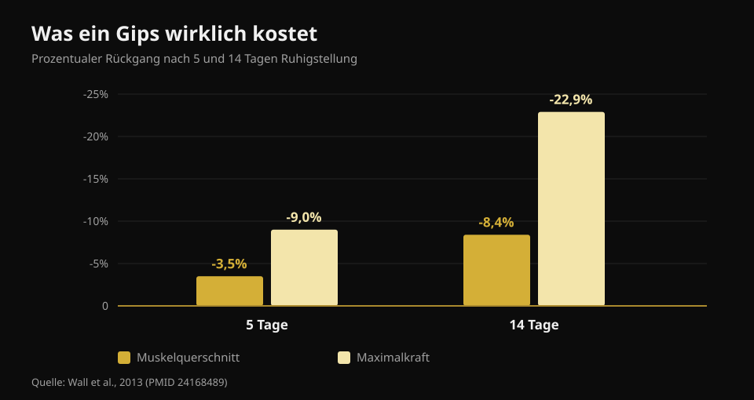
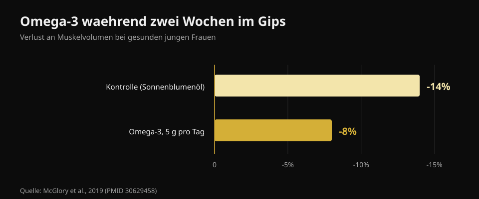

# Ernährung bei Verletzung: was wirklich zählt

Von [Giammaria Loi](/autore/giammaria-loi) · aktualisiert am 21. Oktober 2026

Du verletzt dich, und der erste Gedanke ist fast immer derselbe: „Ich trainiere nicht mehr, also muss ich weniger essen, sonst nehme ich zu." Genau diese Entscheidung bremst die Heilung am stärksten. Ich habe acht Quellen gelesen, um zu klären, was sich im Energiebedarf wirklich ändert, wie viel Protein nötig ist und welche Supplemente echte Daten hinter sich haben.

## Kurz gefasst

- **Kraft verschwindet viel schneller als Muskel.** Fünf Tage im Gips kosten 3,5 % Querschnitt des Quadrizeps, aber 9 % Kraft; nach vierzehn Tagen sind es 8,4 % und 22,9 % (Wall et al., 2013).
- **Zu stark kürzen ist der eigentliche Fehler.** Schon ein moderates Defizit senkt die Proteinsynthese um 20 bis 30 % — also genau den Prozess, der wieder aufbaut (Tipton, 2015).
- **Protein bleibt in absoluten Gramm hoch**, etwa 2 bis 2,5 g pro kg, besonders wenn die Kalorien sinken. Die Empfehlung ist allerdings indirekt.
- **Leucin allein bringt nichts.** 7,5 g pro Tag über eine Woche Ruhigstellung änderten weder Querschnitt noch Kraft (Backx et al., 2018).
- **Kreatin und Omega-3 haben echte Daten**, tun aber Unterschiedliches: Kreatin in der Reha, Omega-3 während der Pause.

## Wie viel Muskel du wirklich verlierst — und wie schnell

Die Zahl, die in fast allen Texten dazu fehlt, ist das Tempo. Eine Gruppe aus Maastricht legte 24 gesunden jungen Männern für fünf oder vierzehn Tage ein Bein in Gips und maß Quadrizeps-Querschnitt per CT und Maximalkraft vorher und nachher.

Nach **fünf Tagen**: Querschnitt -3,5 %, Kraft -9,0 %. Nach **vierzehn Tagen**: Querschnitt -8,4 %, Kraft -22,9 %.

*Werte nach Wall et al., 2013 (PMID 24168489). Quadrizeps-Querschnitt per CT, Kraft als Einwiederholungsmaximum.*

Zwei Punkte. Erstens: Der Muskel schrumpft, aber **die Kraft fällt fast dreimal schneller**. Beim Wiedereinstieg fühlst du dich deutlich schwächer, als du tatsächlich an Muskel verloren hast — das ist normal, weil ein großer Teil der verlorenen Kraft neuronal ist und rasch zurückkommt. Zweitens: Die Uhr läuft sofort. Eine Gnadenwoche gibt es nicht.

Der Grund ist doppelt. Die Ruhe-Proteinsynthese sinkt, und der Muskel wird **resistent gegen anabole Reize**: Dieselbe Proteinmenge, die die Synthese vorher gut anhob, hebt sie jetzt weniger an. Das ist die anabole Resistenz, der Kern des ganzen Themas.

## Kalorien: zu stark kürzen ist der erste Fehler

Hier kursiert eine Zahl, die man in Ruhe auseinandernehmen sollte. Oft liest man, eine Verletzung erhöhe den Energieverbrauch um 10 bis 15 %. Die publizierte Schätzung ist breiter — **von +15 % bis +50 %** — betrifft aber die Kosten der Heilung, nicht den Gesamtbedarf. Und der Gesamtbedarf **sinkt** fast immer, weil das Training wegfällt und du dich weniger bewegst.

Die Frage ist, um wie viel, und die Antwort lautet: weniger als gedacht. Zu den Reparaturkosten kommt: Wer an **Krücken** geht, verbraucht fürs Fortbewegen das **Zwei- bis Dreifache**. Zusammengenommen ist das Loch in der Bilanz viel kleiner, als es sich anfühlt, wenn man die Portionen halbiert.

Und zu stark kürzen kostet messbar. Allein die Proteinsynthese verbraucht bei einem gut bemuskelten Mann rund **500 kcal pro Tag**, noch ohne jede Aktivität. Bei einem auch nur moderaten Defizit sinken Proteinsynthese und anabole Signalwege um **20 bis 30 %**. Du nimmst genau dem Prozess die Energie, der das Gewebe wiederaufbauen soll. Eine negative Bilanz verzögert die Wundheilung und **beschleunigt** den Muskelverlust.

Der umgekehrte Fehler existiert ebenfalls. In einer Bettruhestudie beschleunigte eine **positive** Energiebilanz den Muskelverlust, vermutlich über systemische Entzündung. Also kein „ich bin ohnehin außer Gefecht, dann mache ich Masse". Das Ziel in der Pause ist die Balance.

## Protein: wie viel — und warum es gerade jetzt zählt

Die publizierte Empfehlung lautet **2 bis 2,5 g pro kg Körpergewicht und Tag** während der Ruhigstellung, mindestens aber: die absolute Proteinmenge nicht senken, wenn die Kalorien sinken. Das Karussell, von dem dieser Artikel ausgeht, gibt das fast korrekt wieder (1,8 bis 2,5 g/kg).

Wie es um die Evidenz steht, sagt allerdings niemand. Derselbe Autor schrieb 2011, es gebe „wenig Grund", Protein während der Ruhigstellung zu erhöhen; 2015 hat er seine Position geändert. Und in einer Bettruhestudie reduzierte der Schritt von 1,0 auf 1,6 g/kg den Muskelverlust **nicht**. Also: Protein hochzuhalten ist die vernünftige Wahl und kostet nichts, ist aber keine Versicherung.

Das eigentliche Problem ist Arithmetik. Wer 500 kcal pro Tag weniger isst und Protein „anteilig" hält, kürzt es in Gramm. Es braucht Lebensmittel mit viel Protein pro Energie. Ich habe die offiziellen CREA-Datenblätter einzeln gelesen:

| Lebensmittel (100 g) | Protein | Kalorien | Protein pro 100 kcal |
|---|---|---|---|
| Eiklar | 10,7 g | 43 kcal | **24,9 g** |
| Kabeljau oder Seehecht | 17,0 g | 71 kcal | **23,9 g** |
| Hähnchenbrust | 23,3 g | 100 kcal | **23,3 g** |
| Bresaola (luftgetrocknetes Rind) | 33,1 g | 152 kcal | **21,8 g** |
| Griechischer Joghurt 0 % | 9,0 g | 51 kcal | **17,6 g** |
| Lachs | 18,4 g | 185 kcal | 9,9 g |
| Ganzes Ei | 12,4 g | 128 kcal | 9,7 g |
| Grana Padano | 33,9 g | 392 kcal | 8,6 g |
| Linsen, getrocknet, gekocht | 6,9 g | 109 kcal | 6,3 g |
| Kuhmilch-Ricotta | 8,8 g | 146 kcal | 6,0 g |

*Auswertung von Nurvan auf Basis der CREA-Nährwerttabellen, Stand 2019.*

Hartkäse wirkt mit 33,9 g Protein pro 100 g naheliegend: pro 100 kcal liefert er 8,6 g, weniger als ein Drittel der Hähnchenbrust. Wenn Kalorien der Engpass sind, entscheidet die rechte Spalte. Dieselbe Logik gilt in jedem Defizit, wie ich bei der [Körperrekomposition](/de/blog/koerperrekomposition-fett-verlieren-muskeln-aufbauen) beschrieben habe.

Zum **Timing** ist der Ursprungspost sehr präzise: alle 3 bis 4 Stunden, innerhalb einer Stunde nach dem Aufwachen, 30 bis 40 g Casein vor dem Schlafen. Vernünftige Werte aus der Literatur zu Trainierenden — aber die Wirkung der Mahlzeitenverteilung **während erzwungener Inaktivität wurde nie untersucht**. Gut zu verteilen ist umsichtig, nicht belegt.

## Was die Forschung wirklich sagt

**Bestätigt — die drei Heilungsphasen.** Entzündung, Proliferation, Remodeling: Die Abfolge stimmt und die Phasen überlappen. Zwei Ergänzungen, die der Post auslässt: Die vollständige Erholung kann Jahre dauern, und **die Entzündung niederzudrücken kann die Heilung bremsen**, weil die Entzündungsreaktion die Reparatur überhaupt erst startet.

**Zu präzisieren — „+10-15 % Verbrauch".** Die publizierte Schätzung reicht von +15 % bis +50 % und betrifft die Heilung, nicht den Gesamtbedarf, der in der Regel sinkt.

**Widerlegt — Leucin gegen die anabole Resistenz.** Das ist die einzige Aussage des Posts, die im passenden Kontext direkt getestet wurde — mit negativem Ergebnis. Dreißig junge Männer, sieben Tage Beingips, 2,5 g Leucin zu jeder Hauptmahlzeit (7,5 g pro Tag) gegen kein Supplement. Quadrizeps-Querschnitt: in beiden Gruppen gleich gesunken (p = 0,61). Kraft: gleich gesunken (p = 0,052).

**Nicht überprüfbar — das Timing-Protokoll.** Keine Studie hat Mahlzeitenmuster bei ruhiggestellten Personen verglichen.

**Zu präzisieren — die REDs-Schwelle.** Die Folie nutzt „< 20 kcal/kg fettfreie Masse" als Marker niedriger Energieverfügbarkeit. Der Konsens des Internationalen Olympischen Komitees von 2023 hat die einzelne Schwelle aufgegeben: Das Syndrom wird über **kumulierte Schwere und Risikostratifizierung** mit einem eigenen klinischen Instrument bewertet. Es ist eine ärztliche Diagnose, keine Rechnung für zu Hause.

## Supplemente mit echten Daten

**Kreatin.** Es tut eine bestimmte Sache, und nicht die naheliegende: Während zweier Wochen im Gips reduzierte es weder den Verlust an Querschnitt noch an Leistung — wie Placebo. Aber in den zehn Wochen Reha danach kamen Quadrizeps-Querschnitt und Maximalleistung in der Kreatin-Gruppe **schneller zurück**. Ein Supplement für die Rückkehr, nicht für die Pause.

**Omega-3.** Zwanzig Frauen, 5 g pro Tag, begonnen vier Wochen vorher, dann zwei Wochen Ruhigstellung: Das Muskelvolumen sank um **8 % gegenüber 14 %** in der Kontrollgruppe, und nach zwei Wochen normaler Aktivität war nur die Omega-3-Gruppe wieder auf Ausgangsniveau.

*Werte nach McGlory et al., 2019 (PMID 30629458). Zwanzig gesunde Frauen, 5 g Omega-3 täglich, begonnen vier Wochen vor der Ruhigstellung.*

Die Kehrseite: Zu viel Omega-3 dämpft die Entzündung, und die Entzündung heilt. Die passende Dosis für Verletzte ist nicht etabliert.

**Gelatine und Vitamin C.** Acht Männer, 15 g mit Vitamin C angereicherte Gelatine eine Stunde vor sechs Minuten Seilspringen: Der Blutmarker der Kollagensynthese verdoppelte sich. Vielversprechend, aber acht Personen und ein Marker, keine geheilte Sehne.

**Mikronährstoffe.** Die Regel ist schlicht: Mängel zu vermeiden macht den Unterschied, Extradosen über den Bedarf hinaus nicht. Ausreichend Calcium und Vitamin D zählen bei Frakturen; Megadosen von Antioxidantien zeigten keinen Nutzen.

**Alkohol**, im Post nirgends erwähnt, ist der einzige Punkt mit dokumentiert negativer Wirkung: Er dämpft die Antwort der Proteinsynthese und verzögert die Wundheilung. Ihn wegzulassen kostet nichts und ist besser belegt als die Hälfte der Supplemente.

## So setzt du es um

1. **Kürze nicht blind.** Schätze den realen Aktivitätsrückgang: ohne Training bist du sitzender, aber Heilung kostet und Krücken kosten. Ziel ist Balance, kein Defizit.
2. **Protein in Gramm fixieren, nicht in Prozent.** Ziel in g/kg festlegen und halten, auch wenn die Kalorien sinken — mit proteindichten Lebensmitteln.
3. **Auf 4 bis 5 Mahlzeiten verteilen.** Umsichtig, hier nicht belegt, kostenlos.
4. **Mechanischen Reiz halten, wo es geht.** Was nicht ruhiggestellt ist, wird trainiert: Es braucht erstaunlich wenig, um Bestehendes zu halten, wie in [Kraft, Muskeln und Ausdauer gleichzeitig trainieren](/de/blog/kraft-muskeln-und-ausdauer-gleichzeitig-trainieren) beschrieben.
5. **Kreatin bei der Rückkehr, nicht in der Pause.**
6. **Alkohol raus.**
7. **Lasten, Zeitpläne und Rückkehr entscheidet die Behandlerin oder der Behandler.** Ernährung ist die Beilage, nicht der Behandlungsplan.

> ### Behalte die Zahlen im Griff, während du pausierst
> Nurvan berechnet dein Proteinziel in Gramm und hält es stabil, auch wenn du Kalorien senkst — mit der CREA-Lebensmitteldatenbank siehst du sofort, wie viel Protein du pro Kalorie bekommst. Beim Wiedereinstieg sind die vor der Pause protokollierten Lasten und RIR der Startpunkt, um ohne Übertreibung wieder aufzubauen. [Nurvan testen](https://nurvan.app)

## Häufige Fragen

**Wie viel Protein bei einer Verletzung?**
Die Literatur nennt rund 2 bis 2,5 g pro kg Körpergewicht und Tag während der Ruhigstellung — und in jedem Fall: die absolute Proteinmenge nicht senken, wenn die Kalorien sinken. Es ist eine vorsorgliche Empfehlung: direkte Studien sind wenige und nicht alle positiv.

**Muss ich weniger essen, wenn ich nicht trainiere?**
Etwas weniger ja, viel weniger nein. Der Bedarf sinkt, weil du dich weniger bewegst, aber Heilung verbraucht Energie und Gehen an Krücken kostet zwei- bis dreimal mehr. Ein deutliches Defizit senkt die Proteinsynthese um 20 bis 30 %.

**Verliere ich sofort alle Muskeln?**
Nein, aber schneller als gedacht: etwa 3,5 % Quadrizeps-Querschnitt in fünf Tagen und 8,4 % in zwei Wochen. Die Kraft fällt viel stärker, bis zu 23 % in zwei Wochen, und ist großteils neuronal: Sie kommt schneller zurück als die Masse.

**Bringt Kreatin im Gips etwas?**
Während der Ruhigstellung sagen die Daten nein, in der anschließenden Reha ja: gegenüber Placebo kamen Querschnitt und Leistung in der Kreatin-Gruppe schneller zurück.

## Weiterlesen

- [Körperrekomposition: Fett verlieren, Muskeln aufbauen](/de/blog/koerperrekomposition-fett-verlieren-muskeln-aufbauen) — was ein proteinreiches Defizit tatsächlich bewirkt.
- [Kraft, Muskeln und Ausdauer gleichzeitig trainieren](/de/blog/kraft-muskeln-und-ausdauer-gleichzeitig-trainieren) — mit der Mindestdosis, die Kraft und Masse hält.
- [Wann Nahrungsergänzungsmittel einnehmen](/de/blog/wann-nahrungsergaenzungsmittel-einnehmen) — was der Zeitpunkt wirklich ändert.

## Quellen

1. Tipton KD, 2015. *Nutritional Support for Exercise-Induced Injuries.* Sports Medicine 45(Suppl 1):S93-104. [PMID 26553492](https://pubmed.ncbi.nlm.nih.gov/26553492/) · [DOI 10.1007/s40279-015-0398-4](https://doi.org/10.1007/s40279-015-0398-4)
2. Tipton KD, 2011. *Nutrition for acute exercise-induced injuries.* Annals of Nutrition and Metabolism 57(Suppl 2):43-53. [PMID 21346336](https://pubmed.ncbi.nlm.nih.gov/21346336/) · [DOI 10.1159/000322703](https://doi.org/10.1159/000322703)
3. Wall BT, Dirks ML, Snijders T, Senden JMG, Dolmans J, van Loon LJC, 2013. *Substantial skeletal muscle loss occurs during only 5 days of disuse.* Acta Physiologica 210(3):600-11. [PMID 24168489](https://pubmed.ncbi.nlm.nih.gov/24168489/) · [DOI 10.1111/apha.12190](https://doi.org/10.1111/apha.12190)
4. Backx EMP, Horstman AMH, Marzuca-Nassr GN, van Kranenburg J, Smeets JS, Fuchs CJ, Janssen AAW, de Groot LCPGM, Snijders T, Verdijk LB, van Loon LJC, 2018. *Leucine Supplementation Does Not Attenuate Skeletal Muscle Loss during Leg Immobilization in Healthy, Young Men.* Nutrients 10(5):635. [PMID 29772844](https://pubmed.ncbi.nlm.nih.gov/29772844/) · [DOI 10.3390/nu10050635](https://doi.org/10.3390/nu10050635)
5. McGlory C, Gorissen SHM, Kamal M, Bahniwal R, Hector AJ, Baker SK, Chabowski A, Phillips SM, 2019. *Omega-3 fatty acid supplementation attenuates skeletal muscle disuse atrophy during two weeks of unilateral leg immobilization in healthy young women.* The FASEB Journal 33(3):4586-4597. [PMID 30629458](https://pubmed.ncbi.nlm.nih.gov/30629458/) · [DOI 10.1096/fj.201801857RRR](https://doi.org/10.1096/fj.201801857RRR)
6. Hespel P, Op't Eijnde B, Van Leemputte M, Ursø B, Greenhaff PL, Labarque V, Dymarkowski S, Van Hecke P, Richter EA, 2001. *Oral creatine supplementation facilitates the rehabilitation of disuse atrophy and alters the expression of muscle myogenic factors in humans.* The Journal of Physiology 536(Pt 2):625-33. [PMID 11600695](https://pubmed.ncbi.nlm.nih.gov/11600695/) · [DOI 10.1111/j.1469-7793.2001.0625c.xd](https://doi.org/10.1111/j.1469-7793.2001.0625c.xd)
7. Shaw G, Lee-Barthel A, Ross MLR, Wang B, Baar K, 2017. *Vitamin C-enriched gelatin supplementation before intermittent activity augments collagen synthesis.* The American Journal of Clinical Nutrition 105(1):136-143. [PMID 27852613](https://pubmed.ncbi.nlm.nih.gov/27852613/) · [DOI 10.3945/ajcn.116.138594](https://doi.org/10.3945/ajcn.116.138594)
8. Mountjoy M, Ackerman KE, Bailey DM, et al., 2023. *2023 International Olympic Committee's (IOC) consensus statement on Relative Energy Deficiency in Sport (REDs).* British Journal of Sports Medicine 57(17):1073-1097. [PMID 37752011](https://pubmed.ncbi.nlm.nih.gov/37752011/) · [DOI 10.1136/bjsports-2023-106994](https://doi.org/10.1136/bjsports-2023-106994)

Nährwerte: CREA — Forschungszentrum für Lebensmittel und Ernährung (Italien), Nährwerttabellen, Stand 2019.

Referenzen über PubMed recherchiert. Ausgangspunkt: ein Karussell von **Science for Sport** ([@scienceforsport](https://www.instagram.com/scienceforsport/)) mit James Morehen, [Originalbeitrag](https://www.instagram.com/p/Dd3SC-iF3d7/). Weder Text noch Bild des Beitrags wurden reproduziert.

---

**Giammaria Loi** ist der Gründer von Nurvan. Er trainiert seit 2012 mit Gewichten, arbeitet seit 2013 als FIPE-zertifizierter Personal Trainer und Coach und startet seit 2018 national im Powerlifting. Jeder Artikel von ihm beginnt bei der Studienlage und endet bei dem, was im Gym wirklich funktioniert.

> Hinweis: informativer Inhalt, kein Ersatz für die Einschätzung von Ärztin, Arzt oder Physiotherapie. Diagnose, Lasten und Rückkehrzeitpunkte nach einer Verletzung entscheiden die Behandelnden.
