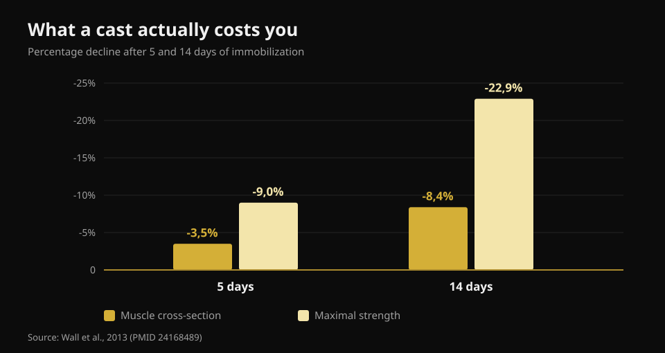
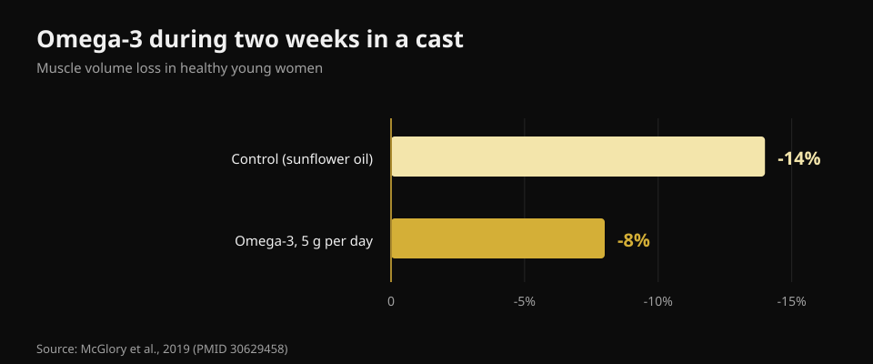

# What to Eat When You're Injured

By [Giammaria Loi](/autore/giammaria-loi) · updated 21 October 2026

You get hurt, and the first thought is almost always the same: "I can't train, so I should eat less or I'll get fat." That single decision slows healing more than anything else on the list. I read eight sources to work out what really changes in your energy needs when you stop, how much protein you need, and which supplements have real data behind them.

## The short version

- **Strength disappears much faster than muscle.** Five days in a cast costs 3.5% of quadriceps cross-section but 9% of strength; at fourteen days it is 8.4% and 22.9% (Wall et al., 2013).
- **Cutting calories hard is the real mistake.** Even a moderate deficit lowers muscle protein synthesis by 20-30% — the exact process rebuilding your tissue (Tipton, 2015).
- **Keep protein high in absolute grams**, around 2-2.5 g per kg, especially if calories drop. But the recommendation is indirect: very few studies tested it head-on.
- **Leucine on its own does nothing.** 7.5 g a day through a week of immobilization changed neither size nor strength (Backx et al., 2018).
- **Creatine and omega-3 both have real data**, but they do different jobs: creatine during rehab, omega-3 during the layoff.

## How much muscle you actually lose, and how fast

The number missing from almost everything written on this topic is speed. A group in Maastricht casted one leg of 24 healthy young men for either five or fourteen days, measuring quadriceps cross-section by CT and maximal strength before and after.

After **five days**: cross-section -3.5%, strength -9.0%. After **fourteen days**: cross-section -8.4%, strength -22.9%.

*Values from Wall et al., 2013 (PMID 24168489). Quadriceps cross-section by CT scan, strength as one-repetition maximum.*

Two things to take away. First: muscle shrinks, but **strength falls nearly three times faster**. You will feel far weaker on your return than the amount of muscle you actually lost — and that is normal, because much of the lost strength is neural and comes back quickly. Second: the clock starts immediately. There is no grace week.

The metabolic reason is twofold. Resting protein synthesis drops, and the muscle becomes **resistant to anabolic stimulation**: the same dose of protein that used to raise synthesis now raises it less. This is anabolic resistance, and it sits at the centre of everything else here.

## Calories: cutting too hard is the first error

There is a figure worth unpacking here. You often read that an injury raises energy expenditure by 10-15%. The published estimate is actually wider — **+15% up to +50%** — but it describes the cost of healing, not your total requirement. And your total requirement almost always **falls**, because training disappears and you move less.

The question is by how much, and the answer is: less than you think. On top of the repair cost, if you walk on **crutches** the energy cost of getting around goes up **two- to threefold**. Put the two together and the hole in your budget is far smaller than it feels when you decide to halve your meals.

Cutting too hard has a measurable price. Protein synthesis alone burns around **500 kcal a day** in a well-muscled man, before any activity at all. During even a moderate deficit, protein synthesis and the anabolic signalling behind it fall by **20-30%**. You are starving the exact process that has to rebuild the tissue. A negative balance slows wound healing and **accelerates** muscle loss.

The opposite error is real too. In a bed-rest study, a **positive** energy balance accelerated muscle loss, most likely by driving systemic inflammation. So no "I'm stuck at home anyway, might as well bulk". The target during the layoff is balance, not either extreme.

## Protein: how much, and why it matters more right now

The published recommendation is **2-2.5 g per kg of body weight per day** during immobilization, or at the very least not to reduce the absolute amount of protein when you reduce calories. The carousel that prompted this article gets it roughly right (1.8-2.5 g/kg).

But the state of the evidence deserves saying out loud, because nobody does. The same author behind that recommendation wrote in 2011 that there was "little rationale" for raising protein during immobilization; by 2015 he had changed his mind. And in a bed-rest study, going from 1.0 to 1.6 g/kg did **not** reduce muscle loss. So: keeping protein high is the sensible call and costs you nothing, but it is not insurance.

The real problem is arithmetic. If you eat 500 kcal less a day and keep protein "proportional", you have in fact cut it in grams. You need foods that give a lot of protein for very little energy. Here is the data from Italy's CREA food composition tables, read one card at a time:

| Food (100 g) | Protein | Calories | Protein per 100 kcal |
|---|---|---|---|
| Egg white | 10.7 g | 43 kcal | **24.9 g** |
| Cod / hake | 17.0 g | 71 kcal | **23.9 g** |
| Chicken breast | 23.3 g | 100 kcal | **23.3 g** |
| Bresaola (air-dried beef) | 33.1 g | 152 kcal | **21.8 g** |
| Greek yoghurt, 0% fat | 9.0 g | 51 kcal | **17.6 g** |
| Salmon | 18.4 g | 185 kcal | 9.9 g |
| Whole egg | 12.4 g | 128 kcal | 9.7 g |
| Grana Padano cheese | 33.9 g | 392 kcal | 8.6 g |
| Lentils, dried, boiled | 6.9 g | 109 kcal | 6.3 g |
| Cow's milk ricotta | 8.8 g | 146 kcal | 6.0 g |

*Nurvan analysis of the CREA food composition tables, 2019 update.*

Hard cheese looks like the obvious pick at 33.9 g of protein per 100 g: per 100 kcal it delivers 8.6 g, less than a third of chicken breast. When calories are the constraint, the right-hand column is the one that decides. The same logic applies in any deficit, as I covered in [how much protein you need when cutting](/en/blog/protein-intake-cutting).

On **timing**, the original post is very specific: every 3-4 hours, within an hour of waking, 30-40 g of casein before bed. These are reasonable numbers borrowed from research on people who train, but the effect of meal distribution **during enforced inactivity has never been studied**. Spreading protein out is prudent, not proven.

## What the research actually says

**Confirmed — the three phases of healing.** Inflammation, proliferation, remodelling: the sequence is right and the phases overlap. Two things worth adding that the post leaves out: full recovery can take years, and **crushing inflammation can slow healing**, because the inflammatory response is what starts repair.

**Needs qualifying — "+10-15% expenditure".** The published estimate is +15% up to +50%, and it describes healing, not total needs, which usually fall. The risk is reading it as "I should eat more".

**Debunked — leucine "overcoming anabolic resistance".** This is the one claim in the post that has been tested directly in the right context, and the test is negative. Thirty young men, seven days of leg casting, 2.5 g of leucine with each main meal (7.5 g a day) against no supplement. Quadriceps cross-section: fell the same in both groups (p = 0.61). Strength: fell the same (p = 0.052). Anabolic resistance is real; leucine alone does not fix it.

**Unverifiable — the timing protocol.** No study has compared meal patterns in immobilized people.

**Needs qualifying — the REDs threshold.** The slide uses "<20 kcal/kg lean body mass" as a marker of low energy availability. The 2023 International Olympic Committee consensus moved away from a single cut-off: the syndrome is now assessed by **accumulated severity and risk stratification** with a dedicated clinical tool. It is a medical diagnosis, not a number you compute at home.

## Supplements with real data

**Creatine.** It does one specific thing, and it is not the obvious one: through two weeks of casting it did not reduce the loss of cross-section or power, no better than placebo. But across the ten weeks of rehab that followed, quadriceps cross-section and peak power **came back faster** in the creatine group. It is a supplement for the comeback, not the layoff.

**Omega-3.** Twenty women, 5 g a day started four weeks ahead, then two weeks of immobilization: muscle volume fell **8% against 14%** in the control group, and after two weeks back to normal activity only the omega-3 group had returned to baseline. It is the most encouraging result in this field.

*Values from McGlory et al., 2019 (PMID 30629458). Twenty healthy women, 5 g a day of omega-3 started four weeks before immobilization.*

Watch the flip side, though: too much omega-3 suppresses inflammation, and inflammation is what heals you. The right dose for an injured person has not been established.

**Gelatin and vitamin C.** Eight men, 15 g of vitamin C-enriched gelatin an hour before six minutes of rope skipping: the blood marker of collagen synthesis doubled. Promising, but that is eight people and a marker, not a healed tendon. Treat it as a hypothesis, not a protocol.

**Micronutrients.** The rule is simple and universal: avoiding deficiency matters, adding extra on top of sufficiency does not. Adequate calcium and vitamin D matter for fractures; megadoses of antioxidants have shown no benefit and in some models interfere.

**Alcohol**, which the post never mentions, is the one item with a documented negative effect: it blunts the protein synthesis response and slows wound healing. Cutting it is free and better evidenced than half the supplements here.

## How to apply it

1. **Don't cut blind.** Estimate the real drop in activity, not the imagined one: no training makes you more sedentary, but healing costs energy and crutches cost more. Aim for balance, not a deficit.
2. **Lock protein in grams, not percentages.** Set the target in g/kg and hold it even as calories fall, using high protein-density foods.
3. **Spread it over 4-5 feedings.** Prudent, unproven in this context, and free.
4. **Keep a mechanical stimulus where you can.** Whatever is not immobilized should still be trained: it takes remarkably little to keep what you have, as I covered in [how little it takes to maintain strength and muscle](/en/blog/training-strength-muscle-and-cardio-together).
5. **Creatine on the way back, not during the layoff.** That is where the data favour it.
6. **Alcohol out.** The best evidence-to-effort ratio available to you.
7. **Loads, timelines and return-to-play belong to your clinician.** Nutrition is the side dish, not the treatment plan.

> ### Keep the numbers steady while you're on the sidelines
> Nurvan sets your protein target in grams and holds it even when you drop calories, with the CREA food database so you can see how much protein you are getting per calorie. When you come back, the loads and RIR you logged before the layoff are the starting point for rebuilding without overshooting. [Try Nurvan](https://nurvan.app)

## FAQ

**How much protein should I eat while injured?**
The literature points to roughly 2-2.5 g per kg of body weight per day during immobilization, and in any case to not reduce the absolute amount of protein when you cut calories. It is a precautionary recommendation: direct studies are few and not all positive.

**Should I eat less now that I'm not training?**
A bit less, yes; a lot less, no. Needs fall because you move less, but healing burns energy and walking on crutches costs two to three times more. A sharp deficit lowers protein synthesis by 20-30% and slows repair.

**Do I lose all my muscle straight away?**
No, but faster than most people assume: about 3.5% of quadriceps cross-section in five days and 8.4% in two weeks. Strength falls much further, up to 23% in two weeks, and much of that is neural — it returns faster than the mass does.

**Is creatine worth taking while I'm in a cast?**
The data say no during immobilization, but yes during the rehab that follows: compared with placebo, cross-section and power returned faster in the group taking it.

## Read next

- [How much protein you need when cutting](/en/blog/protein-intake-cutting) — the same arithmetic, applied to a deliberate deficit.
- [Body recomposition: lose fat and gain muscle at once](/en/blog/body-recomposition-lose-fat-gain-muscle) — what a protein-sparing deficit actually does.
- [Lifting and cardio together: does it cost you?](/en/blog/training-strength-muscle-and-cardio-together) — includes the minimum dose that maintains strength and size.

## Sources

1. Tipton KD, 2015. *Nutritional Support for Exercise-Induced Injuries.* Sports Medicine 45(Suppl 1):S93-104. [PMID 26553492](https://pubmed.ncbi.nlm.nih.gov/26553492/) · [DOI 10.1007/s40279-015-0398-4](https://doi.org/10.1007/s40279-015-0398-4)
2. Tipton KD, 2011. *Nutrition for acute exercise-induced injuries.* Annals of Nutrition and Metabolism 57(Suppl 2):43-53. [PMID 21346336](https://pubmed.ncbi.nlm.nih.gov/21346336/) · [DOI 10.1159/000322703](https://doi.org/10.1159/000322703)
3. Wall BT, Dirks ML, Snijders T, Senden JMG, Dolmans J, van Loon LJC, 2013. *Substantial skeletal muscle loss occurs during only 5 days of disuse.* Acta Physiologica 210(3):600-11. [PMID 24168489](https://pubmed.ncbi.nlm.nih.gov/24168489/) · [DOI 10.1111/apha.12190](https://doi.org/10.1111/apha.12190)
4. Backx EMP, Horstman AMH, Marzuca-Nassr GN, van Kranenburg J, Smeets JS, Fuchs CJ, Janssen AAW, de Groot LCPGM, Snijders T, Verdijk LB, van Loon LJC, 2018. *Leucine Supplementation Does Not Attenuate Skeletal Muscle Loss during Leg Immobilization in Healthy, Young Men.* Nutrients 10(5):635. [PMID 29772844](https://pubmed.ncbi.nlm.nih.gov/29772844/) · [DOI 10.3390/nu10050635](https://doi.org/10.3390/nu10050635)
5. McGlory C, Gorissen SHM, Kamal M, Bahniwal R, Hector AJ, Baker SK, Chabowski A, Phillips SM, 2019. *Omega-3 fatty acid supplementation attenuates skeletal muscle disuse atrophy during two weeks of unilateral leg immobilization in healthy young women.* The FASEB Journal 33(3):4586-4597. [PMID 30629458](https://pubmed.ncbi.nlm.nih.gov/30629458/) · [DOI 10.1096/fj.201801857RRR](https://doi.org/10.1096/fj.201801857RRR)
6. Hespel P, Op't Eijnde B, Van Leemputte M, Ursø B, Greenhaff PL, Labarque V, Dymarkowski S, Van Hecke P, Richter EA, 2001. *Oral creatine supplementation facilitates the rehabilitation of disuse atrophy and alters the expression of muscle myogenic factors in humans.* The Journal of Physiology 536(Pt 2):625-33. [PMID 11600695](https://pubmed.ncbi.nlm.nih.gov/11600695/) · [DOI 10.1111/j.1469-7793.2001.0625c.xd](https://doi.org/10.1111/j.1469-7793.2001.0625c.xd)
7. Shaw G, Lee-Barthel A, Ross MLR, Wang B, Baar K, 2017. *Vitamin C-enriched gelatin supplementation before intermittent activity augments collagen synthesis.* The American Journal of Clinical Nutrition 105(1):136-143. [PMID 27852613](https://pubmed.ncbi.nlm.nih.gov/27852613/) · [DOI 10.3945/ajcn.116.138594](https://doi.org/10.3945/ajcn.116.138594)
8. Mountjoy M, Ackerman KE, Bailey DM, et al., 2023. *2023 International Olympic Committee's (IOC) consensus statement on Relative Energy Deficiency in Sport (REDs).* British Journal of Sports Medicine 57(17):1073-1097. [PMID 37752011](https://pubmed.ncbi.nlm.nih.gov/37752011/) · [DOI 10.1136/bjsports-2023-106994](https://doi.org/10.1136/bjsports-2023-106994)

Food values: CREA — Research Centre for Food and Nutrition, Italian food composition tables, 2019 update.

References retrieved through PubMed. Starting point: a carousel by **Science for Sport** ([@scienceforsport](https://www.instagram.com/scienceforsport/)) with James Morehen, [original post](https://www.instagram.com/p/Dd3SC-iF3d7/). No text and no image from the post was reproduced.

---

**Giammaria Loi** is the founder of Nurvan. He has been lifting since 2012, has worked as a FIPE-certified personal trainer and coach since 2013, and has competed in powerlifting at national level since 2018. Every article he writes starts from the research and ends with what actually works in the gym.

> Note: educational content, not a substitute for advice from a doctor or physiotherapist. Diagnosis, loads and return-to-play timelines after an injury are decisions for the people treating you.
