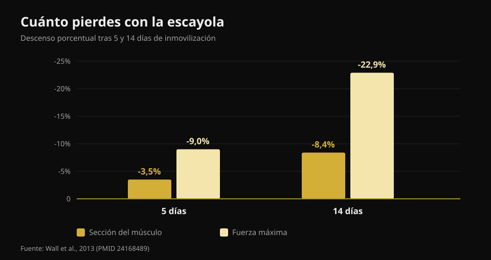
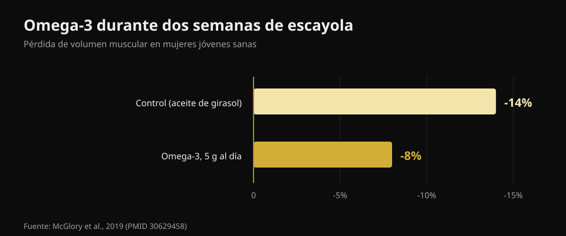

# Qué comer cuando estás lesionado

Por [Giammaria Loi](/autore/giammaria-loi) · actualizado el 21 de octubre de 2026

Te lesionas y la primera reacción casi siempre es la misma: "ya no entreno, así que tengo que comer menos o engordaré". Es la decisión que más retrasa la curación. He leído ocho fuentes para entender qué cambia de verdad en tus necesidades cuando te paras, cuánta proteína hace falta y qué suplementos tienen datos reales detrás.

## En resumen

- **La fuerza se va mucho más rápido que el músculo.** Cinco días de escayola cuestan un 3,5% de sección del cuádriceps pero un 9% de fuerza; a los catorce días son el 8,4% y el 22,9% (Wall et al., 2013).
- **Recortar demasiado las calorías es el error real.** Un déficit incluso moderado baja un 20-30% la síntesis proteica, justo el proceso con el que reconstruyes (Tipton, 2015).
- **La proteína se mantiene alta en gramos absolutos**, en torno a 2-2,5 g por kg, sobre todo si bajan las calorías. Pero la recomendación es indirecta: pocos estudios la han probado de frente.
- **La leucina sola no funciona.** 7,5 g al día durante una semana de inmovilización no cambiaron ni la sección ni la fuerza (Backx et al., 2018).
- **Creatina y omega-3 sí tienen datos**, pero no hacen lo mismo: la creatina en la rehabilitación, los omega-3 durante el parón.

## Cuánto músculo pierdes de verdad, y a qué velocidad

El dato que falta en casi todo lo que se escribe sobre esto es la velocidad. Un grupo de Maastricht escayoló una pierna a 24 chicos sanos, durante cinco o catorce días, midiendo la sección del cuádriceps con TAC y la fuerza máxima antes y después.

A los **cinco días**: sección -3,5%, fuerza -9,0%. A los **catorce días**: sección -8,4%, fuerza -22,9%.

*Valores de Wall et al., 2013 (PMID 24168489). Sección del cuádriceps por TAC, fuerza como máximo de una repetición.*

Dos cosas. La primera: el músculo baja, pero **la fuerza cae casi tres veces más rápido**. Al volver te sentirás mucho más débil de lo que realmente has perdido en músculo, y es normal: buena parte de esa fuerza es nerviosa y vuelve deprisa. La segunda: el reloj empieza ya. No hay una semana de cortesía.

El motivo metabólico es doble. La síntesis proteica en reposo baja, y el músculo se vuelve **resistente al estímulo anabólico**: la misma dosis de proteína que antes la elevaba bien, ahora la eleva menos. Eso es la resistencia anabólica, y es el nudo de todo lo demás.

## Las calorías: el primer error es recortar demasiado

Aquí circula una cifra que conviene desmontar con calma. Se lee a menudo que una lesión aumenta el gasto energético un 10-15%. La estimación publicada es más amplia — **de +15% hasta +50%** — pero se refiere al coste de la curación, no a la necesidad total. Y la necesidad total casi siempre **baja**, porque desaparece el entrenamiento y te mueves menos.

La pregunta es cuánto baja, y la respuesta es: menos de lo que crees. Además del coste de la reparación, si andas con **muletas** el coste energético de desplazarte aumenta **dos o tres veces**. Sumando las dos cosas, el agujero en el balance es mucho más pequeño de lo que parece cuando decides partir los platos por la mitad.

Y recortar demasiado se paga. Solo la síntesis proteica consume unas **500 kcal al día** en un hombre bien musculado, antes de contar la actividad. Con un déficit incluso moderado, síntesis proteica y señalización anabólica bajan un **20-30%**. Estás quitándole energía justo al proceso que debe reconstruir el tejido. Un balance negativo retrasa la cicatrización y **acelera** la pérdida de músculo.

El error contrario también existe. En un estudio de reposo en cama, el balance energético **positivo** aceleró la pérdida de músculo, probablemente por inflamación sistémica. Nada de "ya que estoy parado, hago volumen". El objetivo durante el parón es el equilibrio.

## La proteína: cuánta, y por qué importa ahora más

La recomendación publicada es de **2-2,5 g por kg de peso al día** durante la inmovilización, o como mínimo no reducir la cantidad absoluta de proteína cuando reduces calorías. El carrusel del que parte este artículo lo cuenta casi bien (1,8-2,5 g/kg).

Pero hay que decir cómo está la evidencia, porque nadie lo hace. El mismo autor de esa recomendación escribía en 2011 que había "poco fundamento" para subir la proteína durante la inmovilización; en 2015 cambió de posición. Y en un estudio de reposo en cama, pasar de 1,0 a 1,6 g/kg **no** redujo la pérdida de músculo. Es decir: mantener la proteína alta es lo más sensato y no cuesta nada, pero no es un seguro.

El problema práctico es aritmético. Si comes 500 kcal menos al día y mantienes la proteína "en proporción", en realidad la estás recortando en gramos. Hacen falta alimentos que den mucha proteína por poca energía. He leído las fichas oficiales del CREA una a una:

| Alimento (100 g) | Proteína | Calorías | Proteína por 100 kcal |
|---|---|---|---|
| Clara de huevo | 10,7 g | 43 kcal | **24,9 g** |
| Merluza o bacalao fresco | 17,0 g | 71 kcal | **23,9 g** |
| Pechuga de pollo | 23,3 g | 100 kcal | **23,3 g** |
| Bresaola (cecina de vacuno) | 33,1 g | 152 kcal | **21,8 g** |
| Yogur griego 0% | 9,0 g | 51 kcal | **17,6 g** |
| Salmón | 18,4 g | 185 kcal | 9,9 g |
| Huevo entero | 12,4 g | 128 kcal | 9,7 g |
| Queso Grana Padano | 33,9 g | 392 kcal | 8,6 g |
| Lentejas secas, cocidas | 6,9 g | 109 kcal | 6,3 g |
| Requesón de vaca | 8,8 g | 146 kcal | 6,0 g |

*Elaboración de Nurvan sobre las tablas de composición de alimentos del CREA, actualización de 2019.*

El queso curado parece la opción obvia con 33,9 g de proteína por 100 g: por 100 kcal da 8,6 g, menos de un tercio que la pechuga de pollo. Cuando las calorías son el límite, decide la columna de la derecha. El mismo razonamiento vale en cualquier déficit, como expliqué al hablar de [recomposición corporal](/es/blog/recomposicion-corporal-perder-grasa-ganar-musculo).

Sobre el **timing**, el post original es muy concreto: cada 3-4 horas, en la primera hora tras despertar, 30-40 g de caseína antes de dormir. Son cifras razonables tomadas de la literatura en personas que entrenan, pero el efecto de la distribución de las comidas **durante la inactividad forzada nunca se ha estudiado**. Repartir bien la proteína es prudente, no demostrado.

## Qué dice realmente la investigación

**Confirmado — las tres fases de la curación.** Inflamación, proliferación, remodelación: la secuencia es correcta y las fases se solapan. Vale la pena añadir dos cosas que el post no dice: la recuperación completa puede llevar años, y **aplastar la inflamación puede retrasar la curación**, porque la respuesta inflamatoria es la que pone en marcha la reparación.

**Matizado — "+10-15% de gasto".** La estimación publicada es de +15% hasta +50% y se refiere a la curación, no a la necesidad total, que suele bajar.

**Desmentido — la leucina que "supera la resistencia anabólica".** Es la única afirmación del post probada directamente en el contexto adecuado, y la prueba es negativa. Treinta chicos, siete días de escayola en la pierna, 2,5 g de leucina en cada comida principal (7,5 g al día) frente a ningún suplemento. Sección del cuádriceps: bajó igual en los dos grupos (p = 0,61). Fuerza: bajó igual (p = 0,052).

**No verificable — el protocolo de timing.** Ningún estudio ha comparado patrones de comidas en personas inmovilizadas.

**Matizado — el umbral de RED-S.** La diapositiva usa "<20 kcal/kg de masa magra" como marcador de baja disponibilidad energética. El consenso del Comité Olímpico Internacional de 2023 abandonó el umbral único: el síndrome se valora por **gravedad acumulada y estratificación del riesgo**, con una herramienta clínica propia. Es un diagnóstico médico, no un número que se calcula en casa.

## Suplementos con datos reales

**Creatina.** Hace una cosa concreta, y no es la obvia: durante dos semanas de escayola no redujo la pérdida de sección ni de potencia, igual que el placebo. Pero en las diez semanas de rehabilitación posteriores, sección del cuádriceps y potencia máxima **volvieron más rápido** en el grupo de creatina. Es un suplemento para la vuelta, no para el parón.

**Omega-3.** Veinte mujeres, 5 g al día empezados cuatro semanas antes, luego dos semanas de inmovilización: el volumen muscular bajó un **8% frente al 14%** del grupo control, y tras dos semanas de vuelta a la normalidad solo el grupo omega-3 había recuperado los valores de partida.

*Valores de McGlory et al., 2019 (PMID 30629458). Veinte mujeres sanas, 5 g al día de omega-3 empezados cuatro semanas antes de la inmovilización.*

Ojo al reverso: el exceso de omega-3 deprime la inflamación, y la inflamación sirve para curar. La dosis adecuada en una persona lesionada no está establecida.

**Gelatina y vitamina C.** Ocho hombres, 15 g de gelatina enriquecida con vitamina C una hora antes de seis minutos de comba: el marcador de síntesis de colágeno en sangre se duplicó. Prometedor, pero son ocho personas y un marcador, no un tendón curado.

**Micronutrientes.** La regla es simple: evitar las carencias marca la diferencia, añadir dosis extra por encima de la suficiencia no. Calcio y vitamina D adecuados cuentan en las fracturas; las megadosis de antioxidantes no han mostrado beneficio.

**El alcohol**, que en el post no aparece nunca, es la única entrada con un efecto negativo documentado: empeora la respuesta de la síntesis proteica y retrasa la cicatrización. Quitarlo es gratis y tiene más pruebas detrás que la mitad de los suplementos.

## Cómo aplicarlo

1. **No recortes a ciegas.** Estima la caída real de actividad: sin entrenamientos eres más sedentario, pero la curación cuesta y las muletas cuestan. Apunta al equilibrio.
2. **Fija la proteína en gramos, no en porcentaje.** Mantén el objetivo en g/kg aunque bajen las calorías, eligiendo alimentos de alta densidad proteica.
3. **Repártela en 4-5 tomas.** Prudente, no demostrado en este contexto, y gratis.
4. **Mantén estímulo mecánico donde puedas.** Lo que no está inmovilizado se entrena: hace falta muy poco para conservar lo que tienes, como conté en [entrenar fuerza, músculo y cardio a la vez](/es/blog/entrenar-fuerza-musculo-y-cardio-a-la-vez).
5. **Creatina a la vuelta, no durante el parón.**
6. **Alcohol fuera.**
7. **Cargas, plazos y vuelta a la actividad los decide quien te trata.** La nutrición es el acompañamiento, no el plan de tratamiento.

> ### Mantén los números bajo control mientras estás parado
> Nurvan calcula tu objetivo de proteína en gramos y lo mantiene fijo aunque bajes las calorías, con la base de alimentos CREA para ver al momento cuánta proteína tomas por caloría. A la vuelta, las cargas y el RIR registrados antes del parón son el punto de partida para reconstruir sin pasarte. [Prueba Nurvan](https://nurvan.app)

## Preguntas frecuentes

**¿Cuánta proteína debo tomar si estoy lesionado?**
La literatura indica unos 2-2,5 g por kg de peso al día durante la inmovilización, y en todo caso no reducir la cantidad absoluta de proteína al bajar calorías. Es una recomendación prudencial: los estudios directos son pocos y no todos positivos.

**¿Tengo que comer menos ahora que no entreno?**
Un poco menos sí, mucho menos no. La necesidad baja porque te mueves menos, pero la curación consume energía y andar con muletas cuesta dos o tres veces más. Un déficit marcado baja la síntesis proteica un 20-30%.

**¿Pierdo toda la masa muscular enseguida?**
No, pero más rápido de lo que se cree: en torno al 3,5% de sección del cuádriceps en cinco días y el 8,4% en dos semanas. La fuerza cae mucho más, hasta el 23% en dos semanas, y en gran parte es nerviosa: vuelve antes que la masa.

**¿Sirve la creatina mientras llevo escayola?**
Los datos dicen que no durante la inmovilización, pero sí en la rehabilitación posterior: frente a placebo, sección y potencia volvieron más rápido en el grupo que la tomaba.

## Lee también

- [Recomposición corporal: perder grasa y ganar músculo](/es/blog/recomposicion-corporal-perder-grasa-ganar-musculo) — qué hace de verdad un déficit con proteína alta.
- [Entrenar fuerza, músculo y cardio a la vez](/es/blog/entrenar-fuerza-musculo-y-cardio-a-la-vez) — incluye la dosis mínima que mantiene fuerza y masa.
- [Cuándo tomar los suplementos](/es/blog/cuando-tomar-los-suplementos-horario) — qué cambia de verdad el horario.

## Fuentes

1. Tipton KD, 2015. *Nutritional Support for Exercise-Induced Injuries.* Sports Medicine 45(Suppl 1):S93-104. [PMID 26553492](https://pubmed.ncbi.nlm.nih.gov/26553492/) · [DOI 10.1007/s40279-015-0398-4](https://doi.org/10.1007/s40279-015-0398-4)
2. Tipton KD, 2011. *Nutrition for acute exercise-induced injuries.* Annals of Nutrition and Metabolism 57(Suppl 2):43-53. [PMID 21346336](https://pubmed.ncbi.nlm.nih.gov/21346336/) · [DOI 10.1159/000322703](https://doi.org/10.1159/000322703)
3. Wall BT, Dirks ML, Snijders T, Senden JMG, Dolmans J, van Loon LJC, 2013. *Substantial skeletal muscle loss occurs during only 5 days of disuse.* Acta Physiologica 210(3):600-11. [PMID 24168489](https://pubmed.ncbi.nlm.nih.gov/24168489/) · [DOI 10.1111/apha.12190](https://doi.org/10.1111/apha.12190)
4. Backx EMP, Horstman AMH, Marzuca-Nassr GN, van Kranenburg J, Smeets JS, Fuchs CJ, Janssen AAW, de Groot LCPGM, Snijders T, Verdijk LB, van Loon LJC, 2018. *Leucine Supplementation Does Not Attenuate Skeletal Muscle Loss during Leg Immobilization in Healthy, Young Men.* Nutrients 10(5):635. [PMID 29772844](https://pubmed.ncbi.nlm.nih.gov/29772844/) · [DOI 10.3390/nu10050635](https://doi.org/10.3390/nu10050635)
5. McGlory C, Gorissen SHM, Kamal M, Bahniwal R, Hector AJ, Baker SK, Chabowski A, Phillips SM, 2019. *Omega-3 fatty acid supplementation attenuates skeletal muscle disuse atrophy during two weeks of unilateral leg immobilization in healthy young women.* The FASEB Journal 33(3):4586-4597. [PMID 30629458](https://pubmed.ncbi.nlm.nih.gov/30629458/) · [DOI 10.1096/fj.201801857RRR](https://doi.org/10.1096/fj.201801857RRR)
6. Hespel P, Op't Eijnde B, Van Leemputte M, Ursø B, Greenhaff PL, Labarque V, Dymarkowski S, Van Hecke P, Richter EA, 2001. *Oral creatine supplementation facilitates the rehabilitation of disuse atrophy and alters the expression of muscle myogenic factors in humans.* The Journal of Physiology 536(Pt 2):625-33. [PMID 11600695](https://pubmed.ncbi.nlm.nih.gov/11600695/) · [DOI 10.1111/j.1469-7793.2001.0625c.xd](https://doi.org/10.1111/j.1469-7793.2001.0625c.xd)
7. Shaw G, Lee-Barthel A, Ross MLR, Wang B, Baar K, 2017. *Vitamin C-enriched gelatin supplementation before intermittent activity augments collagen synthesis.* The American Journal of Clinical Nutrition 105(1):136-143. [PMID 27852613](https://pubmed.ncbi.nlm.nih.gov/27852613/) · [DOI 10.3945/ajcn.116.138594](https://doi.org/10.3945/ajcn.116.138594)
8. Mountjoy M, Ackerman KE, Bailey DM, et al., 2023. *2023 International Olympic Committee's (IOC) consensus statement on Relative Energy Deficiency in Sport (REDs).* British Journal of Sports Medicine 57(17):1073-1097. [PMID 37752011](https://pubmed.ncbi.nlm.nih.gov/37752011/) · [DOI 10.1136/bjsports-2023-106994](https://doi.org/10.1136/bjsports-2023-106994)

Valores nutricionales: CREA — Centro de Investigación en Alimentos y Nutrición (Italia), tablas de composición de alimentos, actualización de 2019.

Referencias obtenidas a través de PubMed. Punto de partida: un carrusel de **Science for Sport** ([@scienceforsport](https://www.instagram.com/scienceforsport/)) con James Morehen, [publicación original](https://www.instagram.com/p/Dd3SC-iF3d7/). No se ha reproducido ningún texto ni imagen de la publicación.

---

**Giammaria Loi** es el fundador de Nurvan. Entrena con pesas desde 2012, trabaja como entrenador personal y coach certificado FIPE desde 2013 y compite en powerlifting a nivel nacional desde 2018. Cada artículo que firma parte de los estudios científicos y llega a lo que funciona de verdad en el gimnasio.

> Nota: contenido informativo, no sustituye la opinión de un médico o un fisioterapeuta. El diagnóstico, las cargas y los plazos de vuelta tras una lesión los decide quien te trata.
