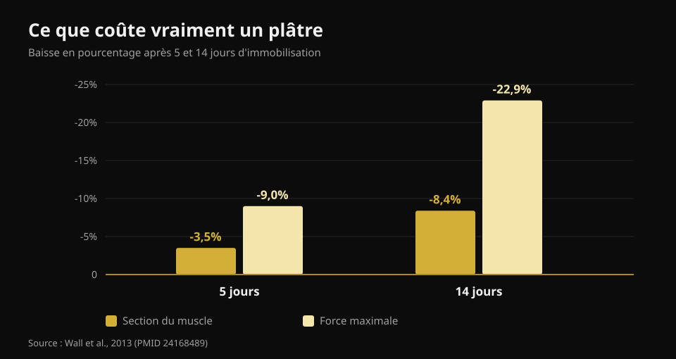
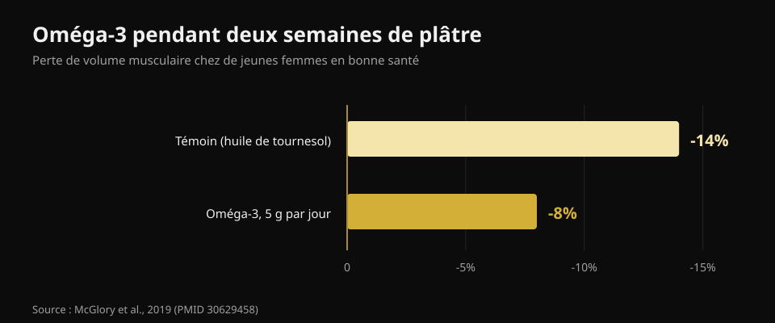

# Que manger quand on est blessé

Par [Giammaria Loi](/autore/giammaria-loi) · mis à jour le 21 octobre 2026

Vous vous blessez, et le premier réflexe est presque toujours le même : « je ne m'entraîne plus, donc je dois manger moins, sinon je grossis ». C'est la décision qui ralentit le plus la guérison. J'ai lu huit sources pour comprendre ce qui change vraiment dans vos besoins quand vous êtes à l'arrêt, combien de protéines il faut et quels compléments ont de vraies données derrière eux.

## L'essentiel

- **La force part beaucoup plus vite que le muscle.** Cinq jours de plâtre coûtent 3,5 % de section du quadriceps mais 9 % de force ; à quatorze jours, c'est 8,4 % et 22,9 % (Wall et al., 2013).
- **Trop couper les calories est la vraie erreur.** Un déficit même modéré abaisse de 20 à 30 % la synthèse protéique, c'est-à-dire exactement le processus qui reconstruit (Tipton, 2015).
- **Les protéines se maintiennent en grammes absolus**, autour de 2 à 2,5 g par kg, surtout si les calories baissent. Mais la recommandation est indirecte.
- **La leucine seule ne fait rien.** 7,5 g par jour pendant une semaine d'immobilisation n'ont changé ni la section ni la force (Backx et al., 2018).
- **Créatine et oméga-3 ont de vraies données**, mais ne font pas la même chose : la créatine en rééducation, les oméga-3 pendant l'arrêt.

## Combien de muscle vous perdez vraiment, et à quelle vitesse

Le chiffre absent de presque tout ce qui s'écrit sur le sujet, c'est la vitesse. Une équipe de Maastricht a plâtré une jambe de 24 jeunes hommes en bonne santé, pendant cinq ou quatorze jours, en mesurant la section du quadriceps au scanner et la force maximale avant et après.

Après **cinq jours** : section -3,5 %, force -9,0 %. Après **quatorze jours** : section -8,4 %, force -22,9 %.

*Valeurs de Wall et al., 2013 (PMID 24168489). Section du quadriceps au scanner, force en maximum sur une répétition.*

Deux choses à retenir. D'abord : le muscle diminue, mais **la force chute près de trois fois plus vite**. Au retour, vous vous sentirez bien plus faible que la quantité de muscle réellement perdue — et c'est normal, car une bonne part de cette force est nerveuse et revient vite. Ensuite : le compteur démarre tout de suite. Il n'y a pas de semaine de grâce.

La raison métabolique est double. La synthèse protéique de repos baisse, et le muscle devient **résistant au stimulus anabolique** : la même dose de protéines qui l'élevait bien l'élève désormais moins. C'est la résistance anabolique, et c'est le nœud de tout le reste.

## Les calories : la première erreur est de trop couper

Un chiffre circule ici et mérite d'être démonté. On lit souvent qu'une blessure augmente la dépense énergétique de 10 à 15 %. L'estimation publiée est en réalité plus large — **de +15 % jusqu'à +50 %** — mais elle concerne le coût de la guérison, pas le besoin total. Et le besoin total, presque toujours, **baisse**, puisque l'entraînement disparaît et que vous bougez moins.

La question est de combien, et la réponse est : moins que vous ne le pensez. Au coût de la réparation s'ajoute celui des **béquilles** : se déplacer coûte alors **deux à trois fois** plus d'énergie. En additionnant les deux, le trou dans le bilan est bien plus petit qu'il n'y paraît quand on décide de diviser ses repas par deux.

Et couper trop coûte cher, de façon mesurable. La seule synthèse protéique consomme environ **500 kcal par jour** chez un homme bien musclé, avant même toute activité. Lors d'un déficit même modéré, synthèse protéique et signalisation anabolique baissent de **20 à 30 %**. Vous coupez l'énergie au processus censé reconstruire le tissu. Un bilan négatif ralentit la cicatrisation et **accélère** la perte de muscle.

L'erreur inverse existe aussi. Dans une étude d'alitement, un bilan énergétique **positif** a accéléré la perte de muscle, probablement via une inflammation systémique. Pas de « je suis à l'arrêt, autant faire une prise de masse ». L'objectif pendant l'arrêt, c'est l'équilibre.

## Les protéines : combien, et pourquoi ça compte davantage maintenant

La recommandation publiée est de **2 à 2,5 g par kg de poids et par jour** pendant l'immobilisation, ou au minimum de ne pas réduire la quantité absolue de protéines quand on réduit les calories. Le carrousel à l'origine de cet article le rapporte presque correctement (1,8 à 2,5 g/kg).

Mais l'état des preuves mérite d'être dit, parce que personne ne le fait. L'auteur même de cette recommandation écrivait en 2011 qu'il y avait « peu de raisons » d'augmenter les protéines pendant l'immobilisation ; en 2015, il a changé d'avis. Et dans une étude d'alitement, passer de 1,0 à 1,6 g/kg n'a **pas** réduit la perte de muscle. Donc : garder les protéines hautes est le choix le plus sensé et ne coûte rien, mais ce n'est pas une assurance.

Le vrai problème est arithmétique. Si vous mangez 500 kcal de moins par jour en gardant les protéines « en proportion », vous les coupez en grammes. Il faut des aliments qui donnent beaucoup de protéines pour peu d'énergie. J'ai lu les fiches officielles du CREA une par une :

| Aliment (100 g) | Protéines | Calories | Protéines pour 100 kcal |
|---|---|---|---|
| Blanc d'œuf | 10,7 g | 43 kcal | **24,9 g** |
| Cabillaud ou merlu | 17,0 g | 71 kcal | **23,9 g** |
| Blanc de poulet | 23,3 g | 100 kcal | **23,3 g** |
| Bresaola (bœuf séché) | 33,1 g | 152 kcal | **21,8 g** |
| Yaourt grec 0 % | 9,0 g | 51 kcal | **17,6 g** |
| Saumon | 18,4 g | 185 kcal | 9,9 g |
| Œuf entier | 12,4 g | 128 kcal | 9,7 g |
| Grana Padano | 33,9 g | 392 kcal | 8,6 g |
| Lentilles sèches, cuites | 6,9 g | 109 kcal | 6,3 g |
| Ricotta de vache | 8,8 g | 146 kcal | 6,0 g |

*Analyse Nurvan des tables de composition des aliments du CREA, mise à jour 2019.*

Le fromage à pâte dure semble évident avec 33,9 g de protéines pour 100 g : pour 100 kcal, il en donne 8,6, moins d'un tiers du blanc de poulet. Quand les calories sont la contrainte, c'est la colonne de droite qui décide. Le même raisonnement vaut dans tout déficit, comme je l'ai expliqué à propos de la [recomposition corporelle](/fr/blog/recomposition-corporelle-perdre-gras-gagner-muscle).

Sur le **timing**, le post d'origine est très précis : toutes les 3 à 4 heures, dans l'heure du réveil, 30 à 40 g de caséine avant de dormir. Ce sont des repères raisonnables tirés de la littérature sur les sportifs, mais l'effet de la répartition des repas **pendant l'inactivité forcée n'a jamais été étudié**. Bien répartir est prudent, pas démontré.

## Ce que dit vraiment la recherche

**Confirmé — les trois phases de la guérison.** Inflammation, prolifération, remodelage : la séquence est juste et les phases se chevauchent. Deux ajouts que le post ne fait pas : la récupération complète peut prendre des années, et **écraser l'inflammation peut ralentir la guérison**, car c'est la réponse inflammatoire qui lance la réparation.

**À préciser — « +10-15 % de dépense ».** L'estimation publiée va de +15 % à +50 % et concerne la guérison, pas le besoin total, qui baisse en général.

**Démenti — la leucine qui « vainc la résistance anabolique ».** C'est la seule affirmation du post testée directement dans le bon contexte, et le test est négatif. Trente jeunes hommes, sept jours de plâtre à la jambe, 2,5 g de leucine à chaque repas principal (7,5 g par jour) contre aucun complément. Section du quadriceps : baisse identique dans les deux groupes (p = 0,61). Force : baisse identique (p = 0,052).

**Non vérifiable — le protocole de timing.** Aucune étude n'a comparé des répartitions de repas chez des personnes immobilisées.

**À préciser — le seuil RED-S.** La diapositive utilise « < 20 kcal/kg de masse maigre » comme marqueur de faible disponibilité énergétique. Le consensus du Comité international olympique de 2023 a abandonné le seuil unique : le syndrome s'évalue par **gravité cumulée et stratification du risque**, avec un outil clinique dédié. C'est un diagnostic médical, pas un calcul à faire chez soi.

## Les compléments qui ont des données

**Créatine.** Elle fait une chose précise, et ce n'est pas la plus évidente : pendant deux semaines de plâtre, elle n'a réduit ni la perte de section ni celle de puissance, comme le placebo. Mais sur les dix semaines de rééducation suivantes, section du quadriceps et puissance maximale sont **revenues plus vite** dans le groupe créatine. C'est un complément du retour, pas de l'arrêt.

**Oméga-3.** Vingt femmes, 5 g par jour commencés quatre semaines avant, puis deux semaines d'immobilisation : le volume musculaire a baissé de **8 % contre 14 %** dans le groupe témoin, et après deux semaines de retour à la normale, seul le groupe oméga-3 était revenu à son niveau de départ.

*Valeurs de McGlory et al., 2019 (PMID 30629458). Vingt femmes en bonne santé, 5 g par jour d'oméga-3 commencés quatre semaines avant l'immobilisation.*

Attention au revers : un excès d'oméga-3 déprime l'inflammation, et l'inflammation sert à guérir. La dose adaptée à une personne blessée n'est pas établie.

**Gélatine et vitamine C.** Huit hommes, 15 g de gélatine enrichie en vitamine C une heure avant six minutes de corde à sauter : le marqueur sanguin de synthèse du collagène a doublé. Prometteur, mais huit personnes et un marqueur, pas un tendon guéri.

**Micronutriments.** La règle est simple : éviter les carences change tout, ajouter des doses au-delà de la suffisance ne change rien. Calcium et vitamine D suffisants comptent pour les fractures ; les mégadoses d'antioxydants n'ont montré aucun bénéfice.

**L'alcool**, absent de tout le post, est le seul élément à effet négatif documenté : il dégrade la réponse de la synthèse protéique et ralentit la cicatrisation. L'enlever est gratuit et mieux étayé que la moitié des compléments.

## Comment l'appliquer

1. **Ne coupez pas à l'aveugle.** Estimez la baisse réelle d'activité : sans entraînement vous êtes plus sédentaire, mais la guérison coûte et les béquilles coûtent. Visez l'équilibre.
2. **Fixez les protéines en grammes, pas en pourcentage.** Gardez la cible en g/kg même si les calories baissent, avec des aliments à forte densité protéique.
3. **Répartissez sur 4 à 5 prises.** Prudent, non démontré ici, et gratuit.
4. **Gardez un stimulus mécanique là où c'est possible.** Ce qui n'est pas immobilisé s'entraîne : il en faut très peu pour conserver l'acquis, comme je l'ai raconté dans [entraîner force, muscle et cardio ensemble](/fr/blog/entrainer-force-muscle-et-cardio-ensemble).
5. **Créatine au retour, pas pendant l'arrêt.**
6. **Alcool dehors.**
7. **Charges, délais et reprise relèvent de ceux qui vous soignent.** La nutrition est l'accompagnement, pas le traitement.

> ### Gardez les chiffres en main pendant l'arrêt
> Nurvan calcule votre cible protéique en grammes et la maintient même quand vous baissez les calories, avec la base alimentaire CREA pour voir immédiatement combien de protéines vous prenez par calorie. Au retour, les charges et le RIR enregistrés avant l'arrêt servent de point de départ pour reconstruire sans en faire trop. [Essayer Nurvan](https://nurvan.app)

## Questions fréquentes

**Combien de protéines manger quand on est blessé ?**
La littérature indique environ 2 à 2,5 g par kg de poids et par jour pendant l'immobilisation, et en tout cas de ne pas réduire la quantité absolue de protéines quand on réduit les calories. C'est une recommandation de prudence : les études directes sont rares et pas toutes positives.

**Dois-je manger moins puisque je ne m'entraîne plus ?**
Un peu moins oui, beaucoup moins non. Le besoin baisse parce que vous bougez moins, mais la guérison consomme de l'énergie et marcher avec des béquilles coûte deux à trois fois plus. Un déficit marqué abaisse la synthèse protéique de 20 à 30 %.

**Est-ce que je perds tout mon muscle tout de suite ?**
Non, mais plus vite qu'on ne le croit : environ 3,5 % de section du quadriceps en cinq jours et 8,4 % en deux semaines. La force chute bien davantage, jusqu'à 23 % en deux semaines, et elle est en grande partie nerveuse : elle revient plus vite que la masse.

**La créatine sert-elle pendant le plâtre ?**
Les données disent non pendant l'immobilisation, mais oui pendant la rééducation qui suit : face au placebo, section et puissance sont revenues plus vite dans le groupe qui en prenait.

## À lire aussi

- [Recomposition corporelle : perdre du gras et gagner du muscle](/fr/blog/recomposition-corporelle-perdre-gras-gagner-muscle) — ce que fait vraiment un déficit riche en protéines.
- [Entraîner force, muscle et cardio ensemble](/fr/blog/entrainer-force-muscle-et-cardio-ensemble) — avec la dose minimale qui maintient force et masse.
- [Quand prendre les compléments](/fr/blog/quand-prendre-les-complements-horaire) — ce que l'horaire change vraiment.

## Sources

1. Tipton KD, 2015. *Nutritional Support for Exercise-Induced Injuries.* Sports Medicine 45(Suppl 1):S93-104. [PMID 26553492](https://pubmed.ncbi.nlm.nih.gov/26553492/) · [DOI 10.1007/s40279-015-0398-4](https://doi.org/10.1007/s40279-015-0398-4)
2. Tipton KD, 2011. *Nutrition for acute exercise-induced injuries.* Annals of Nutrition and Metabolism 57(Suppl 2):43-53. [PMID 21346336](https://pubmed.ncbi.nlm.nih.gov/21346336/) · [DOI 10.1159/000322703](https://doi.org/10.1159/000322703)
3. Wall BT, Dirks ML, Snijders T, Senden JMG, Dolmans J, van Loon LJC, 2013. *Substantial skeletal muscle loss occurs during only 5 days of disuse.* Acta Physiologica 210(3):600-11. [PMID 24168489](https://pubmed.ncbi.nlm.nih.gov/24168489/) · [DOI 10.1111/apha.12190](https://doi.org/10.1111/apha.12190)
4. Backx EMP, Horstman AMH, Marzuca-Nassr GN, van Kranenburg J, Smeets JS, Fuchs CJ, Janssen AAW, de Groot LCPGM, Snijders T, Verdijk LB, van Loon LJC, 2018. *Leucine Supplementation Does Not Attenuate Skeletal Muscle Loss during Leg Immobilization in Healthy, Young Men.* Nutrients 10(5):635. [PMID 29772844](https://pubmed.ncbi.nlm.nih.gov/29772844/) · [DOI 10.3390/nu10050635](https://doi.org/10.3390/nu10050635)
5. McGlory C, Gorissen SHM, Kamal M, Bahniwal R, Hector AJ, Baker SK, Chabowski A, Phillips SM, 2019. *Omega-3 fatty acid supplementation attenuates skeletal muscle disuse atrophy during two weeks of unilateral leg immobilization in healthy young women.* The FASEB Journal 33(3):4586-4597. [PMID 30629458](https://pubmed.ncbi.nlm.nih.gov/30629458/) · [DOI 10.1096/fj.201801857RRR](https://doi.org/10.1096/fj.201801857RRR)
6. Hespel P, Op't Eijnde B, Van Leemputte M, Ursø B, Greenhaff PL, Labarque V, Dymarkowski S, Van Hecke P, Richter EA, 2001. *Oral creatine supplementation facilitates the rehabilitation of disuse atrophy and alters the expression of muscle myogenic factors in humans.* The Journal of Physiology 536(Pt 2):625-33. [PMID 11600695](https://pubmed.ncbi.nlm.nih.gov/11600695/) · [DOI 10.1111/j.1469-7793.2001.0625c.xd](https://doi.org/10.1111/j.1469-7793.2001.0625c.xd)
7. Shaw G, Lee-Barthel A, Ross MLR, Wang B, Baar K, 2017. *Vitamin C-enriched gelatin supplementation before intermittent activity augments collagen synthesis.* The American Journal of Clinical Nutrition 105(1):136-143. [PMID 27852613](https://pubmed.ncbi.nlm.nih.gov/27852613/) · [DOI 10.3945/ajcn.116.138594](https://doi.org/10.3945/ajcn.116.138594)
8. Mountjoy M, Ackerman KE, Bailey DM, et al., 2023. *2023 International Olympic Committee's (IOC) consensus statement on Relative Energy Deficiency in Sport (REDs).* British Journal of Sports Medicine 57(17):1073-1097. [PMID 37752011](https://pubmed.ncbi.nlm.nih.gov/37752011/) · [DOI 10.1136/bjsports-2023-106994](https://doi.org/10.1136/bjsports-2023-106994)

Valeurs nutritionnelles : CREA — Centre de recherche Alimentation et Nutrition (Italie), tables de composition des aliments, mise à jour 2019.

Références obtenues via PubMed. Point de départ : un carrousel de **Science for Sport** ([@scienceforsport](https://www.instagram.com/scienceforsport/)) avec James Morehen, [publication d'origine](https://www.instagram.com/p/Dd3SC-iF3d7/). Aucun texte ni aucune image de la publication n'a été reproduit.

---

**Giammaria Loi** est le fondateur de Nurvan. Il soulève des poids depuis 2012, travaille comme coach et préparateur certifié FIPE depuis 2013 et dispute des compétitions de powerlifting au niveau national depuis 2018. Chaque article qu'il signe part des études scientifiques pour arriver à ce qui fonctionne vraiment en salle.

> Note : contenu informatif, ne remplace pas l'avis d'un médecin ou d'un kinésithérapeute. Le diagnostic, les charges et les délais de reprise après une blessure relèvent de ceux qui vous soignent.
