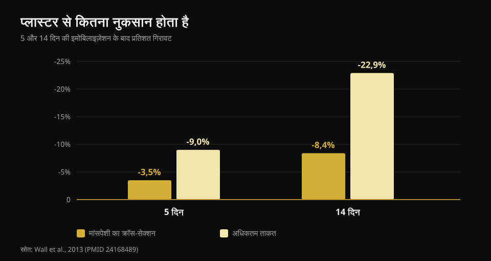
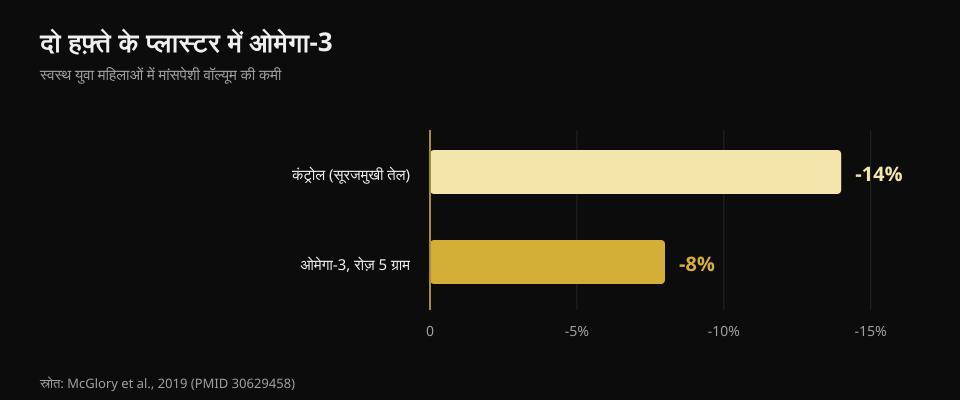

# चोट लगने पर क्या खाएं: ब्रेक के दौरान डाइट

लेखक: [जियाम्मारिया लोई](/autore/giammaria-loi) · अपडेट 21 अक्टूबर 2026

चोट लगते ही पहली प्रतिक्रिया लगभग हमेशा एक ही होती है: "अब ट्रेनिंग नहीं हो रही, तो कम खाना पड़ेगा वरना मोटा हो जाऊंगा।" यही वह फ़ैसला है जो रिकवरी को सबसे ज़्यादा धीमा करता है। मैंने आठ स्रोत पढ़े यह समझने के लिए कि ब्रेक में आपकी ज़रूरतें असल में कैसे बदलती हैं, प्रोटीन कितना चाहिए, और किन सप्लीमेंट के पीछे सच में डेटा है।

## संक्षेप में

- **ताकत मांसपेशी से कहीं तेज़ी से जाती है।** पांच दिन के प्लास्टर में क्वाड्रिसेप्स का क्रॉस-सेक्शन 3.5% घटता है, पर ताकत 9%; चौदह दिन में यह 8.4% और 22.9% हो जाता है (Wall et al., 2013)।
- **असली गलती कैलोरी बहुत ज़्यादा घटाना है।** मामूली घाटा भी मसल प्रोटीन सिंथेसिस को 20-30% गिरा देता है — यानी ठीक वही प्रक्रिया जो ऊतक दोबारा बनाती है (Tipton, 2015)।
- **प्रोटीन को ग्राम में ऊंचा रखें**, लगभग 2-2.5 ग्राम प्रति किलो, खासकर जब कैलोरी घट रही हो। हालांकि यह सिफ़ारिश अप्रत्यक्ष है।
- **अकेला ल्यूसिन काम नहीं करता।** एक हफ़्ते की इमोबिलाइज़ेशन में रोज़ 7.5 ग्राम से न साइज़ बदला, न ताकत (Backx et al., 2018)।
- **क्रिएटिन और ओमेगा-3 के पास असली डेटा है**, पर काम अलग-अलग: क्रिएटिन रिहैब में, ओमेगा-3 ब्रेक के दौरान।

## असल में कितनी मांसपेशी जाती है, और कितनी तेज़ी से

इस विषय पर लिखी लगभग हर चीज़ में जो आंकड़ा गायब है, वह है रफ़्तार। मास्ट्रिख्त की एक टीम ने 24 स्वस्थ युवाओं के एक पैर पर पांच या चौदह दिन के लिए प्लास्टर चढ़ाया, और पहले-बाद में CT से क्वाड्रिसेप्स का क्रॉस-सेक्शन और अधिकतम ताकत नापी।

**पांच दिन बाद**: क्रॉस-सेक्शन -3.5%, ताकत -9.0%। **चौदह दिन बाद**: क्रॉस-सेक्शन -8.4%, ताकत -22.9%।

*मान Wall et al., 2013 (PMID 24168489) से। क्वाड्रिसेप्स क्रॉस-सेक्शन CT से, ताकत वन-रेप मैक्स के रूप में।*

दो बातें। पहली: मांसपेशी घटती है, पर **ताकत लगभग तीन गुना तेज़ी से गिरती है**। वापसी पर आप असल में खोई मांसपेशी से कहीं ज़्यादा कमज़ोर महसूस करेंगे — और यह सामान्य है, क्योंकि खोई ताकत का बड़ा हिस्सा नर्वस होता है और जल्दी लौट आता है। दूसरी: घड़ी तुरंत चलने लगती है, कोई रियायती हफ़्ता नहीं होता।

वजह दोहरी है। आराम की हालत में प्रोटीन सिंथेसिस गिरता है, और मांसपेशी **एनाबॉलिक उत्तेजना के प्रति प्रतिरोधी** हो जाती है: प्रोटीन की जो मात्रा पहले सिंथेसिस को अच्छा उठाती थी, अब कम उठाती है। इसे एनाबॉलिक रेज़िस्टेंस कहते हैं और यही पूरे विषय की गांठ है।

## कैलोरी: पहली गलती है बहुत ज़्यादा काटना

यहां एक आंकड़ा घूमता है जिसे ठहरकर खोलना चाहिए। अक्सर पढ़ने को मिलता है कि चोट ऊर्जा खर्च 10-15% बढ़ा देती है। प्रकाशित अनुमान असल में चौड़ा है — **+15% से +50% तक** — पर वह उपचार की लागत है, कुल ज़रूरत नहीं। और कुल ज़रूरत लगभग हमेशा **घटती** है, क्योंकि ट्रेनिंग हट जाती है और हरकत कम हो जाती है।

सवाल यह है कि कितनी घटती है, और जवाब: जितना आप सोचते हैं उससे कम। मरम्मत की लागत के ऊपर, अगर आप **बैसाखी** पर चलते हैं तो चलने-फिरने की ऊर्जा लागत **दो से तीन गुना** हो जाती है। दोनों जोड़ दें तो बजट का गड्ढा उससे कहीं छोटा है जितना खाना आधा करते वक़्त लगता है।

और ज़्यादा काटना नापने लायक कीमत वसूलता है। अकेली प्रोटीन सिंथेसिस एक अच्छी मांसपेशी वाले पुरुष में रोज़ करीब **500 किलोकैलोरी** खर्च करती है, किसी गतिविधि से पहले ही। मामूली घाटे में भी प्रोटीन सिंथेसिस और एनाबॉलिक सिग्नलिंग **20-30%** गिर जाते हैं। आप ठीक उसी प्रक्रिया से ऊर्जा छीन रहे हैं जिसे ऊतक बनाना है। ऋणात्मक संतुलन घाव भरना धीमा करता है और मांसपेशी का नुकसान **बढ़ाता** है।

उल्टी गलती भी असली है। बेड-रेस्ट के एक अध्ययन में **धनात्मक** ऊर्जा संतुलन ने मांसपेशी का नुकसान तेज़ कर दिया, संभवतः सिस्टेमिक सूजन के ज़रिए। तो "वैसे भी बैठा हूं, बल्क कर लेता हूं" वाली बात नहीं। ब्रेक के दौरान लक्ष्य संतुलन है।

## प्रोटीन: कितना, और अभी क्यों ज़्यादा मायने रखता है

प्रकाशित सिफ़ारिश इमोबिलाइज़ेशन के दौरान **2-2.5 ग्राम प्रति किलो शरीर भार प्रतिदिन** है, या कम से कम यह कि कैलोरी घटाते समय प्रोटीन की निरपेक्ष मात्रा न घटाएं। जिस कैरोसेल से यह लेख शुरू हुआ, वह इसे लगभग सही बताता है (1.8-2.5 ग्राम/किलो)।

पर सबूत की हालत कहना ज़रूरी है, क्योंकि कोई नहीं कहता। उसी सिफ़ारिश के लेखक ने 2011 में लिखा था कि इमोबिलाइज़ेशन में प्रोटीन बढ़ाने का "कम आधार" है; 2015 तक उन्होंने अपनी राय बदल दी। और एक बेड-रेस्ट अध्ययन में 1.0 से 1.6 ग्राम/किलो पर जाने से मांसपेशी का नुकसान **कम नहीं** हुआ। यानी: प्रोटीन ऊंचा रखना समझदारी है और मुफ़्त है, लेकिन यह बीमा नहीं है।

असली दिक्कत गणित की है। अगर आप रोज़ 500 किलोकैलोरी कम खाते हैं और प्रोटीन "अनुपात में" रखते हैं, तो असल में उसे ग्राम में काट रहे हैं। ऐसे खाद्य चाहिए जो कम ऊर्जा में ज़्यादा प्रोटीन दें। मैंने CREA के आधिकारिक कार्ड एक-एक करके पढ़े:

| खाद्य (100 ग्राम) | प्रोटीन | कैलोरी | प्रति 100 kcal प्रोटीन |
|---|---|---|---|
| अंडे का सफ़ेद भाग | 10.7 ग्राम | 43 kcal | **24.9 ग्राम** |
| कॉड या हेक मछली | 17.0 ग्राम | 71 kcal | **23.9 ग्राम** |
| चिकन ब्रेस्ट | 23.3 ग्राम | 100 kcal | **23.3 ग्राम** |
| ब्रेज़ाओला (सूखा गोमांस) | 33.1 ग्राम | 152 kcal | **21.8 ग्राम** |
| ग्रीक योगर्ट 0% | 9.0 ग्राम | 51 kcal | **17.6 ग्राम** |
| सैल्मन | 18.4 ग्राम | 185 kcal | 9.9 ग्राम |
| पूरा अंडा | 12.4 ग्राम | 128 kcal | 9.7 ग्राम |
| ग्राना पादानो चीज़ | 33.9 ग्राम | 392 kcal | 8.6 ग्राम |
| सूखी मसूर, उबली | 6.9 ग्राम | 109 kcal | 6.3 ग्राम |
| गाय के दूध का रिकोटा | 8.8 ग्राम | 146 kcal | 6.0 ग्राम |

*CREA की खाद्य संरचना तालिकाओं (2019 अपडेट) पर Nurvan का विश्लेषण।*

हार्ड चीज़ 33.9 ग्राम प्रोटीन प्रति 100 ग्राम के साथ साफ़ विकल्प लगता है: पर प्रति 100 kcal यह 8.6 ग्राम देता है, चिकन ब्रेस्ट के एक-तिहाई से भी कम। जब कैलोरी ही बंधन हो, फ़ैसला दाईं कॉलम करती है। यही तर्क किसी भी घाटे में लागू होता है, जैसा मैंने [बॉडी रीकंपोज़िशन](/hi/blog/body-recomposition-charbi-ghataye-muscle-badhaye) में समझाया था।

**टाइमिंग** पर मूल पोस्ट बहुत सटीक है: हर 3-4 घंटे, जागने के एक घंटे के भीतर, सोने से पहले 30-40 ग्राम कैसिइन। ये ट्रेनिंग करने वालों पर हुए शोध से लिए उचित आंकड़े हैं, पर **ज़बरदस्ती की निष्क्रियता के दौरान** भोजन के वितरण का असर कभी अध्ययन नहीं हुआ। अच्छा वितरण सावधानी है, प्रमाण नहीं।

## रिसर्च असल में क्या कहती है

**पुष्ट — उपचार के तीन चरण।** सूजन, प्रसार, पुनर्निर्माण: क्रम सही है और चरण आपस में ओवरलैप करते हैं। दो बातें जो पोस्ट नहीं कहती: पूरी रिकवरी में साल लग सकते हैं, और **सूजन को दबा देना उपचार धीमा कर सकता है**, क्योंकि सूजन की प्रतिक्रिया ही मरम्मत शुरू करती है।

**स्पष्ट करने लायक — "+10-15% खर्च"।** प्रकाशित अनुमान +15% से +50% तक है और वह उपचार से जुड़ा है, कुल ज़रूरत से नहीं, जो आम तौर पर घटती है।

**खंडित — ल्यूसिन जो "एनाबॉलिक रेज़िस्टेंस हरा देता है"।** पोस्ट का यही इकलौता दावा है जिसे सही संदर्भ में सीधे परखा गया, और नतीजा नकारात्मक है। तीस युवा, पैर पर सात दिन का प्लास्टर, हर मुख्य भोजन के साथ 2.5 ग्राम ल्यूसिन (रोज़ 7.5 ग्राम) बनाम कोई सप्लीमेंट नहीं। क्वाड्रिसेप्स क्रॉस-सेक्शन: दोनों समूहों में बराबर गिरा (p = 0.61)। ताकत: बराबर गिरी (p = 0.052)।

**अप्रमाणित — टाइमिंग प्रोटोकॉल।** किसी अध्ययन ने इमोबिलाइज़ किए लोगों में भोजन के पैटर्न की तुलना नहीं की है।

**स्पष्ट करने लायक — REDs की सीमा।** स्लाइड "<20 kcal/किलो फैट-फ्री मास" को कम ऊर्जा उपलब्धता का संकेतक बताती है। अंतरराष्ट्रीय ओलंपिक समिति की 2023 की सहमति ने एकल सीमा छोड़ दी: सिंड्रोम का आकलन अब **संचित गंभीरता और जोखिम स्तरीकरण** से, एक समर्पित क्लिनिकल टूल के साथ होता है। यह चिकित्सकीय निदान है, घर का हिसाब नहीं।

## जिन सप्लीमेंट के पास असली डेटा है

**क्रिएटिन।** यह एक ख़ास काम करता है, और वह स्पष्ट वाला नहीं: दो हफ़्ते के प्लास्टर में इसने क्रॉस-सेक्शन या पावर का नुकसान कम नहीं किया, प्लेसीबो जैसा ही रहा। पर उसके बाद के दस हफ़्तों की रिहैब में क्वाड्रिसेप्स क्रॉस-सेक्शन और अधिकतम पावर क्रिएटिन समूह में **तेज़ी से लौटे**। यह वापसी का सप्लीमेंट है, ब्रेक का नहीं।

**ओमेगा-3।** बीस महिलाएं, चार हफ़्ते पहले से रोज़ 5 ग्राम, फिर दो हफ़्ते की इमोबिलाइज़ेशन: मांसपेशी का वॉल्यूम **8% घटा, जबकि कंट्रोल समूह में 14%**, और सामान्य गतिविधि के दो हफ़्ते बाद केवल ओमेगा-3 समूह अपने शुरुआती स्तर पर लौटा था।

*मान McGlory et al., 2019 (PMID 30629458) से। बीस स्वस्थ महिलाएं, इमोबिलाइज़ेशन से चार हफ़्ते पहले शुरू की गई रोज़ 5 ग्राम ओमेगा-3।*

पर दूसरा पहलू भी देखें: ज़रूरत से ज़्यादा ओमेगा-3 सूजन दबाता है, और सूजन ही ठीक करती है। चोटिल व्यक्ति के लिए सही खुराक तय नहीं है।

**जिलेटिन और विटामिन C।** आठ पुरुष, छह मिनट की रस्सी कूद से एक घंटा पहले विटामिन C मिला 15 ग्राम जिलेटिन: खून में कोलेजन सिंथेसिस का मार्कर दोगुना हो गया। आशाजनक, पर यह आठ लोग और एक मार्कर है, ठीक हुआ टेंडन नहीं।

**सूक्ष्म पोषक तत्व।** नियम सीधा है: कमी से बचना फ़र्क डालता है, पर्याप्तता के ऊपर अतिरिक्त खुराक नहीं। फ्रैक्चर में पर्याप्त कैल्शियम और विटामिन D मायने रखते हैं; एंटीऑक्सीडेंट की मेगा-डोज़ से कोई लाभ नहीं दिखा।

**शराब**, जो पूरी पोस्ट में कहीं नहीं है, एकमात्र ऐसी चीज़ है जिसका नकारात्मक असर प्रलेखित है: यह प्रोटीन सिंथेसिस की प्रतिक्रिया बिगाड़ती है और घाव भरना धीमा करती है। इसे हटाना मुफ़्त है और आधे सप्लीमेंट से बेहतर प्रमाणित।

## इसे कैसे लागू करें

1. **अंधाधुंध न काटें।** गतिविधि की असली गिरावट का अनुमान लगाएं: ट्रेनिंग के बिना आप ज़्यादा बैठे रहते हैं, पर उपचार में ऊर्जा लगती है और बैसाखी में और ज़्यादा। लक्ष्य संतुलन हो, घाटा नहीं।
2. **प्रोटीन ग्राम में तय करें, प्रतिशत में नहीं।** लक्ष्य ग्राम/किलो में रखें और कैलोरी घटने पर भी बनाए रखें, उच्च प्रोटीन घनत्व वाले खाद्य चुनकर।
3. **4-5 बार में बांटें।** सावधानी भरा, इस संदर्भ में अप्रमाणित, और मुफ़्त।
4. **जहां संभव हो यांत्रिक उत्तेजना बनाए रखें।** जो हिस्सा इमोबिलाइज़ नहीं है उसे ट्रेन करें: जो है उसे बचाए रखने के लिए बहुत कम चाहिए, जैसा मैंने [ताकत, मांसपेशी और कार्डियो एक साथ](/hi/blog/strength-muscle-cardio-ek-saath-training) में बताया।
5. **क्रिएटिन वापसी पर, ब्रेक के दौरान नहीं।**
6. **शराब बाहर।**
7. **भार, समयसीमा और वापसी आपका इलाज करने वाला तय करे।** पोषण साथ है, इलाज की योजना नहीं।

> ### ब्रेक के दौरान भी आंकड़े अपने हाथ में रखें
> Nurvan आपका प्रोटीन लक्ष्य ग्राम में निकालता है और कैलोरी घटाने पर भी उसे स्थिर रखता है, और CREA फ़ूड डेटाबेस से आप तुरंत देख सकते हैं कि प्रति कैलोरी कितना प्रोटीन मिल रहा है। वापसी पर, ब्रेक से पहले दर्ज किए गए भार और RIR दोबारा शुरुआत का आधार बनते हैं — बिना ज़्यादती किए। [Nurvan आज़माएं](https://nurvan.app)

## अक्सर पूछे जाने वाले सवाल

**चोट लगने पर कितना प्रोटीन खाना चाहिए?**
साहित्य इमोबिलाइज़ेशन के दौरान करीब 2-2.5 ग्राम प्रति किलो प्रतिदिन बताता है, और हर हाल में यह कि कैलोरी घटाते समय प्रोटीन की निरपेक्ष मात्रा न घटे। यह एहतियाती सिफ़ारिश है: सीधे अध्ययन कम हैं और सब सकारात्मक नहीं।

**ट्रेनिंग नहीं हो रही तो क्या कम खाऊं?**
थोड़ा कम हां, बहुत कम नहीं। ज़रूरत घटती है क्योंकि हरकत कम है, पर उपचार ऊर्जा खर्च करता है और बैसाखी पर चलना दो-तीन गुना महंगा है। बड़ा घाटा प्रोटीन सिंथेसिस 20-30% गिरा देता है।

**क्या सारी मांसपेशी तुरंत चली जाती है?**
नहीं, पर जितना लोग सोचते हैं उससे तेज़: पांच दिन में क्वाड्रिसेप्स क्रॉस-सेक्शन का करीब 3.5% और दो हफ़्ते में 8.4%। ताकत कहीं ज़्यादा गिरती है, दो हफ़्ते में 23% तक, और वह बड़े हिस्से में नर्वस होती है: मांसपेशी से पहले लौट आती है।

**प्लास्टर के दौरान क्रिएटिन काम का है?**
डेटा कहता है इमोबिलाइज़ेशन के दौरान नहीं, पर उसके बाद की रिहैब में हां: प्लेसीबो की तुलना में क्रॉस-सेक्शन और पावर क्रिएटिन लेने वाले समूह में तेज़ी से लौटे।

## यह भी पढ़ें

- [बॉडी रीकंपोज़िशन: चर्बी घटाएं, मसल बढ़ाएं](/hi/blog/body-recomposition-charbi-ghataye-muscle-badhaye) — उच्च प्रोटीन वाला घाटा असल में क्या करता है।
- [ताकत, मांसपेशी और कार्डियो एक साथ](/hi/blog/strength-muscle-cardio-ek-saath-training) — इसमें वह न्यूनतम खुराक भी है जो ताकत और मास बनाए रखती है।
- [सप्लीमेंट कब लें](/hi/blog/supplements-kab-lein-samay) — समय असल में क्या बदलता है।

## स्रोत

1. Tipton KD, 2015. *Nutritional Support for Exercise-Induced Injuries.* Sports Medicine 45(Suppl 1):S93-104. [PMID 26553492](https://pubmed.ncbi.nlm.nih.gov/26553492/) · [DOI 10.1007/s40279-015-0398-4](https://doi.org/10.1007/s40279-015-0398-4)
2. Tipton KD, 2011. *Nutrition for acute exercise-induced injuries.* Annals of Nutrition and Metabolism 57(Suppl 2):43-53. [PMID 21346336](https://pubmed.ncbi.nlm.nih.gov/21346336/) · [DOI 10.1159/000322703](https://doi.org/10.1159/000322703)
3. Wall BT, Dirks ML, Snijders T, Senden JMG, Dolmans J, van Loon LJC, 2013. *Substantial skeletal muscle loss occurs during only 5 days of disuse.* Acta Physiologica 210(3):600-11. [PMID 24168489](https://pubmed.ncbi.nlm.nih.gov/24168489/) · [DOI 10.1111/apha.12190](https://doi.org/10.1111/apha.12190)
4. Backx EMP, Horstman AMH, Marzuca-Nassr GN, van Kranenburg J, Smeets JS, Fuchs CJ, Janssen AAW, de Groot LCPGM, Snijders T, Verdijk LB, van Loon LJC, 2018. *Leucine Supplementation Does Not Attenuate Skeletal Muscle Loss during Leg Immobilization in Healthy, Young Men.* Nutrients 10(5):635. [PMID 29772844](https://pubmed.ncbi.nlm.nih.gov/29772844/) · [DOI 10.3390/nu10050635](https://doi.org/10.3390/nu10050635)
5. McGlory C, Gorissen SHM, Kamal M, Bahniwal R, Hector AJ, Baker SK, Chabowski A, Phillips SM, 2019. *Omega-3 fatty acid supplementation attenuates skeletal muscle disuse atrophy during two weeks of unilateral leg immobilization in healthy young women.* The FASEB Journal 33(3):4586-4597. [PMID 30629458](https://pubmed.ncbi.nlm.nih.gov/30629458/) · [DOI 10.1096/fj.201801857RRR](https://doi.org/10.1096/fj.201801857RRR)
6. Hespel P, Op't Eijnde B, Van Leemputte M, Ursø B, Greenhaff PL, Labarque V, Dymarkowski S, Van Hecke P, Richter EA, 2001. *Oral creatine supplementation facilitates the rehabilitation of disuse atrophy and alters the expression of muscle myogenic factors in humans.* The Journal of Physiology 536(Pt 2):625-33. [PMID 11600695](https://pubmed.ncbi.nlm.nih.gov/11600695/) · [DOI 10.1111/j.1469-7793.2001.0625c.xd](https://doi.org/10.1111/j.1469-7793.2001.0625c.xd)
7. Shaw G, Lee-Barthel A, Ross MLR, Wang B, Baar K, 2017. *Vitamin C-enriched gelatin supplementation before intermittent activity augments collagen synthesis.* The American Journal of Clinical Nutrition 105(1):136-143. [PMID 27852613](https://pubmed.ncbi.nlm.nih.gov/27852613/) · [DOI 10.3945/ajcn.116.138594](https://doi.org/10.3945/ajcn.116.138594)
8. Mountjoy M, Ackerman KE, Bailey DM, et al., 2023. *2023 International Olympic Committee's (IOC) consensus statement on Relative Energy Deficiency in Sport (REDs).* British Journal of Sports Medicine 57(17):1073-1097. [PMID 37752011](https://pubmed.ncbi.nlm.nih.gov/37752011/) · [DOI 10.1136/bjsports-2023-106994](https://doi.org/10.1136/bjsports-2023-106994)

पोषण मान: CREA — खाद्य एवं पोषण अनुसंधान केंद्र (इटली), खाद्य संरचना तालिकाएं, 2019 अपडेट।

संदर्भ PubMed के ज़रिए लिए गए। शुरुआती बिंदु: **Science for Sport** ([@scienceforsport](https://www.instagram.com/scienceforsport/)) का James Morehen के साथ कैरोसेल, [मूल पोस्ट](https://www.instagram.com/p/Dd3SC-iF3d7/)। पोस्ट का न कोई टेक्स्ट और न कोई तस्वीर दोबारा इस्तेमाल की गई है।

---

**जियाम्मारिया लोई** Nurvan के संस्थापक हैं। वे 2012 से वेट ट्रेनिंग करते हैं, 2013 से FIPE प्रमाणित पर्सनल ट्रेनर और कोच के रूप में काम करते हैं और 2018 से राष्ट्रीय स्तर पर पावरलिफ्टिंग में हिस्सा लेते हैं। उनके हर लेख की शुरुआत वैज्ञानिक अध्ययनों से होती है और अंत इस पर कि जिम में असल में क्या काम करता है।

> नोट: यह जानकारी भर है, डॉक्टर या फ़िज़ियोथेरेपिस्ट की सलाह का विकल्प नहीं। चोट के बाद निदान, भार और वापसी का समय आपका इलाज करने वाला ही तय करे।
