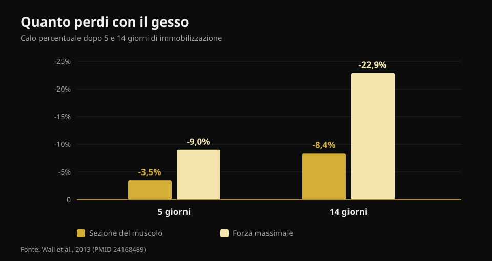
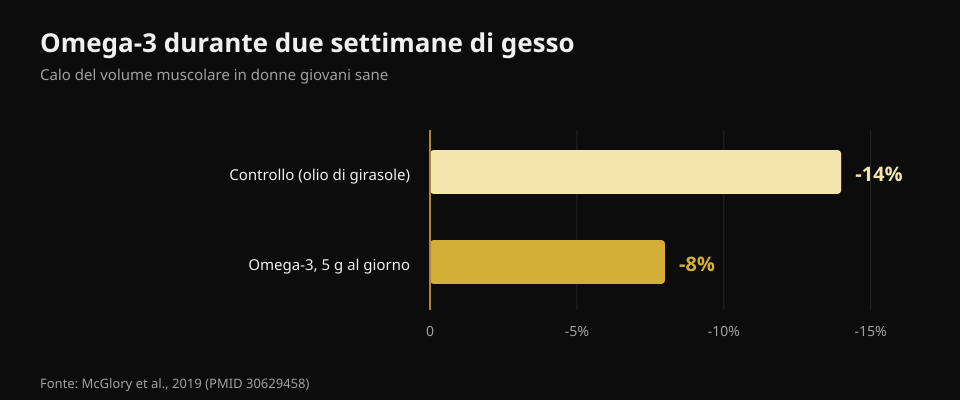

# Cosa mangiare quando sei infortunato

Di [Giammaria Loi](/autore/giammaria-loi) · aggiornato il 21 ottobre 2026

Ti sei fatto male e la prima reazione è quasi sempre la stessa: "non mi alleno più, quindi devo mangiare meno, se no ingrasso". È la decisione che rallenta di più la guarigione. Ho letto otto fonti per capire cosa cambia davvero nel fabbisogno quando ti fermi, quante proteine servono e quali integratori hanno dati veri dietro.

## In breve

- **La forza se ne va molto più in fretta del muscolo.** Cinque giorni di gesso costano il 3,5% di sezione del quadricipite ma il 9% di forza; in quattordici giorni sono l'8,4% e il 22,9% (Wall et al., 2013).
- **Tagliare troppo le calorie è il vero errore.** Un deficit anche moderato abbassa del 20-30% la sintesi proteica, che è esattamente il processo con cui ricostruisci (Tipton, 2015).
- **Le proteine vanno tenute alte in grammi assoluti**, intorno a 2-2,5 g per kg, soprattutto se le calorie scendono. Ma la raccomandazione è indiretta: pochi studi l'hanno testata direttamente.
- **La leucina da sola non funziona.** 7,5 g al giorno per una settimana di immobilizzazione non hanno cambiato né la sezione né la forza (Backx et al., 2018).
- **Creatina e omega-3 hanno dati veri**, ma non fanno la stessa cosa: la creatina aiuta nella riabilitazione, gli omega-3 durante lo stop.

## Quanto muscolo perdi davvero, e quanto in fretta

Il numero che manca in quasi tutti i contenuti sull'argomento è la velocità. Un gruppo di Maastricht ha messo il gesso a una gamba di 24 ragazzi sani, per cinque o per quattordici giorni, misurando sezione del quadricipite con la TAC e forza massimale prima e dopo.

Dopo **cinque giorni**: sezione -3,5%, forza -9,0%. Dopo **quattordici giorni**: sezione -8,4%, forza -22,9%.

*Valori da Wall et al., 2013 (PMID 24168489). Sezione del quadricipite misurata con TAC, forza come massimale su una ripetizione.*

Due cose da portare a casa. La prima: il muscolo cala, ma la **forza cala quasi tre volte più in fretta**. Significa che al rientro ti sentirai molto più debole di quanto tu sia effettivamente dimagrito di muscolo — ed è normale, perché buona parte della forza persa è nervosa e torna in fretta. La seconda: il conto parte subito. Non esiste una settimana di grazia in cui "tanto è presto".

Il motivo metabolico è doppio. La sintesi proteica a riposo scende, e il muscolo diventa **resistente allo stimolo anabolico**: la stessa dose di proteine che prima alzava bene la sintesi, ora la alza di meno. Questo si chiama resistenza anabolica ed è il nodo centrale di tutta la nutrizione da infortunato.

## Le calorie: il primo errore è tagliarle troppo

Qui circola un numero che vale la pena smontare con calma. Si legge spesso che un infortunio aumenta il dispendio energetico del 10-15%. La cifra pubblicata è in realtà più ampia — **da +15% fino a +50%** — ma riguarda il costo della guarigione, non il fabbisogno totale. E il fabbisogno totale, quasi sempre, **scende**, perché l'allenamento sparisce e ti muovi meno.

Il punto è di quanto scende, e la risposta è: meno di quanto pensi. Oltre al costo della riparazione, se cammini con le **stampelle** il costo energetico di spostarti aumenta di **due o tre volte**. Sommando le due cose, il buco nel bilancio è molto più piccolo di quello che ti immagini quando decidi di dimezzare i pasti.

E tagliare troppo costa caro, in modo misurabile. La sola sintesi proteica consuma intorno a **500 kcal al giorno** in un uomo ben muscoloso, prima ancora di considerare l'attività. Durante un deficit anche moderato, sintesi proteica e segnali anabolici scendono del **20-30%**. Tradotto: stai tagliando l'energia proprio al processo che deve ricostruire il tessuto. Un bilancio negativo rallenta la guarigione delle ferite e **accelera** la perdita di muscolo.

L'errore opposto, però, esiste. In uno studio di allettamento il bilancio energetico **positivo** ha accelerato la perdita di muscolo, probabilmente attivando infiammazione sistemica. Niente "tanto sono fermo, mi rifaccio una massa". L'obiettivo durante lo stop è il pareggio, non l'uno né l'altro estremo.

## Le proteine: quante, e perché contano di più proprio adesso

La raccomandazione pubblicata è di **2-2,5 g per kg di peso al giorno** durante l'immobilizzazione, o come minimo di non ridurre la quantità assoluta di proteine quando riduci le calorie. È l'indicazione che il carosello di partenza riporta quasi correttamente (1,8-2,5 g/kg).

Però va detto come sta messa l'evidenza, perché nessuno lo dice. Lo stesso autore di quella raccomandazione, nel 2011, scriveva che c'era "poco razionale" per aumentare le proteine durante l'immobilizzazione; nel 2015 ha cambiato posizione. E in uno studio di allettamento, passare da 1,0 a 1,6 g/kg **non** ha ridotto la perdita di muscolo. Quindi: tenere alte le proteine è la scelta più sensata e non costa niente, ma non è un'assicurazione.

Il vero problema pratico è aritmetico. Se mangi 500 kcal in meno al giorno e mantieni le proteine "in proporzione", in realtà le stai tagliando in grammi. Servono alimenti che diano molte proteine per poca energia. Ho letto le schede ufficiali CREA una per una:

| Alimento (100 g) | Proteine | Calorie | Proteine per 100 kcal |
|---|---|---|---|
| Albume d'uovo | 10,7 g | 43 kcal | **24,9 g** |
| Merluzzo o nasello | 17,0 g | 71 kcal | **23,9 g** |
| Petto di pollo | 23,3 g | 100 kcal | **23,3 g** |
| Bresaola della Valtellina IGP | 33,1 g | 152 kcal | **21,8 g** |
| Yogurt greco 0% | 9,0 g | 51 kcal | **17,6 g** |
| Salmone | 18,4 g | 185 kcal | 9,9 g |
| Uovo intero | 12,4 g | 128 kcal | 9,7 g |
| Grana Padano DOP | 33,9 g | 392 kcal | 8,6 g |
| Lenticchie secche, cotte | 6,9 g | 109 kcal | 6,3 g |
| Ricotta di vacca | 8,8 g | 146 kcal | 6,0 g |

*Elaborazione Nurvan sulle tabelle di composizione degli alimenti CREA, aggiornamento 2019.*

Il Grana ha 33,9 g di proteine per 100 g e sembra la scelta ovvia: per 100 kcal ne dà 8,6, meno di un terzo del petto di pollo. Quando le calorie sono il vincolo, è la colonna di destra che decide. Lo stesso ragionamento vale in qualunque fase di deficit, come ho spiegato parlando di [quante proteine servono in definizione](/blog/proteine-in-definizione).

Sul **timing** il post di partenza è molto preciso: ogni 3-4 ore, entro un'ora dal risveglio, 30-40 g di caseine prima di dormire. Sono indicazioni ragionevoli prese dalla letteratura su chi si allena, ma l'effetto della distribuzione dei pasti **durante l'inattività forzata non è mai stato studiato**. Distribuire bene le proteine è prudente, non dimostrato.

## Cosa dice davvero la ricerca

**Confermato — le tre fasi della guarigione.** Infiammazione, proliferazione, rimodellamento: la sequenza è corretta e le fasi si sovrappongono. Vale la pena aggiungere due cose che il post non dice: il recupero completo può richiedere anni, e **schiacciare l'infiammazione può rallentare la guarigione**, perché la risposta infiammatoria è ciò che avvia la riparazione.

**Da precisare — "+10-15% di dispendio".** La stima pubblicata è +15% fino a +50% e riguarda la guarigione, non il fabbisogno totale, che di solito scende. Il rischio è leggerlo come "devo mangiare di più".

**Smentito — la leucina che "supera la resistenza anabolica".** È l'unica affermazione del post che è stata testata direttamente nel contesto giusto, e il test è negativo. Trenta ragazzi, sette giorni di gesso alla gamba, 2,5 g di leucina a ogni pasto principale (7,5 g al giorno) contro nessun integratore. Sezione del quadricipite: scesa uguale nei due gruppi (p = 0,61). Forza: scesa uguale (p = 0,052). La resistenza anabolica è reale, ma la leucina da sola non la risolve.

**Non verificabile — il protocollo di timing.** Nessuno studio ha confrontato pattern di pasti diversi in persone immobilizzate.

**Da precisare — la soglia RED-S.** La slide usa "<20 kcal/kg di massa magra" come marcatore di bassa disponibilità energetica. Il consenso del Comitato Olimpico Internazionale del 2023 ha abbandonato la soglia unica: la sindrome si valuta per **gravità accumulata e stratificazione del rischio**, con uno strumento clinico dedicato. È una diagnosi medica, non un numero da calcolare a casa.

## Integratori: cosa ha dati veri

**Creatina.** Fa una cosa precisa, e non è quella che pensi: durante due settimane di gesso non ha ridotto la perdita di sezione né di potenza, uguale al placebo. Ma nelle dieci settimane di riabilitazione successive, sezione del quadricipite e potenza massima sono **tornate più in fretta** nel gruppo creatina. È un integratore per la fase di rientro, non per la fase di stop.

**Omega-3.** Venti donne, 5 g al giorno iniziati quattro settimane prima, poi due settimane di immobilizzazione: il volume muscolare è calato dell'**8% contro il 14%** del gruppo di controllo, e dopo due settimane di ritorno alla normalità solo il gruppo omega-3 era tornato ai valori di partenza. È il dato più incoraggiante che esista.

*Valori da McGlory et al., 2019 (PMID 30629458). Venti donne sane, 5 g al giorno di omega-3 iniziati quattro settimane prima dell'immobilizzazione.*

Attenzione però al rovescio: gli omega-3 in eccesso deprimono l'infiammazione, e l'infiammazione serve a guarire. La dose giusta per una persona infortunata non è stata stabilita.

**Gelatina e vitamina C.** Otto uomini, 15 g di gelatina arricchita con vitamina C un'ora prima di sei minuti di salto con la corda: il marcatore di sintesi del collagene nel sangue è raddoppiato. È promettente, ma sono otto persone e un marcatore, non un tendine guarito. Da trattare come ipotesi, non come protocollo.

**Micronutrienti.** La regola è semplice e vale per tutti: evitare le carenze fa la differenza, aggiungere dosi extra sopra la sufficienza no. Calcio e vitamina D adeguati contano per le fratture; megadosi di antiossidanti non hanno mostrato benefici e in alcuni modelli interferiscono.

**L'alcol**, che nel post non compare mai, è l'unica voce con un effetto negativo documentato: peggiora la risposta della sintesi proteica e rallenta la guarigione delle ferite. Tagliarlo è gratis e ha più prove dietro di metà degli integratori.

## Come applicarlo

1. **Non tagliare a caso.** Stima il calo reale di attività, non quello immaginato: senza allenamenti sei più sedentario, ma la guarigione costa e le stampelle costano. Punta al pareggio, non al deficit.
2. **Blocca le proteine in grammi, non in percentuale.** Fissa il target in g/kg e tienilo fisso anche se le calorie scendono, scegliendo alimenti ad alta densità proteica.
3. **Distribuiscile su 4-5 occasioni.** Prudente, non dimostrato nel contesto infortunio, ma non costa nulla.
4. **Tieni uno stimolo meccanico dove puoi.** Il muscolo non immobilizzato va allenato: serve pochissimo per mantenere quello che hai, come ho raccontato parlando di [quanto basta per mantenere forza e massa](/blog/allenare-forza-muscoli-cardio-insieme).
5. **Creatina al rientro, non durante lo stop.** È nella fase di riabilitazione che i dati la premiano.
6. **Alcol fuori.** È la cosa a costo zero con il miglior rapporto prove/beneficio.
7. **Carichi, tempi e rientro li decide chi ti segue.** Fisioterapista e medico: la nutrizione è il contorno, non il piano di cura.

> ### Tieni i numeri sotto controllo mentre sei fermo
> Nurvan calcola il tuo target proteico in grammi e lo tiene fisso anche quando abbassi le calorie, con il database alimenti CREA per vedere subito quante proteine stai prendendo per caloria. Al rientro, i carichi e il RIR registrati prima dello stop sono il punto di partenza per ricostruire senza strafare. [Prova Nurvan](https://nurvan.app)

## Domande frequenti

**Quante proteine devo mangiare se sono infortunato?**
La letteratura indica circa 2-2,5 g per kg di peso al giorno durante l'immobilizzazione, e in ogni caso di non ridurre la quantità assoluta di proteine quando riduci le calorie. È una raccomandazione prudenziale: gli studi diretti sono pochi e non tutti positivi.

**Devo mangiare meno adesso che non mi alleno?**
Un po' meno sì, molto meno no. Il fabbisogno scende perché ti muovi meno, ma la guarigione consuma energia e camminare con le stampelle costa due o tre volte di più. Un deficit marcato abbassa la sintesi proteica del 20-30% e rallenta la riparazione.

**Perdo subito tutta la massa muscolare?**
No, ma più in fretta di quanto si creda: circa il 3,5% di sezione del quadricipite in cinque giorni e l'8,4% in due settimane. La forza cala molto di più, fino al 23% in due settimane, e in gran parte è nervosa: al rientro torna più rapidamente della massa.

**La creatina serve mentre ho il gesso?**
I dati dicono di no durante l'immobilizzazione, ma sì nella riabilitazione successiva: nel confronto con placebo sezione e potenza sono tornate più in fretta nel gruppo che la assumeva.

## Leggi anche

- [Proteine in definizione: quante servono davvero](/blog/proteine-in-definizione)
- [Ricomposizione corporea: perdere grasso e guadagnare muscolo](/blog/ricomposizione-corporea-perdere-grasso-guadagnare-muscolo)
- [Allenare forza, muscoli e cardio insieme: quanto costa davvero](/blog/allenare-forza-muscoli-cardio-insieme)

## Fonti

1. Tipton KD, 2015. Nutritional Support for Exercise-Induced Injuries. Sports Medicine 45(Suppl 1):S93-104. PMID 26553492. doi: [10.1007/s40279-015-0398-4](https://doi.org/10.1007/s40279-015-0398-4)
2. Tipton KD, 2011. Nutrition for acute exercise-induced injuries. Annals of Nutrition and Metabolism 57(Suppl 2):43-53. PMID 21346336. doi: [10.1159/000322703](https://doi.org/10.1159/000322703)
3. Wall BT, Dirks ML, Snijders T, et al., 2013. Substantial skeletal muscle loss occurs during only 5 days of disuse. Acta Physiologica 210(3):600-11. PMID 24168489. doi: [10.1111/apha.12190](https://doi.org/10.1111/apha.12190)
4. Backx EMP, Horstman AMH, Marzuca-Nassr GN, et al., 2018. Leucine Supplementation Does Not Attenuate Skeletal Muscle Loss during Leg Immobilization in Healthy, Young Men. Nutrients 10(5):635. PMID 29772844. doi: [10.3390/nu10050635](https://doi.org/10.3390/nu10050635)
5. McGlory C, Gorissen SHM, Kamal M, et al., 2019. Omega-3 fatty acid supplementation attenuates skeletal muscle disuse atrophy during two weeks of unilateral leg immobilization in healthy young women. The FASEB Journal 33(3):4586-4597. PMID 30629458. doi: [10.1096/fj.201801857RRR](https://doi.org/10.1096/fj.201801857RRR)
6. Hespel P, Op't Eijnde B, Van Leemputte M, et al., 2001. Oral creatine supplementation facilitates the rehabilitation of disuse atrophy and alters the expression of muscle myogenic factors in humans. The Journal of Physiology 536(Pt 2):625-33. PMID 11600695. doi: [10.1111/j.1469-7793.2001.0625c.xd](https://doi.org/10.1111/j.1469-7793.2001.0625c.xd)
7. Shaw G, Lee-Barthel A, Ross MLR, et al., 2017. Vitamin C-enriched gelatin supplementation before intermittent activity augments collagen synthesis. The American Journal of Clinical Nutrition 105(1):136-143. PMID 27852613. doi: [10.3945/ajcn.116.138594](https://doi.org/10.3945/ajcn.116.138594)
8. Mountjoy M, Ackerman KE, Bailey DM, et al., 2023. 2023 International Olympic Committee's (IOC) consensus statement on Relative Energy Deficiency in Sport (REDs). British Journal of Sports Medicine 57(17):1073-1097. PMID 37752011. doi: [10.1136/bjsports-2023-106994](https://doi.org/10.1136/bjsports-2023-106994)

Valori nutrizionali: CREA — Centro di ricerca Alimenti e Nutrizione, Tabelle di composizione degli alimenti, aggiornamento 2019.

Spunto iniziale: carosello di [Science for Sport](https://www.instagram.com/p/Dd3SC-iF3d7/) con James Morehen. Testi, immagini e struttura di questo articolo sono originali.

Giammaria Loi è il fondatore di Nurvan. Si allena con i pesi dal 2012, lavora come personal trainer e coach certificato FIPE dal 2013 e gareggia nel powerlifting a livello nazionale dal 2018. Ogni articolo che firma parte dagli studi scientifici e arriva a ciò che funziona davvero in palestra.

> Nota: contenuto informativo, non sostituisce il parere di un medico o di un fisioterapista. Diagnosi, carichi e tempi di rientro dopo un infortunio vanno decisi con chi ti segue.
