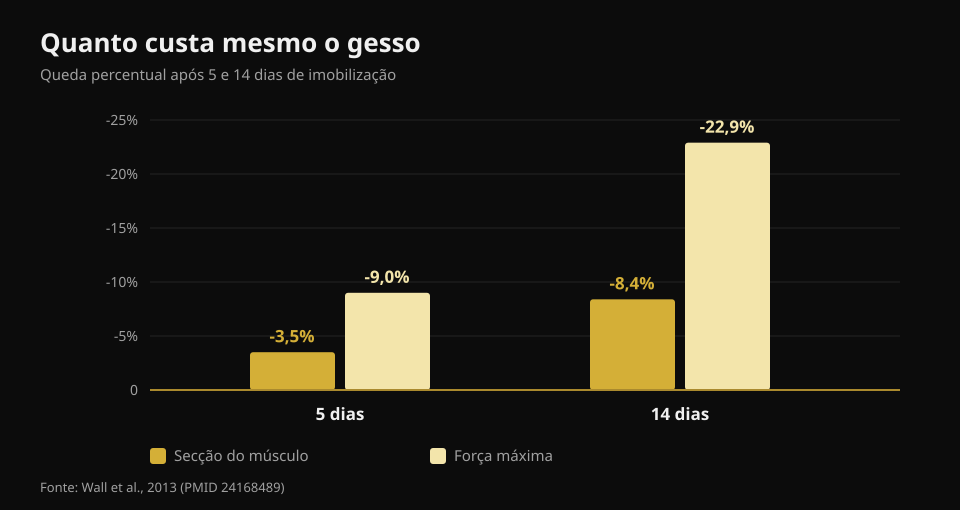
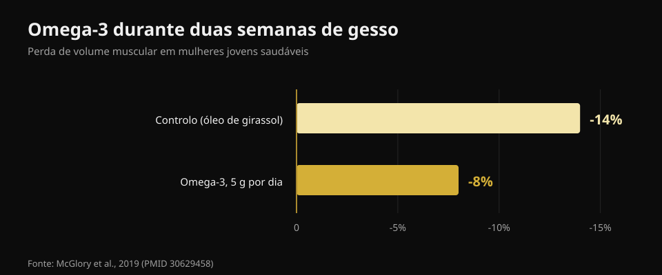

# O que comer quando está lesionado

Por [Giammaria Loi](/autore/giammaria-loi) · atualizado a 21 de outubro de 2026

Lesiona-se, e a primeira reação é quase sempre a mesma: "já não treino, portanto tenho de comer menos ou engordo". É a decisão que mais atrasa a cura. Li oito fontes para perceber o que muda mesmo nas suas necessidades quando para, quanta proteína é precisa e que suplementos têm dados a sério por trás.

## Em resumo

- **A força vai-se muito mais depressa do que o músculo.** Cinco dias de gesso custam 3,5% de secção do quadríceps mas 9% de força; aos catorze dias são 8,4% e 22,9% (Wall et al., 2013).
- **Cortar calorias a mais é o erro verdadeiro.** Um défice mesmo moderado baixa 20 a 30% a síntese proteica, exatamente o processo que reconstrói (Tipton, 2015).
- **A proteína mantém-se alta em gramas absolutos**, à volta de 2 a 2,5 g por kg, sobretudo se as calorias descerem. Mas a recomendação é indireta.
- **A leucina sozinha não funciona.** 7,5 g por dia durante uma semana de imobilização não mudaram secção nem força (Backx et al., 2018).
- **Creatina e ómega-3 têm dados reais**, mas não fazem o mesmo: creatina na reabilitação, ómega-3 durante a paragem.

## Quanto músculo perde mesmo, e a que velocidade

O número que falta em quase tudo o que se escreve sobre isto é a velocidade. Um grupo de Maastricht engessou uma perna a 24 jovens saudáveis, durante cinco ou catorze dias, medindo a secção do quadríceps por TAC e a força máxima antes e depois.

Aos **cinco dias**: secção -3,5%, força -9,0%. Aos **catorze dias**: secção -8,4%, força -22,9%.

*Valores de Wall et al., 2013 (PMID 24168489). Secção do quadríceps por TAC, força como máximo de uma repetição.*

Duas coisas. Primeira: o músculo desce, mas **a força cai quase três vezes mais depressa**. No regresso vai sentir-se muito mais fraco do que o músculo que realmente perdeu — e é normal, porque grande parte dessa força é nervosa e volta depressa. Segunda: o relógio arranca já. Não há semana de cortesia.

A razão metabólica é dupla. A síntese proteica em repouso desce, e o músculo fica **resistente ao estímulo anabólico**: a mesma dose de proteína que antes a elevava bem, agora eleva-a menos. Chama-se resistência anabólica e é o nó de tudo o resto.

## As calorias: o primeiro erro é cortar demais

Circula aqui um número que vale a pena desmontar. Lê-se muitas vezes que uma lesão aumenta o gasto energético 10 a 15%. A estimativa publicada é mais ampla — **de +15% até +50%** — mas diz respeito ao custo da cura, não à necessidade total. E a necessidade total quase sempre **desce**, porque o treino desaparece e mexe-se menos.

A pergunta é quanto, e a resposta é: menos do que pensa. Além do custo da reparação, andar de **canadianas** aumenta **duas a três vezes** o custo energético de se deslocar. Somando as duas coisas, o buraco no balanço é muito menor do que parece quando decide cortar os pratos a meio.

E cortar demais paga-se. Só a síntese proteica consome cerca de **500 kcal por dia** num homem bem musculado, antes de qualquer atividade. Num défice mesmo moderado, síntese proteica e sinalização anabólica descem **20 a 30%**. Está a tirar energia ao processo que tem de reconstruir o tecido. Um balanço negativo atrasa a cicatrização e **acelera** a perda de músculo.

O erro contrário também existe. Num estudo de repouso na cama, o balanço energético **positivo** acelerou a perda de músculo, provavelmente por inflamação sistémica. Nada de "já que estou parado, faço massa". O objetivo na paragem é o equilíbrio.

## A proteína: quanta, e porque conta mais agora

A recomendação publicada é de **2 a 2,5 g por kg de peso por dia** durante a imobilização, ou no mínimo não reduzir a quantidade absoluta de proteína quando reduz calorias. O carrossel de onde parte este artigo acerta quase (1,8 a 2,5 g/kg).

Mas convém dizer como está a evidência, porque ninguém o faz. O mesmo autor dessa recomendação escrevia em 2011 que havia "pouca razão" para subir a proteína durante a imobilização; em 2015 mudou de posição. E num estudo de repouso na cama, passar de 1,0 para 1,6 g/kg **não** reduziu a perda de músculo. Ou seja: manter a proteína alta é o mais sensato e não custa nada, mas não é um seguro.

O problema prático é aritmético. Se come menos 500 kcal por dia e mantém a proteína "em proporção", está a cortá-la em gramas. São precisos alimentos que deem muita proteína por pouca energia. Li as fichas oficiais do CREA uma a uma:

| Alimento (100 g) | Proteína | Calorias | Proteína por 100 kcal |
|---|---|---|---|
| Clara de ovo | 10,7 g | 43 kcal | **24,9 g** |
| Bacalhau ou pescada | 17,0 g | 71 kcal | **23,9 g** |
| Peito de frango | 23,3 g | 100 kcal | **23,3 g** |
| Bresaola (vaca curada) | 33,1 g | 152 kcal | **21,8 g** |
| Iogurte grego 0% | 9,0 g | 51 kcal | **17,6 g** |
| Salmão | 18,4 g | 185 kcal | 9,9 g |
| Ovo inteiro | 12,4 g | 128 kcal | 9,7 g |
| Queijo Grana Padano | 33,9 g | 392 kcal | 8,6 g |
| Lentilhas secas, cozidas | 6,9 g | 109 kcal | 6,3 g |
| Requeijão de vaca | 8,8 g | 146 kcal | 6,0 g |

*Análise da Nurvan sobre as tabelas de composição de alimentos do CREA, atualização de 2019.*

O queijo curado parece óbvio com 33,9 g de proteína por 100 g: por 100 kcal dá 8,6 g, menos de um terço do peito de frango. Quando as calorias são o limite, decide a coluna da direita. O mesmo raciocínio vale em qualquer défice, como expliquei a propósito da [recomposição corporal](/pt/blog/recomposicao-corporal-perder-gordura-ganhar-musculo).

Quanto ao **timing**, o post original é muito preciso: a cada 3 a 4 horas, na primeira hora depois de acordar, 30 a 40 g de caseína antes de dormir. São valores razoáveis tirados da literatura em quem treina, mas o efeito da distribuição das refeições **durante a inatividade forçada nunca foi estudado**. Distribuir bem é prudente, não demonstrado.

## O que a investigação diz mesmo

**Confirmado — as três fases da cura.** Inflamação, proliferação, remodelação: a sequência está certa e as fases sobrepõem-se. Duas notas que o post não dá: a recuperação completa pode levar anos, e **esmagar a inflamação pode atrasar a cura**, porque é a resposta inflamatória que arranca a reparação.

**A precisar — "+10-15% de gasto".** A estimativa publicada vai de +15% a +50% e refere-se à cura, não à necessidade total, que normalmente desce.

**Desmentido — a leucina que "vence a resistência anabólica".** É a única afirmação do post testada diretamente no contexto certo, e o teste é negativo. Trinta jovens, sete dias de gesso na perna, 2,5 g de leucina em cada refeição principal (7,5 g por dia) contra nenhum suplemento. Secção do quadríceps: desceu igual nos dois grupos (p = 0,61). Força: desceu igual (p = 0,052).

**Não verificável — o protocolo de timing.** Nenhum estudo comparou padrões de refeições em pessoas imobilizadas.

**A precisar — o limiar de RED-S.** O diapositivo usa "<20 kcal/kg de massa magra" como marcador de baixa disponibilidade energética. O consenso do Comité Olímpico Internacional de 2023 abandonou o limiar único: a síndrome avalia-se por **gravidade acumulada e estratificação do risco**, com uma ferramenta clínica própria. É um diagnóstico médico.

## Suplementos com dados a sério

**Creatina.** Faz uma coisa precisa, e não é a óbvia: durante duas semanas de gesso não reduziu a perda de secção nem de potência, igual ao placebo. Mas nas dez semanas de reabilitação seguintes, secção do quadríceps e potência máxima **voltaram mais depressa** no grupo da creatina. É um suplemento do regresso, não da paragem.

**Ómega-3.** Vinte mulheres, 5 g por dia começados quatro semanas antes, depois duas semanas de imobilização: o volume muscular desceu **8% contra 14%** no grupo de controlo, e após duas semanas de regresso à normalidade só o grupo do ómega-3 tinha voltado aos valores iniciais.

*Valores de McGlory et al., 2019 (PMID 30629458). Vinte mulheres saudáveis, 5 g por dia de ómega-3 começados quatro semanas antes da imobilização.*

Atenção ao reverso: ómega-3 a mais deprime a inflamação, e a inflamação serve para curar. A dose certa para uma pessoa lesionada não está estabelecida.

**Gelatina e vitamina C.** Oito homens, 15 g de gelatina enriquecida com vitamina C uma hora antes de seis minutos de corda: o marcador de síntese de colagénio no sangue duplicou. Promissor, mas são oito pessoas e um marcador, não um tendão curado.

**Micronutrientes.** A regra é simples: evitar carências faz diferença, acrescentar doses acima da suficiência não. Cálcio e vitamina D adequados contam nas fraturas; megadoses de antioxidantes não mostraram benefício.

**O álcool**, que no post nunca aparece, é a única entrada com efeito negativo documentado: piora a resposta da síntese proteica e atrasa a cicatrização. Tirá-lo é grátis e tem mais provas do que metade dos suplementos.

## Como aplicar

1. **Não corte às cegas.** Estime a queda real de atividade: sem treinos é mais sedentário, mas a cura custa e as canadianas custam. Aponte ao equilíbrio.
2. **Fixe a proteína em gramas, não em percentagem.** Mantenha o alvo em g/kg mesmo com calorias a descer, escolhendo alimentos de alta densidade proteica.
3. **Distribua por 4 a 5 refeições.** Prudente, não demonstrado neste contexto, e grátis.
4. **Mantenha estímulo mecânico onde puder.** O que não está imobilizado treina-se: é precisa muito pouca coisa para conservar o que tem, como contei em [treinar força, músculo e cardio juntos](/pt/blog/treinar-forca-musculo-e-cardio-juntos).
5. **Creatina no regresso, não na paragem.**
6. **Álcool fora.**
7. **Cargas, prazos e regresso decide quem o acompanha.** A nutrição é o acompanhamento, não o plano de tratamento.

> ### Mantenha os números sob controlo enquanto está parado
> A Nurvan calcula o seu alvo de proteína em gramas e mantém-no fixo mesmo quando baixa as calorias, com a base de alimentos CREA para ver na hora quanta proteína está a tomar por caloria. No regresso, as cargas e o RIR registados antes da paragem são o ponto de partida para reconstruir sem exageros. [Experimentar a Nurvan](https://nurvan.app)

## Perguntas frequentes

**Quanta proteína devo comer se estou lesionado?**
A literatura indica cerca de 2 a 2,5 g por kg de peso por dia durante a imobilização e, em qualquer caso, não reduzir a quantidade absoluta de proteína ao reduzir calorias. É uma recomendação de prudência: os estudos diretos são poucos e nem todos positivos.

**Devo comer menos agora que não treino?**
Um pouco menos sim, muito menos não. A necessidade desce porque se mexe menos, mas a cura consome energia e andar de canadianas custa duas a três vezes mais. Um défice marcado baixa a síntese proteica 20 a 30%.

**Perco já toda a massa muscular?**
Não, mas mais depressa do que se julga: cerca de 3,5% de secção do quadríceps em cinco dias e 8,4% em duas semanas. A força cai muito mais, até 23% em duas semanas, e em grande parte é nervosa: volta antes da massa.

**A creatina serve enquanto tenho gesso?**
Os dados dizem que não durante a imobilização, mas sim na reabilitação seguinte: contra placebo, secção e potência voltaram mais depressa no grupo que a tomava.

## Leia também

- [Recomposição corporal: perder gordura e ganhar músculo](/pt/blog/recomposicao-corporal-perder-gordura-ganhar-musculo) — o que faz mesmo um défice com proteína alta.
- [Treinar força, músculo e cardio juntos](/pt/blog/treinar-forca-musculo-e-cardio-juntos) — inclui a dose mínima que mantém força e massa.
- [Quando tomar os suplementos](/pt/blog/quando-tomar-os-suplementos-horario) — o que o horário muda mesmo.

## Fontes

1. Tipton KD, 2015. *Nutritional Support for Exercise-Induced Injuries.* Sports Medicine 45(Suppl 1):S93-104. [PMID 26553492](https://pubmed.ncbi.nlm.nih.gov/26553492/) · [DOI 10.1007/s40279-015-0398-4](https://doi.org/10.1007/s40279-015-0398-4)
2. Tipton KD, 2011. *Nutrition for acute exercise-induced injuries.* Annals of Nutrition and Metabolism 57(Suppl 2):43-53. [PMID 21346336](https://pubmed.ncbi.nlm.nih.gov/21346336/) · [DOI 10.1159/000322703](https://doi.org/10.1159/000322703)
3. Wall BT, Dirks ML, Snijders T, Senden JMG, Dolmans J, van Loon LJC, 2013. *Substantial skeletal muscle loss occurs during only 5 days of disuse.* Acta Physiologica 210(3):600-11. [PMID 24168489](https://pubmed.ncbi.nlm.nih.gov/24168489/) · [DOI 10.1111/apha.12190](https://doi.org/10.1111/apha.12190)
4. Backx EMP, Horstman AMH, Marzuca-Nassr GN, van Kranenburg J, Smeets JS, Fuchs CJ, Janssen AAW, de Groot LCPGM, Snijders T, Verdijk LB, van Loon LJC, 2018. *Leucine Supplementation Does Not Attenuate Skeletal Muscle Loss during Leg Immobilization in Healthy, Young Men.* Nutrients 10(5):635. [PMID 29772844](https://pubmed.ncbi.nlm.nih.gov/29772844/) · [DOI 10.3390/nu10050635](https://doi.org/10.3390/nu10050635)
5. McGlory C, Gorissen SHM, Kamal M, Bahniwal R, Hector AJ, Baker SK, Chabowski A, Phillips SM, 2019. *Omega-3 fatty acid supplementation attenuates skeletal muscle disuse atrophy during two weeks of unilateral leg immobilization in healthy young women.* The FASEB Journal 33(3):4586-4597. [PMID 30629458](https://pubmed.ncbi.nlm.nih.gov/30629458/) · [DOI 10.1096/fj.201801857RRR](https://doi.org/10.1096/fj.201801857RRR)
6. Hespel P, Op't Eijnde B, Van Leemputte M, Ursø B, Greenhaff PL, Labarque V, Dymarkowski S, Van Hecke P, Richter EA, 2001. *Oral creatine supplementation facilitates the rehabilitation of disuse atrophy and alters the expression of muscle myogenic factors in humans.* The Journal of Physiology 536(Pt 2):625-33. [PMID 11600695](https://pubmed.ncbi.nlm.nih.gov/11600695/) · [DOI 10.1111/j.1469-7793.2001.0625c.xd](https://doi.org/10.1111/j.1469-7793.2001.0625c.xd)
7. Shaw G, Lee-Barthel A, Ross MLR, Wang B, Baar K, 2017. *Vitamin C-enriched gelatin supplementation before intermittent activity augments collagen synthesis.* The American Journal of Clinical Nutrition 105(1):136-143. [PMID 27852613](https://pubmed.ncbi.nlm.nih.gov/27852613/) · [DOI 10.3945/ajcn.116.138594](https://doi.org/10.3945/ajcn.116.138594)
8. Mountjoy M, Ackerman KE, Bailey DM, et al., 2023. *2023 International Olympic Committee's (IOC) consensus statement on Relative Energy Deficiency in Sport (REDs).* British Journal of Sports Medicine 57(17):1073-1097. [PMID 37752011](https://pubmed.ncbi.nlm.nih.gov/37752011/) · [DOI 10.1136/bjsports-2023-106994](https://doi.org/10.1136/bjsports-2023-106994)

Valores nutricionais: CREA — Centro de Investigação em Alimentos e Nutrição (Itália), tabelas de composição de alimentos, atualização de 2019.

Referências obtidas através da PubMed. Ponto de partida: um carrossel de **Science for Sport** ([@scienceforsport](https://www.instagram.com/scienceforsport/)) com James Morehen, [publicação original](https://www.instagram.com/p/Dd3SC-iF3d7/). Não foi reproduzido qualquer texto ou imagem da publicação.

---

**Giammaria Loi** é o fundador da Nurvan. Treina com pesos desde 2012, trabalha como personal trainer e coach certificado FIPE desde 2013 e compete em powerlifting a nível nacional desde 2018. Cada artigo que assina parte dos estudos científicos e chega ao que funciona mesmo no ginásio.

> Nota: conteúdo informativo, não substitui a opinião de um médico ou fisioterapeuta. O diagnóstico, as cargas e os prazos de regresso após uma lesão são decididos por quem o acompanha.
