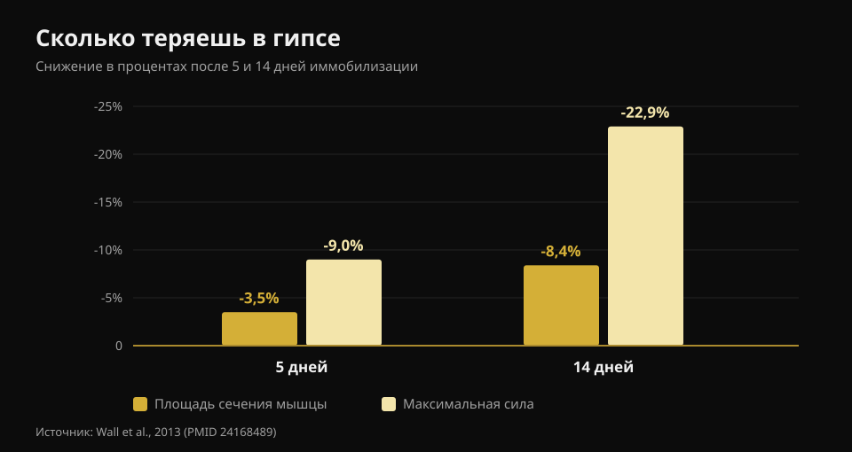
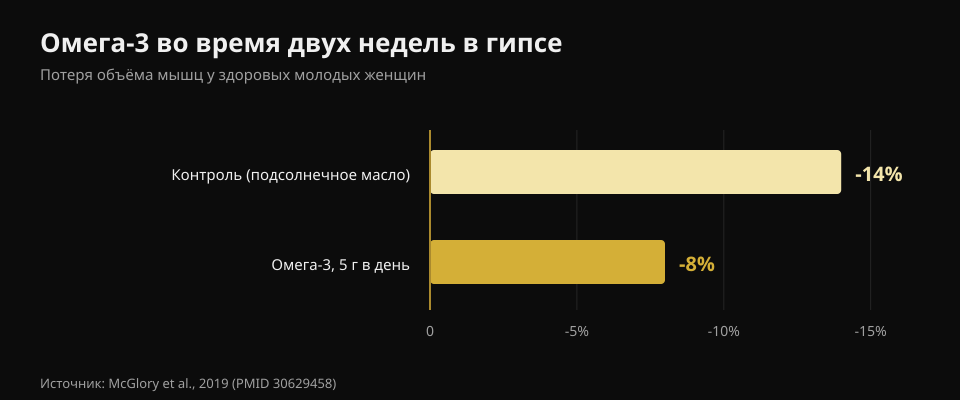

# Что есть при травме: питание во время паузы

Автор: [Джаммария Лои](/autore/giammaria-loi) · обновлено 21 октября 2026

Вы травмировались, и первая реакция почти всегда одна и та же: «я больше не тренируюсь, значит, надо есть меньше, иначе наберу жир». Именно это решение сильнее всего тормозит заживление. Я прочитал восемь источников, чтобы понять, что на самом деле меняется в потребностях во время паузы, сколько нужно белка и у каких добавок есть реальные данные.

## Коротко

- **Сила уходит намного быстрее мышц.** Пять дней в гипсе стоят 3,5% площади сечения квадрицепса, но 9% силы; через четырнадцать дней — 8,4% и 22,9% (Wall et al., 2013).
- **Главная ошибка — слишком урезать калории.** Даже умеренный дефицит снижает синтез мышечного белка на 20-30% — именно тот процесс, который восстанавливает ткань (Tipton, 2015).
- **Белок держим высоким в абсолютных граммах**, около 2-2,5 г на кг, особенно если калории падают. Но рекомендация косвенная.
- **Лейцин сам по себе не работает.** 7,5 г в день в течение недели иммобилизации не изменили ни сечение, ни силу (Backx et al., 2018).
- **У креатина и омега-3 есть реальные данные**, но задачи у них разные: креатин — в реабилитации, омега-3 — во время паузы.

## Сколько мышц теряется на самом деле и как быстро

Цифра, которой нет почти нигде, — это скорость. Группа из Маастрихта наложила гипс на одну ногу 24 здоровым молодым мужчинам на пять или четырнадцать дней, измеряя площадь сечения квадрицепса на КТ и максимальную силу до и после.

Через **пять дней**: сечение -3,5%, сила -9,0%. Через **четырнадцать дней**: сечение -8,4%, сила -22,9%.

*Значения по Wall et al., 2013 (PMID 24168489). Сечение квадрицепса по КТ, сила как максимум на одно повторение.*

Два вывода. Первый: мышца уменьшается, но **сила падает почти втрое быстрее**. При возвращении вы будете чувствовать себя гораздо слабее, чем реально потеряли мышц, — и это нормально, потому что большая часть утраченной силы нервная и возвращается быстро. Второй: отсчёт начинается сразу. Льготной недели нет.

Причина двойная. Синтез белка в покое падает, и мышца становится **устойчивой к анаболическому стимулу**: та же порция белка поднимает синтез слабее, чем раньше. Это анаболическая резистентность, и она — узел всей темы.

## Калории: первая ошибка — урезать слишком сильно

Здесь ходит цифра, которую стоит разобрать спокойно. Часто пишут, что травма повышает расход энергии на 10-15%. Опубликованная оценка шире — **от +15% до +50%** — но она описывает стоимость заживления, а не общую потребность. А общая потребность почти всегда **снижается**, потому что тренировки исчезают и вы меньше двигаетесь.

Вопрос в том, насколько, и ответ: меньше, чем кажется. К стоимости восстановления добавляется ещё одно: ходьба на **костылях** увеличивает энергетическую стоимость передвижения **в два-три раза**. В сумме дыра в балансе гораздо меньше, чем представляется, когда вы решаете урезать порции вдвое.

И урезать слишком сильно обходится дорого, причём измеримо. Один только синтез белка расходует около **500 ккал в день** у хорошо мускулистого мужчины — ещё до всякой активности. При даже умеренном дефиците синтез белка и анаболическая сигнализация падают на **20-30%**. Вы забираете энергию именно у того процесса, который должен восстановить ткань. Отрицательный баланс замедляет заживление ран и **ускоряет** потерю мышц.

Обратная ошибка тоже существует. В исследовании постельного режима **положительный** энергетический баланс ускорил потерю мышц, вероятно через системное воспаление. Никаких «раз всё равно стою, наберу массу». Цель на время паузы — равновесие.

## Белок: сколько и почему именно сейчас это важнее

Опубликованная рекомендация — **2-2,5 г на кг массы тела в сутки** во время иммобилизации или как минимум не снижать абсолютное количество белка, когда снижаете калории. Карусель, с которой начался этот разбор, передаёт это почти верно (1,8-2,5 г/кг).

Но стоит сказать, как обстоит дело с доказательствами, потому что этого не делает никто. Тот же автор в 2011 году писал, что «мало оснований» повышать белок во время иммобилизации; к 2015-му он изменил позицию. А в исследовании постельного режима переход с 1,0 на 1,6 г/кг **не** уменьшил потерю мышц. То есть: держать белок высоким — разумный выбор, который ничего не стоит, но это не страховка.

Настоящая проблема — арифметика. Если вы едите на 500 ккал в день меньше и держите белок «пропорционально», вы режете его в граммах. Нужны продукты, которые дают много белка на мало энергии. Я прочитал официальные карточки CREA одну за другой:

| Продукт (100 г) | Белок | Калории | Белок на 100 ккал |
|---|---|---|---|
| Яичный белок | 10,7 г | 43 ккал | **24,9 г** |
| Треска или хек | 17,0 г | 71 ккал | **23,9 г** |
| Куриная грудка | 23,3 г | 100 ккал | **23,3 г** |
| Брезаола (вяленая говядина) | 33,1 г | 152 ккал | **21,8 г** |
| Греческий йогурт 0% | 9,0 г | 51 ккал | **17,6 г** |
| Лосось | 18,4 г | 185 ккал | 9,9 г |
| Яйцо целиком | 12,4 г | 128 ккал | 9,7 г |
| Сыр Грана Падано | 33,9 г | 392 ккал | 8,6 г |
| Чечевица сухая, варёная | 6,9 г | 109 ккал | 6,3 г |
| Рикотта из коровьего молока | 8,8 г | 146 ккал | 6,0 г |

*Расчёт Nurvan по таблицам состава продуктов CREA, обновление 2019 года.*

Твёрдый сыр кажется очевидным выбором: 33,9 г белка на 100 г. Но на 100 ккал он даёт 8,6 г — меньше трети куриной грудки. Когда ограничение — калории, решает правый столбец. Та же логика работает в любом дефиците, как я разбирал в материале о [рекомпозиции тела](/ru/blog/rekompozitsiya-tela-szhech-zhir-nabrat-myshtsy).

О **времени приёма** исходный пост очень конкретен: каждые 3-4 часа, в течение часа после пробуждения, 30-40 г казеина перед сном. Это разумные ориентиры из литературы о тренирующихся, но влияние распределения приёмов пищи **во время вынужденной неподвижности никогда не изучалось**. Распределять равномерно разумно, но не доказано.

## Что на самом деле говорит наука

**Подтверждено — три фазы заживления.** Воспаление, пролиферация, ремоделирование: последовательность верна, фазы перекрываются. Два дополнения, которых в посте нет: полное восстановление может занять годы, и **подавление воспаления способно замедлить заживление**, потому что именно воспалительный ответ запускает восстановление.

**Требует уточнения — «+10-15% расхода».** Опубликованная оценка от +15% до +50% и касается заживления, а не общей потребности, которая обычно снижается.

**Опровергнуто — лейцин против анаболической резистентности.** Это единственное утверждение поста, проверенное напрямую в нужном контексте, и результат отрицательный. Тридцать молодых мужчин, семь дней гипса на ноге, 2,5 г лейцина с каждым основным приёмом пищи (7,5 г в день) против отсутствия добавки. Сечение квадрицепса: снизилось одинаково в обеих группах (p = 0,61). Сила: снизилась одинаково (p = 0,052).

**Не проверяемо — протокол времени приёма.** Ни одно исследование не сравнивало схемы питания у обездвиженных людей.

**Требует уточнения — порог REDs.** На слайде «<20 ккал/кг безжировой массы» подаётся как маркер низкой доступности энергии. Консенсус Международного олимпийского комитета 2023 года отказался от единого порога: синдром оценивают по **накопленной тяжести и стратификации риска** специальным клиническим инструментом. Это медицинский диагноз, а не домашний расчёт.

## Добавки с реальными данными

**Креатин.** Он делает одну конкретную вещь, и не ту, что кажется: за две недели в гипсе он не уменьшил потерю сечения и мощности — как плацебо. Но за последующие десять недель реабилитации сечение квадрицепса и максимальная мощность **вернулись быстрее** в группе креатина. Это добавка для возвращения, а не для паузы.

**Омега-3.** Двадцать женщин, 5 г в день начиная за четыре недели, затем две недели иммобилизации: объём мышц снизился на **8% против 14%** в контрольной группе, а после двух недель обычной активности к исходным значениям вернулась только группа омега-3.

*Значения по McGlory et al., 2019 (PMID 30629458). Двадцать здоровых женщин, 5 г омега-3 в день, начало за четыре недели до иммобилизации.*

Но есть и обратная сторона: избыток омега-3 подавляет воспаление, а воспаление нужно для заживления. Подходящая доза для травмированного человека не установлена.

**Желатин и витамин C.** Восемь мужчин, 15 г желатина с витамином C за час до шести минут прыжков со скакалкой: маркер синтеза коллагена в крови удвоился. Многообещающе, но это восемь человек и маркер, а не заживший сухожилие.

**Микронутриенты.** Правило простое: избегать дефицита важно, добавлять дозы сверх достаточности — нет. Достаточные кальций и витамин D важны при переломах; мегадозы антиоксидантов пользы не показали.

**Алкоголь**, которого в посте нет вовсе, — единственный пункт с документированным отрицательным эффектом: он ухудшает ответ синтеза белка и замедляет заживление ран. Убрать его бесплатно и доказано лучше, чем половина добавок.

## Как это применить

1. **Не режьте вслепую.** Оцените реальное падение активности: без тренировок вы малоподвижнее, но заживление стоит энергии, и костыли стоят. Цельтесь в равновесие.
2. **Фиксируйте белок в граммах, а не в процентах.** Держите цель в г/кг даже при снижении калорий, выбирая продукты с высокой белковой плотностью.
3. **Распределите на 4-5 приёмов.** Разумно, в этом контексте не доказано, и бесплатно.
4. **Сохраняйте механический стимул там, где можно.** То, что не обездвижено, нужно тренировать: чтобы сохранить имеющееся, нужно совсем немного — об этом в тексте [о тренировке силы, мышц и кардио вместе](/ru/blog/trenirovka-sily-myshts-i-kardio-vmeste).
5. **Креатин на возвращении, а не во время паузы.**
6. **Алкоголь убрать.**
7. **Нагрузки, сроки и возвращение определяет тот, кто вас ведёт.** Питание — сопровождение, а не план лечения.

> ### Держите цифры под контролем, пока стоите на паузе
> Nurvan считает вашу цель по белку в граммах и удерживает её, даже когда вы снижаете калории, а база продуктов CREA показывает, сколько белка вы получаете на калорию. При возвращении веса и RIR, записанные до паузы, становятся точкой отсчёта, чтобы восстанавливаться без перебора. [Попробовать Nurvan](https://nurvan.app)

## Частые вопросы

**Сколько белка есть при травме?**
Литература указывает примерно 2-2,5 г на кг массы тела в сутки во время иммобилизации и в любом случае — не снижать абсолютное количество белка при снижении калорий. Это рекомендация предосторожности: прямых исследований мало и не все положительные.

**Нужно ли есть меньше, раз я не тренируюсь?**
Немного меньше — да, намного меньше — нет. Потребность снижается, потому что вы меньше двигаетесь, но заживление расходует энергию, а ходьба на костылях стоит в два-три раза дороже. Выраженный дефицит снижает синтез белка на 20-30%.

**Я сразу потеряю все мышцы?**
Нет, но быстрее, чем принято думать: около 3,5% сечения квадрицепса за пять дней и 8,4% за две недели. Сила падает гораздо сильнее, до 23% за две недели, и в значительной мере она нервная: возвращается быстрее массы.

**Нужен ли креатин, пока я в гипсе?**
Данные говорят, что во время иммобилизации нет, а в последующей реабилитации да: по сравнению с плацебо сечение и мощность возвращались быстрее в группе, принимавшей креатин.

## Читайте также

- [Рекомпозиция тела: сжечь жир и набрать мышцы](/ru/blog/rekompozitsiya-tela-szhech-zhir-nabrat-myshtsy) — что на самом деле делает дефицит с высоким белком.
- [Тренировка силы, мышц и кардио вместе](/ru/blog/trenirovka-sily-myshts-i-kardio-vmeste) — включая минимальную дозу, которая сохраняет силу и массу.
- [Когда принимать добавки](/ru/blog/kogda-prinimat-dobavki-vremya) — что реально меняет время приёма.

## Источники

1. Tipton KD, 2015. *Nutritional Support for Exercise-Induced Injuries.* Sports Medicine 45(Suppl 1):S93-104. [PMID 26553492](https://pubmed.ncbi.nlm.nih.gov/26553492/) · [DOI 10.1007/s40279-015-0398-4](https://doi.org/10.1007/s40279-015-0398-4)
2. Tipton KD, 2011. *Nutrition for acute exercise-induced injuries.* Annals of Nutrition and Metabolism 57(Suppl 2):43-53. [PMID 21346336](https://pubmed.ncbi.nlm.nih.gov/21346336/) · [DOI 10.1159/000322703](https://doi.org/10.1159/000322703)
3. Wall BT, Dirks ML, Snijders T, Senden JMG, Dolmans J, van Loon LJC, 2013. *Substantial skeletal muscle loss occurs during only 5 days of disuse.* Acta Physiologica 210(3):600-11. [PMID 24168489](https://pubmed.ncbi.nlm.nih.gov/24168489/) · [DOI 10.1111/apha.12190](https://doi.org/10.1111/apha.12190)
4. Backx EMP, Horstman AMH, Marzuca-Nassr GN, van Kranenburg J, Smeets JS, Fuchs CJ, Janssen AAW, de Groot LCPGM, Snijders T, Verdijk LB, van Loon LJC, 2018. *Leucine Supplementation Does Not Attenuate Skeletal Muscle Loss during Leg Immobilization in Healthy, Young Men.* Nutrients 10(5):635. [PMID 29772844](https://pubmed.ncbi.nlm.nih.gov/29772844/) · [DOI 10.3390/nu10050635](https://doi.org/10.3390/nu10050635)
5. McGlory C, Gorissen SHM, Kamal M, Bahniwal R, Hector AJ, Baker SK, Chabowski A, Phillips SM, 2019. *Omega-3 fatty acid supplementation attenuates skeletal muscle disuse atrophy during two weeks of unilateral leg immobilization in healthy young women.* The FASEB Journal 33(3):4586-4597. [PMID 30629458](https://pubmed.ncbi.nlm.nih.gov/30629458/) · [DOI 10.1096/fj.201801857RRR](https://doi.org/10.1096/fj.201801857RRR)
6. Hespel P, Op't Eijnde B, Van Leemputte M, Ursø B, Greenhaff PL, Labarque V, Dymarkowski S, Van Hecke P, Richter EA, 2001. *Oral creatine supplementation facilitates the rehabilitation of disuse atrophy and alters the expression of muscle myogenic factors in humans.* The Journal of Physiology 536(Pt 2):625-33. [PMID 11600695](https://pubmed.ncbi.nlm.nih.gov/11600695/) · [DOI 10.1111/j.1469-7793.2001.0625c.xd](https://doi.org/10.1111/j.1469-7793.2001.0625c.xd)
7. Shaw G, Lee-Barthel A, Ross MLR, Wang B, Baar K, 2017. *Vitamin C-enriched gelatin supplementation before intermittent activity augments collagen synthesis.* The American Journal of Clinical Nutrition 105(1):136-143. [PMID 27852613](https://pubmed.ncbi.nlm.nih.gov/27852613/) · [DOI 10.3945/ajcn.116.138594](https://doi.org/10.3945/ajcn.116.138594)
8. Mountjoy M, Ackerman KE, Bailey DM, et al., 2023. *2023 International Olympic Committee's (IOC) consensus statement on Relative Energy Deficiency in Sport (REDs).* British Journal of Sports Medicine 57(17):1073-1097. [PMID 37752011](https://pubmed.ncbi.nlm.nih.gov/37752011/) · [DOI 10.1136/bjsports-2023-106994](https://doi.org/10.1136/bjsports-2023-106994)

Пищевая ценность: CREA — Исследовательский центр пищевых продуктов и питания (Италия), таблицы состава продуктов, обновление 2019 года.

Ссылки получены через PubMed. Отправная точка: карусель **Science for Sport** ([@scienceforsport](https://www.instagram.com/scienceforsport/)) с Джеймсом Мореэном, [исходная публикация](https://www.instagram.com/p/Dd3SC-iF3d7/). Ни текст, ни изображения публикации не воспроизводились.

---

**Джаммария Лои** — основатель Nurvan. Занимается с отягощениями с 2012 года, работает персональным тренером и коучем с сертификатом FIPE с 2013 года и выступает в пауэрлифтинге на национальном уровне с 2018 года. Каждая его статья начинается с научных исследований и заканчивается тем, что реально работает в зале.

> Примечание: информационный материал, не заменяет консультацию врача или физиотерапевта. Диагноз, нагрузки и сроки возвращения после травмы определяет тот, кто вас ведёт.
