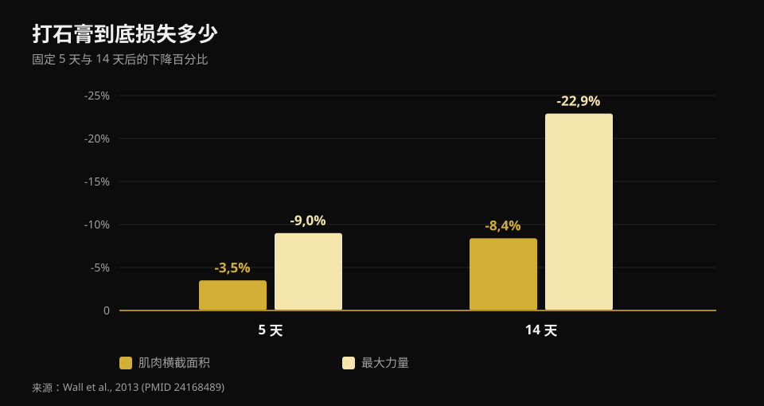
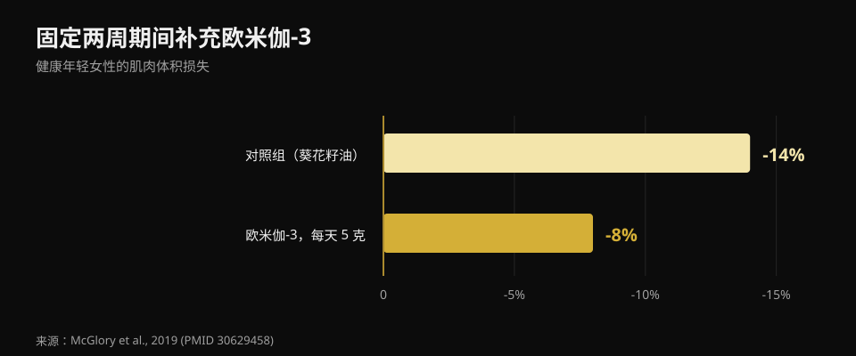

# 受伤时该吃什么：停训期的饮食

作者：[Giammaria Loi](/autore/giammaria-loi) · 更新于 2026 年 10 月 21 日

受伤后的第一反应几乎都一样："练不了了，所以得少吃，不然要长胖。"恰恰是这个决定最拖慢愈合。我读了八份资料，弄清停训后你的能量需求真正发生了什么变化、蛋白质要吃多少，以及哪些补剂背后有真实数据。

## 要点速览

- **力量流失比肌肉快得多。** 打五天石膏，股四头肌横截面积少 3.5%，力量却少 9%；到十四天分别是 8.4% 和 22.9%（Wall et al., 2013）。
- **真正的错误是热量砍太狠。** 即使中等程度的热量缺口，也会让肌肉蛋白合成下降 20-30%，而这正是重建组织的过程（Tipton, 2015）。
- **蛋白质要按绝对克数维持高位**，大约每公斤体重 2-2.5 克，尤其在热量下降时。但这条建议是间接推导出来的。
- **单吃亮氨酸没用。** 一周固定期间每天 7.5 克，横截面积和力量都没有改变（Backx et al., 2018）。
- **肌酸和欧米伽-3 确实有数据**，但作用不同：肌酸用于康复期，欧米伽-3 用于停训期。

## 到底会掉多少肌肉，掉得有多快

几乎所有相关内容里都缺的那个数字，是速度。马斯特里赫特的一个团队给 24 名健康年轻男性的一条腿打石膏，分别五天或十四天，前后用 CT 测量股四头肌横截面积，并测最大力量。

**五天后**：横截面积 -3.5%，力量 -9.0%。**十四天后**：横截面积 -8.4%，力量 -22.9%。

*数据来自 Wall et al., 2013 (PMID 24168489)。股四头肌横截面积由 CT 测量，力量为一次最大重复。*

两点结论。第一：肌肉在缩小，但**力量下降的速度快了将近三倍**。复出时你会觉得自己比实际掉的肌肉虚弱得多——这很正常，因为流失的力量很大一部分是神经性的，回来得很快。第二：时钟立刻开始走，没有宽限的第一周。

代谢上的原因有两层。静息状态下的蛋白合成下降，同时肌肉对**合成代谢刺激变得迟钝**：以前能把合成率拉高的同一份蛋白质，现在拉不动了。这就是"合成代谢抵抗"，也是整个话题的核心。

## 热量：第一个错误就是砍太多

这里有个数字值得慢慢拆开。常见说法是受伤会让能量消耗增加 10-15%。已发表的估计其实更宽——**从 +15% 到 +50%**——但它说的是愈合的成本，不是总需求。而总需求几乎总是**下降**的，因为训练没了，活动也少了。

问题是下降多少，答案是：比你以为的少。除了修复的成本，如果你拄**拐杖**走路，移动的能量成本会增加**两到三倍**。两项相加，缺口远比你决定把饭量减半时感觉到的小。

砍太狠的代价是可以量化的。光是蛋白合成，在一名肌肉量不错的男性身上每天就消耗约 **500 千卡**，这还不算任何活动。在哪怕中等程度的缺口下，蛋白合成和相关的合成代谢信号会下降 **20-30%**。你等于在给必须重建组织的那个过程断粮。负平衡会拖慢伤口愈合，并**加速**肌肉流失。

反方向的错误同样存在。在一项卧床研究中，**正能量平衡**反而加快了肌肉流失，很可能是通过全身性炎症。所以不要想着"反正停着，干脆增肌"。停训期的目标是平衡。

## 蛋白质：吃多少，为什么现在更关键

已发表的建议是固定期间每天每公斤体重 **2-2.5 克**，至少在减少热量时不要减少蛋白质的绝对量。引出这篇文章的那组图片说得大体正确（1.8-2.5 克/公斤）。

但证据的实际状况值得说清楚，因为没人说。提出这条建议的同一位作者在 2011 年还写道，固定期间提高蛋白质"没有太多依据"；到 2015 年他改变了立场。而在一项卧床研究中，从 1.0 克/公斤提高到 1.6 克/公斤**并没有**减少肌肉流失。所以：把蛋白质维持在高位是最合理的选择，而且不花什么成本，但它不是保险。

真正的难题是算术。如果你每天少吃 500 千卡，又"按比例"保留蛋白质，实际上就是在按克数削减它。你需要的是每单位能量提供大量蛋白质的食物。我逐条读了意大利 CREA 的官方食物成分表：

| 食物（100 克） | 蛋白质 | 热量 | 每 100 千卡的蛋白质 |
|---|---|---|---|
| 蛋白 | 10.7 克 | 43 千卡 | **24.9 克** |
| 鳕鱼或无须鳕 | 17.0 克 | 71 千卡 | **23.9 克** |
| 鸡胸肉 | 23.3 克 | 100 千卡 | **23.3 克** |
| 风干牛肉（Bresaola） | 33.1 克 | 152 千卡 | **21.8 克** |
| 零脂希腊酸奶 | 9.0 克 | 51 千卡 | **17.6 克** |
| 三文鱼 | 18.4 克 | 185 千卡 | 9.9 克 |
| 全蛋 | 12.4 克 | 128 千卡 | 9.7 克 |
| 帕达诺干酪 | 33.9 克 | 392 千卡 | 8.6 克 |
| 干扁豆（煮熟） | 6.9 克 | 109 千卡 | 6.3 克 |
| 牛奶里科塔 | 8.8 克 | 146 千卡 | 6.0 克 |

*Nurvan 根据 CREA 食物成分表（2019 年更新）整理。*

硬质奶酪每 100 克有 33.9 克蛋白质，看起来是显而易见的选择：但每 100 千卡只给 8.6 克，不到鸡胸肉的三分之一。当热量是约束条件时，决定权在右边那一栏。同样的逻辑适用于任何热量缺口，我在[身体成分重组](/zh/blog/shenti-chengfen-chongzu-jianzhi-zengji)一文里讲过。

关于**时间安排**，原帖非常具体：每 3-4 小时一次，醒后一小时内，睡前 30-40 克酪蛋白。这些数字取自针对训练者的文献，是合理的参考，但进食分配在**被迫不活动期间的效果从未被研究过**。均匀分配是谨慎做法，不是已证实的结论。

## 研究究竟怎么说

**确认——愈合的三个阶段。** 炎症、增殖、重塑：顺序正确，阶段之间互相重叠。有两点原帖没说：完全恢复可能需要数年，而且**压制炎症反而可能拖慢愈合**，因为正是炎症反应启动了修复。

**需要修正——"消耗增加 10-15%"。** 已发表的估计是 +15% 到 +50%，而且说的是愈合，不是总需求，总需求通常是下降的。

**被否定——亮氨酸"克服合成代谢抵抗"。** 这是原帖中唯一在正确情境下被直接检验过的说法，而结果是阴性的。三十名年轻男性，腿部打石膏七天，每顿正餐补 2.5 克亮氨酸（每天 7.5 克）对比不补。股四头肌横截面积：两组下降幅度相同（p = 0.61）。力量：下降幅度相同（p = 0.052）。

**无法验证——时间安排方案。** 没有任何研究比较过固定人群的不同进食模式。

**需要修正——REDs 的阈值。** 幻灯片用"<20 千卡/公斤去脂体重"作为低能量可用性的标志。国际奥委会 2023 年共识已放弃单一阈值：该综合征改为按**累积严重程度和风险分层**评估，并配有专门的临床工具。这是医学诊断，不是在家算出来的数字。

## 有真实数据的补剂

**肌酸。** 它做的事很具体，但不是你以为的那件：在两周石膏固定期间，它并没有减少横截面积和功率的流失，与安慰剂无异。但在随后十周的康复中，股四头肌横截面积和最大功率在肌酸组**恢复得更快**。它是复出期的补剂，不是停训期的。

**欧米伽-3。** 二十名女性，提前四周开始每天 5 克，随后两周固定：肌肉体积下降 **8%，对照组为 14%**，而恢复正常活动两周后，只有欧米伽-3 组回到了基线水平。

*数据来自 McGlory et al., 2019 (PMID 30629458)。二十名健康女性，固定前四周开始每天补充 5 克欧米伽-3。*

但要注意反面：欧米伽-3 过量会压制炎症，而炎症正是愈合所需。对受伤者合适的剂量尚未确定。

**明胶与维生素 C。** 八名男性，在六分钟跳绳前一小时摄入 15 克添加维生素 C 的明胶：血液中胶原合成标志物翻倍。很有希望，但那是八个人和一个标志物，不是一条愈合的肌腱。

**微量营养素。** 规则很简单：避免缺乏很重要，在充足之上再加量则没有意义。骨折时充足的钙和维生素 D 有意义；抗氧化剂大剂量未显示益处。

**酒精**在原帖中从未出现，却是唯一有明确负面证据的一项：它会削弱蛋白合成的反应并拖慢伤口愈合。戒掉它不花钱，证据比一半补剂都扎实。

## 怎么落实

1. **不要盲目削减。** 估算活动量的真实下降：不训练确实更久坐，但愈合要耗能，拄拐更耗能。目标是平衡，不是缺口。
2. **蛋白质按克锁定，不按百分比。** 把目标定在克/公斤并保持不变，即使热量下降，靠高蛋白密度的食物来达成。
3. **分成 4-5 次摄入。** 谨慎之举，在这个情境下未被证实，而且免费。
4. **能保留机械刺激的部位就继续练。** 没被固定的部分照样训练：维持现有水平所需的量少得惊人，我在[力量、肌肉与有氧同时训练](/zh/blog/liliang-jirou-youyang-tongshi-xunlian)里讲过。
5. **肌酸放在复出期，不是停训期。**
6. **戒酒。**
7. **负荷、时间表和复出由治疗你的人决定。** 营养是配角，不是治疗方案。

> ### 停训期间也把数字握在手里
> Nurvan 会把你的蛋白质目标按克计算并保持稳定，即使你降低热量也不变；配合 CREA 食物数据库，你能立刻看到每一千卡摄入了多少蛋白质。复出时，停训前记录的负重和 RIR 就是重新搭建训练的起点，避免一上来就过量。[试用 Nurvan](https://nurvan.app)

## 常见问题

**受伤时每天该吃多少蛋白质？**
文献指向固定期间每天每公斤体重约 2-2.5 克，并且在减少热量时无论如何不要减少蛋白质的绝对量。这是一条审慎的建议：直接研究很少，而且并非都是阳性结果。

**不训练了是不是该少吃？**
少吃一点可以，大幅少吃不行。需求下降是因为活动减少，但愈合要消耗能量，拄拐走路的消耗是平时的两到三倍。明显的热量缺口会让蛋白合成下降 20-30%。

**肌肉会马上全掉光吗？**
不会，但比多数人想的快：五天约掉 3.5% 的股四头肌横截面积，两周约 8.4%。力量掉得多得多，两周可达 23%，而其中很大一部分是神经性的，回来的速度比肌肉量快。

**打着石膏吃肌酸有用吗？**
数据显示固定期间没用，但随后的康复期有用：与安慰剂相比，服用肌酸组的横截面积和功率恢复更快。

## 延伸阅读

- [身体成分重组：同时减脂增肌](/zh/blog/shenti-chengfen-chongzu-jianzhi-zengji) —— 高蛋白缺口究竟能做到什么。
- [力量、肌肉与有氧同时训练](/zh/blog/liliang-jirou-youyang-tongshi-xunlian) —— 包含维持力量与肌肉量的最低剂量。
- [补剂什么时间吃](/zh/blog/buji-shenme-shijian-chi) —— 时间安排到底改变了什么。

## 参考文献

1. Tipton KD, 2015. *Nutritional Support for Exercise-Induced Injuries.* Sports Medicine 45(Suppl 1):S93-104. [PMID 26553492](https://pubmed.ncbi.nlm.nih.gov/26553492/) · [DOI 10.1007/s40279-015-0398-4](https://doi.org/10.1007/s40279-015-0398-4)
2. Tipton KD, 2011. *Nutrition for acute exercise-induced injuries.* Annals of Nutrition and Metabolism 57(Suppl 2):43-53. [PMID 21346336](https://pubmed.ncbi.nlm.nih.gov/21346336/) · [DOI 10.1159/000322703](https://doi.org/10.1159/000322703)
3. Wall BT, Dirks ML, Snijders T, Senden JMG, Dolmans J, van Loon LJC, 2013. *Substantial skeletal muscle loss occurs during only 5 days of disuse.* Acta Physiologica 210(3):600-11. [PMID 24168489](https://pubmed.ncbi.nlm.nih.gov/24168489/) · [DOI 10.1111/apha.12190](https://doi.org/10.1111/apha.12190)
4. Backx EMP, Horstman AMH, Marzuca-Nassr GN, van Kranenburg J, Smeets JS, Fuchs CJ, Janssen AAW, de Groot LCPGM, Snijders T, Verdijk LB, van Loon LJC, 2018. *Leucine Supplementation Does Not Attenuate Skeletal Muscle Loss during Leg Immobilization in Healthy, Young Men.* Nutrients 10(5):635. [PMID 29772844](https://pubmed.ncbi.nlm.nih.gov/29772844/) · [DOI 10.3390/nu10050635](https://doi.org/10.3390/nu10050635)
5. McGlory C, Gorissen SHM, Kamal M, Bahniwal R, Hector AJ, Baker SK, Chabowski A, Phillips SM, 2019. *Omega-3 fatty acid supplementation attenuates skeletal muscle disuse atrophy during two weeks of unilateral leg immobilization in healthy young women.* The FASEB Journal 33(3):4586-4597. [PMID 30629458](https://pubmed.ncbi.nlm.nih.gov/30629458/) · [DOI 10.1096/fj.201801857RRR](https://doi.org/10.1096/fj.201801857RRR)
6. Hespel P, Op't Eijnde B, Van Leemputte M, Ursø B, Greenhaff PL, Labarque V, Dymarkowski S, Van Hecke P, Richter EA, 2001. *Oral creatine supplementation facilitates the rehabilitation of disuse atrophy and alters the expression of muscle myogenic factors in humans.* The Journal of Physiology 536(Pt 2):625-33. [PMID 11600695](https://pubmed.ncbi.nlm.nih.gov/11600695/) · [DOI 10.1111/j.1469-7793.2001.0625c.xd](https://doi.org/10.1111/j.1469-7793.2001.0625c.xd)
7. Shaw G, Lee-Barthel A, Ross MLR, Wang B, Baar K, 2017. *Vitamin C-enriched gelatin supplementation before intermittent activity augments collagen synthesis.* The American Journal of Clinical Nutrition 105(1):136-143. [PMID 27852613](https://pubmed.ncbi.nlm.nih.gov/27852613/) · [DOI 10.3945/ajcn.116.138594](https://doi.org/10.3945/ajcn.116.138594)
8. Mountjoy M, Ackerman KE, Bailey DM, et al., 2023. *2023 International Olympic Committee's (IOC) consensus statement on Relative Energy Deficiency in Sport (REDs).* British Journal of Sports Medicine 57(17):1073-1097. [PMID 37752011](https://pubmed.ncbi.nlm.nih.gov/37752011/) · [DOI 10.1136/bjsports-2023-106994](https://doi.org/10.1136/bjsports-2023-106994)

营养成分数值：CREA —— 意大利食品与营养研究中心，食物成分表，2019 年更新。

文献通过 PubMed 检索。起点：**Science for Sport**（[@scienceforsport](https://www.instagram.com/scienceforsport/)）与 James Morehen 的一组图文，[原帖](https://www.instagram.com/p/Dd3SC-iF3d7/)。该帖的文字与图片均未被复制使用。

---

**Giammaria Loi** 是 Nurvan 的创始人。他自 2012 年开始力量训练，2013 年起担任 FIPE 认证私人教练，2018 年起参加全国级力量举比赛。他署名的每篇文章都从科学研究出发，落到健身房里真正有效的做法。

> 注：本文为科普内容，不能替代医生或物理治疗师的意见。受伤后的诊断、负荷安排和复出时间应由为你治疗的人决定。
