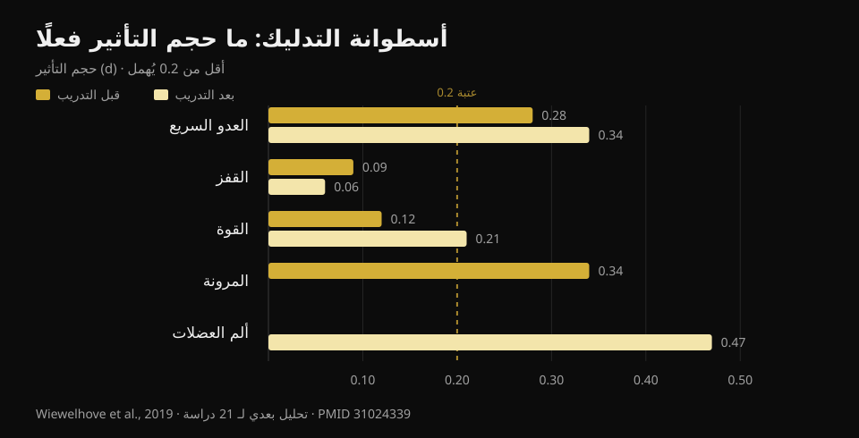
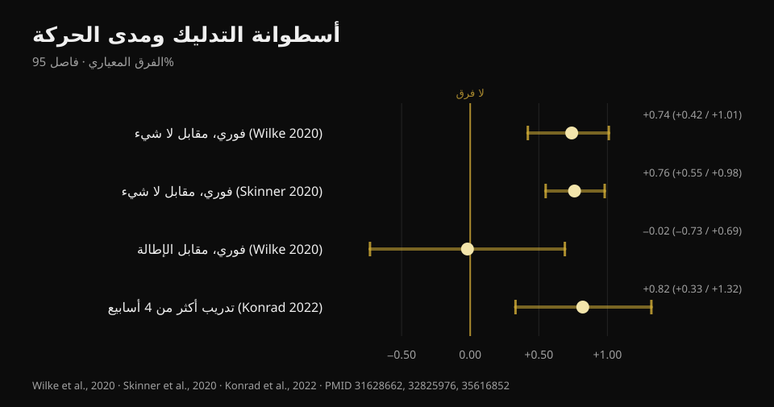

# أسطوانة التدليك: هل تفيد فعلًا؟ ما تقوله الأبحاث

بقلم [Giammaria Loi](/autore/giammaria-loi) · حُدِّث في 22 أكتوبر 2026

منشور واسع الانتشار يصف أسطوانة التدليك بثلاثة "لا": لا تفكّ اللفافة، لا ترفع الأداء، لا تمنع الإصابات. ويبقى بعض النفع على وجع العضلات ومدى الحركة، لكنه "مؤقت". قرأتُ ثماني دراسات مفهرسة لمراجعة هذه الـ"لا" الثلاثة. اثنتان منها تصمدان تمامًا، والثالثة أضعف مما يُروى — أما الجزء الخاص بمدى الحركة فقد تجاوزته الأبحاث: هناك رقم لم يذكره المنشور، وهو يغيّر الطريقة التي يُستخدم بها الرولر.

## باختصار

- **الأسطوانة لا تغيّر صلابة النسيج اللفافي العضلي**: التحليل البعدي الوحيد الذي قاس ذلك بأجهزة موضوعية لم يجد أي أثر (Glänzel وآخرون، 2023). فكرة "إذابة اللفافة" لا تظهر على الأجهزة.
- **الأثر على الأداء ضئيل جدًا**: قبل التمرين يتحسّن العدو السريع بنسبة 0.7% والمرونة بنسبة 4.0%، بينما الأثر على القفز والقوة مهمَل (Wiewelhove وآخرون، 2019). لكنها لا تُضعف الأداء أيضًا: هنا تكمن الفائدة الحقيقية.
- **أكبر أثر على الإطلاق هو على وجع العضلات**: ‎+6.0%‎، d = 0.47، وهي القيمة الوحيدة التي تقترب من حجم متوسط في كل الأدبيات (Wiewelhove وآخرون، 2019). لكنها تحتاج جرعة: **‎90 ثانية على الأقل لكل مجموعة عضلية** (Hughes وRamer، 2019).
- **عبارة "مكاسب مؤقتة في مدى الحركة" لم تعد صحيحة.** الاستمرار على الرولر **لأكثر من 4 أسابيع** يعطي مكاسب ثابتة في مدى الحركة (ES = 0.82) مقارنةً بمن لا يفعل (Konrad وآخرون، 2022).
- **أما الإصابات فلا توجد إجابة نظيفة**: الدراسة الوقائية الوحيدة تجمع الرولر مع تدريب القوة معًا، فلا يمكنها قول شيء عن الرولر وحده (Desai وآخرون، 2023).

## "تفكّ اللفافة": هنا المنشور على حق

هذه أكثر عبارة تتكرر في الصالات، وأسهلها نقضًا، لأن أحدهم ذهب فعلًا ليقيسها.

في 2023 جمع فريق برازيلي عشرين دراسة قيّمت بأجهزة موضوعية ما يحدث للأنسجة بعد جلسة فوم رولينغ: صلابة لفافة الجذع والفخذ، وصلابة عضلات الفخذ والساق، وقوة الركبة والقدم. بعض الدراسات المفردة سجّلت انخفاضًا في الصلابة — اثنتان في اللفافة وخمس في العضلة — لكن **عند تجميع البيانات في التحليل البعدي يختفي الأثر على صلابة النسيج اللفافي**.

ويجدر إضافة التحفّظ الذي وضعه الباحثون أنفسهم: بمنهجية GRADE فإن درجة اليقين في الأدلة **منخفضة**، أي أن دراسات أفضل قد تغيّر الصورة. "لا نملك دليلًا على حدوثه" ليست مطابقة لـ"ثبت أنه لا يحدث". لكن في الأثناء، إذا بيعت لك الأسطوانة بوصفها أداة تعيد تشكيل النسيج الضام، فهذا البيع بلا أساس.

التفسير الأكثر قبولًا لما تشعر به تحت الرولر عصبي لا ميكانيكي: ما يتغيّر هو تحمّل الانزعاج والإدراك، لا البنية. وهذا ليس بالقليل — لكنه شيء آخر.

## الأداء: المسألة ليست أنها ترفعه

هنا المنشور يقول الصواب لكنه يضع النبرة في المكان الخطأ.

التحليل البعدي المرجعي صدر في 2019: إحدى وعشرون دراسة، مقسّمة بين من استخدم الرولر **قبل** التمرين (أربع عشرة دراسة) ومن استخدمه **بعده** (سبع دراسات). الأرقام قبل التمرين:

- العدو السريع **‎+0.7%‎** (d = 0.28)
- المرونة **‎+4.0%‎** (d = 0.34)
- القفز **‎−1.9%‎** (d = 0.09)
- القوة **‎+1.8%‎** (d = 0.12)

وبعد التمرين، كاستراتيجية تعافٍ:

- العدو السريع **‎+3.1%‎** (d = 0.34)
- القوة **‎+3.9%‎** (d = 0.21)
- ألم العضلات المُدرَك **‎+6.0%‎** (d = 0.47)
- القفز **‎−0.2%‎** (d = 0.06)

*حجم الأثر (d) لأسطوانة التدليك على الأداء والمرونة وألم العضلات. أقل من 0.2 يُعدّ مهمَلًا. المصدر: Wiewelhove وآخرون، 2019، تحليل بعدي لـ 21 دراسة (PMID 31024339).*

قيمة d تساوي 0.1 أو 0.2 هي عمليًا ضوضاء. وأعلى قيمة في الجدول كله — 0.47 على ألم العضلات — تبلغ بالكاد حجمًا متوسطًا.

لكن انظر إلى إشارة هذه الأرقام. **لا توجد قيمة سالبة بدرجة ذات معنى.** هنا تختلف أسطوانة التدليك عن أشياء أخرى نفعلها قبل التمرين: الإطالة الساكنة المطوّلة قد تقلّل القوة والقدرة في الحصة التالية، أما الرولر فلا. ويؤكد ذلك تحليل بعدي من 2023 بطريقة مباشرة: لا أثر على القوة الثابتة ولا على عزم الدوران اللامركزي ولا على معدل تطوّر القوة، مع نتيجة إيجابية واحدة فقط هي العزم المركزي لباسطات الركبة (Glänzel وآخرون، 2023).

بعبارة أخرى: الرولر ليس وسيلة لترفع أثقل. إنه وسيلة لتتحرك بشكل أفضل قبل الحصة **دون أن تدفع الثمن على الأوزان**. إذا كنت تحتاج في الإحماء بضع درجات إضافية من الحركة لتؤدي سكوات عميقًا ونظيفًا، فهو أداة مناسبة. أما إذا كنت تنتظر رقمًا قياسيًا أعلى، فلا.

## مدى الحركة: الرقم الذي فاته المنشور

أن تزيد تمريرة واحدة من الرولر مدى الحركة أمر مستقر علميًا. أمتن تحليل بعدي متعدد المستويات — ست وعشرون دراسة بجودة منهجية جيدة — يقيس أثرًا **كبيرًا على المدى القصير**: SMD 0.74 (فاصل ثقة 95%: 0.42–1.01) مقارنةً بعدم فعل شيء (Wilke وآخرون، 2020). وتحليل بعدي ثانٍ على ثلاث عشرة دراسة يصل إلى الرقم نفسه تقريبًا، d = 0.76 (0.55–0.98) (Skinner وآخرون، 2020).

وهنا تفصيلان نادرًا ما يُذكران.

**الأول:** مقارنةً بالإطالة، الرولر لا يتفوّق. SMD ‎−0.02‎ (‎−0.73‎ إلى 0.69): متطابقان. إذن أسطوانة التدليك **بديل** للإطالة في الإحماء، لا إضافة إلزامية. إن كنت تؤدي أصلًا عمل مدى حركة، فإضافة عشر دقائق من الرولر للحصول على "مزيد من الحركة" غير مدعومة بالأدلة.

**الثاني، وهو الذي ينقض عبارة "مؤقت فقط":** في 2022 نُشر تحليل بعدي شمل إحدى عشرة دراسة و290 شخصًا استخدموا الرولر كـ**تدريب** على مدى أسابيع. النتيجة: أثر متوسط على مدى الحركة مقارنةً بمجموعات الضبط، **ES = 0.82 (فاصل ثقة 95%: 0.33–1.32؛ p = 0.001)**. وبشرط محدد: البروتوكولات التي تتجاوز **4 أسابيع** أفضل من تلك التي تصل إلى 4 أسابيع (p = 0.049).

*أثر أسطوانة التدليك على مدى الحركة، مع فواصل ثقة 95%. المقارنة مع الإطالة وحدها هي التي تعبر الصفر. المصادر: Wilke وآخرون، 2020 (PMID 31628662)؛ Skinner وآخرون، 2020 (PMID 32825976)؛ Konrad وآخرون، 2022 (PMID 35616852).*

وفي التحليل نفسه تفصيل عملي مدفون: المكاسب تظهر عند تمرير الرولر على **أوتار الركبة والعضلة رباعية الرؤوس**، بينما تمريره على عضلة الساق **لم يحسّن ثني الكاحل الظهري**. فإذا كانت مشكلتك أن الكاحل لا ينزل في السكوات، فالرولر على الساق على الأرجح طريق خاطئ.

ملاحظة أخيرة من تحليل المعدِّلات عند Wilke: المدة والسرعة ومؤشر كتلة الجسم لا تغيّر النتيجة، لكن **الأثر أقل لدى الرجال** (p < 0.05).

## وجع العضلات: الأثر الأمتن، وله جرعة

هذه النقطة الوحيدة التي تنتج فيها أسطوانة التدليك شيئًا يشبه فائدة حقيقية، وهي أيضًا النقطة الوحيدة التي لدينا فيها إشارة إلى الجرعة.

مراجعة منهجية من 2019 فصلت الدراسات بحسب الهدف: من بين ثماني دراسات قاست الألم والوجع، **سبع** سجّلت انخفاضًا قصير المدى. والعتبة التي تظهر هي **90 ثانية لكل مجموعة عضلية**، دون حدّ أعلى مُحدَّد. تحت هذه الجرعة تصبح النتائج متذبذبة. أما عن مدى الحركة فالمراجعة نفسها أكثر فتورًا (عشر دراسات من سبع عشرة، بنتائج شديدة التباين)، وعن الأداء لم تجد شيئًا.

ومراجعة من 2024 على خمس وعشرين دراسة و517 رياضيًا تصل إلى الموضع نفسه من طريق آخر: تحسّن **الإحساس بالتعافي** وتقلّل الوجع المتأخر، دون أن تضرّ القوة والقدرة القصوى.

انتبه إلى أننا نتحدث غالبًا عن **ألم مُدرَك**، لا عن تلف عضلي يُصلَح أسرع. الرولر يجعلك تشعر بتحسّن؛ ولا يوجد دليل على أنه يختصر زمن إصلاح النسيج. وإذا كان الهدف العودة إلى التدريب أبكر، فالنوم وإدارة الحمل جيدًا و[ما تأكله وأنت متوقف](/ar/blog/madha-takul-eind-alisaba) أثقل وزنًا بكثير.

## الإصابات: السؤال بلا إجابة بعد

يقول المنشور إن أسطوانة التدليك لا تمنع الإصابات. استنتاج معقول، لكن أساسه أهشّ مما يبدو، ويستحق التوضيح.

العمل الجاد الوحيد في الموضوع صدر في 2023: 433 عدّاءً هاويًا، ثمانية عشر أسبوعًا، مجموعة تؤدي **تدريب قوة عام مع فوم رولينغ** مرتين أسبوعيًا ومجموعة ضبط تواصل كالمعتاد. النتيجة الإجمالية: 27.1% إصابات في مجموعة الضبط مقابل 23.0% في مجموعة التدخل، وهو فرق **غير دال** (log-rank p = 0.31).

ثم نظر الباحثون داخل مجموعة التدخل وقسّموها بحسب الالتزام. من اتبع البرنامج بانتظام كان احتمال إصابته أقل بنسبة **85%** (نسبة الخطر 0.15؛ فاصل ثقة 95%: 0.05–0.46)، وكان يُصاب بعد 57 يومًا إضافيًا في المتوسط.

ثلاثة أسباب تمنع استخدام هذا الرقم دليلًا لصالح الرولر. أولًا: **التدخل كان قوة وفوم رولينغ معًا**، وتدريب القوة له أصلًا أدلة متينة في الوقاية من الإصابات؛ فلا يمكن نسب الفضل إلى الأسطوانة. ثانيًا: الدراسة **رصدية** لا عشوائية. ثالثًا، وهو الأهم: مقارنة "من التزم" بمجموعة الضبط كاملة مقارنة غير متكافئة — فمن يستطيع اتباع برنامج ثمانية عشر أسبوعًا ينام عادةً أفضل، ويدير أحماله أفضل، وهو أكثر حذرًا عمومًا. هذه ميزة الملتزمين الكلاسيكية، وليست بالضرورة ميزة التدخل.

إذن الصياغة الأمينة ليست "لا تمنع الإصابات"، بل: **لا توجد دراسة عزلت أسطوانة التدليك وحدها وأثبتت لها أثرًا على الإصابات**. ومن يبيعها لك بهذه الصفة يتجاوز ما تقوله البيانات.

## ما تقوله الأبحاث فعلًا

- **مؤكَّد** — الفوم رولينغ لا يغيّر صلابة النسيج اللفافي العضلي المقاسة بأجهزة موضوعية (Glänzel وآخرون، 2023؛ درجة اليقين منخفضة).
- **مؤكَّد** — الآثار على الأداء مهمَلة: بين d = 0.06 وd = 0.34 على العدو والقفز والقوة (Wiewelhove وآخرون، 2019).
- **مؤكَّد** — الرولر لا يضعف القوة ولا العزم اللامركزي ولا معدل تطوّر القوة: بخلاف الإطالة الساكنة المطوّلة، يمكن إدخاله في الإحماء بلا ثمن (Glänzel وآخرون، 2023؛ Martínez-Aranda وآخرون، 2024).
- **مؤكَّد** — يقلّل ألم العضلات المُدرَك، بأكبر أثر في كل أدبيات الموضوع (d = 0.47) وبجرعة دنيا قدرها 90 ثانية لكل عضلة (Wiewelhove وآخرون، 2019؛ Hughes وRamer، 2019).
- **يحتاج تدقيقًا** — "يزيد مدى الحركة" صحيح، لكن **ليس أكثر من الإطالة** (SMD ‎−0.02‎): فهو بديل لا إضافة (Wilke وآخرون، 2020).
- **منقوض** — "مكاسب مدى الحركة مؤقتة فقط": بالاستمرار لأكثر من 4 أسابيع تصبح المكاسب ثابتة، ES = 0.82 (Konrad وآخرون، 2022).
- **منقوض** — "يعمل على كل المناطق": على عضلة الساق لم يحسّن ثني الكاحل الظهري (Konrad وآخرون، 2022).
- **غير قابل للتحقق** — الأثر على الإصابات: الدراسة الوحيدة المتاحة تجمع الرولر مع القوة، وهي رصدية، والنتيجة الإيجابية تأتي من مجموعة فرعية بحسب الالتزام (Desai وآخرون، 2023).

## كيف تطبّقه

1. **ضعه في الإحماء، لا بعد التمرين.** هذا هو الاستنتاج الصريح لتحليل 2019 البعدي: الأدلة تبرّر استخدامه نشاطًا إحماءً أكثر من كونه أداة تعافٍ. دقيقتان أو ثلاث على المجموعات التي تحتاجها، ثم انتقل إلى مجموعات الاقتراب.
2. **إن استخدمته للوجع، فابلغ 90 ثانية لكل عضلة.** تحت هذه العتبة تصبح النتائج متذبذبة. هذا هو الفرق بين تمريرة عابرة وجرعة حقيقية.
3. **لا تجمعه مع الإطالة أملًا في مضاعفة المكسب.** كلاهما يفعل الشيء نفسه. اختر الأريح لك، واستثمر الوقت الموفَّر في مجموعات الإحماء الحقيقية.
4. **للكاحل غيّر الأداة.** تمرير الرولر على الساق لم يحسّن ثني الكاحل في الدراسات: إن كانت المشكلة في عمق السكوات، فاعمل على مدى الحركة تحت الحمل وعلى وضعية القدم.
5. **لا تتوقع منه حماية من الإصابات.** ما له أدلة متينة هو تدريب القوة التدرّجي. وإن أردت الصورة الكاملة عن توزيع المجموعات والأحمال والراحات، فقد لخّصتها [هنا](/ar/blog/kam-takrar-lilkutla-aladalia).
6. **تحقّق منه على نفسك.** الآثار المتوسطة صغيرة ومتباينة: الطريقة الوحيدة لمعرفة ما إذا كان الرولر يفيدك هي مراقبة أرقامك قبل إدخاله وبعده، على مدى بضعة أسابيع.

### جرّب Nurvan — الإحماء الذي يغيّر شيئًا فعلًا

أسطوانة التدليك لن ترفع لك الأوزان. مجموعات الاقتراب نعم: في Nurvan تُقترح تلقائيًا بناءً على الحمل الذي برمجته، فتصل إلى المجموعة الفعّالة جاهزًا بدل أن تبدأ باردًا. ولأن كل مجموعة تُسجَّل بالحمل والتكرارات وRIR (كم تكرارًا بقي لديك)، يمكنك بعد شهر أن ترى بوضوح إن كان روتين مدى الحركة الذي أضفته قد حرّك أرقامك فعلًا — أم أنك تطيل الإحماء فحسب. **[جرّب Nurvan](https://nurvan.app)**

## أسئلة شائعة

**هل يُستخدم الفوم رولر قبل التمرين أم بعده؟**
الأدلة أميل إلى الاستخدام **قبل** التمرين: تكسب بضع درجات من الحركة دون أن تخسر قوة في الحصة. أما بعد التمرين فالأثر الملموس الوحيد هو تقليل ألم العضلات المُدرَك، وهذا لا يعادل تعافيًا عضليًا أسرع.

**كم من الوقت يجب تمرير الرولر على كل عضلة؟**
للأثر على وجع العضلات، العتبة التي تظهر في الدراسات هي **90 ثانية على الأقل لكل مجموعة عضلية**، دون حدّ أعلى مُحدَّد. أما لمدى الحركة على المدى القصير فلا يبدو أن المدة تغيّر النتيجة كثيرًا.

**هل يفكّ الفوم رولر التصاقات اللفافة حقًا؟**
لا، ليس بحسب الأجهزة التي تقيسها: التحليل البعدي المتاح لم يجد أي تغيّر في صلابة النسيج اللفافي العضلي بعد الجلسة. ما يتغيّر أساسًا هو تحمّل الانزعاج والإدراك، لا بنية النسيج.

**أيهما أفضل في الإحماء: الفوم رولر أم الإطالة؟**
لزيادة مدى الحركة هما متكافئان (SMD ‎−0.02‎ في المقارنة المباشرة). اختر بحسب الراحة والوقت: لا يتفوّق أحدهما على الآخر، ولا يغني أيٌّ منهما عن مجموعات الاقتراب بالبار.

**هل يضرّ التمرير على عضلة موجوعة جدًا؟**
في الدراسات يقلّل الرولر الألم المُدرَك ولا يضرّ بالأداء، لكن يجب ضبط الضغط عند حدّ الانزعاج المحتمَل. وإذا كان الألم حادًا أو موضعيًا أو مختلفًا عن الوجع المعتاد بعد التمرين، فاعرضه على مختص بدل الإصرار على الرولر.

## اقرأ أيضًا

- [كم تكرارًا ومجموعة وراحة للتضخّم العضلي](/ar/blog/kam-takrar-lilkutla-aladalia) — كيف تضبط المتغيرات التي تحرّك النتائج فعلًا.
- [ماذا تأكل عند الإصابة](/ar/blog/madha-takul-eind-alisaba) — الجانب الغذائي من التعافي، بالأرقام.
- [تدريب القوة والعضلات والكارديو معًا](/ar/blog/tadrib-alquwa-walazalat-walkardio-maan) — كيف تنظّم الأسبوع دون أن يأكل أحدهما الآخر.

## المصادر

1. Wiewelhove T, Döweling A, Schneider C, Hottenrott L, Meyer T, Kellmann M, Pfeiffer M, Ferrauti A, 2019. *A Meta-Analysis of the Effects of Foam Rolling on Performance and Recovery.* Frontiers in Physiology 10:376. [PMID 31024339](https://pubmed.ncbi.nlm.nih.gov/31024339/) · [DOI 10.3389/fphys.2019.00376](https://doi.org/10.3389/fphys.2019.00376)
2. Wilke J, Müller AL, Giesche F, Power G, Ahmedi H, Behm DG, 2020. *Acute Effects of Foam Rolling on Range of Motion in Healthy Adults: A Systematic Review with Multilevel Meta-analysis.* Sports Medicine 50(2):387-402. [PMID 31628662](https://pubmed.ncbi.nlm.nih.gov/31628662/) · [DOI 10.1007/s40279-019-01205-7](https://doi.org/10.1007/s40279-019-01205-7)
3. Konrad A, Nakamura M, Tilp M, Donti O, Behm DG, 2022. *Foam Rolling Training Effects on Range of Motion: A Systematic Review and Meta-Analysis.* Sports Medicine 52(10):2523-2535. [PMID 35616852](https://pubmed.ncbi.nlm.nih.gov/35616852/) · [DOI 10.1007/s40279-022-01699-8](https://doi.org/10.1007/s40279-022-01699-8)
4. Glänzel MH, Rodrigues DR, Petter GN, Pozzobon D, Vaz MA, Geremia JM, 2023. *Foam Rolling Acute Effects on Myofascial Tissue Stiffness and Muscle Strength: A Systematic Review and Meta-Analysis.* Journal of Strength and Conditioning Research 37(4):951-968. [PMID 36227232](https://pubmed.ncbi.nlm.nih.gov/36227232/) · [DOI 10.1519/JSC.0000000000004385](https://doi.org/10.1519/JSC.0000000000004385)
5. Hughes GA, Ramer LM, 2019. *Duration of Myofascial Rolling for Optimal Recovery, Range of Motion, and Performance: A Systematic Review of the Literature.* International Journal of Sports Physical Therapy 14(6):845-859. [PMID 31803517](https://pubmed.ncbi.nlm.nih.gov/31803517/)
6. Skinner B, Moss R, Hammond L, 2020. *A systematic review and meta-analysis of the effects of foam rolling on range of motion, recovery and markers of athletic performance.* Journal of Bodywork and Movement Therapies 24(3):105-122. [PMID 32825976](https://pubmed.ncbi.nlm.nih.gov/32825976/) · [DOI 10.1016/j.jbmt.2020.01.007](https://doi.org/10.1016/j.jbmt.2020.01.007)
7. Martínez-Aranda LM, Sanz-Matesanz M, García-Mantilla ED, González-Fernández FT, 2024. *Effects of Self-Myofascial Release on Athletes' Physical Performance: A Systematic Review.* Journal of Functional Morphology and Kinesiology 9(1):20. [PMID 38249097](https://pubmed.ncbi.nlm.nih.gov/38249097/) · [DOI 10.3390/jfmk9010020](https://doi.org/10.3390/jfmk9010020)
8. Desai P, Jungmalm J, Börjesson M, Karlsson J, Grau S, 2023. *Effectiveness of an 18-week general strength and foam-rolling intervention on running-related injuries in recreational runners.* Scandinavian Journal of Medicine & Science in Sports 33(5):766-775. [PMID 36630577](https://pubmed.ncbi.nlm.nih.gov/36630577/) · [DOI 10.1111/sms.14313](https://doi.org/10.1111/sms.14313)

المراجع مستخرجة عبر PubMed. نقطة الانطلاق: منشور **Built With Science** ([@builtwithscience](https://www.instagram.com/builtwithscience/)) بتاريخ 2 سبتمبر 2026، [المنشور الأصلي](https://www.instagram.com/p/DcykEnJFE_2/). لم يُعَد إنتاج أي نص أو صورة من المنشور: أُعيدت كتابة الموضوع من الصفر انطلاقًا من المصادر الأولية.

---

**Giammaria Loi** هو مؤسس Nurvan. يتدرّب بالأثقال منذ 2012، ويعمل مدربًا شخصيًا وكوتشًا معتمدًا من FIPE منذ 2013، وينافس في رفع الأثقال الثلاثي (باورليفتينغ) على المستوى الوطني منذ 2018. كل مقال يحمل توقيعه ينطلق من الدراسات العلمية وينتهي عند ما ينفع فعلًا في الصالة.

> ملاحظة: محتوى تثقيفي لا يغني عن رأي الطبيب أو المختص المؤهل. إذا كان لديك ألم موضعي لا يشبه الوجع المعتاد بعد التمرين، فاعرضه على مختص قبل الإصرار على الرولر.
