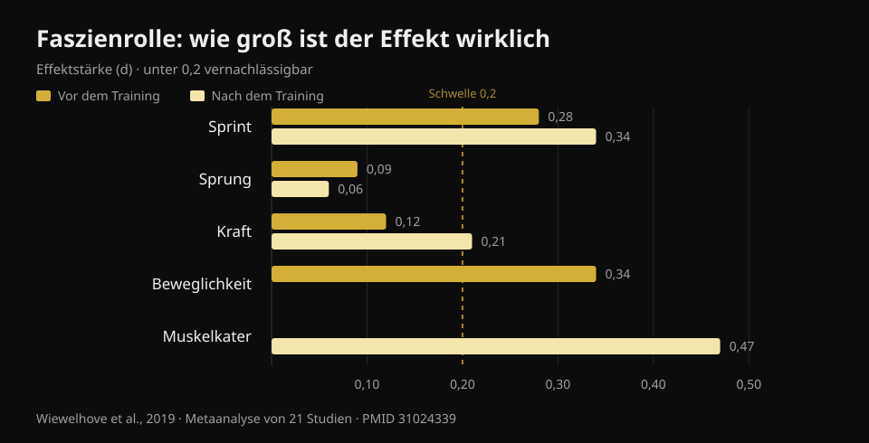
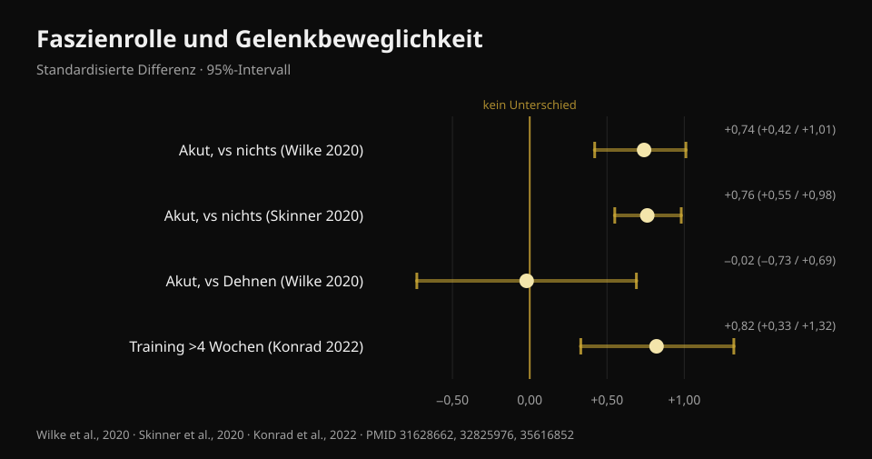

# Faszienrolle: Was bringt sie wirklich? 8 Studien

Von [Giammaria Loi](/autore/giammaria-loi) · aktualisiert am 22. Oktober 2026

Ein viel geteilter Beitrag stellt drei klare Neins zur Faszienrolle auf: Sie löst keine Faszien, sie verbessert die Leistung nicht, sie verhindert keine Verletzungen. Bleiben Muskelkater und Beweglichkeit — aber nur "vorübergehend". Ich habe acht indexierte Arbeiten durchgearbeitet, um diese drei Neins zu prüfen. Zwei halten problemlos stand, das dritte ist schwächer belegt, als es klingt. Und der Teil zur Beweglichkeit ist überholt: Dort gibt es eine Zahl, die im Beitrag fehlt — und die ändert, wie du die Rolle sinnvoll einsetzt.

## Das Wichtigste in Kürze

- **Die Rolle verändert die Steifigkeit des myofaszialen Gewebes nicht**: Die Metaanalyse, die das mit objektiven Messgeräten erfasst hat, findet keinen Effekt (Glänzel et al., 2023). Die "Faszie, die sich löst", ist in den Messungen nicht zu sehen.
- **Auf die Leistung sind die Effekte winzig**: Vor dem Training verbessert sie den Sprint um 0,7 % und die Beweglichkeit um 4 %, bei Sprung und Kraft bleibt der Effekt vernachlässigbar (Wiewelhove et al., 2019). Aber sie verschlechtert nichts — und genau das ist der eigentliche Vorteil.
- **Der größte Effekt überhaupt betrifft den Muskelschmerz**: +6,0 %, d = 0,47, der einzige Wert in der gesamten Literatur, der einer mittleren Effektstärke nahekommt (Wiewelhove et al., 2019). Dafür braucht es aber eine Dosis: **mindestens 90 Sekunden pro Muskelgruppe** (Hughes und Ramer, 2019).
- **"Nur vorübergehende Beweglichkeitsgewinne" stimmt nicht mehr.** Wer **länger als 4 Wochen** konsequent rollt, erzielt stabile Zugewinne an Beweglichkeit (ES = 0,82) gegenüber Kontrollgruppen (Konrad et al., 2022).
- **Zu Verletzungen gibt es keine saubere Antwort**: Die einzige Präventionsstudie kombiniert Rolle und Krafttraining und kann deshalb nichts über die Rolle allein sagen (Desai et al., 2023).

## "Sie löst die Faszien": hier hat der Beitrag recht

Das ist die am häufigsten wiederholte Behauptung im Studio — und die am leichtesten zu widerlegende, weil jemand sie tatsächlich gemessen hat.

2023 hat eine brasilianische Arbeitsgruppe zwanzig Studien zusammengetragen, die mit objektiven Verfahren erfasst haben, was nach einer Foam-Rolling-Einheit mit dem Gewebe passiert: Steifigkeit der Faszie an Rumpf und Oberschenkel, Muskelsteifigkeit an Oberschenkel und Wade, Kraft von Knie und Fuß. Einzelne Studien berichteten durchaus von Rückgängen der Steifigkeit — zwei an der Faszie, fünf am Muskel — aber **sobald die Daten in der Metaanalyse zusammengeführt werden, verschwindet der Effekt auf die myofasziale Steifigkeit**.

Die Vorsicht, die die Autoren selbst anbringen, gehört dazu: Nach der GRADE-Methode ist die Sicherheit der Evidenz **niedrig**, bessere Studien könnten das Bild also verändern. "Wir haben keinen Beleg dafür" ist nicht dasselbe wie "es ist bewiesen, dass es nicht passiert". Aber einstweilen gilt: Wenn dir die Rolle als Gerät verkauft wurde, das Bindegewebe umbaut, hat dieses Verkaufsargument keine Grundlage.

Die plausibelste Erklärung für das, was du unter der Rolle spürst, ist nervlich und nicht mechanisch: Es ändert sich die Toleranz gegenüber dem Druck und die Wahrnehmung, nicht die Struktur. Das ist nicht wenig — aber es ist etwas anderes.

## Leistung: Der Punkt ist nicht, dass sie besser wird

Hier stimmt der Beitrag inhaltlich und setzt den Akzent falsch.

Die maßgebliche Metaanalyse stammt von 2019: einundzwanzig Studien, getrennt nach Rollen **vor** dem Training (vierzehn Studien) und **nach** dem Training (sieben Studien). Die Zahlen vor dem Training:

- Sprint **+0,7 %** (d = 0,28)
- Beweglichkeit **+4,0 %** (d = 0,34)
- Sprung **−1,9 %** (d = 0,09)
- Kraft **+1,8 %** (d = 0,12)

Nach dem Training, als Regenerationsstrategie:

- Sprint **+3,1 %** (d = 0,34)
- Kraft **+3,9 %** (d = 0,21)
- wahrgenommener Muskelschmerz **+6,0 %** (d = 0,47)
- Sprung **−0,2 %** (d = 0,06)

*Effektstärke (d) der Faszienrolle auf Leistung, Beweglichkeit und Muskelschmerz. Unter 0,2 gilt der Effekt als vernachlässigbar. Quelle: Wiewelhove et al., 2019, Metaanalyse von 21 Studien (PMID 31024339).*

Ein d von 0,1 oder 0,2 ist praktisch Rauschen. Der höchste Wert der ganzen Tabelle — 0,47 beim Muskelschmerz — erreicht gerade eben eine mittlere Effektstärke.

Aber achte auf das Vorzeichen dieser Zahlen. **Keines ist nennenswert negativ.** Genau hier unterscheidet sich die Faszienrolle von anderen Dingen, die wir vor dem Training machen: Langes statisches Dehnen kann Kraft und Schnellkraft in der folgenden Einheit senken, die Rolle nicht. Eine Metaanalyse von 2023 bestätigt das direkt: kein Effekt auf die isometrische Kraft, auf das exzentrische Drehmoment oder auf die Kraftentwicklungsrate — mit einem einzigen positiven Befund, dem konzentrischen Drehmoment der Knieextensoren (Glänzel et al., 2023).

Übersetzt: Die Faszienrolle ist kein Weg, stärker zu werden. Sie ist ein Weg, dich vor einer Einheit besser zu bewegen, **ohne bei den Gewichten draufzuzahlen**. Wenn du im Aufwärmen ein paar Grad Beweglichkeit brauchst, um sauber tief zu squatten, ist sie dafür ein passendes Werkzeug. Wenn du ein höheres Maximum erwartest, nicht.

## Beweglichkeit: die Zahl, die der Beitrag übersieht

Dass eine Runde mit der Rolle den Bewegungsumfang vergrößert, ist gesichert. Die solideste Mehrebenen-Metaanalyse — sechsundzwanzig Studien von guter methodischer Qualität — misst akut einen **großen Effekt**: SMD 0,74 (95-%-Konfidenzintervall 0,42–1,01) gegenüber Nichtstun (Wilke et al., 2020). Eine zweite Metaanalyse über dreizehn Studien kommt fast auf denselben Wert, d = 0,76 (0,55–0,98) (Skinner et al., 2020).

Zwei Präzisierungen, die man fast nirgends liest.

**Die erste:** Gegenüber dem Dehnen gewinnt die Rolle nicht. SMD −0,02 (−0,73 bis 0,69): identisch. Die Faszienrolle ist also eine **Alternative** zum Dehnen im Aufwärmen, keine Pflichtergänzung. Wer ohnehin Mobility macht, dem bringen zehn zusätzliche Minuten Rolle für "mehr Beweglichkeit" keinen belegten Vorteil.

**Die zweite — und sie räumt mit dem "nur vorübergehend" auf:** 2022 erschien eine Metaanalyse über elf Studien und 290 Personen, die über Wochen als **Training** gerollt haben. Ergebnis: moderater Effekt auf die Gelenkbeweglichkeit gegenüber den Kontrollgruppen, **ES = 0,82 (95-%-KI 0,33–1,32; p = 0,001)**. Und mit einer präzisen Bedingung: Protokolle **über 4 Wochen** wirken besser als solche bis 4 Wochen (p = 0,049).

*Effekt der Faszienrolle auf die Gelenkbeweglichkeit, mit 95-%-Konfidenzintervallen. Nur der Vergleich mit dem Dehnen kreuzt die Null. Quellen: Wilke et al., 2020 (PMID 31628662); Skinner et al., 2020 (PMID 32825976); Konrad et al., 2022 (PMID 35616852).*

In derselben Analyse steckt ein praktisches Detail: Die Zugewinne zeigen sich beim Rollen von **Oberschenkelrückseite und Quadrizeps**, während das Rollen der Wade **die Dorsalextension im Sprunggelenk nicht verbessert hat**. Wenn dein Problem das Sprunggelenk ist, das dich nicht tief in die Hocke lässt, ist die Rolle an der Wade vermutlich der falsche Weg.

Eine letzte Anmerkung aus der Moderatorenanalyse von Wilke: Dauer, Geschwindigkeit und Body-Mass-Index ändern am Ergebnis nichts, aber **bei Männern fällt der Effekt geringer aus** (p < 0,05).

## Muskelkater: der belastbarste Effekt — und er hat eine Dosis

Das ist der einzige Punkt, an dem die Faszienrolle etwas hervorbringt, das einem echten Nutzen ähnelt, und zugleich der einzige, für den wir einen Dosierungshinweis haben.

Eine systematische Übersichtsarbeit von 2019 hat die Studien nach Zielgröße getrennt: Von acht Arbeiten, die Schmerz und Muskelkater erfasst haben, berichten **sieben** eine kurzfristige Reduktion. Die Schwelle, die sich herausschält, liegt bei **90 Sekunden pro Muskelgruppe**, ohne erkennbare Obergrenze. Unterhalb dieser Dosis werden die Ergebnisse unbeständig. Zur Beweglichkeit fällt dieselbe Übersicht zurückhaltender aus (zehn von siebzehn Studien, mit stark schwankenden Resultaten), und zur Leistung findet sie nichts.

Eine Übersichtsarbeit von 2024 über fünfundzwanzig Studien und 517 Athletinnen und Athleten landet auf einem anderen Weg am selben Punkt: bessere **wahrgenommene Regeneration** und weniger verzögert einsetzender Muskelkater, ohne Einbußen bei Maximalkraft und Schnellkraft.

Beachte: Es geht fast immer um **wahrgenommenen Schmerz**, nicht um schneller reparierten Muskelschaden. Die Rolle lässt dich dich besser fühlen; es gibt keinen Beleg, dass sie die Reparaturzeit des Gewebes verkürzt. Wenn das Ziel ist, früher wieder zu trainieren, zählen Schlaf, gut dosierte Belastung und [was auf dem Teller landet, wenn du pausieren musst](/de/blog/ernaehrung-bei-verletzung) weitaus mehr.

## Verletzungen: die Frage ist noch offen

Der Beitrag sagt, die Faszienrolle verhindere keine Verletzungen. Das ist eine vernünftige Schlussfolgerung, aber die Grundlage ist dünner, als es klingt — und das gehört gesagt.

Die einzige ernstzunehmende Arbeit dazu ist von 2023: 433 Freizeitläuferinnen und -läufer, achtzehn Wochen, eine Gruppe mit **allgemeinem Krafttraining plus Foam Rolling** zweimal pro Woche und eine Kontrollgruppe, die weitermachte wie bisher. Gesamtergebnis: 27,1 % Verletzungen in der Kontrollgruppe gegenüber 23,0 % in der Interventionsgruppe, Unterschied **nicht signifikant** (Log-Rank p = 0,31).

Danach haben die Autoren aber in die Interventionsgruppe hineingeschaut und nach Adhärenz unterteilt. Wer das Programm konsequent durchgezogen hatte, verletzte sich mit **85 % geringerer Wahrscheinlichkeit** (Hazard Ratio 0,15; 95-%-KI 0,05–0,46) und im Mittel 57 Tage später.

Drei Gründe, diese Zahl nicht als Beleg für die Rolle zu nehmen. Erstens: **Die Intervention war Kraft plus Foam Rolling zusammen**, und Krafttraining hat für die Verletzungsprävention bereits solide Evidenz; das Verdienst lässt sich der Rolle nicht zuschreiben. Zweitens ist die Studie **beobachtend**, nicht randomisiert. Drittens, und das wiegt am schwersten: "Wer konsequent war" mit der gesamten Kontrollgruppe zu vergleichen, ist ein schiefer Vergleich — wer ein Programm achtzehn Wochen durchhält, schläft meist besser, dosiert Belastungen besser und geht insgesamt umsichtiger vor. Das ist der klassische Vorteil der Therapietreuen, nicht zwangsläufig der Intervention.

Die redliche Formulierung lautet also nicht "sie verhindert keine Verletzungen", sondern: **Es gibt keine Studie, die die Faszienrolle isoliert betrachtet und einen Effekt auf Verletzungen gezeigt hätte.** Wer sie dir dafür verkauft, geht über die Daten hinaus.

## Was die Forschung wirklich sagt

- **Bestätigt** — Foam Rolling verändert die mit objektiven Verfahren gemessene Steifigkeit des myofaszialen Gewebes nicht (Glänzel et al., 2023; niedrige Sicherheit der Evidenz).
- **Bestätigt** — Die Effekte auf die Leistung sind vernachlässigbar: zwischen d = 0,06 und d = 0,34 bei Sprint, Sprung und Kraft (Wiewelhove et al., 2019).
- **Bestätigt** — Die Rolle verschlechtert Kraft, exzentrisches Drehmoment und Kraftentwicklungsrate nicht: Anders als langes statisches Dehnen lässt sie sich ohne Nachteil im Aufwärmen einsetzen (Glänzel et al., 2023; Martínez-Aranda et al., 2024).
- **Bestätigt** — Sie senkt den wahrgenommenen Muskelschmerz, mit dem größten Effekt der gesamten Literatur zum Thema (d = 0,47) und einer Mindestdosis von 90 Sekunden pro Muskel (Wiewelhove et al., 2019; Hughes und Ramer, 2019).
- **Zu präzisieren** — "Sie erhöht die Beweglichkeit" stimmt, aber **nicht stärker als Dehnen** (SMD −0,02): eine Alternative, keine Ergänzung (Wilke et al., 2020).
- **Widerlegt** — "Die Beweglichkeitsgewinne sind nur vorübergehend": Wer länger als 4 Wochen konsequent rollt, erzielt stabile Zugewinne, ES = 0,82 (Konrad et al., 2022).
- **Widerlegt** — "Sie wirkt an allen Körperregionen": An der Wade hat sie die Dorsalextension im Sprunggelenk nicht verbessert (Konrad et al., 2022).
- **Nicht überprüfbar** — Effekt auf Verletzungen: Die einzige verfügbare Studie kombiniert Rolle und Kraft, ist beobachtend, und das positive Resultat stammt aus einer Untergruppe nach Adhärenz (Desai et al., 2023).

## So setzt du es um

1. **Pack sie ins Aufwärmen, nicht ins Cool-down.** Das ist die ausdrückliche Schlussfolgerung der Metaanalyse von 2019: Die Evidenz rechtfertigt den Einsatz als Aufwärmaktivität eher als den als Regenerationswerkzeug. Zwei bis drei Minuten auf den Gruppen, die du brauchst, dann weiter zu den Aufwärmsätzen.
2. **Wenn du sie gegen Muskelkater einsetzt, komm auf 90 Sekunden pro Muskel.** Unter dieser Schwelle werden die Ergebnisse unbeständig. Das ist der Unterschied zwischen einer beiläufigen Runde und einer Dosis.
3. **Addiere sie nicht zum Dehnen in der Hoffnung auf den doppelten Gewinn.** Sie macht dasselbe. Nimm, was dir angenehmer ist, und steck die gesparte Zeit in echte Aufwärmsätze.
4. **Fürs Sprunggelenk brauchst du ein anderes Werkzeug.** Die Wade zu rollen hat die Dorsalextension in den Studien nicht verbessert: Wenn die tiefe Hocke das Problem ist, arbeite an der Amplitude unter Last und an der Fußposition.
5. **Erwarte keinen Verletzungsschutz.** Solide belegt ist progressives Krafttraining. Wie du Sätze, Lasten und Pausen dosierst, habe ich [hier](/de/blog/wie-viele-wiederholungen-muskelaufbau) zusammengefasst.
6. **Prüf es an dir selbst.** Die mittleren Effekte sind klein und schwankend: Der einzige Weg herauszufinden, ob die Rolle dir nützt, ist, deine eigenen Zahlen über einige Wochen vor und nach der Einführung anzuschauen.

### Nurvan testen — das Aufwärmen, das wirklich etwas ändert

Die Faszienrolle wird dich nicht mehr heben lassen. Die Aufwärmsätze schon: In Nurvan werden sie automatisch auf Basis der geplanten Last vorgeschlagen, damit du nicht kalt in den Arbeitssatz gehst. Und weil jeder Satz mit Last, Wiederholungen und RIR (wie viele Wiederholungen du noch im Tank hattest) protokolliert wird, siehst du nach einem Monat schwarz auf weiß, ob die neue Mobility-Routine deine Zahlen bewegt hat — oder ob sie nur dein Aufwärmen verlängert. **[Nurvan testen](https://nurvan.app)**

## Häufige Fragen

**Faszienrolle vor oder nach dem Training?**
Die Evidenz spricht eher für **vorher**: Du gewinnst ein paar Grad Beweglichkeit, ohne in der Einheit Kraft einzubüßen. Nach dem Training ist der einzige nennenswerte Effekt die Senkung des wahrgenommenen Muskelschmerzes — was nicht gleichbedeutend mit schnellerer muskulärer Erholung ist.

**Wie lange sollte man jeden Muskel rollen?**
Für den Effekt auf den Muskelkater liegt die aus den Studien hervorgehende Schwelle bei **mindestens 90 Sekunden pro Muskelgruppe**, ohne erkennbare Obergrenze. Für die akute Beweglichkeit scheint die Dauer am Ergebnis wenig zu ändern.

**Löst die Faszienrolle wirklich Verklebungen der Faszie?**
Nein, jedenfalls nicht nach den Verfahren, die sie messen: Die verfügbare Metaanalyse findet nach einer Einheit keinerlei Veränderung der myofaszialen Steifigkeit. Was sich ändert, sind vor allem Druck­toleranz und Wahrnehmung, nicht die Gewebestruktur.

**Faszienrolle oder Dehnen im Aufwärmen?**
Für die Vergrößerung des Bewegungsumfangs sind beide gleichwertig (SMD −0,02 im direkten Vergleich). Entscheide nach Bequemlichkeit und Zeit: Keines schlägt das andere, und keines ersetzt die Aufwärmsätze an der Hantel.

**Schadet Rollen, wenn der Muskel stark schmerzt?**
In den Studien senkt die Rolle den wahrgenommenen Schmerz und verschlechtert die Leistung nicht, aber der Druck sollte im erträglichen Bereich bleiben. Ist der Schmerz akut, klar lokalisiert oder anders als der übliche Muskelkater, lass ihn abklären, statt mit der Rolle weiterzumachen.

## Lies auch

- [Wie viele Wiederholungen für Muskelaufbau](/de/blog/wie-viele-wiederholungen-muskelaufbau) — wie du die Variablen dosierst, die die Ergebnisse wirklich bewegen.
- [Ernährung bei einer Verletzung](/de/blog/ernaehrung-bei-verletzung) — die Ernährungsseite der Regeneration, mit Zahlen.
- [Kraft, Muskeln und Ausdauer gleichzeitig trainieren](/de/blog/kraft-muskeln-und-ausdauer-gleichzeitig-trainieren) — die Woche organisieren, ohne dass eines das andere auffrisst.

## Quellen

1. Wiewelhove T, Döweling A, Schneider C, Hottenrott L, Meyer T, Kellmann M, Pfeiffer M, Ferrauti A, 2019. *A Meta-Analysis of the Effects of Foam Rolling on Performance and Recovery.* Frontiers in Physiology 10:376. [PMID 31024339](https://pubmed.ncbi.nlm.nih.gov/31024339/) · [DOI 10.3389/fphys.2019.00376](https://doi.org/10.3389/fphys.2019.00376)
2. Wilke J, Müller AL, Giesche F, Power G, Ahmedi H, Behm DG, 2020. *Acute Effects of Foam Rolling on Range of Motion in Healthy Adults: A Systematic Review with Multilevel Meta-analysis.* Sports Medicine 50(2):387-402. [PMID 31628662](https://pubmed.ncbi.nlm.nih.gov/31628662/) · [DOI 10.1007/s40279-019-01205-7](https://doi.org/10.1007/s40279-019-01205-7)
3. Konrad A, Nakamura M, Tilp M, Donti O, Behm DG, 2022. *Foam Rolling Training Effects on Range of Motion: A Systematic Review and Meta-Analysis.* Sports Medicine 52(10):2523-2535. [PMID 35616852](https://pubmed.ncbi.nlm.nih.gov/35616852/) · [DOI 10.1007/s40279-022-01699-8](https://doi.org/10.1007/s40279-022-01699-8)
4. Glänzel MH, Rodrigues DR, Petter GN, Pozzobon D, Vaz MA, Geremia JM, 2023. *Foam Rolling Acute Effects on Myofascial Tissue Stiffness and Muscle Strength: A Systematic Review and Meta-Analysis.* Journal of Strength and Conditioning Research 37(4):951-968. [PMID 36227232](https://pubmed.ncbi.nlm.nih.gov/36227232/) · [DOI 10.1519/JSC.0000000000004385](https://doi.org/10.1519/JSC.0000000000004385)
5. Hughes GA, Ramer LM, 2019. *Duration of Myofascial Rolling for Optimal Recovery, Range of Motion, and Performance: A Systematic Review of the Literature.* International Journal of Sports Physical Therapy 14(6):845-859. [PMID 31803517](https://pubmed.ncbi.nlm.nih.gov/31803517/)
6. Skinner B, Moss R, Hammond L, 2020. *A systematic review and meta-analysis of the effects of foam rolling on range of motion, recovery and markers of athletic performance.* Journal of Bodywork and Movement Therapies 24(3):105-122. [PMID 32825976](https://pubmed.ncbi.nlm.nih.gov/32825976/) · [DOI 10.1016/j.jbmt.2020.01.007](https://doi.org/10.1016/j.jbmt.2020.01.007)
7. Martínez-Aranda LM, Sanz-Matesanz M, García-Mantilla ED, González-Fernández FT, 2024. *Effects of Self-Myofascial Release on Athletes' Physical Performance: A Systematic Review.* Journal of Functional Morphology and Kinesiology 9(1):20. [PMID 38249097](https://pubmed.ncbi.nlm.nih.gov/38249097/) · [DOI 10.3390/jfmk9010020](https://doi.org/10.3390/jfmk9010020)
8. Desai P, Jungmalm J, Börjesson M, Karlsson J, Grau S, 2023. *Effectiveness of an 18-week general strength and foam-rolling intervention on running-related injuries in recreational runners.* Scandinavian Journal of Medicine & Science in Sports 33(5):766-775. [PMID 36630577](https://pubmed.ncbi.nlm.nih.gov/36630577/) · [DOI 10.1111/sms.14313](https://doi.org/10.1111/sms.14313)

Literaturangaben über PubMed recherchiert. Ausgangsimpuls: der Beitrag von **Built With Science** ([@builtwithscience](https://www.instagram.com/builtwithscience/)) vom 2. September 2026, [Originalbeitrag](https://www.instagram.com/p/DcykEnJFE_2/). Weder Text noch Bilder des Beitrags wurden reproduziert: Das Thema wurde ausgehend von den Primärquellen neu geschrieben.

---

**Giammaria Loi** ist der Gründer von Nurvan. Er trainiert seit 2012 mit Gewichten, arbeitet seit 2013 als FIPE-zertifizierter Personal Trainer und Coach und startet seit 2018 auf nationalem Niveau im Powerlifting. Jeder Artikel, den er zeichnet, beginnt bei den wissenschaftlichen Studien und endet bei dem, was im Studio tatsächlich funktioniert.

> Hinweis: informativer Inhalt, ersetzt nicht die Einschätzung einer Ärztin, eines Arztes oder einer qualifizierten Fachkraft. Wenn du einen lokalisierten Schmerz hast, der sich nicht nach normalem Muskelkater anfühlt, lass ihn abklären, bevor du mit der Rolle weitermachst.
