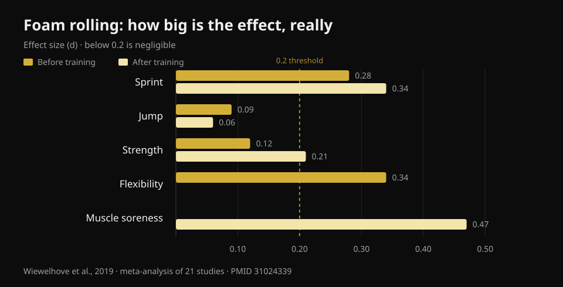
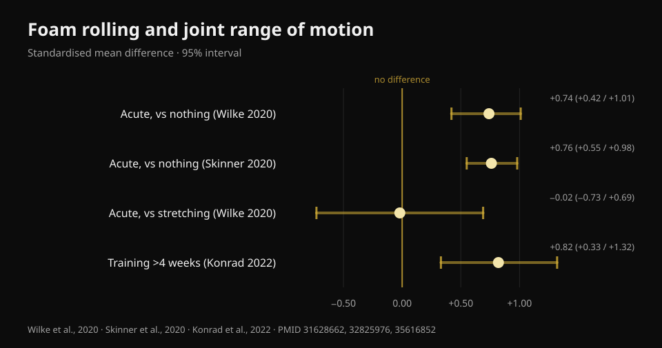

# Does foam rolling work? What 8 studies actually say

By [Giammaria Loi](/autore/giammaria-loi) · updated 22 October 2026

A widely shared post lines up three "no"s about foam rolling: it doesn't break down fascia, it doesn't improve performance, it doesn't prevent injuries. What's left is some benefit on soreness and mobility, but only "temporary". I went through eight indexed papers to check those three no's. Two hold up perfectly. The third is weaker than it sounds. And the mobility part is out of date — there's a finding the post doesn't mention, and it changes how you should be using the roller.

## The short version

- **The roller doesn't change myofascial tissue stiffness.** The meta-analysis that measured it with objective instruments found no effect at all (Glänzel et al., 2023). "Melting the fascia" doesn't show up on the equipment.
- **Performance effects are tiny**: used before training it improves sprint by 0.7% and flexibility by 4%, with negligible effects on jumping and strength (Wiewelhove et al., 2019). But it doesn't hurt them either — that's the real advantage.
- **The biggest effect of all is on muscle soreness**: +6.0%, d = 0.47, the only value in this literature that gets close to a medium effect (Wiewelhove et al., 2019). It needs a dose though: **at least 90 seconds per muscle group** (Hughes and Ramer, 2019).
- **"Only temporary mobility gains" is no longer true.** Rolling consistently for **more than 4 weeks** produces lasting range-of-motion gains (ES = 0.82) compared to not doing it (Konrad et al., 2022).
- **On injuries there is no clean answer**: the only prevention study bundles rolling together with strength work, so it can't tell you anything about the roller on its own (Desai et al., 2023).

## "It breaks up the fascia": here the post is right

This is the claim you hear most in gyms, and the easiest one to take apart — because somebody went and measured it.

In 2023 a Brazilian group pooled twenty studies that had assessed, with objective instruments, what happens to tissue after a foam rolling session: fascial stiffness in the trunk and thigh, muscle stiffness in the thigh and calf, knee and ankle strength. A few individual studies did report drops in stiffness — two in fascia, five in muscle — but **when the data are pooled in the meta-analysis, the effect on myofascial stiffness disappears**.

The caution the authors themselves add is worth repeating: under the GRADE system the certainty of evidence is **low**, meaning better studies could change the picture. "We have no evidence it happens" is not the same as "it's proven not to happen". In the meantime, though, if someone sold you the roller as a tool that remodels connective tissue, that sale has no basis.

The leading explanation for what you feel under the roller is neural, not mechanical: what changes is your tolerance to discomfort and your perception, not the structure. Which isn't nothing — but it's a different thing.

## Performance: the point isn't that it improves it

Here the post is right on the facts and wrong on the emphasis.

The reference meta-analysis is from 2019: twenty-one studies, split between people who rolled **before** training (fourteen studies) and people who rolled **after** (seven studies). The numbers, before training:

- sprint **+0.7%** (d = 0.28)
- flexibility **+4.0%** (d = 0.34)
- jump **−1.9%** (d = 0.09)
- strength **+1.8%** (d = 0.12)

After training, as a recovery strategy:

- sprint **+3.1%** (d = 0.34)
- strength **+3.9%** (d = 0.21)
- perceived muscle pain **+6.0%** (d = 0.47)
- jump **−0.2%** (d = 0.06)

*Effect size (d) of foam rolling on performance, flexibility and muscle soreness. Below 0.2 an effect is considered negligible. Source: Wiewelhove et al., 2019, meta-analysis of 21 studies (PMID 31024339).*

A d of 0.1 or 0.2 is, in practice, noise. The highest value in the whole table — 0.47 on muscle soreness — only just reaches a medium effect.

But look at the signs on those numbers. **None of them is meaningfully negative.** This is where foam rolling separates itself from other things we do before training: prolonged static stretching can cut strength and power in the session that follows, the roller doesn't. A 2023 meta-analysis confirms it directly: no effect on isometric strength, eccentric torque or rate of force development, with a single positive finding, concentric torque of the knee extensors (Glänzel et al., 2023).

Translated: foam rolling is not a way to lift more. It's a way to move better before a session **without paying for it on the bar**. If your warm-up needs a few degrees of range to get a deep, clean squat, it's a reasonable tool. If you're expecting a bigger one-rep max, it isn't.

## Mobility: the finding the post misses

That a pass with the roller widens your range of motion is settled. The most solid multilevel meta-analysis — twenty-six studies of good methodological quality — measures a **large acute effect**: SMD 0.74 (95% confidence interval 0.42–1.01) versus doing nothing (Wilke et al., 2020). A second meta-analysis across thirteen studies lands at almost the same number, d = 0.76 (0.55–0.98) (Skinner et al., 2020).

Two qualifications you almost never read anywhere.

**First:** against stretching, the roller doesn't win. SMD −0.02 (−0.73 to 0.69): identical. Foam rolling is therefore an **alternative** to stretching in your warm-up, not a mandatory addition. If you already do mobility work, adding ten minutes of rolling to get "more mobility" isn't supported.

**Second, and this is what dismantles the "temporary only" line:** in 2022 a meta-analysis was published covering eleven studies and 290 people who rolled as **training**, for weeks at a time. Result: a moderate effect on joint range of motion versus control groups, **ES = 0.82 (95% CI 0.33–1.32; p = 0.001)**. With one precise condition: protocols running **beyond 4 weeks** work better than those up to 4 weeks (p = 0.049).

*Effect of foam rolling on joint range of motion, with 95% confidence intervals. Only the comparison against stretching crosses zero. Sources: Wilke et al., 2020 (PMID 31628662); Skinner et al., 2020 (PMID 32825976); Konrad et al., 2022 (PMID 35616852).*

There's a practical detail buried in the same analysis: the gains show up when you roll **hamstrings and quadriceps**, while rolling the calf **did not improve ankle dorsiflexion**. If your problem is an ankle that won't let you sit into a squat, the roller on your calf is probably the wrong way to attack it.

One last note from Wilke's moderator analysis: duration, speed and body mass index don't change the result, but **the effect is smaller in men** (p < 0.05).

## Muscle soreness: the most solid effect, and it comes with a dose

This is the one place where foam rolling produces something resembling a real benefit, and it's also the only one where we have dosing guidance.

A 2019 systematic review separated studies by outcome: across eight papers that measured pain and soreness, **seven** report a short-term reduction. The threshold that emerges is **90 seconds per muscle group**, with no upper limit identified. Below that dose, results become inconsistent. On mobility the same review is cooler (ten studies out of seventeen, with highly variable results) and on performance it finds nothing.

A 2024 review of twenty-five studies and 517 athletes arrives at the same place from another direction: it improves **perceived recovery** and reduces delayed-onset muscle soreness, without penalising maximal strength and power.

Note that we're almost always talking about **perceived pain**, not muscle damage being repaired faster. The roller makes you feel better; there's no evidence it shortens tissue repair time. If the goal is getting back to training sooner, sleep, well-managed load and [what's on your plate while you're out](/en/blog/what-to-eat-when-injured) matter far more.

## Injuries: the question still has no answer

The post says foam rolling doesn't prevent injuries. That's a reasonable conclusion, but the basis is shakier than it sounds, and that's worth saying.

The only serious study on the subject is from 2023: 433 recreational runners, eighteen weeks, one group doing **general strength plus foam rolling** twice a week and a control group carrying on as usual. Overall result: 27.1% injuries in the control group versus 23.0% in the intervention group, a **non-significant** difference (log-rank p = 0.31).

Then the authors looked inside the intervention group, splitting it by compliance. Those who had followed the programme consistently were **85% less likely** to get injured (hazard ratio 0.15; 95% CI 0.05–0.46) and got injured on average 57 days later.

Three reasons not to use that number as evidence for the roller. First: **the intervention was strength plus foam rolling together**, and strength work already has solid evidence on injury prevention; the credit can't be assigned to the roller. Second: the study is **observational**, not randomised. Third, and most important: comparing "the people who stuck with it" against the whole control group is a lopsided comparison — people who can follow a programme for eighteen weeks usually sleep better, manage their training load better and are more cautious in general. That's the classic adherer advantage, not necessarily the intervention's.

So the honest phrasing isn't "it doesn't prevent injuries", it's: **no study has isolated foam rolling and shown an effect on injuries**. Anyone selling it to you on that basis is going beyond the data.

## What the research actually says

- **Confirmed** — Foam rolling does not change myofascial tissue stiffness as measured by objective instruments (Glänzel et al., 2023; low certainty of evidence).
- **Confirmed** — Performance effects are negligible: between d = 0.06 and d = 0.34 across sprint, jump and strength (Wiewelhove et al., 2019).
- **Confirmed** — The roller does not impair strength, eccentric torque or rate of force development: unlike prolonged static stretching, you can use it in a warm-up without penalty (Glänzel et al., 2023; Martínez-Aranda et al., 2024).
- **Confirmed** — It reduces perceived muscle soreness, with the largest effect in this whole literature (d = 0.47) and a minimum dose of 90 seconds per muscle (Wiewelhove et al., 2019; Hughes and Ramer, 2019).
- **Needs nuance** — "It increases mobility" is true, but **no more than stretching does** (SMD −0.02): it's an alternative, not an addition (Wilke et al., 2020).
- **Debunked** — "Mobility gains are only temporary": rolling consistently for more than 4 weeks makes the gains stick, ES = 0.82 (Konrad et al., 2022).
- **Debunked** — "It works everywhere on the body": on the calf it did not improve ankle dorsiflexion (Konrad et al., 2022).
- **Unverifiable** — Effect on injuries: the only available study combines rolling with strength work, is observational, and the positive result comes from a compliance subgroup (Desai et al., 2023).

## How to apply it

1. **Put it in the warm-up, not in the cool-down.** That's the explicit conclusion of the 2019 meta-analysis: the evidence justifies its use as a warm-up activity more than as a recovery tool. Two or three minutes on the groups you need, then move to your ramp-up sets.
2. **If you're using it for soreness, get to 90 seconds per muscle.** Below that threshold results become inconsistent. That's the difference between a distracted pass and a dose.
3. **Don't stack it on top of stretching expecting double the gain.** It does the same job. Pick whichever suits you and spend the time you save on actual warm-up sets.
4. **For the ankle, change tools.** Rolling the calf did not improve dorsiflexion in the studies: if the deep squat is the problem, work on range under load and foot position instead.
5. **Don't expect it to protect you from injury.** What has solid evidence is progressive strength work. If you want the full picture on how to dose sets, loads and rest, I summarised it [here](/en/blog/how-many-reps-build-muscle).
6. **Test it on yourself.** The average effects are small and variable: the only way to know whether the roller does anything for you is to look at your own numbers before and after adding it, over a few weeks.

### Try Nurvan — the warm-up that actually changes something

The foam roller won't make you lift more. Your ramp-up sets will: in Nurvan they're proposed automatically based on the load you've programmed, so you reach your working set ready instead of cold. And because every set is logged with load, reps and RIR (how many reps you had left in the tank), after a month you can see in black and white whether the mobility routine you added moved anything on your numbers — or whether you're just making your warm-up longer. **[Try Nurvan](https://nurvan.app)**

## Frequently asked questions

**Should you foam roll before or after a workout?**
The evidence favours rolling **before**: you gain a few degrees of range without losing strength in the session. After training, the only noticeable effect is a reduction in perceived muscle soreness, which is not the same thing as faster muscle recovery.

**How long should you foam roll each muscle?**
For the effect on muscle soreness, the threshold emerging from the studies is **at least 90 seconds per muscle group**, with no upper limit identified. For acute mobility, duration doesn't seem to change the result much.

**Does foam rolling really break up fascial adhesions?**
No, not according to the instruments that measure it: the available meta-analysis finds no change in myofascial tissue stiffness after a session. What changes is mainly your tolerance to discomfort and your perception, not the structure of the tissue.

**Foam rolling or stretching in the warm-up?**
For increasing range of motion the two are equivalent (SMD −0.02 in the head-to-head comparison). Pick based on convenience and time: neither beats the other, and neither replaces your ramp-up sets with the bar.

**Is it bad to roll a muscle that's very sore?**
In the studies the roller reduces perceived soreness and doesn't hurt performance, but pressure should be kept to tolerable discomfort. If the pain is sharp, localised or different from normal post-training soreness, get it looked at instead of pushing through with the roller.

## Read also

- [How many reps to build muscle](/en/blog/how-many-reps-build-muscle) — how to dose the variables that actually move your results.
- [What to eat when you're injured](/en/blog/what-to-eat-when-injured) — the nutrition side of recovery, with the numbers.
- [Training strength, muscle and cardio together](/en/blog/training-strength-muscle-and-cardio-together) — organising the week without one thing eating the other.

## Sources

1. Wiewelhove T, Döweling A, Schneider C, Hottenrott L, Meyer T, Kellmann M, Pfeiffer M, Ferrauti A, 2019. *A Meta-Analysis of the Effects of Foam Rolling on Performance and Recovery.* Frontiers in Physiology 10:376. [PMID 31024339](https://pubmed.ncbi.nlm.nih.gov/31024339/) · [DOI 10.3389/fphys.2019.00376](https://doi.org/10.3389/fphys.2019.00376)
2. Wilke J, Müller AL, Giesche F, Power G, Ahmedi H, Behm DG, 2020. *Acute Effects of Foam Rolling on Range of Motion in Healthy Adults: A Systematic Review with Multilevel Meta-analysis.* Sports Medicine 50(2):387-402. [PMID 31628662](https://pubmed.ncbi.nlm.nih.gov/31628662/) · [DOI 10.1007/s40279-019-01205-7](https://doi.org/10.1007/s40279-019-01205-7)
3. Konrad A, Nakamura M, Tilp M, Donti O, Behm DG, 2022. *Foam Rolling Training Effects on Range of Motion: A Systematic Review and Meta-Analysis.* Sports Medicine 52(10):2523-2535. [PMID 35616852](https://pubmed.ncbi.nlm.nih.gov/35616852/) · [DOI 10.1007/s40279-022-01699-8](https://doi.org/10.1007/s40279-022-01699-8)
4. Glänzel MH, Rodrigues DR, Petter GN, Pozzobon D, Vaz MA, Geremia JM, 2023. *Foam Rolling Acute Effects on Myofascial Tissue Stiffness and Muscle Strength: A Systematic Review and Meta-Analysis.* Journal of Strength and Conditioning Research 37(4):951-968. [PMID 36227232](https://pubmed.ncbi.nlm.nih.gov/36227232/) · [DOI 10.1519/JSC.0000000000004385](https://doi.org/10.1519/JSC.0000000000004385)
5. Hughes GA, Ramer LM, 2019. *Duration of Myofascial Rolling for Optimal Recovery, Range of Motion, and Performance: A Systematic Review of the Literature.* International Journal of Sports Physical Therapy 14(6):845-859. [PMID 31803517](https://pubmed.ncbi.nlm.nih.gov/31803517/)
6. Skinner B, Moss R, Hammond L, 2020. *A systematic review and meta-analysis of the effects of foam rolling on range of motion, recovery and markers of athletic performance.* Journal of Bodywork and Movement Therapies 24(3):105-122. [PMID 32825976](https://pubmed.ncbi.nlm.nih.gov/32825976/) · [DOI 10.1016/j.jbmt.2020.01.007](https://doi.org/10.1016/j.jbmt.2020.01.007)
7. Martínez-Aranda LM, Sanz-Matesanz M, García-Mantilla ED, González-Fernández FT, 2024. *Effects of Self-Myofascial Release on Athletes' Physical Performance: A Systematic Review.* Journal of Functional Morphology and Kinesiology 9(1):20. [PMID 38249097](https://pubmed.ncbi.nlm.nih.gov/38249097/) · [DOI 10.3390/jfmk9010020](https://doi.org/10.3390/jfmk9010020)
8. Desai P, Jungmalm J, Börjesson M, Karlsson J, Grau S, 2023. *Effectiveness of an 18-week general strength and foam-rolling intervention on running-related injuries in recreational runners.* Scandinavian Journal of Medicine & Science in Sports 33(5):766-775. [PMID 36630577](https://pubmed.ncbi.nlm.nih.gov/36630577/) · [DOI 10.1111/sms.14313](https://doi.org/10.1111/sms.14313)

References retrieved through PubMed. Starting point: the post by **Built With Science** ([@builtwithscience](https://www.instagram.com/builtwithscience/)) of 2 September 2026, [original post](https://www.instagram.com/p/DcykEnJFE_2/). No text and no images from the post were reproduced: the topic was rewritten from scratch starting from the primary sources.

---

**Giammaria Loi** is the founder of Nurvan. He has been lifting since 2012, has worked as a FIPE-certified personal trainer and coach since 2013, and has competed in powerlifting at national level since 2018. Every article he writes starts from the research and ends with what actually works in the gym.

> Note: this is informational content and does not replace the advice of a doctor or qualified professional. If you have localised pain that doesn't feel like normal post-training soreness, get it assessed instead of pushing through with the roller.
