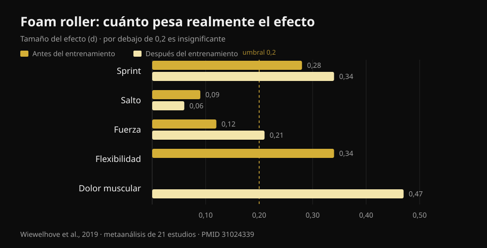
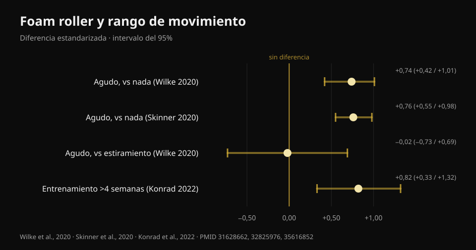

# ¿El foam roller sirve? Esto dicen 8 estudios

Por [Giammaria Loi](/autore/giammaria-loi) · actualizado el 22 de octubre de 2026

Una publicación muy compartida alinea tres "no" sobre el foam roller: no deshace la fascia, no mejora el rendimiento, no previene lesiones. Queda algún beneficio sobre el dolor muscular y la movilidad, pero "temporal". He leído ocho trabajos indexados para comprobar esos tres no. Dos aguantan perfectamente. El tercero es más débil de lo que suena. Y la parte de la movilidad está desfasada: ahí hay un dato que la publicación no menciona y que cambia cómo conviene usar el rodillo.

## En resumen

- **El rodillo no modifica la rigidez del tejido miofascial.** El metaanálisis que la midió con instrumentos objetivos no encuentra ningún efecto (Glänzel et al., 2023). Lo de "deshacer la fascia" no aparece en los aparatos.
- **Los efectos sobre el rendimiento son minúsculos**: usado antes de entrenar mejora el sprint un 0,7% y la flexibilidad un 4%, con efectos despreciables sobre el salto y la fuerza (Wiewelhove et al., 2019). Pero tampoco los empeora: ahí está la ventaja real.
- **El efecto más grande de todos es sobre el dolor muscular**: +6,0%, d = 0,47, el único valor de toda la literatura que se acerca a un tamaño medio (Wiewelhove et al., 2019). Eso sí, necesita dosis: **al menos 90 segundos por grupo muscular** (Hughes y Ramer, 2019).
- **"Solo ganancias temporales de movilidad" ya no es cierto.** Rodar con constancia **más de 4 semanas** produce ganancias de movilidad estables (TE = 0,82) frente a quien no lo hace (Konrad et al., 2022).
- **Sobre lesiones no hay respuesta limpia**: el único estudio de prevención junta rodillo y trabajo de fuerza, así que no puede decir nada sobre el rodillo por separado (Desai et al., 2023).

## "Deshace la fascia": aquí la publicación tiene razón

Es la afirmación más repetida en los gimnasios y la más fácil de desmontar, porque alguien fue a medirla.

En 2023 un grupo brasileño reunió veinte estudios que habían evaluado, con instrumentos objetivos, qué les pasa a los tejidos tras una sesión de foam rolling: rigidez de la fascia del tronco y del muslo, rigidez muscular de muslo y pantorrilla, fuerza de rodilla y de pie. Algunos estudios sueltos sí informaban de caídas de rigidez —dos en la fascia, cinco en el músculo—, pero **cuando los datos se juntan en el metaanálisis, el efecto sobre la rigidez miofascial desaparece**.

Merece la pena repetir la cautela que añaden los propios autores: con el método GRADE la certeza de la evidencia es **baja**, es decir, estudios mejores podrían cambiar el cuadro. "No tenemos pruebas de que ocurra" no es idéntico a "está demostrado que no ocurre". Pero mientras tanto, si te vendieron el rodillo como un aparato que remodela el tejido conectivo, esa venta no tiene base.

La explicación más aceptada de lo que notas bajo el rodillo es nerviosa, no mecánica: cambia la tolerancia a la molestia y la percepción, no la estructura. Que no es poco, pero es otra cosa.

## Rendimiento: el punto no es que lo mejore

Aquí la publicación acierta en los hechos y falla en el acento.

El metaanálisis de referencia es de 2019: veintiún estudios, separados entre quien rodaba **antes** de entrenar (catorce estudios) y quien rodaba **después** (siete estudios). Los números, antes de entrenar:

- sprint **+0,7%** (d = 0,28)
- flexibilidad **+4,0%** (d = 0,34)
- salto **−1,9%** (d = 0,09)
- fuerza **+1,8%** (d = 0,12)

Después de entrenar, como estrategia de recuperación:

- sprint **+3,1%** (d = 0,34)
- fuerza **+3,9%** (d = 0,21)
- dolor muscular percibido **+6,0%** (d = 0,47)
- salto **−0,2%** (d = 0,06)

*Tamaño del efecto (d) del foam roller sobre rendimiento, flexibilidad y dolor muscular. Por debajo de 0,2 el efecto se considera despreciable. Fuente: Wiewelhove et al., 2019, metaanálisis de 21 estudios (PMID 31024339).*

Una d de 0,1 o 0,2 es, en la práctica, ruido. El valor más alto de toda la tabla —0,47 sobre el dolor muscular— apenas llega a un tamaño medio.

Pero fíjate en el signo de esos números. **Ninguno es negativo de forma relevante.** Ahí es donde el foam roller se separa de otras cosas que hacemos antes de entrenar: el estiramiento estático prolongado puede reducir fuerza y potencia en la sesión que viene, el rodillo no. Un metaanálisis de 2023 lo confirma directamente: ningún efecto sobre la fuerza isométrica, el torque excéntrico o la velocidad de desarrollo de la fuerza, con un único dato en positivo, el torque concéntrico de los extensores de rodilla (Glänzel et al., 2023).

Traducido: el foam roller no es una forma de levantar más. Es una forma de moverte mejor antes de una sesión **sin pagar peaje en la barra**. Si en el calentamiento necesitas ganar unos grados de movilidad para hacer una sentadilla profunda y limpia, es una herramienta válida. Si esperas un máximo más alto, no.

## Movilidad: el dato que la publicación se pierde

Que una pasada de rodillo amplíe el rango de movimiento está asentado. El metaanálisis multinivel más sólido —veintiséis estudios de buena calidad metodológica— mide un efecto **grande en agudo**: DME 0,74 (intervalo de confianza del 95% 0,42–1,01) frente a no hacer nada (Wilke et al., 2020). Un segundo metaanálisis sobre trece estudios llega casi al mismo número, d = 0,76 (0,55–0,98) (Skinner et al., 2020).

Dos matices que casi nunca se leen por ahí.

**El primero:** frente al estiramiento, el rodillo no gana. DME −0,02 (−0,73 a 0,69): idéntico. El foam roller es por tanto una **alternativa** al estiramiento en el calentamiento, no un añadido obligatorio. Si ya haces movilidad, añadir diez minutos de rodillo para tener "más movilidad" no está respaldado.

**El segundo, y es el que desmonta el "solo temporal":** en 2022 se publicó un metaanálisis sobre once estudios y 290 personas que rodaron como **entrenamiento**, durante semanas. Resultado: efecto moderado sobre la movilidad articular frente a los grupos control, **TE = 0,82 (IC 95% 0,33–1,32; p = 0,001)**. Y con una condición precisa: los protocolos de **más de 4 semanas** funcionan mejor que los de hasta 4 semanas (p = 0,049).

*Efecto del foam roller sobre la movilidad articular, con intervalos de confianza del 95%. Solo la comparación con el estiramiento cruza el cero. Fuentes: Wilke et al., 2020 (PMID 31628662); Skinner et al., 2020 (PMID 32825976); Konrad et al., 2022 (PMID 35616852).*

Hay un detalle práctico enterrado en ese mismo análisis: las ganancias aparecen cuando se ruedan **isquiosurales y cuádriceps**, mientras que rodar la pantorrilla **no mejoró la dorsiflexión de tobillo**. Si tu problema es el tobillo que no baja en la sentadilla, el rodillo en el gemelo es probablemente la forma equivocada de atacarlo.

Una última nota del análisis de moderadores de Wilke: duración, velocidad e índice de masa corporal no cambian el resultado, pero **en los hombres el efecto es menor** (p < 0,05).

## Dolor muscular: el efecto más sólido, y tiene dosis

Es el único punto en el que el foam roller produce algo parecido a un beneficio real, y también el único sobre el que tenemos una indicación de dosificación.

Una revisión sistemática de 2019 separó los estudios por objetivo: de ocho trabajos que midieron dolor y agujetas, **siete** informan de una reducción a corto plazo. Y el umbral que emerge es de **90 segundos por grupo muscular**, sin límite superior identificado. Por debajo de esa dosis los resultados se vuelven inconstantes. Sobre la movilidad la misma revisión es más tibia (diez estudios de diecisiete, con resultados muy variables) y sobre el rendimiento no encuentra nada.

Una revisión de 2024 sobre veinticinco estudios y 517 atletas llega al mismo sitio por otro camino: mejora la **percepción de la recuperación** y reduce las agujetas de aparición tardía, sin penalizar fuerza y potencia máxima.

Fíjate en que hablamos casi siempre de **dolor percibido**, no de daño muscular reparado más rápido. El rodillo te hace sentir mejor; no hay prueba de que acorte los tiempos de reparación del tejido. Si el objetivo es volver a entrenar antes, pesan mucho más el sueño, la carga bien gestionada y [qué pones en el plato cuando estás parado](/es/blog/que-comer-cuando-estas-lesionado).

## Lesiones: la pregunta todavía no tiene respuesta

La publicación dice que el foam roller no previene lesiones. Es una conclusión razonable, pero la base es más frágil de lo que parece, y merece decirse.

El único trabajo serio sobre el tema es de 2023: 433 corredores aficionados, dieciocho semanas, un grupo que hacía **fuerza general más foam rolling** dos veces por semana y un grupo control que seguía como siempre. Resultado global: 27,1% de lesiones en el control frente a 23,0% en la intervención, diferencia **no significativa** (log-rank p = 0,31).

Después, los autores miraron dentro del grupo de intervención, dividiéndolo por adherencia. Quien había seguido el programa con constancia tenía un **85% menos de probabilidad** de lesionarse (hazard ratio 0,15; IC 95% 0,05–0,46) y se lesionaba de media 57 días más tarde.

Tres motivos para no usar ese número como prueba a favor del rodillo. Primero: **la intervención era fuerza más foam rolling juntos**, y el trabajo de fuerza ya tiene pruebas sólidas sobre prevención de lesiones; no se puede atribuir el mérito al rodillo. Segundo: el estudio es **observacional**, no aleatorizado. Tercero, el más importante: comparar "quien fue constante" con todo el grupo control es una comparación desequilibrada —quien consigue seguir un programa dieciocho semanas suele dormir mejor, gestionar mejor las cargas y ser más prudente en general. Es la clásica ventaja del que se adhiere, no necesariamente de la intervención.

Así que la formulación honesta no es "no previene lesiones", sino: **no existe ningún estudio que haya aislado el foam roller y demostrado un efecto sobre las lesiones**. Quien te lo venda por eso está yendo más allá de los datos.

## Qué dice realmente la investigación

- **Confirmado** — El foam rolling no modifica la rigidez del tejido miofascial medida con instrumentos objetivos (Glänzel et al., 2023; certeza de la evidencia baja).
- **Confirmado** — Los efectos sobre el rendimiento son despreciables: entre d = 0,06 y d = 0,34 en sprint, salto y fuerza (Wiewelhove et al., 2019).
- **Confirmado** — El rodillo no empeora fuerza, torque excéntrico ni velocidad de desarrollo de la fuerza: a diferencia del estiramiento estático prolongado, se puede usar en el calentamiento sin penalización (Glänzel et al., 2023; Martínez-Aranda et al., 2024).
- **Confirmado** — Reduce el dolor muscular percibido, con el efecto más grande de toda la literatura sobre el tema (d = 0,47) y una dosis mínima de 90 segundos por músculo (Wiewelhove et al., 2019; Hughes y Ramer, 2019).
- **A matizar** — "Aumenta la movilidad" es cierto, pero **no más que el estiramiento** (DME −0,02): es una alternativa, no un añadido (Wilke et al., 2020).
- **Desmentido** — "Las ganancias de movilidad son solo temporales": rodando con constancia más de 4 semanas las ganancias se vuelven estables, TE = 0,82 (Konrad et al., 2022).
- **Desmentido** — "Funciona en todas las zonas": en la pantorrilla no mejoró la dorsiflexión de tobillo (Konrad et al., 2022).
- **No verificable** — Efecto sobre las lesiones: el único estudio disponible combina rodillo y fuerza, es observacional y el resultado positivo viene de un subgrupo por adherencia (Desai et al., 2023).

## Cómo aplicarlo

1. **Mételo en el calentamiento, no en la vuelta a la calma.** Es la conclusión explícita del metaanálisis de 2019: la evidencia justifica su uso como actividad de calentamiento más que como herramienta de recuperación. Dos o tres minutos en los grupos que necesitas y pasa a las series de aproximación.
2. **Si lo usas para el dolor, llega a 90 segundos por músculo.** Por debajo de ese umbral los resultados se vuelven inconstantes. Es la diferencia entre una pasada distraída y una dosis.
3. **No lo sumes al estiramiento esperando ganar el doble.** Hace lo mismo. Elige lo que te resulte más cómodo y usa el tiempo ahorrado en series de calentamiento de verdad.
4. **Para el tobillo, cambia de herramienta.** Rodar la pantorrilla no mejoró la dorsiflexión en los estudios: si la sentadilla profunda es el problema, trabaja el rango bajo carga y la posición del pie.
5. **No esperes que te proteja de las lesiones.** Lo que tiene pruebas sólidas es el trabajo de fuerza progresivo. Si quieres el cuadro completo sobre cómo dosificar series, cargas y descansos, lo resumí [aquí](/es/blog/cuantas-repeticiones-masa-muscular).
6. **Compruébalo en ti.** Los efectos medios son pequeños y variables: la única forma de saber si el rodillo te sirve es mirar tus números antes y después de incorporarlo, durante unas semanas.

### Prueba Nurvan — el calentamiento que cambia algo

El foam roller no te hará levantar más. Las series de aproximación sí: en Nurvan se proponen automáticamente según la carga que has programado, así llegas a la serie efectiva preparado en lugar de frío. Y como cada serie se registra con carga, repeticiones y RIR (cuántas repeticiones te quedaban en el depósito), al cabo de un mes puedes ver negro sobre blanco si la rutina de movilidad que añadiste movió algo en tus números, o si solo estás alargando el calentamiento. **[Prueba Nurvan](https://nurvan.app)**

## Preguntas frecuentes

**¿El foam roller se usa antes o después de entrenar?**
La evidencia es más favorable al uso **antes**: ganas unos grados de movilidad sin perder fuerza en la sesión. Después de entrenar el único efecto apreciable es la reducción del dolor muscular percibido, que no equivale a una recuperación muscular más rápida.

**¿Cuánto tiempo hay que rodar cada músculo?**
Para el efecto sobre el dolor muscular el umbral que emerge de los estudios es de **al menos 90 segundos por grupo muscular**, sin límite superior identificado. Para la movilidad en agudo la duración no parece cambiar mucho el resultado.

**¿El foam roller rompe de verdad las adherencias de la fascia?**
No, no según los instrumentos que la miden: el metaanálisis disponible no encuentra ninguna variación de la rigidez del tejido miofascial tras una sesión. Lo que cambia es sobre todo la tolerancia a la molestia y la percepción, no la estructura del tejido.

**¿Mejor foam roller o estiramientos en el calentamiento?**
Para aumentar el rango de movimiento los dos son equivalentes (DME −0,02 en la comparación directa). Elige según comodidad y tiempo: ninguno gana al otro, y ninguno sustituye a las series de aproximación con la barra.

**¿Hace daño rodar un músculo con muchas agujetas?**
En los estudios el rodillo reduce el dolor percibido y no empeora el rendimiento, pero la presión hay que dosificarla en la molestia tolerable. Si el dolor es agudo, localizado o distinto de las agujetas normales, hazlo valorar en vez de insistir con el rodillo.

## Lee también

- [Cuántas repeticiones para ganar masa muscular](/es/blog/cuantas-repeticiones-masa-muscular) — cómo dosificar las variables que de verdad mueven los resultados.
- [Qué comer cuando estás lesionado](/es/blog/que-comer-cuando-estas-lesionado) — el lado nutricional de la recuperación, con números.
- [Entrenar fuerza, músculo y cardio a la vez](/es/blog/entrenar-fuerza-musculo-y-cardio-a-la-vez) — organizar la semana sin que una cosa se coma la otra.

## Fuentes

1. Wiewelhove T, Döweling A, Schneider C, Hottenrott L, Meyer T, Kellmann M, Pfeiffer M, Ferrauti A, 2019. *A Meta-Analysis of the Effects of Foam Rolling on Performance and Recovery.* Frontiers in Physiology 10:376. [PMID 31024339](https://pubmed.ncbi.nlm.nih.gov/31024339/) · [DOI 10.3389/fphys.2019.00376](https://doi.org/10.3389/fphys.2019.00376)
2. Wilke J, Müller AL, Giesche F, Power G, Ahmedi H, Behm DG, 2020. *Acute Effects of Foam Rolling on Range of Motion in Healthy Adults: A Systematic Review with Multilevel Meta-analysis.* Sports Medicine 50(2):387-402. [PMID 31628662](https://pubmed.ncbi.nlm.nih.gov/31628662/) · [DOI 10.1007/s40279-019-01205-7](https://doi.org/10.1007/s40279-019-01205-7)
3. Konrad A, Nakamura M, Tilp M, Donti O, Behm DG, 2022. *Foam Rolling Training Effects on Range of Motion: A Systematic Review and Meta-Analysis.* Sports Medicine 52(10):2523-2535. [PMID 35616852](https://pubmed.ncbi.nlm.nih.gov/35616852/) · [DOI 10.1007/s40279-022-01699-8](https://doi.org/10.1007/s40279-022-01699-8)
4. Glänzel MH, Rodrigues DR, Petter GN, Pozzobon D, Vaz MA, Geremia JM, 2023. *Foam Rolling Acute Effects on Myofascial Tissue Stiffness and Muscle Strength: A Systematic Review and Meta-Analysis.* Journal of Strength and Conditioning Research 37(4):951-968. [PMID 36227232](https://pubmed.ncbi.nlm.nih.gov/36227232/) · [DOI 10.1519/JSC.0000000000004385](https://doi.org/10.1519/JSC.0000000000004385)
5. Hughes GA, Ramer LM, 2019. *Duration of Myofascial Rolling for Optimal Recovery, Range of Motion, and Performance: A Systematic Review of the Literature.* International Journal of Sports Physical Therapy 14(6):845-859. [PMID 31803517](https://pubmed.ncbi.nlm.nih.gov/31803517/)
6. Skinner B, Moss R, Hammond L, 2020. *A systematic review and meta-analysis of the effects of foam rolling on range of motion, recovery and markers of athletic performance.* Journal of Bodywork and Movement Therapies 24(3):105-122. [PMID 32825976](https://pubmed.ncbi.nlm.nih.gov/32825976/) · [DOI 10.1016/j.jbmt.2020.01.007](https://doi.org/10.1016/j.jbmt.2020.01.007)
7. Martínez-Aranda LM, Sanz-Matesanz M, García-Mantilla ED, González-Fernández FT, 2024. *Effects of Self-Myofascial Release on Athletes' Physical Performance: A Systematic Review.* Journal of Functional Morphology and Kinesiology 9(1):20. [PMID 38249097](https://pubmed.ncbi.nlm.nih.gov/38249097/) · [DOI 10.3390/jfmk9010020](https://doi.org/10.3390/jfmk9010020)
8. Desai P, Jungmalm J, Börjesson M, Karlsson J, Grau S, 2023. *Effectiveness of an 18-week general strength and foam-rolling intervention on running-related injuries in recreational runners.* Scandinavian Journal of Medicine & Science in Sports 33(5):766-775. [PMID 36630577](https://pubmed.ncbi.nlm.nih.gov/36630577/) · [DOI 10.1111/sms.14313](https://doi.org/10.1111/sms.14313)

Referencias bibliográficas recuperadas a través de PubMed. Punto de partida: la publicación de **Built With Science** ([@builtwithscience](https://www.instagram.com/builtwithscience/)) del 2 de septiembre de 2026, [publicación original](https://www.instagram.com/p/DcykEnJFE_2/). No se ha reproducido ningún texto ni imagen de la publicación: el tema se ha reescrito desde cero a partir de las fuentes primarias.

---

**Giammaria Loi** es el fundador de Nurvan. Entrena con pesas desde 2012, trabaja como entrenador personal y coach certificado FIPE desde 2013 y compite en powerlifting a nivel nacional desde 2018. Cada artículo que firma parte de los estudios científicos y llega a lo que funciona de verdad en el gimnasio.

> Nota: contenido informativo, no sustituye la opinión de un médico o de un profesional cualificado. Si tienes un dolor localizado que no se parece a las agujetas normales después de entrenar, hazlo valorar antes de insistir con el rodillo.
