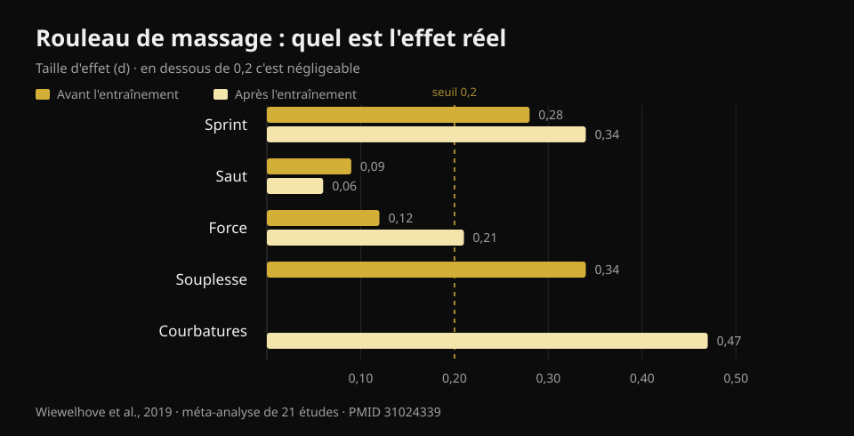
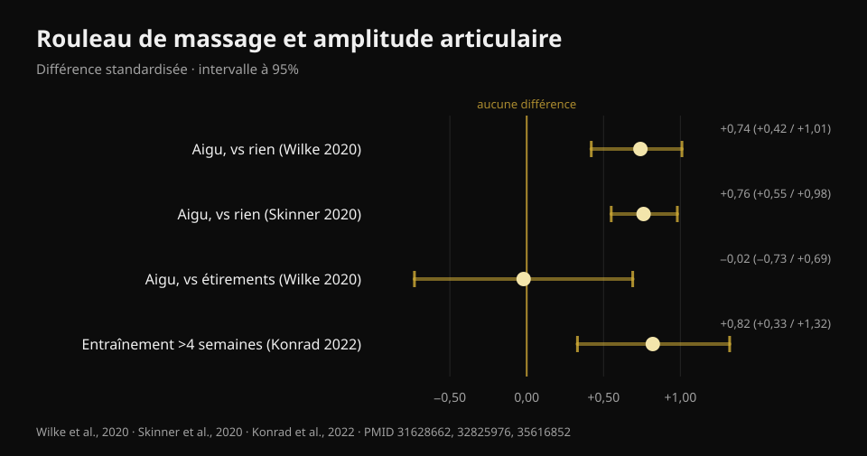

# Le rouleau de massage est-il utile ? 8 études

Par [Giammaria Loi](/autore/giammaria-loi) · mis à jour le 22 octobre 2026

Une publication très partagée aligne trois « non » sur le rouleau de massage : il ne dissout pas le fascia, il n'améliore pas la performance, il ne prévient pas les blessures. Il reste quelques bénéfices sur les courbatures et la mobilité, mais « temporaires ». J'ai lu huit travaux indexés pour vérifier ces trois non. Deux tiennent parfaitement. Le troisième est plus fragile qu'il n'y paraît. Et la partie sur la mobilité est dépassée : il y a là une donnée que la publication ne mentionne pas, et qui change la façon dont il faut utiliser le rouleau.

## En bref

- **Le rouleau ne modifie pas la raideur du tissu myofascial.** La méta-analyse qui l'a mesurée avec des instruments objectifs ne trouve aucun effet (Glänzel et al., 2023). Le fascia qui « fond » ne se voit pas sur les appareils.
- **Les effets sur la performance sont minuscules** : utilisé avant l'entraînement, il améliore le sprint de 0,7 % et la souplesse de 4 %, avec des effets négligeables sur le saut et la force (Wiewelhove et al., 2019). Mais il ne les dégrade pas non plus : c'est là le vrai avantage.
- **L'effet le plus grand de tous porte sur les courbatures** : +6,0 %, d = 0,47, la seule valeur de toute la littérature qui approche une taille moyenne (Wiewelhove et al., 2019). Il faut toutefois une dose : **au moins 90 secondes par groupe musculaire** (Hughes et Ramer, 2019).
- **« Seulement des gains temporaires de mobilité » n'est plus vrai.** Rouler avec régularité **pendant plus de 4 semaines** produit des gains de mobilité durables (TE = 0,82) par rapport à ceux qui ne le font pas (Konrad et al., 2022).
- **Sur les blessures, il n'y a pas de réponse nette** : la seule étude de prévention associe rouleau et travail de force, elle ne peut donc rien dire du rouleau seul (Desai et al., 2023).

## « Il casse le fascia » : ici la publication a raison

C'est l'affirmation la plus répétée dans les salles et la plus facile à démonter, parce que quelqu'un est allé la mesurer.

En 2023, une équipe brésilienne a rassemblé vingt études qui avaient évalué, avec des instruments objectifs, ce qui arrive aux tissus après une séance de rouleau : raideur du fascia du tronc et de la cuisse, raideur musculaire de la cuisse et du mollet, force du genou et du pied. Quelques études isolées rapportaient bien des baisses de raideur — deux pour le fascia, cinq pour le muscle — mais **quand les données sont regroupées dans la méta-analyse, l'effet sur la raideur myofasciale disparaît**.

La prudence qu'ajoutent les auteurs eux-mêmes mérite d'être répétée : avec la méthode GRADE, la certitude des preuves est **faible**, c'est-à-dire que de meilleures études pourraient changer le tableau. « Nous n'avons pas de preuve que cela arrive » n'est pas identique à « il est démontré que cela n'arrive pas ». En attendant, si on vous a vendu le rouleau comme un outil qui remodèle le tissu conjonctif, cette vente n'a aucune base.

L'explication la plus admise de ce que vous ressentez sous le rouleau est nerveuse, pas mécanique : ce qui change, c'est la tolérance à l'inconfort et la perception, pas la structure. Ce qui n'est pas rien — mais c'est autre chose.

## Performance : le point n'est pas qu'il l'améliore

Ici la publication dit vrai sur les faits et se trompe d'accent.

La méta-analyse de référence date de 2019 : vingt et une études, séparées entre ceux qui roulaient **avant** l'entraînement (quatorze études) et ceux qui roulaient **après** (sept études). Les chiffres, avant l'entraînement :

- sprint **+0,7 %** (d = 0,28)
- souplesse **+4,0 %** (d = 0,34)
- saut **−1,9 %** (d = 0,09)
- force **+1,8 %** (d = 0,12)

Après l'entraînement, comme stratégie de récupération :

- sprint **+3,1 %** (d = 0,34)
- force **+3,9 %** (d = 0,21)
- douleur musculaire perçue **+6,0 %** (d = 0,47)
- saut **−0,2 %** (d = 0,06)

*Taille d'effet (d) du rouleau de massage sur la performance, la souplesse et les courbatures. En dessous de 0,2, l'effet est considéré comme négligeable. Source : Wiewelhove et al., 2019, méta-analyse de 21 études (PMID 31024339).*

Un d de 0,1 ou 0,2 est, en pratique, du bruit. La valeur la plus élevée de tout le tableau — 0,47 sur les courbatures — atteint tout juste une taille moyenne.

Mais regardez le signe de ces chiffres. **Aucun n'est négatif de façon notable.** C'est là que le rouleau se distingue des autres choses que l'on fait avant de s'entraîner : les étirements statiques prolongés peuvent réduire force et puissance sur la séance qui suit, le rouleau non. Une méta-analyse de 2023 le confirme directement : aucun effet sur la force isométrique, le couple excentrique ou la vitesse de développement de la force, avec une seule donnée positive, le couple concentrique des extenseurs du genou (Glänzel et al., 2023).

Traduit : le rouleau de massage n'est pas un moyen de soulever plus lourd. C'est un moyen de mieux bouger avant une séance **sans le payer sur la barre**. Si votre échauffement a besoin de quelques degrés d'amplitude pour un squat profond et propre, c'est un outil adapté. Si vous attendez un maximal plus élevé, non.

## Mobilité : la donnée que la publication rate

Qu'un passage de rouleau élargisse l'amplitude de mouvement est acquis. La méta-analyse multiniveau la plus solide — vingt-six études de bonne qualité méthodologique — mesure un effet **grand en aigu** : DMS 0,74 (intervalle de confiance à 95 % 0,42–1,01) par rapport à ne rien faire (Wilke et al., 2020). Une seconde méta-analyse sur treize études arrive presque au même chiffre, d = 0,76 (0,55–0,98) (Skinner et al., 2020).

Deux précisions qu'on ne lit presque jamais ailleurs.

**La première :** face aux étirements, le rouleau ne gagne pas. DMS −0,02 (−0,73 à 0,69) : identique. Le rouleau est donc une **alternative** aux étirements dans l'échauffement, pas un ajout obligatoire. Si vous faites déjà de la mobilité, ajouter dix minutes de rouleau pour avoir « plus de mobilité » n'est pas soutenu par les données.

**La seconde, et c'est elle qui démonte le « seulement temporaire » :** en 2022 a été publiée une méta-analyse portant sur onze études et 290 personnes qui ont roulé comme **entraînement**, pendant des semaines. Résultat : effet modéré sur l'amplitude articulaire par rapport aux groupes contrôle, **TE = 0,82 (IC 95 % 0,33–1,32 ; p = 0,001)**. Avec une condition précise : les protocoles de **plus de 4 semaines** fonctionnent mieux que ceux allant jusqu'à 4 semaines (p = 0,049).

*Effet du rouleau de massage sur l'amplitude articulaire, avec intervalles de confiance à 95 %. Seule la comparaison avec les étirements traverse le zéro. Sources : Wilke et al., 2020 (PMID 31628662) ; Skinner et al., 2020 (PMID 32825976) ; Konrad et al., 2022 (PMID 35616852).*

Il y a un détail pratique enfoui dans cette même analyse : les gains apparaissent quand on roule **ischio-jambiers et quadriceps**, alors que rouler le mollet **n'a pas amélioré la dorsiflexion de cheville**. Si votre problème est une cheville qui ne descend pas au squat, le rouleau sur le mollet est probablement la mauvaise façon de l'attaquer.

Une dernière note issue de l'analyse des modérateurs de Wilke : durée, vitesse et indice de masse corporelle ne changent pas le résultat, mais **chez les hommes l'effet est moindre** (p < 0,05).

## Courbatures : l'effet le plus solide, et il a une dose

C'est le seul point où le rouleau produit quelque chose qui ressemble à un bénéfice réel, et c'est aussi le seul pour lequel on dispose d'une indication de dosage.

Une revue systématique de 2019 a séparé les études par objectif : sur huit travaux ayant mesuré douleur et courbatures, **sept** rapportent une réduction à court terme. Et le seuil qui ressort est de **90 secondes par groupe musculaire**, sans limite supérieure identifiée. En dessous de cette dose, les résultats deviennent inconstants. Sur la mobilité, la même revue est plus tiède (dix études sur dix-sept, avec des résultats très variables) et sur la performance elle ne trouve rien.

Une revue de 2024 portant sur vingt-cinq études et 517 athlètes arrive au même endroit par un autre chemin : elle améliore la **perception de la récupération** et réduit les courbatures d'apparition retardée, sans pénaliser force et puissance maximales.

Notez qu'on parle presque toujours de **douleur perçue**, pas de dommage musculaire réparé plus vite. Le rouleau vous fait vous sentir mieux ; rien ne prouve qu'il raccourcisse les délais de réparation du tissu. Si l'objectif est de revenir s'entraîner plus tôt, le sommeil, une charge bien gérée et [ce que vous mettez dans l'assiette quand vous êtes à l'arrêt](/fr/blog/que-manger-quand-on-est-blesse) comptent bien davantage.

## Blessures : la question n'a pas encore de réponse

La publication dit que le rouleau ne prévient pas les blessures. C'est une conclusion raisonnable, mais la base est plus fragile qu'elle n'en a l'air, et cela mérite d'être dit.

Le seul travail sérieux sur le sujet date de 2023 : 433 coureurs amateurs, dix-huit semaines, un groupe faisant **force générale plus rouleau** deux fois par semaine et un groupe contrôle poursuivant comme d'habitude. Résultat global : 27,1 % de blessures dans le contrôle contre 23,0 % dans l'intervention, différence **non significative** (log-rank p = 0,31).

Puis les auteurs ont regardé à l'intérieur du groupe intervention, en le divisant par adhésion. Ceux qui avaient suivi le programme avec régularité avaient **85 % de probabilité en moins** de se blesser (hazard ratio 0,15 ; IC 95 % 0,05–0,46) et se blessaient en moyenne 57 jours plus tard.

Trois raisons de ne pas utiliser ce chiffre comme preuve en faveur du rouleau. Premièrement : **l'intervention associait force et rouleau**, et le travail de force a déjà des preuves solides sur la prévention des blessures ; on ne peut pas en attribuer le mérite au rouleau. Deuxièmement : l'étude est **observationnelle**, pas randomisée. Troisièmement, le plus important : comparer « ceux qui ont été réguliers » à l'ensemble du groupe contrôle est une comparaison déséquilibrée — ceux qui arrivent à suivre un programme pendant dix-huit semaines dorment en général mieux, gèrent mieux leurs charges et sont plus prudents en général. C'est le classique avantage de l'adhérent, pas nécessairement celui de l'intervention.

La formulation honnête n'est donc pas « il ne prévient pas les blessures », mais : **aucune étude n'a isolé le rouleau et démontré un effet sur les blessures**. Celui qui vous le vend pour ça va au-delà des données.

## Ce que dit vraiment la recherche

- **Confirmé** — Le rouleau ne modifie pas la raideur du tissu myofascial mesurée avec des instruments objectifs (Glänzel et al., 2023 ; certitude des preuves faible).
- **Confirmé** — Les effets sur la performance sont négligeables : entre d = 0,06 et d = 0,34 sur le sprint, le saut et la force (Wiewelhove et al., 2019).
- **Confirmé** — Le rouleau ne dégrade ni la force, ni le couple excentrique, ni la vitesse de développement de la force : contrairement aux étirements statiques prolongés, on peut l'utiliser à l'échauffement sans pénalité (Glänzel et al., 2023 ; Martínez-Aranda et al., 2024).
- **Confirmé** — Il réduit la douleur musculaire perçue, avec l'effet le plus grand de toute la littérature sur le sujet (d = 0,47) et une dose minimale de 90 secondes par muscle (Wiewelhove et al., 2019 ; Hughes et Ramer, 2019).
- **À préciser** — « Il augmente la mobilité » est vrai, mais **pas plus que les étirements** (DMS −0,02) : c'est une alternative, pas un ajout (Wilke et al., 2020).
- **Démenti** — « Les gains de mobilité sont seulement temporaires » : en roulant avec régularité plus de 4 semaines, les gains deviennent durables, TE = 0,82 (Konrad et al., 2022).
- **Démenti** — « Ça marche partout » : sur le mollet, il n'a pas amélioré la dorsiflexion de cheville (Konrad et al., 2022).
- **Non vérifiable** — Effet sur les blessures : la seule étude disponible combine rouleau et force, elle est observationnelle et le résultat positif vient d'un sous-groupe défini par l'adhésion (Desai et al., 2023).

## Comment l'appliquer

1. **Mettez-le à l'échauffement, pas après la séance.** C'est la conclusion explicite de la méta-analyse de 2019 : les preuves justifient son usage comme activité d'échauffement plus que comme outil de récupération. Deux à trois minutes sur les groupes dont vous avez besoin, puis passez aux séries d'approche.
2. **Si vous l'utilisez pour les courbatures, atteignez 90 secondes par muscle.** En dessous de ce seuil, les résultats deviennent inconstants. C'est la différence entre un passage distrait et une dose.
3. **Ne l'additionnez pas aux étirements en espérant doubler le gain.** Il fait la même chose. Choisissez ce qui vous convient et consacrez le temps gagné à de vraies séries d'échauffement.
4. **Pour la cheville, changez d'outil.** Rouler le mollet n'a pas amélioré la dorsiflexion dans les études : si le squat profond est le problème, travaillez l'amplitude sous charge et la position du pied.
5. **N'attendez pas qu'il vous protège des blessures.** Ce qui a des preuves solides, c'est le travail de force progressif. Si vous voulez le tableau complet sur le dosage des séries, des charges et des récupérations, je l'ai résumé [ici](/fr/blog/combien-de-repetitions-masse-musculaire).
6. **Vérifiez-le sur vous.** Les effets moyens sont petits et variables : la seule façon de savoir si le rouleau vous sert est de regarder vos propres chiffres avant et après l'avoir intégré, sur quelques semaines.

### Essayez Nurvan — l'échauffement qui change quelque chose

Le rouleau ne vous fera pas soulever plus. Les séries d'approche, si : dans Nurvan elles sont proposées automatiquement en fonction de la charge programmée, pour arriver à la série de travail prêt plutôt que froid. Et comme chaque série est enregistrée avec la charge, les répétitions et le RIR (combien de répétitions il vous restait en réserve), après un mois vous voyez noir sur blanc si la routine de mobilité que vous avez ajoutée a déplacé quelque chose sur vos chiffres — ou si vous ne faites qu'allonger l'échauffement. **[Essayez Nurvan](https://nurvan.app)**

## Questions fréquentes

**Faut-il utiliser le rouleau avant ou après l'entraînement ?**
Les preuves sont plus favorables à l'usage **avant** : vous gagnez quelques degrés d'amplitude sans perdre de force sur la séance. Après l'entraînement, le seul effet appréciable porte sur la réduction de la douleur musculaire perçue, ce qui n'équivaut pas à une récupération musculaire plus rapide.

**Combien de temps faut-il rouler chaque muscle ?**
Pour l'effet sur les courbatures, le seuil qui ressort des études est d'**au moins 90 secondes par groupe musculaire**, sans limite supérieure identifiée. Pour la mobilité en aigu, la durée ne semble pas beaucoup changer le résultat.

**Le rouleau casse-t-il vraiment les adhérences du fascia ?**
Non, pas selon les instruments qui la mesurent : la méta-analyse disponible ne trouve aucune variation de la raideur du tissu myofascial après une séance. Ce qui change, c'est surtout la tolérance à l'inconfort et la perception, pas la structure du tissu.

**Rouleau ou étirements à l'échauffement ?**
Pour augmenter l'amplitude de mouvement, les deux sont équivalents (DMS −0,02 en comparaison directe). Choisissez selon le confort et le temps : aucun ne bat l'autre, et aucun ne remplace les séries d'approche à la barre.

**Est-ce mauvais de rouler un muscle très courbaturé ?**
Dans les études, le rouleau réduit la douleur perçue et ne dégrade pas la performance, mais la pression doit rester dans l'inconfort tolérable. Si la douleur est vive, localisée ou différente des courbatures habituelles, faites-la évaluer au lieu d'insister avec le rouleau.

## À lire aussi

- [Combien de répétitions pour la masse musculaire](/fr/blog/combien-de-repetitions-masse-musculaire) — comment doser les variables qui déplacent vraiment les résultats.
- [Que manger quand on est blessé](/fr/blog/que-manger-quand-on-est-blesse) — le versant nutritionnel de la récupération, chiffres à l'appui.
- [Entraîner force, muscle et cardio ensemble](/fr/blog/entrainer-force-muscle-et-cardio-ensemble) — organiser la semaine sans qu'une chose mange l'autre.

## Sources

1. Wiewelhove T, Döweling A, Schneider C, Hottenrott L, Meyer T, Kellmann M, Pfeiffer M, Ferrauti A, 2019. *A Meta-Analysis of the Effects of Foam Rolling on Performance and Recovery.* Frontiers in Physiology 10:376. [PMID 31024339](https://pubmed.ncbi.nlm.nih.gov/31024339/) · [DOI 10.3389/fphys.2019.00376](https://doi.org/10.3389/fphys.2019.00376)
2. Wilke J, Müller AL, Giesche F, Power G, Ahmedi H, Behm DG, 2020. *Acute Effects of Foam Rolling on Range of Motion in Healthy Adults: A Systematic Review with Multilevel Meta-analysis.* Sports Medicine 50(2):387-402. [PMID 31628662](https://pubmed.ncbi.nlm.nih.gov/31628662/) · [DOI 10.1007/s40279-019-01205-7](https://doi.org/10.1007/s40279-019-01205-7)
3. Konrad A, Nakamura M, Tilp M, Donti O, Behm DG, 2022. *Foam Rolling Training Effects on Range of Motion: A Systematic Review and Meta-Analysis.* Sports Medicine 52(10):2523-2535. [PMID 35616852](https://pubmed.ncbi.nlm.nih.gov/35616852/) · [DOI 10.1007/s40279-022-01699-8](https://doi.org/10.1007/s40279-022-01699-8)
4. Glänzel MH, Rodrigues DR, Petter GN, Pozzobon D, Vaz MA, Geremia JM, 2023. *Foam Rolling Acute Effects on Myofascial Tissue Stiffness and Muscle Strength: A Systematic Review and Meta-Analysis.* Journal of Strength and Conditioning Research 37(4):951-968. [PMID 36227232](https://pubmed.ncbi.nlm.nih.gov/36227232/) · [DOI 10.1519/JSC.0000000000004385](https://doi.org/10.1519/JSC.0000000000004385)
5. Hughes GA, Ramer LM, 2019. *Duration of Myofascial Rolling for Optimal Recovery, Range of Motion, and Performance: A Systematic Review of the Literature.* International Journal of Sports Physical Therapy 14(6):845-859. [PMID 31803517](https://pubmed.ncbi.nlm.nih.gov/31803517/)
6. Skinner B, Moss R, Hammond L, 2020. *A systematic review and meta-analysis of the effects of foam rolling on range of motion, recovery and markers of athletic performance.* Journal of Bodywork and Movement Therapies 24(3):105-122. [PMID 32825976](https://pubmed.ncbi.nlm.nih.gov/32825976/) · [DOI 10.1016/j.jbmt.2020.01.007](https://doi.org/10.1016/j.jbmt.2020.01.007)
7. Martínez-Aranda LM, Sanz-Matesanz M, García-Mantilla ED, González-Fernández FT, 2024. *Effects of Self-Myofascial Release on Athletes' Physical Performance: A Systematic Review.* Journal of Functional Morphology and Kinesiology 9(1):20. [PMID 38249097](https://pubmed.ncbi.nlm.nih.gov/38249097/) · [DOI 10.3390/jfmk9010020](https://doi.org/10.3390/jfmk9010020)
8. Desai P, Jungmalm J, Börjesson M, Karlsson J, Grau S, 2023. *Effectiveness of an 18-week general strength and foam-rolling intervention on running-related injuries in recreational runners.* Scandinavian Journal of Medicine & Science in Sports 33(5):766-775. [PMID 36630577](https://pubmed.ncbi.nlm.nih.gov/36630577/) · [DOI 10.1111/sms.14313](https://doi.org/10.1111/sms.14313)

Références bibliographiques récupérées via PubMed. Point de départ : la publication de **Built With Science** ([@builtwithscience](https://www.instagram.com/builtwithscience/)) du 2 septembre 2026, [publication originale](https://www.instagram.com/p/DcykEnJFE_2/). Aucun texte ni aucune image de la publication n'ont été reproduits : le sujet a été réécrit depuis zéro à partir des sources primaires.

---

**Giammaria Loi** est le fondateur de Nurvan. Il s'entraîne avec des poids depuis 2012, travaille comme coach et entraîneur personnel certifié FIPE depuis 2013 et participe à des compétitions de powerlifting au niveau national depuis 2018. Chaque article qu'il signe part des études scientifiques et arrive à ce qui fonctionne vraiment en salle.

> Note : contenu informatif, qui ne remplace pas l'avis d'un médecin ou d'un professionnel qualifié. Si vous avez une douleur localisée qui ne ressemble pas aux courbatures habituelles après l'entraînement, faites-la évaluer au lieu d'insister avec le rouleau.
