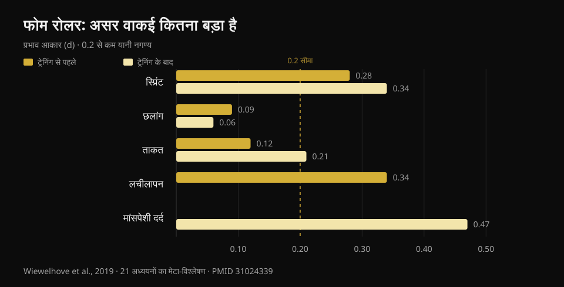
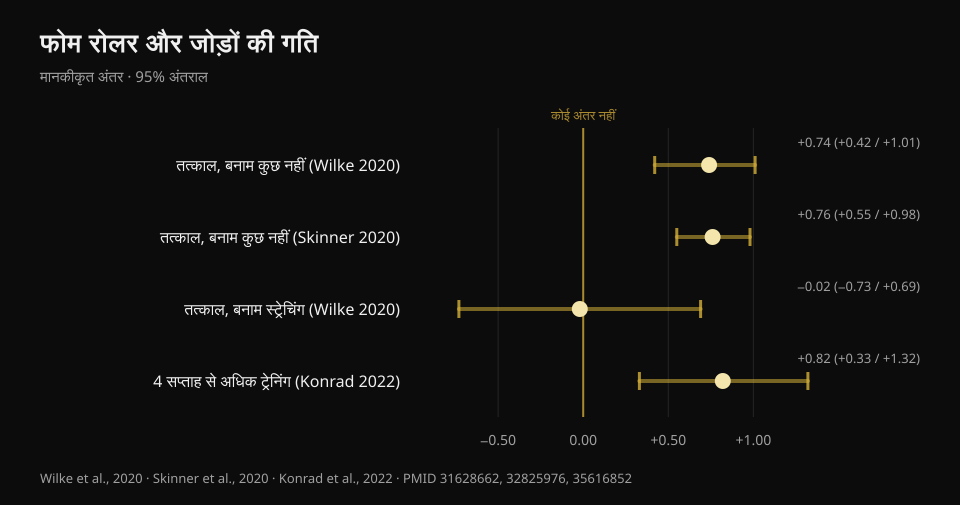

# फोम रोलर सच में काम करता है? रिसर्च क्या कहती है

लेखक: [Giammaria Loi](/autore/giammaria-loi) · 22 अक्टूबर 2026 को अपडेट किया गया

एक खूब शेयर हुई पोस्ट फोम रोलर पर तीन "नहीं" गिनाती है: यह फेशिया नहीं खोलता, परफॉर्मेंस नहीं बढ़ाता, चोट नहीं रोकता। बाकी बचता है मसल सोरनेस और मोबिलिटी पर थोड़ा फायदा, लेकिन "अस्थायी"। मैंने उन तीनों "नहीं" को जांचने के लिए आठ इंडेक्स्ड स्टडी पढ़ीं। दो पूरी तरह टिकती हैं, तीसरी जितनी मज़बूत बताई जाती है उतनी नहीं है — और मोबिलिटी वाला हिस्सा अब पुराना पड़ चुका है: वहां एक आंकड़ा है जो पोस्ट में नहीं आया, और वही तय करता है कि रोलर को इस्तेमाल कैसे करना चाहिए।

## एक नज़र में

- **रोलर मायोफेशियल टिश्यू की कठोरता नहीं बदलता**: जिस मेटा-एनालिसिस ने इसे वस्तुनिष्ठ उपकरणों से नापा, उसे कोई असर नहीं मिला (Glänzel et al., 2023)। "फेशिया पिघलने" वाली बात उपकरणों पर दिखती ही नहीं।
- **परफॉर्मेंस पर असर बेहद छोटा है**: ट्रेनिंग से पहले इस्तेमाल करने पर स्प्रिंट 0.7% और फ्लेक्सिबिलिटी 4.0% बेहतर होती है, जबकि जंप और ताकत पर असर नगण्य है (Wiewelhove et al., 2019)। लेकिन यह परफॉर्मेंस बिगाड़ता भी नहीं — असली फायदा यही है।
- **सबसे बड़ा असर मसल सोरनेस पर है**: +6.0%, d = 0.47, जो इस पूरे विषय के साहित्य में इकलौता आंकड़ा है जो मध्यम आकार के पास पहुंचता है (Wiewelhove et al., 2019)। पर इसकी एक डोज़ चाहिए: **हर मसल ग्रुप पर कम से कम 90 सेकंड** (Hughes और Ramer, 2019)।
- **"मोबिलिटी का फायदा सिर्फ अस्थायी है" अब सच नहीं रहा।** लगातार **4 हफ्ते से ज़्यादा** रोल करने पर मोबिलिटी का फायदा स्थायी हो जाता है (ES = 0.82), उन लोगों की तुलना में जो यह नहीं करते (Konrad et al., 2022)।
- **चोट रोकने पर कोई साफ जवाब नहीं है**: इकलौती प्रिवेंशन स्टडी रोलर और स्ट्रेंथ ट्रेनिंग को साथ रखकर चली, इसलिए वह अकेले रोलर के बारे में कुछ नहीं कह सकती (Desai et al., 2023)।

## "फेशिया खोल देता है": यहां पोस्ट सही है

जिम में सबसे ज़्यादा दोहराया जाने वाला और सबसे आसानी से गिर जाने वाला दावा यही है, क्योंकि किसी ने इसे सच में नापा है।

2023 में एक ब्राज़ीलियन टीम ने बीस स्टडी इकट्ठी कीं जिन्होंने वस्तुनिष्ठ उपकरणों से जांचा कि फोम रोलिंग के एक सेशन के बाद टिश्यू का क्या होता है: धड़ और जांघ की फेशिया की कठोरता, जांघ और पिंडली की मसल स्टिफनेस, घुटने और पैर की ताकत। कुछ अलग-अलग स्टडी में कठोरता घटी भी — फेशिया पर दो, मसल पर पांच — लेकिन **जब आंकड़ों को मेटा-एनालिसिस में जोड़ा जाता है तो मायोफेशियल कठोरता पर असर गायब हो जाता है**।

लेखकों की अपनी चेतावनी भी जोड़ लीजिए: GRADE पद्धति से प्रमाणों की निश्चितता **कम** है, यानी बेहतर स्टडी तस्वीर बदल सकती हैं। "हमारे पास सबूत नहीं है कि ऐसा होता है" और "साबित हो चुका है कि ऐसा नहीं होता" एक बात नहीं हैं। पर फिलहाल, अगर आपको रोलर इस दावे पर बेचा गया है कि यह कनेक्टिव टिश्यू को दोबारा गढ़ता है, तो उस दावे का कोई आधार नहीं।

रोलर के नीचे आप जो महसूस करते हैं, उसकी सबसे स्वीकार्य व्याख्या नर्वस सिस्टम की है, मैकेनिकल नहीं: बदलती है असहजता सहने की क्षमता और अनुभूति, संरचना नहीं। यह कम बात नहीं है — पर यह अलग बात है।

## परफॉर्मेंस: बात यह नहीं कि यह उसे बढ़ाता है

यहां पोस्ट सही कहती है, पर ज़ोर गलत जगह डालती है।

संदर्भ वाली मेटा-एनालिसिस 2019 की है: इक्कीस स्टडी, जिनमें **पहले** रोल करने वाले (चौदह स्टडी) और ट्रेनिंग के **बाद** रोल करने वाले (सात स्टडी) अलग किए गए। ट्रेनिंग से पहले के आंकड़े:

- स्प्रिंट **+0.7%** (d = 0.28)
- फ्लेक्सिबिलिटी **+4.0%** (d = 0.34)
- जंप **−1.9%** (d = 0.09)
- ताकत **+1.8%** (d = 0.12)

ट्रेनिंग के बाद, रिकवरी रणनीति के तौर पर:

- स्प्रिंट **+3.1%** (d = 0.34)
- ताकत **+3.9%** (d = 0.21)
- महसूस होने वाला मसल दर्द **+6.0%** (d = 0.47)
- जंप **−0.2%** (d = 0.06)

*परफॉर्मेंस, फ्लेक्सिबिलिटी और मसल सोरनेस पर फोम रोलर का प्रभाव आकार (d)। 0.2 से नीचे असर नगण्य माना जाता है। स्रोत: Wiewelhove et al., 2019, 21 स्टडी की मेटा-एनालिसिस (PMID 31024339)।*

0.1 या 0.2 का d व्यवहार में शोर है। पूरी तालिका का सबसे बड़ा आंकड़ा — मसल सोरनेस पर 0.47 — बमुश्किल मध्यम आकार तक पहुंचता है।

पर इन आंकड़ों का चिह्न देखिए। **कोई भी सार्थक रूप से ऋणात्मक नहीं है।** ठीक यहीं फोम रोलर ट्रेनिंग से पहले की जाने वाली बाकी चीज़ों से अलग पड़ता है: लंबी स्टैटिक स्ट्रेचिंग अगले सेशन में ताकत और पावर घटा सकती है, रोलर नहीं। 2023 की एक मेटा-एनालिसिस इसे सीधे पुष्ट करती है: आइसोमेट्रिक ताकत, इसेंट्रिक टॉर्क या रेट ऑफ फोर्स डेवलपमेंट पर कोई असर नहीं, और सकारात्मक दिशा में सिर्फ एक आंकड़ा — घुटने के एक्सटेंसर का कंसेंट्रिक टॉर्क (Glänzel et al., 2023)।

सीधे शब्दों में: फोम रोलर ज़्यादा वज़न उठाने का तरीका नहीं है। यह सेशन से पहले बेहतर मूवमेंट पाने का तरीका है, **वह भी वज़न पर कीमत चुकाए बिना**। अगर वॉर्म-अप में आपको गहरी और साफ स्क्वाट के लिए कुछ डिग्री मोबिलिटी चाहिए, तो यह सही औज़ार है। अगर आप ऊंचे मैक्स की उम्मीद कर रहे हैं, तो नहीं।

## मोबिलिटी: वह आंकड़ा जो पोस्ट से छूट गया

रोलर की एक पास से मूवमेंट की रेंज बढ़ती है, यह तय बात है। पद्धति के लिहाज़ से सबसे मज़बूत मल्टीलेवल मेटा-एनालिसिस — छब्बीस अच्छी गुणवत्ता वाली स्टडी — तात्कालिक असर **बड़ा** नापती है: कुछ न करने की तुलना में SMD 0.74 (95% कॉन्फिडेंस इंटरवल 0.42–1.01) (Wilke et al., 2020)। तेरह स्टडी वाली दूसरी मेटा-एनालिसिस लगभग वही आंकड़ा देती है, d = 0.76 (0.55–0.98) (Skinner et al., 2020)।

दो बातें जो लगभग कहीं पढ़ने को नहीं मिलतीं।

**पहली:** स्ट्रेचिंग के मुकाबले रोलर जीतता नहीं है। SMD −0.02 (−0.73 से 0.69): बिल्कुल बराबर। यानी वॉर्म-अप में फोम रोलर स्ट्रेचिंग का **विकल्प** है, कोई अनिवार्य अतिरिक्त चीज़ नहीं। अगर आप पहले से मोबिलिटी का काम करते हैं, तो "और मोबिलिटी" पाने के लिए दस मिनट रोलर जोड़ने का कोई सबूत नहीं है।

**दूसरी, और यही "सिर्फ अस्थायी" वाली बात गिराती है:** 2022 में ग्यारह स्टडी और 290 लोगों पर एक मेटा-एनालिसिस छपी, जिन्होंने हफ्तों तक रोलिंग को **ट्रेनिंग** की तरह किया। नतीजा: कंट्रोल ग्रुप की तुलना में जोड़ों की मोबिलिटी पर मध्यम असर, **ES = 0.82 (95% CI 0.33–1.32; p = 0.001)**। और एक साफ शर्त के साथ: **4 हफ्ते से ज़्यादा** चलने वाले प्रोटोकॉल 4 हफ्ते तक वालों से बेहतर काम करते हैं (p = 0.049)।

*जोड़ों की मोबिलिटी पर फोम रोलर का असर, 95% कॉन्फिडेंस इंटरवल के साथ। सिर्फ स्ट्रेचिंग वाली तुलना शून्य को पार करती है। स्रोत: Wilke et al., 2020 (PMID 31628662); Skinner et al., 2020 (PMID 32825976); Konrad et al., 2022 (PMID 35616852)।*

उसी एनालिसिस में एक बहुत काम की बात दबी हुई है: फायदा तब दिखता है जब **हैमस्ट्रिंग और क्वाड्रिसेप्स** पर रोल किया जाए, जबकि पिंडली पर रोल करने से **टखने का डोर्सिफ्लेक्शन बेहतर नहीं हुआ**। अगर आपकी दिक्कत यह है कि स्क्वाट में टखना नीचे नहीं जाता, तो पिंडली पर रोलर शायद गलत रास्ता है।

Wilke के मॉडरेटर एनालिसिस से एक आखिरी बात: अवधि, रफ्तार और बॉडी मास इंडेक्स नतीजा नहीं बदलते, पर **पुरुषों में असर कम होता है** (p < 0.05)।

## मसल सोरनेस: सबसे ठोस असर, और इसकी एक डोज़ है

यही इकलौता बिंदु है जहां फोम रोलर कुछ ऐसा देता है जो असली फायदे जैसा लगता है, और यही इकलौता बिंदु है जहां हमारे पास डोज़ का संकेत है।

2019 की एक सिस्टेमैटिक रिव्यू ने स्टडी को लक्ष्य के हिसाब से अलग किया: दर्द और सोरनेस नापने वाली आठ स्टडी में से **सात** में अल्पकालिक कमी दर्ज हुई। जो सीमा उभरती है वह है **हर मसल ग्रुप पर 90 सेकंड**, और कोई ऊपरी सीमा नहीं मिली। उस डोज़ से नीचे नतीजे अस्थिर हो जाते हैं। मोबिलिटी पर वही रिव्यू ज़्यादा ठंडी है (सत्रह में से दस स्टडी, बहुत बिखरे नतीजों के साथ) और परफॉर्मेंस पर उसे कुछ नहीं मिला।

पच्चीस स्टडी और 517 एथलीटों पर 2024 की एक रिव्यू दूसरे रास्ते से उसी नतीजे पर पहुंचती है: **रिकवरी का एहसास** बेहतर होता है और देर से आने वाली सोरनेस घटती है, बिना अधिकतम ताकत और पावर को नुकसान पहुंचाए।

ध्यान दीजिए कि बात लगभग हमेशा **महसूस होने वाले दर्द** की है, न कि तेज़ी से भरते मसल डैमेज की। रोलर आपको बेहतर महसूस कराता है; इसका कोई सबूत नहीं कि यह टिश्यू की मरम्मत का समय घटाता है। अगर लक्ष्य जल्दी ट्रेनिंग पर लौटना है, तो नींद, सही ढंग से संभाला गया लोड और [चोट के दौरान आप क्या खाते हैं](/hi/blog/chot-lagne-par-kya-khayein) कहीं ज़्यादा मायने रखते हैं।

## चोट: इस सवाल का जवाब अभी नहीं है

पोस्ट कहती है कि फोम रोलर चोट नहीं रोकता। निष्कर्ष वाजिब है, पर उसका आधार जितना लगता है उससे कमज़ोर है, और यह कहना ज़रूरी है।

इस विषय पर इकलौता गंभीर काम 2023 का है: 433 शौकिया धावक, अठारह हफ्ते, एक ग्रुप हफ्ते में दो बार **सामान्य स्ट्रेंथ ट्रेनिंग के साथ फोम रोलिंग** करता था और कंट्रोल ग्रुप पहले की तरह चलता रहा। कुल नतीजा: कंट्रोल में 27.1% चोटें बनाम इंटरवेंशन में 23.0%, अंतर **सार्थक नहीं** (log-rank p = 0.31)।

फिर लेखकों ने इंटरवेंशन ग्रुप के भीतर झांका और उसे पालन के हिसाब से बांटा। जिन्होंने प्रोग्राम नियमित रूप से निभाया, उनके चोटिल होने की संभावना **85% कम** थी (हैज़र्ड रेशियो 0.15; 95% CI 0.05–0.46) और वे औसतन 57 दिन बाद चोटिल हुए।

इस आंकड़े को रोलर के पक्ष में सबूत न मानने के तीन कारण हैं। पहला: **इंटरवेंशन में स्ट्रेंथ और फोम रोलिंग साथ थे**, और चोट रोकने में स्ट्रेंथ ट्रेनिंग के पास पहले से ठोस प्रमाण हैं; श्रेय रोलर को नहीं दिया जा सकता। दूसरा: स्टडी **ऑब्ज़र्वेशनल** है, रैंडमाइज़्ड नहीं। तीसरा, और सबसे अहम: "जिन्होंने नियमितता निभाई" की तुलना पूरे कंट्रोल ग्रुप से करना असंतुलित तुलना है — जो अठारह हफ्ते तक कोई प्रोग्राम निभा पाता है, वह आमतौर पर बेहतर सोता है, लोड बेहतर संभालता है और कुल मिलाकर ज़्यादा सावधान रहता है। यह नियमित रहने वालों का जाना-पहचाना फायदा है, ज़रूरी नहीं कि इंटरवेंशन का।

तो ईमानदार वाक्य यह नहीं है कि "यह चोट नहीं रोकता", बल्कि यह: **ऐसी कोई स्टडी नहीं है जिसने अकेले फोम रोलर को अलग करके चोटों पर उसका असर दिखाया हो**। जो इसे इस दावे पर बेच रहा है, वह आंकड़ों से आगे निकल रहा है।

## रिसर्च असल में क्या कहती है

- **पुष्ट** — वस्तुनिष्ठ उपकरणों से नापने पर फोम रोलिंग मायोफेशियल टिश्यू की कठोरता नहीं बदलता (Glänzel et al., 2023; प्रमाणों की निश्चितता कम)।
- **पुष्ट** — परफॉर्मेंस पर असर नगण्य है: स्प्रिंट, जंप और ताकत पर d = 0.06 से d = 0.34 के बीच (Wiewelhove et al., 2019)।
- **पुष्ट** — रोलर ताकत, इसेंट्रिक टॉर्क और रेट ऑफ फोर्स डेवलपमेंट को नहीं बिगाड़ता: लंबी स्टैटिक स्ट्रेचिंग से अलग, इसे बिना नुकसान वॉर्म-अप में रखा जा सकता है (Glänzel et al., 2023; Martínez-Aranda et al., 2024)।
- **पुष्ट** — महसूस होने वाला मसल दर्द घटाता है, और यह इस विषय के पूरे साहित्य का सबसे बड़ा असर है (d = 0.47), न्यूनतम डोज़ हर मसल पर 90 सेकंड (Wiewelhove et al., 2019; Hughes और Ramer, 2019)।
- **स्पष्टीकरण चाहिए** — "मोबिलिटी बढ़ाता है" सच है, पर **स्ट्रेचिंग से ज़्यादा नहीं** (SMD −0.02): यह विकल्प है, अतिरिक्त चीज़ नहीं (Wilke et al., 2020)।
- **खंडित** — "मोबिलिटी का फायदा सिर्फ अस्थायी है": 4 हफ्ते से ज़्यादा लगातार रोल करने पर फायदा स्थायी हो जाता है, ES = 0.82 (Konrad et al., 2022)।
- **खंडित** — "हर हिस्से पर काम करता है": पिंडली पर इसने टखने का डोर्सिफ्लेक्शन बेहतर नहीं किया (Konrad et al., 2022)।
- **असत्यापित** — चोटों पर असर: उपलब्ध इकलौती स्टडी रोलर और स्ट्रेंथ को साथ रखती है, ऑब्ज़र्वेशनल है, और सकारात्मक नतीजा पालन के आधार पर बने सबग्रुप से आता है (Desai et al., 2023)।

## इसे कैसे लागू करें

1. **इसे वॉर्म-अप में रखिए, ट्रेनिंग के बाद नहीं।** 2019 की मेटा-एनालिसिस का यही साफ निष्कर्ष है: प्रमाण इसे रिकवरी टूल से ज़्यादा वॉर्म-अप गतिविधि के रूप में सही ठहराते हैं। जिन ग्रुप पर ज़रूरत हो उन पर दो-तीन मिनट, फिर वॉर्म-अप सेट पर जाइए।
2. **अगर दर्द के लिए इस्तेमाल कर रहे हैं, तो हर मसल पर 90 सेकंड तक पहुंचिए।** उस सीमा से नीचे नतीजे अस्थिर हो जाते हैं। लापरवाह एक पास और असली डोज़ में यही फर्क है।
3. **दोगुना फायदा पाने की उम्मीद में इसे स्ट्रेचिंग के ऊपर मत जोड़िए।** दोनों एक ही काम करते हैं। जो सुविधाजनक लगे वह चुनिए, और बचा हुआ समय असली वॉर्म-अप सेट में लगाइए।
4. **टखने के लिए औज़ार बदलिए।** स्टडी में पिंडली पर रोल करने से डोर्सिफ्लेक्शन बेहतर नहीं हुआ: अगर गहरी स्क्वाट दिक्कत है, तो लोड के नीचे रेंज और पैर की पोज़िशन पर काम कीजिए।
5. **यह उम्मीद मत रखिए कि यह आपको चोट से बचाएगा।** ठोस प्रमाण प्रोग्रेसिव स्ट्रेंथ ट्रेनिंग के पास हैं। सेट, लोड और रेस्ट कैसे तय करें, इसका पूरा खाका मैंने [यहां](/hi/blog/kitne-reps-muscle-ke-liye) समेटा है।
6. **खुद पर जांचिए।** औसत असर छोटे और बदलते रहते हैं: रोलर आपके काम आता है या नहीं, यह जानने का इकलौता तरीका है कुछ हफ्तों तक उसे जोड़ने से पहले और बाद के अपने आंकड़े देखना।

### Nurvan आज़माइए — वह वॉर्म-अप जो सच में फर्क डालता है

फोम रोलर आपसे ज़्यादा वज़न नहीं उठवाएगा। वॉर्म-अप सेट उठवाएंगे: Nurvan में ये आपके तय किए गए लोड के हिसाब से अपने आप सुझाए जाते हैं, ताकि आप ठंडे नहीं बल्कि तैयार होकर मुख्य सेट पर पहुंचें। और चूंकि हर सेट लोड, रेप्स और RIR (कितनी रेप्स बची थीं) के साथ दर्ज होता है, एक महीने बाद आप साफ-साफ देख सकते हैं कि जो मोबिलिटी रूटीन आपने जोड़ा उसने आपके आंकड़े हिलाए या नहीं — या आप सिर्फ वॉर्म-अप लंबा कर रहे हैं। **[Nurvan आज़माइए](https://nurvan.app)**

## अक्सर पूछे जाने वाले सवाल

**फोम रोलर वर्कआउट से पहले इस्तेमाल करें या बाद में?**
प्रमाण **पहले** इस्तेमाल के ज़्यादा पक्ष में हैं: आपको कुछ डिग्री मोबिलिटी मिलती है और उस सेशन में ताकत भी नहीं घटती। ट्रेनिंग के बाद इकलौता दिखने वाला असर महसूस होने वाले मसल दर्द में कमी है, पर यह तेज़ मसल रिकवरी के बराबर नहीं है।

**हर मसल पर कितनी देर रोल करना चाहिए?**
मसल सोरनेस पर असर के लिए स्टडी से उभरने वाली सीमा है **हर मसल ग्रुप पर कम से कम 90 सेकंड**, और कोई ऊपरी सीमा नहीं मिली। तात्कालिक मोबिलिटी के लिए अवधि नतीजे को बहुत नहीं बदलती।

**क्या फोम रोलर वाकई फेशिया की चिपकन तोड़ता है?**
नहीं, कम से कम उन उपकरणों के हिसाब से नहीं जो इसे नापते हैं: उपलब्ध मेटा-एनालिसिस को एक सेशन के बाद मायोफेशियल टिश्यू की कठोरता में कोई बदलाव नहीं मिला। जो बदलता है वह मुख्य रूप से असहजता सहने की क्षमता और अनुभूति है, टिश्यू की संरचना नहीं।

**वॉर्म-अप में फोम रोलर बेहतर है या स्ट्रेचिंग?**
मूवमेंट की रेंज बढ़ाने के लिए दोनों बराबर हैं (सीधी तुलना में SMD −0.02)। सुविधा और समय के हिसाब से चुनिए: कोई किसी से बेहतर नहीं, और दोनों में से कोई भी बारबेल के वॉर्म-अप सेट की जगह नहीं लेता।

**मसल बहुत दुख रही हो तो रोल करना नुकसानदेह है?**
स्टडी में रोलर महसूस होने वाला दर्द घटाता है और परफॉर्मेंस नहीं बिगाड़ता, पर दबाव सहने लायक असहजता तक ही रखना चाहिए। अगर दर्द तेज़ है, किसी एक जगह सिमटा है, या ट्रेनिंग के बाद की सामान्य सोरनेस से अलग लगता है, तो रोलर से ज़ोर लगाने के बजाय उसे जंचवाइए।

## यह भी पढ़ें

- [मसल के लिए कितने रेप्स, सेट और रेस्ट](/hi/blog/kitne-reps-muscle-ke-liye) — नतीजे सच में बदलने वाले वेरिएबल कैसे तय करें।
- [चोट लगने पर क्या खाएं](/hi/blog/chot-lagne-par-kya-khayein) — रिकवरी का पोषण वाला पहलू, आंकड़ों के साथ।
- [ताकत, मसल और कार्डियो एक साथ](/hi/blog/strength-muscle-cardio-ek-saath-training) — हफ्ता ऐसे बांटिए कि एक चीज़ दूसरी को न खाए।

## स्रोत

1. Wiewelhove T, Döweling A, Schneider C, Hottenrott L, Meyer T, Kellmann M, Pfeiffer M, Ferrauti A, 2019. *A Meta-Analysis of the Effects of Foam Rolling on Performance and Recovery.* Frontiers in Physiology 10:376. [PMID 31024339](https://pubmed.ncbi.nlm.nih.gov/31024339/) · [DOI 10.3389/fphys.2019.00376](https://doi.org/10.3389/fphys.2019.00376)
2. Wilke J, Müller AL, Giesche F, Power G, Ahmedi H, Behm DG, 2020. *Acute Effects of Foam Rolling on Range of Motion in Healthy Adults: A Systematic Review with Multilevel Meta-analysis.* Sports Medicine 50(2):387-402. [PMID 31628662](https://pubmed.ncbi.nlm.nih.gov/31628662/) · [DOI 10.1007/s40279-019-01205-7](https://doi.org/10.1007/s40279-019-01205-7)
3. Konrad A, Nakamura M, Tilp M, Donti O, Behm DG, 2022. *Foam Rolling Training Effects on Range of Motion: A Systematic Review and Meta-Analysis.* Sports Medicine 52(10):2523-2535. [PMID 35616852](https://pubmed.ncbi.nlm.nih.gov/35616852/) · [DOI 10.1007/s40279-022-01699-8](https://doi.org/10.1007/s40279-022-01699-8)
4. Glänzel MH, Rodrigues DR, Petter GN, Pozzobon D, Vaz MA, Geremia JM, 2023. *Foam Rolling Acute Effects on Myofascial Tissue Stiffness and Muscle Strength: A Systematic Review and Meta-Analysis.* Journal of Strength and Conditioning Research 37(4):951-968. [PMID 36227232](https://pubmed.ncbi.nlm.nih.gov/36227232/) · [DOI 10.1519/JSC.0000000000004385](https://doi.org/10.1519/JSC.0000000000004385)
5. Hughes GA, Ramer LM, 2019. *Duration of Myofascial Rolling for Optimal Recovery, Range of Motion, and Performance: A Systematic Review of the Literature.* International Journal of Sports Physical Therapy 14(6):845-859. [PMID 31803517](https://pubmed.ncbi.nlm.nih.gov/31803517/)
6. Skinner B, Moss R, Hammond L, 2020. *A systematic review and meta-analysis of the effects of foam rolling on range of motion, recovery and markers of athletic performance.* Journal of Bodywork and Movement Therapies 24(3):105-122. [PMID 32825976](https://pubmed.ncbi.nlm.nih.gov/32825976/) · [DOI 10.1016/j.jbmt.2020.01.007](https://doi.org/10.1016/j.jbmt.2020.01.007)
7. Martínez-Aranda LM, Sanz-Matesanz M, García-Mantilla ED, González-Fernández FT, 2024. *Effects of Self-Myofascial Release on Athletes' Physical Performance: A Systematic Review.* Journal of Functional Morphology and Kinesiology 9(1):20. [PMID 38249097](https://pubmed.ncbi.nlm.nih.gov/38249097/) · [DOI 10.3390/jfmk9010020](https://doi.org/10.3390/jfmk9010020)
8. Desai P, Jungmalm J, Börjesson M, Karlsson J, Grau S, 2023. *Effectiveness of an 18-week general strength and foam-rolling intervention on running-related injuries in recreational runners.* Scandinavian Journal of Medicine & Science in Sports 33(5):766-775. [PMID 36630577](https://pubmed.ncbi.nlm.nih.gov/36630577/) · [DOI 10.1111/sms.14313](https://doi.org/10.1111/sms.14313)

संदर्भ PubMed के ज़रिए निकाले गए। शुरुआती प्रेरणा: **Built With Science** ([@builtwithscience](https://www.instagram.com/builtwithscience/)) की 2 सितंबर 2026 की पोस्ट, [मूल पोस्ट](https://www.instagram.com/p/DcykEnJFE_2/)। पोस्ट का न कोई टेक्स्ट और न कोई तस्वीर दोबारा इस्तेमाल की गई है: विषय को प्राथमिक स्रोतों से शुरू करके नए सिरे से लिखा गया है।

---

**Giammaria Loi** Nurvan के संस्थापक हैं। वे 2012 से वेट ट्रेनिंग कर रहे हैं, 2013 से FIPE-सर्टिफाइड पर्सनल ट्रेनर और कोच के रूप में काम करते हैं, और 2018 से राष्ट्रीय स्तर पर पावरलिफ्टिंग में प्रतिस्पर्धा करते हैं। उनके नाम से छपा हर लेख रिसर्च से शुरू होता है और वहीं खत्म होता है जो जिम में सच में काम करता है।

> नोट: यह जानकारी देने वाली सामग्री है, जो डॉक्टर या योग्य पेशेवर की सलाह की जगह नहीं लेती। अगर आपको किसी एक जगह सिमटा दर्द है जो ट्रेनिंग के बाद की सामान्य सोरनेस जैसा नहीं लगता, तो रोलर से ज़ोर लगाने के बजाय पहले उसे जंचवाइए।
