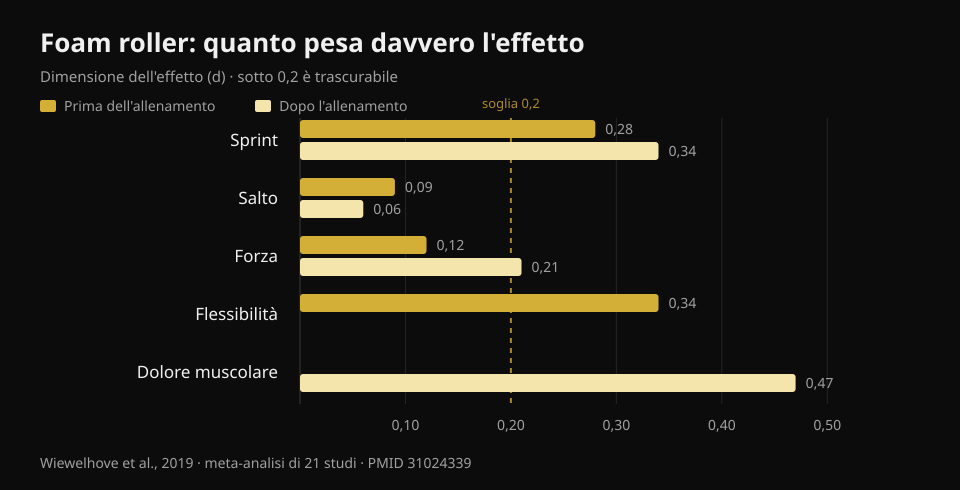
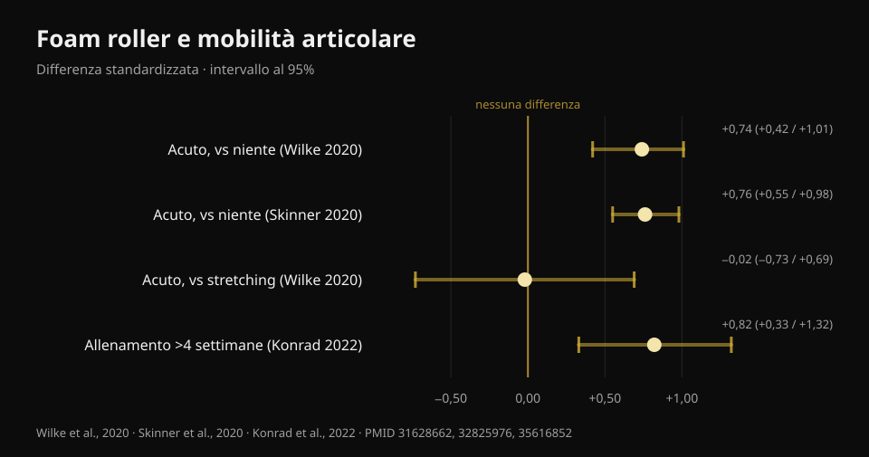

# Foam roller: serve davvero? Cosa dicono gli studi

Di [Giammaria Loi](/autore/giammaria-loi) · aggiornato il 22 ottobre 2026

Un post molto condiviso mette in fila tre "no" sul foam roller: non scioglie la fascia, non migliora la prestazione, non previene gli infortuni. Resta qualche beneficio su dolori muscolari e mobilità, ma "temporaneo". Ho letto otto lavori indicizzati per controllare quei tre no. Due reggono benissimo, il terzo è più debole di come viene raccontato — e la parte sulla mobilità è ormai superata: su quella c'è un dato che il post non riporta e che cambia il modo in cui conviene usare il rullo.

## In breve

- **Il rullo non modifica la rigidità del tessuto miofasciale**: la meta-analisi che l'ha misurata con strumenti oggettivi non trova alcun effetto (Glänzel et al., 2023). La "fascia che si scioglie" non si vede negli strumenti.
- **Sulla prestazione gli effetti sono minuscoli**: usato prima dell'allenamento migliora lo sprint dello 0,7% e la flessibilità del 4%, con effetti su salto e forza trascurabili (Wiewelhove et al., 2019). Ma non la peggiora: è questo il vero vantaggio.
- **L'effetto più grande di tutti è sul dolore muscolare**: +6,0%, d = 0,47, l'unico valore che si avvicina a una dimensione media in tutta la letteratura (Wiewelhove et al., 2019). Serve però una dose: **almeno 90 secondi per gruppo muscolare** (Hughes e Ramer, 2019).
- **"Solo guadagni temporanei di mobilità" non è più vero.** Rullare con costanza **per più di 4 settimane** produce guadagni di mobilità stabili (ES = 0,82) rispetto a chi non lo fa (Konrad et al., 2022).
- **Sugli infortuni non esiste una risposta pulita**: l'unico studio di prevenzione mette insieme rullo e lavoro di forza, quindi non può dire nulla sul rullo da solo (Desai et al., 2023).

## "Scioglie la fascia": qui il post ha ragione

È l'affermazione più ripetuta nelle palestre e la più facile da smontare, perché qualcuno è andato a misurarla.

Nel 2023 un gruppo brasiliano ha raccolto venti studi che avevano valutato, con strumenti oggettivi, cosa succede ai tessuti dopo una sessione di foam rolling: rigidità della fascia del tronco e della coscia, rigidità muscolare di coscia e polpaccio, forza del ginocchio e del piede. Alcuni singoli studi riportavano cali di rigidità — due sulla fascia, cinque sul muscolo — ma **quando i dati vengono messi insieme nella meta-analisi l'effetto sulla rigidità miofasciale sparisce**.

Vale la pena aggiungere la cautela che mettono gli autori stessi: con il metodo GRADE la certezza delle prove è **bassa**, cioè studi migliori potrebbero cambiare il quadro. "Non abbiamo prove che succeda" non è identico a "è dimostrato che non succede". Ma nel frattempo, se ti hanno venduto il rullo come attrezzo che rimodella il tessuto connettivo, quella vendita non ha basi.

La spiegazione più accreditata di quello che senti sotto il rullo è nervosa, non meccanica: cambia la tolleranza al fastidio e la percezione, non la struttura. Il che non è poco — ma è un'altra cosa.

## Prestazione: il punto non è che la migliora

Qui il post dice il vero e sbaglia l'accento.

La meta-analisi di riferimento è del 2019: ventun studi, separati fra chi rullava **prima** (quattordici studi) e chi rullava **dopo** l'allenamento (sette studi). I numeri, prima dell'allenamento:

- sprint **+0,7%** (d = 0,28)
- flessibilità **+4,0%** (d = 0,34)
- salto **−1,9%** (d = 0,09)
- forza **+1,8%** (d = 0,12)

Dopo l'allenamento, come strategia di recupero:

- sprint **+3,1%** (d = 0,34)
- forza **+3,9%** (d = 0,21)
- dolore muscolare percepito **+6,0%** (d = 0,47)
- salto **−0,2%** (d = 0,06)

*Dimensione dell'effetto (d) del foam roller su prestazione, flessibilità e dolore muscolare. Sotto 0,2 l'effetto è considerato trascurabile. Fonte: Wiewelhove et al., 2019, meta-analisi su 21 studi (PMID 31024339).*

Un d di 0,1 o 0,2 è, in pratica, rumore. Il valore più alto di tutta la tabella — 0,47 sul dolore muscolare — arriva appena a una dimensione media.

Però guarda il segno di quei numeri. **Nessuno è negativo in modo rilevante.** È qui che il foam roller si distingue da altre cose che facciamo prima di allenarci: lo stretching statico prolungato può ridurre forza e potenza nella seduta che segue, il rullo no. Una meta-analisi del 2023 lo conferma per via diretta: nessun effetto sulla forza isometrica, sul torque eccentrico o sulla velocità di sviluppo della forza, con un solo dato in positivo, il torque concentrico degli estensori del ginocchio (Glänzel et al., 2023).

Tradotto: il foam roller non è un modo per andare più forte. È un modo per muoverti meglio prima di una seduta **senza pagare pegno sui carichi**. Se nel riscaldamento ti serve guadagnare qualche grado di mobilità per fare uno squat profondo e pulito, è uno strumento adatto. Se ti aspetti un massimale più alto, no.

## Mobilità: il dato che il post si perde

Che una passata di rullo allarghi l'arco di movimento è assodato. La meta-analisi multilivello più solida — ventisei studi di buona qualità metodologica — misura un effetto **grande in acuto**: SMD 0,74 (intervallo di confidenza 95% 0,42–1,01) rispetto a non fare nulla (Wilke et al., 2020). Una seconda meta-analisi su tredici studi arriva quasi allo stesso numero, d = 0,76 (0,55–0,98) (Skinner et al., 2020).

Due precisazioni che in giro non si leggono quasi mai.

**La prima:** rispetto allo stretching, il rullo non vince. SMD −0,02 (−0,73 a 0,69): identico. Il foam roller è quindi un'**alternativa** allo stretching nel riscaldamento, non un'aggiunta obbligatoria. Se già fai mobilità, aggiungere dieci minuti di rullo per avere "più mobilità" non è supportato.

**La seconda, ed è quella che smonta il "solo temporaneo":** nel 2022 è stata pubblicata una meta-analisi su undici studi e 290 persone che hanno rullato come **allenamento**, per settimane. Risultato: effetto moderato sulla mobilità articolare rispetto ai gruppi di controllo, **ES = 0,82 (IC 95% 0,33–1,32; p = 0,001)**. E con una condizione precisa: i protocolli **oltre le 4 settimane** funzionano meglio di quelli fino a 4 settimane (p = 0,049).

*Effetto del foam roller sulla mobilità articolare, con intervalli di confidenza al 95%. Solo il confronto con lo stretching attraversa lo zero. Fonti: Wilke et al., 2020 (PMID 31628662); Skinner et al., 2020 (PMID 32825976); Konrad et al., 2022 (PMID 35616852).*

C'è un dettaglio pratico sepolto nella stessa analisi: i guadagni compaiono quando si rulla **femorali e quadricipiti**, mentre rullare il polpaccio **non ha migliorato la dorsiflessione di caviglia**. Se il tuo problema è la caviglia che non scende nello squat, il rullo sul polpaccio è probabilmente il modo sbagliato di affrontarlo.

Un'ultima nota dall'analisi dei moderatori di Wilke: durata, velocità e indice di massa corporea non cambiano il risultato, ma **negli uomini l'effetto è minore** (p < 0,05).

## Dolori muscolari: l'effetto più solido, e ha una dose

È l'unico punto in cui il foam roller produce qualcosa che somiglia a un beneficio reale, ed è anche l'unico su cui abbiamo un'indicazione di dosaggio.

Una revisione sistematica del 2019 ha separato gli studi per obiettivo: su otto lavori che hanno misurato dolore e indolenzimento, **sette** riportano una riduzione a breve termine. E la soglia che emerge è **90 secondi per gruppo muscolare**, senza un limite superiore identificato. Sotto quella dose, i risultati diventano incostanti. Sulla mobilità la stessa revisione è più tiepida (dieci studi su diciassette, con risultati molto variabili) e sulla prestazione non trova nulla.

Una revisione del 2024 su venticinque studi e 517 atleti arriva allo stesso posto da un'altra strada: migliora la **percezione del recupero** e riduce l'indolenzimento a insorgenza ritardata, senza penalizzare forza e potenza massimale.

Nota che parliamo quasi sempre di **dolore percepito**, non di danno muscolare riparato più in fretta. Il rullo ti fa sentire meglio; non c'è prova che accorci i tempi di riparazione del tessuto. Se l'obiettivo è tornare ad allenarsi prima, contano molto di più sonno, carico gestito bene e [cosa metti nel piatto quando sei fermo](/blog/cosa-mangiare-quando-sei-infortunato).

## Infortuni: la domanda non ha ancora una risposta

Il post dice che il foam roller non previene gli infortuni. È una conclusione ragionevole, ma la base è più fragile di quanto suoni, e vale la pena dirlo.

L'unico lavoro serio sul tema è del 2023: 433 runner amatoriali, diciotto settimane, un gruppo che faceva **forza generale più foam rolling** due volte a settimana e un gruppo di controllo che continuava come sempre. Risultato complessivo: 27,1% di infortuni nel controllo contro 23,0% nell'intervento, differenza **non significativa** (log-rank p = 0,31).

Poi però gli autori hanno guardato dentro il gruppo intervento, dividendolo per aderenza. Chi aveva seguito il programma con costanza aveva l'**85% di probabilità in meno** di infortunarsi (hazard ratio 0,15; IC 95% 0,05–0,46) e si infortunava in media 57 giorni più tardi.

Tre motivi per non usare quel numero come prova a favore del rullo. Primo: **l'intervento era forza più foam rolling insieme**, e il lavoro di forza ha già prove solide sulla prevenzione degli infortuni; non si può attribuire il merito al rullo. Secondo: lo studio è **osservazionale**, non randomizzato. Terzo, il più importante: confrontare "chi è stato costante" con l'intero gruppo di controllo è un confronto sbilanciato — chi riesce a seguire un programma per diciotto settimane di solito dorme meglio, gestisce meglio i carichi ed è più prudente in generale. È il classico vantaggio di chi aderisce, non necessariamente dell'intervento.

Quindi la formulazione onesta non è "non previene gli infortuni", ma: **non esiste uno studio che abbia isolato il foam roller e dimostrato un effetto sugli infortuni**. Chi te lo vende per quello sta andando oltre i dati.

## Cosa dice davvero la ricerca

- **Confermato** — Il foam rolling non modifica la rigidità del tessuto miofasciale misurata con strumenti oggettivi (Glänzel et al., 2023; certezza delle prove bassa).
- **Confermato** — Gli effetti sulla prestazione sono trascurabili: fra d = 0,06 e d = 0,34 su sprint, salto e forza (Wiewelhove et al., 2019).
- **Confermato** — Il rullo non peggiora forza, torque eccentrico e velocità di sviluppo della forza: a differenza dello stretching statico prolungato, si può usare nel riscaldamento senza penalità (Glänzel et al., 2023; Martínez-Aranda et al., 2024).
- **Confermato** — Riduce il dolore muscolare percepito, con l'effetto più grande di tutta la letteratura sul tema (d = 0,47) e una dose minima di 90 secondi per muscolo (Wiewelhove et al., 2019; Hughes e Ramer, 2019).
- **Da precisare** — "Aumenta la mobilità" è vero, ma **non più dello stretching** (SMD −0,02): è un'alternativa, non un'aggiunta (Wilke et al., 2020).
- **Smentito** — "I guadagni di mobilità sono solo temporanei": rullando con costanza per più di 4 settimane i guadagni diventano stabili, ES = 0,82 (Konrad et al., 2022).
- **Smentito** — "Funziona su tutti i distretti": sul polpaccio non ha migliorato la dorsiflessione di caviglia (Konrad et al., 2022).
- **Non verificabile** — Effetto sugli infortuni: l'unico studio disponibile combina rullo e forza, è osservazionale e il risultato positivo arriva da un sottogruppo per aderenza (Desai et al., 2023).

## Come applicarlo

1. **Mettilo nel riscaldamento, non nel dopo-allenamento.** È la conclusione esplicita della meta-analisi del 2019: le prove giustificano l'uso come attività di riscaldamento più che come strumento di recupero. Due-tre minuti sui gruppi che ti servono, poi passa alle serie di avvicinamento.
2. **Se lo usi per il dolore, arriva a 90 secondi per muscolo.** Sotto quella soglia i risultati diventano incostanti. È la differenza fra una passata distratta e una dose.
3. **Non sommarlo allo stretching sperando di guadagnare il doppio.** Fa la stessa cosa. Scegli quello che ti riesce più comodo e usa il tempo risparmiato per le serie di riscaldamento vere.
4. **Per la caviglia cambia strumento.** Rullare il polpaccio non ha migliorato la dorsiflessione negli studi: se lo squat profondo è il problema, lavora sull'ampiezza sotto carico e sulla posizione del piede.
5. **Non aspettarti che ti protegga dagli infortuni.** Quello che ha prove solide è il lavoro di forza progressivo. Se vuoi il quadro su come dosare serie, carichi e recuperi, l'ho riassunto [qui](/blog/ripetizioni-serie-recupero-ipertrofia).
6. **Verificalo su di te.** Gli effetti medi sono piccoli e variabili: l'unico modo per sapere se il rullo ti serve è guardare i tuoi numeri prima e dopo averlo inserito, per qualche settimana.

### Prova Nurvan — il riscaldamento che cambia qualcosa

Il foam roller non ti farà alzare di più. Le serie di avvicinamento sì: su Nurvan vengono proposte automaticamente in base al carico che hai programmato, così arrivi alla serie allenante pronto invece che freddo. E dato che ogni serie viene registrata con carico, ripetizioni e RIR (quante ripetizioni ti restavano), dopo un mese puoi vedere nero su bianco se la routine di mobilità che hai aggiunto ha spostato qualcosa sui tuoi numeri — o se stai solo allungando il riscaldamento. **[Prova Nurvan](https://nurvan.app)**

## Domande frequenti

**Il foam roller va usato prima o dopo l'allenamento?**
Le prove sono più favorevoli all'uso **prima**: guadagni qualche grado di mobilità senza perdere forza nella seduta. Dopo l'allenamento l'unico effetto apprezzabile è sulla riduzione del dolore muscolare percepito, che però non equivale a un recupero muscolare più rapido.

**Quanto tempo bisogna rullare ogni muscolo?**
Per l'effetto sul dolore muscolare la soglia che emerge dagli studi è di **almeno 90 secondi per gruppo muscolare**, senza un limite superiore identificato. Per la mobilità in acuto la durata non sembra cambiare molto il risultato.

**Il foam roller rompe davvero le aderenze della fascia?**
No, non secondo gli strumenti che la misurano: la meta-analisi disponibile non trova alcuna variazione della rigidità del tessuto miofasciale dopo una sessione. Quello che cambia è soprattutto la tolleranza al fastidio e la percezione, non la struttura del tessuto.

**Meglio foam roller o stretching nel riscaldamento?**
Per aumentare l'arco di movimento i due sono equivalenti (SMD −0,02 nel confronto diretto). Scegli in base alla comodità e al tempo: nessuno dei due batte l'altro, e nessuno dei due sostituisce le serie di avvicinamento con il bilanciere.

**Fa male rullare se il muscolo è molto indolenzito?**
Negli studi il rullo riduce il dolore percepito e non peggiora la prestazione, ma la pressione va dosata sul fastidio tollerabile. Se il dolore è acuto, localizzato o diverso dal normale indolenzimento post-allenamento, fallo valutare invece di insistere con il rullo.

## Leggi anche

- [Ripetizioni, serie e recupero per l'ipertrofia](/blog/ripetizioni-serie-recupero-ipertrofia) — come dosare le variabili che spostano davvero i risultati.
- [Cosa mangiare quando sei infortunato](/blog/cosa-mangiare-quando-sei-infortunato) — il lato nutrizionale del recupero, con i numeri.
- [Allenare forza e cardio insieme](/blog/allenare-forza-muscoli-cardio-insieme) — organizzare la settimana senza che una cosa mangi l'altra.

## Fonti

1. Wiewelhove T, Döweling A, Schneider C, Hottenrott L, Meyer T, Kellmann M, Pfeiffer M, Ferrauti A, 2019. *A Meta-Analysis of the Effects of Foam Rolling on Performance and Recovery.* Frontiers in Physiology 10:376. [PMID 31024339](https://pubmed.ncbi.nlm.nih.gov/31024339/) · [DOI 10.3389/fphys.2019.00376](https://doi.org/10.3389/fphys.2019.00376)
2. Wilke J, Müller AL, Giesche F, Power G, Ahmedi H, Behm DG, 2020. *Acute Effects of Foam Rolling on Range of Motion in Healthy Adults: A Systematic Review with Multilevel Meta-analysis.* Sports Medicine 50(2):387-402. [PMID 31628662](https://pubmed.ncbi.nlm.nih.gov/31628662/) · [DOI 10.1007/s40279-019-01205-7](https://doi.org/10.1007/s40279-019-01205-7)
3. Konrad A, Nakamura M, Tilp M, Donti O, Behm DG, 2022. *Foam Rolling Training Effects on Range of Motion: A Systematic Review and Meta-Analysis.* Sports Medicine 52(10):2523-2535. [PMID 35616852](https://pubmed.ncbi.nlm.nih.gov/35616852/) · [DOI 10.1007/s40279-022-01699-8](https://doi.org/10.1007/s40279-022-01699-8)
4. Glänzel MH, Rodrigues DR, Petter GN, Pozzobon D, Vaz MA, Geremia JM, 2023. *Foam Rolling Acute Effects on Myofascial Tissue Stiffness and Muscle Strength: A Systematic Review and Meta-Analysis.* Journal of Strength and Conditioning Research 37(4):951-968. [PMID 36227232](https://pubmed.ncbi.nlm.nih.gov/36227232/) · [DOI 10.1519/JSC.0000000000004385](https://doi.org/10.1519/JSC.0000000000004385)
5. Hughes GA, Ramer LM, 2019. *Duration of Myofascial Rolling for Optimal Recovery, Range of Motion, and Performance: A Systematic Review of the Literature.* International Journal of Sports Physical Therapy 14(6):845-859. [PMID 31803517](https://pubmed.ncbi.nlm.nih.gov/31803517/)
6. Skinner B, Moss R, Hammond L, 2020. *A systematic review and meta-analysis of the effects of foam rolling on range of motion, recovery and markers of athletic performance.* Journal of Bodywork and Movement Therapies 24(3):105-122. [PMID 32825976](https://pubmed.ncbi.nlm.nih.gov/32825976/) · [DOI 10.1016/j.jbmt.2020.01.007](https://doi.org/10.1016/j.jbmt.2020.01.007)
7. Martínez-Aranda LM, Sanz-Matesanz M, García-Mantilla ED, González-Fernández FT, 2024. *Effects of Self-Myofascial Release on Athletes' Physical Performance: A Systematic Review.* Journal of Functional Morphology and Kinesiology 9(1):20. [PMID 38249097](https://pubmed.ncbi.nlm.nih.gov/38249097/) · [DOI 10.3390/jfmk9010020](https://doi.org/10.3390/jfmk9010020)
8. Desai P, Jungmalm J, Börjesson M, Karlsson J, Grau S, 2023. *Effectiveness of an 18-week general strength and foam-rolling intervention on running-related injuries in recreational runners.* Scandinavian Journal of Medicine & Science in Sports 33(5):766-775. [PMID 36630577](https://pubmed.ncbi.nlm.nih.gov/36630577/) · [DOI 10.1111/sms.14313](https://doi.org/10.1111/sms.14313)

Riferimenti bibliografici recuperati tramite PubMed. Spunto iniziale: il post di **Built With Science** ([@builtwithscience](https://www.instagram.com/builtwithscience/)) del 2 settembre 2026, [post originale](https://www.instagram.com/p/DcykEnJFE_2/). Nessun testo e nessuna immagine del post sono stati riprodotti: il tema è stato riscritto da zero a partire dalle fonti primarie.

---

**Giammaria Loi** è il fondatore di Nurvan. Si allena con i pesi dal 2012, lavora come personal trainer e coach certificato FIPE dal 2013 e gareggia nel powerlifting a livello nazionale dal 2018. Ogni articolo che firma parte dagli studi scientifici e arriva a ciò che funziona davvero in palestra.

> Nota: contenuto informativo, non sostituisce il parere di un medico o di un professionista qualificato. Se hai un dolore localizzato che non somiglia al normale indolenzimento dopo l'allenamento, fallo valutare prima di insistere con il rullo.
