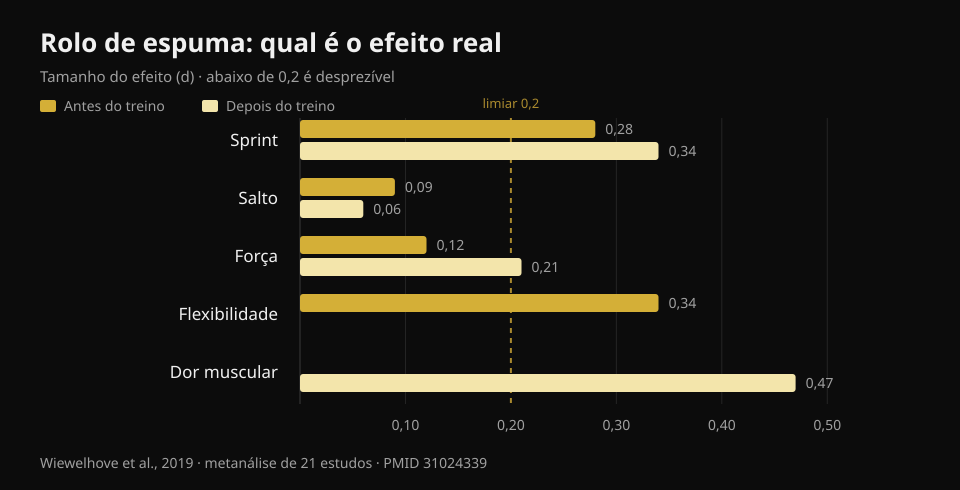
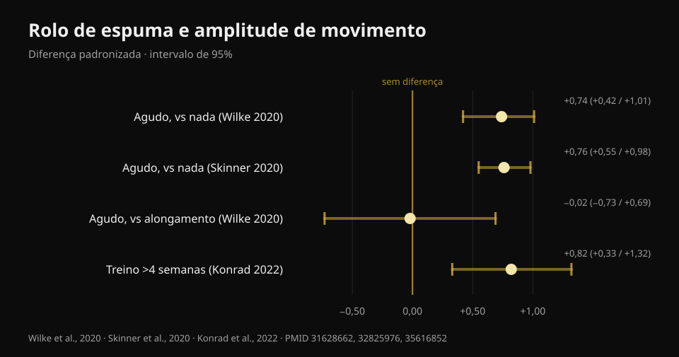

# Rolo de espuma funciona? O que dizem 8 estudos

Por [Giammaria Loi](/autore/giammaria-loi) · atualizado em 22 de outubro de 2026

Um post muito partilhado alinha três "nãos" sobre o rolo de espuma: não dissolve a fáscia, não melhora o desempenho, não previne lesões. Sobram alguns benefícios na dor muscular e na mobilidade, mas "temporários". Li oito trabalhos indexados para verificar esses três nãos. Dois resistem bem, o terceiro é mais frágil do que parece — e a parte sobre mobilidade já está ultrapassada: aí há um dado que o post não traz e que muda a forma como vale a pena usar o rolo.

## Em resumo

- **O rolo não altera a rigidez do tecido miofascial**: a metanálise que mediu isso com instrumentos objetivos não encontra qualquer efeito (Glänzel et al., 2023). A "fáscia que se dissolve" não aparece nos aparelhos.
- **No desempenho os efeitos são minúsculos**: usado antes do treino melhora o sprint em 0,7 % e a flexibilidade em 4 %, com efeitos desprezíveis no salto e na força (Wiewelhove et al., 2019). Mas não piora nada — e é esta a verdadeira vantagem.
- **O maior efeito de todos está na dor muscular**: +6,0 %, d = 0,47, o único valor que se aproxima de uma dimensão média em toda a literatura (Wiewelhove et al., 2019). Mas exige dose: **pelo menos 90 segundos por grupo muscular** (Hughes e Ramer, 2019).
- **"Só ganhos temporários de mobilidade" já não é verdade.** Rolar com constância **por mais de 4 semanas** produz ganhos de mobilidade estáveis (ES = 0,82) face a quem não o faz (Konrad et al., 2022).
- **Sobre lesões não existe resposta limpa**: o único estudo de prevenção junta rolo e trabalho de força, por isso não pode dizer nada sobre o rolo isolado (Desai et al., 2023).

## "Dissolve a fáscia": aqui o post tem razão

É a afirmação mais repetida nos ginásios e a mais fácil de desmontar, porque alguém foi medi-la.

Em 2023 um grupo brasileiro reuniu vinte estudos que avaliaram, com instrumentos objetivos, o que acontece aos tecidos depois de uma sessão de foam rolling: rigidez da fáscia do tronco e da coxa, rigidez muscular da coxa e da perna, força do joelho e do pé. Alguns estudos isolados relatavam quedas de rigidez — dois na fáscia, cinco no músculo — mas **quando os dados são reunidos na metanálise o efeito sobre a rigidez miofascial desaparece**.

Vale acrescentar a cautela que os próprios autores colocam: pelo método GRADE a certeza da evidência é **baixa**, ou seja, estudos melhores poderiam mudar o quadro. "Não temos provas de que aconteça" não é idêntico a "está demonstrado que não acontece". Mas, entretanto, se te venderam o rolo como aparelho que remodela o tecido conjuntivo, essa venda não tem base.

A explicação mais aceite para o que sentes debaixo do rolo é nervosa, não mecânica: muda a tolerância ao desconforto e a perceção, não a estrutura. O que não é pouco — mas é outra coisa.

## Desempenho: o ponto não é que melhore

Aqui o post diz a verdade e erra o acento.

A metanálise de referência é de 2019: vinte e um estudos, separados entre quem rolava **antes** (catorze estudos) e quem rolava **depois** do treino (sete estudos). Os números, antes do treino:

- sprint **+0,7 %** (d = 0,28)
- flexibilidade **+4,0 %** (d = 0,34)
- salto **−1,9 %** (d = 0,09)
- força **+1,8 %** (d = 0,12)

Depois do treino, como estratégia de recuperação:

- sprint **+3,1 %** (d = 0,34)
- força **+3,9 %** (d = 0,21)
- dor muscular percebida **+6,0 %** (d = 0,47)
- salto **−0,2 %** (d = 0,06)

*Dimensão do efeito (d) do rolo de espuma no desempenho, flexibilidade e dor muscular. Abaixo de 0,2 o efeito é considerado desprezível. Fonte: Wiewelhove et al., 2019, metanálise de 21 estudos (PMID 31024339).*

Um d de 0,1 ou 0,2 é, na prática, ruído. O valor mais alto de toda a tabela — 0,47 na dor muscular — mal chega a uma dimensão média.

Mas repara no sinal desses números. **Nenhum é negativo de forma relevante.** É aqui que o rolo de espuma se distingue de outras coisas que fazemos antes de treinar: o alongamento estático prolongado pode reduzir força e potência na sessão seguinte, o rolo não. Uma metanálise de 2023 confirma-o por via direta: nenhum efeito na força isométrica, no torque excêntrico ou na taxa de desenvolvimento de força, com um único dado positivo, o torque concêntrico dos extensores do joelho (Glänzel et al., 2023).

Traduzido: o rolo de espuma não é uma forma de ficar mais forte. É uma forma de te moveres melhor antes de uma sessão **sem pagar nada nas cargas**. Se no aquecimento precisas de ganhar alguns graus de mobilidade para fazer um agachamento profundo e limpo, é uma ferramenta adequada. Se esperas um máximo mais alto, não.

## Mobilidade: o dado que o post perde

Que uma passagem de rolo aumente a amplitude de movimento é consensual. A metanálise multinível mais sólida — vinte e seis estudos de boa qualidade metodológica — mede um efeito **grande em agudo**: SMD 0,74 (intervalo de confiança 95 % 0,42–1,01) face a não fazer nada (Wilke et al., 2020). Uma segunda metanálise sobre treze estudos chega quase ao mesmo número, d = 0,76 (0,55–0,98) (Skinner et al., 2020).

Duas precisões que por aí quase nunca se leem.

**A primeira:** face ao alongamento, o rolo não vence. SMD −0,02 (−0,73 a 0,69): idêntico. O rolo de espuma é portanto uma **alternativa** ao alongamento no aquecimento, não um acréscimo obrigatório. Se já fazes mobilidade, acrescentar dez minutos de rolo para ter "mais mobilidade" não tem suporte.

**A segunda, e é a que desmonta o "só temporário":** em 2022 foi publicada uma metanálise sobre onze estudos e 290 pessoas que rolaram como **treino**, durante semanas. Resultado: efeito moderado na mobilidade articular face aos grupos de controlo, **ES = 0,82 (IC 95 % 0,33–1,32; p = 0,001)**. E com uma condição precisa: os protocolos **acima das 4 semanas** funcionam melhor do que os até 4 semanas (p = 0,049).

*Efeito do rolo de espuma na mobilidade articular, com intervalos de confiança a 95 %. Só a comparação com o alongamento atravessa o zero. Fontes: Wilke et al., 2020 (PMID 31628662); Skinner et al., 2020 (PMID 32825976); Konrad et al., 2022 (PMID 35616852).*

Há um detalhe prático enterrado na mesma análise: os ganhos aparecem quando se rola **isquiotibiais e quadríceps**, enquanto rolar a perna **não melhorou a dorsiflexão do tornozelo**. Se o teu problema é o tornozelo que não desce no agachamento, o rolo na perna é provavelmente a forma errada de o enfrentar.

Uma última nota da análise de moderadores de Wilke: duração, velocidade e índice de massa corporal não mudam o resultado, mas **nos homens o efeito é menor** (p < 0,05).

## Dor muscular: o efeito mais sólido, e tem dose

É o único ponto em que o rolo de espuma produz algo que se parece com um benefício real, e também o único para o qual temos uma indicação de dosagem.

Uma revisão sistemática de 2019 separou os estudos por objetivo: em oito trabalhos que mediram dor e desconforto muscular, **sete** relatam uma redução a curto prazo. E o limiar que emerge é de **90 segundos por grupo muscular**, sem limite superior identificado. Abaixo dessa dose, os resultados tornam-se inconstantes. Sobre a mobilidade a mesma revisão é mais contida (dez estudos em dezassete, com resultados muito variáveis) e sobre o desempenho não encontra nada.

Uma revisão de 2024 sobre vinte e cinco estudos e 517 atletas chega ao mesmo sítio por outro caminho: melhora a **perceção de recuperação** e reduz a dor muscular de início tardio, sem penalizar força e potência máximas.

Repara que falamos quase sempre de **dor percebida**, não de dano muscular reparado mais depressa. O rolo faz-te sentir melhor; não há prova de que encurte os tempos de reparação do tecido. Se o objetivo é voltar a treinar mais cedo, contam muito mais o sono, a carga bem gerida e [o que pões no prato quando estás parado](/pt/blog/o-que-comer-quando-esta-lesionado).

## Lesões: a pergunta ainda não tem resposta

O post diz que o rolo de espuma não previne lesões. É uma conclusão razoável, mas a base é mais frágil do que soa, e vale a pena dizê-lo.

O único trabalho sério sobre o tema é de 2023: 433 corredores amadores, dezoito semanas, um grupo que fazia **força geral mais foam rolling** duas vezes por semana e um grupo de controlo que continuava como sempre. Resultado global: 27,1 % de lesões no controlo contra 23,0 % na intervenção, diferença **não significativa** (log-rank p = 0,31).

Depois, porém, os autores olharam para dentro do grupo de intervenção, dividindo-o por adesão. Quem tinha seguido o programa com constância tinha **85 % menos probabilidade** de se lesionar (hazard ratio 0,15; IC 95 % 0,05–0,46) e lesionava-se em média 57 dias mais tarde.

Três motivos para não usar esse número como prova a favor do rolo. Primeiro: **a intervenção era força mais foam rolling em conjunto**, e o trabalho de força já tem provas sólidas na prevenção de lesões; não se pode atribuir o mérito ao rolo. Segundo: o estudo é **observacional**, não aleatorizado. Terceiro, o mais importante: comparar "quem foi constante" com todo o grupo de controlo é uma comparação desequilibrada — quem consegue seguir um programa durante dezoito semanas costuma dormir melhor, gerir melhor as cargas e ser mais prudente em geral. É a clássica vantagem de quem adere, não necessariamente da intervenção.

Por isso a formulação honesta não é "não previne lesões", mas: **não existe nenhum estudo que tenha isolado o rolo de espuma e demonstrado um efeito sobre as lesões**. Quem to vende para isso está a ir além dos dados.

## O que a investigação diz de facto

- **Confirmado** — O foam rolling não altera a rigidez do tecido miofascial medida com instrumentos objetivos (Glänzel et al., 2023; certeza da evidência baixa).
- **Confirmado** — Os efeitos no desempenho são desprezíveis: entre d = 0,06 e d = 0,34 em sprint, salto e força (Wiewelhove et al., 2019).
- **Confirmado** — O rolo não piora força, torque excêntrico e taxa de desenvolvimento de força: ao contrário do alongamento estático prolongado, pode usar-se no aquecimento sem penalização (Glänzel et al., 2023; Martínez-Aranda et al., 2024).
- **Confirmado** — Reduz a dor muscular percebida, com o maior efeito de toda a literatura sobre o tema (d = 0,47) e uma dose mínima de 90 segundos por músculo (Wiewelhove et al., 2019; Hughes e Ramer, 2019).
- **A precisar** — "Aumenta a mobilidade" é verdade, mas **não mais do que o alongamento** (SMD −0,02): é uma alternativa, não um acréscimo (Wilke et al., 2020).
- **Desmentido** — "Os ganhos de mobilidade são só temporários": rolando com constância por mais de 4 semanas os ganhos tornam-se estáveis, ES = 0,82 (Konrad et al., 2022).
- **Desmentido** — "Funciona em todas as zonas": na perna não melhorou a dorsiflexão do tornozelo (Konrad et al., 2022).
- **Não verificável** — Efeito sobre lesões: o único estudo disponível combina rolo e força, é observacional e o resultado positivo vem de um subgrupo por adesão (Desai et al., 2023).

## Como aplicar

1. **Põe-no no aquecimento, não no fim do treino.** É a conclusão explícita da metanálise de 2019: as provas justificam o uso como atividade de aquecimento mais do que como ferramenta de recuperação. Dois a três minutos nos grupos de que precisas, depois passa às séries de aproximação.
2. **Se o usas para a dor, chega aos 90 segundos por músculo.** Abaixo desse limiar os resultados tornam-se inconstantes. É a diferença entre uma passagem distraída e uma dose.
3. **Não o somes ao alongamento à espera de ganhar o dobro.** Faz a mesma coisa. Escolhe o que te for mais cómodo e usa o tempo poupado nas séries de aquecimento a sério.
4. **Para o tornozelo muda de ferramenta.** Rolar a perna não melhorou a dorsiflexão nos estudos: se o agachamento profundo é o problema, trabalha a amplitude sob carga e a posição do pé.
5. **Não esperes que te proteja de lesões.** O que tem provas sólidas é o trabalho de força progressivo. Se queres o quadro sobre como dosear séries, cargas e descansos, resumi-o [aqui](/pt/blog/quantas-repeticoes-massa-muscular).
6. **Verifica-o em ti.** Os efeitos médios são pequenos e variáveis: a única forma de saber se o rolo te serve é olhar para os teus números antes e depois de o introduzires, durante algumas semanas.

### Experimenta a Nurvan — o aquecimento que muda alguma coisa

O rolo de espuma não te vai fazer levantar mais. As séries de aproximação sim: na Nurvan são propostas automaticamente com base na carga que programaste, para chegares à série de trabalho pronto em vez de frio. E como cada série fica registada com carga, repetições e RIR (quantas repetições te sobravam), ao fim de um mês podes ver preto no branco se a rotina de mobilidade que acrescentaste mexeu nos teus números — ou se só está a alongar o aquecimento. **[Experimenta a Nurvan](https://nurvan.app)**

## Perguntas frequentes

**O rolo de espuma usa-se antes ou depois do treino?**
As provas são mais favoráveis ao uso **antes**: ganhas alguns graus de mobilidade sem perder força na sessão. Depois do treino o único efeito apreciável é na redução da dor muscular percebida, que no entanto não equivale a uma recuperação muscular mais rápida.

**Quanto tempo é preciso rolar cada músculo?**
Para o efeito na dor muscular o limiar que emerge dos estudos é de **pelo menos 90 segundos por grupo muscular**, sem limite superior identificado. Para a mobilidade em agudo a duração não parece mudar muito o resultado.

**O rolo de espuma quebra mesmo as aderências da fáscia?**
Não, não segundo os instrumentos que a medem: a metanálise disponível não encontra qualquer variação da rigidez do tecido miofascial depois de uma sessão. O que muda é sobretudo a tolerância ao desconforto e a perceção, não a estrutura do tecido.

**Melhor rolo de espuma ou alongamento no aquecimento?**
Para aumentar a amplitude de movimento os dois são equivalentes (SMD −0,02 na comparação direta). Escolhe pela comodidade e pelo tempo: nenhum bate o outro, e nenhum substitui as séries de aproximação com a barra.

**Faz mal rolar se o músculo está muito dorido?**
Nos estudos o rolo reduz a dor percebida e não piora o desempenho, mas a pressão deve ser doseada no desconforto tolerável. Se a dor é aguda, localizada ou diferente do normal desconforto pós-treino, manda avaliá-la em vez de insistir com o rolo.

## Lê também

- [Quantas repetições para ganhar massa muscular](/pt/blog/quantas-repeticoes-massa-muscular) — como dosear as variáveis que mexem mesmo nos resultados.
- [O que comer quando estás lesionado](/pt/blog/o-que-comer-quando-esta-lesionado) — o lado nutricional da recuperação, com números.
- [Treinar força, músculo e cardio juntos](/pt/blog/treinar-forca-musculo-e-cardio-juntos) — organizar a semana sem que uma coisa coma a outra.

## Fontes

1. Wiewelhove T, Döweling A, Schneider C, Hottenrott L, Meyer T, Kellmann M, Pfeiffer M, Ferrauti A, 2019. *A Meta-Analysis of the Effects of Foam Rolling on Performance and Recovery.* Frontiers in Physiology 10:376. [PMID 31024339](https://pubmed.ncbi.nlm.nih.gov/31024339/) · [DOI 10.3389/fphys.2019.00376](https://doi.org/10.3389/fphys.2019.00376)
2. Wilke J, Müller AL, Giesche F, Power G, Ahmedi H, Behm DG, 2020. *Acute Effects of Foam Rolling on Range of Motion in Healthy Adults: A Systematic Review with Multilevel Meta-analysis.* Sports Medicine 50(2):387-402. [PMID 31628662](https://pubmed.ncbi.nlm.nih.gov/31628662/) · [DOI 10.1007/s40279-019-01205-7](https://doi.org/10.1007/s40279-019-01205-7)
3. Konrad A, Nakamura M, Tilp M, Donti O, Behm DG, 2022. *Foam Rolling Training Effects on Range of Motion: A Systematic Review and Meta-Analysis.* Sports Medicine 52(10):2523-2535. [PMID 35616852](https://pubmed.ncbi.nlm.nih.gov/35616852/) · [DOI 10.1007/s40279-022-01699-8](https://doi.org/10.1007/s40279-022-01699-8)
4. Glänzel MH, Rodrigues DR, Petter GN, Pozzobon D, Vaz MA, Geremia JM, 2023. *Foam Rolling Acute Effects on Myofascial Tissue Stiffness and Muscle Strength: A Systematic Review and Meta-Analysis.* Journal of Strength and Conditioning Research 37(4):951-968. [PMID 36227232](https://pubmed.ncbi.nlm.nih.gov/36227232/) · [DOI 10.1519/JSC.0000000000004385](https://doi.org/10.1519/JSC.0000000000004385)
5. Hughes GA, Ramer LM, 2019. *Duration of Myofascial Rolling for Optimal Recovery, Range of Motion, and Performance: A Systematic Review of the Literature.* International Journal of Sports Physical Therapy 14(6):845-859. [PMID 31803517](https://pubmed.ncbi.nlm.nih.gov/31803517/)
6. Skinner B, Moss R, Hammond L, 2020. *A systematic review and meta-analysis of the effects of foam rolling on range of motion, recovery and markers of athletic performance.* Journal of Bodywork and Movement Therapies 24(3):105-122. [PMID 32825976](https://pubmed.ncbi.nlm.nih.gov/32825976/) · [DOI 10.1016/j.jbmt.2020.01.007](https://doi.org/10.1016/j.jbmt.2020.01.007)
7. Martínez-Aranda LM, Sanz-Matesanz M, García-Mantilla ED, González-Fernández FT, 2024. *Effects of Self-Myofascial Release on Athletes' Physical Performance: A Systematic Review.* Journal of Functional Morphology and Kinesiology 9(1):20. [PMID 38249097](https://pubmed.ncbi.nlm.nih.gov/38249097/) · [DOI 10.3390/jfmk9010020](https://doi.org/10.3390/jfmk9010020)
8. Desai P, Jungmalm J, Börjesson M, Karlsson J, Grau S, 2023. *Effectiveness of an 18-week general strength and foam-rolling intervention on running-related injuries in recreational runners.* Scandinavian Journal of Medicine & Science in Sports 33(5):766-775. [PMID 36630577](https://pubmed.ncbi.nlm.nih.gov/36630577/) · [DOI 10.1111/sms.14313](https://doi.org/10.1111/sms.14313)

Referências bibliográficas recuperadas através da PubMed. Ponto de partida: o post de **Built With Science** ([@builtwithscience](https://www.instagram.com/builtwithscience/)) de 2 de setembro de 2026, [post original](https://www.instagram.com/p/DcykEnJFE_2/). Nenhum texto e nenhuma imagem do post foram reproduzidos: o tema foi reescrito de raiz a partir das fontes primárias.

---

**Giammaria Loi** é o fundador da Nurvan. Treina com pesos desde 2012, trabalha como personal trainer e coach certificado pela FIPE desde 2013 e compete em powerlifting a nível nacional desde 2018. Cada artigo que assina parte dos estudos científicos e chega ao que funciona mesmo no ginásio.

> Nota: conteúdo informativo, não substitui a opinião de um médico ou de um profissional qualificado. Se tens uma dor localizada que não se parece com o desconforto normal depois do treino, manda avaliá-la antes de insistir com o rolo.
