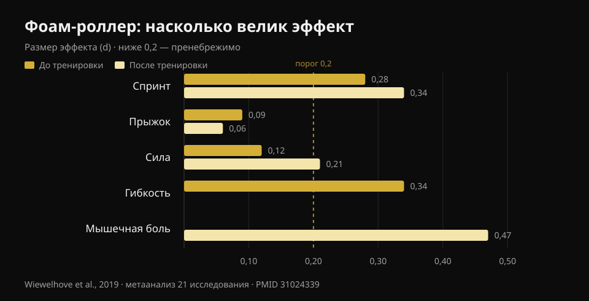
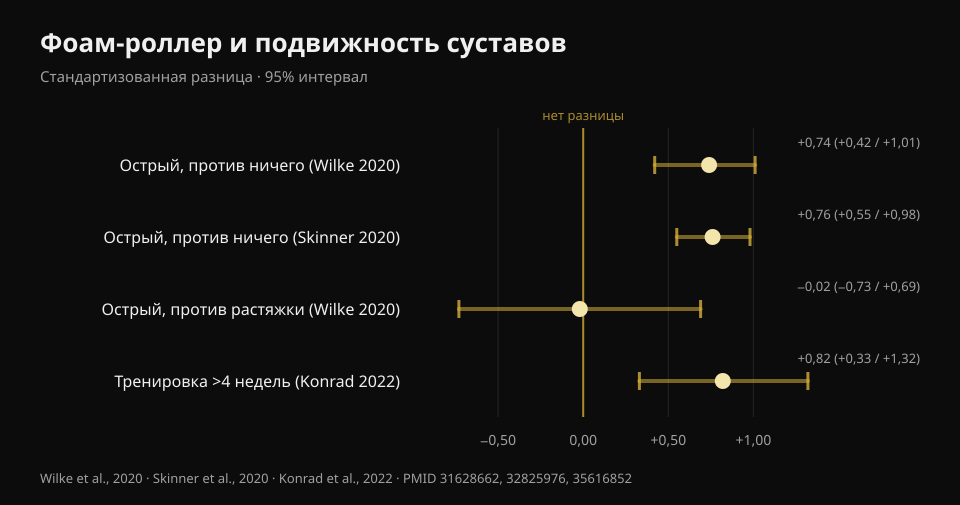

# Фоам-роллер: работает ли он? Данные 8 работ

Автор: [Джаммария Лои](/autore/giammaria-loi) · обновлено 22 октября 2026

В разошедшемся по сети посте выстроены три «нет» про фоам-роллер: он не разрушает фасцию, не улучшает результат, не предотвращает травмы. Остаётся польза для мышечной боли и подвижности — но «временная». Я разобрал восемь проиндексированных работ, чтобы проверить эти три «нет». Два держатся отлично, третье слабее, чем звучит. А часть про подвижность уже устарела: там есть цифра, которой в посте нет, и она меняет то, как роллер стоит использовать.

## Коротко

- **Роллер не меняет жёсткость миофасциальной ткани**: метаанализ, измерявший это объективными приборами, не находит никакого эффекта (Glänzel et al., 2023). «Растворяющейся фасции» приборы не видят.
- **На результат эффекты крошечные**: перед тренировкой роллер улучшает спринт на 0,7 % и гибкость на 4 %, а на прыжок и силу влияние пренебрежимо (Wiewelhove et al., 2019). Но он ничего и не ухудшает — вот в этом и есть настоящее преимущество.
- **Самый крупный эффект из всех — на мышечную боль**: +6,0 %, d = 0,47, единственное значение во всей литературе, приближающееся к среднему размеру эффекта (Wiewelhove et al., 2019). Но нужна доза: **минимум 90 секунд на мышечную группу** (Hughes и Ramer, 2019).
- **«Только временный прирост подвижности» — уже неправда.** Если катать регулярно **дольше 4 недель**, прирост подвижности становится устойчивым (ES = 0,82) по сравнению с контрольными группами (Konrad et al., 2022).
- **По травмам чистого ответа нет**: единственное профилактическое исследование объединяет роллер и силовую работу, поэтому сказать что-либо про роллер отдельно не может (Desai et al., 2023).

## «Разбивает фасцию»: здесь пост прав

Это самое повторяемое в залах утверждение и самое лёгкое для опровержения, потому что кто-то взял и измерил.

В 2023 году бразильская группа собрала двадцать исследований, в которых объективными приборами оценивали, что происходит с тканями после сессии с роллером: жёсткость фасции корпуса и бедра, мышечная жёсткость бедра и голени, сила колена и стопы. Отдельные работы сообщали о снижении жёсткости — две по фасции, пять по мышце, — но **когда данные сводят в метаанализ, эффект на миофасциальную жёсткость исчезает**.

Стоит добавить оговорку, которую делают сами авторы: по методу GRADE уверенность в доказательствах **низкая**, то есть более качественные исследования могут изменить картину. «У нас нет доказательств, что это происходит» — не то же самое, что «доказано, что этого не происходит». Но пока: если вам продавали роллер как прибор, перестраивающий соединительную ткань, у этой продажи нет оснований.

Самое признанное объяснение того, что вы чувствуете под роллером, — нервное, а не механическое: меняется переносимость дискомфорта и восприятие, а не структура. Это немало — но это другое.

## Результат: дело не в том, что он улучшается

Здесь пост говорит правду, но ставит неверный акцент.

Опорный метаанализ — 2019 года: двадцать одно исследование, разделённые на тех, кто катал **до** (четырнадцать работ), и тех, кто катал **после** тренировки (семь работ). Цифры до тренировки:

- спринт **+0,7 %** (d = 0,28)
- гибкость **+4,0 %** (d = 0,34)
- прыжок **−1,9 %** (d = 0,09)
- сила **+1,8 %** (d = 0,12)

После тренировки, как стратегия восстановления:

- спринт **+3,1 %** (d = 0,34)
- сила **+3,9 %** (d = 0,21)
- воспринимаемая мышечная боль **+6,0 %** (d = 0,47)
- прыжок **−0,2 %** (d = 0,06)

*Размер эффекта (d) фоам-роллера на результат, гибкость и мышечную боль. Ниже 0,2 эффект считается пренебрежимым. Источник: Wiewelhove et al., 2019, метаанализ 21 исследования (PMID 31024339).*

d в 0,1 или 0,2 — это на практике шум. Самое высокое значение во всей таблице, 0,47 по мышечной боли, едва дотягивает до среднего размера.

Но посмотрите на знак этих чисел. **Ни одно из них не отрицательно сколько-нибудь существенно.** Именно здесь фоам-роллер отличается от другого, что мы делаем перед тренировкой: длительная статическая растяжка может снизить силу и мощность в последующей сессии, роллер — нет. Метаанализ 2023 года подтверждает это напрямую: никакого эффекта на изометрическую силу, эксцентрический момент или скорость развития усилия, с единственным положительным показателем — концентрическим моментом разгибателей колена (Glänzel et al., 2023).

В переводе: фоам-роллер — не способ стать сильнее. Это способ лучше двигаться перед сессией **без платы в рабочих весах**. Если в разминке вам нужно добрать несколько градусов подвижности, чтобы сделать глубокий и чистый присед, инструмент подходящий. Если вы ждёте более высокого максимума — нет.

## Подвижность: цифра, которую пост упускает

То, что прокат роллером увеличивает амплитуду движения, установлено. Самый надёжный многоуровневый метаанализ — двадцать шесть исследований хорошего методологического качества — измеряет **крупный острый эффект**: SMD 0,74 (95 % доверительный интервал 0,42–1,01) по сравнению с бездействием (Wilke et al., 2020). Второй метаанализ по тринадцати исследованиям приходит почти к той же цифре, d = 0,76 (0,55–0,98) (Skinner et al., 2020).

Два уточнения, которые почти нигде не встретишь.

**Первое:** по сравнению с растяжкой роллер не выигрывает. SMD −0,02 (от −0,73 до 0,69): идентично. То есть фоам-роллер — это **альтернатива** растяжке в разминке, а не обязательная добавка. Если вы уже делаете мобилити, добавлять десять минут роллера ради «большей подвижности» доказательствами не подкреплено.

**Второе, и оно разбирает «только временно»:** в 2022 году вышел метаанализ по одиннадцати исследованиям и 290 участникам, которые катали роллер как **тренировку**, неделями. Результат: умеренный эффект на подвижность суставов по сравнению с контрольными группами, **ES = 0,82 (95 % ДИ 0,33–1,32; p = 0,001)**. И с точным условием: протоколы **дольше 4 недель** работают лучше, чем до 4 недель (p = 0,049).

*Эффект фоам-роллера на подвижность суставов, с 95 % доверительными интервалами. Только сравнение с растяжкой пересекает ноль. Источники: Wilke et al., 2020 (PMID 31628662); Skinner et al., 2020 (PMID 32825976); Konrad et al., 2022 (PMID 35616852).*

В том же анализе спрятана практическая деталь: прирост появляется, когда катают **бицепс бедра и квадрицепс**, тогда как прокат голени **не улучшил тыльное сгибание стопы**. Если ваша проблема — голеностоп, не пускающий вас вниз в приседе, роллер на икре, скорее всего, неверный способ её решать.

Последнее замечание из анализа модераторов у Wilke: длительность, скорость и индекс массы тела результат не меняют, но **у мужчин эффект меньше** (p < 0,05).

## Мышечная боль: самый надёжный эффект, и у него есть доза

Это единственный пункт, где фоам-роллер даёт нечто похожее на реальную пользу, и единственный, по которому у нас есть указание на дозировку.

Систематический обзор 2019 года разделил исследования по цели: из восьми работ, измерявших боль и крепатуру, **семь** сообщают о краткосрочном снижении. А выявленный порог — **90 секунд на мышечную группу**, без обнаруженного верхнего предела. Ниже этой дозы результаты становятся непостоянными. По подвижности тот же обзор сдержаннее (десять исследований из семнадцати, с очень разнородными результатами), а по результативности не находит ничего.

Обзор 2024 года по двадцати пяти исследованиям и 517 спортсменам приходит туда же другим путём: улучшается **восприятие восстановления** и снижается отсроченная мышечная болезненность, без потерь в максимальной силе и мощности.

Обратите внимание: речь почти всегда о **воспринимаемой боли**, а не о быстрее починенном мышечном повреждении. Роллер делает так, что вы чувствуете себя лучше; доказательств, что он сокращает сроки восстановления ткани, нет. Если цель — вернуться к тренировкам раньше, гораздо важнее сон, грамотно дозированная нагрузка и [то, что вы кладёте в тарелку на вынужденной паузе](/ru/blog/chto-est-pri-travme).

## Травмы: у вопроса пока нет ответа

Пост утверждает, что фоам-роллер не предотвращает травмы. Вывод разумный, но основание более хрупкое, чем кажется, и об этом стоит сказать.

Единственная серьёзная работа по теме — 2023 года: 433 бегуна-любителя, восемнадцать недель, одна группа делала **общую силовую работу плюс фоам-роллинг** дважды в неделю, контрольная продолжала как обычно. Общий результат: 27,1 % травм в контроле против 23,0 % в группе вмешательства, разница **незначимая** (лог-ранговый критерий p = 0,31).

Но затем авторы заглянули внутрь группы вмешательства, разделив её по приверженности. У тех, кто следовал программе регулярно, вероятность травмы была **на 85 % ниже** (отношение рисков 0,15; 95 % ДИ 0,05–0,46), а травма наступала в среднем на 57 дней позже.

Три причины не использовать эту цифру как довод в пользу роллера. Первая: **вмешательство — это сила плюс фоам-роллинг вместе**, а у силовой работы уже есть надёжные доказательства в профилактике травм; заслугу нельзя приписать роллеру. Вторая: исследование **наблюдательное**, не рандомизированное. Третья, самая весомая: сравнивать «тех, кто был регулярен» со всей контрольной группой — несбалансированное сравнение: тот, кто выдерживает программу восемнадцать недель, обычно лучше спит, лучше дозирует нагрузки и в целом осторожнее. Это классическое преимущество приверженных, а не обязательно вмешательства.

Поэтому честная формулировка не «он не предотвращает травмы», а: **нет ни одного исследования, которое изолировало бы фоам-роллер и показало эффект на травмы**. Кто продаёт вам его именно для этого, выходит за рамки данных.

## Что на самом деле говорит наука

- **Подтверждено** — Фоам-роллинг не меняет жёсткость миофасциальной ткани, измеренную объективными приборами (Glänzel et al., 2023; уверенность в доказательствах низкая).
- **Подтверждено** — Эффекты на результативность пренебрежимы: от d = 0,06 до d = 0,34 по спринту, прыжку и силе (Wiewelhove et al., 2019).
- **Подтверждено** — Роллер не ухудшает силу, эксцентрический момент и скорость развития усилия: в отличие от длительной статической растяжки, его можно включать в разминку без потерь (Glänzel et al., 2023; Martínez-Aranda et al., 2024).
- **Подтверждено** — Он снижает воспринимаемую мышечную боль, с самым крупным эффектом во всей литературе по теме (d = 0,47) и минимальной дозой 90 секунд на мышцу (Wiewelhove et al., 2019; Hughes и Ramer, 2019).
- **Требует уточнения** — «Увеличивает подвижность» верно, но **не больше, чем растяжка** (SMD −0,02): это альтернатива, а не добавка (Wilke et al., 2020).
- **Опровергнуто** — «Прирост подвижности только временный»: при регулярном катании дольше 4 недель прирост становится устойчивым, ES = 0,82 (Konrad et al., 2022).
- **Опровергнуто** — «Работает на всех зонах»: на голени он не улучшил тыльное сгибание стопы (Konrad et al., 2022).
- **Непроверяемо** — Эффект на травмы: единственное доступное исследование объединяет роллер и силовую работу, носит наблюдательный характер, а положительный результат получен в подгруппе по приверженности (Desai et al., 2023).

## Как это применить

1. **Ставьте его в разминку, а не в заминку.** Это прямой вывод метаанализа 2019 года: доказательства оправдывают использование как разминочной активности скорее, чем как инструмента восстановления. Две-три минуты на нужные группы, затем переходите к подводящим подходам.
2. **Если используете против боли, доводите до 90 секунд на мышцу.** Ниже этого порога результаты становятся непостоянными. Это разница между рассеянным прокатом и дозой.
3. **Не складывайте его с растяжкой в надежде на двойной выигрыш.** Он делает то же самое. Выберите то, что вам удобнее, а сэкономленное время потратьте на настоящие подводящие подходы.
4. **Для голеностопа смените инструмент.** Прокат голени в исследованиях не улучшил тыльное сгибание: если проблема в глубоком приседе, работайте над амплитудой под нагрузкой и положением стопы.
5. **Не ждите защиты от травм.** Надёжные доказательства есть у прогрессирующей силовой работы. Если нужна общая картина по дозированию подходов, весов и отдыха, я изложил её [здесь](/ru/blog/skolko-povtoreniy-dlya-massy).
6. **Проверьте на себе.** Средние эффекты малы и изменчивы: единственный способ понять, нужен ли вам роллер, — смотреть на собственные цифры до и после его добавления в течение нескольких недель.

### Попробуйте Nurvan — разминка, которая что-то меняет

Фоам-роллер не заставит вас поднять больше. Подводящие подходы — заставят: в Nurvan они предлагаются автоматически на основе запланированного веса, так что к рабочему подходу вы приходите готовым, а не холодным. А поскольку каждый подход записывается с весом, повторениями и RIR (сколько повторений оставалось в запасе), через месяц вы увидите чёрным по белому, сдвинула ли добавленная мобилити-рутина ваши цифры — или просто удлинила разминку. **[Попробуйте Nurvan](https://nurvan.app)**

## Частые вопросы

**Фоам-роллер до или после тренировки?**
Доказательства больше в пользу использования **до**: вы добираете несколько градусов подвижности, не теряя силу в сессии. После тренировки единственный заметный эффект — снижение воспринимаемой мышечной боли, что, однако, не равно более быстрому мышечному восстановлению.

**Сколько времени катать каждую мышцу?**
Для эффекта на мышечную боль порог, выявленный в исследованиях, — **минимум 90 секунд на мышечную группу**, без обнаруженного верхнего предела. Для острой подвижности длительность, похоже, мало меняет результат.

**Правда ли фоам-роллер разбивает спайки фасции?**
Нет, по крайней мере не по данным приборов, которые её измеряют: доступный метаанализ не находит никаких изменений жёсткости миофасциальной ткани после сессии. Меняется прежде всего переносимость дискомфорта и восприятие, а не структура ткани.

**Что лучше в разминке: фоам-роллер или растяжка?**
Для увеличения амплитуды движения они равноценны (SMD −0,02 в прямом сравнении). Выбирайте по удобству и времени: ни один не превосходит другой, и ни один не заменяет подводящие подходы со штангой.

**Вредно ли катать, если мышца сильно болит?**
В исследованиях роллер снижает воспринимаемую боль и не ухудшает результативность, но давление нужно дозировать по переносимому дискомфорту. Если боль острая, точечная или не похожа на обычную послетренировочную болезненность, покажитесь специалисту, вместо того чтобы продолжать с роллером.

## Читайте также

- [Сколько повторений нужно для массы](/ru/blog/skolko-povtoreniy-dlya-massy) — как дозировать переменные, которые действительно двигают результат.
- [Что есть при травме](/ru/blog/chto-est-pri-travme) — питательная сторона восстановления, с цифрами.
- [Тренировка силы, мышц и кардио вместе](/ru/blog/trenirovka-sily-myshts-i-kardio-vmeste) — как собрать неделю, чтобы одно не съедало другое.

## Источники

1. Wiewelhove T, Döweling A, Schneider C, Hottenrott L, Meyer T, Kellmann M, Pfeiffer M, Ferrauti A, 2019. *A Meta-Analysis of the Effects of Foam Rolling on Performance and Recovery.* Frontiers in Physiology 10:376. [PMID 31024339](https://pubmed.ncbi.nlm.nih.gov/31024339/) · [DOI 10.3389/fphys.2019.00376](https://doi.org/10.3389/fphys.2019.00376)
2. Wilke J, Müller AL, Giesche F, Power G, Ahmedi H, Behm DG, 2020. *Acute Effects of Foam Rolling on Range of Motion in Healthy Adults: A Systematic Review with Multilevel Meta-analysis.* Sports Medicine 50(2):387-402. [PMID 31628662](https://pubmed.ncbi.nlm.nih.gov/31628662/) · [DOI 10.1007/s40279-019-01205-7](https://doi.org/10.1007/s40279-019-01205-7)
3. Konrad A, Nakamura M, Tilp M, Donti O, Behm DG, 2022. *Foam Rolling Training Effects on Range of Motion: A Systematic Review and Meta-Analysis.* Sports Medicine 52(10):2523-2535. [PMID 35616852](https://pubmed.ncbi.nlm.nih.gov/35616852/) · [DOI 10.1007/s40279-022-01699-8](https://doi.org/10.1007/s40279-022-01699-8)
4. Glänzel MH, Rodrigues DR, Petter GN, Pozzobon D, Vaz MA, Geremia JM, 2023. *Foam Rolling Acute Effects on Myofascial Tissue Stiffness and Muscle Strength: A Systematic Review and Meta-Analysis.* Journal of Strength and Conditioning Research 37(4):951-968. [PMID 36227232](https://pubmed.ncbi.nlm.nih.gov/36227232/) · [DOI 10.1519/JSC.0000000000004385](https://doi.org/10.1519/JSC.0000000000004385)
5. Hughes GA, Ramer LM, 2019. *Duration of Myofascial Rolling for Optimal Recovery, Range of Motion, and Performance: A Systematic Review of the Literature.* International Journal of Sports Physical Therapy 14(6):845-859. [PMID 31803517](https://pubmed.ncbi.nlm.nih.gov/31803517/)
6. Skinner B, Moss R, Hammond L, 2020. *A systematic review and meta-analysis of the effects of foam rolling on range of motion, recovery and markers of athletic performance.* Journal of Bodywork and Movement Therapies 24(3):105-122. [PMID 32825976](https://pubmed.ncbi.nlm.nih.gov/32825976/) · [DOI 10.1016/j.jbmt.2020.01.007](https://doi.org/10.1016/j.jbmt.2020.01.007)
7. Martínez-Aranda LM, Sanz-Matesanz M, García-Mantilla ED, González-Fernández FT, 2024. *Effects of Self-Myofascial Release on Athletes' Physical Performance: A Systematic Review.* Journal of Functional Morphology and Kinesiology 9(1):20. [PMID 38249097](https://pubmed.ncbi.nlm.nih.gov/38249097/) · [DOI 10.3390/jfmk9010020](https://doi.org/10.3390/jfmk9010020)
8. Desai P, Jungmalm J, Börjesson M, Karlsson J, Grau S, 2023. *Effectiveness of an 18-week general strength and foam-rolling intervention on running-related injuries in recreational runners.* Scandinavian Journal of Medicine & Science in Sports 33(5):766-775. [PMID 36630577](https://pubmed.ncbi.nlm.nih.gov/36630577/) · [DOI 10.1111/sms.14313](https://doi.org/10.1111/sms.14313)

Библиографические ссылки получены через PubMed. Отправная точка: пост **Built With Science** ([@builtwithscience](https://www.instagram.com/builtwithscience/)) от 2 сентября 2026 года, [оригинальный пост](https://www.instagram.com/p/DcykEnJFE_2/). Ни текст, ни изображения поста не воспроизводились: тема написана с нуля на основе первичных источников.

---

**Джаммария Лои** — основатель Nurvan. Тренируется с отягощениями с 2012 года, работает персональным тренером и коучем с сертификацией FIPE с 2013 года и выступает в пауэрлифтинге на национальном уровне с 2018 года. Каждая статья, которую он подписывает, начинается с научных исследований и заканчивается тем, что действительно работает в зале.

> Примечание: информационный материал, не заменяет мнение врача или квалифицированного специалиста. Если у вас точечная боль, не похожая на обычную послетренировочную болезненность, покажитесь специалисту, прежде чем продолжать с роллером.
