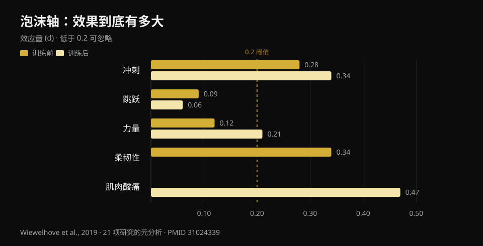
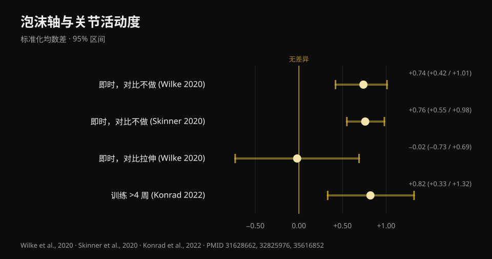

# 泡沫轴到底有没有用？八项研究给出答案

作者 [Giammaria Loi](/autore/giammaria-loi) · 更新于 2026 年 10 月 22 日

一条传播很广的帖子对泡沫轴连说了三个"不"：不能松解筋膜，不能提升运动表现，不能预防伤病。剩下的好处是缓解肌肉酸痛和改善活动度，但只是"暂时的"。我查了八项被收录的研究来核对这三个"不"。其中两个站得住脚，第三个比帖子说得要脆弱得多——而关于活动度的那部分已经过时了：那里有一个帖子没有提到的数据，而它恰恰改变了泡沫轴该怎么用。

## 要点速览

- **泡沫轴不会改变肌筋膜组织的硬度**：唯一用客观仪器测量过这一点的荟萃分析没有发现任何效应（Glänzel 等，2023）。所谓"把筋膜滚开"，在仪器上看不到。
- **对运动表现的影响极其微小**：训练前使用，冲刺提升 0.7%，柔韧性提升 4.0%，对跳跃和力量的影响可以忽略（Wiewelhove 等，2019）。但它也不会让你变差——这才是真正的价值。
- **所有效应里最大的一个是对肌肉酸痛**：+6.0%，d = 0.47，这是整个文献里唯一接近中等量级的数值（Wiewelhove 等，2019）。但需要剂量：**每个肌群至少 90 秒**（Hughes 和 Ramer，2019）。
- **"活动度只是暂时提升"已经不成立了。** 坚持滚压**超过 4 周**，活动度的提升会变成稳定的改善（ES = 0.82），显著优于不做的对照组（Konrad 等，2022）。
- **关于预防伤病，没有干净的答案**：唯一一项预防研究把泡沫轴和力量训练捆在一起做，因此无法单独说明泡沫轴的作用（Desai 等，2023）。

## "松解筋膜"：这一点帖子说对了

这是健身房里被重复最多、也最容易被推翻的说法，因为真的有人去测量过。

2023 年，一个巴西团队汇总了二十项用客观仪器评估滚压后组织变化的研究：躯干和大腿筋膜的硬度、大腿与小腿的肌肉硬度、膝关节和踝关节的力量。个别研究确实报告了硬度下降——筋膜两项、肌肉五项——但**当这些数据被合并进荟萃分析时，对肌筋膜硬度的效应就消失了**。

值得补上作者自己给出的提醒：按 GRADE 方法，证据确定性是**低**的，也就是说更好的研究有可能改变结论。"我们没有证据说它发生"并不等同于"已经证明它不会发生"。但在此之前，如果有人把泡沫轴当成能重塑结缔组织的器械卖给你，这个说法没有依据。

对于你在泡沫轴下面感受到的那些变化，目前最被接受的解释是神经层面的，而不是机械层面的：改变的是对不适的耐受度和主观感受，不是结构。这并不是小事——但这是另一回事。

## 运动表现：重点不在于它能提升

这里帖子说的是对的，但重音放错了地方。

参考性的荟萃分析发表于 2019 年：二十一项研究，分成训练**前**滚压（十四项）和训练**后**滚压（七项）两组。训练前的数字：

- 冲刺 **+0.7%**（d = 0.28）
- 柔韧性 **+4.0%**（d = 0.34）
- 跳跃 **−1.9%**（d = 0.09）
- 力量 **+1.8%**（d = 0.12）

训练后作为恢复手段：

- 冲刺 **+3.1%**（d = 0.34）
- 力量 **+3.9%**（d = 0.21）
- 主观肌肉酸痛 **+6.0%**（d = 0.47）
- 跳跃 **−0.2%**（d = 0.06）

*泡沫轴对运动表现、柔韧性和肌肉酸痛的效应量（d）。低于 0.2 视为可忽略。来源：Wiewelhove 等，2019，21 项研究的荟萃分析（PMID 31024339）。*

d 值在 0.1 或 0.2 这个量级，实际上就是噪声。整张表里最高的那个数字——肌肉酸痛的 0.47——也才勉强够到中等量级。

但请注意这些数字的符号。**没有一个是有意义的负值。** 泡沫轴正是在这一点上区别于其他训练前要做的事：长时间的静态拉伸可能会降低随后那节课的力量和爆发力，泡沫轴不会。2023 年的一篇荟萃分析从正面证实了这点：对等长力量、离心力矩和力量发展速率都没有影响，只有一个数据是正向的，即膝伸肌的向心力矩（Glänzel 等，2023）。

翻译成人话：泡沫轴不是让你变强的办法。它是一种在训练前让身体更好动起来、**而不用在负重上付出代价**的方式。如果热身时你需要多争取几度活动范围，好把深蹲蹲得更深更干净，它是合适的工具。如果你指望一个更高的极限重量，那就不是。

## 活动度：帖子漏掉的那个数据

滚一遍能扩大活动范围，这一点已经是定论。方法学质量最可靠的多水平荟萃分析——二十六项研究——测出的**急性效应是大的**：相比什么都不做，SMD 0.74（95% 置信区间 0.42–1.01）（Wilke 等，2020）。另一项基于十三项研究的荟萃分析得出几乎相同的数字，d = 0.76（0.55–0.98）（Skinner 等，2020）。

有两个几乎没人提的细节。

**第一：** 和拉伸相比，泡沫轴并不占优。SMD −0.02（−0.73 到 0.69）：完全一样。所以泡沫轴是热身中拉伸的**替代方案**，不是必须叠加的项目。如果你已经在做活动度训练，再加十分钟滚压来"多拿一点活动度"，是没有证据支持的。

**第二，也正是推翻"只是暂时"的那一条：** 2022 年发表了一篇荟萃分析，纳入十一项研究、290 名受试者，他们把滚压当作**训练**坚持了数周。结果：相比对照组，关节活动度出现中等程度的改善，**ES = 0.82（95% CI 0.33–1.32；p = 0.001）**。而且有一个明确条件：**超过 4 周**的方案效果优于 4 周以内的方案（p = 0.049）。

*泡沫轴对关节活动度的效应，含 95% 置信区间。只有与拉伸的比较跨过了零线。来源：Wilke 等，2020（PMID 31628662）；Skinner 等，2020（PMID 32825976）；Konrad 等，2022（PMID 35616852）。*

同一份分析里还埋着一个很实用的细节：改善出现在滚压**腘绳肌和股四头肌**的时候，而滚小腿**并没有改善踝关节背屈**。如果你的问题是深蹲时脚踝下不去，滚小腿多半是走错了方向。

Wilke 的调节因素分析还有最后一条：时长、速度和体重指数都不改变结果，但**在男性身上效应更小**（p < 0.05）。

## 肌肉酸痛：最扎实的效应，而且有剂量

这是泡沫轴唯一能拿出类似真实收益的地方，也是唯一有剂量指引的地方。

2019 年的一篇系统综述按目标把研究分开：在八项测量疼痛和酸痛的研究中，**七项**报告了短期减轻。浮现出来的阈值是**每个肌群 90 秒**，且没有发现上限。低于这个剂量，结果就变得不稳定。同一篇综述对活动度的态度要保守得多（十七项里十项有改善，但结果变异很大），对运动表现则什么也没找到。

2024 年一篇纳入二十五项研究、517 名运动员的综述从另一条路走到同一个结论：改善**主观恢复感受**，减轻延迟性肌肉酸痛，同时不损害最大力量和爆发力。

注意，我们谈的几乎都是**主观疼痛**，而不是肌肉损伤被更快修复。泡沫轴让你感觉更好；没有证据说它缩短了组织修复的时间。如果目标是更早回到训练，睡眠、合理的负荷安排，以及[受伤期间吃什么](/zh/blog/shoushang-shi-chi-shenme)，分量要重得多。

## 伤病预防：这个问题还没有答案

帖子说泡沫轴不能预防伤病。这个结论是合理的，但它的依据比听上去更脆弱，这一点值得说清楚。

这个主题上唯一一项认真的研究发表于 2023 年：433 名业余跑者，十八周，一组每周两次做**全身力量训练加泡沫轴**，对照组保持原有习惯。总体结果：对照组 27.1% 的人受伤，干预组 23.0%，差异**不显著**（log-rank p = 0.31）。

但随后作者按依从性把干预组拆开看。坚持完成了计划的人受伤概率低 **85%**（风险比 0.15；95% CI 0.05–0.46），受伤时间平均推迟了 57 天。

有三个理由不要把这个数字当作泡沫轴有效的证据。第一：**干预是力量训练加泡沫轴一起做的**，而力量训练在伤病预防上本来就有扎实的证据，功劳不能算在滚筒头上。第二：这是一项**观察性**研究，不是随机对照试验。第三，也是最重要的：把"坚持下来的人"和整个对照组相比，本身就是不对等的比较——能把一个计划坚持十八周的人，通常睡得更好、负荷安排更合理、整体上也更谨慎。这是典型的依从者优势，不一定是干预本身的功劳。

所以诚实的说法不是"它不能预防伤病"，而是：**目前还没有任何一项研究单独分离出泡沫轴，并证明它对伤病有影响**。拿这个来卖货的人，已经走在数据前面了。

## 研究到底怎么说

- **已证实** — 用客观仪器测量时，泡沫轴不改变肌筋膜组织的硬度（Glänzel 等，2023；证据确定性为低）。
- **已证实** — 对运动表现的效应可以忽略：冲刺、跳跃和力量的效应量介于 d = 0.06 与 d = 0.34 之间（Wiewelhove 等，2019）。
- **已证实** — 泡沫轴不会削弱力量、离心力矩和力量发展速率：与长时间静态拉伸不同，它可以放进热身而不付出代价（Glänzel 等，2023；Martínez-Aranda 等，2024）。
- **已证实** — 减轻主观肌肉酸痛，这是该主题文献中最大的效应（d = 0.47），最低剂量为每块肌肉 90 秒（Wiewelhove 等，2019；Hughes 和 Ramer，2019）。
- **需要补充** — "提升活动度"是真的，但**并不优于拉伸**（SMD −0.02）：它是替代项，不是附加项（Wilke 等，2020）。
- **已被推翻** — "活动度的提升只是暂时的"：坚持滚压超过 4 周，提升会变得稳定，ES = 0.82（Konrad 等，2022）。
- **已被推翻** — "对所有部位都有效"：滚小腿并没有改善踝关节背屈（Konrad 等，2022）。
- **无法核实** — 对伤病的影响：唯一可用的研究把滚筒和力量训练合在一起，是观察性设计，而且阳性结果来自按依从性划分的亚组（Desai 等，2023）。

## 怎么用才对

1. **放进热身，而不是训练后。** 这是 2019 年那篇荟萃分析的明确结论：证据更支持把它当作热身活动，而不是恢复手段。在需要的肌群上花两到三分钟，然后进入递增组。
2. **如果用来缓解酸痛，每块肌肉要滚满 90 秒。** 低于这个阈值，结果就不稳定。这是"随手滚两下"和"一个剂量"之间的区别。
3. **别指望叠加拉伸来拿双份收益。** 两者做的是同一件事。选你更顺手的那个，把省下的时间用在真正的递增组上。
4. **脚踝的问题要换工具。** 研究中滚小腿并没有改善背屈：如果深蹲蹲不下去，就去练负重下的活动范围和脚的站位。
5. **别指望它保护你不受伤。** 有扎实证据的是渐进式的力量训练。关于组数、负荷和组间休息怎么安排，我在[这里](/zh/blog/duoshao-cishu-zengji)整理过。
6. **在自己身上验证。** 平均效应很小而且因人而异：想知道泡沫轴对你有没有用，唯一的办法是在加入它之后的几周里，对比自己的数据。

### 试试 Nurvan — 真正起作用的那部分热身

泡沫轴不会让你举得更重。递增组会：在 Nurvan 上，系统会根据你计划的负重自动安排递增组，让你带着准备好的状态进入正式组，而不是冷着上。而且每一组都会记录负重、次数和 RIR（还剩几次到力竭），所以一个月之后，你可以清清楚楚地看到你加进去的那套活动度流程有没有真的让数字变化——还是只是把热身拉长了。**[试试 Nurvan](https://nurvan.app)**

## 常见问题

**泡沫轴该在训练前还是训练后用？**
证据更支持**训练前**使用：你能多拿到几度活动度，而且不会让这节课的力量下降。训练后唯一能看到的效应是减轻主观肌肉酸痛，但这并不等于肌肉恢复得更快。

**每块肌肉要滚多久？**
就减轻肌肉酸痛而言，研究中浮现的阈值是**每个肌群至少 90 秒**，且没有发现上限。对于急性的活动度改善，时长似乎对结果影响不大。

**泡沫轴真的能滚开筋膜粘连吗？**
按测量它的仪器来看，不能：现有的荟萃分析没有发现单次滚压后肌筋膜组织硬度有任何变化。真正改变的主要是对不适的耐受度和主观感受，不是组织结构。

**热身时选泡沫轴还是拉伸？**
就扩大活动范围而言，两者等效（直接比较的 SMD 为 −0.02）。按方便程度和时间来选：谁也不比谁强，而且两者都不能替代杠铃上的递增组。

**肌肉很酸的时候滚会不会有害？**
在研究中，泡沫轴减轻了主观疼痛，也没有损害运动表现，但压力要控制在可忍受的不适范围内。如果疼痛是尖锐的、局限在某一点的，或者和训练后的正常酸痛不一样，就别靠滚筒硬扛，去做个检查。

## 延伸阅读

- [增肌要做多少次数、多少组、休息多久](/zh/blog/duoshao-cishu-zengji) — 真正影响结果的那些变量该怎么调。
- [受伤期间该吃什么](/zh/blog/shoushang-shi-chi-shenme) — 恢复的营养面，带数据。
- [力量、肌肉和有氧能不能一起练](/zh/blog/liliang-jirou-youyang-tongshi-xunlian) — 怎么安排一周，让两件事不互相吃掉。

## 参考文献

1. Wiewelhove T, Döweling A, Schneider C, Hottenrott L, Meyer T, Kellmann M, Pfeiffer M, Ferrauti A, 2019. *A Meta-Analysis of the Effects of Foam Rolling on Performance and Recovery.* Frontiers in Physiology 10:376. [PMID 31024339](https://pubmed.ncbi.nlm.nih.gov/31024339/) · [DOI 10.3389/fphys.2019.00376](https://doi.org/10.3389/fphys.2019.00376)
2. Wilke J, Müller AL, Giesche F, Power G, Ahmedi H, Behm DG, 2020. *Acute Effects of Foam Rolling on Range of Motion in Healthy Adults: A Systematic Review with Multilevel Meta-analysis.* Sports Medicine 50(2):387-402. [PMID 31628662](https://pubmed.ncbi.nlm.nih.gov/31628662/) · [DOI 10.1007/s40279-019-01205-7](https://doi.org/10.1007/s40279-019-01205-7)
3. Konrad A, Nakamura M, Tilp M, Donti O, Behm DG, 2022. *Foam Rolling Training Effects on Range of Motion: A Systematic Review and Meta-Analysis.* Sports Medicine 52(10):2523-2535. [PMID 35616852](https://pubmed.ncbi.nlm.nih.gov/35616852/) · [DOI 10.1007/s40279-022-01699-8](https://doi.org/10.1007/s40279-022-01699-8)
4. Glänzel MH, Rodrigues DR, Petter GN, Pozzobon D, Vaz MA, Geremia JM, 2023. *Foam Rolling Acute Effects on Myofascial Tissue Stiffness and Muscle Strength: A Systematic Review and Meta-Analysis.* Journal of Strength and Conditioning Research 37(4):951-968. [PMID 36227232](https://pubmed.ncbi.nlm.nih.gov/36227232/) · [DOI 10.1519/JSC.0000000000004385](https://doi.org/10.1519/JSC.0000000000004385)
5. Hughes GA, Ramer LM, 2019. *Duration of Myofascial Rolling for Optimal Recovery, Range of Motion, and Performance: A Systematic Review of the Literature.* International Journal of Sports Physical Therapy 14(6):845-859. [PMID 31803517](https://pubmed.ncbi.nlm.nih.gov/31803517/)
6. Skinner B, Moss R, Hammond L, 2020. *A systematic review and meta-analysis of the effects of foam rolling on range of motion, recovery and markers of athletic performance.* Journal of Bodywork and Movement Therapies 24(3):105-122. [PMID 32825976](https://pubmed.ncbi.nlm.nih.gov/32825976/) · [DOI 10.1016/j.jbmt.2020.01.007](https://doi.org/10.1016/j.jbmt.2020.01.007)
7. Martínez-Aranda LM, Sanz-Matesanz M, García-Mantilla ED, González-Fernández FT, 2024. *Effects of Self-Myofascial Release on Athletes' Physical Performance: A Systematic Review.* Journal of Functional Morphology and Kinesiology 9(1):20. [PMID 38249097](https://pubmed.ncbi.nlm.nih.gov/38249097/) · [DOI 10.3390/jfmk9010020](https://doi.org/10.3390/jfmk9010020)
8. Desai P, Jungmalm J, Börjesson M, Karlsson J, Grau S, 2023. *Effectiveness of an 18-week general strength and foam-rolling intervention on running-related injuries in recreational runners.* Scandinavian Journal of Medicine & Science in Sports 33(5):766-775. [PMID 36630577](https://pubmed.ncbi.nlm.nih.gov/36630577/) · [DOI 10.1111/sms.14313](https://doi.org/10.1111/sms.14313)

文献通过 PubMed 检索。最初的触发点：**Built With Science**（[@builtwithscience](https://www.instagram.com/builtwithscience/)）2026 年 9 月 2 日的帖子，[原帖](https://www.instagram.com/p/DcykEnJFE_2/)。帖子的文字和图片均未被复制：本文的主题是从一手文献出发重新写成的。

---

**Giammaria Loi** 是 Nurvan 的创始人。他从 2012 年开始进行力量训练，自 2013 年起作为 FIPE 认证的私人教练和教练工作，并自 2018 年起在国家级别参加力量举比赛。他署名的每一篇文章都从研究出发，落到健身房里真正有效的做法。

> 注：本文为科普内容，不能替代医生或合格专业人士的意见。如果你的疼痛集中在某一点，而且和训练后的正常酸痛不一样，先去做检查，别用滚筒硬压。
