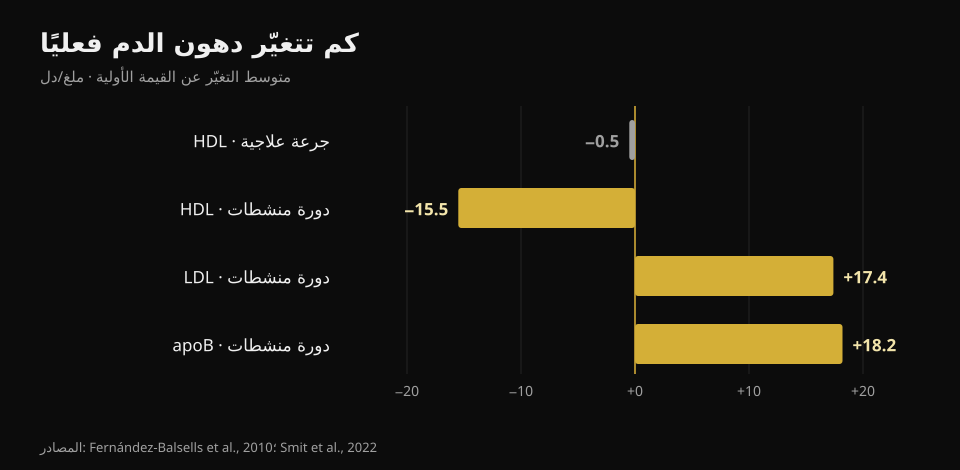
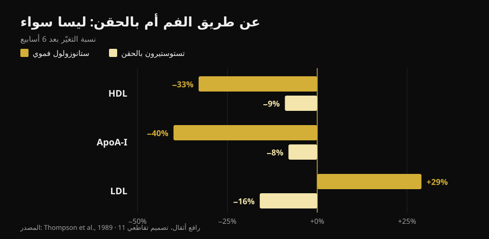

# التستوستيرون والكوليسترول: ماذا تقول الدراسات

بقلم [Giammaria Loi](/autore/giammaria-loi) · حُدِّث في 23 أكتوبر 2026

في النادي تُستخدم كلمة «تستوستيرون» للإشارة إلى أمرين مختلفين تمامًا: علاج يصفه الطبيب لمن لديه قيم منخفضة موثّقة، وجرعات أعلى بكثير تُؤخذ لزيادة العضلات. أرقام الدم ليست واحدة في الحالتين، لكنها تختلط دائمًا في الحديث نفسه. قرأت ثماني أوراق بحثية مفهرسة لفصلهما — والمتغيّر الأهم ليس ما تتوقعه.

## باختصار

- **بجرعات العلاج التعويضي يتحرّك الكوليسترول بالكاد.** التحليل البعدي لـ 51 دراسة يجد HDL أقل بمقدار **0,49 ملغ/دل** (Fernández-Balsells وآخرون، 2010). نصف ملغ لكل ديسيلتر: فرق يضيع داخل ضجيج المختبر.
- **ما يتغيّر فعلًا مع العلاج ليس الكوليسترول بل الدم نفسه.** الهيموغلوبين **+0,80 غ/دل** والهيماتوكريت **+3,18 نقطة مئوية** في التحليل نفسه. لهذا تكرّر البروتوكولات الطبية صورة الدم الكاملة.
- **أكبر تجربة لم تجد فرقًا في الأحداث القلبية.** في TRAVERSE، 5.246 رجلًا بخطورة قلبية وعائية عالية: أحداث كبرى بنسبة **7,0%** مع التستوستيرون مقابل **7,3%** مع الدواء الوهمي. لكن رجفان أذيني وانصمام رئوي وأذية كلوية حادة أكثر (Lincoff وآخرون، 2023).
- **خلال دورة ذاتية الاستعمال تتحرّك الأرقام فعلًا.** في 100 رجل تُوبعوا قبل وأثناء وبعد: **apoB +18,2 ملغ/دل**، LDL +0,45 مليمول/ل (نحو +17 ملغ/دل)، ضغط الدم **+6,9/+3,2 ملم زئبق**. وعاد كل ذلك إلى القيمة الأولية بعد ثلاثة أشهر من انتهاء الدورة (Smit وآخرون، 2022).
- **أكبر فارق ليس الجرعة بل طريقة التناول.** في الدراسة نفسها وعلى الرجال أنفسهم: منشّط فموي خفض HDL بنسبة **33%** ورفع LDL بنسبة **29%**؛ بينما التستوستيرون بالحقن خفض HDL بنسبة **9%** و*خفض* LDL بنسبة **16%** (Thompson وآخرون، 1989).

## حالتان مختلفتان باسم واحد

العلاج التعويضي وصفة طبية: يُعطى لمن لديه تستوستيرون منخفض مؤكَّد في أكثر من سحب دم مع أعراض متوافقة، والهدف إعادة القيمة إلى المجال الطبيعي. أما جرعات النادي فتستهدف ما هو أعلى بكثير من ذلك المجال، وغالبًا بدمج أكثر من مادة.

أعلى بكم؟ الطريقة الأمانة لقول ذلك ليست بالملغ بل بالتراكيز المقيسة. في التجربة المرجعية حول العلاقة بين الجرعة والاستجابة، تلقّى 61 رجلًا سليمًا بين 18 و35 عامًا خمس جرعات متصاعدة لمدة 20 أسبوعًا: التركيز الأدنى تراوح من **253 نانوغرام/دل** في المجموعة الأدنى إلى **2.370 نانوغرام/دل** في الأعلى (Bhasin وآخرون، 2001). للمقارنة، المجال الطبيعي لدى الرجل البالغ يقع تقريبًا بين 300 و1.000 نانوغرام/دل. أي أن المجموعة الأعلى كانت تعمل عند أكثر من ضعف الحد الأعلى.

في التجربة نفسها ارتفعت الكتلة الخالية من الدهون بتناسب مع الجرعة (+3,4 و+5,2 و+7,9 كغ في المجموعات الثلاث الأعلى)، و**انخفض HDL بتناسب مع تركيز التستوستيرون**. ولهذا بالضبط فإن نقل أرقام العلاج إلى الدورة — أو العكس — يضلّل في الاتجاهين.

## جرعات العلاج: أرقام أصغر مما يُقال

هنا الأدبيات وافرة ومتسقة إلى حد بعيد. التحليل البعدي لـ 51 دراسة من Fernández-Balsells وزملائه يصف ثلاثة آثار: الهيموغلوبين **+0,80 غ/دل** (فاصل ثقة 95% من 0,45 إلى 1,14)، الهيماتوكريت **+3,18%** (1,35–5,01)، وHDL **−0,49 ملغ/دل** (−0,85 إلى −0,13). ولا أثر معتدًّا به على الوفيات أو البروستاتا أو الأحداث القلبية الوعائية. والمؤلفون أنفسهم يصفون هذه التغيّرات بأنها «مجهولة الدلالة السريرية».

أحدث تجميع، المبني على بيانات المشاركين الفردية من 35 تجربة مضبوطة (5.601 رجل)، يصل إلى النتيجة نفسها: أحداث قلبية ودماغية وعائية عند 7,5% من مجموعة العلاج مقابل 7,2% مع الدواء الوهمي (نسبة أرجحية 1,07؛ فاصل ثقة 95% 0,81–1,42)، ولا أثر سلبي على ضغط الدم أو دهون المصل أو مؤشرات السكر — بل إن الكوليسترول الكلي والدهون الثلاثية كانا أقل مع العلاج (Cruickshank وآخرون، 2024).

أما TRAVERSE، التجربة المصمَّمة خصيصًا لسلامة القلب والأوعية، فضمّت 5.246 رجلًا بين 45 و80 عامًا لديهم مرض قلبي وعائي قائم أو خطورة عالية وتستوستيرون أقل من 300 نانوغرام/دل. بعد 21,7 شهرًا من العلاج وسطيًا، بلغت الأحداث القلبية الكبرى 182 (7,0%) مع التستوستيرون و190 (7,3%) مع الدواء الوهمي. لكن ثلاث إشارات ظهرت بزيادة في مجموعة العلاج: **الرجفان الأذيني والانصمام الرئوي والأذية الكلوية الحادة**. وهذه ليست تفاصيل هامشية: هي سبب متابعة العلاج من قِبل من وصفه.

## في الدورة تتغيّر الأرقام فعلًا

أنظف دراسة في هذا الجانب هولندية ومستقبلية: 100 رجل سُحبت عيناتهم قبل الدورة وفي نهايتها وبعد ثلاثة أشهر وبعد سنة من البداية. خلال الاستعمال ارتفع الضغط الانقباضي 6,87 ملم زئبق والانبساطي 3,17، وارتفع LDL بمقدار 0,45 مليمول/ل وapoB بمقدار 18,2 ملغ/دل؛ وانخفض HDL وApoA والبروتين الشحمي (أ)، وارتفع الهيماتوكريت 0,03 ل/ل (Smit وآخرون، 2022).

*رسم بياني من إنتاج Nurvan اعتمادًا على Fernández-Balsells وآخرون 2010 وSmit وآخرون 2022. حوّلنا قيم الدراسة الهولندية من مليمول/ل إلى ملغ/دل (×38,67).*

أمران يجب قولهما كاملين لأنهما يختفيان غالبًا في ملخصات مواقع التواصل. الأول: **apoB أهم من LDL**، لأنه يقيس عدد الجسيمات المحتمل أن تسبب التصلب العصيدي، وهو هنا يرتفع نحو 20 ملغ/دل. الثاني: **بعد ثلاثة أشهر من انتهاء الدورة عادت كل هذه القيم إلى نقطة البداية**. هذه الانعكاسية حقيقية ويجب ذكرها — لكنها تخص مؤشرات الدم، لا بالضرورة ما يحدث للشرايين وعضلة القلب بعد عشر أو عشرين سنة من دورات متكررة.

على ذلك الأفق الطويل لا يوجد سوى نوع واحد من البيانات، وهو رصدي. في سجل دنماركي، قُورن 1.189 رجلًا عوقبوا بسبب استعمال المنشطات بـ 59.450 شخصًا ضابطًا على مدى نحو 11 سنة: احتشاء عضلة القلب بنسبة خطورة معدَّلة **3,00** (فاصل ثقة 95% 1,67–5,39)، والانصمام الخثاري الوريدي 2,42، واضطرابات النظم 2,26، وقصور القلب 3,63، و**اعتلال عضلة القلب 8,90** (4,99–15,88) — أقوى إشارة على الإطلاق، وهي بالضبط ما لا يراه الكوليسترول (Windfeld-Mathiasen وآخرون، 2025). إنها علاقة ارتباط: لا تثبت السببية، لأن المستعملين يختلفون عن الضوابط في عادات أخرى أيضًا.

## فمويًا أم بالحقن: أكبر فارق على الإطلاق

هذه هي النقطة التي لا يضعها أي محتوى تبسيطي تقريبًا في المقدمة، وهي الأنفع. في 1989 تلقّى أحد عشر رافع أثقال، بتصميم تقاطعي وستة أسابيع لكل مرحلة، منشّطًا فمويًا من نوع 17-ألفا-ألكيل وتستوستيرونًا بالحقن بجرعة فوق فسيولوجية. الدراسة نفسها، الأشخاص أنفسهم، الفترة نفسها.

*رسم بياني من إنتاج Nurvan اعتمادًا على Thompson وآخرون، 1989 (JAMA): 11 رافع أثقال، تصميم تقاطعي، ستة أسابيع لكل مرحلة.*

مع الجزيء الفموي انخفض HDL بنسبة 33% (والجزء الفرعي HDL2 بنسبة 71%)، وApoA-I بنسبة 40%، وارتفع LDL بنسبة 29%، وتضاعف نشاط الليباز الكبدي أكثر من مرة. ومع التستوستيرون بالحقن انخفض HDL بنسبة 9% و**انخفض LDL بنسبة 16%**. وخلاصة المؤلفين، المكتوبة عام 1989 ولم تُدحض بعد، أن الأثر الضار على البروتينات الشحمية يتبع طريقة التناول لا القوة الأندروجينية.

بعبارة أخرى: قد يكون شخصان «على المنشطات» ويحملان صورتين دهنيتين متعاكستين. وبدون معرفة ما يُستعمل وكيف ولكم من الوقت، لا يقول تحليل واحد شيئًا.

## ماذا تقول الأبحاث فعلًا

- **«مع العلاج التعويضي يتغيّر الكوليسترول قليلًا» — مؤكَّد.** نصف ملغ/دل من HDL في أكبر تحليل بعدي، ولا أثر سلبي على الدهون في تجميع البيانات الفردية.
- **«العلاج التعويضي يزيد احتشاء القلب» — غير صحيح.** لا TRAVERSE ولا التحليلان البعديان وجدا زيادة في الأحداث القلبية الكبرى. لكن الرجفان الأذيني والانصمام الرئوي والأذية الكلوية الحادة بقيت أعلى في TRAVERSE.
- **«القيمة التي تُراقَب أثناء العلاج هي الكوليسترول» — يحتاج إلى توضيح.** التغيّر الأكثر ثباتًا دموي: الهيموغلوبين والهيماتوكريت. لذلك تُكرَّر صورة الدم.
- **«المنشطات ترفع LDL» — يحتاج إلى توضيح.** يعتمد على الطريق: فمويًا نعم وبقوة؛ ومع التستوستيرون بالحقن في تجربة مضبوطة انخفض LDL فعلًا. أما ما يرتفع باطّراد في دورة واقعية متعددة المواد فهو apoB.
- **«إذا كانت التحاليل طبيعية فالدورة آمنة» — غير صحيح.** أقوى إشارة في السجل الدنماركي هي اعتلال عضلة القلب لا قيمة دهنية. صورة دهنية هادئة لا تنفي شيئًا.
- **«انخفاض HDL يعني تلقائيًا خطورة أكبر» — يحتاج إلى توضيح.** في تجربة مضبوطة على 53 رجلًا سليمًا، لم تتوافق تغيّرات HDL الناتجة عن التستوستيرون مع تغيّرات في قدرة HDL على سحب الكوليسترول من الخلايا (Rubinow وآخرون، 2018). الرقم ينخفض، أما الوظيفة فليس بالضرورة.

## كيف تطبّق ذلك

1. **افصل السؤالين.** «تستوستيروني منخفض ووصف لي الطبيب علاجًا» و«أريد استعمال جرعات النادي» تستندان إلى أدبيّتين مختلفتين. لا تنقل أرقام إحداهما إلى الأخرى.
2. **إن كنت على علاج، التزم بجدول المتابعة الذي وضعه طبيبك.** صورة الدم والهيماتوكريت يتحركان أولًا، وهما أيضًا الأسهل إدارةً حين تراهما قادمين.
3. **انظر إلى apoB لا إلى «الكوليسترول» وحده.** حيث يتوفر، يصف حمل الجسيمات العصيدية أفضل من LDL وحده، الذي قد يبقى ثابتًا بينما يرتفع apoB.
4. **لا تستنتج السلامة من الدهون.** ضغط الدم والهيماتوكريت وعضلة القلب قنوات مستقلة: السجل الدنماركي وجد أقوى إشارة تحديدًا حيث لا ينظر الكوليسترول.
5. **اقرأ المنحنى لا التقرير المفرد.** قيمة واحدة تقول القليل؛ ثلاثة سحوبات في الوقت نفسه من السنة تقول الكثير. يصحّ ذلك في العلاج وفي التحاليل الروتينية.
6. **خذ الأرقام إلى الطبيب لا إلى المنتديات.** هذا المقال يشرح ماذا تقيس هذه القيم؛ أما ماذا تفعل بها فيعود لمن يفحصك ويعرف سيرتك المرضية.

### جرّب Nurvan — كل تحاليلك في مكان واحد

المشكلة العملية لمن يتابع قيمه عبر الزمن أن التقارير تتفرق بين مجلدات ورسائل بريد وملفات PDF. في Nurvan يمكنك رفع تحاليل الدم ورؤية مسار كل بند — HDL وLDL وapoB والهيماتوكريت والهيموغلوبين — على خط زمني واحد، بدل مقارنة ورقتين من الذاكرة. وحين تزور الطبيب تحمل السلسلة كاملة لا الورقة الأخيرة. وإن كنت تتمرّن، فإلى جانب الأشهر نفسها تجد أحمالك وحجم تدريبك ووزنك: السياق الذي لا يمنحه تقرير منفرد أبدًا. **[جرّب Nurvan](https://nurvan.app)**

## أسئلة شائعة

**هل يرفع التستوستيرون الكوليسترول؟**
يعتمد على الكمية والطريقة. بجرعات العلاج التعويضي يكون الأثر على الدهون ضئيلًا: نصف ملغ/دل أقل من HDL في التحليل البعدي لـ 51 دراسة، ولا تدهور في LDL. أما في دورة بجرعات أعلى بكثير ومواد متعددة فيرتفع LDL وapoB ارتفاعًا قابلًا للقياس.

**أي قيمة أراقب إن كنت على علاج تعويضي؟**
الأكثر ثباتًا ليست دهنية: الهيموغلوبين والهيماتوكريت يرتفعان بشكل قابل للتكرار (+0,80 غ/دل و+3,18 نقطة في التحليل البعدي). أما نوع الفحوص وتواترها فيحددهما الطبيب الذي وصف العلاج.

**هل تتعافى اضطرابات الدهون بعد الدورة؟**
في الدراسة المستقبلية على 100 رجل نعم: بعد ثلاثة أشهر من الانتهاء عادت الدهون والضغط والهيماتوكريت إلى القيم الأولية. هذا يخص مؤشرات الدم؛ أما أثر دورات متكررة لسنوات على القلب فسؤال آخر، والبيانات المتاحة رصدية فقط.

**لماذا تُعدّ المنشطات الفموية أسوأ؟**
لأنها تمرّ عبر الكبد وتغيّر استقلاب البروتينات الشحمية بدرجة أكبر بكثير. في المقارنة المباشرة على الأشخاص أنفسهم خفض الجزيء الفموي HDL بنسبة 33% ورفع LDL بنسبة 29%، مقابل −9% و−16% للتستوستيرون بالحقن.

**هل تكفي تحاليل الدم للقول إن الدورة آمنة؟**
لا. في السجل الدنماركي كانت أعلى خطورة تخص اعتلال عضلة القلب، أي العضلة نفسها، بنسبة تقارب تسعة أضعاف الضوابط: وهو ما لم تكن أي صورة دهنية لتنبّه إليه.

## اقرأ أيضًا

- [هل يسبب الكرياتين تساقط الشعر؟](/ar/blog/creatine-hair-loss) — السؤال «الهرموني» الكبير الآخر في النادي، مُتحقَّق منه على الدراسات.
- [تصنيف مكملات القوة](/ar/blog/tasnif-mukammilat-alquwa) — ما لديه أدلة متينة فعلًا، مرتّبًا.
- [أي مغنيسيوم تختار](/ar/blog/ayyu-maghnisyum-takhtar-aljuraa-walashkal) — الجرعات والأشكال، بالأرقام.

## المصادر

1. Fernández-Balsells MM, Murad MH, Lane M, Lampropulos JF, Albuquerque F, Mullan RJ, Agrwal N, Elamin MB, Gallegos-Orozco JF, Wang AT, Erwin PJ, Bhasin S, Montori VM, 2010. *Clinical review 1: Adverse effects of testosterone therapy in adult men: a systematic review and meta-analysis.* Journal of Clinical Endocrinology & Metabolism 95(6):2560-75. [PMID 20525906](https://pubmed.ncbi.nlm.nih.gov/20525906/) · [DOI 10.1210/jc.2009-2575](https://doi.org/10.1210/jc.2009-2575)
2. Cruickshank M, Hudson J, Hernández R, Aceves-Martins M, Quinton R, Gillies K, Aucott LS, Kennedy C, Manson P, Oliver N, Wu F, Bhattacharya S, Dhillo WS, Jayasena CN, Brazzelli M, 2024. *The effects and safety of testosterone replacement therapy for men with hypogonadism: the TestES evidence synthesis and economic evaluation.* Health Technology Assessment 28(43):1-210. [PMID 39248210](https://pubmed.ncbi.nlm.nih.gov/39248210/) · [DOI 10.3310/JRYT3981](https://doi.org/10.3310/JRYT3981)
3. Lincoff AM, Bhasin S, Flevaris P, Mitchell LM, Basaria S, Boden WE, Cunningham GR, Granger CB, Khera M, Thompson IM, Wang Q, Wolski K, Davey D, Kalahasti V, Khan N, Miller MG, Snabes MC, Chan A, Dubcenco E, Li X, Yi T, Huang B, Pencina KM, Travison TG, Nissen SE, 2023. *Cardiovascular Safety of Testosterone-Replacement Therapy (TRAVERSE).* New England Journal of Medicine 389(2):107-117. [PMID 37326322](https://pubmed.ncbi.nlm.nih.gov/37326322/) · [DOI 10.1056/NEJMoa2215025](https://doi.org/10.1056/NEJMoa2215025)
4. Bhasin S, Woodhouse L, Casaburi R, Singh AB, Bhasin D, Berman N, Chen X, Yarasheski KE, Magliano L, Dzekov C, Dzekov J, Bross R, Phillips J, Sinha-Hikim I, Shen R, Storer TW, 2001. *Testosterone dose-response relationships in healthy young men.* American Journal of Physiology - Endocrinology and Metabolism 281(6):E1172-81. [PMID 11701431](https://pubmed.ncbi.nlm.nih.gov/11701431/) · [DOI 10.1152/ajpendo.2001.281.6.E1172](https://doi.org/10.1152/ajpendo.2001.281.6.E1172)
5. Smit DL, Grefhorst A, Buijs MM, de Hon O, den Heijer M, de Ronde W, 2022. *Prospective study on blood pressure, lipid metabolism and erythrocytosis during and after androgen abuse.* Andrologia 54(4):e14372. [PMID 35014715](https://pubmed.ncbi.nlm.nih.gov/35014715/) · [DOI 10.1111/and.14372](https://doi.org/10.1111/and.14372)
6. Thompson PD, Cullinane EM, Sady SP, Chenevert C, Saritelli AL, Sady MA, Herbert PN, 1989. *Contrasting effects of testosterone and stanozolol on serum lipoprotein levels.* JAMA 261(8):1165-8. [PMID 2915439](https://pubmed.ncbi.nlm.nih.gov/2915439/)
7. Windfeld-Mathiasen J, Heerfordt IM, Dalhoff KP, Andersen JT, Andersen MA, Johansson KS, Biering-Sørensen T, Olsen FJ, Horwitz H, 2025. *Cardiovascular Disease in Anabolic Androgenic Steroid Users.* Circulation 151(12):828-834. [PMID 39945117](https://pubmed.ncbi.nlm.nih.gov/39945117/) · [DOI 10.1161/CIRCULATIONAHA.124.071117](https://doi.org/10.1161/CIRCULATIONAHA.124.071117)
8. Rubinow KB, Vaisar T, Chao JH, Heinecke JW, Page ST, 2018. *Sex steroids mediate discrete effects on HDL cholesterol efflux capacity and particle concentration in healthy men.* Journal of Clinical Lipidology 12(4):1072-1082. [PMID 29793828](https://pubmed.ncbi.nlm.nih.gov/29793828/) · [DOI 10.1016/j.jacl.2018.04.013](https://doi.org/10.1016/j.jacl.2018.04.013)

المراجع مستخرجة عبر PubMed. نقطة الانطلاق: منشور **Dwayne N. Jackson** ([@drdnjackson](https://www.instagram.com/drdnjackson/)) بتاريخ 2 أكتوبر 2026، [المنشور الأصلي](https://www.instagram.com/p/Dd98gQmD6sN/). لم يُنسخ أي نص أو صورة من ذلك المنشور: أُعيدت كتابة الموضوع من الصفر بالعودة إلى الدراسات الأصلية والتحقق منها واحدة واحدة.

---

**Giammaria Loi** هو مؤسس Nurvan. يتدرّب بالأثقال منذ 2012، ويعمل مدربًا شخصيًا ومدرّبًا معتمدًا من FIPE منذ 2013، ويشارك في منافسات رفع القوة على المستوى الوطني منذ 2018. كل مقال يوقّعه ينطلق من الدراسات العلمية وينتهي عند ما ينفع فعلًا في النادي.

> ملاحظة: محتوى تثقيفي لا يغني عن رأي الطبيب. لا يتضمن هذا المقال أي إرشادات جرعات ولا يشجّع على استعمال أي مادة: الاستعمال غير الطبي للمنشطات الابتنائية محظور في الرياضة وغير قانوني في كثير من الدول. إن كنت تتبع علاجًا هرمونيًا أو تفكر فيه، فناقشه مع الطبيب الذي يتابعك.
