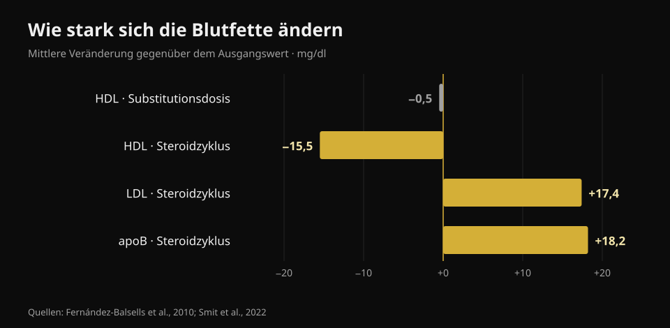
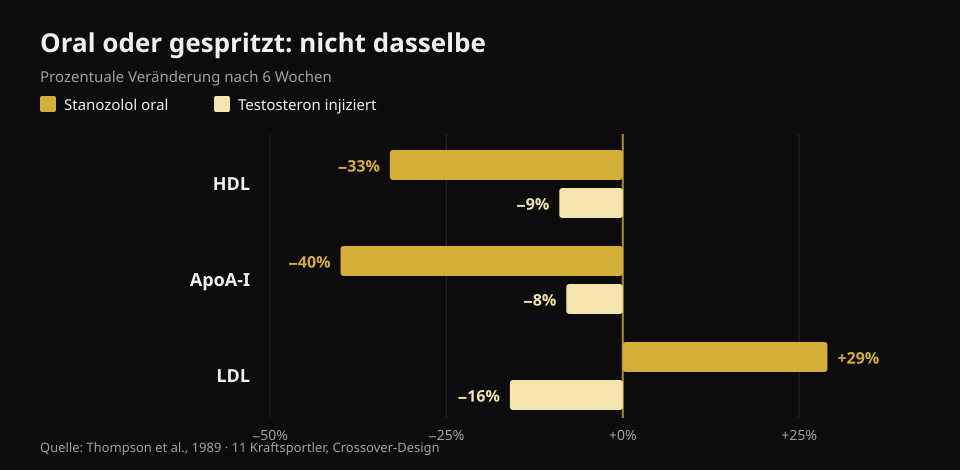

# Testosteron und Cholesterin: was die Studien sagen

Von [Giammaria Loi](/autore/giammaria-loi) · aktualisiert am 23. Oktober 2026

Im Studio meint „Testosteron" zwei sehr verschiedene Dinge: eine verordnete Therapie bei dokumentiert niedrigen Werten und deutlich höhere Dosen, die zum Muskelaufbau genommen werden. Die Blutwerte sind in beiden Fällen nicht dieselben, landen aber fast immer im selben Gespräch. Ich habe acht indexierte Arbeiten gelesen, um sie zu trennen — und die wichtigste Variable ist nicht die, die man erwartet.

## Kurz gefasst

- **Bei Substitutionsdosen bewegt sich das Cholesterin kaum.** Die Metaanalyse über 51 Studien findet ein um **0,49 mg/dl** niedrigeres HDL (Fernández-Balsells et al., 2010). Ein halbes Milligramm pro Deziliter: eine Veränderung, die im Laborrauschen untergeht.
- **Was sich unter Therapie wirklich ändert, ist nicht das Cholesterin, sondern das Blut.** Hämoglobin **+0,80 g/dl** und Hämatokrit **+3,18 Prozentpunkte** in derselben Metaanalyse. Deshalb wiederholen medizinische Protokolle ein Blutbild.
- **Die größte Studie findet keinen Unterschied bei Herzereignissen.** In TRAVERSE, 5.246 Männer mit hohem kardiovaskulärem Risiko: schwere Ereignisse bei **7,0 %** unter Testosteron gegenüber **7,3 %** unter Placebo. Aber mehr Vorhofflimmern, Lungenembolie und akute Nierenschädigung (Lincoff et al., 2023).
- **Im selbst verabreichten Zyklus bewegen sich die Zahlen wirklich.** Bei 100 Männern, die vorher, währenddessen und danach untersucht wurden: **apoB +18,2 mg/dl**, LDL +0,45 mmol/l (rund +17 mg/dl), Blutdruck **+6,9/+3,2 mmHg**. Drei Monate nach Zyklusende alles wieder auf Ausgangsniveau (Smit et al., 2022).
- **Der größte Unterschied ist nicht die Dosis, sondern der Weg der Einnahme.** In derselben Studie, bei denselben Männern: ein orales Steroid senkte HDL um **33 %** und hob LDL um **29 %**; injiziertes Testosteron senkte HDL um **9 %** und *senkte* LDL um **16 %** (Thompson et al., 1989).

## Zwei verschiedene Situationen mit demselben Namen

Die Substitutionstherapie ist eine ärztliche Verordnung: Sie richtet sich an Männer mit mehrfach bestätigtem niedrigem Testosteron und passenden Symptomen, und das Ziel ist, den Wert zurück in den Normbereich zu bringen. Studio-Dosen zielen weit über diesen Bereich hinaus, meist mit mehreren Substanzen gleichzeitig.

Wie weit darüber? Ehrlich sagt man das nicht in Milligramm, sondern in gemessenen Konzentrationen. In der Referenzstudie zur Dosis-Wirkungs-Beziehung erhielten 61 gesunde Männer zwischen 18 und 35 Jahren 20 Wochen lang fünf ansteigende Dosen: Die Talkonzentration reichte von **253 ng/dl** in der niedrigsten bis **2.370 ng/dl** in der höchsten Gruppe (Bhasin et al., 2001). Zum Vergleich: Der übliche Normbereich beim erwachsenen Mann liegt grob zwischen 300 und 1.000 ng/dl. Die höchste Gruppe lag also bei mehr als dem Doppelten der Obergrenze.

In derselben Studie stieg die fettfreie Masse dosisabhängig (+3,4, +5,2 und +7,9 kg in den drei höchsten Gruppen) und **das HDL sank proportional zur Testosteronkonzentration**. Genau deshalb führt es in beide Richtungen in die Irre, Zahlen aus einer Therapiestudie auf einen Zyklus zu übertragen — oder umgekehrt.

## Substitutionsdosen: kleinere Zahlen als im Netz erzählt

Hier ist die Literatur umfangreich und ziemlich einheitlich. Die Metaanalyse über 51 Studien von Fernández-Balsells und Kollegen berichtet drei Effekte: Hämoglobin **+0,80 g/dl** (95 %-KI 0,45–1,14), Hämatokrit **+3,18 %** (1,35–5,01) und HDL **−0,49 mg/dl** (−0,85 bis −0,13). Kein signifikanter Effekt auf Sterblichkeit, Prostata oder kardiovaskuläre Ereignisse. Die Autoren selbst nennen diese Veränderungen „von unbekannter klinischer Bedeutung".

Die neueste Synthese, auf Basis individueller Teilnehmerdaten aus 35 kontrollierten Studien (5.601 Männer), kommt zum selben Schluss: kardiovaskuläre und zerebrovaskuläre Ereignisse bei 7,5 % der Behandelten gegenüber 7,2 % unter Placebo (OR 1,07; 95 %-KI 0,81–1,42) und kein ungünstiger Effekt auf Blutdruck, Serumlipide oder Blutzuckermarker — Gesamtcholesterin und Triglyzeride lagen unter Behandlung sogar niedriger (Cruickshank et al., 2024).

TRAVERSE, die eigens für die kardiovaskuläre Sicherheit angelegte Studie, schloss 5.246 Männer zwischen 45 und 80 Jahren mit bestehender Herz-Kreislauf-Erkrankung oder hohem Risiko und Testosteron unter 300 ng/dl ein. Nach im Mittel 21,7 Behandlungsmonaten gab es 182 schwere Herzereignisse (7,0 %) unter Testosteron und 190 (7,3 %) unter Placebo. Drei Signale traten in der Behandlungsgruppe jedoch häufiger auf: **Vorhofflimmern, Lungenembolie und akute Nierenschädigung**. Das sind keine Fußnoten, sondern der Grund, warum eine Therapie von dem begleitet wird, der sie verordnet hat.

## Im Zyklus bewegen sich die Zahlen tatsächlich

Die sauberste Studie auf dieser Seite ist niederländisch und prospektiv: 100 Männer, gemessen vor dem Zyklus, am Ende, drei Monate später und ein Jahr nach Beginn. Während der Einnahme stieg der systolische Druck um 6,87 mmHg und der diastolische um 3,17 mmHg, das LDL um 0,45 mmol/l, das apoB um 18,2 mg/dl; HDL, ApoA und Lipoprotein(a) fielen, der Hämatokrit stieg um 0,03 l/l (Smit et al., 2022).

*Nurvan-Grafik nach Fernández-Balsells et al., 2010 und Smit et al., 2022. Die mmol/l-Werte der niederländischen Studie haben wir in mg/dl umgerechnet (×38,67).*

Zwei Punkte gehören vollständig gesagt, weil sie in Social-Media-Zusammenfassungen fast immer fehlen. Erstens: **apoB zählt mehr als LDL**, weil es misst, wie viele potenziell atherogene Partikel zirkulieren — und hier steigt es um fast 20 mg/dl. Zweitens: **Drei Monate nach Zyklusende lagen all diese Werte wieder auf dem Ausgangsniveau.** Diese Reversibilität ist real und gehört berichtet — sie betrifft aber Marker im Blut, nicht zwangsläufig das, was nach zehn oder zwanzig Jahren wiederholter Zyklen mit Gefäßen und Herzmuskel passiert.

Für diesen langen Zeitraum gibt es nur eine Art von Daten, und die ist beobachtend. In einem dänischen Register wurden 1.189 wegen Steroidgebrauchs sanktionierte Männer über rund 11 Jahre mit 59.450 Kontrollen verglichen: Herzinfarkt mit adjustierter Hazard Ratio **3,00** (95 %-KI 1,67–5,39), venöse Thromboembolie 2,42, Arrhythmien 2,26, Herzinsuffizienz 3,63 und **Kardiomyopathie 8,90** (4,99–15,88) — das größte Signal von allen, und genau das, was Cholesterin nicht sieht (Windfeld-Mathiasen et al., 2025). Es ist eine Assoziation: Sie beweist keine Ursache, weil sich Anwender auch in anderen Gewohnheiten von den Kontrollen unterscheiden.

## Oral oder gespritzt: der größte Unterschied

Das ist der Punkt, den fast kein populärer Beitrag nach vorne stellt — und er ist der nützlichste. 1989 erhielten elf Kraftsportler im Crossover-Design jeweils sechs Wochen lang ein orales 17-alpha-alkyliertes Steroid und supraphysiologisch dosiertes injiziertes Testosteron. Gleiche Studie, gleiche Personen, gleicher Zeitraum.

*Nurvan-Grafik nach Thompson et al., 1989 (JAMA): 11 Kraftsportler, Crossover-Design, sechs Wochen pro Phase.*

Unter der oralen Substanz fiel das HDL um 33 % (die Unterfraktion HDL2 um 71 %), ApoA-I um 40 %, das LDL stieg um 29 % und die hepatische Lipase mehr als verdoppelte sich. Unter injiziertem Testosteron fiel das HDL um 9 % und **das LDL um 16 %**. Die Schlussfolgerung der Autoren, 1989 geschrieben und nie widerlegt: Der ungünstige Lipoproteineffekt folgt dem Einnahmeweg, nicht der androgenen Potenz.

Übersetzt: Zwei Personen können beide „auf Steroiden" sein und entgegengesetzte Lipidprofile haben. Ohne zu wissen, was, wie und wie lange, sagt ein einzelner Befund nichts.

## Was die Forschung wirklich zeigt

- **„Unter Substitutionstherapie ändert sich das Cholesterin kaum" — Bestätigt.** Ein halbes mg/dl HDL in der größten Metaanalyse, kein ungünstiger Lipideffekt in der Synthese individueller Daten.
- **„Substitutionstherapie erhöht das Herzinfarktrisiko" — Widerlegt.** Weder TRAVERSE noch die beiden Metaanalysen finden einen Überschuss schwerer Herzereignisse. In TRAVERSE blieben aber Vorhofflimmern, Lungenembolie und akute Nierenschädigung erhöht.
- **„Unter Therapie ist Cholesterin der Wert, den man im Auge behält" — Zu präzisieren.** Die konstanteste Veränderung ist hämatologisch: Hämoglobin und Hämatokrit. Deshalb wird das Blutbild wiederholt.
- **„Steroide heben das LDL" — Zu präzisieren.** Es hängt vom Weg ab: oral ja, und deutlich; mit injiziertem Testosteron fiel das LDL in einer kontrollierten Studie sogar. Was in einem realen Zyklus mit mehreren Substanzen konsistent steigt, ist apoB.
- **„Wenn die Blutwerte normal sind, ist der Zyklus sicher" — Widerlegt.** Das stärkste Signal im dänischen Register ist die Kardiomyopathie, kein Lipidwert. Ein ruhiges Lipidprofil schließt nichts aus.
- **„Niedrigeres HDL bedeutet automatisch mehr Risiko" — Zu präzisieren.** In einer kontrollierten Studie mit 53 gesunden Männern entsprachen testosteronbedingte HDL-Veränderungen nicht Veränderungen der Fähigkeit des HDL, Cholesterin aus Zellen abzutransportieren (Rubinow et al., 2018). Die Zahl sinkt; die Funktion nicht unbedingt.

## So wendest du das an

1. **Trenne die beiden Fragen.** „Mein Testosteron ist niedrig und mein Arzt hat eine Therapie verordnet" und „ich will Studio-Dosen nutzen" stehen auf zwei verschiedenen Literaturen. Übertrage die Zahlen nicht von einer auf die andere.
2. **Unter Therapie: Halte den Kontrollplan ein, den dein Arzt festgelegt hat.** Blutbild und Hämatokrit bewegen sich zuerst — und lassen sich am besten steuern, wenn man sie kommen sieht.
3. **Schau auf apoB, nicht nur auf „Cholesterin".** Wo verfügbar, beschreibt es die Last atherogener Partikel besser: Das LDL allein kann gleich bleiben, während apoB steigt.
4. **Leite Sicherheit nicht aus den Lipiden ab.** Blutdruck, Hämatokrit und Herzmuskel sind unabhängige Kanäle: Das dänische Register findet sein größtes Signal genau dort, wo Cholesterin nicht hinschaut.
5. **Lies den Verlauf, nicht den Einzelbefund.** Ein isolierter Wert sagt wenig; drei Messungen zum gleichen Zeitpunkt im Jahr sagen viel. Das gilt unter Therapie wie bei der Routinekontrolle.
6. **Bring die Zahlen zum Arzt, nicht ins Forum.** Dieser Artikel erklärt, was diese Werte messen; was damit zu tun ist, entscheidet, wer dich untersucht und deine Vorgeschichte kennt.

### Nurvan testen — alle Blutwerte an einem Ort

Das praktische Problem beim Verfolgen eigener Werte: Die Befunde liegen in Ordnern, Mails und verstreuten PDFs. In Nurvan lädst du deine Blutbefunde hoch und siehst jeden Posten — HDL, LDL, apoB, Hämatokrit, Hämoglobin — auf einer Zeitachse, statt zwei Blätter aus dem Gedächtnis zu vergleichen. Zum Arzttermin bringst du die Reihe mit, nicht das letzte Blatt. Und wenn du trainierst, stehen in denselben Monaten deine Lasten, dein Volumen und dein Gewicht daneben: der Kontext, den ein Befund allein nie hat. **[Nurvan testen](https://nurvan.app)**

## Häufige Fragen

**Erhöht Testosteron das Cholesterin?**
Das hängt davon ab, wie viel und wie. Bei Substitutionsdosen ist der Lipideffekt minimal: ein halbes mg/dl weniger HDL in der Metaanalyse über 51 Studien, keine Verschlechterung des LDL. In einem Zyklus mit viel höheren Dosen und mehreren Substanzen steigen LDL und apoB messbar.

**Welchen Wert sollte ich unter Substitutionstherapie beobachten?**
Der konstanteste ist kein Lipidwert: Hämoglobin und Hämatokrit steigen reproduzierbar (+0,80 g/dl und +3,18 Punkte in der Metaanalyse). Welche Untersuchungen in welchem Abstand, legt der verordnende Arzt fest.

**Erholen sich die Lipidwerte nach einem Zyklus?**
In der prospektiven Studie an 100 Männern ja: Drei Monate nach dem Ende waren Lipide, Blutdruck und Hämatokrit wieder auf Ausgangsniveau. Das betrifft Marker im Blut; was wiederholte Zyklen über Jahre mit dem Herzen machen, ist eine andere Frage, und die verfügbaren Daten sind rein beobachtend.

**Warum gelten orale Steroide als schlechter?**
Weil sie die Leber passieren und den Lipoproteinstoffwechsel deutlich stärker verändern. Im direkten Vergleich bei denselben Personen senkte die orale Substanz das HDL um 33 % und hob das LDL um 29 %, gegenüber −9 % und −16 % bei injiziertem Testosteron.

**Reichen Blutwerte, um zu sagen, ob ein Zyklus sicher ist?**
Nein. Im dänischen Register betraf das höchste Risiko die Kardiomyopathie, also den Herzmuskel selbst, mit fast dem Neunfachen der Kontrollen: Das hätte kein Lipidprofil angezeigt.

## Weiterlesen

- [Verursacht Kreatin Haarausfall?](/de/blog/kreatin-haarausfall) — die andere große „Hormonfrage" aus dem Studio, an den Studien geprüft.
- [Supplement-Tier-List für Kraft](/de/blog/kraftsport-supplemente-tier-list) — was wirklich belastbare Evidenz hat, sortiert.
- [Welches Magnesium wählen](/de/blog/welches-magnesium-waehlen-dosis-formen) — Dosis und Formen, mit Zahlen.

## Quellen

1. Fernández-Balsells MM, Murad MH, Lane M, Lampropulos JF, Albuquerque F, Mullan RJ, Agrwal N, Elamin MB, Gallegos-Orozco JF, Wang AT, Erwin PJ, Bhasin S, Montori VM, 2010. *Clinical review 1: Adverse effects of testosterone therapy in adult men: a systematic review and meta-analysis.* Journal of Clinical Endocrinology & Metabolism 95(6):2560-75. [PMID 20525906](https://pubmed.ncbi.nlm.nih.gov/20525906/) · [DOI 10.1210/jc.2009-2575](https://doi.org/10.1210/jc.2009-2575)
2. Cruickshank M, Hudson J, Hernández R, Aceves-Martins M, Quinton R, Gillies K, Aucott LS, Kennedy C, Manson P, Oliver N, Wu F, Bhattacharya S, Dhillo WS, Jayasena CN, Brazzelli M, 2024. *The effects and safety of testosterone replacement therapy for men with hypogonadism: the TestES evidence synthesis and economic evaluation.* Health Technology Assessment 28(43):1-210. [PMID 39248210](https://pubmed.ncbi.nlm.nih.gov/39248210/) · [DOI 10.3310/JRYT3981](https://doi.org/10.3310/JRYT3981)
3. Lincoff AM, Bhasin S, Flevaris P, Mitchell LM, Basaria S, Boden WE, Cunningham GR, Granger CB, Khera M, Thompson IM, Wang Q, Wolski K, Davey D, Kalahasti V, Khan N, Miller MG, Snabes MC, Chan A, Dubcenco E, Li X, Yi T, Huang B, Pencina KM, Travison TG, Nissen SE, 2023. *Cardiovascular Safety of Testosterone-Replacement Therapy (TRAVERSE).* New England Journal of Medicine 389(2):107-117. [PMID 37326322](https://pubmed.ncbi.nlm.nih.gov/37326322/) · [DOI 10.1056/NEJMoa2215025](https://doi.org/10.1056/NEJMoa2215025)
4. Bhasin S, Woodhouse L, Casaburi R, Singh AB, Bhasin D, Berman N, Chen X, Yarasheski KE, Magliano L, Dzekov C, Dzekov J, Bross R, Phillips J, Sinha-Hikim I, Shen R, Storer TW, 2001. *Testosterone dose-response relationships in healthy young men.* American Journal of Physiology - Endocrinology and Metabolism 281(6):E1172-81. [PMID 11701431](https://pubmed.ncbi.nlm.nih.gov/11701431/) · [DOI 10.1152/ajpendo.2001.281.6.E1172](https://doi.org/10.1152/ajpendo.2001.281.6.E1172)
5. Smit DL, Grefhorst A, Buijs MM, de Hon O, den Heijer M, de Ronde W, 2022. *Prospective study on blood pressure, lipid metabolism and erythrocytosis during and after androgen abuse.* Andrologia 54(4):e14372. [PMID 35014715](https://pubmed.ncbi.nlm.nih.gov/35014715/) · [DOI 10.1111/and.14372](https://doi.org/10.1111/and.14372)
6. Thompson PD, Cullinane EM, Sady SP, Chenevert C, Saritelli AL, Sady MA, Herbert PN, 1989. *Contrasting effects of testosterone and stanozolol on serum lipoprotein levels.* JAMA 261(8):1165-8. [PMID 2915439](https://pubmed.ncbi.nlm.nih.gov/2915439/)
7. Windfeld-Mathiasen J, Heerfordt IM, Dalhoff KP, Andersen JT, Andersen MA, Johansson KS, Biering-Sørensen T, Olsen FJ, Horwitz H, 2025. *Cardiovascular Disease in Anabolic Androgenic Steroid Users.* Circulation 151(12):828-834. [PMID 39945117](https://pubmed.ncbi.nlm.nih.gov/39945117/) · [DOI 10.1161/CIRCULATIONAHA.124.071117](https://doi.org/10.1161/CIRCULATIONAHA.124.071117)
8. Rubinow KB, Vaisar T, Chao JH, Heinecke JW, Page ST, 2018. *Sex steroids mediate discrete effects on HDL cholesterol efflux capacity and particle concentration in healthy men.* Journal of Clinical Lipidology 12(4):1072-1082. [PMID 29793828](https://pubmed.ncbi.nlm.nih.gov/29793828/) · [DOI 10.1016/j.jacl.2018.04.013](https://doi.org/10.1016/j.jacl.2018.04.013)

Literatur über PubMed recherchiert. Ausgangspunkt: der Beitrag von **Dwayne N. Jackson** ([@drdnjackson](https://www.instagram.com/drdnjackson/)) vom 2. Oktober 2026, [Originalbeitrag](https://www.instagram.com/p/Dd98gQmD6sN/). Kein Text und kein Bild dieses Beitrags wurde übernommen: Das Thema wurde von Grund auf neu geschrieben, zurück zu den Primärstudien und einzeln überprüft.

---

**Giammaria Loi** ist der Gründer von Nurvan. Er trainiert seit 2012 mit Gewichten, arbeitet seit 2013 als FIPE-zertifizierter Personal Trainer und Coach und startet seit 2018 im Powerlifting auf nationaler Ebene. Jeder Artikel, den er zeichnet, beginnt bei den Studien und endet bei dem, was im Studio wirklich funktioniert.

> Hinweis: informativer Inhalt, kein Ersatz für ärztlichen Rat. Dieser Artikel enthält keine Dosierungsangaben und ermutigt nicht zum Gebrauch irgendeiner Substanz: Der nichtmedizinische Gebrauch anaboler Steroide ist im Sport verboten und in vielen Ländern illegal. Wenn du eine Hormontherapie machst oder erwägst, sprich mit dem Arzt, der dich betreut.
