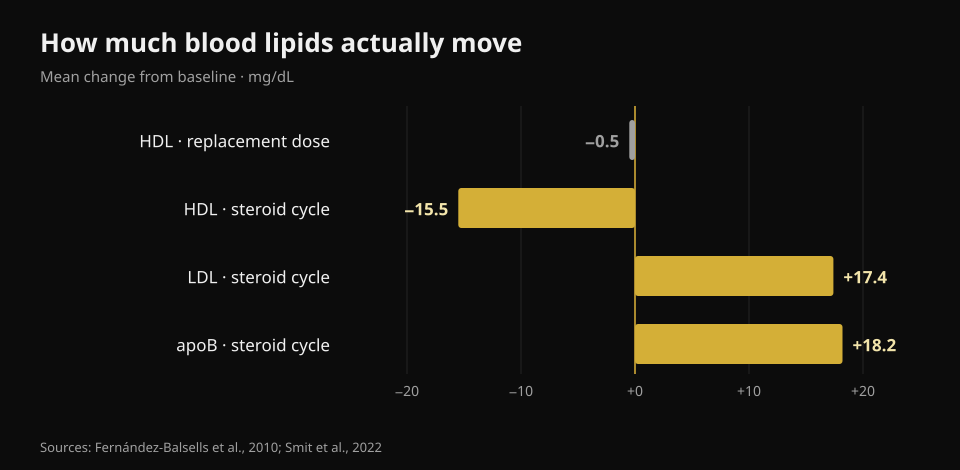
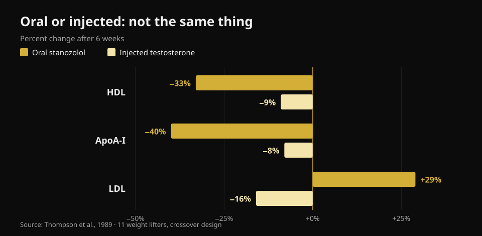

# Testosterone and cholesterol: what the studies say

By [Giammaria Loi](/autore/giammaria-loi) · updated 23 October 2026

In the gym, "testosterone" covers two very different things: a prescribed therapy for men with documented low levels, and far higher doses taken to grow. The blood numbers are not the same in the two cases, yet they almost always end up in the same conversation. I read eight indexed papers to pull them apart — and the variable that matters most is not the one you would expect.

## The short version

- **At replacement doses, cholesterol barely moves.** The meta-analysis of 51 studies found HDL **0.49 mg/dL lower** (Fernández-Balsells et al., 2010). Half a milligram per decilitre: a change that disappears into lab noise.
- **The value that really shifts on therapy is not cholesterol, it is blood.** Haemoglobin **+0.80 g/dL** and haematocrit **+3.18 percentage points** in the same meta-analysis. That is why medical protocols repeat a blood count, not a lipid panel.
- **The largest trial found no difference in cardiac events.** In TRAVERSE, 5,246 men at high cardiovascular risk: major events in **7.0%** on testosterone versus **7.3%** on placebo. But more atrial fibrillation, pulmonary embolism and acute kidney injury (Lincoff et al., 2023).
- **During a self-administered cycle the numbers move for real.** In 100 men followed before, during and after: **apoB +18.2 mg/dL**, LDL +0.45 mmol/L (about +17 mg/dL), blood pressure **+6.9/+3.2 mmHg**. All back to baseline three months after the cycle ended (Smit et al., 2022).
- **The biggest difference is not the dose, it is the route.** In one crossover trial, in the same men: an oral steroid cut HDL by **33%** and raised LDL by **29%**; injected testosterone cut HDL by **9%** and *lowered* LDL by **16%** (Thompson et al., 1989).

## Two different situations with the same name

Replacement therapy is a prescription. It goes to men with low testosterone confirmed on repeated morning samples and matching symptoms, and the goal is to bring the value back inside the normal range. Gym doses aim well above that range, usually stacking more than one compound.

How far above? The honest way to say it is not in milligrams but in measured concentrations. In the reference dose-response trial, 61 healthy men aged 18 to 35 received five increasing weekly doses for 20 weeks: nadir testosterone ran from **253 ng/dL** in the lowest group to **2,370 ng/dL** in the highest (Bhasin et al., 2001). For reference, the usual adult male range sits roughly between 300 and 1,000 ng/dL. The top group was running at more than twice the upper limit.

In that same trial lean mass rose with dose (+3.4, +5.2 and +7.9 kg in the three highest groups) and **HDL fell in proportion to testosterone concentration**. That is exactly why taking numbers from a therapy trial and applying them to a cycle — or the reverse — misleads in both directions.

## Replacement doses: smaller numbers than the internet claims

Here the literature is large and fairly consistent. The 51-study meta-analysis by Fernández-Balsells and colleagues reports three effects: haemoglobin **+0.80 g/dL** (95% CI 0.45–1.14), haematocrit **+3.18%** (1.35–5.01) and HDL **−0.49 mg/dL** (−0.85 to −0.13). No significant effect on mortality, prostate or cardiovascular outcomes. The authors themselves call these changes "of unknown clinical significance".

The most recent synthesis, built on individual participant data from 35 controlled trials (5,601 men), lands in the same place: cardiovascular and cerebrovascular events in 7.5% of the treated group versus 7.2% on placebo (OR 1.07; 95% CI 0.81–1.42), and no adverse effect on blood pressure, serum lipids or glycaemic markers — total cholesterol and triglycerides were in fact lower on treatment (Cruickshank et al., 2024).

TRAVERSE, the trial designed specifically for cardiovascular safety, enrolled 5,246 men aged 45 to 80 with existing cardiovascular disease or high risk and testosterone below 300 ng/dL. After a mean 21.7 months of treatment, major cardiac events numbered 182 (7.0%) on testosterone and 190 (7.3%) on placebo. Three signals did come out higher in the treated group: **atrial fibrillation, pulmonary embolism and acute kidney injury**. Those are not footnotes — they are the reason therapy is followed by the doctor who prescribed it rather than self-managed.

## During a cycle, the numbers really do move

The cleanest study on this side is Dutch and prospective: 100 men sampled before a cycle, at the end, three months later and one year from the start. During use, systolic pressure rose 6.87 mmHg and diastolic 3.17 mmHg, LDL rose 0.45 mmol/L, apoB rose 18.2 mg/dL; HDL, ApoA and lipoprotein(a) fell, and haematocrit rose by 0.03 L/L (Smit et al., 2022).

*Nurvan chart built on Fernández-Balsells et al., 2010 and Smit et al., 2022. We converted the Dutch study's mmol/L values to mg/dL (×38.67).*

Two things deserve to be said in full, because social summaries almost always drop them. First, **apoB matters more than LDL**: it counts how many potentially atherogenic particles are circulating, and here it climbs by almost 20 mg/dL. Second, **three months after the cycle ended, every one of these values was back at baseline**. That reversibility is real and should be reported — but it concerns markers in blood, not necessarily what happens to arteries and heart muscle over ten or twenty years of repeated cycles.

On that longer horizon there is only one kind of data, and it is observational. In a Danish registry, 1,189 men sanctioned for steroid use were compared with 59,450 controls over roughly 11 years: myocardial infarction at an adjusted hazard ratio of **3.00** (95% CI 1.67–5.39), venous thromboembolism 2.42, arrhythmias 2.26, heart failure 3.63 and **cardiomyopathy 8.90** (4.99–15.88) — the largest signal of all, and the one cholesterol cannot see (Windfeld-Mathiasen et al., 2025). It is an association: it cannot prove cause, because steroid users differ from controls in other habits too.

## Oral or injected: the biggest difference of all

This is the point almost no popular content puts first, and it is the most useful. In 1989, eleven weight lifters received, in crossover order and for six weeks each, a 17-alpha-alkylated oral steroid and supraphysiological injected testosterone. Same study, same people, same time frame.

*Nurvan chart built on Thompson et al., 1989 (JAMA): 11 weight lifters, crossover design, six weeks per phase.*

On the oral compound HDL fell 33% (the HDL2 subfraction by 71%), ApoA-I fell 40%, LDL rose 29% and hepatic lipase more than doubled. On injected testosterone HDL fell 9% and **LDL fell 16%**. The authors' conclusion, written in 1989 and never overturned, is that the unfavourable lipoprotein effect tracks the route of administration, not androgenic potency.

Translated: two people can both be "on steroids" and have opposite lipid profiles. Without knowing what, how and for how long, a single lab report tells you nothing.

## What the research actually shows

- **"Cholesterol barely changes on replacement therapy" — Confirmed.** Half a mg/dL of HDL in the largest meta-analysis, no adverse lipid effect in the individual-participant synthesis.
- **"Replacement therapy raises heart attack risk" — Not supported.** Neither TRAVERSE nor the two meta-analyses find excess major cardiac events. Atrial fibrillation, pulmonary embolism and acute kidney injury were in excess in TRAVERSE, though.
- **"Cholesterol is the number to watch on therapy" — Needs qualifying.** The most consistent change is haematological: haemoglobin and haematocrit. That is why a blood count gets repeated.
- **"Steroids raise LDL" — Needs qualifying.** It depends on the route: orally yes, and sharply; with injected testosterone in a controlled trial LDL actually fell. What rises consistently in a real-world cycle, with several compounds, is apoB.
- **"If blood work is normal, the cycle is safe" — Not supported.** The strongest signal in the Danish registry is cardiomyopathy, not a lipid value. A calm lipid panel rules nothing out.
- **"Lower HDL automatically means more risk" — Needs qualifying.** In a controlled trial in 53 healthy men, HDL changes caused by testosterone did not track changes in the HDL's ability to pull cholesterol out of cells (Rubinow et al., 2018). The number drops; the function may not.

## How to use this

1. **Keep the two questions apart.** "My testosterone is low and my doctor prescribed therapy" and "I want to use gym doses" sit on two different bodies of literature. Do not port numbers from one to the other.
2. **If you are on therapy, follow the monitoring schedule your doctor set.** Blood count and haematocrit move first, and they are also the easiest to manage when you see them coming.
3. **Look at apoB, not just "cholesterol".** Where it is available it describes the atherogenic particle load better than LDL alone, which can stay flat while apoB climbs.
4. **Do not infer safety from lipids.** Blood pressure, haematocrit and heart muscle are independent channels: the Danish registry found its biggest signal exactly where cholesterol is not looking.
5. **Read the trend, not the single report.** One isolated value says little; three draws at the same point of the year say a lot. That holds whether you are on therapy or just doing routine blood work.
6. **Take the numbers to a doctor, not to a forum.** This article explains what those values measure; deciding what to do about them belongs to the clinician who has your history in front of them.

### Try Nurvan — all your blood work in one place

The practical problem for anyone tracking their own values is that reports live in folders, emails and scattered PDFs. In Nurvan you can upload your blood work and see each line — HDL, LDL, apoB, haematocrit, haemoglobin — on a timeline instead of comparing two sheets from memory. When you see your doctor you bring the series, not the latest page. And if you train, those same months sit next to your loads, volume and body weight: the context a lab report on its own never has. **[Try Nurvan](https://nurvan.app)**

## Frequently asked questions

**Does testosterone raise cholesterol?**
It depends how much and how. At replacement doses the lipid effect is minimal: half a mg/dL less HDL in the 51-study meta-analysis, no worsening of LDL. During a cycle with much higher doses and several compounds, LDL and apoB rise measurably.

**Which value should I watch if I am on replacement therapy?**
The most consistent one is not a lipid: haemoglobin and haematocrit rise reproducibly (+0.80 g/dL and +3.18 points in the meta-analysis). Which tests and how often is set by the doctor who prescribed the therapy.

**Do lipid changes after a cycle recover?**
In the prospective study of 100 men, yes: three months after the cycle ended, lipids, blood pressure and haematocrit were back at baseline. That concerns markers in blood; what repeated cycles do to the heart over years is a separate question, and the available data are observational only.

**Why are oral steroids considered worse?**
Because they pass through the liver and alter lipoprotein metabolism far more sharply. In a head-to-head comparison in the same men, the oral compound cut HDL by 33% and raised LDL by 29%, against −9% and −16% for injected testosterone.

**Is blood work enough to tell whether a cycle is safe?**
No. In the Danish registry the highest risk was cardiomyopathy — the heart muscle itself — at nearly nine times the controls: something no lipid panel would have flagged.

## Read next

- [Does creatine cause hair loss?](/en/blog/creatine-hair-loss) — the other big "hormone" question from the gym floor, checked against the studies.
- [Strength supplement tier list](/en/blog/strength-supplements-tier-list-evidence) — what actually has solid evidence, ranked.
- [Which magnesium to take](/en/blog/which-magnesium-to-choose-dose-forms) — doses and forms, with the numbers.

## References

1. Fernández-Balsells MM, Murad MH, Lane M, Lampropulos JF, Albuquerque F, Mullan RJ, Agrwal N, Elamin MB, Gallegos-Orozco JF, Wang AT, Erwin PJ, Bhasin S, Montori VM, 2010. *Clinical review 1: Adverse effects of testosterone therapy in adult men: a systematic review and meta-analysis.* Journal of Clinical Endocrinology & Metabolism 95(6):2560-75. [PMID 20525906](https://pubmed.ncbi.nlm.nih.gov/20525906/) · [DOI 10.1210/jc.2009-2575](https://doi.org/10.1210/jc.2009-2575)
2. Cruickshank M, Hudson J, Hernández R, Aceves-Martins M, Quinton R, Gillies K, Aucott LS, Kennedy C, Manson P, Oliver N, Wu F, Bhattacharya S, Dhillo WS, Jayasena CN, Brazzelli M, 2024. *The effects and safety of testosterone replacement therapy for men with hypogonadism: the TestES evidence synthesis and economic evaluation.* Health Technology Assessment 28(43):1-210. [PMID 39248210](https://pubmed.ncbi.nlm.nih.gov/39248210/) · [DOI 10.3310/JRYT3981](https://doi.org/10.3310/JRYT3981)
3. Lincoff AM, Bhasin S, Flevaris P, Mitchell LM, Basaria S, Boden WE, Cunningham GR, Granger CB, Khera M, Thompson IM, Wang Q, Wolski K, Davey D, Kalahasti V, Khan N, Miller MG, Snabes MC, Chan A, Dubcenco E, Li X, Yi T, Huang B, Pencina KM, Travison TG, Nissen SE, 2023. *Cardiovascular Safety of Testosterone-Replacement Therapy (TRAVERSE).* New England Journal of Medicine 389(2):107-117. [PMID 37326322](https://pubmed.ncbi.nlm.nih.gov/37326322/) · [DOI 10.1056/NEJMoa2215025](https://doi.org/10.1056/NEJMoa2215025)
4. Bhasin S, Woodhouse L, Casaburi R, Singh AB, Bhasin D, Berman N, Chen X, Yarasheski KE, Magliano L, Dzekov C, Dzekov J, Bross R, Phillips J, Sinha-Hikim I, Shen R, Storer TW, 2001. *Testosterone dose-response relationships in healthy young men.* American Journal of Physiology - Endocrinology and Metabolism 281(6):E1172-81. [PMID 11701431](https://pubmed.ncbi.nlm.nih.gov/11701431/) · [DOI 10.1152/ajpendo.2001.281.6.E1172](https://doi.org/10.1152/ajpendo.2001.281.6.E1172)
5. Smit DL, Grefhorst A, Buijs MM, de Hon O, den Heijer M, de Ronde W, 2022. *Prospective study on blood pressure, lipid metabolism and erythrocytosis during and after androgen abuse.* Andrologia 54(4):e14372. [PMID 35014715](https://pubmed.ncbi.nlm.nih.gov/35014715/) · [DOI 10.1111/and.14372](https://doi.org/10.1111/and.14372)
6. Thompson PD, Cullinane EM, Sady SP, Chenevert C, Saritelli AL, Sady MA, Herbert PN, 1989. *Contrasting effects of testosterone and stanozolol on serum lipoprotein levels.* JAMA 261(8):1165-8. [PMID 2915439](https://pubmed.ncbi.nlm.nih.gov/2915439/)
7. Windfeld-Mathiasen J, Heerfordt IM, Dalhoff KP, Andersen JT, Andersen MA, Johansson KS, Biering-Sørensen T, Olsen FJ, Horwitz H, 2025. *Cardiovascular Disease in Anabolic Androgenic Steroid Users.* Circulation 151(12):828-834. [PMID 39945117](https://pubmed.ncbi.nlm.nih.gov/39945117/) · [DOI 10.1161/CIRCULATIONAHA.124.071117](https://doi.org/10.1161/CIRCULATIONAHA.124.071117)
8. Rubinow KB, Vaisar T, Chao JH, Heinecke JW, Page ST, 2018. *Sex steroids mediate discrete effects on HDL cholesterol efflux capacity and particle concentration in healthy men.* Journal of Clinical Lipidology 12(4):1072-1082. [PMID 29793828](https://pubmed.ncbi.nlm.nih.gov/29793828/) · [DOI 10.1016/j.jacl.2018.04.013](https://doi.org/10.1016/j.jacl.2018.04.013)

References retrieved through PubMed. Starting point: the post by **Dwayne N. Jackson** ([@drdnjackson](https://www.instagram.com/drdnjackson/)) of 2 October 2026, [original post](https://www.instagram.com/p/Dd98gQmD6sN/). No text and no image from that post was reproduced: the topic was rewritten from scratch by going back to the primary studies and checking them one by one.

---

**Giammaria Loi** is the founder of Nurvan. He has been lifting since 2012, has worked as a FIPE-certified personal trainer and coach since 2013, and has competed in powerlifting at national level since 2018. Every article he writes starts from the research and ends with what actually works in the gym.

> Note: educational content, not a substitute for medical advice. This article contains no dosing instructions and does not encourage use of any substance: non-medical use of anabolic steroids is banned in sport and illegal in many countries. If you are on, or considering, hormone therapy, discuss it with the doctor who follows you.
