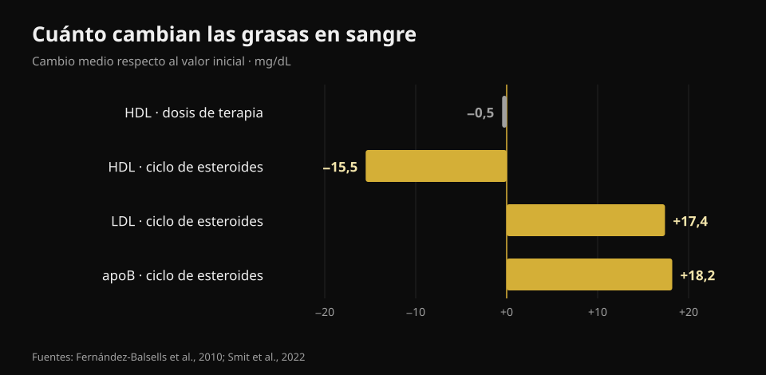
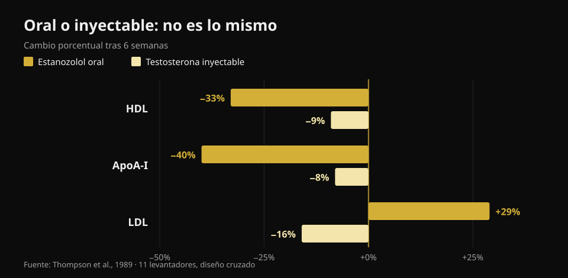

# Testosterona y colesterol: qué dicen los estudios

Por [Giammaria Loi](/autore/giammaria-loi) · actualizado el 23 de octubre de 2026

En el gimnasio "testosterona" significa dos cosas muy distintas: una terapia prescrita a quien tiene valores bajos documentados y dosis mucho más altas tomadas para crecer. Los números en sangre no son iguales en los dos casos, pero casi siempre acaban mezclados en la misma conversación. He leído ocho trabajos indexados para separarlos, y la variable que más pesa no es la que esperas.

## En resumen

- **Con dosis de terapia el colesterol apenas se mueve.** El metaanálisis de 51 estudios encuentra un HDL **0,49 mg/dL más bajo** (Fernández-Balsells et al., 2010). Medio miligramo por decilitro: un cambio que se pierde en el ruido del laboratorio.
- **Lo que de verdad cambia con la terapia no es el colesterol, es la sangre.** Hemoglobina **+0,80 g/dL** y hematocrito **+3,18 puntos** en ese mismo metaanálisis. Por eso los protocolos médicos repiten un hemograma.
- **El ensayo más grande no encuentra diferencias en eventos cardíacos.** En TRAVERSE, 5.246 hombres con riesgo cardiovascular alto: eventos mayores en el **7,0%** con testosterona frente al **7,3%** con placebo. Pero más fibrilación auricular, embolia pulmonar y daño renal agudo (Lincoff et al., 2023).
- **Durante un ciclo autoadministrado los números se mueven de verdad.** En 100 hombres seguidos antes, durante y después: **apoB +18,2 mg/dL**, LDL +0,45 mmol/L (unos +17 mg/dL), presión **+6,9/+3,2 mmHg**. Todo de vuelta al valor inicial tres meses después (Smit et al., 2022).
- **La mayor diferencia no es la dosis, es la vía.** En el mismo ensayo y en los mismos hombres: un esteroide oral bajó el HDL un **33%** y subió el LDL un **29%**; la testosterona inyectable bajó el HDL un **9%** y *bajó* el LDL un **16%** (Thompson et al., 1989).

## Dos situaciones distintas con el mismo nombre

La terapia sustitutiva es una prescripción médica: se da a quien tiene testosterona baja confirmada en varias extracciones y síntomas coherentes, y el objetivo es devolver el valor al rango normal. Las dosis de gimnasio apuntan muy por encima de ese rango, normalmente combinando varias moléculas.

¿Cuánto por encima? La forma honesta de decirlo no es en miligramos sino en concentraciones medidas. En el ensayo de referencia sobre respuesta a la dosis, 61 hombres sanos de 18 a 35 años recibieron durante 20 semanas cinco dosis crecientes: la concentración mínima de testosterona iba de **253 ng/dL** en el grupo más bajo a **2.370 ng/dL** en el más alto (Bhasin et al., 2001). Como referencia, el rango normal en un hombre adulto está aproximadamente entre 300 y 1.000 ng/dL. El grupo más alto circulaba, por tanto, al doble largo del límite superior.

En ese mismo ensayo la masa magra subió en proporción a la dosis (+3,4, +5,2 y +7,9 kg en los tres grupos más altos) y **el HDL bajó en proporción a la concentración de testosterona**. Por eso coger los números de una terapia y aplicarlos a un ciclo —o al revés— despista en las dos direcciones.

## Dosis de terapia: números más pequeños de lo que se cuenta

Aquí la literatura es amplia y bastante coherente. El metaanálisis de 51 estudios de Fernández-Balsells y colaboradores describe tres efectos: hemoglobina **+0,80 g/dL** (IC 95% 0,45–1,14), hematocrito **+3,18%** (1,35–5,01) y HDL **−0,49 mg/dL** (−0,85 a −0,13). Ningún efecto significativo sobre mortalidad, próstata o eventos cardiovasculares. Los propios autores califican estos cambios de "significado clínico desconocido".

La síntesis más reciente, con datos individuales de 35 ensayos controlados (5.601 hombres), llega al mismo punto: eventos cardiovasculares y cerebrovasculares en el 7,5% del grupo tratado frente al 7,2% con placebo (OR 1,07; IC 95% 0,81–1,42) y ningún efecto desfavorable sobre presión arterial, lípidos séricos o marcadores glucémicos: de hecho, colesterol total y triglicéridos eran más bajos con el tratamiento (Cruickshank et al., 2024).

TRAVERSE, el ensayo diseñado expresamente para la seguridad cardiovascular, incluyó a 5.246 hombres de 45 a 80 años con enfermedad cardiovascular o riesgo alto y testosterona por debajo de 300 ng/dL. Tras 21,7 meses de tratamiento de media, los eventos cardíacos mayores fueron 182 (7,0%) con testosterona y 190 (7,3%) con placebo. Tres señales sí aparecieron en exceso en el grupo tratado: **fibrilación auricular, embolia pulmonar y daño renal agudo**. No son detalles: son la razón por la que una terapia la sigue quien la ha prescrito.

## Durante un ciclo los números cambian de verdad

El estudio más limpio de este lado es holandés y prospectivo: 100 hombres con extracciones antes del ciclo, al final, tres meses después y al año del inicio. Durante el uso la presión sistólica subió 6,87 mmHg y la diastólica 3,17 mmHg, el LDL subió 0,45 mmol/L y la apoB 18,2 mg/dL; HDL, ApoA y lipoproteína(a) bajaron, y el hematocrito subió 0,03 L/L (Smit et al., 2022).

*Gráfico de Nurvan con datos de Fernández-Balsells et al., 2010 y Smit et al., 2022. Hemos convertido a mg/dL (×38,67) los valores en mmol/L del estudio holandés.*

Dos cosas hay que decirlas enteras, porque en los resúmenes de redes casi siempre desaparecen. La primera: **la apoB importa más que el LDL**, porque mide cuántas partículas potencialmente aterogénicas circulan, y aquí sube casi 20 mg/dL. La segunda: **tres meses después del final del ciclo todos estos valores habían vuelto al punto de partida**. Esa reversibilidad es real y hay que contarla, pero se refiere a los marcadores en sangre, no necesariamente a lo que les pasa a las arterias y al corazón tras diez o veinte años de ciclos repetidos.

En ese horizonte largo solo hay un tipo de dato, y es observacional. En un registro danés, 1.189 hombres sancionados por uso de esteroides se compararon con 59.450 controles durante unos 11 años: infarto con razón de riesgo ajustada **3,00** (IC 95% 1,67–5,39), tromboembolia venosa 2,42, arritmias 2,26, insuficiencia cardíaca 3,63 y **miocardiopatía 8,90** (4,99–15,88), la señal más grande de todas y la que el colesterol no ve (Windfeld-Mathiasen et al., 2025). Es una asociación: no demuestra causa, porque quien usa esteroides se diferencia de los controles también en otros hábitos.

## Oral o inyectable: la diferencia más grande

Este es el punto que casi ningún contenido divulgativo pone primero, y es el más útil. En 1989 once levantadores recibieron, en orden cruzado y seis semanas cada fase, un esteroide 17-alfa-alquilado por vía oral y testosterona inyectable a dosis suprafisiológica. Mismo estudio, mismas personas, mismo periodo.

*Gráfico de Nurvan con datos de Thompson et al., 1989 (JAMA): 11 levantadores, diseño cruzado, seis semanas por fase.*

Con la molécula oral el HDL bajó un 33% (la subfracción HDL2 un 71%), la ApoA-I un 40%, el LDL subió un 29% y la lipasa hepática más que se duplicó. Con la testosterona inyectable el HDL bajó un 9% y **el LDL bajó un 16%**. La conclusión de los autores, escrita en 1989 y nunca desmentida, es que el efecto desfavorable sobre las lipoproteínas depende de la vía de administración y no de la potencia androgénica.

Traducido: dos personas pueden estar "con esteroides" y tener perfiles lipídicos opuestos. Sin saber qué, cómo y durante cuánto, una analítica aislada no dice nada.

## Qué dice realmente la investigación

- **"Con la terapia sustitutiva el colesterol cambia poco" — Confirmado.** Medio mg/dL de HDL en el metaanálisis más amplio y ningún efecto desfavorable sobre los lípidos en la síntesis de datos individuales.
- **"La terapia sustitutiva aumenta el infarto" — Desmentido.** Ni TRAVERSE ni los dos metaanálisis encuentran exceso de eventos cardíacos mayores. Sí quedaron en exceso fibrilación auricular, embolia pulmonar y daño renal agudo en TRAVERSE.
- **"El valor a vigilar con la terapia es el colesterol" — Matizable.** El cambio más constante es hematológico: hemoglobina y hematocrito. Por eso se repite el hemograma.
- **"Los esteroides suben el LDL" — Matizable.** Depende de la vía: por vía oral sí, y mucho; con testosterona inyectable en un ensayo controlado el LDL incluso bajó. Lo que sube de forma coherente en un ciclo real, con varias moléculas, es la apoB.
- **"Si la analítica sale bien, el ciclo es seguro" — Desmentido.** La señal más fuerte del registro danés es la miocardiopatía, no un valor lipídico. Un perfil lipídico tranquilo no excluye nada.
- **"Un HDL más bajo significa automáticamente más riesgo" — Matizable.** En un ensayo controlado con 53 hombres sanos, los cambios de HDL debidos a la testosterona no se correspondían con cambios en la capacidad del HDL de retirar colesterol de las células (Rubinow et al., 2018). El número baja; la función no necesariamente.

## Cómo aplicarlo

1. **Separa las dos preguntas.** "Tengo la testosterona baja y el médico me ha prescrito una terapia" y "quiero usar dosis de gimnasio" son dos situaciones con dos literaturas distintas. No traslades los números de una a la otra.
2. **Si estás en terapia, sigue el calendario de controles que te dio el médico.** El hemograma y el hematocrito son los que se mueven primero, y también los que se manejan mejor si los ves venir.
3. **Mira la apoB, no solo el "colesterol".** Donde esté disponible, describe mejor la carga de partículas aterogénicas: el LDL solo puede quedarse igual mientras la apoB sube.
4. **No deduzcas la seguridad de los lípidos.** Presión, hematocrito y corazón son canales independientes: el registro danés encuentra la señal mayor justo donde el colesterol no mira.
5. **Mira la tendencia, no el informe suelto.** Un valor aislado dice poco; tres extracciones en el mismo punto del año dicen mucho. Vale igual en terapia que en una analítica de rutina.
6. **Lleva los números al médico, no al foro.** Este artículo sirve para entender qué miden esos valores, no para decidir qué hacer con ellos: eso le toca a quien te visita y conoce tu historia clínica.

### Prueba Nurvan — todas tus analíticas en un solo sitio

El problema práctico de quien sigue sus valores en el tiempo es que los informes acaban en carpetas, correos y PDF sueltos. En Nurvan puedes subir tus analíticas y ver la evolución de cada línea —HDL, LDL, apoB, hematocrito, hemoglobina— en una línea de tiempo, en vez de comparar dos hojas de memoria. Cuando vas al médico llevas la serie, no el último papel. Y si entrenas, esos mismos meses tienen al lado tus cargas, tu volumen y tu peso: el contexto que un informe solo no da. **[Prueba Nurvan](https://nurvan.app)**

## Preguntas frecuentes

**¿La testosterona sube el colesterol?**
Depende de cuánta y de cómo. Con dosis de terapia sustitutiva el efecto sobre los lípidos es mínimo: medio mg/dL menos de HDL en el metaanálisis de 51 estudios y ningún empeoramiento del LDL. Durante un ciclo con dosis mucho más altas y varias moléculas, LDL y apoB suben de forma medible.

**¿Qué valor hay que controlar si estoy en terapia sustitutiva?**
El más constante no es lipídico: hemoglobina y hematocrito suben de manera reproducible (+0,80 g/dL y +3,18 puntos en el metaanálisis). Qué pruebas y con qué frecuencia lo decide el médico que ha prescrito la terapia.

**¿Las alteraciones de los lípidos tras un ciclo se recuperan?**
En el estudio prospectivo con 100 hombres sí: tres meses después del final, lípidos, presión y hematocrito habían vuelto a los valores de partida. Eso se refiere a los marcadores en sangre; el efecto de ciclos repetidos durante años sobre el corazón es otra pregunta, y los datos disponibles son solo observacionales.

**¿Por qué los esteroides orales se consideran peores?**
Porque pasan por el hígado y alteran mucho más el metabolismo de las lipoproteínas. En la comparación directa en las mismas personas, la molécula oral bajó el HDL un 33% y subió el LDL un 29%, frente a −9% y −16% de la testosterona inyectable.

**¿Basta una analítica para saber si un ciclo es seguro?**
No. En el registro danés el riesgo más alto correspondía a la miocardiopatía, es decir al músculo cardíaco, con una razón de riesgo casi nueve veces la de los controles: algo que ningún perfil lipídico habría anticipado.

## Lee también

- [¿La creatina provoca caída del cabello?](/es/blog/creatina-caida-cabello) — el otro gran tema "hormonal" de gimnasio, verificado en los estudios.
- [Tier list de suplementos para la fuerza](/es/blog/clasificacion-suplementos-fuerza-tier-list) — qué tiene pruebas sólidas de verdad, ordenado.
- [Qué magnesio elegir](/es/blog/que-magnesio-elegir-dosis-y-formas) — dosis y formas, con los números.

## Fuentes

1. Fernández-Balsells MM, Murad MH, Lane M, Lampropulos JF, Albuquerque F, Mullan RJ, Agrwal N, Elamin MB, Gallegos-Orozco JF, Wang AT, Erwin PJ, Bhasin S, Montori VM, 2010. *Clinical review 1: Adverse effects of testosterone therapy in adult men: a systematic review and meta-analysis.* Journal of Clinical Endocrinology & Metabolism 95(6):2560-75. [PMID 20525906](https://pubmed.ncbi.nlm.nih.gov/20525906/) · [DOI 10.1210/jc.2009-2575](https://doi.org/10.1210/jc.2009-2575)
2. Cruickshank M, Hudson J, Hernández R, Aceves-Martins M, Quinton R, Gillies K, Aucott LS, Kennedy C, Manson P, Oliver N, Wu F, Bhattacharya S, Dhillo WS, Jayasena CN, Brazzelli M, 2024. *The effects and safety of testosterone replacement therapy for men with hypogonadism: the TestES evidence synthesis and economic evaluation.* Health Technology Assessment 28(43):1-210. [PMID 39248210](https://pubmed.ncbi.nlm.nih.gov/39248210/) · [DOI 10.3310/JRYT3981](https://doi.org/10.3310/JRYT3981)
3. Lincoff AM, Bhasin S, Flevaris P, Mitchell LM, Basaria S, Boden WE, Cunningham GR, Granger CB, Khera M, Thompson IM, Wang Q, Wolski K, Davey D, Kalahasti V, Khan N, Miller MG, Snabes MC, Chan A, Dubcenco E, Li X, Yi T, Huang B, Pencina KM, Travison TG, Nissen SE, 2023. *Cardiovascular Safety of Testosterone-Replacement Therapy (TRAVERSE).* New England Journal of Medicine 389(2):107-117. [PMID 37326322](https://pubmed.ncbi.nlm.nih.gov/37326322/) · [DOI 10.1056/NEJMoa2215025](https://doi.org/10.1056/NEJMoa2215025)
4. Bhasin S, Woodhouse L, Casaburi R, Singh AB, Bhasin D, Berman N, Chen X, Yarasheski KE, Magliano L, Dzekov C, Dzekov J, Bross R, Phillips J, Sinha-Hikim I, Shen R, Storer TW, 2001. *Testosterone dose-response relationships in healthy young men.* American Journal of Physiology - Endocrinology and Metabolism 281(6):E1172-81. [PMID 11701431](https://pubmed.ncbi.nlm.nih.gov/11701431/) · [DOI 10.1152/ajpendo.2001.281.6.E1172](https://doi.org/10.1152/ajpendo.2001.281.6.E1172)
5. Smit DL, Grefhorst A, Buijs MM, de Hon O, den Heijer M, de Ronde W, 2022. *Prospective study on blood pressure, lipid metabolism and erythrocytosis during and after androgen abuse.* Andrologia 54(4):e14372. [PMID 35014715](https://pubmed.ncbi.nlm.nih.gov/35014715/) · [DOI 10.1111/and.14372](https://doi.org/10.1111/and.14372)
6. Thompson PD, Cullinane EM, Sady SP, Chenevert C, Saritelli AL, Sady MA, Herbert PN, 1989. *Contrasting effects of testosterone and stanozolol on serum lipoprotein levels.* JAMA 261(8):1165-8. [PMID 2915439](https://pubmed.ncbi.nlm.nih.gov/2915439/)
7. Windfeld-Mathiasen J, Heerfordt IM, Dalhoff KP, Andersen JT, Andersen MA, Johansson KS, Biering-Sørensen T, Olsen FJ, Horwitz H, 2025. *Cardiovascular Disease in Anabolic Androgenic Steroid Users.* Circulation 151(12):828-834. [PMID 39945117](https://pubmed.ncbi.nlm.nih.gov/39945117/) · [DOI 10.1161/CIRCULATIONAHA.124.071117](https://doi.org/10.1161/CIRCULATIONAHA.124.071117)
8. Rubinow KB, Vaisar T, Chao JH, Heinecke JW, Page ST, 2018. *Sex steroids mediate discrete effects on HDL cholesterol efflux capacity and particle concentration in healthy men.* Journal of Clinical Lipidology 12(4):1072-1082. [PMID 29793828](https://pubmed.ncbi.nlm.nih.gov/29793828/) · [DOI 10.1016/j.jacl.2018.04.013](https://doi.org/10.1016/j.jacl.2018.04.013)

Referencias recuperadas a través de PubMed. Punto de partida: la publicación de **Dwayne N. Jackson** ([@drdnjackson](https://www.instagram.com/drdnjackson/)) del 2 de octubre de 2026, [publicación original](https://www.instagram.com/p/Dd98gQmD6sN/). No se ha reproducido ningún texto ni imagen de esa publicación: el tema se ha reescrito desde cero volviendo a los estudios primarios y verificándolos uno a uno.

---

**Giammaria Loi** es el fundador de Nurvan. Entrena con pesas desde 2012, trabaja como entrenador personal y coach certificado FIPE desde 2013 y compite en powerlifting a nivel nacional desde 2018. Cada artículo que firma parte de los estudios científicos y llega a lo que funciona de verdad en el gimnasio.

> Nota: contenido informativo, no sustituye la opinión de un médico. Este artículo no incluye indicaciones de dosis ni anima a usar ninguna sustancia: el uso no médico de esteroides anabolizantes está prohibido en el deporte y es ilegal en muchos países. Si sigues o estás valorando una terapia hormonal, háblalo con el médico que te atiende.
