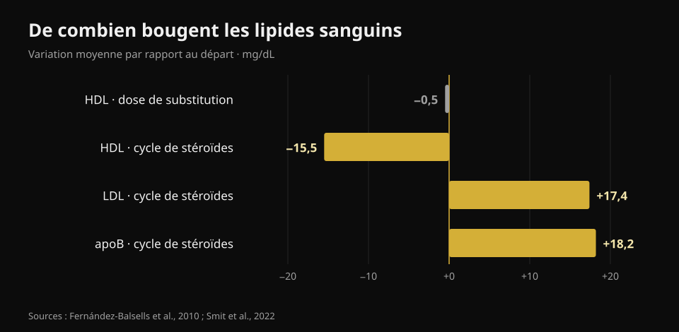
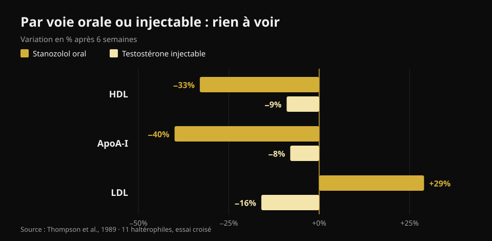

# Testostérone et cholestérol : ce que disent les études

Par [Giammaria Loi](/autore/giammaria-loi) · mis à jour le 23 octobre 2026

À la salle, « testostérone » recouvre deux choses très différentes : un traitement prescrit à ceux dont les valeurs basses sont documentées, et des doses bien plus élevées prises pour prendre du muscle. Les chiffres sanguins ne sont pas les mêmes dans les deux cas, pourtant ils finissent presque toujours mélangés. J'ai lu huit travaux indexés pour les séparer — et la variable qui pèse le plus n'est pas celle qu'on attend.

## L'essentiel

- **Aux doses de substitution, le cholestérol bouge à peine.** La méta-analyse de 51 études trouve un HDL plus bas de **0,49 mg/dL** (Fernández-Balsells et al., 2010). Un demi-milligramme par décilitre : une variation noyée dans le bruit du laboratoire.
- **Ce qui change vraiment sous traitement, ce n'est pas le cholestérol, c'est le sang.** Hémoglobine **+0,80 g/dL** et hématocrite **+3,18 points** dans la même méta-analyse. C'est pour cela que les protocoles médicaux répètent une numération.
- **Le plus grand essai ne trouve pas de différence sur les événements cardiaques.** Dans TRAVERSE, 5 246 hommes à risque cardiovasculaire élevé : événements majeurs chez **7,0 %** sous testostérone contre **7,3 %** sous placebo. Mais plus de fibrillation atriale, d'embolie pulmonaire et d'insuffisance rénale aiguë (Lincoff et al., 2023).
- **Pendant un cycle auto-administré, les chiffres bougent pour de bon.** Chez 100 hommes suivis avant, pendant et après : **apoB +18,2 mg/dL**, LDL +0,45 mmol/L (environ +17 mg/dL), pression **+6,9/+3,2 mmHg**. Tout revenu au niveau de départ trois mois après la fin (Smit et al., 2022).
- **La plus grande différence n'est pas la dose, c'est la voie d'administration.** Dans le même essai, chez les mêmes hommes : un stéroïde oral a fait chuter le HDL de **33 %** et monter le LDL de **29 %** ; la testostérone injectable a fait baisser le HDL de **9 %** et *baisser* le LDL de **16 %** (Thompson et al., 1989).

## Deux situations différentes sous le même nom

Le traitement substitutif est une prescription : il s'adresse aux hommes dont la testostérone basse est confirmée sur plusieurs prélèvements avec des symptômes cohérents, et l'objectif est de ramener la valeur dans l'intervalle normal. Les doses de salle visent très au-dessus de cet intervalle, le plus souvent en combinant plusieurs molécules.

À quel point au-dessus ? La façon honnête de le dire n'est pas en milligrammes mais en concentrations mesurées. Dans l'essai de référence sur la relation dose-réponse, 61 hommes sains de 18 à 35 ans ont reçu pendant 20 semaines cinq doses croissantes : la concentration minimale de testostérone allait de **253 ng/dL** dans le groupe le plus bas à **2 370 ng/dL** dans le plus haut (Bhasin et al., 2001). Pour référence, l'intervalle normal chez l'homme adulte se situe approximativement entre 300 et 1 000 ng/dL. Le groupe le plus haut circulait donc à plus du double de la limite supérieure.

Dans ce même essai, la masse maigre a augmenté proportionnellement à la dose (+3,4, +5,2 et +7,9 kg dans les trois groupes les plus hauts) et **le HDL a baissé proportionnellement à la concentration de testostérone**. C'est exactement pour cela que transposer les chiffres d'un traitement à un cycle — ou l'inverse — induit en erreur dans les deux sens.

## Doses de substitution : des chiffres plus petits que ce qu'on raconte

Ici la littérature est abondante et assez cohérente. La méta-analyse de 51 études de Fernández-Balsells et collègues rapporte trois effets : hémoglobine **+0,80 g/dL** (IC 95 % 0,45–1,14), hématocrite **+3,18 %** (1,35–5,01) et HDL **−0,49 mg/dL** (−0,85 à −0,13). Aucun effet significatif sur la mortalité, la prostate ou les événements cardiovasculaires. Les auteurs eux-mêmes qualifient ces variations de « signification clinique inconnue ».

La synthèse la plus récente, fondée sur les données individuelles de 35 essais contrôlés (5 601 hommes), arrive au même point : événements cardiovasculaires et cérébrovasculaires chez 7,5 % du groupe traité contre 7,2 % sous placebo (OR 1,07 ; IC 95 % 0,81–1,42) et aucun effet défavorable sur la pression artérielle, les lipides sériques ou les marqueurs glycémiques — cholestérol total et triglycérides étaient même plus bas sous traitement (Cruickshank et al., 2024).

TRAVERSE, l'essai conçu spécifiquement pour la sécurité cardiovasculaire, a inclus 5 246 hommes de 45 à 80 ans porteurs d'une maladie cardiovasculaire ou à risque élevé, avec une testostérone sous 300 ng/dL. Après 21,7 mois de traitement en moyenne, les événements cardiaques majeurs ont été 182 (7,0 %) sous testostérone et 190 (7,3 %) sous placebo. Trois signaux sont en revanche ressortis en excès dans le groupe traité : **fibrillation atriale, embolie pulmonaire et insuffisance rénale aiguë**. Ce ne sont pas des détails : c'est la raison pour laquelle un traitement est suivi par celui qui l'a prescrit.

## Pendant un cycle, les chiffres bougent vraiment

L'étude la plus propre de ce côté est néerlandaise et prospective : 100 hommes prélevés avant le cycle, à la fin, trois mois après et un an après le début. Pendant la prise, la pression systolique a monté de 6,87 mmHg et la diastolique de 3,17 mmHg, le LDL de 0,45 mmol/L et l'apoB de 18,2 mg/dL ; HDL, ApoA et lipoprotéine(a) ont baissé, l'hématocrite a monté de 0,03 L/L (Smit et al., 2022).

*Graphique Nurvan d'après Fernández-Balsells et al., 2010 et Smit et al., 2022. Nous avons converti en mg/dL (×38,67) les valeurs en mmol/L de l'étude néerlandaise.*

Deux points méritent d'être dits en entier, parce que les résumés sur les réseaux les escamotent presque toujours. D'abord, **l'apoB compte plus que le LDL** : elle mesure le nombre de particules potentiellement athérogènes en circulation, et elle grimpe ici de près de 20 mg/dL. Ensuite, **trois mois après la fin du cycle, toutes ces valeurs étaient revenues au point de départ**. Cette réversibilité est réelle et doit être rapportée — mais elle concerne des marqueurs sanguins, pas nécessairement ce qui arrive aux artères et au cœur après dix ou vingt ans de cycles répétés.

Sur cet horizon long, il n'existe qu'un seul type de données, et il est observationnel. Dans un registre danois, 1 189 hommes sanctionnés pour usage de stéroïdes ont été comparés à 59 450 témoins pendant environ 11 ans : infarctus avec un rapport de risque ajusté de **3,00** (IC 95 % 1,67–5,39), thromboembolie veineuse 2,42, arythmies 2,26, insuffisance cardiaque 3,63 et **cardiomyopathie 8,90** (4,99–15,88) — le signal le plus fort de tous, et celui que le cholestérol ne voit pas (Windfeld-Mathiasen et al., 2025). C'est une association : elle ne prouve pas la causalité, car les usagers diffèrent des témoins par d'autres habitudes aussi.

## Oral ou injectable : la plus grande différence

C'est le point que presque aucun contenu grand public ne met en avant, et c'est le plus utile. En 1989, onze haltérophiles ont reçu, en ordre croisé et pendant six semaines chacun, un stéroïde 17-alpha-alkylé par voie orale et de la testostérone injectable à dose supraphysiologique. Même étude, mêmes personnes, même période.

*Graphique Nurvan d'après Thompson et al., 1989 (JAMA) : 11 haltérophiles, essai croisé, six semaines par phase.*

Avec la molécule orale, le HDL a chuté de 33 % (la sous-fraction HDL2 de 71 %), l'ApoA-I de 40 %, le LDL a monté de 29 % et la lipase hépatique a plus que doublé. Avec la testostérone injectable, le HDL a baissé de 9 % et **le LDL a baissé de 16 %**. La conclusion des auteurs, écrite en 1989 et jamais démentie, est que l'effet défavorable sur les lipoprotéines suit la voie d'administration et non la puissance androgénique.

Traduction : deux personnes peuvent toutes deux être « sous stéroïdes » et avoir des profils lipidiques opposés. Sans savoir quoi, comment et pendant combien de temps, un bilan isolé ne dit rien.

## Ce que dit vraiment la recherche

- **« Sous traitement substitutif le cholestérol change peu » — Confirmé.** Un demi-mg/dL de HDL dans la plus grande méta-analyse, aucun effet défavorable sur les lipides dans la synthèse des données individuelles.
- **« Le traitement substitutif augmente l'infarctus » — Démenti.** Ni TRAVERSE ni les deux méta-analyses ne trouvent d'excès d'événements cardiaques majeurs. Restent en excès dans TRAVERSE la fibrillation atriale, l'embolie pulmonaire et l'insuffisance rénale aiguë.
- **« La valeur à surveiller sous traitement, c'est le cholestérol » — À préciser.** Le changement le plus constant est hématologique : hémoglobine et hématocrite. D'où la numération répétée.
- **« Les stéroïdes font monter le LDL » — À préciser.** Cela dépend de la voie : par voie orale oui, et fortement ; avec la testostérone injectable, dans un essai contrôlé, le LDL a même baissé. Ce qui monte de façon cohérente dans un cycle réel, à plusieurs molécules, c'est l'apoB.
- **« Si le bilan est normal, le cycle est sûr » — Démenti.** Le signal le plus fort du registre danois est la cardiomyopathie, pas une valeur lipidique. Un bilan lipidique tranquille n'exclut rien.
- **« Un HDL plus bas signifie automatiquement plus de risque » — À préciser.** Dans un essai contrôlé chez 53 hommes sains, les variations de HDL dues à la testostérone ne correspondaient pas à des variations de la capacité du HDL à retirer le cholestérol des cellules (Rubinow et al., 2018). Le chiffre baisse ; la fonction, pas forcément.

## Comment l'appliquer

1. **Séparez les deux questions.** « Ma testostérone est basse et mon médecin m'a prescrit un traitement » et « je veux utiliser des doses de salle » relèvent de deux littératures différentes. Ne transposez pas les chiffres de l'une à l'autre.
2. **Sous traitement, suivez le calendrier de contrôles fixé par votre médecin.** Numération et hématocrite bougent en premier, et se gèrent d'autant mieux qu'on les voit venir.
3. **Regardez l'apoB, pas seulement « le cholestérol ».** Là où elle est disponible, elle décrit mieux la charge de particules athérogènes : le LDL seul peut rester stable pendant que l'apoB monte.
4. **Ne déduisez pas la sécurité des lipides.** Pression, hématocrite et muscle cardiaque sont des canaux indépendants : le registre danois trouve son signal le plus fort là où le cholestérol ne regarde pas.
5. **Lisez la tendance, pas le bilan isolé.** Une valeur seule dit peu ; trois prélèvements au même moment de l'année disent beaucoup. Cela vaut sous traitement comme en bilan de routine.
6. **Apportez les chiffres à un médecin, pas à un forum.** Cet article explique ce que mesurent ces valeurs ; décider quoi en faire revient à celui qui vous suit et connaît votre histoire clinique.

### Essayez Nurvan — tous vos bilans au même endroit

Le problème pratique, quand on suit ses valeurs dans le temps, c'est que les comptes rendus finissent dans des dossiers, des mails et des PDF éparpillés. Dans Nurvan, vous importez vos bilans sanguins et vous voyez l'évolution de chaque ligne — HDL, LDL, apoB, hématocrite, hémoglobine — sur une frise, au lieu de comparer deux feuilles de mémoire. Chez le médecin, vous apportez la série, pas la dernière page. Et si vous vous entraînez, ces mêmes mois côtoient vos charges, votre volume et votre poids : le contexte qu'un compte rendu seul n'a jamais. **[Essayez Nurvan](https://nurvan.app)**

## Questions fréquentes

**La testostérone fait-elle monter le cholestérol ?**
Cela dépend de la quantité et de la forme. Aux doses de substitution, l'effet lipidique est minime : un demi-mg/dL de HDL en moins dans la méta-analyse de 51 études, aucune dégradation du LDL. Pendant un cycle à doses bien plus hautes et à plusieurs molécules, LDL et apoB montent de façon mesurable.

**Quelle valeur surveiller sous traitement substitutif ?**
La plus constante n'est pas lipidique : hémoglobine et hématocrite montent de manière reproductible (+0,80 g/dL et +3,18 points dans la méta-analyse). Quels examens et à quelle fréquence, c'est le médecin prescripteur qui le fixe.

**Les anomalies lipidiques après un cycle se corrigent-elles ?**
Dans l'étude prospective sur 100 hommes, oui : trois mois après la fin, lipides, pression et hématocrite étaient revenus aux valeurs de départ. Cela concerne les marqueurs sanguins ; l'effet de cycles répétés pendant des années sur le cœur est une autre question, et les données disponibles sont seulement observationnelles.

**Pourquoi les stéroïdes oraux sont-ils considérés comme pires ?**
Parce qu'ils passent par le foie et modifient bien plus fortement le métabolisme des lipoprotéines. En comparaison directe chez les mêmes personnes, la molécule orale a fait baisser le HDL de 33 % et monter le LDL de 29 %, contre −9 % et −16 % pour la testostérone injectable.

**Un bilan sanguin suffit-il à dire qu'un cycle est sûr ?**
Non. Dans le registre danois, le risque le plus élevé concernait la cardiomyopathie, donc le muscle cardiaque, avec un rapport de risque près de neuf fois celui des témoins : rien dans un bilan lipidique ne l'aurait annoncé.

## À lire aussi

- [La créatine fait-elle perdre les cheveux ?](/fr/blog/creatine-chute-cheveux) — l'autre grande question « hormonale » de la salle, vérifiée sur les études.
- [Tier list des compléments pour la force](/fr/blog/classement-complements-force-tier-list) — ce qui a vraiment des preuves solides, classé.
- [Quel magnésium choisir](/fr/blog/quel-magnesium-choisir-dose-et-formes) — doses et formes, chiffres à l'appui.

## Sources

1. Fernández-Balsells MM, Murad MH, Lane M, Lampropulos JF, Albuquerque F, Mullan RJ, Agrwal N, Elamin MB, Gallegos-Orozco JF, Wang AT, Erwin PJ, Bhasin S, Montori VM, 2010. *Clinical review 1: Adverse effects of testosterone therapy in adult men: a systematic review and meta-analysis.* Journal of Clinical Endocrinology & Metabolism 95(6):2560-75. [PMID 20525906](https://pubmed.ncbi.nlm.nih.gov/20525906/) · [DOI 10.1210/jc.2009-2575](https://doi.org/10.1210/jc.2009-2575)
2. Cruickshank M, Hudson J, Hernández R, Aceves-Martins M, Quinton R, Gillies K, Aucott LS, Kennedy C, Manson P, Oliver N, Wu F, Bhattacharya S, Dhillo WS, Jayasena CN, Brazzelli M, 2024. *The effects and safety of testosterone replacement therapy for men with hypogonadism: the TestES evidence synthesis and economic evaluation.* Health Technology Assessment 28(43):1-210. [PMID 39248210](https://pubmed.ncbi.nlm.nih.gov/39248210/) · [DOI 10.3310/JRYT3981](https://doi.org/10.3310/JRYT3981)
3. Lincoff AM, Bhasin S, Flevaris P, Mitchell LM, Basaria S, Boden WE, Cunningham GR, Granger CB, Khera M, Thompson IM, Wang Q, Wolski K, Davey D, Kalahasti V, Khan N, Miller MG, Snabes MC, Chan A, Dubcenco E, Li X, Yi T, Huang B, Pencina KM, Travison TG, Nissen SE, 2023. *Cardiovascular Safety of Testosterone-Replacement Therapy (TRAVERSE).* New England Journal of Medicine 389(2):107-117. [PMID 37326322](https://pubmed.ncbi.nlm.nih.gov/37326322/) · [DOI 10.1056/NEJMoa2215025](https://doi.org/10.1056/NEJMoa2215025)
4. Bhasin S, Woodhouse L, Casaburi R, Singh AB, Bhasin D, Berman N, Chen X, Yarasheski KE, Magliano L, Dzekov C, Dzekov J, Bross R, Phillips J, Sinha-Hikim I, Shen R, Storer TW, 2001. *Testosterone dose-response relationships in healthy young men.* American Journal of Physiology - Endocrinology and Metabolism 281(6):E1172-81. [PMID 11701431](https://pubmed.ncbi.nlm.nih.gov/11701431/) · [DOI 10.1152/ajpendo.2001.281.6.E1172](https://doi.org/10.1152/ajpendo.2001.281.6.E1172)
5. Smit DL, Grefhorst A, Buijs MM, de Hon O, den Heijer M, de Ronde W, 2022. *Prospective study on blood pressure, lipid metabolism and erythrocytosis during and after androgen abuse.* Andrologia 54(4):e14372. [PMID 35014715](https://pubmed.ncbi.nlm.nih.gov/35014715/) · [DOI 10.1111/and.14372](https://doi.org/10.1111/and.14372)
6. Thompson PD, Cullinane EM, Sady SP, Chenevert C, Saritelli AL, Sady MA, Herbert PN, 1989. *Contrasting effects of testosterone and stanozolol on serum lipoprotein levels.* JAMA 261(8):1165-8. [PMID 2915439](https://pubmed.ncbi.nlm.nih.gov/2915439/)
7. Windfeld-Mathiasen J, Heerfordt IM, Dalhoff KP, Andersen JT, Andersen MA, Johansson KS, Biering-Sørensen T, Olsen FJ, Horwitz H, 2025. *Cardiovascular Disease in Anabolic Androgenic Steroid Users.* Circulation 151(12):828-834. [PMID 39945117](https://pubmed.ncbi.nlm.nih.gov/39945117/) · [DOI 10.1161/CIRCULATIONAHA.124.071117](https://doi.org/10.1161/CIRCULATIONAHA.124.071117)
8. Rubinow KB, Vaisar T, Chao JH, Heinecke JW, Page ST, 2018. *Sex steroids mediate discrete effects on HDL cholesterol efflux capacity and particle concentration in healthy men.* Journal of Clinical Lipidology 12(4):1072-1082. [PMID 29793828](https://pubmed.ncbi.nlm.nih.gov/29793828/) · [DOI 10.1016/j.jacl.2018.04.013](https://doi.org/10.1016/j.jacl.2018.04.013)

Références récupérées via PubMed. Point de départ : la publication de **Dwayne N. Jackson** ([@drdnjackson](https://www.instagram.com/drdnjackson/)) du 2 octobre 2026, [publication originale](https://www.instagram.com/p/Dd98gQmD6sN/). Aucun texte ni aucune image de cette publication n'a été reproduit : le sujet a été réécrit de zéro en remontant aux études primaires et en les vérifiant une par une.

---

**Giammaria Loi** est le fondateur de Nurvan. Il s'entraîne avec des charges depuis 2012, travaille comme coach et entraîneur personnel certifié FIPE depuis 2013 et compète en powerlifting au niveau national depuis 2018. Chaque article qu'il signe part des études scientifiques et arrive à ce qui fonctionne vraiment en salle.

> Note : contenu informatif, qui ne remplace pas l'avis d'un médecin. Cet article ne contient aucune indication de dose et n'encourage l'usage d'aucune substance : l'usage non médical de stéroïdes anabolisants est interdit dans le sport et illégal dans de nombreux pays. Si vous suivez ou envisagez un traitement hormonal, parlez-en au médecin qui vous suit.
