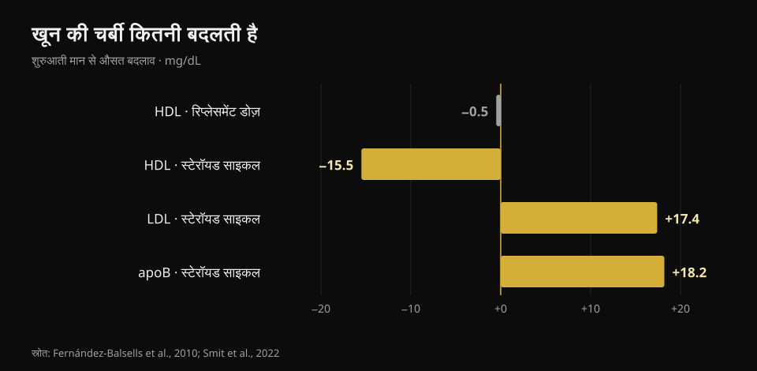
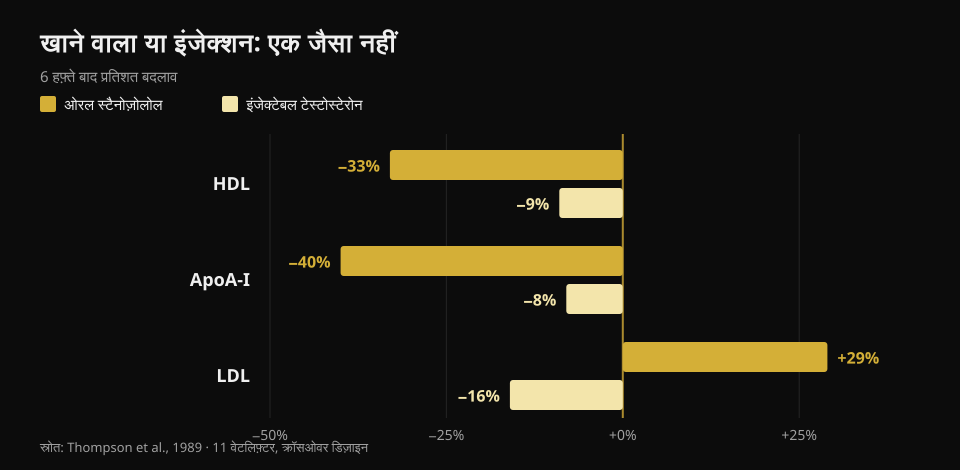

# टेस्टोस्टेरोन और कोलेस्ट्रॉल: स्टडी क्या कहती हैं

लेखक: [Giammaria Loi](/autore/giammaria-loi) · 23 अक्तूबर 2026 को अपडेट

जिम में "टेस्टोस्टेरोन" शब्द दो बिल्कुल अलग चीज़ों के लिए इस्तेमाल होता है: एक, जिनका लेवल जांच में कम निकला हो उनके लिए डॉक्टर की लिखी थेरेपी; और दो, मसल बढ़ाने के लिए ली जाने वाली कहीं ज़्यादा ऊँची डोज़। दोनों हालात में खून के आंकड़े एक जैसे नहीं होते, फिर भी बातचीत में हमेशा घुलमिल जाते हैं। इन्हें अलग करने के लिए मैंने आठ इंडेक्स्ड पेपर पढ़े — और सबसे अहम वेरिएबल वह नहीं निकला जिसकी उम्मीद होती है।

## संक्षेप में

- **रिप्लेसमेंट डोज़ पर कोलेस्ट्रॉल मुश्किल से हिलता है।** 51 स्टडी के मेटा-एनालिसिस में HDL सिर्फ़ **0.49 mg/dL** कम मिला (Fernández-Balsells वग़ैरह, 2010). आधा मिलीग्राम प्रति डेसीलीटर: इतना बदलाव लैब के सामान्य उतार-चढ़ाव में ही खो जाता है।
- **थेरेपी में असल में कोलेस्ट्रॉल नहीं, खून बदलता है।** उसी मेटा-एनालिसिस में हीमोग्लोबिन **+0.80 g/dL** और हीमाटोक्रिट **+3.18 प्रतिशत अंक**। इसीलिए मेडिकल प्रोटोकॉल बार-बार CBC दोहराते हैं।
- **सबसे बड़े ट्रायल में हार्ट इवेंट में फ़र्क़ नहीं मिला।** TRAVERSE में हाई कार्डियोवैस्कुलर रिस्क वाले 5,246 पुरुष: बड़े इवेंट टेस्टोस्टेरोन पर **7.0%**, प्लेसिबो पर **7.3%**। लेकिन एट्रियल फ़िब्रिलेशन, पल्मोनरी एम्बोलिज़्म और एक्यूट किडनी इंजरी ज़्यादा (Lincoff वग़ैरह, 2023)।
- **ख़ुद ली गई साइकल में आंकड़े सचमुच हिलते हैं।** 100 पुरुषों को पहले, दौरान और बाद में ट्रैक किया गया: **apoB +18.2 mg/dL**, LDL +0.45 mmol/L (लगभग +17 mg/dL), ब्लड प्रेशर **+6.9/+3.2 mmHg**। साइकल ख़त्म होने के तीन महीने बाद सब कुछ शुरुआती स्तर पर लौट आया (Smit वग़ैरह, 2022)।
- **सबसे बड़ा फ़र्क़ डोज़ नहीं, लेने का तरीक़ा है।** एक ही ट्रायल में, एक ही लोगों पर: ओरल स्टेरॉयड से HDL **33%** गिरा और LDL **29%** चढ़ा; इंजेक्टेबल टेस्टोस्टेरोन से HDL **9%** गिरा और LDL **16%** *गिरा* (Thompson वग़ैरह, 1989)।

## एक ही नाम, दो अलग हालात

रिप्लेसमेंट थेरेपी डॉक्टर का पर्चा है: यह उन पुरुषों को दी जाती है जिनका टेस्टोस्टेरोन कई बार की जांच में कम मिला हो और लक्षण भी मेल खाते हों, और मक़सद वैल्यू को सामान्य रेंज में वापस लाना है। जिम वाली डोज़ उस रेंज से कहीं ऊपर निशाना लगाती हैं, आमतौर पर एक से ज़्यादा दवाओं को मिलाकर।

कितना ऊपर? ईमानदार तरीक़ा मिलीग्राम नहीं, मापी गई सांद्रता है। डोज़-रिस्पॉन्स के संदर्भ ट्रायल में 18 से 35 साल के 61 स्वस्थ पुरुषों को 20 हफ़्ते तक पाँच बढ़ती डोज़ दी गईं: न्यूनतम सांद्रता सबसे कम वाले ग्रुप में **253 ng/dL** से लेकर सबसे ऊँचे ग्रुप में **2,370 ng/dL** तक रही (Bhasin वग़ैरह, 2001)। तुलना के लिए, वयस्क पुरुष की सामान्य रेंज मोटे तौर पर 300 से 1,000 ng/dL है। यानी सबसे ऊँचा ग्रुप ऊपरी सीमा के दोगुने से भी ज़्यादा पर चल रहा था।

उसी ट्रायल में लीन मास डोज़ के अनुपात में बढ़ा (सबसे ऊँचे तीन ग्रुप में +3.4, +5.2 और +7.9 kg) और **HDL टेस्टोस्टेरोन की सांद्रता के अनुपात में गिरा**। ठीक इसीलिए थेरेपी के आंकड़े साइकल पर — या उल्टा — लगाना दोनों दिशाओं में भटकाता है।

## रिप्लेसमेंट डोज़: आंकड़े इंटरनेट के दावों से छोटे हैं

यहाँ साहित्य भरपूर है और काफ़ी हद तक एकमत। Fernández-Balsells और साथियों के 51-स्टडी मेटा-एनालिसिस में तीन असर दर्ज हैं: हीमोग्लोबिन **+0.80 g/dL** (95% CI 0.45–1.14), हीमाटोक्रिट **+3.18%** (1.35–5.01) और HDL **−0.49 mg/dL** (−0.85 से −0.13)। मृत्यु दर, प्रोस्टेट या कार्डियोवैस्कुलर परिणामों पर कोई सार्थक असर नहीं। लेखक ख़ुद इन बदलावों को "अज्ञात क्लिनिकल महत्व" का बताते हैं।

सबसे नया संश्लेषण, जो 35 नियंत्रित ट्रायल (5,601 पुरुष) के व्यक्तिगत प्रतिभागी डेटा पर बना है, वहीं पहुँचता है: कार्डियोवैस्कुलर और सेरेब्रोवैस्कुलर इवेंट इलाज वाले ग्रुप में 7.5% बनाम प्लेसिबो में 7.2% (OR 1.07; 95% CI 0.81–1.42), और ब्लड प्रेशर, सीरम लिपिड या ग्लाइसेमिक मार्कर पर कोई प्रतिकूल असर नहीं — बल्कि इलाज वाले ग्रुप में टोटल कोलेस्ट्रॉल और ट्राइग्लिसराइड कम थे (Cruickshank वग़ैरह, 2024)।

TRAVERSE, जो ख़ास तौर पर कार्डियोवैस्कुलर सुरक्षा के लिए डिज़ाइन हुआ, उसमें 45 से 80 साल के 5,246 पुरुष शामिल थे जिन्हें पहले से हृदय रोग या ऊँचा जोखिम था और टेस्टोस्टेरोन 300 ng/dL से नीचे। औसतन 21.7 महीने इलाज के बाद बड़े हार्ट इवेंट टेस्टोस्टेरोन पर 182 (7.0%) और प्लेसिबो पर 190 (7.3%) रहे। पर तीन संकेत इलाज वाले ग्रुप में ज़्यादा निकले: **एट्रियल फ़िब्रिलेशन, पल्मोनरी एम्बोलिज़्म और एक्यूट किडनी इंजरी**। ये छोटी बातें नहीं: यही वजह है कि थेरेपी उसी डॉक्टर की निगरानी में चलती है जिसने उसे लिखा है।

## साइकल के दौरान आंकड़े सचमुच बदलते हैं

इस तरफ़ की सबसे साफ़ स्टडी डच और प्रॉस्पेक्टिव है: 100 पुरुषों के सैंपल साइकल से पहले, अंत में, तीन महीने बाद और शुरुआत के एक साल बाद लिए गए। इस्तेमाल के दौरान सिस्टोलिक प्रेशर 6.87 mmHg और डायस्टोलिक 3.17 mmHg बढ़ा, LDL 0.45 mmol/L और apoB 18.2 mg/dL बढ़ा; HDL, ApoA और लिपोप्रोटीन(a) गिरे, हीमाटोक्रिट 0.03 L/L बढ़ा (Smit वग़ैरह, 2022)।

*Nurvan का मौलिक ग्राफ़, डेटा Fernández-Balsells वग़ैरह 2010 और Smit वग़ैरह 2022 से। डच स्टडी के mmol/L मान हमने mg/dL में बदले (×38.67)।*

दो बातें पूरी कहनी ज़रूरी हैं, क्योंकि सोशल मीडिया के सारांशों में ये लगभग हमेशा ग़ायब रहती हैं। पहली: **apoB, LDL से ज़्यादा मायने रखता है**, क्योंकि यह गिनता है कि कितने संभावित एथेरोजेनिक कण घूम रहे हैं — और यहाँ वह क़रीब 20 mg/dL चढ़ता है। दूसरी: **साइकल ख़त्म होने के तीन महीने बाद ये सारे मान शुरुआती बिंदु पर लौट आए थे।** यह उलटाव असली है और इसे बताना चाहिए — पर यह खून के मार्कर की बात है, ज़रूरी नहीं कि दस-बीस साल की बार-बार की साइकलों के बाद धमनियों और हृदय की मांसपेशी के साथ क्या होता है।

उस लंबे दायरे पर सिर्फ़ एक तरह का डेटा मौजूद है, और वह ऑब्ज़र्वेशनल है। डेनमार्क की एक रजिस्ट्री में स्टेरॉयड इस्तेमाल पर दंडित 1,189 पुरुषों की तुलना 59,450 नियंत्रण से लगभग 11 साल तक की गई: हार्ट अटैक का समायोजित हैज़र्ड रेशियो **3.00** (95% CI 1.67–5.39), वीनस थ्रोम्बोएम्बोलिज़्म 2.42, अतालता 2.26, हार्ट फ़ेलियर 3.63 और **कार्डियोमायोपैथी 8.90** (4.99–15.88) — सबसे तगड़ा संकेत, और ठीक वही जो कोलेस्ट्रॉल नहीं देख पाता (Windfeld-Mathiasen वग़ैरह, 2025)। यह एक संबंध है: कारण साबित नहीं करता, क्योंकि इस्तेमाल करने वाले दूसरी आदतों में भी नियंत्रण समूह से अलग होते हैं।

## खाने वाला या इंजेक्शन: सबसे बड़ा फ़र्क़

यही वह बिंदु है जिसे लगभग कोई लोकप्रिय कंटेंट आगे नहीं रखता, और यही सबसे काम का है। 1989 में ग्यारह वेटलिफ़्टरों ने क्रॉसओवर क्रम में छह-छह हफ़्ते तक एक 17-अल्फ़ा-एल्काइलेटेड ओरल स्टेरॉयड और सुप्राफ़िज़ियोलॉजिकल डोज़ वाला इंजेक्टेबल टेस्टोस्टेरोन लिया। वही स्टडी, वही लोग, वही अवधि।

*Nurvan का मौलिक ग्राफ़, डेटा Thompson वग़ैरह, 1989 (JAMA) से: 11 वेटलिफ़्टर, क्रॉसओवर डिज़ाइन, हर चरण छह हफ़्ते।*

ओरल दवा पर HDL 33% गिरा (HDL2 उप-अंश 71%), ApoA-I 40% गिरा, LDL 29% चढ़ा और हेपैटिक लाइपेज दोगुने से ज़्यादा हो गया। इंजेक्टेबल टेस्टोस्टेरोन पर HDL 9% गिरा और **LDL 16% गिरा**। लेखकों का निष्कर्ष, जो 1989 में लिखा गया और आज तक ख़ारिज नहीं हुआ: लिपोप्रोटीन पर प्रतिकूल असर लेने के रास्ते से तय होता है, एंड्रोजेनिक ताक़त से नहीं।

मतलब: दो लोग दोनों "स्टेरॉयड पर" हो सकते हैं और उनके लिपिड प्रोफ़ाइल उल्टे हो सकते हैं। क्या, कैसे और कितने समय तक — यह जाने बिना एक अकेली रिपोर्ट कुछ नहीं बताती।

## रिसर्च असल में क्या कहती है

- **"रिप्लेसमेंट थेरेपी पर कोलेस्ट्रॉल कम बदलता है" — पुष्ट।** सबसे बड़े मेटा-एनालिसिस में HDL में आधा mg/dL, और व्यक्तिगत डेटा के संश्लेषण में लिपिड पर कोई प्रतिकूल असर नहीं।
- **"रिप्लेसमेंट थेरेपी हार्ट अटैक बढ़ाती है" — ग़लत।** न TRAVERSE और न दोनों मेटा-एनालिसिस में बड़े हार्ट इवेंट की अधिकता मिली। हाँ, TRAVERSE में एट्रियल फ़िब्रिलेशन, पल्मोनरी एम्बोलिज़्म और एक्यूट किडनी इंजरी ज़्यादा रहे।
- **"थेरेपी में नज़र कोलेस्ट्रॉल पर रखनी है" — स्पष्टीकरण ज़रूरी।** सबसे स्थिर बदलाव हीमैटोलॉजिकल है: हीमोग्लोबिन और हीमाटोक्रिट। इसीलिए CBC दोहराया जाता है।
- **"स्टेरॉयड LDL बढ़ाते हैं" — स्पष्टीकरण ज़रूरी।** रास्ते पर निर्भर है: खाने से हाँ, और तेज़ी से; नियंत्रित ट्रायल में इंजेक्टेबल टेस्टोस्टेरोन से LDL उल्टा गिरा। असली साइकल में, जहाँ कई दवाएँ साथ चलती हैं, लगातार चढ़ने वाला मान apoB है।
- **"रिपोर्ट नॉर्मल है तो साइकल सुरक्षित है" — ग़लत।** डेनिश रजिस्ट्री का सबसे तगड़ा संकेत कार्डियोमायोपैथी है, कोई लिपिड मान नहीं। शांत लिपिड प्रोफ़ाइल कुछ भी ख़ारिज नहीं करती।
- **"HDL कम यानी अपने आप जोखिम ज़्यादा" — स्पष्टीकरण ज़रूरी।** 53 स्वस्थ पुरुषों के नियंत्रित ट्रायल में टेस्टोस्टेरोन से आए HDL के बदलाव, कोशिकाओं से कोलेस्ट्रॉल निकालने की HDL की क्षमता के बदलाव से मेल नहीं खाते थे (Rubinow वग़ैरह, 2018)। आंकड़ा गिरता है; काम ज़रूरी नहीं।

## इसे कैसे इस्तेमाल करें

1. **दोनों सवाल अलग रखें।** "मेरा टेस्टोस्टेरोन कम है और डॉक्टर ने थेरेपी लिखी है" और "मैं जिम वाली डोज़ इस्तेमाल करना चाहता हूँ" — ये दो अलग साहित्य हैं। एक के आंकड़े दूसरे पर मत लगाइए।
2. **थेरेपी पर हैं तो डॉक्टर का जांच कैलेंडर मानिए।** CBC और हीमाटोक्रिट सबसे पहले हिलते हैं, और पहले से दिख जाएँ तो संभालना भी सबसे आसान।
3. **सिर्फ़ "कोलेस्ट्रॉल" नहीं, apoB देखिए।** जहाँ उपलब्ध हो, यह एथेरोजेनिक कणों का बोझ LDL से बेहतर बताता है: LDL वैसा का वैसा रह सकता है जबकि apoB चढ़ रहा हो।
4. **लिपिड से सुरक्षा मत निकालिए।** ब्लड प्रेशर, हीमाटोक्रिट और हृदय की मांसपेशी अलग-अलग रास्ते हैं: डेनिश रजिस्ट्री को सबसे बड़ा संकेत ठीक वहीं मिला जहाँ कोलेस्ट्रॉल देखता ही नहीं।
5. **ट्रेंड पढ़िए, अकेली रिपोर्ट नहीं।** एक अलग-थलग मान कम बताता है; साल के एक ही समय पर तीन जांचें बहुत बताती हैं। थेरेपी में भी और सामान्य जांच में भी।
6. **आंकड़े डॉक्टर के पास ले जाइए, फ़ोरम पर नहीं।** यह लेख बताता है कि ये मान क्या नापते हैं; उनका क्या करना है, यह उसी का काम है जो आपको देखता है और आपका इतिहास जानता है।

### Nurvan आज़माइए — आपकी सारी रिपोर्ट एक जगह

अपने मान लंबे समय तक ट्रैक करने वालों की असली दिक़्क़त यह है कि रिपोर्टें फ़ोल्डरों, ईमेल और बिखरे PDF में पड़ी रहती हैं। Nurvan में आप ब्लड टेस्ट अपलोड करके हर मद — HDL, LDL, apoB, हीमाटोक्रिट, हीमोग्लोबिन — को एक टाइमलाइन पर देख सकते हैं, दो काग़ज़ याद से मिलाने के बजाय। डॉक्टर के पास आप पूरी सीरीज़ ले जाते हैं, आख़िरी पन्ना नहीं। और अगर आप ट्रेनिंग करते हैं, तो उन्हीं महीनों के साथ आपके वज़न, वॉल्यूम और बॉडी वेट भी दिखते हैं: वह संदर्भ जो अकेली रिपोर्ट कभी नहीं देती। **[Nurvan आज़माइए](https://nurvan.app)**

## अक्सर पूछे जाने वाले सवाल

**क्या टेस्टोस्टेरोन कोलेस्ट्रॉल बढ़ाता है?**
कितना और कैसे, इस पर निर्भर है। रिप्लेसमेंट डोज़ पर लिपिड असर बहुत कम है: 51 स्टडी के मेटा-एनालिसिस में HDL आधा mg/dL कम, LDL में कोई बिगाड़ नहीं। कहीं ऊँची डोज़ और कई दवाओं वाली साइकल में LDL और apoB मापने लायक़ बढ़ते हैं।

**रिप्लेसमेंट थेरेपी पर कौन सा मान देखूँ?**
सबसे स्थिर मान लिपिड नहीं है: हीमोग्लोबिन और हीमाटोक्रिट दोहराने लायक़ ढंग से बढ़ते हैं (मेटा-एनालिसिस में +0.80 g/dL और +3.18 अंक)। कौन सी जांच और कितनी बार, यह थेरेपी लिखने वाला डॉक्टर तय करता है।

**साइकल के बाद लिपिड की गड़बड़ी ठीक होती है?**
100 पुरुषों की प्रॉस्पेक्टिव स्टडी में हाँ: ख़त्म होने के तीन महीने बाद लिपिड, ब्लड प्रेशर और हीमाटोक्रिट शुरुआती मानों पर लौट आए थे। यह खून के मार्कर की बात है; सालों तक दोहराई गई साइकलों का हृदय पर असर अलग सवाल है, और उपलब्ध डेटा सिर्फ़ ऑब्ज़र्वेशनल है।

**ओरल स्टेरॉयड को ज़्यादा ख़राब क्यों माना जाता है?**
क्योंकि वे लिवर से गुज़रते हैं और लिपोप्रोटीन चयापचय को कहीं ज़्यादा बदलते हैं। एक ही लोगों पर सीधी तुलना में ओरल दवा ने HDL 33% गिराया और LDL 29% चढ़ाया, जबकि इंजेक्टेबल टेस्टोस्टेरोन पर यह −9% और −16% था।

**क्या ब्लड टेस्ट से तय हो जाता है कि साइकल सुरक्षित है?**
नहीं। डेनिश रजिस्ट्री में सबसे ऊँचा जोखिम कार्डियोमायोपैथी यानी हृदय की मांसपेशी से जुड़ा था, नियंत्रण समूह से लगभग नौ गुना: ऐसा कुछ जो कोई लिपिड प्रोफ़ाइल पहले से नहीं बताती।

## यह भी पढ़ें

- [क्या क्रिएटिन से बाल झड़ते हैं?](/hi/blog/creatine-and-hair-fall) — जिम का दूसरा बड़ा "हार्मोन" सवाल, स्टडी पर जाँचा हुआ।
- [स्ट्रेंथ सप्लीमेंट टियर लिस्ट](/hi/blog/strength-supplements-tier-list-hindi) — किसके पास सचमुच ठोस सबूत हैं, क्रम से।
- [कौन सा मैग्नीशियम चुनें](/hi/blog/kaunsa-magnesium-chunein-khurak-aur-roop) — ख़ुराक और रूप, आंकड़ों के साथ।

## स्रोत

1. Fernández-Balsells MM, Murad MH, Lane M, Lampropulos JF, Albuquerque F, Mullan RJ, Agrwal N, Elamin MB, Gallegos-Orozco JF, Wang AT, Erwin PJ, Bhasin S, Montori VM, 2010. *Clinical review 1: Adverse effects of testosterone therapy in adult men: a systematic review and meta-analysis.* Journal of Clinical Endocrinology & Metabolism 95(6):2560-75. [PMID 20525906](https://pubmed.ncbi.nlm.nih.gov/20525906/) · [DOI 10.1210/jc.2009-2575](https://doi.org/10.1210/jc.2009-2575)
2. Cruickshank M, Hudson J, Hernández R, Aceves-Martins M, Quinton R, Gillies K, Aucott LS, Kennedy C, Manson P, Oliver N, Wu F, Bhattacharya S, Dhillo WS, Jayasena CN, Brazzelli M, 2024. *The effects and safety of testosterone replacement therapy for men with hypogonadism: the TestES evidence synthesis and economic evaluation.* Health Technology Assessment 28(43):1-210. [PMID 39248210](https://pubmed.ncbi.nlm.nih.gov/39248210/) · [DOI 10.3310/JRYT3981](https://doi.org/10.3310/JRYT3981)
3. Lincoff AM, Bhasin S, Flevaris P, Mitchell LM, Basaria S, Boden WE, Cunningham GR, Granger CB, Khera M, Thompson IM, Wang Q, Wolski K, Davey D, Kalahasti V, Khan N, Miller MG, Snabes MC, Chan A, Dubcenco E, Li X, Yi T, Huang B, Pencina KM, Travison TG, Nissen SE, 2023. *Cardiovascular Safety of Testosterone-Replacement Therapy (TRAVERSE).* New England Journal of Medicine 389(2):107-117. [PMID 37326322](https://pubmed.ncbi.nlm.nih.gov/37326322/) · [DOI 10.1056/NEJMoa2215025](https://doi.org/10.1056/NEJMoa2215025)
4. Bhasin S, Woodhouse L, Casaburi R, Singh AB, Bhasin D, Berman N, Chen X, Yarasheski KE, Magliano L, Dzekov C, Dzekov J, Bross R, Phillips J, Sinha-Hikim I, Shen R, Storer TW, 2001. *Testosterone dose-response relationships in healthy young men.* American Journal of Physiology - Endocrinology and Metabolism 281(6):E1172-81. [PMID 11701431](https://pubmed.ncbi.nlm.nih.gov/11701431/) · [DOI 10.1152/ajpendo.2001.281.6.E1172](https://doi.org/10.1152/ajpendo.2001.281.6.E1172)
5. Smit DL, Grefhorst A, Buijs MM, de Hon O, den Heijer M, de Ronde W, 2022. *Prospective study on blood pressure, lipid metabolism and erythrocytosis during and after androgen abuse.* Andrologia 54(4):e14372. [PMID 35014715](https://pubmed.ncbi.nlm.nih.gov/35014715/) · [DOI 10.1111/and.14372](https://doi.org/10.1111/and.14372)
6. Thompson PD, Cullinane EM, Sady SP, Chenevert C, Saritelli AL, Sady MA, Herbert PN, 1989. *Contrasting effects of testosterone and stanozolol on serum lipoprotein levels.* JAMA 261(8):1165-8. [PMID 2915439](https://pubmed.ncbi.nlm.nih.gov/2915439/)
7. Windfeld-Mathiasen J, Heerfordt IM, Dalhoff KP, Andersen JT, Andersen MA, Johansson KS, Biering-Sørensen T, Olsen FJ, Horwitz H, 2025. *Cardiovascular Disease in Anabolic Androgenic Steroid Users.* Circulation 151(12):828-834. [PMID 39945117](https://pubmed.ncbi.nlm.nih.gov/39945117/) · [DOI 10.1161/CIRCULATIONAHA.124.071117](https://doi.org/10.1161/CIRCULATIONAHA.124.071117)
8. Rubinow KB, Vaisar T, Chao JH, Heinecke JW, Page ST, 2018. *Sex steroids mediate discrete effects on HDL cholesterol efflux capacity and particle concentration in healthy men.* Journal of Clinical Lipidology 12(4):1072-1082. [PMID 29793828](https://pubmed.ncbi.nlm.nih.gov/29793828/) · [DOI 10.1016/j.jacl.2018.04.013](https://doi.org/10.1016/j.jacl.2018.04.013)

संदर्भ PubMed के ज़रिए निकाले गए। शुरुआती प्रेरणा: **Dwayne N. Jackson** ([@drdnjackson](https://www.instagram.com/drdnjackson/)) की 2 अक्तूबर 2026 की पोस्ट, [मूल पोस्ट](https://www.instagram.com/p/Dd98gQmD6sN/)। उस पोस्ट का कोई टेक्स्ट या इमेज दोहराया नहीं गया: विषय को शून्य से दोबारा लिखा गया, मूल अध्ययनों पर लौटकर और एक-एक कर जाँचकर।

---

**Giammaria Loi** Nurvan के संस्थापक हैं। वे 2012 से वेट ट्रेनिंग करते हैं, 2013 से FIPE प्रमाणित पर्सनल ट्रेनर और कोच के रूप में काम करते हैं और 2018 से राष्ट्रीय स्तर पर पावरलिफ़्टिंग में भाग लेते हैं। उनके हर लेख की शुरुआत वैज्ञानिक अध्ययनों से होती है और अंत उस पर जो जिम में सचमुच काम करता है।

> नोट: यह जानकारीपरक सामग्री है, डॉक्टर की राय का विकल्प नहीं। इस लेख में कोई ख़ुराक नहीं बताई गई है और किसी पदार्थ के इस्तेमाल को बढ़ावा नहीं दिया गया है: एनाबॉलिक स्टेरॉयड का ग़ैर-चिकित्सकीय इस्तेमाल खेल में प्रतिबंधित है और कई देशों में ग़ैर-क़ानूनी। अगर आप हार्मोन थेरेपी ले रहे हैं या सोच रहे हैं, तो अपने डॉक्टर से बात कीजिए।
