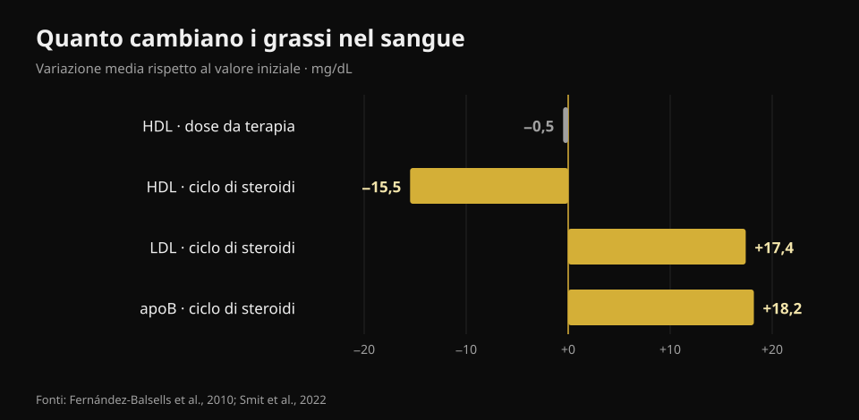
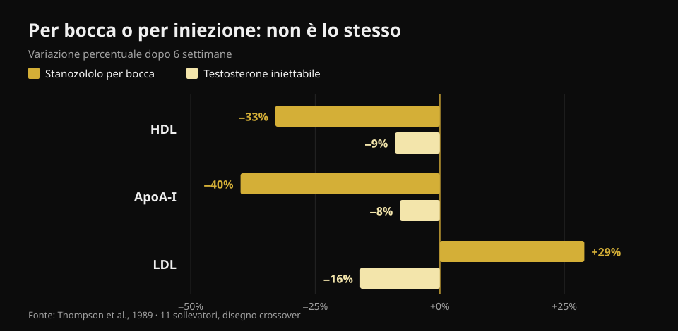

# Testosterone e colesterolo: cosa dicono gli studi

Di [Giammaria Loi](/autore/giammaria-loi) · aggiornato il 23 ottobre 2026

In palestra "testosterone" indica due cose molto diverse: una terapia prescritta a chi ha valori bassi documentati, e dosi molto più alte prese per crescere. I numeri sul sangue sono diversi nei due casi, ma finiscono quasi sempre mescolati nello stesso discorso. Ho letto otto lavori indicizzati per separarli — e la variabile che pesa di più non è quella che ti aspetti.

## In breve

- **Con le dosi da terapia il colesterolo si muove pochissimo.** La meta-analisi su 51 studi trova un HDL più basso di **0,49 mg/dL** (Fernández-Balsells et al., 2010). Mezzo milligrammo per decilitro: una variazione che si perde nel rumore del laboratorio.
- **Il valore che cambia davvero con la terapia non è il colesterolo, è il sangue.** Emoglobina **+0,80 g/dL** ed ematocrito **+3,18 punti percentuali** nella stessa meta-analisi: è questo il controllo che i protocolli medici ripetono nel tempo.
- **Sugli eventi cardiaci lo studio più grande non trova differenze.** In TRAVERSE, 5.246 uomini a rischio cardiovascolare alto: eventi maggiori nel **7,0%** con testosterone contro il **7,3%** con placebo. Ma più fibrillazione atriale, embolia polmonare e danno renale acuto (Lincoff et al., 2023).
- **Durante un ciclo auto-somministrato i numeri si muovono sul serio.** In 100 uomini seguiti prima, durante e dopo: **apoB +18,2 mg/dL**, LDL +0,45 mmol/L (circa +17 mg/dL), pressione **+6,9/+3,2 mmHg**. Tutto tornato al valore di partenza tre mesi dopo la fine (Smit et al., 2022).
- **La differenza più grande non è la dose, è la via di assunzione.** Nello stesso studio, sugli stessi uomini: con uno steroide per bocca HDL **−33%** e LDL **+29%**; con testosterone iniettabile HDL **−9%** e LDL **−16%** (Thompson et al., 1989).

## Due situazioni diverse che vengono chiamate con lo stesso nome

La terapia sostitutiva è una prescrizione medica: si dà a chi ha testosterone basso confermato da più prelievi e sintomi coerenti, e l'obiettivo è riportare il valore dentro l'intervallo normale. Le dosi usate in palestra per crescere puntano invece molto sopra quell'intervallo, spesso combinando più molecole.

Quanto sopra? Il modo più onesto per dirlo non è in milligrammi ma in concentrazioni misurate. Nel trial di riferimento sulla risposta alla dose, 61 uomini sani tra i 18 e i 35 anni hanno ricevuto per 20 settimane cinque dosi crescenti: la concentrazione minima di testosterone andava da **253 ng/dL** nel gruppo più basso a **2.370 ng/dL** nel più alto (Bhasin et al., 2001). Per riferimento, l'intervallo considerato normale in un uomo adulto sta indicativamente fra 300 e 1.000 ng/dL. Il gruppo più alto, quindi, viaggiava a più del doppio del limite superiore.

Nello stesso studio la massa magra è aumentata in proporzione alla dose (+3,4, +5,2 e +7,9 kg nei tre gruppi più alti) e **l'HDL è sceso in proporzione alla concentrazione di testosterone**. È il motivo per cui prendere i numeri di una terapia e applicarli a un ciclo — o viceversa — porta fuori strada in entrambe le direzioni.

## Dosi da terapia: i numeri sono più piccoli di come li racconta il web

Qui la letteratura è abbondante e abbastanza concorde. La meta-analisi su 51 studi di Fernández-Balsells e colleghi riporta tre effetti: emoglobina **+0,80 g/dL** (IC 95% 0,45–1,14), ematocrito **+3,18%** (1,35–5,01) e HDL **−0,49 mg/dL** (−0,85 a −0,13). Nessun effetto significativo su mortalità, prostata o eventi cardiovascolari. Gli autori stessi definiscono queste variazioni "di significato clinico ignoto".

La sintesi più recente, basata sui dati dei singoli partecipanti di 35 studi controllati (5.601 uomini), arriva allo stesso punto: eventi cardiovascolari e cerebrovascolari nel 7,5% del gruppo trattato contro il 7,2% del placebo (OR 1,07; IC 95% 0,81–1,42) e nessun effetto sfavorevole su pressione, lipidi sierici o marcatori glicemici — anzi, colesterolo totale e trigliceridi risultavano più bassi nel gruppo trattato (Cruickshank et al., 2024).

TRAVERSE, lo studio disegnato apposta per la sicurezza cardiovascolare, ha arruolato 5.246 uomini fra 45 e 80 anni con malattia cardiovascolare in atto o rischio alto e testosterone sotto 300 ng/dL. Dopo in media 21,7 mesi di trattamento, gli eventi cardiaci maggiori sono stati 182 (7,0%) con testosterone e 190 (7,3%) con placebo. Tre segnali però sono emersi in eccesso nel gruppo trattato: **fibrillazione atriale, embolia polmonare e danno renale acuto**. Non sono dettagli: sono la ragione per cui una terapia va seguita da chi l'ha prescritta, non gestita da soli.

## Durante un ciclo i numeri cambiano sul serio

Lo studio più pulito su questo lato è olandese e prospettico: 100 uomini seguiti con prelievi prima del ciclo, alla fine, tre mesi dopo e a un anno dall'inizio. Durante l'assunzione la pressione è salita di 6,87 mmHg (sistolica) e 3,17 mmHg (diastolica), l'LDL di 0,45 mmol/L, l'apoB di 18,2 mg/dL; HDL, ApoA e lipoproteina(a) sono scesi, l'ematocrito è salito di 0,03 L/L (Smit et al., 2022).

*Grafico Nurvan sui dati di Fernández-Balsells et al., 2010 e Smit et al., 2022. I valori in mmol/L dello studio olandese sono stati convertiti in mg/dL (×38,67) da noi.*

Due cose vanno dette per intero, perché nei riassunti social spariscono quasi sempre. La prima: **l'apoB è il numero che conta più dell'LDL**, perché misura quante particelle potenzialmente aterogene circolano, e qui sale di quasi 20 mg/dL. La seconda: **tre mesi dopo la fine del ciclo tutti questi valori erano tornati al punto di partenza**. La reversibilità è un dato reale e va riportata — ma riguarda i marcatori nel sangue, non necessariamente quello che succede alle arterie e al cuore in dieci o vent'anni di cicli ripetuti.

Su quell'orizzonte lungo c'è un solo tipo di dato disponibile, ed è osservazionale. In un registro danese, 1.189 uomini sanzionati per uso di steroidi sono stati confrontati con 59.450 controlli per circa 11 anni: infarto con rapporto di rischio aggiustato **3,00** (IC 95% 1,67–5,39), tromboembolia venosa 2,42, aritmie 2,26, scompenso cardiaco 3,63 e **cardiomiopatia 8,90** (4,99–15,88) — il segnale più grande di tutti, e quello che il colesterolo non vede (Windfeld-Mathiasen et al., 2025). È un'associazione: non dimostra un rapporto di causa, perché chi usa steroidi differisce dai controlli anche per altre abitudini.

## Per bocca o per iniezione: la differenza più grande

Questo è il punto che quasi nessun contenuto divulgativo mette in primo piano, ed è il più utile. Nel 1989 undici sollevatori hanno ricevuto, in sequenza incrociata e per sei settimane ciascuna, uno steroide 17-alfa-alchilato per bocca e testosterone iniettabile a dose sovrafisiologica. Stesso studio, stesse persone, stesso periodo.

*Grafico Nurvan sui dati di Thompson et al., 1989 (JAMA): 11 sollevatori, disegno crossover, 6 settimane per fase.*

Con la molecola per bocca l'HDL è sceso del 33% (la sottofrazione HDL2 del 71%), l'ApoA-I del 40%, l'LDL è salito del 29% e la lipasi epatica è più che raddoppiata. Con il testosterone iniettabile l'HDL è sceso del 9% e **l'LDL è sceso del 16%**. La conclusione degli autori, scritta nel 1989 e mai smentita, è che l'effetto sfavorevole sulle lipoproteine dipende dalla via di assunzione e non dalla potenza androgena.

Tradotto: due persone possono assumere "steroidi" e avere profili lipidici opposti. Senza sapere cosa, come e per quanto, un singolo referto non dice niente.

## Cosa dice davvero la ricerca

- **"Con la terapia sostitutiva il colesterolo cambia poco" — Confermato.** Mezzo mg/dL di HDL nella meta-analisi più ampia, nessun effetto sfavorevole sui lipidi nella sintesi dei dati individuali.
- **"La terapia sostitutiva aumenta l'infarto" — Smentito.** Né TRAVERSE né le due meta-analisi trovano un eccesso di eventi cardiaci maggiori. Restano però fibrillazione atriale, embolia polmonare e danno renale acuto in eccesso in TRAVERSE.
- **"Il valore da tenere d'occhio con la terapia è il colesterolo" — Da precisare.** Il cambiamento più costante è ematologico: emoglobina ed ematocrito. È il motivo per cui l'emocromo viene ripetuto.
- **"Gli steroidi alzano l'LDL" — Da precisare.** Dipende dalla via: per bocca sì, e molto; con testosterone iniettabile in un trial controllato l'LDL è perfino sceso. Quello che sale in modo coerente durante un ciclo reale, fatto di più molecole, è l'apoB.
- **"Se gli esami sono normali il ciclo è sicuro" — Smentito.** Il segnale più forte del registro danese è la cardiomiopatia, non un valore lipidico. Un profilo lipidico tranquillo non esclude nulla.
- **"L'HDL più basso significa automaticamente più rischio" — Da precisare.** In uno studio controllato su 53 uomini sani le variazioni di HDL dovute al testosterone non corrispondevano a variazioni della capacità dell'HDL di rimuovere colesterolo dalle cellule (Rubinow et al., 2018). Il numero scende, la funzione non è detto.

## Come applicarlo

1. **Separa le due domande.** "Ho il testosterone basso e il medico mi ha prescritto una terapia" e "voglio usare dosi da palestra" sono due situazioni con due letterature diverse. Non applicare i numeri dell'una all'altra.
2. **Se sei in terapia, segui il calendario dei controlli che ti ha dato il medico.** Emocromo ed ematocrito sono quelli che si muovono per primi, e sono anche quelli che si gestiscono più facilmente se li vedi arrivare.
3. **Guarda l'apoB, non solo il "colesterolo".** Dove è disponibile, è il parametro che racconta meglio il carico di particelle aterogene. L'LDL da solo può restare uguale mentre l'apoB sale.
4. **Non dedurre la sicurezza dai lipidi.** Pressione, ematocrito e cuore sono canali indipendenti: il registro danese trova il segnale più grande proprio dove il colesterolo non guarda.
5. **Guarda l'andamento, non il singolo referto.** Un valore isolato dice poco; tre prelievi nello stesso punto dell'anno dicono molto. Vale per chi è in terapia come per chiunque faccia esami di routine.
6. **Porta i numeri al medico, non al forum.** Questo articolo serve a capire cosa misurano quei valori, non a decidere cosa farne: quella parte spetta a chi ti visita e ha la tua storia clinica davanti.

### Prova Nurvan — tutti i tuoi esami in un posto solo

Il problema pratico di chi segue i propri valori nel tempo è che i referti stanno in cartelle, email e PDF sparsi. Su Nurvan puoi caricare gli esami del sangue e vedere l'andamento di ogni voce — HDL, LDL, apoB, ematocrito, emoglobina — su una linea del tempo, invece di confrontare due fogli a memoria. Quando vai dal medico porti la serie storica, non l'ultimo foglio. E se ti alleni, gli stessi mesi hanno accanto i carichi, i volumi e il peso: il contesto che un referto da solo non ha. **[Prova Nurvan](https://nurvan.app)**

## Domande frequenti

**Il testosterone fa alzare il colesterolo?**
Dipende da quanto e da come. Alle dosi usate in terapia sostitutiva l'effetto sui lipidi è minimo: mezzo mg/dL di HDL in meno nella meta-analisi su 51 studi, nessun peggioramento di LDL. Durante un ciclo con dosi molto più alte e più molecole, LDL e apoB salgono in modo misurabile.

**Qual è il valore da controllare se sono in terapia sostitutiva?**
Il più costante non è lipidico: emoglobina ed ematocrito salgono in modo riproducibile (+0,80 g/dL e +3,18 punti nella meta-analisi). I controlli e la loro frequenza li stabilisce il medico che ha prescritto la terapia.

**Le alterazioni dei lipidi dopo un ciclo si recuperano?**
Nello studio prospettico su 100 uomini sì: tre mesi dopo la fine del ciclo lipidi, pressione ed ematocrito erano tornati ai valori di partenza. Questo riguarda i marcatori nel sangue; l'effetto di cicli ripetuti per anni sul cuore è un'altra domanda, e i dati disponibili sono solo osservazionali.

**Perché gli steroidi per bocca sono considerati peggiori?**
Perché passano dal fegato e modificano in modo molto più marcato il metabolismo delle lipoproteine. Nel confronto diretto a parità di persone, la molecola orale ha fatto scendere l'HDL del 33% e salire l'LDL del 29%, contro −9% e −16% del testosterone iniettabile.

**Gli esami del sangue bastano a dire se un ciclo è sicuro?**
No. Nel registro danese il rischio più alto riguardava la cardiomiopatia, cioè il muscolo cardiaco, con un rapporto di rischio quasi nove volte superiore ai controlli: un dato che nessun profilo lipidico avrebbe anticipato.

## Leggi anche

- [La creatina fa cadere i capelli?](/blog/creatina-caduta-capelli) — l'altro grande tema "ormonale" da palestra, verificato sugli studi.
- [Tier list integratori forza](/blog/classifica-integratori-forza-tier-list) — cosa ha davvero prove solide, in ordine di evidenza.
- [Quale magnesio scegliere](/blog/quale-magnesio-scegliere-dosaggio-forme) — dosi e forme, con i numeri.

## Fonti

1. Fernández-Balsells MM, Murad MH, Lane M, Lampropulos JF, Albuquerque F, Mullan RJ, Agrwal N, Elamin MB, Gallegos-Orozco JF, Wang AT, Erwin PJ, Bhasin S, Montori VM, 2010. *Clinical review 1: Adverse effects of testosterone therapy in adult men: a systematic review and meta-analysis.* Journal of Clinical Endocrinology & Metabolism 95(6):2560-75. [PMID 20525906](https://pubmed.ncbi.nlm.nih.gov/20525906/) · [DOI 10.1210/jc.2009-2575](https://doi.org/10.1210/jc.2009-2575)
2. Cruickshank M, Hudson J, Hernández R, Aceves-Martins M, Quinton R, Gillies K, Aucott LS, Kennedy C, Manson P, Oliver N, Wu F, Bhattacharya S, Dhillo WS, Jayasena CN, Brazzelli M, 2024. *The effects and safety of testosterone replacement therapy for men with hypogonadism: the TestES evidence synthesis and economic evaluation.* Health Technology Assessment 28(43):1-210. [PMID 39248210](https://pubmed.ncbi.nlm.nih.gov/39248210/) · [DOI 10.3310/JRYT3981](https://doi.org/10.3310/JRYT3981)
3. Lincoff AM, Bhasin S, Flevaris P, Mitchell LM, Basaria S, Boden WE, Cunningham GR, Granger CB, Khera M, Thompson IM, Wang Q, Wolski K, Davey D, Kalahasti V, Khan N, Miller MG, Snabes MC, Chan A, Dubcenco E, Li X, Yi T, Huang B, Pencina KM, Travison TG, Nissen SE, 2023. *Cardiovascular Safety of Testosterone-Replacement Therapy (TRAVERSE).* New England Journal of Medicine 389(2):107-117. [PMID 37326322](https://pubmed.ncbi.nlm.nih.gov/37326322/) · [DOI 10.1056/NEJMoa2215025](https://doi.org/10.1056/NEJMoa2215025)
4. Bhasin S, Woodhouse L, Casaburi R, Singh AB, Bhasin D, Berman N, Chen X, Yarasheski KE, Magliano L, Dzekov C, Dzekov J, Bross R, Phillips J, Sinha-Hikim I, Shen R, Storer TW, 2001. *Testosterone dose-response relationships in healthy young men.* American Journal of Physiology - Endocrinology and Metabolism 281(6):E1172-81. [PMID 11701431](https://pubmed.ncbi.nlm.nih.gov/11701431/) · [DOI 10.1152/ajpendo.2001.281.6.E1172](https://doi.org/10.1152/ajpendo.2001.281.6.E1172)
5. Smit DL, Grefhorst A, Buijs MM, de Hon O, den Heijer M, de Ronde W, 2022. *Prospective study on blood pressure, lipid metabolism and erythrocytosis during and after androgen abuse.* Andrologia 54(4):e14372. [PMID 35014715](https://pubmed.ncbi.nlm.nih.gov/35014715/) · [DOI 10.1111/and.14372](https://doi.org/10.1111/and.14372)
6. Thompson PD, Cullinane EM, Sady SP, Chenevert C, Saritelli AL, Sady MA, Herbert PN, 1989. *Contrasting effects of testosterone and stanozolol on serum lipoprotein levels.* JAMA 261(8):1165-8. [PMID 2915439](https://pubmed.ncbi.nlm.nih.gov/2915439/)
7. Windfeld-Mathiasen J, Heerfordt IM, Dalhoff KP, Andersen JT, Andersen MA, Johansson KS, Biering-Sørensen T, Olsen FJ, Horwitz H, 2025. *Cardiovascular Disease in Anabolic Androgenic Steroid Users.* Circulation 151(12):828-834. [PMID 39945117](https://pubmed.ncbi.nlm.nih.gov/39945117/) · [DOI 10.1161/CIRCULATIONAHA.124.071117](https://doi.org/10.1161/CIRCULATIONAHA.124.071117)
8. Rubinow KB, Vaisar T, Chao JH, Heinecke JW, Page ST, 2018. *Sex steroids mediate discrete effects on HDL cholesterol efflux capacity and particle concentration in healthy men.* Journal of Clinical Lipidology 12(4):1072-1082. [PMID 29793828](https://pubmed.ncbi.nlm.nih.gov/29793828/) · [DOI 10.1016/j.jacl.2018.04.013](https://doi.org/10.1016/j.jacl.2018.04.013)

Riferimenti bibliografici recuperati tramite PubMed. Spunto iniziale: il post di **Dwayne N. Jackson** ([@drdnjackson](https://www.instagram.com/drdnjackson/)) del 2 ottobre 2026, [post originale](https://www.instagram.com/p/Dd98gQmD6sN/). Nessun testo e nessuna immagine del post sono stati riprodotti: il tema è stato riscritto da zero risalendo agli studi primari e verificandoli uno per uno.

---

**Giammaria Loi** è il fondatore di Nurvan. Si allena con i pesi dal 2012, lavora come personal trainer e coach certificato FIPE dal 2013 e gareggia nel powerlifting a livello nazionale dal 2018. Ogni articolo che firma parte dagli studi scientifici e arriva a ciò che funziona davvero in palestra.

> Nota: contenuto informativo, non sostituisce il parere di un medico. Questo articolo non contiene indicazioni di dosaggio e non incoraggia l'uso di sostanze: l'uso non medico di steroidi anabolizzanti è vietato nello sport e, in molti Paesi, illegale. Se stai seguendo o stai valutando una terapia ormonale, parlane con il medico che ti segue.
