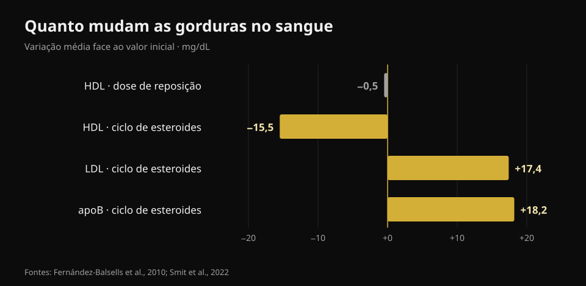
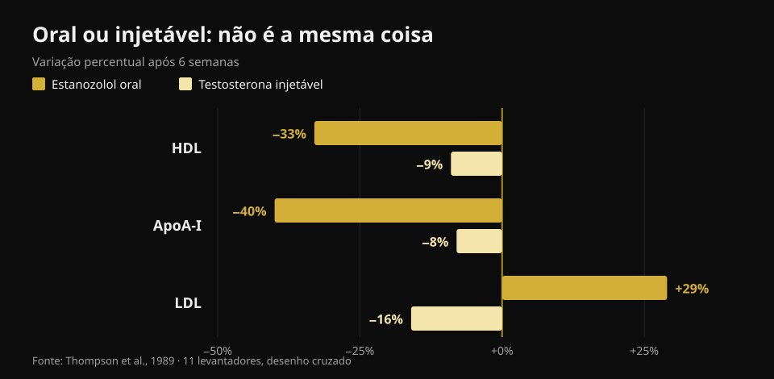

# Testosterona e colesterol: o que dizem os estudos

Por [Giammaria Loi](/autore/giammaria-loi) · atualizado a 23 de outubro de 2026

No ginásio, "testosterona" significa duas coisas muito diferentes: uma terapia prescrita a quem tem valores baixos documentados e doses muito mais altas tomadas para crescer. Os números no sangue não são iguais nos dois casos, mas acabam quase sempre misturados na mesma conversa. Li oito trabalhos indexados para os separar — e a variável que mais pesa não é a que se espera.

## Em resumo

- **Com doses de reposição o colesterol mexe-se pouquíssimo.** A meta-análise de 51 estudos encontra um HDL **0,49 mg/dL mais baixo** (Fernández-Balsells et al., 2010). Meio miligrama por decilitro: uma variação que se perde no ruído do laboratório.
- **O que muda mesmo com a terapia não é o colesterol, é o sangue.** Hemoglobina **+0,80 g/dL** e hematócrito **+3,18 pontos** na mesma meta-análise. É por isso que os protocolos médicos repetem um hemograma.
- **O maior ensaio não encontra diferenças em eventos cardíacos.** No TRAVERSE, 5.246 homens com risco cardiovascular elevado: eventos major em **7,0%** com testosterona contra **7,3%** com placebo. Mas mais fibrilhação auricular, embolia pulmonar e lesão renal aguda (Lincoff et al., 2023).
- **Durante um ciclo autoadministrado os números mexem-se a sério.** Em 100 homens seguidos antes, durante e depois: **apoB +18,2 mg/dL**, LDL +0,45 mmol/L (cerca de +17 mg/dL), pressão **+6,9/+3,2 mmHg**. Tudo de volta ao valor inicial três meses depois do fim (Smit et al., 2022).
- **A maior diferença não é a dose, é a via.** No mesmo ensaio e nos mesmos homens: um esteroide oral baixou o HDL **33%** e subiu o LDL **29%**; a testosterona injetável baixou o HDL **9%** e *baixou* o LDL **16%** (Thompson et al., 1989).

## Duas situações diferentes com o mesmo nome

A terapia de reposição é uma prescrição médica: destina-se a quem tem testosterona baixa confirmada em várias colheitas e sintomas coerentes, e o objetivo é devolver o valor ao intervalo normal. As doses de ginásio apontam muito acima desse intervalo, normalmente combinando várias moléculas.

Quanto acima? A forma honesta de o dizer não é em miligramas mas em concentrações medidas. No ensaio de referência sobre resposta à dose, 61 homens saudáveis dos 18 aos 35 anos receberam durante 20 semanas cinco doses crescentes: a concentração mínima de testosterona ia de **253 ng/dL** no grupo mais baixo a **2.370 ng/dL** no mais alto (Bhasin et al., 2001). Como referência, o intervalo normal num homem adulto situa-se grosso modo entre 300 e 1.000 ng/dL. O grupo mais alto circulava, portanto, a mais do dobro do limite superior.

Nesse mesmo ensaio a massa magra subiu em proporção à dose (+3,4, +5,2 e +7,9 kg nos três grupos mais altos) e **o HDL desceu em proporção à concentração de testosterona**. É exatamente por isso que pegar nos números de uma terapia e aplicá-los a um ciclo — ou o contrário — engana nas duas direções.

## Doses de reposição: números menores do que se conta

Aqui a literatura é vasta e bastante consistente. A meta-análise de 51 estudos de Fernández-Balsells e colegas descreve três efeitos: hemoglobina **+0,80 g/dL** (IC 95% 0,45–1,14), hematócrito **+3,18%** (1,35–5,01) e HDL **−0,49 mg/dL** (−0,85 a −0,13). Nenhum efeito significativo sobre mortalidade, próstata ou eventos cardiovasculares. Os próprios autores classificam estas variações como "de significado clínico desconhecido".

A síntese mais recente, com dados individuais de 35 ensaios controlados (5.601 homens), chega ao mesmo ponto: eventos cardiovasculares e cerebrovasculares em 7,5% do grupo tratado contra 7,2% com placebo (OR 1,07; IC 95% 0,81–1,42) e nenhum efeito desfavorável sobre pressão arterial, lípidos séricos ou marcadores glicémicos — colesterol total e triglicéridos estavam até mais baixos com tratamento (Cruickshank et al., 2024).

O TRAVERSE, o ensaio desenhado especificamente para a segurança cardiovascular, incluiu 5.246 homens dos 45 aos 80 anos com doença cardiovascular ou risco elevado e testosterona abaixo de 300 ng/dL. Após 21,7 meses de tratamento em média, os eventos cardíacos major foram 182 (7,0%) com testosterona e 190 (7,3%) com placebo. Três sinais surgiram em excesso no grupo tratado: **fibrilhação auricular, embolia pulmonar e lesão renal aguda**. Não são pormenores: são a razão pela qual uma terapia é acompanhada por quem a prescreveu.

## Durante um ciclo os números mudam mesmo

O estudo mais limpo deste lado é holandês e prospetivo: 100 homens avaliados antes do ciclo, no fim, três meses depois e um ano após o início. Durante o uso a pressão sistólica subiu 6,87 mmHg e a diastólica 3,17 mmHg, o LDL subiu 0,45 mmol/L e a apoB 18,2 mg/dL; HDL, ApoA e lipoproteína(a) desceram, e o hematócrito subiu 0,03 L/L (Smit et al., 2022).

*Gráfico Nurvan com dados de Fernández-Balsells et al., 2010 e Smit et al., 2022. Convertemos para mg/dL (×38,67) os valores em mmol/L do estudo holandês.*

Duas coisas têm de ser ditas por inteiro, porque nos resumos das redes desaparecem quase sempre. A primeira: **a apoB conta mais do que o LDL**, porque mede quantas partículas potencialmente aterogénicas circulam, e aqui sobe quase 20 mg/dL. A segunda: **três meses depois do fim do ciclo todos estes valores tinham regressado ao ponto de partida**. Essa reversibilidade é real e deve ser reportada — mas diz respeito a marcadores no sangue, não necessariamente ao que acontece às artérias e ao coração ao fim de dez ou vinte anos de ciclos repetidos.

Nesse horizonte longo só existe um tipo de dados, e é observacional. Num registo dinamarquês, 1.189 homens sancionados por uso de esteroides foram comparados com 59.450 controlos durante cerca de 11 anos: enfarte com razão de risco ajustada **3,00** (IC 95% 1,67–5,39), tromboembolismo venoso 2,42, arritmias 2,26, insuficiência cardíaca 3,63 e **miocardiopatia 8,90** (4,99–15,88) — o maior sinal de todos, e aquele que o colesterol não vê (Windfeld-Mathiasen et al., 2025). É uma associação: não prova causa, porque quem usa esteroides difere dos controlos também noutros hábitos.

## Oral ou injetável: a maior diferença

Este é o ponto que quase nenhum conteúdo de divulgação coloca à frente, e é o mais útil. Em 1989, onze levantadores receberam, em ordem cruzada e durante seis semanas cada fase, um esteroide 17-alfa-alquilado por via oral e testosterona injetável em dose suprafisiológica. Mesmo estudo, mesmas pessoas, mesmo período.

*Gráfico Nurvan com dados de Thompson et al., 1989 (JAMA): 11 levantadores, desenho cruzado, seis semanas por fase.*

Com a molécula oral o HDL desceu 33% (a subfração HDL2 71%), a ApoA-I 40%, o LDL subiu 29% e a lipase hepática mais do que duplicou. Com a testosterona injetável o HDL desceu 9% e **o LDL desceu 16%**. A conclusão dos autores, escrita em 1989 e nunca desmentida, é que o efeito desfavorável sobre as lipoproteínas depende da via de administração e não da potência androgénica.

Traduzindo: duas pessoas podem estar ambas "com esteroides" e ter perfis lipídicos opostos. Sem saber o quê, como e durante quanto tempo, uma análise isolada não diz nada.

## O que a investigação diz de facto

- **"Com terapia de reposição o colesterol muda pouco" — Confirmado.** Meio mg/dL de HDL na maior meta-análise e nenhum efeito desfavorável nos lípidos na síntese de dados individuais.
- **"A terapia de reposição aumenta o enfarte" — Desmentido.** Nem o TRAVERSE nem as duas meta-análises encontram excesso de eventos cardíacos major. Ficaram em excesso, no TRAVERSE, fibrilhação auricular, embolia pulmonar e lesão renal aguda.
- **"O valor a vigiar na terapia é o colesterol" — A precisar.** A mudança mais constante é hematológica: hemoglobina e hematócrito. Daí a repetição do hemograma.
- **"Os esteroides sobem o LDL" — A precisar.** Depende da via: por via oral sim, e muito; com testosterona injetável, num ensaio controlado, o LDL até desceu. O que sobe de forma consistente num ciclo real, com várias moléculas, é a apoB.
- **"Se as análises estão normais o ciclo é seguro" — Desmentido.** O sinal mais forte do registo dinamarquês é a miocardiopatia, não um valor lipídico. Um perfil lipídico tranquilo não exclui nada.
- **"Um HDL mais baixo significa automaticamente mais risco" — A precisar.** Num ensaio controlado com 53 homens saudáveis, as variações de HDL devidas à testosterona não correspondiam a variações na capacidade do HDL de retirar colesterol das células (Rubinow et al., 2018). O número desce; a função pode não descer.

## Como aplicar

1. **Separa as duas perguntas.** "Tenho testosterona baixa e o médico prescreveu-me terapia" e "quero usar doses de ginásio" assentam em duas literaturas diferentes. Não transportes os números de uma para a outra.
2. **Se estás em terapia, segue o calendário de controlos que o médico definiu.** Hemograma e hematócrito mexem-se primeiro, e também são os mais fáceis de gerir quando se vêem chegar.
3. **Olha para a apoB, não só para o "colesterol".** Onde está disponível, descreve melhor a carga de partículas aterogénicas: o LDL sozinho pode ficar igual enquanto a apoB sobe.
4. **Não deduzas segurança a partir dos lípidos.** Pressão, hematócrito e músculo cardíaco são canais independentes: o registo dinamarquês encontra o maior sinal exatamente onde o colesterol não olha.
5. **Lê a tendência, não a análise isolada.** Um valor sozinho diz pouco; três colheitas no mesmo ponto do ano dizem muito. Vale em terapia como em análises de rotina.
6. **Leva os números ao médico, não ao fórum.** Este artigo serve para perceber o que esses valores medem, não para decidir o que fazer com eles: isso cabe a quem te observa e conhece a tua história clínica.

### Experimenta o Nurvan — todas as tuas análises num só sítio

O problema prático de quem segue os próprios valores ao longo do tempo é que os relatórios ficam em pastas, e-mails e PDF espalhados. No Nurvan podes carregar as tuas análises e ver a evolução de cada linha — HDL, LDL, apoB, hematócrito, hemoglobina — numa linha temporal, em vez de comparar duas folhas de memória. Quando vais ao médico levas a série, não a última folha. E se treinas, esses mesmos meses têm ao lado as tuas cargas, o volume e o peso: o contexto que um relatório sozinho nunca tem. **[Experimenta o Nurvan](https://nurvan.app)**

## Perguntas frequentes

**A testosterona faz subir o colesterol?**
Depende de quanta e de como. Em doses de reposição o efeito sobre os lípidos é mínimo: meio mg/dL menos de HDL na meta-análise de 51 estudos e nenhum agravamento do LDL. Durante um ciclo com doses muito mais altas e várias moléculas, LDL e apoB sobem de forma mensurável.

**Que valor devo controlar se estou em terapia de reposição?**
O mais constante não é lipídico: hemoglobina e hematócrito sobem de forma reprodutível (+0,80 g/dL e +3,18 pontos na meta-análise). Que exames e com que frequência é o médico que prescreveu a terapia que define.

**As alterações dos lípidos depois de um ciclo recuperam?**
No estudo prospetivo com 100 homens sim: três meses depois do fim, lípidos, pressão e hematócrito tinham voltado aos valores iniciais. Isso diz respeito aos marcadores no sangue; o efeito de ciclos repetidos durante anos sobre o coração é outra pergunta, e os dados disponíveis são apenas observacionais.

**Porque é que os esteroides orais são considerados piores?**
Porque passam pelo fígado e alteram muito mais o metabolismo das lipoproteínas. Na comparação direta nas mesmas pessoas, a molécula oral baixou o HDL 33% e subiu o LDL 29%, contra −9% e −16% da testosterona injetável.

**As análises bastam para dizer se um ciclo é seguro?**
Não. No registo dinamarquês o risco mais alto era a miocardiopatia, ou seja o músculo cardíaco, com uma razão de risco quase nove vezes a dos controlos: algo que nenhum perfil lipídico teria antecipado.

## Lê também

- [Creatina faz cair o cabelo?](/pt/blog/creatina-queda-cabelo) — a outra grande questão "hormonal" do ginásio, verificada nos estudos.
- [Tier list de suplementos para força](/pt/blog/ranking-suplementos-forca-tier-list) — o que tem mesmo evidência sólida, por ordem.
- [Que magnésio escolher](/pt/blog/que-magnesio-escolher-dose-e-formas) — doses e formas, com os números.

## Fontes

1. Fernández-Balsells MM, Murad MH, Lane M, Lampropulos JF, Albuquerque F, Mullan RJ, Agrwal N, Elamin MB, Gallegos-Orozco JF, Wang AT, Erwin PJ, Bhasin S, Montori VM, 2010. *Clinical review 1: Adverse effects of testosterone therapy in adult men: a systematic review and meta-analysis.* Journal of Clinical Endocrinology & Metabolism 95(6):2560-75. [PMID 20525906](https://pubmed.ncbi.nlm.nih.gov/20525906/) · [DOI 10.1210/jc.2009-2575](https://doi.org/10.1210/jc.2009-2575)
2. Cruickshank M, Hudson J, Hernández R, Aceves-Martins M, Quinton R, Gillies K, Aucott LS, Kennedy C, Manson P, Oliver N, Wu F, Bhattacharya S, Dhillo WS, Jayasena CN, Brazzelli M, 2024. *The effects and safety of testosterone replacement therapy for men with hypogonadism: the TestES evidence synthesis and economic evaluation.* Health Technology Assessment 28(43):1-210. [PMID 39248210](https://pubmed.ncbi.nlm.nih.gov/39248210/) · [DOI 10.3310/JRYT3981](https://doi.org/10.3310/JRYT3981)
3. Lincoff AM, Bhasin S, Flevaris P, Mitchell LM, Basaria S, Boden WE, Cunningham GR, Granger CB, Khera M, Thompson IM, Wang Q, Wolski K, Davey D, Kalahasti V, Khan N, Miller MG, Snabes MC, Chan A, Dubcenco E, Li X, Yi T, Huang B, Pencina KM, Travison TG, Nissen SE, 2023. *Cardiovascular Safety of Testosterone-Replacement Therapy (TRAVERSE).* New England Journal of Medicine 389(2):107-117. [PMID 37326322](https://pubmed.ncbi.nlm.nih.gov/37326322/) · [DOI 10.1056/NEJMoa2215025](https://doi.org/10.1056/NEJMoa2215025)
4. Bhasin S, Woodhouse L, Casaburi R, Singh AB, Bhasin D, Berman N, Chen X, Yarasheski KE, Magliano L, Dzekov C, Dzekov J, Bross R, Phillips J, Sinha-Hikim I, Shen R, Storer TW, 2001. *Testosterone dose-response relationships in healthy young men.* American Journal of Physiology - Endocrinology and Metabolism 281(6):E1172-81. [PMID 11701431](https://pubmed.ncbi.nlm.nih.gov/11701431/) · [DOI 10.1152/ajpendo.2001.281.6.E1172](https://doi.org/10.1152/ajpendo.2001.281.6.E1172)
5. Smit DL, Grefhorst A, Buijs MM, de Hon O, den Heijer M, de Ronde W, 2022. *Prospective study on blood pressure, lipid metabolism and erythrocytosis during and after androgen abuse.* Andrologia 54(4):e14372. [PMID 35014715](https://pubmed.ncbi.nlm.nih.gov/35014715/) · [DOI 10.1111/and.14372](https://doi.org/10.1111/and.14372)
6. Thompson PD, Cullinane EM, Sady SP, Chenevert C, Saritelli AL, Sady MA, Herbert PN, 1989. *Contrasting effects of testosterone and stanozolol on serum lipoprotein levels.* JAMA 261(8):1165-8. [PMID 2915439](https://pubmed.ncbi.nlm.nih.gov/2915439/)
7. Windfeld-Mathiasen J, Heerfordt IM, Dalhoff KP, Andersen JT, Andersen MA, Johansson KS, Biering-Sørensen T, Olsen FJ, Horwitz H, 2025. *Cardiovascular Disease in Anabolic Androgenic Steroid Users.* Circulation 151(12):828-834. [PMID 39945117](https://pubmed.ncbi.nlm.nih.gov/39945117/) · [DOI 10.1161/CIRCULATIONAHA.124.071117](https://doi.org/10.1161/CIRCULATIONAHA.124.071117)
8. Rubinow KB, Vaisar T, Chao JH, Heinecke JW, Page ST, 2018. *Sex steroids mediate discrete effects on HDL cholesterol efflux capacity and particle concentration in healthy men.* Journal of Clinical Lipidology 12(4):1072-1082. [PMID 29793828](https://pubmed.ncbi.nlm.nih.gov/29793828/) · [DOI 10.1016/j.jacl.2018.04.013](https://doi.org/10.1016/j.jacl.2018.04.013)

Referências obtidas através da PubMed. Ponto de partida: a publicação de **Dwayne N. Jackson** ([@drdnjackson](https://www.instagram.com/drdnjackson/)) de 2 de outubro de 2026, [publicação original](https://www.instagram.com/p/Dd98gQmD6sN/). Nenhum texto e nenhuma imagem dessa publicação foram reproduzidos: o tema foi reescrito de raiz, voltando aos estudos primários e verificando-os um a um.

---

**Giammaria Loi** é o fundador do Nurvan. Treina com pesos desde 2012, trabalha como personal trainer e coach certificado FIPE desde 2013 e compete em powerlifting a nível nacional desde 2018. Cada artigo que assina parte dos estudos científicos e chega ao que funciona mesmo no ginásio.

> Nota: conteúdo informativo, não substitui a opinião de um médico. Este artigo não contém indicações de dose nem incentiva o uso de qualquer substância: o uso não médico de esteroides anabolizantes é proibido no desporto e ilegal em muitos países. Se segues ou estás a ponderar uma terapia hormonal, fala com o médico que te acompanha.
