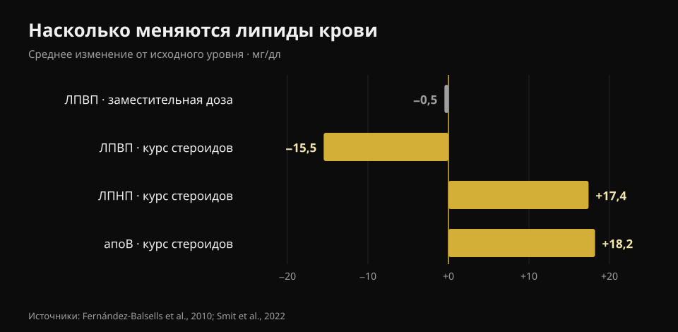
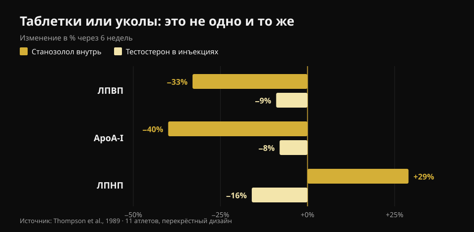

# Тестостерон и холестерин: что говорят исследования

Автор: [Giammaria Loi](/autore/giammaria-loi) · обновлено 23 октября 2026

В зале словом «тестостерон» называют две очень разные вещи: назначенную врачом терапию при документально низких значениях и гораздо более высокие дозы, которые принимают ради массы. Показатели крови в этих двух случаях разные, но в разговоре они почти всегда смешиваются. Я прочитал восемь индексированных работ, чтобы их разделить, — и главной оказалась не та переменная, которую ждёшь.

## Коротко

- **На заместительных дозах холестерин почти не двигается.** Метаанализ 51 исследования находит ЛПВП ниже на **0,49 мг/дл** (Fernández-Balsells et al., 2010). Полмиллиграмма на децилитр: сдвиг, который тонет в лабораторном шуме.
- **На терапии реально меняется не холестерин, а кровь.** Гемоглобин **+0,80 г/дл** и гематокрит **+3,18 процентного пункта** в том же метаанализе. Поэтому медицинские протоколы повторяют общий анализ крови.
- **Самое крупное исследование не находит разницы по сердечным событиям.** В TRAVERSE 5 246 мужчин высокого сердечно-сосудистого риска: крупные события у **7,0%** на тестостероне против **7,3%** на плацебо. Но больше фибрилляции предсердий, тромбоэмболии лёгочной артерии и острого повреждения почек (Lincoff et al., 2023).
- **На самостоятельном курсе цифры двигаются по-настоящему.** У 100 мужчин, обследованных до, во время и после: **апоB +18,2 мг/дл**, ЛПНП +0,45 ммоль/л (примерно +17 мг/дл), давление **+6,9/+3,2 мм рт. ст.** Через три месяца после окончания курса всё вернулось к исходному (Smit et al., 2022).
- **Самое большое различие — не доза, а способ приёма.** В одном исследовании и у одних и тех же мужчин: пероральный стероид снизил ЛПВП на **33%** и поднял ЛПНП на **29%**; инъекционный тестостерон снизил ЛПВП на **9%** и *снизил* ЛПНП на **16%** (Thompson et al., 1989).

## Две разные ситуации под одним названием

Заместительная терапия — это врачебное назначение: её получают мужчины с подтверждённым по нескольким заборам низким тестостероном и соответствующими симптомами, а цель — вернуть значение в нормальный диапазон. «Зальные» дозы целятся сильно выше этого диапазона, обычно сочетая несколько веществ.

Насколько выше? Честнее говорить не в миллиграммах, а в измеренных концентрациях. В базовом исследовании зависимости «доза — ответ» 61 здоровый мужчина 18–35 лет 20 недель получал пять возрастающих доз: минимальная концентрация тестостерона шла от **253 нг/дл** в самой низкой группе до **2 370 нг/дл** в самой высокой (Bhasin et al., 2001). Для ориентира: обычный диапазон у взрослого мужчины — примерно от 300 до 1 000 нг/дл. То есть верхняя группа работала более чем на двойном превышении верхней границы.

В том же исследовании сухая масса росла пропорционально дозе (+3,4, +5,2 и +7,9 кг в трёх верхних группах), а **ЛПВП снижался пропорционально концентрации тестостерона**. Именно поэтому переносить цифры терапии на курс — или наоборот — вводит в заблуждение в обе стороны.

## Заместительные дозы: цифры меньше, чем рассказывают

Здесь литература обширна и довольно единодушна. Метаанализ 51 исследования Fernández-Balsells и коллег описывает три эффекта: гемоглобин **+0,80 г/дл** (95% ДИ 0,45–1,14), гематокрит **+3,18%** (1,35–5,01) и ЛПВП **−0,49 мг/дл** (−0,85 до −0,13). Значимого влияния на смертность, простату или сердечно-сосудистые события нет. Сами авторы называют эти изменения «клинически неизвестной значимости».

Самый свежий синтез, построенный на индивидуальных данных 35 контролируемых исследований (5 601 мужчина), приходит к тому же: сердечно-сосудистые и цереброваскулярные события у 7,5% в группе лечения против 7,2% на плацебо (ОШ 1,07; 95% ДИ 0,81–1,42) и никакого неблагоприятного влияния на давление, липиды сыворотки или показатели гликемии — общий холестерин и триглицериды на лечении были даже ниже (Cruickshank et al., 2024).

TRAVERSE — исследование, специально спроектированное под сердечно-сосудистую безопасность, — включило 5 246 мужчин 45–80 лет с имеющимся сердечно-сосудистым заболеванием или высоким риском и тестостероном ниже 300 нг/дл. После в среднем 21,7 месяца лечения крупных сердечных событий было 182 (7,0%) на тестостероне и 190 (7,3%) на плацебо. Зато три сигнала оказались выше в группе лечения: **фибрилляция предсердий, тромбоэмболия лёгочной артерии и острое повреждение почек**. Это не сноски: именно поэтому терапию ведёт тот, кто её назначил.

## На курсе цифры меняются по-настоящему

Самая чистая работа на этой стороне — голландская и проспективная: 100 мужчин обследовали до курса, в конце, через три месяца и через год от начала. Во время приёма систолическое давление выросло на 6,87 мм рт. ст., диастолическое на 3,17; ЛПНП вырос на 0,45 ммоль/л, апоB — на 18,2 мг/дл; ЛПВП, ApoA и липопротеин(а) снизились, гематокрит поднялся на 0,03 л/л (Smit et al., 2022).

*График Nurvan по данным Fernández-Balsells et al., 2010 и Smit et al., 2022. Значения голландского исследования в ммоль/л мы перевели в мг/дл (×38,67).*

Две вещи надо сказать целиком, потому что в соцсетевых пересказах они почти всегда исчезают. Первое: **апоB важнее ЛПНП**, потому что считает, сколько потенциально атерогенных частиц циркулирует, — и здесь он растёт почти на 20 мг/дл. Второе: **через три месяца после окончания курса все эти значения вернулись к исходным**. Обратимость реальна и о ней надо говорить — но она касается маркеров в крови, а не обязательно того, что происходит с сосудами и сердечной мышцей за десять-двадцать лет повторяющихся курсов.

На этом длинном горизонте есть только один тип данных, и он наблюдательный. В датском регистре 1 189 мужчин, санкционированных за употребление стероидов, сравнили с 59 450 контролями примерно за 11 лет: инфаркт с скорректированным отношением рисков **3,00** (95% ДИ 1,67–5,39), венозная тромбоэмболия 2,42, аритмии 2,26, сердечная недостаточность 3,63 и **кардиомиопатия 8,90** (4,99–15,88) — самый сильный сигнал из всех и именно тот, которого холестерин не видит (Windfeld-Mathiasen et al., 2025). Это ассоциация: она не доказывает причину, потому что употребляющие отличаются от контролей и другими привычками.

## Внутрь или в инъекции: самая большая разница

Это пункт, который почти ни один популярный материал не ставит вперёд, — и он самый полезный. В 1989 году одиннадцать тяжелоатлетов получали по перекрёстной схеме, по шесть недель каждую фазу, пероральный 17-альфа-алкилированный стероид и инъекционный тестостерон в сверхфизиологической дозе. То же исследование, те же люди, тот же период.

*График Nurvan по данным Thompson et al., 1989 (JAMA): 11 тяжелоатлетов, перекрёстный дизайн, шесть недель на фазу.*

На пероральной молекуле ЛПВП упал на 33% (субфракция HDL2 — на 71%), ApoA-I на 40%, ЛПНП вырос на 29%, а печёночная липаза более чем удвоилась. На инъекционном тестостероне ЛПВП снизился на 9%, а **ЛПНП снизился на 16%**. Вывод авторов, написанный в 1989 году и ни разу не опровергнутый: неблагоприятный эффект на липопротеины определяется способом приёма, а не андрогенной силой.

В переводе: два человека могут оба быть «на стероидах» и иметь противоположные липидные профили. Не зная, что, как и сколько, один анализ не говорит ничего.

## Что на самом деле показывают исследования

- **«На заместительной терапии холестерин меняется мало» — Подтверждено.** Полмиллиграмма на децилитр ЛПВП в самом крупном метаанализе и никакого неблагоприятного эффекта на липиды в синтезе индивидуальных данных.
- **«Заместительная терапия повышает риск инфаркта» — Опровергнуто.** Ни TRAVERSE, ни оба метаанализа не находят избытка крупных сердечных событий. При этом в TRAVERSE в избытке оказались фибрилляция предсердий, ТЭЛА и острое повреждение почек.
- **«На терапии следить надо за холестерином» — Требует уточнения.** Самое постоянное изменение — гематологическое: гемоглобин и гематокрит. Поэтому повторяют общий анализ крови.
- **«Стероиды поднимают ЛПНП» — Требует уточнения.** Зависит от способа: внутрь — да, и сильно; на инъекционном тестостероне в контролируемом исследовании ЛПНП даже снизился. Что последовательно растёт на реальном курсе из нескольких веществ — это апоB.
- **«Если анализы в норме, курс безопасен» — Опровергнуто.** Самый сильный сигнал датского регистра — кардиомиопатия, а не липидный показатель. Спокойная липидограмма ничего не исключает.
- **«Более низкий ЛПВП автоматически означает больший риск» — Требует уточнения.** В контролируемом исследовании на 53 здоровых мужчинах изменения ЛПВП из-за тестостерона не совпадали с изменениями способности ЛПВП выводить холестерин из клеток (Rubinow et al., 2018). Цифра падает — функция не обязательно.

## Как это применить

1. **Разделите два вопроса.** «У меня низкий тестостерон, и врач назначил терапию» и «я хочу использовать зальные дозы» стоят на двух разных массивах литературы. Не переносите цифры с одного на другой.
2. **Если вы на терапии, соблюдайте график контроля, который дал врач.** Общий анализ крови и гематокрит двигаются первыми — и ими проще управлять, когда видишь их заранее.
3. **Смотрите на апоB, а не только на «холестерин».** Там, где он доступен, он лучше описывает нагрузку атерогенными частицами: ЛПНП сам по себе может не измениться, пока апоB растёт.
4. **Не выводите безопасность из липидов.** Давление, гематокрит и сердечная мышца — независимые каналы: датский регистр нашёл самый сильный сигнал именно там, куда холестерин не смотрит.
5. **Читайте динамику, а не один бланк.** Отдельное значение говорит мало; три забора в одно и то же время года говорят много. Это верно и на терапии, и при обычной диспансеризации.
6. **Несите цифры врачу, а не на форум.** Эта статья объясняет, что измеряют эти показатели; что с ними делать, решает тот, кто вас осматривает и знает вашу историю.

### Попробуйте Nurvan — все анализы в одном месте

Практическая проблема тех, кто следит за своими показателями, в том, что бланки лежат в папках, письмах и разрозненных PDF. В Nurvan можно загрузить анализы крови и увидеть динамику каждой строки — ЛПВП, ЛПНП, апоB, гематокрит, гемоглобин — на одной временной шкале, вместо сравнения двух листов по памяти. К врачу вы приносите ряд, а не последний бланк. А если вы тренируетесь, рядом с теми же месяцами стоят ваши веса, объём и масса тела: контекст, которого у одного бланка никогда нет. **[Попробуйте Nurvan](https://nurvan.app)**

## Частые вопросы

**Тестостерон поднимает холестерин?**
Зависит от количества и способа. На заместительных дозах влияние на липиды минимально: полмиллиграмма на децилитр меньше ЛПВП в метаанализе 51 исследования и никакого ухудшения ЛПНП. На курсе с гораздо большими дозами и несколькими веществами ЛПНП и апоB растут измеримо.

**За каким показателем следить на заместительной терапии?**
Самый постоянный — не липидный: гемоглобин и гематокрит растут воспроизводимо (+0,80 г/дл и +3,18 пункта в метаанализе). Какие анализы и как часто, определяет назначивший терапию врач.

**Восстанавливаются ли липиды после курса?**
В проспективном исследовании на 100 мужчинах — да: через три месяца после окончания липиды, давление и гематокрит вернулись к исходным значениям. Это касается маркеров в крови; что делают с сердцем повторяющиеся годами курсы — другой вопрос, и доступные данные только наблюдательные.

**Почему пероральные стероиды считают хуже?**
Потому что они проходят через печень и гораздо сильнее меняют обмен липопротеинов. В прямом сравнении на одних и тех же людях пероральная молекула снизила ЛПВП на 33% и подняла ЛПНП на 29% против −9% и −16% у инъекционного тестостерона.

**Достаточно ли анализов, чтобы сказать, что курс безопасен?**
Нет. В датском регистре самый высокий риск касался кардиомиопатии, то есть самой сердечной мышцы, почти в девять раз выше контролей: ни одна липидограмма этого не показала бы.

## Читайте также

- [Креатин вызывает выпадение волос?](/ru/blog/kreatin-vypadenie-volos) — другой большой «гормональный» вопрос из зала, проверенный по исследованиям.
- [Тир-лист добавок для силы](/ru/blog/reyting-sportivnykh-dobavok-dlya-sily) — у чего действительно есть надёжные доказательства.
- [Какой магний выбрать](/ru/blog/kakoy-magniy-vybrat-doza-i-formy) — дозы и формы, с цифрами.

## Источники

1. Fernández-Balsells MM, Murad MH, Lane M, Lampropulos JF, Albuquerque F, Mullan RJ, Agrwal N, Elamin MB, Gallegos-Orozco JF, Wang AT, Erwin PJ, Bhasin S, Montori VM, 2010. *Clinical review 1: Adverse effects of testosterone therapy in adult men: a systematic review and meta-analysis.* Journal of Clinical Endocrinology & Metabolism 95(6):2560-75. [PMID 20525906](https://pubmed.ncbi.nlm.nih.gov/20525906/) · [DOI 10.1210/jc.2009-2575](https://doi.org/10.1210/jc.2009-2575)
2. Cruickshank M, Hudson J, Hernández R, Aceves-Martins M, Quinton R, Gillies K, Aucott LS, Kennedy C, Manson P, Oliver N, Wu F, Bhattacharya S, Dhillo WS, Jayasena CN, Brazzelli M, 2024. *The effects and safety of testosterone replacement therapy for men with hypogonadism: the TestES evidence synthesis and economic evaluation.* Health Technology Assessment 28(43):1-210. [PMID 39248210](https://pubmed.ncbi.nlm.nih.gov/39248210/) · [DOI 10.3310/JRYT3981](https://doi.org/10.3310/JRYT3981)
3. Lincoff AM, Bhasin S, Flevaris P, Mitchell LM, Basaria S, Boden WE, Cunningham GR, Granger CB, Khera M, Thompson IM, Wang Q, Wolski K, Davey D, Kalahasti V, Khan N, Miller MG, Snabes MC, Chan A, Dubcenco E, Li X, Yi T, Huang B, Pencina KM, Travison TG, Nissen SE, 2023. *Cardiovascular Safety of Testosterone-Replacement Therapy (TRAVERSE).* New England Journal of Medicine 389(2):107-117. [PMID 37326322](https://pubmed.ncbi.nlm.nih.gov/37326322/) · [DOI 10.1056/NEJMoa2215025](https://doi.org/10.1056/NEJMoa2215025)
4. Bhasin S, Woodhouse L, Casaburi R, Singh AB, Bhasin D, Berman N, Chen X, Yarasheski KE, Magliano L, Dzekov C, Dzekov J, Bross R, Phillips J, Sinha-Hikim I, Shen R, Storer TW, 2001. *Testosterone dose-response relationships in healthy young men.* American Journal of Physiology - Endocrinology and Metabolism 281(6):E1172-81. [PMID 11701431](https://pubmed.ncbi.nlm.nih.gov/11701431/) · [DOI 10.1152/ajpendo.2001.281.6.E1172](https://doi.org/10.1152/ajpendo.2001.281.6.E1172)
5. Smit DL, Grefhorst A, Buijs MM, de Hon O, den Heijer M, de Ronde W, 2022. *Prospective study on blood pressure, lipid metabolism and erythrocytosis during and after androgen abuse.* Andrologia 54(4):e14372. [PMID 35014715](https://pubmed.ncbi.nlm.nih.gov/35014715/) · [DOI 10.1111/and.14372](https://doi.org/10.1111/and.14372)
6. Thompson PD, Cullinane EM, Sady SP, Chenevert C, Saritelli AL, Sady MA, Herbert PN, 1989. *Contrasting effects of testosterone and stanozolol on serum lipoprotein levels.* JAMA 261(8):1165-8. [PMID 2915439](https://pubmed.ncbi.nlm.nih.gov/2915439/)
7. Windfeld-Mathiasen J, Heerfordt IM, Dalhoff KP, Andersen JT, Andersen MA, Johansson KS, Biering-Sørensen T, Olsen FJ, Horwitz H, 2025. *Cardiovascular Disease in Anabolic Androgenic Steroid Users.* Circulation 151(12):828-834. [PMID 39945117](https://pubmed.ncbi.nlm.nih.gov/39945117/) · [DOI 10.1161/CIRCULATIONAHA.124.071117](https://doi.org/10.1161/CIRCULATIONAHA.124.071117)
8. Rubinow KB, Vaisar T, Chao JH, Heinecke JW, Page ST, 2018. *Sex steroids mediate discrete effects on HDL cholesterol efflux capacity and particle concentration in healthy men.* Journal of Clinical Lipidology 12(4):1072-1082. [PMID 29793828](https://pubmed.ncbi.nlm.nih.gov/29793828/) · [DOI 10.1016/j.jacl.2018.04.013](https://doi.org/10.1016/j.jacl.2018.04.013)

Источники найдены через PubMed. Отправная точка: пост **Dwayne N. Jackson** ([@drdnjackson](https://www.instagram.com/drdnjackson/)) от 2 октября 2026 года, [оригинальный пост](https://www.instagram.com/p/Dd98gQmD6sN/). Ни текст, ни изображения этого поста не воспроизводились: тема написана с нуля, с возвратом к первичным исследованиям и поштучной проверкой.

---

**Giammaria Loi** — основатель Nurvan. Тренируется с отягощениями с 2012 года, работает персональным тренером и коучем с сертификацией FIPE с 2013 года и выступает в пауэрлифтинге на национальном уровне с 2018 года. Каждая его статья начинается с научных работ и заканчивается тем, что действительно работает в зале.

> Примечание: информационный материал, не заменяет консультацию врача. В этой статье нет указаний по дозировкам и нет призыва к применению каких-либо веществ: немедицинское использование анаболических стероидов запрещено в спорте и незаконно во многих странах. Если вы проходите или рассматриваете гормональную терапию, обсудите это с лечащим врачом.
