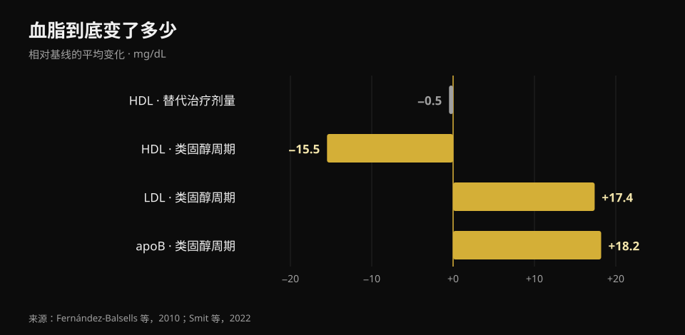
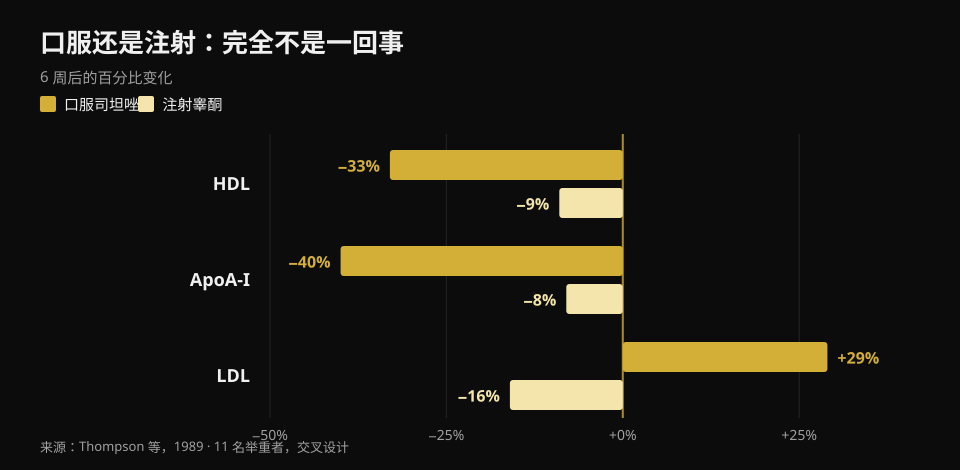

# 睾酮与胆固醇：研究到底怎么说

作者：[Giammaria Loi](/autore/giammaria-loi) · 更新于 2026 年 10 月 23 日

在健身房里，"睾酮"其实指两件完全不同的事：一是医生给确诊低睾酮者开的替代治疗，二是为了长肌肉而使用的高得多的剂量。两种情况下的血液数字并不一样，但在讨论里几乎总被混为一谈。我读了八篇被收录的研究来把它们分开——结果最关键的变量，并不是你以为的那个。

## 要点速览

- **替代治疗剂量下，胆固醇几乎不动。** 51 项研究的荟萃分析发现 HDL 只低了 **0.49 mg/dL**（Fernández-Balsells 等，2010）。每分升半毫克，这个幅度基本淹没在检验误差里。
- **治疗中真正变化的不是胆固醇，是血液本身。** 同一篇荟萃分析里血红蛋白 **+0.80 g/dL**、红细胞压积 **+3.18 个百分点**。这正是医疗方案反复复查血常规的原因。
- **规模最大的试验没有发现心脏事件差异。** TRAVERSE 纳入 5,246 名心血管高风险男性：主要事件在睾酮组为 **7.0%**，安慰剂组 **7.3%**。但房颤、肺栓塞和急性肾损伤更多（Lincoff 等，2023）。
- **自行使用的周期里，数字是真的会动。** 100 名男性在周期前、中、后被追踪：**apoB +18.2 mg/dL**，LDL +0.45 mmol/L（约 +17 mg/dL），血压 **+6.9/+3.2 mmHg**。周期结束三个月后全部回到基线（Smit 等，2022）。
- **最大的差别不是剂量，而是给药途径。** 同一项研究、同一批人：口服类固醇让 HDL 下降 **33%**、LDL 上升 **29%**；注射睾酮让 HDL 下降 **9%**，LDL 反而*下降* **16%**（Thompson 等，1989）。

## 两种不同情况，却用同一个名字

替代治疗是医疗处方：面向多次抽血确认睾酮偏低、症状也吻合的男性，目标是把数值拉回正常区间。健身房里的剂量则远远瞄准这个区间之上，而且通常是几种药物叠加使用。

高多少？诚实的说法不是用毫克，而是用实测浓度。在那项经典的剂量—反应试验里，61 名 18 至 35 岁的健康男性接受了 20 周五种递增剂量：谷浓度从最低组的 **253 ng/dL** 到最高组的 **2,370 ng/dL**（Bhasin 等，2001）。作为参照，成年男性常见区间大约在 300 到 1,000 ng/dL。也就是说，最高组常年运行在上限的两倍以上。

同一项试验中，去脂体重随剂量上升（最高三组分别 +3.4、+5.2 和 +7.9 kg），而 **HDL 随睾酮浓度成比例下降**。正因如此，把治疗试验的数字搬到周期上——或者反过来——两个方向都会误导。

## 替代治疗剂量：数字比网上说的小得多

这一侧的文献很多，结论也相当一致。Fernández-Balsells 等人对 51 项研究的荟萃分析报告了三个效应：血红蛋白 **+0.80 g/dL**（95% CI 0.45–1.14）、红细胞压积 **+3.18%**（1.35–5.01）、HDL **−0.49 mg/dL**（−0.85 至 −0.13）。对死亡率、前列腺或心血管结局没有显著影响。作者自己把这些变化称为"临床意义未知"。

最新的汇总基于 35 项对照试验的个体参与者数据（5,601 名男性），结论一致：心血管与脑血管事件在治疗组为 7.5%，安慰剂组 7.2%（OR 1.07；95% CI 0.81–1.42），对血压、血脂和血糖标志物均无不良影响——治疗组的总胆固醇和甘油三酯反而更低（Cruickshank 等，2024）。

TRAVERSE 是专门为心血管安全设计的试验，纳入 5,246 名 45 至 80 岁、已有心血管病或高风险、且睾酮低于 300 ng/dL 的男性。平均治疗 21.7 个月后，主要心脏事件睾酮组 182 例（7.0%），安慰剂组 190 例（7.3%）。但治疗组有三个信号偏高：**房颤、肺栓塞和急性肾损伤**。这不是脚注，而是治疗必须由开处方的医生随访、而不是自己管理的原因。

## 周期中，数字确实在变

这一侧最干净的研究来自荷兰，而且是前瞻性的：100 名男性在周期前、周期结束时、三个月后以及起始一年后分别抽血。用药期间收缩压升高 6.87 mmHg、舒张压升高 3.17 mmHg，LDL 升高 0.45 mmol/L，apoB 升高 18.2 mg/dL；HDL、ApoA 和脂蛋白(a) 下降，红细胞压积升高 0.03 L/L（Smit 等，2022）。

*Nurvan 原创图表，数据来自 Fernández-Balsells 等（2010）与 Smit 等（2022）。荷兰研究中的 mmol/L 数值由我们换算为 mg/dL（×38.67）。*

有两点必须讲完整，因为社交媒体的摘要几乎总会漏掉。第一，**apoB 比 LDL 更重要**，因为它衡量循环中有多少潜在致动脉粥样硬化颗粒，而这里它上升了将近 20 mg/dL。第二，**周期结束三个月后，上述所有数值都回到了起点**。这种可逆性是真实的，应当照实写出来——但它针对的是血液标志物，不一定等于十年二十年反复用药之后动脉和心肌会怎样。

在那个更长的时间尺度上，只有一种数据，而且是观察性的。在丹麦的一项登记研究中，1,189 名因使用类固醇被处罚的男性与 59,450 名对照者随访约 11 年：心肌梗死校正风险比 **3.00**（95% CI 1.67–5.39），静脉血栓栓塞 2.42，心律失常 2.26，心力衰竭 3.63，**心肌病 8.90**（4.99–15.88）——这是所有信号中最强的一个，也恰恰是胆固醇看不到的那个（Windfeld-Mathiasen 等，2025）。这是关联：无法证明因果，因为使用者与对照者在其他习惯上也不同。

## 口服还是注射：最大的差别在这里

这是几乎没有科普内容放在前面、却最有用的一点。1989 年，十一名举重运动员以交叉设计各接受六周：一段是口服 17-α-烷基化类固醇，一段是超生理剂量的注射睾酮。同一项研究、同一批人、同一时期。

*Nurvan 原创图表，数据来自 Thompson 等，1989（JAMA）：11 名举重者，交叉设计，每阶段六周。*

口服药物期间 HDL 下降 33%（HDL2 亚组分下降 71%），ApoA-I 下降 40%，LDL 上升 29%，肝脂肪酶活性增加一倍以上。注射睾酮期间 HDL 下降 9%，而 **LDL 下降了 16%**。作者 1989 年写下、至今未被推翻的结论是：对脂蛋白的不利影响取决于给药途径，而不是雄激素强度。

换句话说：两个人都"在用类固醇"，血脂图谱却可能完全相反。不知道用的是什么、怎么用、用了多久，单张化验单什么都说明不了。

## 研究真正说了什么

- **"替代治疗下胆固醇变化很小"——证实。** 最大的荟萃分析里 HDL 只差半个 mg/dL，个体数据汇总中对血脂没有不良影响。
- **"替代治疗会增加心梗"——不成立。** TRAVERSE 和两项荟萃分析都没有发现主要心脏事件增加。但 TRAVERSE 中房颤、肺栓塞和急性肾损伤确实偏多。
- **"治疗期间要盯的是胆固醇"——需要修正。** 最稳定的变化是血液学指标：血红蛋白和红细胞压积。这正是要复查血常规的原因。
- **"类固醇会升高 LDL"——需要修正。** 要看途径：口服会，而且很明显；在对照试验中注射睾酮反而让 LDL 下降。真实周期（多药叠加）里稳定上升的是 apoB。
- **"化验正常说明周期安全"——不成立。** 丹麦登记研究里最强的信号是心肌病，而不是某个血脂指标。血脂平稳并不能排除什么。
- **"HDL 更低就自动意味着风险更高"——需要修正。** 在 53 名健康男性的对照试验中，睾酮引起的 HDL 变化并不对应 HDL 把胆固醇从细胞中带走的能力的变化（Rubinow 等，2018）。数字降了，功能未必。

## 怎么用这些信息

1. **把两个问题分开。** "我睾酮低、医生开了治疗"和"我想用健身房剂量"依据的是两套完全不同的文献，不要把数字从一边搬到另一边。
2. **如果在接受治疗，按医生定的复查计划走。** 血常规和红细胞压积最先变化，也最容易在提前看见时处理好。
3. **看 apoB，而不只是"胆固醇"。** 在可检测的地方，它比单看 LDL 更能描述致动脉粥样硬化颗粒的负荷：LDL 可能不变，apoB 却在上升。
4. **不要用血脂推断安全。** 血压、红细胞压积和心肌是独立的通道：丹麦登记研究最强的信号恰恰出现在胆固醇看不到的地方。
5. **看趋势，而不是单次报告。** 一个孤立数值说明不了什么；一年中同一时间点的三次抽血能说明很多。无论在治疗中还是常规体检都适用。
6. **把数字带给医生，而不是论坛。** 这篇文章解释这些指标测的是什么；该怎么处理，交给面诊你、了解你病史的人。

### 试试 Nurvan——所有化验单都在一个地方

长期跟踪自己指标的人，实际困难在于报告散落在文件夹、邮件和各种 PDF 里。在 Nurvan 里，你可以上传血液检查，把每一项——HDL、LDL、apoB、红细胞压积、血红蛋白——放在同一条时间线上看，而不是凭记忆对比两张纸。去看医生时你带的是整条曲线，而不是最新一页。如果你同时在训练，那几个月旁边还有你的负荷、训练量和体重：这是单张化验单永远给不了的背景。**[试试 Nurvan](https://nurvan.app)**

## 常见问题

**睾酮会让胆固醇升高吗？**
取决于用多少、怎么用。替代治疗剂量下对血脂的影响很小：51 项研究的荟萃分析中 HDL 只低了半个 mg/dL，LDL 没有恶化。而在剂量高得多、还叠加多种药物的周期里，LDL 和 apoB 会出现可测量的上升。

**接受替代治疗时应该盯哪个指标？**
最稳定的那个不是血脂：血红蛋白和红细胞压积会可重复地上升（荟萃分析中 +0.80 g/dL 与 +3.18 个百分点）。具体查什么、多久查一次，由开处方的医生决定。

**周期结束后血脂异常能恢复吗？**
在 100 人的前瞻性研究里可以：结束三个月后，血脂、血压和红细胞压积都回到了基线。这说的是血液标志物；多年反复用药对心脏的影响是另一个问题，而且现有数据只是观察性的。

**为什么口服类固醇被认为更糟？**
因为它们经过肝脏，对脂蛋白代谢的改变要剧烈得多。在同一批人身上的直接对比中，口服药物让 HDL 下降 33%、LDL 上升 29%，而注射睾酮分别是 −9% 和 −16%。

**化验单足以判断一个周期是否安全吗？**
不够。丹麦登记研究中风险最高的是心肌病，也就是心肌本身，风险比接近对照者的九倍：这是任何血脂谱都提示不了的。

## 延伸阅读

- [肌酸会导致脱发吗？](/zh/blog/creatine-hair-loss-zh)——健身房里另一个大"激素"问题，按研究逐条核对。
- [力量补剂等级榜](/zh/blog/liliang-buji-dengji-bang)——真正有扎实证据的是哪些，按顺序排。
- [镁怎么选](/zh/blog/ruhe-xuanze-mei-jiliang-yu-xingshi)——剂量与形式，附数字。

## 参考文献

1. Fernández-Balsells MM, Murad MH, Lane M, Lampropulos JF, Albuquerque F, Mullan RJ, Agrwal N, Elamin MB, Gallegos-Orozco JF, Wang AT, Erwin PJ, Bhasin S, Montori VM, 2010. *Clinical review 1: Adverse effects of testosterone therapy in adult men: a systematic review and meta-analysis.* Journal of Clinical Endocrinology & Metabolism 95(6):2560-75. [PMID 20525906](https://pubmed.ncbi.nlm.nih.gov/20525906/) · [DOI 10.1210/jc.2009-2575](https://doi.org/10.1210/jc.2009-2575)
2. Cruickshank M, Hudson J, Hernández R, Aceves-Martins M, Quinton R, Gillies K, Aucott LS, Kennedy C, Manson P, Oliver N, Wu F, Bhattacharya S, Dhillo WS, Jayasena CN, Brazzelli M, 2024. *The effects and safety of testosterone replacement therapy for men with hypogonadism: the TestES evidence synthesis and economic evaluation.* Health Technology Assessment 28(43):1-210. [PMID 39248210](https://pubmed.ncbi.nlm.nih.gov/39248210/) · [DOI 10.3310/JRYT3981](https://doi.org/10.3310/JRYT3981)
3. Lincoff AM, Bhasin S, Flevaris P, Mitchell LM, Basaria S, Boden WE, Cunningham GR, Granger CB, Khera M, Thompson IM, Wang Q, Wolski K, Davey D, Kalahasti V, Khan N, Miller MG, Snabes MC, Chan A, Dubcenco E, Li X, Yi T, Huang B, Pencina KM, Travison TG, Nissen SE, 2023. *Cardiovascular Safety of Testosterone-Replacement Therapy (TRAVERSE).* New England Journal of Medicine 389(2):107-117. [PMID 37326322](https://pubmed.ncbi.nlm.nih.gov/37326322/) · [DOI 10.1056/NEJMoa2215025](https://doi.org/10.1056/NEJMoa2215025)
4. Bhasin S, Woodhouse L, Casaburi R, Singh AB, Bhasin D, Berman N, Chen X, Yarasheski KE, Magliano L, Dzekov C, Dzekov J, Bross R, Phillips J, Sinha-Hikim I, Shen R, Storer TW, 2001. *Testosterone dose-response relationships in healthy young men.* American Journal of Physiology - Endocrinology and Metabolism 281(6):E1172-81. [PMID 11701431](https://pubmed.ncbi.nlm.nih.gov/11701431/) · [DOI 10.1152/ajpendo.2001.281.6.E1172](https://doi.org/10.1152/ajpendo.2001.281.6.E1172)
5. Smit DL, Grefhorst A, Buijs MM, de Hon O, den Heijer M, de Ronde W, 2022. *Prospective study on blood pressure, lipid metabolism and erythrocytosis during and after androgen abuse.* Andrologia 54(4):e14372. [PMID 35014715](https://pubmed.ncbi.nlm.nih.gov/35014715/) · [DOI 10.1111/and.14372](https://doi.org/10.1111/and.14372)
6. Thompson PD, Cullinane EM, Sady SP, Chenevert C, Saritelli AL, Sady MA, Herbert PN, 1989. *Contrasting effects of testosterone and stanozolol on serum lipoprotein levels.* JAMA 261(8):1165-8. [PMID 2915439](https://pubmed.ncbi.nlm.nih.gov/2915439/)
7. Windfeld-Mathiasen J, Heerfordt IM, Dalhoff KP, Andersen JT, Andersen MA, Johansson KS, Biering-Sørensen T, Olsen FJ, Horwitz H, 2025. *Cardiovascular Disease in Anabolic Androgenic Steroid Users.* Circulation 151(12):828-834. [PMID 39945117](https://pubmed.ncbi.nlm.nih.gov/39945117/) · [DOI 10.1161/CIRCULATIONAHA.124.071117](https://doi.org/10.1161/CIRCULATIONAHA.124.071117)
8. Rubinow KB, Vaisar T, Chao JH, Heinecke JW, Page ST, 2018. *Sex steroids mediate discrete effects on HDL cholesterol efflux capacity and particle concentration in healthy men.* Journal of Clinical Lipidology 12(4):1072-1082. [PMID 29793828](https://pubmed.ncbi.nlm.nih.gov/29793828/) · [DOI 10.1016/j.jacl.2018.04.013](https://doi.org/10.1016/j.jacl.2018.04.013)

文献通过 PubMed 检索获得。选题起点：**Dwayne N. Jackson**（[@drdnjackson](https://www.instagram.com/drdnjackson/)）2026 年 10 月 2 日的帖子，[原帖](https://www.instagram.com/p/Dd98gQmD6sN/)。该帖的任何文字与图片都未被复制：本文从零重写，回到原始研究并逐篇核对。

---

**Giammaria Loi** 是 Nurvan 的创始人。他从 2012 年开始进行力量训练，自 2013 年起担任 FIPE 认证私人教练与教练，自 2018 年起在全国级别参加力量举比赛。他署名的每篇文章都从科学研究出发，落到健身房里真正有效的做法。

> 注：本文为科普内容，不能替代医生的意见。文中不提供任何剂量指导，也不鼓励使用任何物质：非医疗用途的合成代谢类固醇在竞技体育中被禁止，在许多国家属于违法。如果你正在接受或考虑激素治疗，请与负责你的医生讨论。
