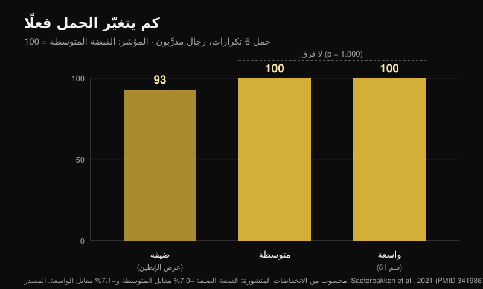
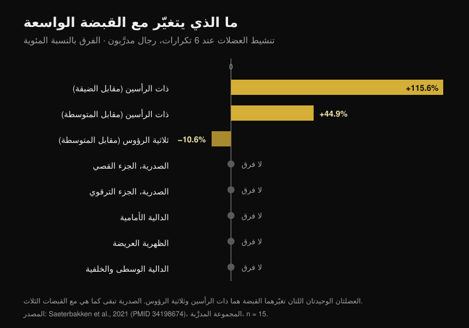

# قبضة ضغط الصدر: واسعة أم متوسطة أم ضيقة؟

بقلم [Giammaria Loi](/autore/giammaria-loi) · حُدِّث في 24 أكتوبر 2026

القاعدة تدور في النوادي منذ سنوات: قبضة واسعة للقوة، متوسطة للصدر، ضيقة لثلاثية الرؤوس. مرتّبة، سهلة الحفظ، ويتبعها الجميع تقريبًا دون أن يختبرها أحد. قرأت ثماني أوراق مفهرسة قاست الأحمال والتنشيط العضلي وعزوم المفاصل مع قبضات مختلفة. جزءان من القاعدة يصحّان. أما الجزء الأوسط فلا توجد دراسة واحدة تسنده.

## باختصار

- **القبضة الواسعة ليست «الأثقل».** هي كذلك أمام الضيقة فقط، بنحو **7%**. وأمام المتوسطة لا فرق أصلًا: p = 1.000 (Saeterbakken وآخرون، 2021)، وفي مختبر آخر **109.8 كغ مقابل 108.9 كغ** في الحد الأقصى (Larsen وآخرون، 2021).
- **العضلة الصدرية لا تتغيّر مع عرض القبضة.** الجزء القصّي، الجزء الترقوي، الظهرية العريضة، الدالية الوسطى والخلفية: لا فرق بين الضيقة والمتوسطة والواسعة، لا عند المتدرّبين ولا عند المبتدئين (Saeterbakken وآخرون، 2021).
- **العضلتان التي تتحرّكان فعلًا غيرهما.** مع القبضة الواسعة تعمل ذات الرأسين **بزيادة 115.6%** عن الضيقة، وثلاثية الرؤوس **بنقص 10.6%** عن المتوسطة. ثلاثية الرؤوس هي العضلة الدافعة الوحيدة التي تحرّكها القبضة.
- **مجال التكرارات لا يتبع القبضة.** عند 75% من الحد الأقصى يكون عدد التكرارات حتى العجز واحدًا مع القبضة الضيقة والمتوسطة والواسعة والحرّة (p = 0.545؛ Pérez-Castilla وآخرون، 2021).
- **القبضة التي ترفع بها أكثر هي التي تستخدمها أصلًا.** مع قبضة وسرعة حرّتين يكون الحد الأقصى أعلى بدلالة معتدّ بها منه مع قبضة مفروضة — ولم يصف أي من المشاركين الحالة الحرّة بغير المريحة، مقابل 80% في الحالة المضبوطة (Lee وآخرون، 2020).

## الحمل: الواسعة تتقدّم على الضيقة فقط

أنفع دراسة في هذه النقطة فعلت شيئًا بسيطًا: أخذت 28 رجلًا، 15 منهم متدرّبون (ضغط الصدر عند **125%** من وزن الجسم على الأقل) و13 مبتدئًا، واختبرت الحد الأقصى لستة تكرارات بثلاث قبضات محدَّدة على جسد كل واحد. القبضة الضيقة = المسافة بين الإبطين. الواسعة = الحد الأقصى المسموح في المنافسة، **81 سم**. المتوسطة = في المنتصف بالضبط (Saeterbakken وآخرون، 2021).

النتيجة عند المتدرّبين: القبضة الضيقة ترفع **7.0%** أقل من المتوسطة و**7.1%** أقل من الواسعة. أما بين المتوسطة والواسعة فـ p = 1.000 — أي أن القبضتين غير قابلتين للتمييز. وعند المبتدئين الفارق مشابه: −8.4% و−6.6%، ومن جديد بلا فرق بين المتوسطة والواسعة.

وصل فريق ثانٍ إلى النقطة نفسها بقياس الحد الأقصى الحقيقي على 14 رجلًا متدرّبًا: **109.8 كغ** بالقبضة الواسعة، **108.9 كغ** بالمتوسطة، **103.7 كغ** بالضيقة. ويخلص المؤلفون إلى أن رفع أكبر حمل ممكن يصحّ معه «قبضة واسعة **أو متوسطة**» (Larsen وآخرون، 2021).

وهناك ثمن ميكانيكي لا يظهر في عمود بياني داخل منشور. مع القبضة الواسعة تذهب **13.1-15.7%** من القوة التي تطبّقها على البار جانبيًا نحو الخارج؛ ومع الضيقة تذهب **8.5-10.1%** نحو الداخل؛ ومع المتوسطة تكون القوة شبه عمودية بالكامل، **0.4-1.8%** فقط (Larsen وآخرون، 2021). الدفع للخارج لا يرفع البار: وظيفته تثبيت المسار، لكنها قوة لا تراها على الحمل.

## الصدر لا يتغيّر. المتغيّر هو ذات الرأسين وثلاثية الرؤوس

هنا تسقط القاعدة. في الدراسة نفسها، وبأقطاب كهربائية على سبع عضلات، غيّر عرض القبضة تنشيط **عضلتين** فقط:

- **العضلة ذات الرأسين العضدية**: مع القبضة الواسعة +115.6% عن الضيقة و+44.9% عن المتوسطة (p < 0.001). تعمل كمضادّة، لتثبيت المرفق؛
- **العضلة ثلاثية الرؤوس العضدية**: مع القبضة الواسعة **−10.6%** عن المتوسطة (p = 0.032) و−24.1% عن الضيقة، وهذا الفارق الأخير على حدود الدلالة (p = 0.058).

الصدرية القصّية، الصدرية الترقوية، الظهرية العريضة، الدالية الوسطى والخلفية: لا فرق، في أي من المجموعتين. والدالية الأمامية تتحرّك عند المبتدئين وحدهم، وبقدر ضئيل.

هذا يقلب نصف الكلام الشائع: القبضة الواسعة لا «توزّع العمل بالتساوي» على العضلات الدافعة. تفعل العكس تمامًا — فهي القبضة التي **تسلب** العمل من ثلاثية الرؤوس. ويؤكّد ذلك فريق ثالث من الاتجاه المقابل: عند 50% من المسافة بين الكتفين تكون ثلاثية الرؤوس عند 16% من الانقباض الأقصى، وعند 150% تنزل إلى 12%، والدالية الأمامية لا تتغيّر في أي حالة (Muyor وآخرون، 2023). ويختم مؤلفو تلك الدراسة بعبارة تصلح للمقال كله: اختيار التمرين لا ينبغي أن يُبنى على التنشيط وحده.

وانتبه لتفصيل يسقطه المنشور: **الفارق على ثلاثية الرؤوس يظهر في المجموعة المتدرّبة فقط**. عند المبتدئين لا تتغيّر ثلاثية الرؤوس مع أي قبضة. النصيحة نفسها لا تنتج الأثر نفسه عند شخصين مختلفين.

## ليست «الصدر مقابل ثلاثية الرؤوس»، بل أي جزء من الصدر

أطرف ما في البيانات لا يتعلق بمقدار عمل الصدر، بل **بأي جزء** منه يعمل. بقياس عزوم المفاصل عند 35 شخصًا بالغًا متدرّبًا بأحمال 6-8RM، تزيد القبضة الأضيق العزم عند المرفق ونشاط الرأس الوحشي لثلاثية الرؤوس والدالية الأمامية **والرأس الترقوي للعضلة الصدرية** — أي الصدر العلوي. أما القبضة الأوسع فتزيد العزم عند الكتف ونشاط الرأس البطني، أي الجزء السفلي (Mausehund وآخرون، 2022).

وهو المبدأ نفسه الذي وجدته عند مقارنة [ضغط الدمبل والفرد لنموّ الصدر](/ar/blog/dafa-aldumbil-am-alfard-lilsadr): الاختيار لا يغيّر مقدار نموّ العضلة الصدرية ككل، بل يغيّر مكان النمو.

أما الوجه العملي فيتعلق بالكتف. كلما اتسعت القبضة ارتفع الحمل الذي يتحمّله الكتف، بالقيمة المطلقة وبالنسبة إلى قدرتك القصوى معًا. وهذا هو السبب الميكانيكي الذي يجعل من لديه تهيّج في الكتف أفضل حالًا غالبًا عند تضييق القبضة. لكن انتبه: **لا توجد دراسة اختبرت القبضة الضيقة كعلاج تأهيلي**. هي خيار منطقي لإدارة الحمل، لا علاج: إن كان لديك ألم في الكتف فالطريق هو الطبيب أو أخصائي العلاج الطبيعي، لا شريحة في منشور.

## المدى الجزئي للصدر: الرقم غير موجود

«نصف حركة في التمدّد لتنمية الصدر» هي ربما أكثر أجزاء القاعدة تكرارًا وأقلّها تحقّقًا. المراجعة المنهجية المخصّصة لمدى الحركة وجدت أن الجزئي في القسم الأول (العضلة ممدودة) والحركة الكاملة يتقدّمان على الجزئي في القسم الأخير — لكن البيانات تأتي من **المستقيمة الفخذية والوحشية الفخذية وذات الرأسين والعضدية والألوية الكبيرة والعضلات المقرِّبة**. والعضلة الصدرية ليست بينها (Kassiano وآخرون، 2023). أما ثلاثية الرؤوس، والمفارقة هنا، فأفضل جزئي معها هو الجزئي في **منتصف** الحركة.

وفي الدراسة الحادة الوحيدة التي قارنت مديات الحركة في ضغط الصدر تحديدًا، أنتج النصف **العلوي** — أي المقصّر، نقيض «الانحياز إلى التمدّد» — أعلى ذروة إثارة في الجزء القصّي الضلعي للعضلة الصدرية وفي الرأسين الطويل والوحشي لثلاثية الرؤوس (Fischer وآخرون، 2025). يبقى هذا قياسًا حادًّا على 19 رجلًا، لا دليل نموّ. لكن اتجاه النصيحة نفسه غير مُبرهَن أيضًا.

## ماذا تقول الأبحاث فعلًا

| الادعاء | النتيجة | الرقم |
|---|---|---|
| قبضة واسعة = أحمال أثقل | **يحتاج إلى توضيح** | صحيح أمام الضيقة (+7%)، خطأ أمام المتوسطة (p = 1.000) |
| قبضة واسعة = عمل متوازن على العضلات الدافعة | **غير صحيح** | ثلاثية الرؤوس تعمل بنقص 10.6% |
| قبضة متوسطة = الأفضل للصدر | **غير قابل للتحقق** | لا فرق في تنشيط العضلة الصدرية؛ وصفر دراسات نموّ |
| قبضة ضيقة = ثلاثية رؤوس أكثر | **مؤكَّد** | 16% مقابل 12% من الانقباض الأقصى |
| قبضة ضيقة = أحمال أخفّ | **مؤكَّد** | نحو 7% أقل |
| القبضة الضيقة لتأهيل الكتف والصدر | **يحتاج إلى توضيح** | منطقية ميكانيكيًا، لم تُختبر قط كتأهيل |
| لكل قبضة مجال تكرارات خاص | **غير صحيح** | التكرارات حتى العجز لا تتغيّر (p = 0.545) |

## كيف تطبّق ذلك

1. **قِس قبضتك، ولا تنسخ سنتيمترات غيرك.** في الدراسات القبضة الضيقة هي المسافة بين الإبطين والواسعة هي حدّ المنافسة، 81 سم: لمن كتفاه ضيقتان تكون تلك الـ 81 سم «أوسع» بكثير مما هي لمن كتفاه عريضتان.
2. **اختر القبضة للحمل وللكتف، لا للعضلة.** العضلة الصدرية تعمل بالقدر نفسه في الحالات الثلاث. المتغيّر الحقيقي هو كم تستطيع أن تحمّل وكم تطلب من كتفك.
3. **اختبر حدّك الأقصى لـ 5-6 تكرارات بقبضتين مختلفتين، بفاصل أسبوع.** إن تجاوز الفارق 5% فلديك جوابك — وعلى الأرجح ليس جواب القاعدة.
4. **لا تغيّر القبضة ومجال التكرارات معًا.** المجال تختاره بحسب الهدف، لا بحسب موضع يديك.
5. **استخدم القبضة الضيقة لثلاثية الرؤوس، لا للصدر.** هذا هو الأثر الوحيد على العضلات الدافعة الذي ظهر باتساق في أكثر من مختبر.

> ### مع Nurvan
> النصيحة الصحيحة في هذا الموضوع هي «قِس»، والقياس يفترض أن الأرقام تبقى. في Nurvan يكون ضغط الصدر بالقبضة الواسعة والمتوسطة والضيقة ثلاث صور مستقلة للتمرين نفسه: كل مجموعة تسجّل الحمل والتكرارات وRIR (التكرارات التي كانت لا تزال في جرابك)، ومنحنى السجل يُظهر لك خلال أسابيع أي قبضة تتقدّم فعلًا على جسدك. إنه اختبار النقطة الثالثة، بلا جدول بيانات.
> **[جرّب Nurvan](https://nurvan.app)**

## أسئلة شائعة

**ما أفضل قبضة في ضغط الصدر؟**
تلك التي ترفع بها أكثر ولا تسبّب لك إزعاجًا في الكتف. في الدراسات القبضتان المتوسطة والواسعة متكافئتان في الحمل، والعضلة الصدرية لا تتغيّر بين الثلاث. ومع قبضة وسرعة حرّتين يكون الحد الأقصى أعلى منه مع قبضة مفروضة (Lee وآخرون، 2020): القبضة التي بنيتها بالتدريب ميزة حقيقية، لا عادة تُصحّح.

**هل القبضة الضيقة تشغّل الصدر أقل؟**
لا. في سبع عضلات مقيسة لم يختلف تنشيط العضلة الصدرية بين القبضة الضيقة والمتوسطة والواسعة (Saeterbakken وآخرون، 2021). ما يتغيّر هو الجزء المُحمَّل — أعلى مع الضيقة وأسفل مع الواسعة (Mausehund وآخرون، 2022) — وما يتغيّر كثيرًا هو ثلاثية الرؤوس.

**هل يجب أن أستخدم القبضة الواسعة إن أردت القوة؟**
ليس بالضرورة. القبضة الواسعة تتقدّم على الضيقة وحدها، بنحو 7%، وتتعادل مع المتوسطة. وإن كانت الواسعة تزعج كتفك فالمتوسطة لا تكلّفك كيلوغرامًا واحدًا.

**كم تكرارًا لكل قبضة؟**
عدد التكرارات الذي تستطيعه عند نسبة معيّنة من الحد الأقصى لا يتغيّر مع القبضة (Pérez-Castilla وآخرون، 2021). المجال تحدّده من الهدف: وللتوجّه، جمعت الأرقام في [كم تكرارًا تحتاج فعلًا للكتلة العضلية](/ar/blog/kam-takrar-lilkutla-aladalia).

## اقرأ أيضًا

- [ضغط الدمبل أم الفرد: ما ينمّي الصدر أكثر؟](/ar/blog/dafa-aldumbil-am-alfard-lilsadr) — المنطق نفسه مطبَّقًا على اختيار التمرين، لا القبضة.
- [كم تكرارًا ومجموعة وراحة للتضخيم](/ar/blog/kam-takrar-lilkutla-aladalia) — لماذا مجال التكرارات متغيّر قائم بذاته.
- [تمديد الساقين أم دفع الأرجل: ماذا تقول الدراسات](/ar/blog/tamdid-alsaqayn-am-dafe-alarjul-alfakhidh-almustaqim) — النموّ الموضعي، مقيسًا على الأرجل.

## المصادر

1. Saeterbakken AH, Stien N, Pedersen H, Solstad TEJ, Cumming KT, Andersen V, 2021. The Effect of Grip Width on Muscle Strength and Electromyographic Activity in Bench Press among Novice- and Resistance-Trained Men. *Int J Environ Res Public Health*. PMID [34198674](https://pubmed.ncbi.nlm.nih.gov/34198674/) · [DOI](https://doi.org/10.3390/ijerph18126444)
2. Larsen S, Gomo O, van den Tillaar R, 2021. A Biomechanical Analysis of Wide, Medium, and Narrow Grip Width Effects on Kinematics, Horizontal Kinetics, and Muscle Activity on the Sticking Region in Recreationally Trained Males During 1-RM Bench Pressing. *Front Sports Act Living*. PMID [33554113](https://pubmed.ncbi.nlm.nih.gov/33554113/) · [DOI](https://doi.org/10.3389/fspor.2020.637066)
3. Mausehund L, Werkhausen A, Bartsch J, Krosshaug T, 2022. Understanding Bench Press Biomechanics—The Necessity of Measuring Lateral Barbell Forces. *J Strength Cond Res*. PMID [33555823](https://pubmed.ncbi.nlm.nih.gov/33555823/) · [DOI](https://doi.org/10.1519/JSC.0000000000003948)
4. Muyor JM, Rodríguez-Ridao D, Oliva-Lozano JM, 2023. Comparison of Muscle Activity between the Horizontal Bench Press and the Seated Chest Press Exercises Using Several Grips. *J Hum Kinet*. PMID [37229415](https://pubmed.ncbi.nlm.nih.gov/37229415/) · [DOI](https://doi.org/10.5114/jhk/161468)
5. Pérez-Castilla A, Jukic I, Haff GG, García-Ramos A, 2021. The Bench Press Grip Width Does Not Affect the Number of Repetitions Performed at Different Velocity Loss Thresholds. *Int J Environ Res Public Health*. PMID [33504038](https://pubmed.ncbi.nlm.nih.gov/33504038/) · [DOI](https://doi.org/10.3390/ijerph18031057)
6. Lee S, Cone SM, Kim S, 2020. A biomechanical comparison of self-selected and experimentally controlled speeds and grip widths during the bench press exercise. *Sports Biomech*. PMID [32564677](https://pubmed.ncbi.nlm.nih.gov/32564677/) · [DOI](https://doi.org/10.1080/14763141.2020.1772357)
7. Kassiano W, Costa B, Nunes JP, Ribeiro AS, Schoenfeld BJ, Cyrino ES, 2023. Which ROMs Lead to Rome? A Systematic Review of the Effects of Range of Motion on Muscle Hypertrophy. *J Strength Cond Res*. PMID [36662126](https://pubmed.ncbi.nlm.nih.gov/36662126/) · [DOI](https://doi.org/10.1519/JSC.0000000000004415)
8. Fischer J, Burger C, Manieu Seguel JA, Rodoplu C, Paternoster FK, Tilp M, Konrad A, 2025. Acute muscle excitation response across various bench press ranges of motion. *Sci Rep*. PMID [40269203](https://pubmed.ncbi.nlm.nih.gov/40269203/) · [DOI](https://doi.org/10.1038/s41598-025-98354-9)

بيانات المراجع مُتحقَّق منها على PubMed. نقطة الانطلاق: منشور «Bench press cheat sheet» لـ Sebastian Oreb ([@australianstrengthcoach](https://www.instagram.com/p/Dd8lCqIkfEh/)، 1 أكتوبر 2026). نص هذا المقال وبنيته وبياناته ورسومه أصلية.

---

*Giammaria Loi هو مؤسس Nurvan. يتدرّب بالأثقال منذ 2012، ويعمل مدربًا شخصيًا ومدرّبًا معتمدًا من FIPE منذ 2013، ويشارك في منافسات رفع القوة على المستوى الوطني منذ 2018.*

> ملاحظة: محتوى تثقيفي لا يغني عن رأي طبيب أو مختص. إن كان لديك ألم في الكتف أو الصدر، فاستشر طبيبًا أو أخصائي علاج طبيعي قبل تعديل تدريبك.
