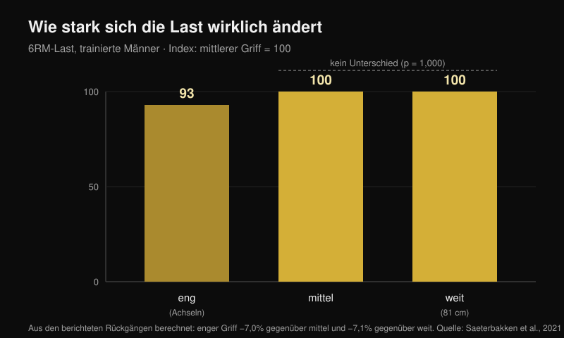
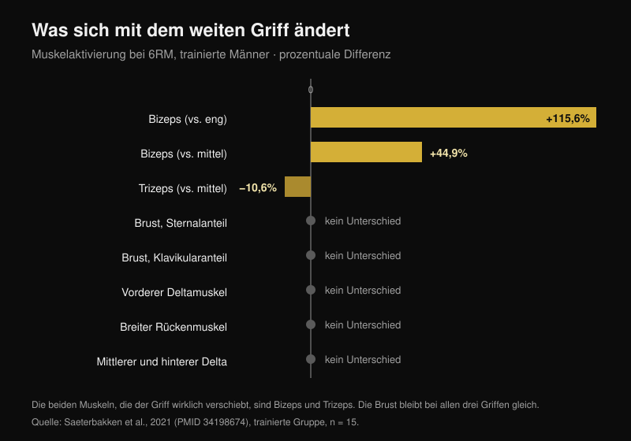

# Bankdrücken Griffbreite: weit, mittel oder eng?

Von [Giammaria Loi](/autore/giammaria-loi) · aktualisiert am 24. Oktober 2026

Das Schema kursiert seit Jahren: weiter Griff für die Kraft, mittlerer Griff für die Brust, enger Griff für den Trizeps. Es ist ordentlich, leicht zu behalten, und fast alle folgen ihm, ohne es je überprüft zu haben. Ich habe acht indexierte Arbeiten gelesen, die Lasten, Muskelaktivierung und Gelenkmomente bei unterschiedlichen Griffbreiten gemessen haben. Zwei Teile des Schemas halten. Einer, der mittlere, hat nicht eine einzige Studie hinter sich.

## Kurz gefasst

- **Der weite Griff ist nicht „der schwerste".** Er ist es nur gegenüber dem engen, um rund **7 %**. Gegenüber dem mittleren Griff gibt es den Unterschied gar nicht: p = 1,000 (Saeterbakken et al., 2021), und in einem anderen Labor **109,8 kg gegenüber 108,9 kg** im Maximalversuch (Larsen et al., 2021).
- **Die Brust ändert sich mit der Griffbreite nicht.** Sternaler Anteil, klavikulärer Anteil, breiter Rückenmuskel, mittlerer und hinterer Deltamuskel: kein Unterschied zwischen eng, mittel und weit, weder bei Trainierten noch bei Anfängern (Saeterbakken et al., 2021).
- **Wirklich verschieben sich zwei andere Muskeln.** Mit weitem Griff arbeitet der Bizeps **115,6 % mehr** als mit engem, und der Trizeps **10,6 % weniger** als mit mittlerem. Der Trizeps ist der einzige „drückende" Muskel, den der Griff verschiebt.
- **Der Wiederholungsbereich hängt nicht vom Griff ab.** Bei 75 % des Maximums ist die Zahl der Wiederholungen bis zum Muskelversagen mit engem, mittlerem, weitem und frei gewähltem Griff dieselbe (p = 0,545; Pérez-Castilla et al., 2021).
- **Der Griff, mit dem du am meisten hebst, ist der, den du schon benutzt.** Mit frei gewähltem Griff und frei gewählter Geschwindigkeit liegt das Maximum signifikant höher als mit vorgegebenem Griff — und keiner der Probanden empfand die freie Bedingung als unangenehm, gegenüber 80 % in der kontrollierten (Lee et al., 2020).

## Die Last: der weite Griff gewinnt nur gegen den engen

Die nützlichste Arbeit zu diesem Punkt hat etwas Einfaches getan: 28 Männer, davon 15 Trainierte (Bankdrücken mit mindestens 125 % des Körpergewichts) und 13 Anfänger, wurden auf ihr Maximum für 6 Wiederholungen mit drei Griffen getestet, die am Körper jedes Einzelnen definiert wurden. Enger Griff = der Abstand zwischen den Achseln. Weiter Griff = das im Wettkampf erlaubte Maximum, **81 cm**. Mittlerer Griff = genau dazwischen (Saeterbakken et al., 2021).

Ergebnis bei den Trainierten: Mit engem Griff heben sie **7,0 %** weniger als mit mittlerem und **7,1 %** weniger als mit weitem. Zwischen mittel und weit dagegen p = 1,000 — die beiden Griffe sind also nicht unterscheidbar. Bei den Anfängern ist der Abstand ähnlich: −8,4 % und −6,6 %, wieder ohne Unterschied zwischen mittel und weit.

Eine zweite Gruppe kam am echten Maximum von 14 trainierten Männern zum selben Punkt: **109,8 kg** mit weitem Griff, **108,9 kg** mit mittlerem, **103,7 kg** mit engem. Die Autoren schließen, dass für maximale Last „ein weiter **oder mittlerer** Griff" in Ordnung ist (Larsen et al., 2021).

Es gibt noch einen mechanischen Preis, den das Balkendiagramm eines Karussells nicht zeigen kann. Mit weitem Griff gehen **13,1-15,7 %** der Kraft, die du auf die Stange bringst, seitlich nach außen; mit engem Griff gehen **8,5-10,1 %** nach innen; mit mittlerem Griff ist fast alles vertikal, **0,4-1,8 %** (Larsen et al., 2021). Nach außen zu drücken hebt die Stange nicht: Es hält die Bahn stabil, ist aber Kraft, die du auf der Last nicht siehst.

## Die Brust ändert sich nicht. Bizeps und Trizeps schon

Hier fällt das Schema. In derselben Studie, mit Elektroden auf sieben Muskeln, veränderte die Griffbreite die Aktivierung von genau **zwei** Muskeln:

- **Bizeps brachii**: mit weitem Griff +115,6 % gegenüber dem engen und +44,9 % gegenüber dem mittleren (p < 0,001). Er arbeitet als Gegenspieler, um das Ellenbogengelenk zu stabilisieren;
- **Trizeps brachii**: mit weitem Griff **−10,6 %** gegenüber dem mittleren (p = 0,032) und −24,1 % gegenüber dem engen, wobei dieser zweite Unterschied an der Grenze zur Signifikanz liegt (p = 0,058).

Sternaler Brustmuskel, klavikulärer Brustmuskel, breiter Rückenmuskel, mittlerer und hinterer Deltamuskel: kein Unterschied, in keiner der beiden Gruppen. Der vordere Deltamuskel bewegt sich nur bei den Anfängern, und das kaum.

Das kehrt einen Teil des Allgemeinwissens um: Der weite Griff „verteilt die Arbeit" nicht gleichmäßig auf die drückenden Muskeln. Er macht genau das Gegenteil — er ist der Griff, der dem Trizeps Arbeit **wegnimmt**. Eine dritte Gruppe bestätigt das aus der anderen Richtung: bei 50 % des Schulterabstands liegt der Trizeps bei 16 % der maximalen Kontraktion, bei 150 % sinkt er auf 12 %, und der vordere Deltamuskel ändert sich in keiner Bedingung (Muyor et al., 2023). Die Autoren dieser Arbeit schließen mit einem Satz, der für den ganzen Artikel gilt: Die Übungswahl sollte nicht allein auf der Aktivierung beruhen.

Achte auf ein Detail, das das Karussell überspringt: **Der Unterschied am Trizeps zeigt sich nur in der trainierten Gruppe.** Bei den Anfängern ändert sich der Trizeps mit keinem Griff. Derselbe Ratschlag erzeugt bei zwei verschiedenen Menschen nicht denselben Effekt.

## Es geht nicht um „Brust gegen Trizeps": es geht darum, welcher Teil der Brust

Die interessanteste Zahl betrifft nicht, wie viel Brust arbeitet, sondern **welcher** Teil. In einer Messung der Gelenkmomente von 35 trainierten Erwachsenen mit 6-8RM-Lasten erhöht der engere Griff das Moment am Ellenbogen und die Aktivität des lateralen Trizepskopfs, des vorderen Deltamuskels **und des klavikulären Anteils des Brustmuskels** — also der oberen Brust. Der weitere Griff erhöht das Moment an der Schulter und die Aktivität des abdominalen Anteils, also des unteren Teils (Mausehund et al., 2022).

Es ist dasselbe Prinzip, das ich beim Vergleich von [Bankdrücken und Fliegenden für das Brustwachstum](/de/blog/kurzhantel-bankdruecken-oder-fliegende-brust) gefunden habe: Die Wahl ändert nicht, wie viel die Brust insgesamt wächst, sie ändert wo.

Praktisch relevant ist das für die Schulter. Je weiter der Griff, desto höher die Last, die die Schulter tragen muss — absolut und relativ zu ihrer maximalen Kapazität. Das ist der mechanische Grund, warum es Menschen mit gereizter Schulter oft besser geht, wenn sie enger greifen. Aber Achtung: **Keine Studie hat den engen Griff als Reha-Maßnahme getestet.** Er ist eine sinnvolle Entscheidung im Lastmanagement, keine Therapie: Wenn du Schulterschmerzen hast, führt der Weg zur Ärztin, zum Arzt oder zur Physiotherapie, nicht zu einer Slide.

## Teil-ROM für die Brust: die Zahl, die nicht existiert

„Halbe Bewegung in der Dehnung, damit die Brust wächst" ist vielleicht der am häufigsten wiederholte und am wenigsten überprüfte Teil des Schemas. Die systematische Übersichtsarbeit zum Bewegungsumfang fand, dass die Teilwiederholung im Anfangsbereich (gedehnter Muskel) und die vollständige Bewegung die Teilwiederholung im Endbereich schlagen — aber die Daten kommen von **Rectus femoris, Vastus lateralis, Bizeps, Brachialis, großem Gesäßmuskel und Adduktoren**. Der Brustmuskel ist nicht dabei (Kassiano et al., 2023). Beim Trizeps hat merkwürdigerweise die Teilwiederholung im **mittleren** Bereich der Bewegung am besten funktioniert.

Und in der einzigen akuten Studie, die Bewegungsumfänge direkt beim Bankdrücken verglichen hat, erzeugte die **obere** Hälfte — also die verkürzte, das Gegenteil des „lengthened bias" — die höchste Spitzenerregung im sternokostalen Anteil des Brustmuskels und im langen und lateralen Trizepskopf (Fischer et al., 2025). Das bleibt ein akuter Wert an 19 Männern, kein Wachstumsnachweis. Aber nicht einmal die Richtung des Ratschlags ist belegt.

## Was die Forschung wirklich sagt

| Aussage | Ergebnis | Zahl |
|---|---|---|
| Weiter Griff = schwerere Lasten | **Zu präzisieren** | Wahr gegenüber dem engen (+7 %), falsch gegenüber dem mittleren (p = 1,000) |
| Weiter Griff = gleichmäßige Arbeit für die drückenden Muskeln | **Widerlegt** | Der Trizeps arbeitet 10,6 % weniger |
| Mittlerer Griff = der beste für die Brust | **Nicht überprüfbar** | Kein Unterschied in der Brustaktivierung; null Wachstumsstudien |
| Enger Griff = mehr Trizeps | **Bestätigt** | 16 % gegenüber 12 % der maximalen Kontraktion |
| Enger Griff = leichtere Lasten | **Bestätigt** | Rund 7 % weniger |
| Enger Griff zur Reha von Schulter und Brust | **Zu präzisieren** | Mechanisch sinnvoll, nie als Reha getestet |
| Jeder Griff hat seinen Wiederholungsbereich | **Widerlegt** | Die Wiederholungen bis zum Versagen ändern sich nicht (p = 0,545) |

## So setzt du es um

1. **Miss deinen Griff, kopiere nicht die Zentimeter von jemand anderem.** In den Studien ist der enge Griff der Abstand zwischen den Achseln und der weite das Wettkampfmaximum, 81 cm: Für schmale Schultern sind diese 81 cm viel „weiter" als für breite.
2. **Wähle den Griff nach Last und Schulter, nicht nach Muskel.** Die Brust arbeitet in allen drei Fällen gleich. Was sich wirklich ändert, ist, wie viel du auflegen kannst und wie viel du der Schulter abverlangst.
3. **Teste dein Maximum für 5-6 Wiederholungen mit zwei verschiedenen Griffen, im Abstand von einer Woche.** Liegt der Unterschied über 5 %, hast du deine Antwort — und wahrscheinlich ist es nicht die des Schemas.
4. **Ändere Griff und Wiederholungsbereich nicht gleichzeitig.** Den Bereich wählst du nach dem Ziel, nicht danach, wo du die Hände hältst.
5. **Nutze den engen Griff für den Trizeps, nicht für die Brust.** Das ist der einzige Effekt auf die drückenden Muskeln, der in mehreren Labors konsistent gezeigt wurde.

> ### Mit Nurvan
> Der richtige Rat zu diesem Thema heißt „messen", und Messen setzt voraus, dass die Zahlen bleiben. In Nurvan sind Bankdrücken mit weitem, mittlerem und engem Griff eigene Varianten derselben Übung: Jeder Satz hält Last, Wiederholungen und RIR fest (die Wiederholungen, die du noch im Tank gehabt hättest), und der Verlaufsgraph zeigt dir über Wochen, welcher Griff an deinem Körper wirklich vorankommt. Das ist der Test aus Punkt 3, ohne Tabellenkalkulation.
> **[Nurvan testen](https://nurvan.app)**

## Häufige Fragen

**Welcher Griff ist beim Bankdrücken der beste?**
Der, mit dem du am meisten hebst und keine Beschwerden in der Schulter hast. In den Studien sind mittlerer und weiter Griff bei der Last gleichwertig, und die Brust ändert sich zwischen den drei nicht. Mit frei gewähltem Griff und frei gewählter Geschwindigkeit liegt das Maximum höher als mit vorgegebenem Griff (Lee et al., 2020): Der Griff, den du dir im Training aufgebaut hast, ist ein echter Vorteil und keine Angewohnheit, die man korrigieren muss.

**Trainiert der enge Griff die Brust weniger?**
Nein. Von sieben gemessenen Muskeln zeigte die Aktivierung des Brustmuskels keinen Unterschied zwischen engem, mittlerem und weitem Griff (Saeterbakken et al., 2021). Es ändert sich der beanspruchte Anteil — höher mit engem, tiefer mit weitem Griff (Mausehund et al., 2022) — und es ändert sich deutlich der Trizeps.

**Muss ich weit greifen, wenn ich stark werden will?**
Nicht zwingend. Der weite Griff schlägt nur den engen, um rund 7 %, und liegt mit dem mittleren gleich. Wenn der weite Griff deiner Schulter Beschwerden macht, kostet der mittlere null Kilo.

**Wie viele Wiederholungen pro Griff?**
Die Zahl der Wiederholungen, die du bei einem bestimmten Prozentsatz des Maximums schaffst, ändert sich mit dem Griff nicht (Pérez-Castilla et al., 2021). Den Bereich entscheidest du nach dem Ziel: zur Orientierung habe ich die Daten in [wie viele Wiederholungen es wirklich für Muskelaufbau braucht](/de/blog/wie-viele-wiederholungen-muskelaufbau) gesammelt.

## Auch interessant

- [Bankdrücken oder Fliegende: was die Brust mehr wachsen lässt?](/de/blog/kurzhantel-bankdruecken-oder-fliegende-brust) — dieselbe Logik, angewandt auf die Wahl der Übung statt des Griffs.
- [Wie viele Wiederholungen, Sätze und wie viel Pause es für Hypertrophie braucht](/de/blog/wie-viele-wiederholungen-muskelaufbau) — warum der Wiederholungsbereich eine eigene Variable ist.
- [Beinstrecker oder Beinpresse: was die Studien sagen](/de/blog/beinstrecker-oder-beinpresse-rectus-femoris) — regionales Wachstum, an den Beinen gemessen.

## Quellen

1. Saeterbakken AH, Stien N, Pedersen H, Solstad TEJ, Cumming KT, Andersen V, 2021. The Effect of Grip Width on Muscle Strength and Electromyographic Activity in Bench Press among Novice- and Resistance-Trained Men. *Int J Environ Res Public Health*. PMID [34198674](https://pubmed.ncbi.nlm.nih.gov/34198674/) · [DOI](https://doi.org/10.3390/ijerph18126444)
2. Larsen S, Gomo O, van den Tillaar R, 2021. A Biomechanical Analysis of Wide, Medium, and Narrow Grip Width Effects on Kinematics, Horizontal Kinetics, and Muscle Activity on the Sticking Region in Recreationally Trained Males During 1-RM Bench Pressing. *Front Sports Act Living*. PMID [33554113](https://pubmed.ncbi.nlm.nih.gov/33554113/) · [DOI](https://doi.org/10.3389/fspor.2020.637066)
3. Mausehund L, Werkhausen A, Bartsch J, Krosshaug T, 2022. Understanding Bench Press Biomechanics—The Necessity of Measuring Lateral Barbell Forces. *J Strength Cond Res*. PMID [33555823](https://pubmed.ncbi.nlm.nih.gov/33555823/) · [DOI](https://doi.org/10.1519/JSC.0000000000003948)
4. Muyor JM, Rodríguez-Ridao D, Oliva-Lozano JM, 2023. Comparison of Muscle Activity between the Horizontal Bench Press and the Seated Chest Press Exercises Using Several Grips. *J Hum Kinet*. PMID [37229415](https://pubmed.ncbi.nlm.nih.gov/37229415/) · [DOI](https://doi.org/10.5114/jhk/161468)
5. Pérez-Castilla A, Jukic I, Haff GG, García-Ramos A, 2021. The Bench Press Grip Width Does Not Affect the Number of Repetitions Performed at Different Velocity Loss Thresholds. *Int J Environ Res Public Health*. PMID [33504038](https://pubmed.ncbi.nlm.nih.gov/33504038/) · [DOI](https://doi.org/10.3390/ijerph18031057)
6. Lee S, Cone SM, Kim S, 2020. A biomechanical comparison of self-selected and experimentally controlled speeds and grip widths during the bench press exercise. *Sports Biomech*. PMID [32564677](https://pubmed.ncbi.nlm.nih.gov/32564677/) · [DOI](https://doi.org/10.1080/14763141.2020.1772357)
7. Kassiano W, Costa B, Nunes JP, Ribeiro AS, Schoenfeld BJ, Cyrino ES, 2023. Which ROMs Lead to Rome? A Systematic Review of the Effects of Range of Motion on Muscle Hypertrophy. *J Strength Cond Res*. PMID [36662126](https://pubmed.ncbi.nlm.nih.gov/36662126/) · [DOI](https://doi.org/10.1519/JSC.0000000000004415)
8. Fischer J, Burger C, Manieu Seguel JA, Rodoplu C, Paternoster FK, Tilp M, Konrad A, 2025. Acute muscle excitation response across various bench press ranges of motion. *Sci Rep*. PMID [40269203](https://pubmed.ncbi.nlm.nih.gov/40269203/) · [DOI](https://doi.org/10.1038/s41598-025-98354-9)

Bibliografische Daten auf PubMed überprüft. Ausgangspunkt: das Karussell „Bench press cheat sheet" von Sebastian Oreb ([@australianstrengthcoach](https://www.instagram.com/p/Dd8lCqIkfEh/), 1. Oktober 2026). Text, Struktur, Daten und Grafiken dieses Artikels sind original.

---

*Giammaria Loi ist der Gründer von Nurvan. Er trainiert seit 2012 mit Gewichten, arbeitet seit 2013 als Personal Trainer und FIPE-zertifizierter Coach und tritt seit 2018 im Powerlifting auf nationalem Niveau an. Jeder Artikel, den er zeichnet, beginnt bei den Studien und endet bei dem, was im Studio wirklich funktioniert.*

> Hinweis: informativer Inhalt, ersetzt nicht die Beratung durch eine Ärztin, einen Arzt oder eine qualifizierte Fachperson. Bei Schmerzen in Schulter oder Brust wende dich an eine Ärztin, einen Arzt oder eine Physiotherapie, bevor du dein Training änderst.
