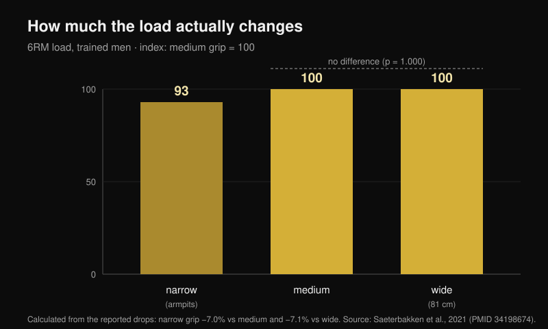
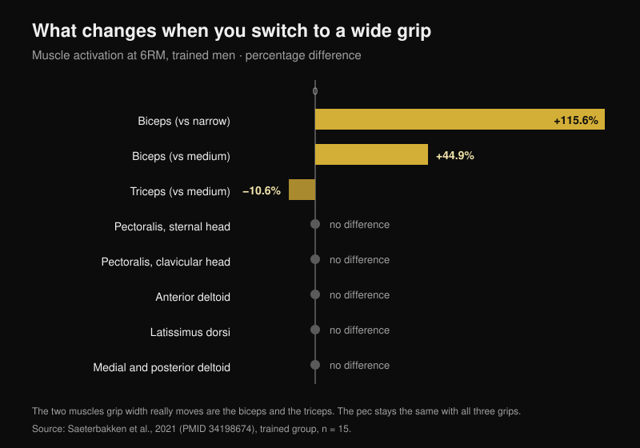

# Bench press grip width: wide, medium or close?

By [Giammaria Loi](/autore/giammaria-loi) · updated 24 October 2026

The cheat sheet has been going around for years: wide grip for strength, medium grip for the chest, close grip for the triceps. It is tidy, it is easy to remember, and almost everyone follows it without ever having tested it. I read eight indexed papers that measured loads, muscle activation and joint moments across different grip widths. Two parts of the cheat sheet hold up. The middle one does not have a single study behind it.

## The short version

- **The wide grip is not "the strongest one".** It only beats the close grip, by about **7%**. Against the medium grip the difference does not exist: p = 1.000 (Saeterbakken et al., 2021), and in another lab **109.8 kg versus 108.9 kg** of one-rep max (Larsen et al., 2021).
- **The chest does not change with grip width.** Sternal portion, clavicular portion, lats, middle and rear delts: no difference between close, medium and wide, in trained lifters or in novices (Saeterbakken et al., 2021).
- **The two muscles that really move are somewhere else.** With a wide grip the biceps works **115.6% more** than with a close grip, and the triceps **10.6% less** than with a medium grip. The triceps is the only "pushing muscle" that grip width shifts.
- **Your rep range does not depend on the grip.** At 75% of one-rep max, the number of reps you can hit before failure is the same with a close, medium, wide or self-selected grip (p = 0.545; Pérez-Castilla et al., 2021).
- **The grip you lift the most with is the one you already use.** With self-selected grip and speed the one-rep max is significantly higher than with an imposed grip — and not one subject found the free condition uncomfortable, against 80% in the controlled one (Lee et al., 2020).

## The load: the wide grip only wins against the close grip

The most useful study on this point did something simple: it took 28 men, 15 trained (benching at least 125% of body weight) and 13 novices, and tested their 6-rep max with three grips defined on each lifter's own body. Close grip = the distance between the armpits. Wide grip = the maximum allowed in competition, **81 cm**. Medium grip = exactly halfway between the two (Saeterbakken et al., 2021).

Result in the trained group: the close grip moves **7.0%** less load than the medium grip and **7.1%** less than the wide grip. Between medium and wide, though, p = 1.000 — meaning the two grips are indistinguishable. In the novices the gap is similar: −8.4% and −6.6%, again with no difference between medium and wide.

A second group reached the same conclusion by measuring true one-rep maxes in 14 trained men: **109.8 kg** with a wide grip, **108.9 kg** with a medium grip, **103.7 kg** with a close grip. The authors conclude that to lift as much as possible "a wide **or medium**" grip will do (Larsen et al., 2021).

There is also a mechanical cost that no bar chart in a carousel can show. With a wide grip, **13.1–15.7%** of the force you apply to the bar goes sideways, outwards; with a close grip **8.5–10.1%** goes inwards; with a medium grip almost all of it is vertical, **0.4–1.8%** (Larsen et al., 2021). Pushing out does not lift the bar: it keeps the path stable, but it is force you never see on the load.

## The chest does not change. The biceps and triceps do

This is where the cheat sheet falls apart. In that same study, with electrodes on seven muscles, grip width changed the activation of **two** muscles only:

- **biceps brachii**: with a wide grip, +115.6% versus close and +44.9% versus medium (p < 0.001). It works as an antagonist, stabilising the elbow;
- **triceps brachii**: with a wide grip, **−10.6%** versus medium (p = 0.032) and −24.1% versus close, the latter difference borderline for significance (p = 0.058).

Sternal pec, clavicular pec, lats, middle and rear delts: no difference, in either group. The front delt moves only in the novices, and only a little.

That flips part of the received wisdom on its head: the wide grip does not "spread the work evenly" across the pushing muscles. It does exactly the opposite — it is the grip that **takes work away** from the triceps. A third group confirms it from the other direction: at 50% of the distance between the shoulders the triceps sits at 16% of maximum contraction, at 150% it drops to 12%, and the front delt does not change in any condition (Muyor et al., 2023). The authors of that paper close with a line that applies to this whole article: exercise selection should not be based on activation alone.

Watch one detail the carousel skips: **the triceps difference shows up only in the trained group**. In novices the triceps does not change with any grip. The same piece of advice does not produce the same effect in two different people.

## It is not "chest versus triceps": it is which part of the chest

The most interesting finding is not about how much chest works, but about **which** part of it. Measuring joint moments in 35 trained adults with 6–8RM loads, the closer grip increases the elbow moment and the activity of the lateral triceps, the front delt **and the clavicular head of the pec** — the upper chest. The wider grip increases the shoulder moment and the activity of the abdominal head, meaning the lower part (Mausehund et al., 2022).

It is the same principle I found comparing [the dumbbell bench press and the fly for chest growth](/en/blog/dumbbell-bench-press-vs-fly-chest-growth): the choice does not change how much the pec grows overall, it changes where.

The practical upshot concerns the shoulder. The wider the grip, the higher the load the shoulder has to carry, both in absolute terms and relative to your own maximum capacity. That is the mechanical reason why people with a cranky shoulder often feel better bringing the hands in. But be careful: **no study has tested the close grip as a rehab treatment**. It is a sensible load-management choice, not a therapy: if your shoulder hurts, the route is a doctor or a physiotherapist, not a slide.

## Partial ROM for the chest: the data that does not exist

"Half a rep in the stretch to grow the chest" is probably the most repeated and least verified part of the cheat sheet. The systematic review dedicated to range of motion found that partials in the initial part of the movement (muscle lengthened) and full-range work both beat partials in the final part — but the data come from the **rectus femoris, vastus lateralis, biceps, brachialis, gluteus maximus and adductors**. The pec is not among them (Kassiano et al., 2023). For the triceps, curiously, the partial that worked best was the one in the **middle** of the movement.

And in the only acute study that compared ranges of motion in the bench press itself, the **top** half — the shortened one, the opposite of a lengthened bias — produced the highest peak excitation in the sternocostal portion of the pec and in the long and lateral heads of the triceps (Fischer et al., 2025). It is still an acute measurement in 19 men, not evidence of growth. But the direction of the advice is not proven either.

## What the research actually says

| Claim | Verdict | Number |
|---|---|---|
| Wide grip = heavier loads | **Needs nuance** | True against close (+7%), false against medium (p = 1.000) |
| Wide grip = even work across the pushing muscles | **Debunked** | The triceps works 10.6% less |
| Medium grip = best for the chest | **Unverifiable** | No difference in pec activation; zero growth studies |
| Close grip = more triceps | **Confirmed** | 16% versus 12% of maximum contraction |
| Close grip = lighter loads | **Confirmed** | About 7% less |
| Close grip to rehab the shoulder and chest | **Needs nuance** | Mechanically sensible, never tested as rehab |
| Every grip has its own rep range | **Debunked** | Reps to failure do not change (p = 0.545) |

## How to apply it

1. **Measure your own grip, do not copy someone else's centimetres.** In the studies the close grip is the distance between the armpits and the wide grip is the competition maximum, 81 cm: for narrow-shouldered lifters those 81 cm are far "wider" than for someone built broad.
2. **Pick the grip for the load and for the shoulder, not for the muscle.** The pec works the same in all three cases. What actually changes is how much you can load and how much you ask of the shoulder.
3. **Test your 5–6 rep max with two different grips, a week apart.** If the difference is more than 5%, you have your answer — and it probably is not the one on the cheat sheet.
4. **Do not change grip and rep range at the same time.** You pick the range from your goal, not from where you put your hands.
5. **Use the close grip for the triceps, not for the chest.** It is the only effect on the pushing muscles that has shown up consistently across more than one lab.

> ### With Nurvan
> The right advice here is "measure", but measuring means the numbers have to stick around. In Nurvan the wide, medium and close grip bench press are separate variants of the same exercise: every set logs load, reps and RIR (the reps you had left in the tank), and the history chart shows you, over weeks, which grip is actually progressing on your body. It is the test in point 3, without the spreadsheet.
> **[Try Nurvan](https://nurvan.app)**

## Frequently asked questions

**What is the best grip for the bench press?**
The one you lift the most with and that leaves your shoulder alone. In the studies the medium and wide grips are equivalent for load, and the pec does not change across the three. With self-selected grip and speed the one-rep max is higher than with an imposed grip (Lee et al., 2020): the grip you built by training is a real advantage, not a habit to correct.

**Does a close grip train the chest less?**
No. Across seven muscles measured, pec activation was no different between close, medium and wide grips (Saeterbakken et al., 2021). What changes is the portion loaded — more upper chest with a close grip, more lower chest with a wide one (Mausehund et al., 2022) — and the triceps changes a lot.

**Do I need a wide grip to get strong?**
Not necessarily. The wide grip only beats the close grip, by about 7%, and ties with the medium grip. If a wide grip bothers your shoulder, going medium costs you zero kilos.

**How many reps per grip?**
The number of reps you can do at a given percentage of your max does not change with the grip (Pérez-Castilla et al., 2021). You decide the range from your goal: to get your bearings, I pulled the data together in [how many reps you actually need to build muscle](/en/blog/how-many-reps-build-muscle).

## Read next

- [Dumbbell bench press or fly: what grows the chest more?](/en/blog/dumbbell-bench-press-vs-fly-chest-growth) — the same logic applied to picking the exercise, not the grip.
- [How many reps, sets and how much rest for hypertrophy](/en/blog/how-many-reps-build-muscle) — why the rep range is a variable of its own.
- [Leg extension or leg press: what the studies say](/en/blog/leg-extension-vs-leg-press-rectus-femoris) — regional growth, measured on the legs.

## References

1. Saeterbakken AH, Stien N, Pedersen H, Solstad TEJ, Cumming KT, Andersen V, 2021. The Effect of Grip Width on Muscle Strength and Electromyographic Activity in Bench Press among Novice- and Resistance-Trained Men. *Int J Environ Res Public Health*. PMID [34198674](https://pubmed.ncbi.nlm.nih.gov/34198674/) · [DOI](https://doi.org/10.3390/ijerph18126444)
2. Larsen S, Gomo O, van den Tillaar R, 2021. A Biomechanical Analysis of Wide, Medium, and Narrow Grip Width Effects on Kinematics, Horizontal Kinetics, and Muscle Activity on the Sticking Region in Recreationally Trained Males During 1-RM Bench Pressing. *Front Sports Act Living*. PMID [33554113](https://pubmed.ncbi.nlm.nih.gov/33554113/) · [DOI](https://doi.org/10.3389/fspor.2020.637066)
3. Mausehund L, Werkhausen A, Bartsch J, Krosshaug T, 2022. Understanding Bench Press Biomechanics—The Necessity of Measuring Lateral Barbell Forces. *J Strength Cond Res*. PMID [33555823](https://pubmed.ncbi.nlm.nih.gov/33555823/) · [DOI](https://doi.org/10.1519/JSC.0000000000003948)
4. Muyor JM, Rodríguez-Ridao D, Oliva-Lozano JM, 2023. Comparison of Muscle Activity between the Horizontal Bench Press and the Seated Chest Press Exercises Using Several Grips. *J Hum Kinet*. PMID [37229415](https://pubmed.ncbi.nlm.nih.gov/37229415/) · [DOI](https://doi.org/10.5114/jhk/161468)
5. Pérez-Castilla A, Jukic I, Haff GG, García-Ramos A, 2021. The Bench Press Grip Width Does Not Affect the Number of Repetitions Performed at Different Velocity Loss Thresholds. *Int J Environ Res Public Health*. PMID [33504038](https://pubmed.ncbi.nlm.nih.gov/33504038/) · [DOI](https://doi.org/10.3390/ijerph18031057)
6. Lee S, Cone SM, Kim S, 2020. A biomechanical comparison of self-selected and experimentally controlled speeds and grip widths during the bench press exercise. *Sports Biomech*. PMID [32564677](https://pubmed.ncbi.nlm.nih.gov/32564677/) · [DOI](https://doi.org/10.1080/14763141.2020.1772357)
7. Kassiano W, Costa B, Nunes JP, Ribeiro AS, Schoenfeld BJ, Cyrino ES, 2023. Which ROMs Lead to Rome? A Systematic Review of the Effects of Range of Motion on Muscle Hypertrophy. *J Strength Cond Res*. PMID [36662126](https://pubmed.ncbi.nlm.nih.gov/36662126/) · [DOI](https://doi.org/10.1519/JSC.0000000000004415)
8. Fischer J, Burger C, Manieu Seguel JA, Rodoplu C, Paternoster FK, Tilp M, Konrad A, 2025. Acute muscle excitation response across various bench press ranges of motion. *Sci Rep*. PMID [40269203](https://pubmed.ncbi.nlm.nih.gov/40269203/) · [DOI](https://doi.org/10.1038/s41598-025-98354-9)

Bibliographic data verified on PubMed. Starting point: the "Bench press cheat sheet" carousel by Sebastian Oreb ([@australianstrengthcoach](https://www.instagram.com/p/Dd8lCqIkfEh/), 1 October 2026). The text, structure, data and charts in this article are original.

---

*Giammaria Loi is the founder of Nurvan. He has been lifting since 2012, has worked as a FIPE-certified personal trainer and coach since 2013, and has competed in powerlifting at national level since 2018. Every article he writes starts from the research and ends with what actually works in the gym.*

> Note: educational content, not a substitute for advice from a doctor or qualified professional. If you have shoulder or chest pain, see a doctor or a physiotherapist before changing your training.
