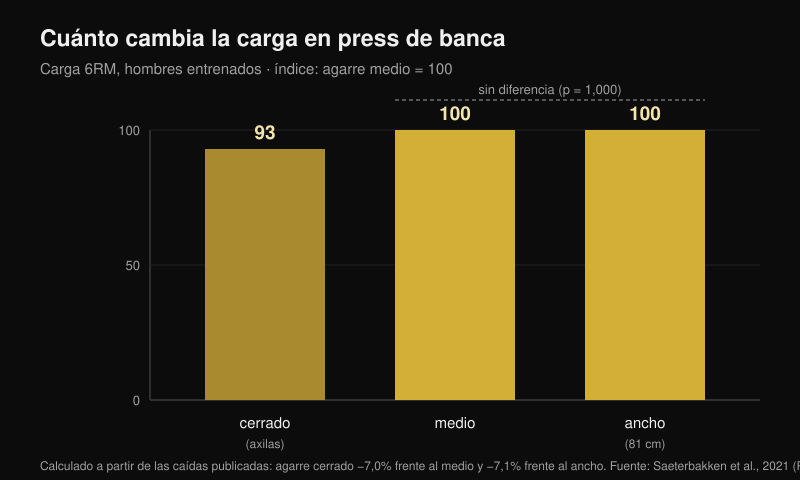
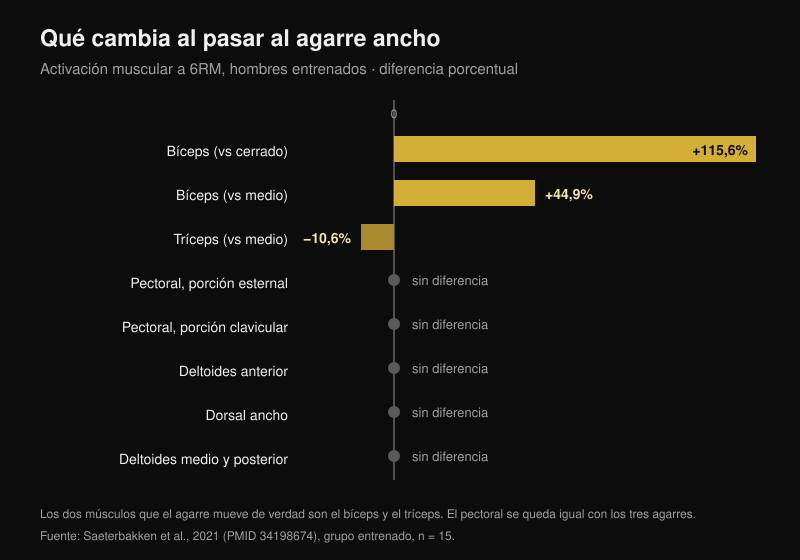

# Agarre en press de banca: ¿ancho, medio o cerrado?

Por [Giammaria Loi](/autore/giammaria-loi) · actualizado el 24 de octubre de 2026

El esquema circula desde hace años: agarre ancho para la fuerza, agarre medio para el pecho, agarre cerrado para el tríceps. Es ordenado, es fácil de recordar y es lo que casi todo el mundo sigue sin haberlo probado nunca. He leído ocho trabajos indexados que midieron cargas, activación muscular y momentos articulares con distintos agarres. Dos partes del esquema se sostienen. La del medio no tiene ni un solo estudio detrás.

## En resumen

- **El agarre ancho no es "el más pesado".** Solo lo es frente al cerrado, en torno a un **7%**. Frente al agarre medio la diferencia no existe: p = 1,000 (Saeterbakken et al., 2021), y en otro laboratorio **109,8 kg frente a 108,9 kg** de máximo (Larsen et al., 2021).
- **El pectoral no cambia con la anchura del agarre.** Porción esternal, porción clavicular, dorsal ancho, deltoides medio y posterior: ninguna diferencia entre cerrado, medio y ancho, ni en entrenados ni en principiantes (Saeterbakken et al., 2021).
- **Los músculos que de verdad se mueven son otros dos.** Con agarre ancho el bíceps trabaja un **115,6% más** que con el cerrado, y el tríceps un **10,6% menos** que con el medio. El tríceps es el único "músculo que empuja" que el agarre mueve.
- **El rango de repeticiones no depende del agarre.** Al 75% del máximo, el número de repeticiones que consigues hacer antes del fallo es el mismo con agarre cerrado, medio, ancho o libre (p = 0,545; Pérez-Castilla et al., 2021).
- **El agarre con el que más levantas es el que ya usas.** Con agarre y velocidad libres el máximo es significativamente más alto que con agarre impuesto, y ninguno de los sujetos consideró incómoda la condición libre, frente al 80% de la controlada (Lee et al., 2020).

## La carga: el agarre ancho solo gana al cerrado

El estudio más útil en este punto hizo algo sencillo: tomó a 28 hombres, 15 entrenados (press de banca con al menos el 125% del peso corporal) y 13 principiantes, y midió el máximo para 6 repeticiones con tres agarres definidos sobre el cuerpo de cada uno. Agarre cerrado = la distancia entre las axilas. Agarre ancho = el máximo permitido en competición, **81 cm**. Agarre medio = exactamente a mitad de camino (Saeterbakken et al., 2021).

Resultado en los entrenados: el agarre cerrado permite levantar un **7,0%** menos que el medio y un **7,1%** menos que el ancho. Entre medio y ancho, en cambio, p = 1,000, es decir, los dos agarres son indistinguibles. En los principiantes la diferencia es parecida: −8,4% y −6,6%, otra vez sin diferencias entre medio y ancho.

Un segundo grupo llegó al mismo sitio midiendo el máximo real en 14 hombres entrenados: **109,8 kg** con agarre ancho, **108,9 kg** con agarre medio, **103,7 kg** con agarre cerrado. Los autores concluyen que para levantar la mayor carga posible "un agarre ancho **o medio**" puede servir igual (Larsen et al., 2021).

Hay además un precio mecánico que el gráfico de barras de un carrusel no puede mostrar. Con agarre ancho, el **13,1-15,7%** de la fuerza que aplicas a la barra se va hacia los lados, hacia fuera; con agarre cerrado el **8,5-10,1%** se va hacia dentro; con agarre medio casi todo es vertical, el **0,4-1,8%** (Larsen et al., 2021). Empujar hacia fuera no sube la barra: sirve para mantener estable la trayectoria, pero es fuerza que no ves en la carga.

## El pecho no cambia. Cambian el bíceps y el tríceps

Aquí se cae el esquema. En ese mismo estudio, con electrodos en siete músculos, la anchura del agarre cambió la activación de **dos** músculos solamente:

- **bíceps braquial**: con agarre ancho, +115,6% frente al cerrado y +44,9% frente al medio (p < 0,001). Trabaja como antagonista, para estabilizar el codo;
- **tríceps braquial**: con agarre ancho, **−10,6%** frente al medio (p = 0,032) y −24,1% frente al cerrado, esta última diferencia al límite de la significación (p = 0,058).

Pectoral esternal, pectoral clavicular, dorsal ancho, deltoides medio y posterior: ninguna diferencia, en ninguno de los dos grupos. El deltoides anterior se mueve solo en los principiantes, y poco.

Esto da la vuelta a una parte del tópico: el agarre ancho no "reparte el trabajo de forma uniforme" entre los músculos que empujan. Hace exactamente lo contrario: es el agarre que le **quita** trabajo al tríceps. Un tercer grupo lo confirma en dirección opuesta: al 50% de la distancia entre los hombros el tríceps está al 16% de la contracción máxima, al 150% baja al 12%, y el deltoides anterior no cambia en ninguna condición (Muyor et al., 2023). Los autores de ese estudio cierran con una frase que vale para todo el artículo: la elección del ejercicio no debería basarse solo en la activación.

Y un detalle que el carrusel se salta: **la diferencia en el tríceps aparece solo en el grupo entrenado**. En los principiantes el tríceps no cambia con ningún agarre. El mismo consejo no produce el mismo efecto en dos personas distintas.

## No es "pecho contra tríceps": es qué porción de pecho

El dato más interesante no es cuánto pecho trabaja, sino **qué** parte. Midiendo los momentos articulares de 35 adultos entrenados con cargas de 6-8RM, el agarre más cerrado aumenta el momento en el codo y la actividad del tríceps lateral, del deltoides anterior **y del haz clavicular del pectoral**: el pecho alto. El agarre más ancho aumenta el momento en el hombro y la actividad del haz abdominal, o sea la parte baja (Mausehund et al., 2022).

Es el mismo principio que había encontrado comparando [el press con mancuernas y las aperturas para el crecimiento del pecho](/es/blog/press-con-mancuernas-o-aperturas-pecho): la elección no cambia cuánto crece el pectoral en su conjunto, cambia dónde.

La consecuencia práctica afecta al hombro. Cuanto más ancho es el agarre, mayor es la carga que el hombro tiene que soportar, tanto en términos absolutos como en relación con tu capacidad máxima. Es el motivo mecánico por el que quien tiene el hombro irritado suele estar mejor cerrando las manos. Pero cuidado: **ningún estudio ha probado el agarre cerrado como tratamiento de rehabilitación**. Es una decisión sensata de gestión de la carga, no una terapia: si te duele el hombro, el camino es el médico o el fisioterapeuta, no una diapositiva.

## El ROM parcial para el pecho: el dato que no existe

"Medio movimiento en estiramiento para hacer crecer el pecho" es quizá la parte más repetida y menos verificada del esquema. La revisión sistemática dedicada al rango de movimiento encontró que el parcial en la parte inicial (músculo estirado) y el movimiento completo superan al parcial en la parte final, pero los datos vienen del **recto femoral, el vasto lateral, el bíceps, el braquial, el glúteo mayor y los aductores**. El pectoral no está entre ellos (Kassiano et al., 2023). Para el tríceps, curiosamente, el parcial que funcionó mejor fue el de la parte **central** del movimiento.

Y en el único estudio agudo que comparó los rangos de movimiento justamente en press de banca, la mitad **alta**, es decir la acortada, lo contrario del "lengthened bias", produjo la mayor excitación de pico en la porción esternocostal del pectoral y en los haces largo y lateral del tríceps (Fischer et al., 2025). Sigue siendo un dato agudo en 19 hombres, no una prueba de crecimiento. Pero tampoco está demostrada la dirección del consejo.

## Qué dice de verdad la investigación

| Afirmación | Resultado | Número |
|---|---|---|
| Agarre ancho = cargas más altas | **Matizado** | Cierto frente al cerrado (+7%), falso frente al medio (p = 1,000) |
| Agarre ancho = trabajo uniforme en los músculos que empujan | **Desmentido** | El tríceps trabaja un 10,6% menos |
| Agarre medio = el mejor para el pecho | **No verificable** | Ninguna diferencia de activación del pectoral; cero estudios de crecimiento |
| Agarre cerrado = más tríceps | **Confirmado** | 16% frente al 12% de la contracción máxima |
| Agarre cerrado = cargas más ligeras | **Confirmado** | Alrededor de un 7% menos |
| Agarre cerrado para rehabilitar hombro y pecho | **Matizado** | Mecánicamente sensato, nunca probado como rehabilitación |
| Cada agarre tiene su rango de repeticiones | **Desmentido** | Las repeticiones hasta el fallo no cambian (p = 0,545) |

## Cómo aplicarlo

1. **Mide tu agarre, no copies los centímetros de otro.** En los estudios el agarre cerrado es la distancia entre las axilas y el ancho es el máximo de competición, 81 cm: para quien tiene los hombros estrechos esos 81 cm son mucho más "anchos" que para quien los tiene amplios.
2. **Elige el agarre por la carga y por el hombro, no por el músculo.** El pectoral trabaja igual en los tres casos. Lo que cambia de verdad es cuánto puedes cargar y cuánto le pides al hombro.
3. **Mide tu máximo para 5-6 repeticiones con dos agarres distintos, con una semana de diferencia.** Si la diferencia supera el 5%, ya tienes tu respuesta, y probablemente no sea la del esquema.
4. **No cambies agarre y rango de repeticiones a la vez.** El rango lo eliges según el objetivo, no según dónde pones las manos.
5. **Usa el agarre cerrado para el tríceps, no para el pecho.** Es el único efecto sobre los músculos que empujan demostrado de forma coherente en más de un laboratorio.

> ### Con Nurvan
> El consejo correcto en este tema es "mide", pero medir exige que los números se queden. En Nurvan el press de banca con agarre ancho, medio y cerrado son variantes distintas del mismo ejercicio: cada serie registra carga, repeticiones y RIR (las repeticiones que te habrían quedado en el depósito), y el gráfico del historial te muestra, semana a semana, qué agarre está progresando de verdad en tu cuerpo. Es la prueba del punto 3, hecha sin hoja de cálculo.
> **[Prueba Nurvan](https://nurvan.app)**

## Preguntas frecuentes

**¿Cuál es el mejor agarre en press de banca?**
Aquel con el que más levantas y con el que no te molesta el hombro. En los estudios, agarre medio y ancho son equivalentes en carga, y el pectoral no cambia entre los tres. Con agarre y velocidad libres el máximo es más alto que con agarre impuesto (Lee et al., 2020): el agarre que te has construido entrenando es una ventaja real, no una costumbre que corregir.

**¿El agarre cerrado trabaja menos el pecho?**
No. En los siete músculos medidos, la activación del pectoral no resultó distinta entre agarre cerrado, medio y ancho (Saeterbakken et al., 2021). Cambia la porción solicitada, más alta con agarre cerrado y más baja con agarre ancho (Mausehund et al., 2022), y cambia mucho el tríceps.

**¿Tengo que usar agarre ancho si quiero ser fuerte?**
No necesariamente. El agarre ancho solo supera al cerrado, en torno a un 7%, y empata con el medio. Si el agarre ancho te molesta el hombro, el medio no te cuesta ni un kilo.

**¿Cuántas repeticiones con cada agarre?**
El número de repeticiones que consigues hacer a un porcentaje dado del máximo no cambia con el agarre (Pérez-Castilla et al., 2021). El rango lo decides por el objetivo: para orientarte, reuní los datos en [cuántas repeticiones hacen falta de verdad para crecer](/es/blog/cuantas-repeticiones-masa-muscular).

## Lee también

- [¿Press con mancuernas o aperturas: qué hace crecer más el pecho?](/es/blog/press-con-mancuernas-o-aperturas-pecho) — la misma lógica aplicada a la elección del ejercicio, no del agarre.
- [Cuántas repeticiones, series y descanso hacen falta para la hipertrofia](/es/blog/cuantas-repeticiones-masa-muscular) — por qué el rango de repeticiones es una variable aparte.
- [Extensión de piernas o prensa: qué dicen los estudios](/es/blog/extension-de-piernas-o-prensa-recto-femoral) — el crecimiento regional, medido en las piernas.

## Fuentes

1. Saeterbakken AH, Stien N, Pedersen H, Solstad TEJ, Cumming KT, Andersen V, 2021. The Effect of Grip Width on Muscle Strength and Electromyographic Activity in Bench Press among Novice- and Resistance-Trained Men. *Int J Environ Res Public Health*. PMID [34198674](https://pubmed.ncbi.nlm.nih.gov/34198674/) · [DOI](https://doi.org/10.3390/ijerph18126444)
2. Larsen S, Gomo O, van den Tillaar R, 2021. A Biomechanical Analysis of Wide, Medium, and Narrow Grip Width Effects on Kinematics, Horizontal Kinetics, and Muscle Activity on the Sticking Region in Recreationally Trained Males During 1-RM Bench Pressing. *Front Sports Act Living*. PMID [33554113](https://pubmed.ncbi.nlm.nih.gov/33554113/) · [DOI](https://doi.org/10.3389/fspor.2020.637066)
3. Mausehund L, Werkhausen A, Bartsch J, Krosshaug T, 2022. Understanding Bench Press Biomechanics—The Necessity of Measuring Lateral Barbell Forces. *J Strength Cond Res*. PMID [33555823](https://pubmed.ncbi.nlm.nih.gov/33555823/) · [DOI](https://doi.org/10.1519/JSC.0000000000003948)
4. Muyor JM, Rodríguez-Ridao D, Oliva-Lozano JM, 2023. Comparison of Muscle Activity between the Horizontal Bench Press and the Seated Chest Press Exercises Using Several Grips. *J Hum Kinet*. PMID [37229415](https://pubmed.ncbi.nlm.nih.gov/37229415/) · [DOI](https://doi.org/10.5114/jhk/161468)
5. Pérez-Castilla A, Jukic I, Haff GG, García-Ramos A, 2021. The Bench Press Grip Width Does Not Affect the Number of Repetitions Performed at Different Velocity Loss Thresholds. *Int J Environ Res Public Health*. PMID [33504038](https://pubmed.ncbi.nlm.nih.gov/33504038/) · [DOI](https://doi.org/10.3390/ijerph18031057)
6. Lee S, Cone SM, Kim S, 2020. A biomechanical comparison of self-selected and experimentally controlled speeds and grip widths during the bench press exercise. *Sports Biomech*. PMID [32564677](https://pubmed.ncbi.nlm.nih.gov/32564677/) · [DOI](https://doi.org/10.1080/14763141.2020.1772357)
7. Kassiano W, Costa B, Nunes JP, Ribeiro AS, Schoenfeld BJ, Cyrino ES, 2023. Which ROMs Lead to Rome? A Systematic Review of the Effects of Range of Motion on Muscle Hypertrophy. *J Strength Cond Res*. PMID [36662126](https://pubmed.ncbi.nlm.nih.gov/36662126/) · [DOI](https://doi.org/10.1519/JSC.0000000000004415)
8. Fischer J, Burger C, Manieu Seguel JA, Rodoplu C, Paternoster FK, Tilp M, Konrad A, 2025. Acute muscle excitation response across various bench press ranges of motion. *Sci Rep*. PMID [40269203](https://pubmed.ncbi.nlm.nih.gov/40269203/) · [DOI](https://doi.org/10.1038/s41598-025-98354-9)

Datos bibliográficos verificados en PubMed. Punto de partida: el carrusel "Bench press cheat sheet" de Sebastian Oreb ([@australianstrengthcoach](https://www.instagram.com/p/Dd8lCqIkfEh/), 1 de octubre de 2026). El texto, la estructura, los datos y los gráficos de este artículo son originales.

---

*Giammaria Loi es el fundador de Nurvan. Entrena con pesas desde 2012, trabaja como entrenador personal y coach certificado por la FIPE desde 2013 y compite en powerlifting a nivel nacional desde 2018. Cada artículo que firma parte de los estudios científicos y llega a lo que funciona de verdad en el gimnasio.*

> Nota: contenido informativo, no sustituye la opinión de un médico o de un profesional. Si tienes dolor en el hombro o en el pecho, consulta a un médico o a un fisioterapeuta antes de modificar tu entrenamiento.
