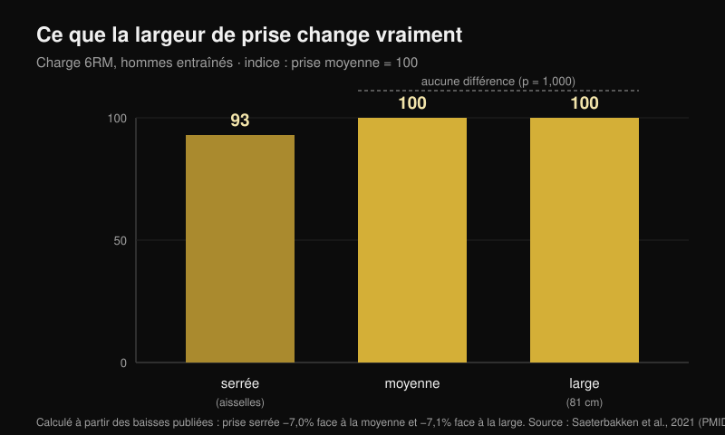
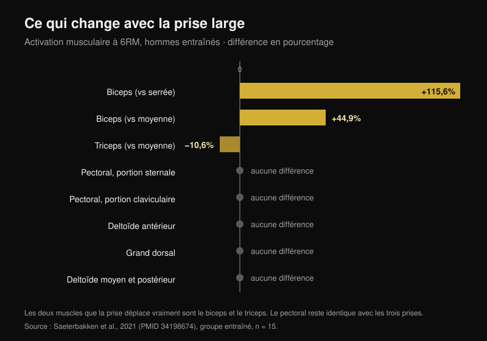

# Prise au développé couché : large, moyenne ou serrée ?

Par [Giammaria Loi](/autore/giammaria-loi) · mis à jour le 24 octobre 2026

Le schéma circule depuis des années : prise large pour la force, prise moyenne pour les pectoraux, prise serrée pour les triceps. C'est propre, c'est facile à retenir et presque tout le monde l'applique sans l'avoir jamais testé. J'ai lu huit travaux indexés qui ont mesuré les charges, l'activation musculaire et les moments articulaires avec différentes prises. Deux morceaux du schéma tiennent. Celui du milieu n'a pas une seule étude derrière lui.

## L'essentiel

- **La prise large n'est pas « la plus lourde ».** Elle ne l'est que face à la prise serrée, d'environ **7 %**. Face à la prise moyenne, la différence n'existe pas : p = 1,000 (Saeterbakken et al., 2021), et dans un autre laboratoire **109,8 kg contre 108,9 kg** de charge maximale (Larsen et al., 2021).
- **Le pectoral ne change pas avec la largeur de prise.** Portion sternale, portion claviculaire, grand dorsal, deltoïde moyen et postérieur : aucune différence entre prise serrée, moyenne et large, ni chez les entraînés ni chez les débutants (Saeterbakken et al., 2021).
- **Les muscles qui bougent vraiment sont deux autres.** Avec une prise large, le biceps travaille **115,6 % de plus** qu'avec une prise serrée, et le triceps **10,6 % de moins** qu'avec une prise moyenne. Le triceps est le seul « muscle qui pousse » que la prise déplace.
- **La plage de répétitions ne dépend pas de la prise.** À 75 % de la charge maximale, le nombre de répétitions que tu arrives à faire avant l'échec est le même avec une prise serrée, moyenne, large ou libre (p = 0,545 ; Pérez-Castilla et al., 2021).
- **La prise avec laquelle tu soulèves le plus est celle que tu utilises déjà.** Avec prise et vitesse libres, la charge maximale est significativement plus élevée qu'avec une prise imposée, et aucun sujet n'a jugé la condition libre inconfortable, contre 80 % pour la condition contrôlée (Lee et al., 2020).

## La charge : la prise large ne gagne que face à la prise serrée

L'étude la plus utile sur ce point a fait quelque chose de simple : elle a pris 28 hommes, 15 entraînés (développé couché à au moins 125 % du poids de corps) et 13 débutants, et a testé la charge maximale sur 6 répétitions avec trois prises définies sur le corps de chacun. Prise serrée = la distance entre les aisselles. Prise large = le maximum autorisé en compétition, **81 cm**. Prise moyenne = exactement à mi-chemin (Saeterbakken et al., 2021).

Résultat chez les entraînés : la prise serrée fait soulever **7,0 %** de moins que la moyenne et **7,1 %** de moins que la large. Entre moyenne et large, en revanche, p = 1,000 : les deux prises sont indiscernables. Chez les débutants, l'écart est comparable, −8,4 % et −6,6 %, là encore sans différence entre moyenne et large.

Une deuxième équipe est arrivée au même endroit en mesurant la charge maximale réelle chez 14 hommes entraînés : **109,8 kg** en prise large, **108,9 kg** en prise moyenne, **103,7 kg** en prise serrée. Les auteurs concluent que, pour soulever le plus lourd possible, « une prise large **ou moyenne** » peut convenir (Larsen et al., 2021).

Il y a aussi un prix mécanique que le graphique en barres d'un carrousel ne peut pas montrer. En prise large, **13,1-15,7 %** de la force que tu appliques à la barre part latéralement, vers l'extérieur ; en prise serrée, **8,5-10,1 %** part vers l'intérieur ; en prise moyenne, presque tout est vertical, **0,4-1,8 %** (Larsen et al., 2021). Pousser vers l'extérieur ne fait pas monter la barre : cela sert à stabiliser la trajectoire, mais c'est de la force que tu ne vois pas sur la charge.

## Les pectoraux ne changent pas. Le biceps et le triceps, oui

C'est là que le schéma s'écroule. Dans cette même étude, avec des électrodes sur sept muscles, la largeur de prise n'a modifié l'activation que de **deux** muscles :

- **biceps brachial** : en prise large, +115,6 % par rapport à la prise serrée et +44,9 % par rapport à la moyenne (p < 0,001). Il travaille en antagoniste, pour stabiliser le coude ;
- **triceps brachial** : en prise large, **−10,6 %** par rapport à la moyenne (p = 0,032) et −24,1 % par rapport à la serrée, cette dernière différence étant à la limite de la significativité (p = 0,058).

Pectoral sternal, pectoral claviculaire, grand dorsal, deltoïde moyen et postérieur : aucune différence, dans aucun des deux groupes. Le deltoïde antérieur ne bouge que chez les débutants, et peu.

Cela renverse une partie de l'idée reçue : la prise large ne « répartit pas le travail de façon uniforme » sur les muscles qui poussent. Elle fait exactement l'inverse : c'est la prise qui **enlève** du travail au triceps. Une troisième équipe le confirme dans l'autre sens : à 50 % de la distance entre les épaules, le triceps est à 16 % de la contraction maximale, à 150 % il descend à 12 %, et le deltoïde antérieur ne change dans aucune condition (Muyor et al., 2023). Les auteurs de cette étude terminent par une phrase qui vaut pour tout l'article : le choix d'un exercice ne devrait pas reposer uniquement sur l'activation.

Attention à un détail que le carrousel saute : **la différence sur le triceps n'apparaît que dans le groupe entraîné**. Chez les débutants, le triceps ne change avec aucune prise. Le même conseil ne produit pas le même effet chez deux personnes différentes.

## Ce n'est pas « pectoraux contre triceps » : c'est quelle portion de pectoral

La donnée la plus intéressante ne concerne pas la quantité de pectoral qui travaille, mais **quelle** partie. En mesurant les moments articulaires de 35 adultes entraînés avec des charges de 6-8RM, la prise la plus serrée augmente le moment au coude et l'activité du triceps latéral, du deltoïde antérieur **et du chef claviculaire du pectoral**, soit le haut des pectoraux. La prise la plus large augmente le moment à l'épaule et l'activité du chef abdominal, c'est-à-dire la partie basse (Mausehund et al., 2022).

C'est le même principe que celui trouvé en comparant [le développé avec haltères et les écartés pour la croissance des pectoraux](/fr/blog/developpe-halteres-ou-ecartes-pectoraux) : le choix ne change pas la croissance du pectoral dans son ensemble, il change l'endroit.

La conséquence pratique concerne l'épaule. Plus la prise est large, plus la charge que l'épaule doit encaisser est élevée, en valeur absolue comme par rapport à ta capacité maximale. C'est la raison mécanique pour laquelle les personnes qui ont l'épaule irritée se sentent souvent mieux en resserrant. Mais attention : **aucune étude n'a testé la prise serrée comme traitement de rééducation**. C'est un choix sensé de gestion de la charge, pas une thérapie : si tu as mal à l'épaule, la voie est le médecin ou le kinésithérapeute, pas une slide.

## L'amplitude partielle pour les pectoraux : la donnée qui n'existe pas

« Un demi-mouvement en position allongée pour faire grossir les pectoraux » est peut-être la partie la plus répétée et la moins vérifiée du schéma. La revue systématique consacrée à l'amplitude de mouvement a trouvé que le partiel dans la partie initiale (muscle allongé) et le mouvement complet battent le partiel dans la partie finale, mais les données viennent du **droit fémoral, du vaste latéral, du biceps, du brachial, du grand fessier et des adducteurs**. Le pectoral n'en fait pas partie (Kassiano et al., 2023). Pour le triceps, curieusement, le partiel qui a le mieux fonctionné est celui de la partie **centrale** du mouvement.

Et dans la seule étude aiguë qui a comparé les amplitudes de mouvement précisément au développé couché, la moitié **haute**, c'est-à-dire la position raccourcie, l'inverse du « lengthened bias », a produit la plus forte excitation de pic dans la portion sternocostale du pectoral et dans les chefs long et latéral du triceps (Fischer et al., 2025). Cela reste une mesure aiguë sur 19 hommes, pas une preuve de croissance. Mais la direction du conseil n'est pas démontrée non plus.

## Ce que dit vraiment la recherche

| Affirmation | Verdict | Chiffre |
|---|---|---|
| Prise large = charges plus lourdes | **À nuancer** | Vrai face à la serrée (+7 %), faux face à la moyenne (p = 1,000) |
| Prise large = travail uniforme sur les muscles qui poussent | **Démenti** | Le triceps travaille 10,6 % de moins |
| Prise moyenne = la meilleure pour les pectoraux | **Invérifiable** | Aucune différence d'activation du pectoral ; zéro étude de croissance |
| Prise serrée = plus de triceps | **Confirmé** | 16 % contre 12 % de la contraction maximale |
| Prise serrée = charges plus légères | **Confirmé** | Environ 7 % de moins |
| Prise serrée pour rééduquer l'épaule et les pectoraux | **À nuancer** | Mécaniquement sensé, jamais testé en rééducation |
| Chaque prise a sa plage de répétitions | **Démenti** | Les répétitions jusqu'à l'échec ne changent pas (p = 0,545) |

## Comment l'appliquer

1. **Mesure ta prise, ne copie pas les centimètres de quelqu'un d'autre.** Dans les études, la prise serrée correspond à la distance entre les aisselles et la large au maximum autorisé en compétition, 81 cm : pour qui a les épaules étroites, ces 81 cm sont bien plus « larges » que pour qui les a amples.
2. **Choisis la prise pour la charge et pour l'épaule, pas pour le muscle.** Le pectoral travaille pareil dans les trois cas. Ce qui change vraiment, c'est ce que tu peux charger et ce que tu demandes à l'épaule.
3. **Teste ta charge maximale sur 5-6 répétitions avec deux prises différentes, à une semaine d'intervalle.** Si l'écart dépasse 5 %, tu as ta réponse, et ce n'est probablement pas celle du schéma.
4. **Ne change pas la prise et la plage de répétitions en même temps.** La plage se choisit selon l'objectif, pas selon l'endroit où tu poses les mains.
5. **Utilise la prise serrée pour le triceps, pas pour les pectoraux.** C'est le seul effet sur les muscles qui poussent démontré de façon cohérente dans plusieurs laboratoires.

> ### Avec Nurvan
> Le bon conseil sur ce sujet, c'est « mesure », mais mesurer suppose que les chiffres restent. Dans Nurvan, le développé couché en prise large, moyenne et serrée sont des variantes distinctes du même exercice : chaque série enregistre la charge, les répétitions et le RIR (les répétitions qu'il te restait en réserve), et le graphique de l'historique te montre, semaine après semaine, quelle prise progresse vraiment sur ton corps. C'est le test du point 3, sans tableur.
> **[Essayez Nurvan](https://nurvan.app)**

## Questions fréquentes

**Quelle est la meilleure prise au développé couché ?**
Celle avec laquelle tu soulèves le plus et qui ne gêne pas ton épaule. Dans les études, prise moyenne et prise large sont équivalentes pour la charge, et le pectoral ne change pas entre les trois. Avec prise et vitesse libres, la charge maximale est plus élevée qu'avec une prise imposée (Lee et al., 2020) : la prise que tu t'es construite à l'entraînement est un avantage réel, pas une habitude à corriger.

**La prise serrée travaille-t-elle moins les pectoraux ?**
Non. Sur sept muscles mesurés, l'activation du pectoral ne s'est pas révélée différente entre prise serrée, moyenne et large (Saeterbakken et al., 2021). Ce qui change, c'est la portion sollicitée, plus haute en prise serrée, plus basse en prise large (Mausehund et al., 2022), et le triceps change beaucoup.

**Faut-il une prise large pour devenir fort ?**
Pas forcément. La prise large ne bat que la prise serrée, d'environ 7 %, et égalise avec la moyenne. Si la prise large gêne ton épaule, la moyenne ne te coûte aucun kilo.

**Combien de répétitions pour chaque prise ?**
Le nombre de répétitions que tu arrives à faire à un pourcentage donné de ta charge maximale ne change pas avec la prise (Pérez-Castilla et al., 2021). La plage, tu la décides selon l'objectif : pour t'orienter, j'ai rassemblé les données dans [combien de répétitions il faut vraiment pour prendre du muscle](/fr/blog/combien-de-repetitions-masse-musculaire).

## À lire aussi

- [Développé avec haltères ou écartés : qu'est-ce qui fait le plus grossir les pectoraux ?](/fr/blog/developpe-halteres-ou-ecartes-pectoraux) — la même logique appliquée au choix de l'exercice, pas de la prise.
- [Combien de répétitions, de séries et de récupération pour l'hypertrophie](/fr/blog/combien-de-repetitions-masse-musculaire) — pourquoi la plage de répétitions est une variable à part.
- [Leg extension ou presse à cuisses : ce que disent les études](/fr/blog/leg-extension-ou-presse-a-cuisses-droit-femoral) — la croissance régionale, mesurée sur les jambes.

## Sources

1. Saeterbakken AH, Stien N, Pedersen H, Solstad TEJ, Cumming KT, Andersen V, 2021. The Effect of Grip Width on Muscle Strength and Electromyographic Activity in Bench Press among Novice- and Resistance-Trained Men. *Int J Environ Res Public Health*. PMID [34198674](https://pubmed.ncbi.nlm.nih.gov/34198674/) · [DOI](https://doi.org/10.3390/ijerph18126444)
2. Larsen S, Gomo O, van den Tillaar R, 2021. A Biomechanical Analysis of Wide, Medium, and Narrow Grip Width Effects on Kinematics, Horizontal Kinetics, and Muscle Activity on the Sticking Region in Recreationally Trained Males During 1-RM Bench Pressing. *Front Sports Act Living*. PMID [33554113](https://pubmed.ncbi.nlm.nih.gov/33554113/) · [DOI](https://doi.org/10.3389/fspor.2020.637066)
3. Mausehund L, Werkhausen A, Bartsch J, Krosshaug T, 2022. Understanding Bench Press Biomechanics—The Necessity of Measuring Lateral Barbell Forces. *J Strength Cond Res*. PMID [33555823](https://pubmed.ncbi.nlm.nih.gov/33555823/) · [DOI](https://doi.org/10.1519/JSC.0000000000003948)
4. Muyor JM, Rodríguez-Ridao D, Oliva-Lozano JM, 2023. Comparison of Muscle Activity between the Horizontal Bench Press and the Seated Chest Press Exercises Using Several Grips. *J Hum Kinet*. PMID [37229415](https://pubmed.ncbi.nlm.nih.gov/37229415/) · [DOI](https://doi.org/10.5114/jhk/161468)
5. Pérez-Castilla A, Jukic I, Haff GG, García-Ramos A, 2021. The Bench Press Grip Width Does Not Affect the Number of Repetitions Performed at Different Velocity Loss Thresholds. *Int J Environ Res Public Health*. PMID [33504038](https://pubmed.ncbi.nlm.nih.gov/33504038/) · [DOI](https://doi.org/10.3390/ijerph18031057)
6. Lee S, Cone SM, Kim S, 2020. A biomechanical comparison of self-selected and experimentally controlled speeds and grip widths during the bench press exercise. *Sports Biomech*. PMID [32564677](https://pubmed.ncbi.nlm.nih.gov/32564677/) · [DOI](https://doi.org/10.1080/14763141.2020.1772357)
7. Kassiano W, Costa B, Nunes JP, Ribeiro AS, Schoenfeld BJ, Cyrino ES, 2023. Which ROMs Lead to Rome? A Systematic Review of the Effects of Range of Motion on Muscle Hypertrophy. *J Strength Cond Res*. PMID [36662126](https://pubmed.ncbi.nlm.nih.gov/36662126/) · [DOI](https://doi.org/10.1519/JSC.0000000000004415)
8. Fischer J, Burger C, Manieu Seguel JA, Rodoplu C, Paternoster FK, Tilp M, Konrad A, 2025. Acute muscle excitation response across various bench press ranges of motion. *Sci Rep*. PMID [40269203](https://pubmed.ncbi.nlm.nih.gov/40269203/) · [DOI](https://doi.org/10.1038/s41598-025-98354-9)

Données bibliographiques vérifiées sur PubMed. Point de départ : le carrousel « Bench press cheat sheet » de Sebastian Oreb ([@australianstrengthcoach](https://www.instagram.com/p/Dd8lCqIkfEh/), 1er octobre 2026). Le texte, la structure, les données et les graphiques de cet article sont originaux.

---

*Giammaria Loi est le fondateur de Nurvan. Il s'entraîne avec des poids depuis 2012, travaille comme entraîneur personnel et coach certifié FIPE depuis 2013 et participe à des compétitions de powerlifting au niveau national depuis 2018. Chaque article qu'il signe part des études scientifiques et aboutit à ce qui fonctionne vraiment en salle.*

> Note : contenu informatif, qui ne remplace pas l'avis d'un médecin ou d'un professionnel. En cas de douleur à l'épaule ou aux pectoraux, consulte un médecin ou un kinésithérapeute avant de modifier ton entraînement.
