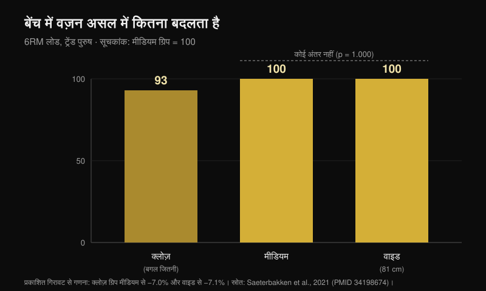
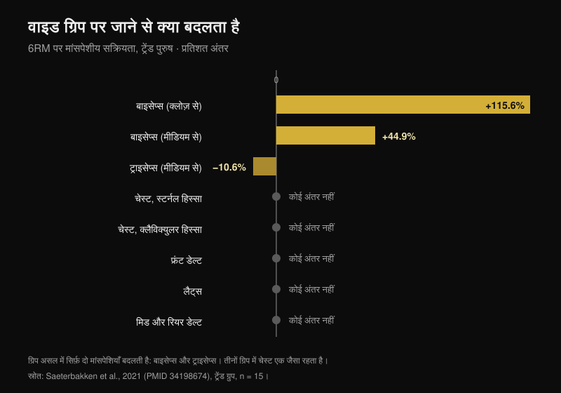

# बेंच प्रेस ग्रिप: चौड़ी, मीडियम या क्लोज़?

लेखक: [Giammaria Loi](/autore/giammaria-loi) · 24 अक्तूबर 2026 को अपडेट

यह फ़ॉर्मूला सालों से जिम में घूम रहा है: ताक़त के लिए चौड़ी ग्रिप, चेस्ट के लिए मीडियम, ट्राइसेप्स के लिए क्लोज़। साफ़-सुथरा है, याद रखना आसान है, और लगभग सब इसी पर चल रहे हैं — कभी जाँचे बिना। मैंने आठ इंडेक्स्ड पेपर पढ़े, जिनमें अलग-अलग ग्रिप पर वज़न, मसल एक्टिवेशन और जॉइंट मोमेंट नापे गए हैं। फ़ॉर्मूले के दो हिस्से टिकते हैं। बीच वाले हिस्से के पक्ष में एक भी स्टडी नहीं है।

## संक्षेप में

- **चौड़ी ग्रिप "सबसे भारी" ग्रिप नहीं है।** वह सिर्फ़ क्लोज़ ग्रिप से भारी है, करीब **7%**। मीडियम ग्रिप के मुक़ाबले फ़र्क़ ही नहीं है: p = 1.000 (Saeterbakken वग़ैरह, 2021), और दूसरी लैब में मैक्स **109.8 kg बनाम 108.9 kg** निकला (Larsen वग़ैरह, 2021)।
- **ग्रिप की चौड़ाई से चेस्ट नहीं बदलता।** स्टर्नल हिस्सा, क्लैविक्युलर हिस्सा, लैट्स, मिडल और रियर डेल्ट: क्लोज़, मीडियम और चौड़ी ग्रिप के बीच कोई फ़र्क़ नहीं — न ट्रेंड लोगों में, न शुरुआती लोगों में (Saeterbakken वग़ैरह, 2021)।
- **असल में हिलने वाली मसल दो और हैं।** चौड़ी ग्रिप पर बाइसेप्स क्लोज़ ग्रिप से **115.6% ज़्यादा** काम करता है, और ट्राइसेप्स मीडियम ग्रिप से **10.6% कम**। ट्राइसेप्स ही वह एकमात्र "धक्का लगाने वाली" मसल है जिसे ग्रिप हिलाती है।
- **रेप रेंज ग्रिप पर निर्भर नहीं है।** मैक्स के 75% पर फ़ेल्योर तक जितने रेप्स आप लगा सकते हैं, वे क्लोज़, मीडियम, चौड़ी और अपनी पसंद की ग्रिप पर एक जैसे रहते हैं (p = 0.545; Pérez-Castilla वग़ैरह, 2021)।
- **जिस ग्रिप पर आप सबसे ज़्यादा उठाते हैं, वह वही है जो आप पहले से लगा रहे हैं।** ग्रिप और स्पीड अपनी पसंद से चुनने पर मैक्स, थोपी गई ग्रिप से साफ़ तौर पर ज़्यादा निकलता है — और अपनी पसंद वाली स्थिति को किसी भी वॉलंटियर ने असहज नहीं बताया, जबकि कंट्रोल वाली स्थिति में यह आंकड़ा 80% था (Lee वग़ैरह, 2020)।

## वज़न: चौड़ी ग्रिप सिर्फ़ क्लोज़ ग्रिप से जीतती है

इस सवाल पर सबसे काम की स्टडी ने एक सीधा काम किया: 28 पुरुष लिए — 15 ट्रेंड (बेंच प्रेस बॉडी वेट के कम से कम **125%** पर) और 13 शुरुआती — और हर एक के शरीर के हिसाब से तय तीन ग्रिप पर 6 रेप्स का मैक्स नापा। क्लोज़ ग्रिप = दोनों बग़लों के बीच की दूरी। चौड़ी ग्रिप = कॉम्पिटिशन में अनुमत अधिकतम, **81 cm**। मीडियम ग्रिप = ठीक इन दोनों के बीच (Saeterbakken वग़ैरह, 2021)।

ट्रेंड ग्रुप का नतीजा: क्लोज़ ग्रिप पर मीडियम से **7.0%** कम और चौड़ी से **7.1%** कम वज़न उठा। लेकिन मीडियम और चौड़ी के बीच p = 1.000 — यानी दोनों ग्रिप में कोई अंतर पकड़ में नहीं आया। शुरुआती लोगों में फ़ासला ऐसा ही रहा: −8.4% और −6.6%, और यहाँ भी मीडियम और चौड़ी में फ़र्क़ नहीं।

दूसरी टीम 14 ट्रेंड पुरुषों पर असली मैक्स नापकर उसी नतीजे पर पहुँची: चौड़ी ग्रिप पर **109.8 kg**, मीडियम पर **108.9 kg**, क्लोज़ पर **103.7 kg**। लेखक लिखते हैं कि ज़्यादा से ज़्यादा वज़न उठाने के लिए "चौड़ी **या मीडियम**" ग्रिप, दोनों चल जाती हैं (Larsen वग़ैरह, 2021)।

एक मैकेनिकल क़ीमत भी है, जो किसी कैरोसेल के बार चार्ट में नहीं दिखती। चौड़ी ग्रिप पर आप बार पर जो ज़ोर लगाते हैं उसका **13.1-15.7%** बग़ल की तरफ़, बाहर की ओर जाता है; क्लोज़ ग्रिप पर **8.5-10.1%** अंदर की ओर; और मीडियम ग्रिप पर लगभग सब कुछ सीधा ऊपर, सिर्फ़ **0.4-1.8%** इधर-उधर (Larsen वग़ैरह, 2021)। बाहर की तरफ़ धक्का बार को ऊपर नहीं उठाता: उसका काम रास्ता स्थिर रखना है, पर यह वह ज़ोर है जो आपको वज़न में दिखता नहीं।

## चेस्ट नहीं बदलता। बाइसेप्स और ट्राइसेप्स बदलते हैं

फ़ॉर्मूला यहीं गिरता है। उसी स्टडी में, सात मसल पर इलेक्ट्रोड लगाकर देखा गया तो ग्रिप की चौड़ाई ने सिर्फ़ **दो** मसल का एक्टिवेशन बदला:

- **बाइसेप्स ब्रैकी**: चौड़ी ग्रिप पर क्लोज़ से +115.6% और मीडियम से +44.9% (p < 0.001)। यह यहाँ एंटागोनिस्ट की तरह काम करता है, कोहनी को स्थिर रखने के लिए;
- **ट्राइसेप्स ब्रैकी**: चौड़ी ग्रिप पर मीडियम से **−10.6%** (p = 0.032) और क्लोज़ से −24.1%, जिसमें आख़िरी फ़र्क़ सार्थकता की सीमा पर है (p = 0.058)।

स्टर्नल चेस्ट, क्लैविक्युलर चेस्ट, लैट्स, मिडल और रियर डेल्ट: किसी भी ग्रुप में कोई फ़र्क़ नहीं। फ़्रंट डेल्ट सिर्फ़ शुरुआती लोगों में हिलता है, और वह भी थोड़ा।

इससे आम धारणा का आधा हिस्सा पलट जाता है: चौड़ी ग्रिप धक्का लगाने वाली मसल में काम "बराबर नहीं बाँटती"। वह ठीक उलटा करती है — यही वह ग्रिप है जो ट्राइसेप्स से काम **छीनती** है। एक तीसरी टीम इसे उलटी दिशा से पक्का करती है: कंधों के बीच की दूरी के 50% पर ट्राइसेप्स मैक्सिमम कॉन्ट्रैक्शन के 16% पर रहता है, 150% पर गिरकर 12% हो जाता है, और फ़्रंट डेल्ट किसी भी स्थिति में नहीं बदलता (Muyor वग़ैरह, 2023)। उस स्टडी के लेखक आख़िर में एक बात लिखते हैं जो पूरे लेख पर लागू होती है: एक्सरसाइज़ का चुनाव सिर्फ़ एक्टिवेशन पर नहीं टिकना चाहिए।

एक बारीकी पर ध्यान दीजिए जिसे कैरोसेल छोड़ देता है: **ट्राइसेप्स वाला यह फ़र्क़ सिर्फ़ ट्रेंड ग्रुप में दिखता है।** शुरुआती लोगों में ट्राइसेप्स किसी भी ग्रिप पर नहीं बदला। एक ही सलाह दो अलग लोगों पर एक ही असर नहीं देती।

## सवाल "चेस्ट बनाम ट्राइसेप्स" नहीं है: सवाल है चेस्ट का कौन सा हिस्सा

सबसे दिलचस्प आंकड़ा यह नहीं है कि चेस्ट कितना काम करता है, बल्कि यह कि **कौन सा हिस्सा** करता है। 35 ट्रेंड वयस्कों पर 6-8RM वज़न के साथ जॉइंट मोमेंट नापे गए: ज़्यादा क्लोज़ ग्रिप कोहनी का मोमेंट और ट्राइसेप्स के लेटरल हेड, फ़्रंट डेल्ट **तथा चेस्ट के क्लैविक्युलर हेड** की एक्टिविटी बढ़ाती है — यानी अपर चेस्ट। ज़्यादा चौड़ी ग्रिप कंधे का मोमेंट और एब्डोमिनल हेड, यानी निचले हिस्से की एक्टिविटी बढ़ाती है (Mausehund वग़ैरह, 2022)।

यही सिद्धांत मुझे [डंबल बेंच प्रेस और फ़्लाई की तुलना](/hi/blog/dumbbell-bench-press-ya-fly-chest-growth) में भी मिला था: चुनाव यह नहीं बदलता कि पूरा चेस्ट कितना बढ़ेगा, यह बदलता है कि कहाँ बढ़ेगा।

व्यावहारिक पहलू कंधे से जुड़ा है। ग्रिप जितनी चौड़ी, कंधे को उतना ज़्यादा लोड उठाना पड़ता है — निरपेक्ष रूप से भी और आपकी अधिकतम क्षमता के अनुपात में भी। यही वह मैकेनिकल वजह है जिसकी वजह से जिनका कंधा चिढ़ा हुआ है, उन्हें ग्रिप सँकरी करने पर अक्सर आराम मिलता है। लेकिन ध्यान रहे: **किसी स्टडी ने क्लोज़ ग्रिप को रिहैब के इलाज की तरह नहीं जाँचा है।** यह लोड मैनेज करने का समझदार फ़ैसला है, थेरेपी नहीं: कंधे में दर्द हो तो रास्ता डॉक्टर या फ़िज़ियोथेरेपिस्ट है, कोई स्लाइड नहीं।

## चेस्ट के लिए "लेंथेंड हाफ़ रेप": यह आंकड़ा मौजूद ही नहीं है

"चेस्ट बढ़ाने के लिए स्ट्रेच वाले हिस्से में आधा मूवमेंट" पूरे फ़ॉर्मूले का सबसे दोहराया और सबसे कम जाँचा हिस्सा है। रेंज ऑफ़ मोशन पर हुई सिस्टेमैटिक रिव्यू ने पाया कि शुरुआती हिस्से (मसल खिंची हुई) का पार्शियल और पूरा मूवमेंट, आख़िरी हिस्से के पार्शियल से बेहतर हैं — लेकिन वे आंकड़े **रेक्टस फ़ेमोरिस, वास्टस लेटरालिस, बाइसेप्स, ब्रैकिअलिस, ग्लूटियस मैक्सिमस और एडक्टर्स** से आते हैं। चेस्ट उनमें नहीं है (Kassiano वग़ैरह, 2023)। और ट्राइसेप्स में, मज़े की बात, सबसे अच्छा चलने वाला पार्शियल मूवमेंट के **बीच** वाले हिस्से का निकला।

और जिस एक एक्यूट स्टडी ने रेंज ऑफ़ मोशन की तुलना सीधे बेंच प्रेस पर की, उसमें **ऊपरी** आधा हिस्सा — यानी सिकुड़ा हुआ, "लेंथेंड बायस" का ठीक उलटा — चेस्ट के स्टर्नोकॉस्टल हिस्से और ट्राइसेप्स के लॉन्ग व लेटरल हेड में सबसे ऊँची पीक एक्साइटेशन लाया (Fischer वग़ैरह, 2025)। यह 19 पुरुषों का एक्यूट डेटा है, ग्रोथ का सबूत नहीं। लेकिन उस सलाह की दिशा भी साबित नहीं है।

## रिसर्च असल में क्या कहती है

| दावा | नतीजा | आंकड़ा |
|---|---|---|
| चौड़ी ग्रिप = ज़्यादा भारी वज़न | **स्पष्टीकरण ज़रूरी** | क्लोज़ के मुक़ाबले सही (+7%), मीडियम के मुक़ाबले ग़लत (p = 1.000) |
| चौड़ी ग्रिप = धक्का देने वाली मसल में बराबर काम | **ग़लत** | ट्राइसेप्स 10.6% कम काम करता है |
| मीडियम ग्रिप = चेस्ट के लिए सबसे अच्छी | **जाँचा नहीं जा सकता** | चेस्ट एक्टिवेशन में कोई फ़र्क़ नहीं; ग्रोथ स्टडी शून्य |
| क्लोज़ ग्रिप = ट्राइसेप्स ज़्यादा | **पुष्ट** | मैक्सिमम कॉन्ट्रैक्शन का 16% बनाम 12% |
| क्लोज़ ग्रिप = हल्का वज़न | **पुष्ट** | करीब 7% कम |
| कंधे और चेस्ट के रिहैब के लिए क्लोज़ ग्रिप | **स्पष्टीकरण ज़रूरी** | मैकेनिकली समझदार, रिहैब के तौर पर कभी जाँची नहीं गई |
| हर ग्रिप की अपनी रेप रेंज होती है | **ग़लत** | फ़ेल्योर तक रेप्स नहीं बदलते (p = 0.545) |

## इसे कैसे इस्तेमाल करें

1. **अपनी ग्रिप नापिए, किसी और के सेंटीमीटर मत कॉपी कीजिए।** स्टडी में क्लोज़ ग्रिप दोनों बग़लों के बीच की दूरी है और चौड़ी ग्रिप कॉम्पिटिशन की अधिकतम सीमा, 81 cm: सँकरे कंधों वाले के लिए वही 81 cm, चौड़े कंधों वाले से कहीं ज़्यादा "चौड़े" पड़ते हैं।
2. **ग्रिप वज़न और कंधे के हिसाब से चुनिए, मसल के हिसाब से नहीं।** तीनों हालात में चेस्ट बराबर काम करता है। असल में यह बदलता है कि आप कितना लोड कर सकते हैं और कंधे से कितना माँग रहे हैं।
3. **दो अलग ग्रिप पर 5-6 रेप्स का अपना मैक्स जाँचिए, एक हफ़्ते के अंतर पर।** फ़र्क़ 5% से ऊपर निकला तो जवाब आपके पास है — और शायद वह फ़ॉर्मूले वाला जवाब नहीं होगा।
4. **ग्रिप और रेप रेंज एक साथ मत बदलिए।** रेंज लक्ष्य से तय होती है, इससे नहीं कि हाथ कहाँ रखे हैं।
5. **क्लोज़ ग्रिप ट्राइसेप्स के लिए इस्तेमाल कीजिए, चेस्ट के लिए नहीं।** धक्का देने वाली मसल पर यही एक असर है जो कई लैब में एक जैसा दिखा है।

> ### Nurvan के साथ
> इस विषय पर सही सलाह है "नापिए", और नापने के लिए ज़रूरी है कि आंकड़े बचे रहें। Nurvan में चौड़ी, मीडियम और क्लोज़ ग्रिप बेंच प्रेस एक ही एक्सरसाइज़ के तीन अलग वेरिएंट हैं: हर सेट में वज़न, रेप्स और RIR (वे रेप्स जो टैंक में बचे थे) दर्ज होते हैं, और हिस्ट्री का ग्राफ़ कुछ हफ़्तों में दिखा देता है कि आपके शरीर पर कौन सी ग्रिप सचमुच आगे बढ़ रही है। यह पॉइंट 3 का वही टेस्ट है, स्प्रेडशीट के बिना।
> **[Nurvan आज़माएँ](https://nurvan.app)**

## अक्सर पूछे जाने वाले सवाल

**बेंच प्रेस में सबसे अच्छी ग्रिप कौन सी है?**
वही जिस पर आप सबसे ज़्यादा उठाते हैं और कंधे में तकलीफ़ न हो। स्टडी में मीडियम और चौड़ी ग्रिप वज़न के लिहाज़ से बराबर हैं, और तीनों के बीच चेस्ट नहीं बदलता। ग्रिप और स्पीड अपनी पसंद से चुनने पर मैक्स, थोपी गई ग्रिप से ज़्यादा निकलता है (Lee वग़ैरह, 2020): ट्रेनिंग से बनी आपकी ग्रिप एक असली फ़ायदा है, सुधारने वाली आदत नहीं।

**क्या क्लोज़ ग्रिप से चेस्ट कम लगता है?**
नहीं। नापी गई सात मसल में चेस्ट का एक्टिवेशन क्लोज़, मीडियम और चौड़ी ग्रिप के बीच अलग नहीं निकला (Saeterbakken वग़ैरह, 2021)। जो बदलता है वह है ज़ोर पड़ने वाला हिस्सा — क्लोज़ ग्रिप पर ऊपरी, चौड़ी ग्रिप पर निचला (Mausehund वग़ैरह, 2022) — और ट्राइसेप्स, जो काफ़ी बदलता है।

**ताक़त चाहिए तो चौड़ी ग्रिप ज़रूरी है?**
ज़रूरी नहीं। चौड़ी ग्रिप सिर्फ़ क्लोज़ से जीतती है, करीब 7%, और मीडियम से बराबरी पर रहती है। अगर चौड़ी ग्रिप पर कंधा तकलीफ़ देता है, तो मीडियम ग्रिप एक किलो भी नहीं लेती।

**हर ग्रिप पर कितने रेप्स करें?**
मैक्स के किसी तय प्रतिशत पर आप जितने रेप्स लगा पाते हैं, वे ग्रिप से नहीं बदलते (Pérez-Castilla वग़ैरह, 2021)। रेंज लक्ष्य से तय कीजिए: दिशा के लिए आंकड़े मैंने [मसल बढ़ाने के लिए सचमुच कितने रेप्स चाहिए](/hi/blog/kitne-reps-muscle-ke-liye) में इकट्ठे किए हैं।

## यह भी पढ़ें

- [डंबल बेंच प्रेस या फ़्लाई: चेस्ट किससे ज़्यादा बढ़ता है?](/hi/blog/dumbbell-bench-press-ya-fly-chest-growth) — वही तर्क, ग्रिप के बजाय एक्सरसाइज़ के चुनाव पर।
- [हाइपरट्रॉफ़ी के लिए कितने रेप्स, सेट और रेस्ट](/hi/blog/kitne-reps-muscle-ke-liye) — रेप रेंज एक अलग वेरिएबल क्यों है।
- [लेग एक्सटेंशन या लेग प्रेस: स्टडी क्या कहती हैं](/hi/blog/leg-extension-vs-leg-press-rectus-femoris-hindi) — रीजनल ग्रोथ, टाँगों पर नापी हुई।

## स्रोत

1. Saeterbakken AH, Stien N, Pedersen H, Solstad TEJ, Cumming KT, Andersen V, 2021. The Effect of Grip Width on Muscle Strength and Electromyographic Activity in Bench Press among Novice- and Resistance-Trained Men. *Int J Environ Res Public Health*. PMID [34198674](https://pubmed.ncbi.nlm.nih.gov/34198674/) · [DOI](https://doi.org/10.3390/ijerph18126444)
2. Larsen S, Gomo O, van den Tillaar R, 2021. A Biomechanical Analysis of Wide, Medium, and Narrow Grip Width Effects on Kinematics, Horizontal Kinetics, and Muscle Activity on the Sticking Region in Recreationally Trained Males During 1-RM Bench Pressing. *Front Sports Act Living*. PMID [33554113](https://pubmed.ncbi.nlm.nih.gov/33554113/) · [DOI](https://doi.org/10.3389/fspor.2020.637066)
3. Mausehund L, Werkhausen A, Bartsch J, Krosshaug T, 2022. Understanding Bench Press Biomechanics—The Necessity of Measuring Lateral Barbell Forces. *J Strength Cond Res*. PMID [33555823](https://pubmed.ncbi.nlm.nih.gov/33555823/) · [DOI](https://doi.org/10.1519/JSC.0000000000003948)
4. Muyor JM, Rodríguez-Ridao D, Oliva-Lozano JM, 2023. Comparison of Muscle Activity between the Horizontal Bench Press and the Seated Chest Press Exercises Using Several Grips. *J Hum Kinet*. PMID [37229415](https://pubmed.ncbi.nlm.nih.gov/37229415/) · [DOI](https://doi.org/10.5114/jhk/161468)
5. Pérez-Castilla A, Jukic I, Haff GG, García-Ramos A, 2021. The Bench Press Grip Width Does Not Affect the Number of Repetitions Performed at Different Velocity Loss Thresholds. *Int J Environ Res Public Health*. PMID [33504038](https://pubmed.ncbi.nlm.nih.gov/33504038/) · [DOI](https://doi.org/10.3390/ijerph18031057)
6. Lee S, Cone SM, Kim S, 2020. A biomechanical comparison of self-selected and experimentally controlled speeds and grip widths during the bench press exercise. *Sports Biomech*. PMID [32564677](https://pubmed.ncbi.nlm.nih.gov/32564677/) · [DOI](https://doi.org/10.1080/14763141.2020.1772357)
7. Kassiano W, Costa B, Nunes JP, Ribeiro AS, Schoenfeld BJ, Cyrino ES, 2023. Which ROMs Lead to Rome? A Systematic Review of the Effects of Range of Motion on Muscle Hypertrophy. *J Strength Cond Res*. PMID [36662126](https://pubmed.ncbi.nlm.nih.gov/36662126/) · [DOI](https://doi.org/10.1519/JSC.0000000000004415)
8. Fischer J, Burger C, Manieu Seguel JA, Rodoplu C, Paternoster FK, Tilp M, Konrad A, 2025. Acute muscle excitation response across various bench press ranges of motion. *Sci Rep*. PMID [40269203](https://pubmed.ncbi.nlm.nih.gov/40269203/) · [DOI](https://doi.org/10.1038/s41598-025-98354-9)

संदर्भ के आंकड़े PubMed पर जाँचे गए। शुरुआती प्रेरणा: Sebastian Oreb का "Bench press cheat sheet" कैरोसेल ([@australianstrengthcoach](https://www.instagram.com/p/Dd8lCqIkfEh/), 1 अक्तूबर 2026)। इस लेख का टेक्स्ट, ढाँचा, आंकड़े और ग्राफ़ मौलिक हैं।

---

*Giammaria Loi Nurvan के संस्थापक हैं। वे 2012 से वेट ट्रेनिंग करते हैं, 2013 से FIPE प्रमाणित पर्सनल ट्रेनर और कोच के रूप में काम करते हैं और 2018 से राष्ट्रीय स्तर पर पावरलिफ़्टिंग में भाग लेते हैं।*

> नोट: यह जानकारीपरक सामग्री है, डॉक्टर या पेशेवर की राय का विकल्प नहीं। कंधे या चेस्ट में दर्द हो तो ट्रेनिंग बदलने से पहले डॉक्टर या फ़िज़ियोथेरेपिस्ट से बात कीजिए।
