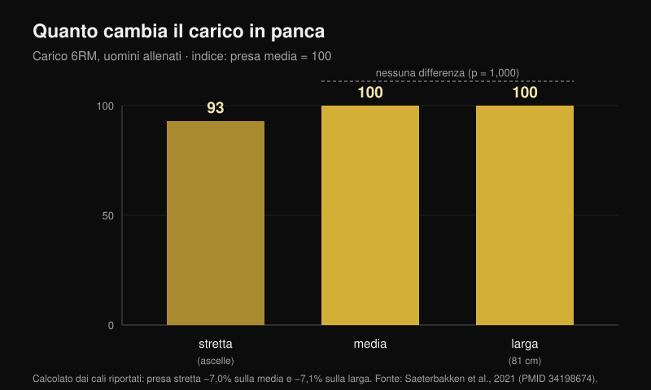
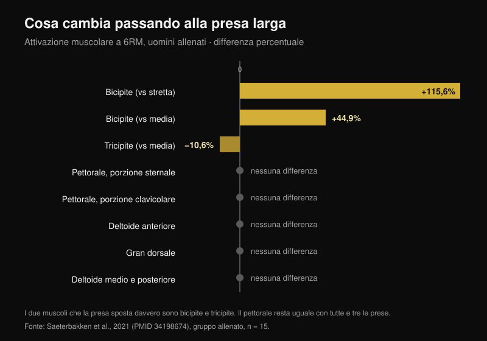

# Presa in panca piana: larga, media o stretta?

Di [Giammaria Loi](/autore/giammaria-loi) · aggiornato il 24 ottobre 2026

Lo schema gira da anni: presa larga per la forza, presa media per il petto, presa stretta per i tricipiti. È ordinato, è facile da ricordare ed è quello che quasi tutti seguono senza averlo mai testato. Ho letto otto lavori indicizzati che hanno misurato carichi, attivazione muscolare e momenti articolari con prese diverse. Due pezzi dello schema reggono. Uno, quello centrale, non ha nemmeno uno studio che lo sostenga.

## In breve

- **La presa larga non è "la più pesante".** Lo è solo rispetto alla stretta, di circa il **7%**. Contro la presa media la differenza non esiste: p = 1,000 (Saeterbakken et al., 2021), e in un altro laboratorio **109,8 kg contro 108,9 kg** di massimale (Larsen et al., 2021).
- **Il pettorale non cambia con la larghezza della presa.** Porzione sternale, porzione clavicolare, gran dorsale, deltoide medio e posteriore: nessuna differenza fra stretta, media e larga, né negli allenati né nei principianti (Saeterbakken et al., 2021).
- **I muscoli che si spostano davvero sono altri due.** Con presa larga il bicipite lavora **il 115,6% in più** rispetto alla stretta, e il tricipite **il 10,6% in meno** rispetto alla media. Il tricipite è l'unico "muscolo spinto" che la presa sposta.
- **Il range di ripetizioni non dipende dalla presa.** Al 75% del massimale il numero di ripetizioni che riesci a fare prima del cedimento è lo stesso con presa stretta, media, larga o libera (p = 0,545; Pérez-Castilla et al., 2021).
- **La presa con cui sollevi di più è quella che usi già.** Con presa e velocità libere il massimale è significativamente più alto che con presa imposta — e nessuno dei soggetti ha giudicato scomoda la condizione libera, contro l'80% di quella controllata (Lee et al., 2020).

## Il carico: la presa larga vince solo contro la stretta

Lo studio più utile su questo punto ha fatto una cosa semplice: ha preso 28 uomini, 15 allenati (panca ad almeno il 125% del peso corporeo) e 13 principianti, e ha testato il massimale per 6 ripetizioni con tre prese definite sul corpo di ciascuno. Presa stretta = la distanza fra le ascelle. Presa larga = il massimo consentito in gara, **81 cm**. Presa media = esattamente a metà (Saeterbakken et al., 2021).

Risultato negli allenati: la presa stretta fa sollevare il **7,0%** in meno della media e il **7,1%** in meno della larga. Fra media e larga, invece, p = 1,000 — cioè le due prese sono indistinguibili. Nei principianti lo scarto è simile: −8,4% e −6,6%, di nuovo senza differenze fra media e larga.

Un secondo gruppo è arrivato allo stesso punto misurando il massimale vero su 14 uomini allenati: **109,8 kg** con presa larga, **108,9 kg** con presa media, **103,7 kg** con presa stretta. Gli autori concludono che per alzare più carico possibile "una presa larga **o media**" può andare bene (Larsen et al., 2021).

C'è anche un prezzo meccanico che il grafico a barre di un carosello non può mostrare. Con presa larga il **13,1-15,7%** della forza che applichi al bilanciere va lateralmente, verso l'esterno; con presa stretta l'**8,5-10,1%** va verso l'interno; con presa media è quasi tutto verticale, **0,4-1,8%** (Larsen et al., 2021). Spingere in fuori non alza il bilanciere: serve a tenere stabile la traiettoria, ma è forza che non vedi sul carico.

## Il petto non cambia. Cambiano bicipite e tricipite

Qui casca lo schema. Nello stesso studio, con elettrodi su sette muscoli, la larghezza della presa ha cambiato l'attivazione di **due** muscoli soli:

- **bicipite brachiale**: con presa larga +115,6% rispetto alla stretta e +44,9% rispetto alla media (p < 0,001). Lavora da antagonista, per stabilizzare il gomito;
- **tricipite brachiale**: con presa larga **−10,6%** rispetto alla media (p = 0,032) e −24,1% rispetto alla stretta, quest'ultima differenza al limite della significatività (p = 0,058).

Pettorale sternale, pettorale clavicolare, gran dorsale, deltoide medio e posteriore: nessuna differenza, in nessuno dei due gruppi. Il deltoide anteriore si muove solo nei principianti, e di poco.

Questo rovescia un pezzo del luogo comune: la presa larga non "distribuisce il lavoro in modo uniforme" sui muscoli che spingono. Fa esattamente il contrario — è la presa che **toglie** lavoro al tricipite. Un terzo gruppo lo conferma in direzione opposta: al 50% della distanza fra le spalle il tricipite sta al 16% della contrazione massima, al 150% scende al 12%, e il deltoide anteriore non cambia in nessuna condizione (Muyor et al., 2023). Gli autori di quello studio chiudono con una frase che vale per tutto l'articolo: la scelta dell'esercizio non dovrebbe basarsi solo sull'attivazione.

Attenzione a un dettaglio che il carosello salta: **la differenza sul tricipite compare solo nel gruppo allenato**. Nei principianti il tricipite non cambia con nessuna presa. Lo stesso consiglio non produce lo stesso effetto in due persone diverse.

## Non è "petto contro tricipiti": è quale porzione di petto

Il dato più interessante non riguarda quanto petto lavora, ma **quale** parte. Misurando i momenti articolari di 35 adulti allenati con carichi 6-8RM, la presa più stretta aumenta il momento al gomito e l'attività del tricipite laterale, del deltoide anteriore **e del capo clavicolare del pettorale** — il petto alto. La presa più larga aumenta il momento alla spalla e l'attività del capo addominale, cioè la parte bassa (Mausehund et al., 2022).

È lo stesso principio che avevo trovato confrontando [panca e croci per la crescita del petto](/blog/panca-o-croci-pettorali): la scelta non cambia quanto cresce il pettorale nel suo insieme, cambia dove.

Il risvolto pratico riguarda la spalla. Più la presa è larga, più alto è il carico che la spalla deve reggere, in termini sia assoluti sia relativi alla tua capacità massima. È il motivo meccanico per cui chi ha la spalla irritata spesso sta meglio stringendo. Ma attenzione: **nessuno studio ha testato la presa stretta come trattamento riabilitativo**. È una scelta sensata di gestione del carico, non una terapia: se hai dolore alla spalla, la strada è il medico o il fisioterapista, non una slide.

## Il ROM parziale per il petto: il dato che non esiste

"Mezzo movimento in allungamento per far crescere il petto" è forse la parte più ripetuta e meno verificata dello schema. La revisione sistematica dedicata al range di movimento ha trovato che il parziale nella parte iniziale (muscolo allungato) e il movimento completo battono il parziale nella parte finale — ma i dati vengono da **retto femorale, vasto laterale, bicipite, brachiale, grande gluteo e adduttori**. Il pettorale non è fra questi (Kassiano et al., 2023). Per il tricipite, curiosamente, il parziale che ha funzionato meglio è quello nella parte **centrale** del movimento.

E nell'unico studio acuto che ha confrontato i range di movimento proprio in panca, la metà **alta** — cioè quella accorciata, l'opposto del "lengthened bias" — ha prodotto l'eccitazione di picco maggiore nella porzione sternocostale del pettorale e nei capi lungo e laterale del tricipite (Fischer et al., 2025). Resta un dato acuto su 19 uomini, non una prova di crescita. Ma nemmeno la direzione del consiglio è dimostrata.

## Cosa dice davvero la ricerca

| Affermazione | Esito | Numero |
|---|---|---|
| Presa larga = carichi più pesanti | **Da precisare** | Vero contro la stretta (+7%), falso contro la media (p = 1,000) |
| Presa larga = lavoro uniforme sui muscoli spinti | **Smentito** | Il tricipite lavora il 10,6% in meno |
| Presa media = la migliore per il petto | **Non verificabile** | Nessuna differenza di attivazione del pettorale; zero studi di crescita |
| Presa stretta = più tricipiti | **Confermato** | 16% contro 12% della contrazione massima |
| Presa stretta = carichi più leggeri | **Confermato** | Circa il 7% in meno |
| Presa stretta per riabilitare spalla e petto | **Da precisare** | Meccanicamente sensato, mai testato come riabilitazione |
| Ogni presa ha il suo range di ripetizioni | **Smentito** | Le ripetizioni al cedimento non cambiano (p = 0,545) |

## Come applicarlo

1. **Misura la tua presa, non copiare i centimetri di un altro.** Negli studi la presa stretta è la distanza fra le ascelle e la larga è il massimo di gara, 81 cm: per chi ha spalle strette quegli 81 cm sono molto più "larghi" che per chi le ha ampie.
2. **Scegli la presa per il carico e per la spalla, non per il muscolo.** Il pettorale lavora uguale in tutti e tre i casi. Quello che cambia davvero è quanto puoi caricare e quanto chiedi alla spalla.
3. **Testa il tuo massimale per 5-6 ripetizioni con due prese diverse, a una settimana di distanza.** Se la differenza supera il 5%, hai la tua risposta — e probabilmente non è quella dello schema.
4. **Non cambiare presa e range di ripetizioni insieme.** Il range lo scegli in base all'obiettivo, non in base a dove tieni le mani.
5. **Usa la presa stretta per il tricipite, non per il petto.** È l'unico effetto sui muscoli che spingono dimostrato in modo coerente in più laboratori.

> ### Con Nurvan
> Il consiglio giusto su questo tema è "misura", ma misurare richiede che i numeri restino. In Nurvan la panca con presa larga, media e stretta sono varianti distinte dello stesso esercizio: ogni serie registra carico, ripetizioni e RIR (le ripetizioni che avresti ancora in serbatoio), e il grafico dello storico ti mostra in settimane quale presa sta progredendo davvero sul tuo corpo. È il test del punto 3, fatto senza foglio di calcolo.
> **[Prova Nurvan](https://nurvan.app)**

## Domande frequenti

**Qual è la presa migliore in panca piana?**
Quella con cui sollevi di più e non hai fastidio alla spalla. Negli studi presa media e larga sono equivalenti per carico, e il pettorale non cambia fra le tre. Con presa e velocità libere il massimale è più alto che con presa imposta (Lee et al., 2020): la presa che ti sei costruito allenandoti è un vantaggio reale, non un'abitudine da correggere.

**La presa stretta allena meno il petto?**
No. In sette muscoli misurati, l'attivazione del pettorale non è risultata diversa fra presa stretta, media e larga (Saeterbakken et al., 2021). Cambia la porzione sollecitata — più alta con presa stretta, più bassa con presa larga (Mausehund et al., 2022) — e cambia molto il tricipite.

**Devo usare la presa larga se voglio diventare forte?**
Non necessariamente. La presa larga batte solo la stretta, di circa il 7%, e pareggia con la media. Se la presa larga ti dà fastidio alla spalla, la media costa zero chili.

**Quante ripetizioni per ogni presa?**
Il numero di ripetizioni che riesci a fare a una data percentuale del massimale non cambia con la presa (Pérez-Castilla et al., 2021). Il range lo decidi dall'obiettivo: per orientarti, ho raccolto i dati in [quante ripetizioni servono davvero per crescere](/blog/ripetizioni-serie-recupero-ipertrofia).

## Leggi anche

- [Panca o croci: cosa fa crescere di più il petto?](/blog/panca-o-croci-pettorali) — la stessa logica applicata alla scelta dell'esercizio, non della presa.
- [Quante ripetizioni, serie e recupero servono per l'ipertrofia](/blog/ripetizioni-serie-recupero-ipertrofia) — perché il range di ripetizioni è una variabile a sé.
- [Leg extension o leg press: cosa dicono gli studi](/blog/leg-extension-o-leg-press-retto-femorale) — la crescita regionale, misurata sulle gambe.

## Fonti

1. Saeterbakken AH, Stien N, Pedersen H, Solstad TEJ, Cumming KT, Andersen V, 2021. The Effect of Grip Width on Muscle Strength and Electromyographic Activity in Bench Press among Novice- and Resistance-Trained Men. *Int J Environ Res Public Health*. PMID [34198674](https://pubmed.ncbi.nlm.nih.gov/34198674/) · [DOI](https://doi.org/10.3390/ijerph18126444)
2. Larsen S, Gomo O, van den Tillaar R, 2021. A Biomechanical Analysis of Wide, Medium, and Narrow Grip Width Effects on Kinematics, Horizontal Kinetics, and Muscle Activity on the Sticking Region in Recreationally Trained Males During 1-RM Bench Pressing. *Front Sports Act Living*. PMID [33554113](https://pubmed.ncbi.nlm.nih.gov/33554113/) · [DOI](https://doi.org/10.3389/fspor.2020.637066)
3. Mausehund L, Werkhausen A, Bartsch J, Krosshaug T, 2022. Understanding Bench Press Biomechanics—The Necessity of Measuring Lateral Barbell Forces. *J Strength Cond Res*. PMID [33555823](https://pubmed.ncbi.nlm.nih.gov/33555823/) · [DOI](https://doi.org/10.1519/JSC.0000000000003948)
4. Muyor JM, Rodríguez-Ridao D, Oliva-Lozano JM, 2023. Comparison of Muscle Activity between the Horizontal Bench Press and the Seated Chest Press Exercises Using Several Grips. *J Hum Kinet*. PMID [37229415](https://pubmed.ncbi.nlm.nih.gov/37229415/) · [DOI](https://doi.org/10.5114/jhk/161468)
5. Pérez-Castilla A, Jukic I, Haff GG, García-Ramos A, 2021. The Bench Press Grip Width Does Not Affect the Number of Repetitions Performed at Different Velocity Loss Thresholds. *Int J Environ Res Public Health*. PMID [33504038](https://pubmed.ncbi.nlm.nih.gov/33504038/) · [DOI](https://doi.org/10.3390/ijerph18031057)
6. Lee S, Cone SM, Kim S, 2020. A biomechanical comparison of self-selected and experimentally controlled speeds and grip widths during the bench press exercise. *Sports Biomech*. PMID [32564677](https://pubmed.ncbi.nlm.nih.gov/32564677/) · [DOI](https://doi.org/10.1080/14763141.2020.1772357)
7. Kassiano W, Costa B, Nunes JP, Ribeiro AS, Schoenfeld BJ, Cyrino ES, 2023. Which ROMs Lead to Rome? A Systematic Review of the Effects of Range of Motion on Muscle Hypertrophy. *J Strength Cond Res*. PMID [36662126](https://pubmed.ncbi.nlm.nih.gov/36662126/) · [DOI](https://doi.org/10.1519/JSC.0000000000004415)
8. Fischer J, Burger C, Manieu Seguel JA, Rodoplu C, Paternoster FK, Tilp M, Konrad A, 2025. Acute muscle excitation response across various bench press ranges of motion. *Sci Rep*. PMID [40269203](https://pubmed.ncbi.nlm.nih.gov/40269203/) · [DOI](https://doi.org/10.1038/s41598-025-98354-9)

Dati bibliografici verificati su PubMed. Spunto iniziale: il carosello "Bench press cheat sheet" di Sebastian Oreb ([@australianstrengthcoach](https://www.instagram.com/p/Dd8lCqIkfEh/), 1 ottobre 2026). Testo, struttura, dati e grafici di questo articolo sono originali.

---

*Giammaria Loi è il fondatore di Nurvan. Si allena con i pesi dal 2012, lavora come personal trainer e coach certificato FIPE dal 2013 e gareggia nel powerlifting a livello nazionale dal 2018. Ogni articolo che firma parte dagli studi scientifici e arriva a ciò che funziona davvero in palestra.*

> Nota: contenuto informativo, non sostituisce il parere di un medico o professionista. In caso di dolore alla spalla o al petto, rivolgiti a un medico o a un fisioterapista prima di modificare l'allenamento.
