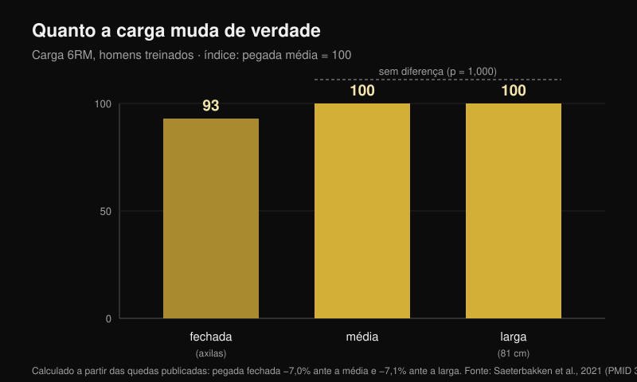
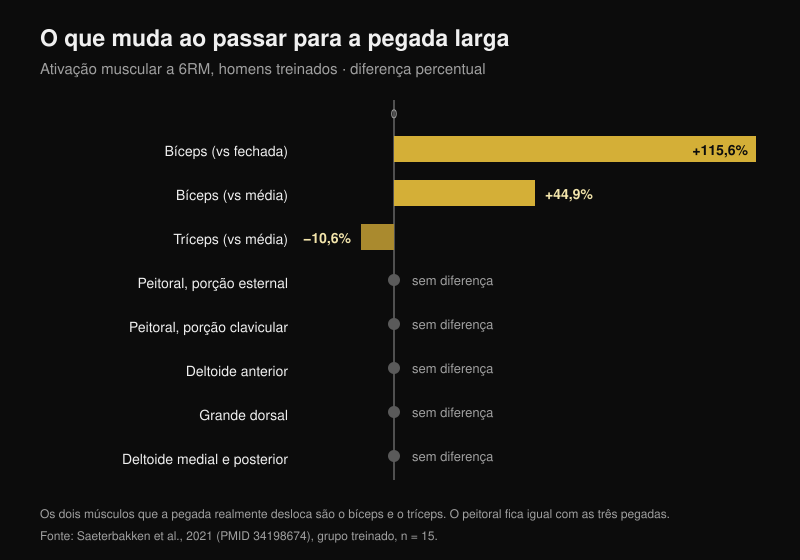

# Pegada no supino: larga, média ou fechada?

Por [Giammaria Loi](/autore/giammaria-loi) · atualizado em 24 de outubro de 2026

O esquema circula há anos: pegada larga para força, pegada média para o peito, pegada fechada para o tríceps. É organizado, é fácil de lembrar e é o que quase todo mundo segue sem nunca ter testado. Li oito trabalhos indexados que mediram cargas, ativação muscular e momentos articulares com pegadas diferentes. Duas partes do esquema se sustentam. Uma, a do meio, não tem um único estudo por trás.

## Em resumo

- **A pegada larga não é "a mais pesada".** Só é em relação à fechada, cerca de **7%**. Contra a pegada média a diferença não existe: p = 1,000 (Saeterbakken et al., 2021), e em outro laboratório **109,8 kg contra 108,9 kg** de máxima (Larsen et al., 2021).
- **O peitoral não muda com a largura da pegada.** Porção esternal, porção clavicular, grande dorsal, deltoide medial e posterior: nenhuma diferença entre fechada, média e larga, nem nos treinados nem nos iniciantes (Saeterbakken et al., 2021).
- **Os músculos que realmente se deslocam são outros dois.** Com pegada larga o bíceps trabalha **115,6% mais** que com a fechada, e o tríceps **10,6% menos** que com a média. O tríceps é o único músculo "que empurra" que a pegada desloca.
- **A faixa de repetições não depende da pegada.** A 75% da máxima, o número de repetições que você consegue fazer até a falha é o mesmo com pegada fechada, média, larga ou livre (p = 0,545; Pérez-Castilla et al., 2021).
- **A pegada com que você levanta mais é a que já usa.** Com pegada e velocidade livres a máxima é significativamente maior do que com pegada imposta — e nenhum dos participantes achou a condição livre desconfortável, contra 80% na condição controlada (Lee et al., 2020).

## A carga: a pegada larga só ganha da fechada

O estudo mais útil sobre esse ponto fez uma coisa simples: pegou 28 homens, 15 treinados (supino com pelo menos 125% do peso corporal) e 13 iniciantes, e testou a máxima para 6 repetições com três pegadas definidas no corpo de cada um. Pegada fechada = a distância entre as axilas. Pegada larga = o máximo permitido em competição, **81 cm**. Pegada média = exatamente no meio (Saeterbakken et al., 2021).

Resultado nos treinados: a pegada fechada faz levantar **7,0%** menos que a média e **7,1%** menos que a larga. Entre média e larga, por outro lado, p = 1,000 — ou seja, as duas pegadas são indistinguíveis. Nos iniciantes a diferença é parecida: −8,4% e −6,6%, de novo sem diferença entre média e larga.

Um segundo grupo chegou ao mesmo ponto medindo a máxima real em 14 homens treinados: **109,8 kg** com pegada larga, **108,9 kg** com pegada média, **103,7 kg** com pegada fechada. Os autores concluem que, para levantar o máximo de carga possível, "uma pegada larga **ou média**" serve (Larsen et al., 2021).

Existe também um custo mecânico que o gráfico de barras de um carrossel não consegue mostrar. Com pegada larga, **13,1-15,7%** da força que você aplica na barra vai lateralmente, para fora; com pegada fechada, **8,5-10,1%** vai para dentro; com pegada média é quase tudo vertical, **0,4-1,8%** (Larsen et al., 2021). Empurrar para fora não levanta a barra: serve para manter a trajetória estável, mas é força que você não vê na carga.

## O peito não muda. Mudam bíceps e tríceps

É aqui que o esquema cai. No mesmo estudo, com eletrodos em sete músculos, a largura da pegada mudou a ativação de **dois** músculos apenas:

- **bíceps braquial**: com pegada larga +115,6% em relação à fechada e +44,9% em relação à média (p < 0,001). Trabalha como antagonista, para estabilizar o cotovelo;
- **tríceps braquial**: com pegada larga **−10,6%** em relação à média (p = 0,032) e −24,1% em relação à fechada, essa última diferença no limite da significância (p = 0,058).

Peitoral esternal, peitoral clavicular, grande dorsal, deltoide medial e posterior: nenhuma diferença, em nenhum dos dois grupos. O deltoide anterior se move só nos iniciantes, e pouco.

Isso inverte uma parte do senso comum: a pegada larga não "distribui o trabalho de forma uniforme" entre os músculos que empurram. Faz exatamente o contrário — é a pegada que **tira** trabalho do tríceps. Um terceiro grupo confirma na direção oposta: a 50% da distância entre os ombros o tríceps fica em 16% da contração máxima, a 150% cai para 12%, e o deltoide anterior não muda em nenhuma condição (Muyor et al., 2023). Os autores desse estudo fecham com uma frase que vale para todo o artigo: a escolha do exercício não deveria se basear só na ativação.

Atenção a um detalhe que o carrossel pula: **a diferença no tríceps aparece só no grupo treinado**. Nos iniciantes o tríceps não muda com nenhuma pegada. O mesmo conselho não produz o mesmo efeito em duas pessoas diferentes.

## Não é "peito contra tríceps": é qual parte do peito

O dado mais interessante não é quanto peitoral trabalha, mas **qual** parte. Medindo os momentos articulares de 35 adultos treinados com cargas de 6-8RM, a pegada mais fechada aumenta o momento no cotovelo e a atividade da cabeça lateral do tríceps, do deltoide anterior **e da porção clavicular do peitoral** — o peito alto. A pegada mais larga aumenta o momento no ombro e a atividade da porção abdominal, ou seja, a parte baixa (Mausehund et al., 2022).

É o mesmo princípio que eu havia encontrado comparando [supino e crucifixo para o crescimento do peito](/pt/blog/supino-com-halteres-ou-crucifixo-peitoral): a escolha não muda quanto o peitoral cresce no conjunto, muda onde.

O desdobramento prático diz respeito ao ombro. Quanto mais larga a pegada, maior a carga que o ombro tem que sustentar, tanto em termos absolutos quanto em relação à sua capacidade máxima. É o motivo mecânico pelo qual quem está com o ombro irritado muitas vezes se sente melhor fechando a pegada. Mas atenção: **nenhum estudo testou a pegada fechada como tratamento de reabilitação**. É uma escolha sensata de gestão de carga, não uma terapia: se você tem dor no ombro, o caminho é o médico ou o fisioterapeuta, não um slide.

## Amplitude parcial para o peito: o dado que não existe

"Meio movimento em alongamento para fazer o peito crescer" é talvez a parte mais repetida e menos verificada do esquema. A revisão sistemática dedicada à amplitude de movimento encontrou que o parcial na parte inicial (músculo alongado) e o movimento completo superam o parcial na parte final — mas os dados vêm de **reto femoral, vasto lateral, bíceps, braquial, glúteo máximo e adutores**. O peitoral não está entre eles (Kassiano et al., 2023). Para o tríceps, curiosamente, o parcial que funcionou melhor foi o da parte **central** do movimento.

E no único estudo agudo que comparou amplitudes de movimento justamente no supino, a metade **alta** — ou seja, a encurtada, o oposto do "lengthened bias" — produziu a maior excitação de pico na porção esternocostal do peitoral e nas cabeças longa e lateral do tríceps (Fischer et al., 2025). Continua sendo um dado agudo em 19 homens, não uma prova de crescimento. Mas nem a direção do conselho está demonstrada.

## O que a pesquisa realmente diz

| Afirmação | Resultado | Número |
|---|---|---|
| Pegada larga = cargas mais pesadas | **Com ressalvas** | Verdade contra a fechada (+7%), falso contra a média (p = 1,000) |
| Pegada larga = trabalho uniforme nos músculos que empurram | **Desmentido** | O tríceps trabalha 10,6% menos |
| Pegada média = a melhor para o peito | **Não verificável** | Nenhuma diferença de ativação do peitoral; zero estudos de crescimento |
| Pegada fechada = mais tríceps | **Confirmado** | 16% contra 12% da contração máxima |
| Pegada fechada = cargas mais leves | **Confirmado** | Cerca de 7% menos |
| Pegada fechada para reabilitar ombro e peito | **Com ressalvas** | Mecanicamente sensato, nunca testado como reabilitação |
| Cada pegada tem sua faixa de repetições | **Desmentido** | As repetições até a falha não mudam (p = 0,545) |

## Como aplicar

1. **Meça a sua pegada, não copie os centímetros de outra pessoa.** Nos estudos a pegada fechada é a distância entre as axilas e a larga é o máximo de competição, 81 cm: para quem tem ombros estreitos esses 81 cm são muito mais "largos" do que para quem os tem amplos.
2. **Escolha a pegada pela carga e pelo ombro, não pelo músculo.** O peitoral trabalha igual nos três casos. O que muda de verdade é quanto você consegue carregar e quanto pede do ombro.
3. **Teste a sua máxima para 5-6 repetições com duas pegadas diferentes, com uma semana de intervalo.** Se a diferença passar de 5%, você já tem a sua resposta — e provavelmente não é a do esquema.
4. **Não mude pegada e faixa de repetições juntas.** A faixa você escolhe pelo objetivo, não por onde coloca as mãos.
5. **Use a pegada fechada para o tríceps, não para o peito.** É o único efeito nos músculos que empurram demonstrado de forma coerente em mais de um laboratório.

> ### Com o Nurvan
> O conselho certo sobre esse tema é "meça", mas medir exige que os números fiquem registrados. No Nurvan o supino com pegada larga, média e fechada são variantes distintas do mesmo exercício: cada série registra carga, repetições e RIR (as repetições que ainda sobrariam no tanque), e o gráfico do histórico mostra em semanas qual pegada está realmente progredindo no seu corpo. É o teste do ponto 3, feito sem planilha.
> **[Experimente o Nurvan](https://nurvan.app)**

## Perguntas frequentes

**Qual é a melhor pegada no supino?**
Aquela com que você levanta mais e não sente incômodo no ombro. Nos estudos, pegada média e larga são equivalentes em carga, e o peitoral não muda entre as três. Com pegada e velocidade livres a máxima é maior do que com pegada imposta (Lee et al., 2020): a pegada que você construiu treinando é uma vantagem real, não um vício para corrigir.

**A pegada fechada treina menos o peito?**
Não. Em sete músculos medidos, a ativação do peitoral não foi diferente entre pegada fechada, média e larga (Saeterbakken et al., 2021). Muda a porção solicitada — mais alta com pegada fechada, mais baixa com pegada larga (Mausehund et al., 2022) — e muda bastante o tríceps.

**Preciso usar a pegada larga se quero ficar forte?**
Não necessariamente. A pegada larga só ganha da fechada, cerca de 7%, e empata com a média. Se a pegada larga incomoda o seu ombro, a média custa zero quilo.

**Quantas repetições para cada pegada?**
O número de repetições que você consegue fazer em uma dada porcentagem da máxima não muda com a pegada (Pérez-Castilla et al., 2021). A faixa você decide pelo objetivo: para se orientar, reuni os dados em [quantas repetições são necessárias de verdade para crescer](/pt/blog/quantas-repeticoes-massa-muscular).

## Leia também

- [Supino ou crucifixo: o que faz o peito crescer mais?](/pt/blog/supino-com-halteres-ou-crucifixo-peitoral) — a mesma lógica aplicada à escolha do exercício, não da pegada.
- [Quantas repetições, séries e quanto descanso para hipertrofia](/pt/blog/quantas-repeticoes-massa-muscular) — por que a faixa de repetições é uma variável à parte.
- [Cadeira extensora ou leg press: o que dizem os estudos](/pt/blog/cadeira-extensora-ou-leg-press-reto-femoral) — o crescimento regional, medido nas pernas.

## Fontes

1. Saeterbakken AH, Stien N, Pedersen H, Solstad TEJ, Cumming KT, Andersen V, 2021. The Effect of Grip Width on Muscle Strength and Electromyographic Activity in Bench Press among Novice- and Resistance-Trained Men. *Int J Environ Res Public Health*. PMID [34198674](https://pubmed.ncbi.nlm.nih.gov/34198674/) · [DOI](https://doi.org/10.3390/ijerph18126444)
2. Larsen S, Gomo O, van den Tillaar R, 2021. A Biomechanical Analysis of Wide, Medium, and Narrow Grip Width Effects on Kinematics, Horizontal Kinetics, and Muscle Activity on the Sticking Region in Recreationally Trained Males During 1-RM Bench Pressing. *Front Sports Act Living*. PMID [33554113](https://pubmed.ncbi.nlm.nih.gov/33554113/) · [DOI](https://doi.org/10.3389/fspor.2020.637066)
3. Mausehund L, Werkhausen A, Bartsch J, Krosshaug T, 2022. Understanding Bench Press Biomechanics—The Necessity of Measuring Lateral Barbell Forces. *J Strength Cond Res*. PMID [33555823](https://pubmed.ncbi.nlm.nih.gov/33555823/) · [DOI](https://doi.org/10.1519/JSC.0000000000003948)
4. Muyor JM, Rodríguez-Ridao D, Oliva-Lozano JM, 2023. Comparison of Muscle Activity between the Horizontal Bench Press and the Seated Chest Press Exercises Using Several Grips. *J Hum Kinet*. PMID [37229415](https://pubmed.ncbi.nlm.nih.gov/37229415/) · [DOI](https://doi.org/10.5114/jhk/161468)
5. Pérez-Castilla A, Jukic I, Haff GG, García-Ramos A, 2021. The Bench Press Grip Width Does Not Affect the Number of Repetitions Performed at Different Velocity Loss Thresholds. *Int J Environ Res Public Health*. PMID [33504038](https://pubmed.ncbi.nlm.nih.gov/33504038/) · [DOI](https://doi.org/10.3390/ijerph18031057)
6. Lee S, Cone SM, Kim S, 2020. A biomechanical comparison of self-selected and experimentally controlled speeds and grip widths during the bench press exercise. *Sports Biomech*. PMID [32564677](https://pubmed.ncbi.nlm.nih.gov/32564677/) · [DOI](https://doi.org/10.1080/14763141.2020.1772357)
7. Kassiano W, Costa B, Nunes JP, Ribeiro AS, Schoenfeld BJ, Cyrino ES, 2023. Which ROMs Lead to Rome? A Systematic Review of the Effects of Range of Motion on Muscle Hypertrophy. *J Strength Cond Res*. PMID [36662126](https://pubmed.ncbi.nlm.nih.gov/36662126/) · [DOI](https://doi.org/10.1519/JSC.0000000000004415)
8. Fischer J, Burger C, Manieu Seguel JA, Rodoplu C, Paternoster FK, Tilp M, Konrad A, 2025. Acute muscle excitation response across various bench press ranges of motion. *Sci Rep*. PMID [40269203](https://pubmed.ncbi.nlm.nih.gov/40269203/) · [DOI](https://doi.org/10.1038/s41598-025-98354-9)

Dados bibliográficos verificados no PubMed. Ponto de partida: o carrossel "Bench press cheat sheet" de Sebastian Oreb ([@australianstrengthcoach](https://www.instagram.com/p/Dd8lCqIkfEh/), 1 de outubro de 2026). Texto, estrutura, dados e gráficos deste artigo são originais.

---

*Giammaria Loi é o fundador do Nurvan. Treina com pesos desde 2012, trabalha como personal trainer e coach certificado FIPE desde 2013 e compete no powerlifting em nível nacional desde 2018. Todo artigo que ele assina parte dos estudos científicos e chega ao que funciona de verdade na academia.*

> Nota: conteúdo informativo, não substitui a opinião de um médico ou de um profissional. Em caso de dor no ombro ou no peito, procure um médico ou um fisioterapeuta antes de mudar o treino.
