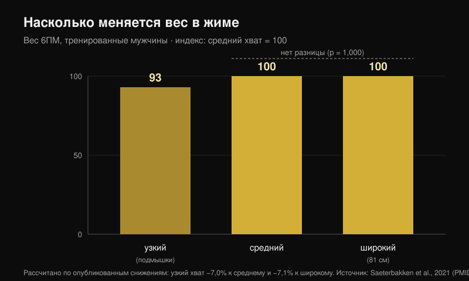
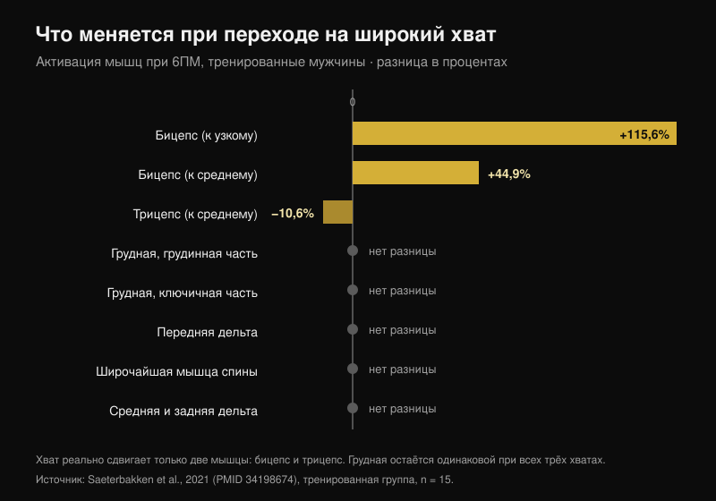

# Ширина хвата в жиме лёжа: широкий или узкий?

Автор: [Giammaria Loi](/autore/giammaria-loi) · обновлено 24 октября 2026

Эта схема ходит по залам годами: широкий хват — для силы, средний — для груди, узкий — для трицепса. Она аккуратная, её легко запомнить, и почти все следуют ей, ни разу не проверив. Я прочитал восемь индексированных работ, в которых измеряли вес на штанге, активацию мышц и моменты в суставах при разных хватах. Две части схемы держатся. Одна, центральная, не опирается ни на одно исследование.

## Коротко

- **Широкий хват — не «самый сильный».** Он сильнее только узкого, примерно на **7%**. По сравнению со средним разницы просто нет: p = 1,000 (Saeterbakken et al., 2021), а в другой лаборатории — **109,8 кг против 108,9 кг** в разовом максимуме (Larsen et al., 2021).
- **Грудь не меняется от ширины хвата.** Грудинная часть, ключичная часть, широчайшая, средний и задний пучки дельты: ни одной разницы между узким, средним и широким хватом — ни у тренированных, ни у новичков (Saeterbakken et al., 2021).
- **Реально смещаются две другие мышцы.** При широком хвате бицепс работает **на 115,6% больше**, чем при узком, а трицепс — **на 10,6% меньше**, чем при среднем. Трицепс — единственная «жимовая» мышца, которую хват действительно смещает.
- **Диапазон повторений от хвата не зависит.** На 75% от максимума число повторений до отказа одинаково при узком, среднем, широком и свободном хвате (p = 0,545; Pérez-Castilla et al., 2021).
- **Хват, с которым ты жмёшь больше, — тот, которым ты уже жмёшь.** При свободном хвате и свободной скорости максимум значимо выше, чем при заданном хвате, — и ни один участник не назвал свободный вариант неудобным, против 80% в контролируемом (Lee et al., 2020).

## Вес на штанге: широкий хват выигрывает только у узкого

Самая полезная работа по этому вопросу сделала простую вещь: взяла 28 мужчин — 15 тренированных (жим минимум 125% от собственного веса) и 13 новичков — и проверила максимум на 6 повторений с тремя хватами, отмеренными по телу каждого. Узкий хват = расстояние между подмышками. Широкий хват = максимум, разрешённый на соревнованиях, **81 см**. Средний хват = ровно посередине (Saeterbakken et al., 2021).

Результат у тренированных: с узким хватом поднимают на **7,0%** меньше, чем со средним, и на **7,1%** меньше, чем с широким. А между средним и широким — p = 1,000, то есть два хвата неразличимы. У новичков разрыв похожий: −8,4% и −6,6%, и снова без разницы между средним и широким.

Вторая группа пришла к тому же, измерив настоящий разовый максимум у 14 тренированных мужчин: **109,8 кг** широким хватом, **108,9 кг** средним, **103,7 кг** узким. Авторы заключают, что для максимального веса подойдёт «широкий **или средний**» хват (Larsen et al., 2021).

Есть и механическая плата, которую столбики в карусели показать не могут. При широком хвате **13,1-15,7%** силы, которую ты прикладываешь к штанге, уходит в стороны, наружу; при узком **8,5-10,1%** уходит внутрь; при среднем почти всё вертикально — **0,4-1,8%** (Larsen et al., 2021). Давить наружу штангу не поднимает: это держит траекторию стабильной, но это сила, которой ты не видишь на весе.

## Грудь не меняется. Меняются бицепс и трицепс

Вот здесь схема и ломается. В том же исследовании, с электродами на семи мышцах, ширина хвата изменила активацию всего **двух** мышц:

- **двуглавая мышца плеча (бицепс)**: при широком хвате +115,6% к узкому и +44,9% к среднему (p < 0,001). Он работает как антагонист, стабилизируя локоть;
- **трёхглавая мышца плеча (трицепс)**: при широком хвате **−10,6%** к среднему (p = 0,032) и −24,1% к узкому, причём последняя разница на границе значимости (p = 0,058).

Грудинная часть грудной, ключичная часть грудной, широчайшая, средний и задний пучки дельты: разницы нет ни в одной из двух групп. Передний пучок дельты сдвигается только у новичков, и совсем немного.

Это переворачивает часть общепринятого: широкий хват не «распределяет работу равномерно» между жимовыми мышцами. Он делает ровно обратное — именно он **забирает** работу у трицепса. Третья группа подтверждает это с другой стороны: на 50% от расстояния между плечами трицепс держится на 16% от максимального произвольного сокращения, на 150% падает до 12%, а передний пучок дельты не меняется ни в одном варианте (Muyor et al., 2023). Авторы этой работы заканчивают фразой, которая подходит всей статье: выбирать упражнение не стоит только по активации.

Обрати внимание на деталь, которую карусель пропускает: **разница в трицепсе появляется только в тренированной группе**. У новичков трицепс не меняется ни при одном хвате. Один и тот же совет не даёт одинакового эффекта двум разным людям.

## Это не «грудь против трицепса»: это какая часть груди

Самое интересное здесь не то, сколько работает грудь, а **какая** её часть. При измерении моментов в суставах у 35 тренированных взрослых с весами на 6-8 повторений более узкий хват увеличивает момент в локте и активность латеральной головки трицепса, переднего пучка дельты **и ключичной части грудной мышцы** — то есть верха груди. Более широкий хват увеличивает момент в плече и активность брюшной части, то есть низа (Mausehund et al., 2022).

Это тот же принцип, который я нашёл, сравнивая [жим и разведения для роста груди](/ru/blog/zhim-gantelyami-ili-razvedeniya-grud): выбор меняет не то, насколько вырастет грудная мышца в целом, а то, где.

Практический вывод касается плеча. Чем шире хват, тем выше нагрузка, которую приходится держать плечу, — и в абсолютных значениях, и относительно твоего максимума. Это механическая причина, по которой при раздражённом плече многим легче жать уже. Но важно: **ни одно исследование не проверяло узкий хват как реабилитацию**. Это разумное управление нагрузкой, а не лечение: если плечо болит, идти нужно к врачу или физиотерапевту, а не к слайду.

## Частичная амплитуда для груди: цифры, которой нет

«Половина движения в растяжении, чтобы росла грудь» — пожалуй, самая повторяемая и меньше всего проверенная часть схемы. Систематический обзор по амплитуде движения показал, что частичные повторения в начальной части (мышца в растяжении) и полное движение обходят частичные в конечной части — но данные получены на **прямой мышце бедра, латеральной широкой мышце бедра, бицепсе, плечевой мышце, большой ягодичной и приводящих** (Kassiano et al., 2023). Грудной мышцы среди них нет. Для трицепса, что любопытно, лучше всего сработали частичные повторения в **средней** части движения.

А в единственном остром исследовании, где амплитуды сравнивали именно в жиме лёжа, **верхняя** половина — то есть укороченная, противоположность «lengthened bias» — дала самое высокое пиковое возбуждение в грудинно-реберной части грудной мышцы и в длинной и латеральной головках трицепса (Fischer et al., 2025). Это остаётся острым измерением на 19 мужчинах, а не доказательством роста. Но и направление совета не доказано.

## Что на самом деле говорят исследования

| Утверждение | Итог | Цифры |
|---|---|---|
| Широкий хват = больше вес | **Требует уточнения** | Верно против узкого (+7%), неверно против среднего (p = 1,000) |
| Широкий хват = равномерная работа жимовых мышц | **Опровергнуто** | Трицепс работает на 10,6% меньше |
| Средний хват = лучший для груди | **Проверить невозможно** | Разницы в активации грудной нет; исследований роста ноль |
| Узкий хват = больше трицепса | **Подтверждено** | 16% против 12% от максимального сокращения |
| Узкий хват = меньше вес | **Подтверждено** | Примерно на 7% меньше |
| Узкий хват для реабилитации плеча и груди | **Требует уточнения** | Механически логично, как реабилитация не проверялось |
| У каждого хвата свой диапазон повторений | **Опровергнуто** | Число повторений до отказа не меняется (p = 0,545) |

## Как это применить

1. **Измерь свой хват, а не копируй чужие сантиметры.** В исследованиях узкий хват — это расстояние между подмышками, а широкий — соревновательный максимум, 81 см: для узких плеч эти 81 см гораздо «шире», чем для широких.
2. **Выбирай хват по весу и по плечу, а не по мышце.** Грудь работает одинаково во всех трёх вариантах. Реально меняется то, сколько ты можешь поднять и сколько требуешь от плеча.
3. **Проверь свой максимум на 5-6 повторений с двумя разными хватами, с интервалом в неделю.** Если разница больше 5%, ответ у тебя есть — и, скорее всего, он не совпадёт со схемой.
4. **Не меняй хват и диапазон повторений одновременно.** Диапазон выбирают под цель, а не под то, где стоят руки.
5. **Используй узкий хват для трицепса, а не для груди.** Это единственный эффект на жимовые мышцы, который воспроизвели в нескольких лабораториях.

> ### С Nurvan
> Правильный совет по этой теме — «измеряй», но измерение требует, чтобы цифры сохранялись. В Nurvan жим широким, средним и узким хватом — это отдельные варианты одного упражнения: каждый подход записывает вес, повторения и RIR (сколько повторений осталось бы в запасе), а график истории показывает за недели, какой хват действительно прогрессирует на твоём теле. Это тест из пункта 3, только без таблицы в экселе.
> **[Попробуйте Nurvan](https://nurvan.app)**

## Частые вопросы

**Какой хват в жиме лёжа лучше?**
Тот, с которым ты поднимаешь больше и не чувствуешь дискомфорта в плече. В исследованиях средний и широкий хват равны по весу, а грудь не отличается между всеми тремя. При свободном хвате и свободной скорости максимум выше, чем при заданном хвате (Lee et al., 2020): хват, который ты наработал тренировками, — реальное преимущество, а не привычка, которую надо исправлять.

**Узкий хват меньше нагружает грудь?**
Нет. Из семи измеренных мышц активация грудной не отличалась между узким, средним и широким хватом (Saeterbakken et al., 2021). Меняется задействованная часть — выше при узком, ниже при широком (Mausehund et al., 2022) — и сильно меняется трицепс.

**Нужен ли широкий хват, чтобы стать сильнее?**
Не обязательно. Широкий хват выигрывает только у узкого, примерно на 7%, и идёт вровень со средним. Если от широкого хвата болит плечо, средний не стоит ни одного килограмма.

**Сколько повторений для каждого хвата?**
Число повторений, которое ты сделаешь на заданном проценте от максимума, от хвата не меняется (Pérez-Castilla et al., 2021). Диапазон выбирают под цель: для ориентира я собрал данные в материале [сколько повторений действительно нужно для роста](/ru/blog/skolko-povtoreniy-dlya-massy).

## Читайте также

- [Жим или разведения: от чего грудь растёт больше?](/ru/blog/zhim-gantelyami-ili-razvedeniya-grud) — та же логика, но применённая к выбору упражнения, а не хвата.
- [Сколько повторений, подходов и отдыха нужно для гипертрофии](/ru/blog/skolko-povtoreniy-dlya-massy) — почему диапазон повторений — отдельная переменная.
- [Разгибания ног или жим ногами: что говорят исследования](/ru/blog/razgibaniya-nog-ili-zhim-nogami-pryamaya-myshtsa-bedra) — региональный рост, измеренный на ногах.

## Источники

1. Saeterbakken AH, Stien N, Pedersen H, Solstad TEJ, Cumming KT, Andersen V, 2021. The Effect of Grip Width on Muscle Strength and Electromyographic Activity in Bench Press among Novice- and Resistance-Trained Men. *Int J Environ Res Public Health*. PMID [34198674](https://pubmed.ncbi.nlm.nih.gov/34198674/) · [DOI](https://doi.org/10.3390/ijerph18126444)
2. Larsen S, Gomo O, van den Tillaar R, 2021. A Biomechanical Analysis of Wide, Medium, and Narrow Grip Width Effects on Kinematics, Horizontal Kinetics, and Muscle Activity on the Sticking Region in Recreationally Trained Males During 1-RM Bench Pressing. *Front Sports Act Living*. PMID [33554113](https://pubmed.ncbi.nlm.nih.gov/33554113/) · [DOI](https://doi.org/10.3389/fspor.2020.637066)
3. Mausehund L, Werkhausen A, Bartsch J, Krosshaug T, 2022. Understanding Bench Press Biomechanics—The Necessity of Measuring Lateral Barbell Forces. *J Strength Cond Res*. PMID [33555823](https://pubmed.ncbi.nlm.nih.gov/33555823/) · [DOI](https://doi.org/10.1519/JSC.0000000000003948)
4. Muyor JM, Rodríguez-Ridao D, Oliva-Lozano JM, 2023. Comparison of Muscle Activity between the Horizontal Bench Press and the Seated Chest Press Exercises Using Several Grips. *J Hum Kinet*. PMID [37229415](https://pubmed.ncbi.nlm.nih.gov/37229415/) · [DOI](https://doi.org/10.5114/jhk/161468)
5. Pérez-Castilla A, Jukic I, Haff GG, García-Ramos A, 2021. The Bench Press Grip Width Does Not Affect the Number of Repetitions Performed at Different Velocity Loss Thresholds. *Int J Environ Res Public Health*. PMID [33504038](https://pubmed.ncbi.nlm.nih.gov/33504038/) · [DOI](https://doi.org/10.3390/ijerph18031057)
6. Lee S, Cone SM, Kim S, 2020. A biomechanical comparison of self-selected and experimentally controlled speeds and grip widths during the bench press exercise. *Sports Biomech*. PMID [32564677](https://pubmed.ncbi.nlm.nih.gov/32564677/) · [DOI](https://doi.org/10.1080/14763141.2020.1772357)
7. Kassiano W, Costa B, Nunes JP, Ribeiro AS, Schoenfeld BJ, Cyrino ES, 2023. Which ROMs Lead to Rome? A Systematic Review of the Effects of Range of Motion on Muscle Hypertrophy. *J Strength Cond Res*. PMID [36662126](https://pubmed.ncbi.nlm.nih.gov/36662126/) · [DOI](https://doi.org/10.1519/JSC.0000000000004415)
8. Fischer J, Burger C, Manieu Seguel JA, Rodoplu C, Paternoster FK, Tilp M, Konrad A, 2025. Acute muscle excitation response across various bench press ranges of motion. *Sci Rep*. PMID [40269203](https://pubmed.ncbi.nlm.nih.gov/40269203/) · [DOI](https://doi.org/10.1038/s41598-025-98354-9)

Библиографические данные проверены в PubMed. Отправная точка: карусель «Bench press cheat sheet» Себастьяна Ореба ([@australianstrengthcoach](https://www.instagram.com/p/Dd8lCqIkfEh/), 1 октября 2026). Текст, структура, данные и графики этой статьи оригинальны.

---

*Giammaria Loi — основатель Nurvan. Тренируется с отягощениями с 2012 года, работает персональным тренером и сертифицированным тренером FIPE с 2013 года и выступает в пауэрлифтинге на национальном уровне с 2018 года. Каждая его статья начинается с научных исследований и заканчивается тем, что действительно работает в зале.*

> Примечание: информационный материал, он не заменяет консультацию врача или специалиста. При боли в плече или груди обратись к врачу или физиотерапевту, прежде чем менять тренировки.
