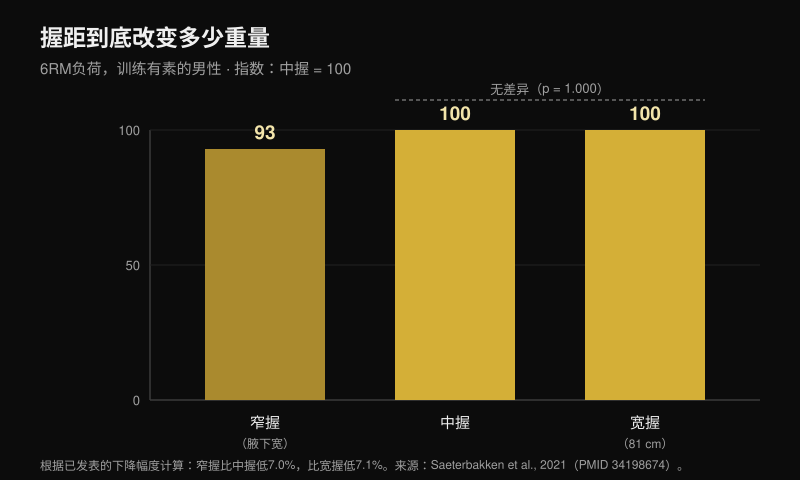
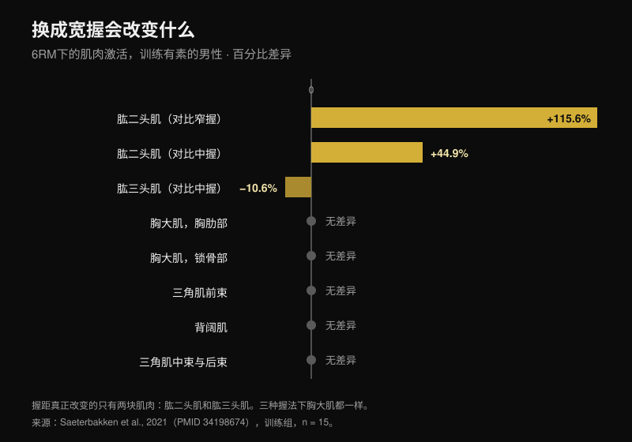

# 卧推握距：宽、中还是窄？

作者：[Giammaria Loi](/autore/giammaria-loi) · 更新于 2026 年 10 月 24 日

这套说法流传了很多年：宽握练力量，中握练胸，窄握练三头。它很整齐，很好记，而且几乎所有人都在照着做，却从来没有人验证过。我读了八篇被收录的研究，它们分别测量了不同握距下的负重、肌肉激活和关节力矩。这套说法有两条站得住。中间那条，连一篇支持它的研究都找不到。

## 要点速览

- **宽握并不是"最能举重"的握法。** 它只赢过窄握，大约 **7%**。对比中握，差别根本不存在：p = 1.000（Saeterbakken 等，2021）；另一个实验室测到的极限负重是 **109.8 kg 对 108.9 kg**（Larsen 等，2021）。
- **胸肌不会因为握距而改变。** 胸肌胸骨部、锁骨部、背阔肌、中束与后束三角肌：窄握、中握、宽握之间没有任何差别，训练者和新手都一样（Saeterbakken 等，2021）。
- **真正被改变的是另外两块肌肉。** 换成宽握后，二头肌的工作量比窄握多 **115.6%**，三头肌比中握少 **10.6%**。三头肌是唯一一块会被握距改变的"发力肌"。
- **次数范围跟握距无关。** 在极限负重的 75% 下，你到力竭前能做的次数，窄握、中握、宽握和自选握距都一样（p = 0.545；Pérez-Castilla 等，2021）。
- **让你举得最多的握距，就是你已经在用的那个。** 握距和速度都自选时，极限负重显著高于被规定握距的情况——而且没有一位受试者觉得自选条件别扭，被控制的条件下这个比例是 80%（Lee 等，2020）。

## 负重：宽握只赢过窄握

这一点上最有用的研究做了件很简单的事：找来 28 名男性，15 名有训练经验（卧推至少达到体重的 **125%**），13 名新手，用三种按每个人身体比例定义的握距测 6 次极限负重。窄握 = 两侧腋窝之间的距离。宽握 = 比赛允许的最大值，**81 cm**。中握 = 正好取中间（Saeterbakken 等，2021）。

训练组的结果：窄握比中握少举 **7.0%**，比宽握少举 **7.1%**。而中握与宽握之间，p = 1.000——也就是两种握距无法区分。新手组的落差类似：−8.4% 和 −6.6%，同样在中握与宽握之间没有差别。

另一组人用真实的 1RM 在 14 名训练男性身上得到了同一个结论：宽握 **109.8 kg**，中握 **108.9 kg**，窄握 **103.7 kg**。作者的结论是，想举起尽可能大的负重，"宽握**或中握**"都可以（Larsen 等，2021）。

还有一笔力学上的代价，图文里的柱状图是显示不出来的。宽握时，你施加在杠铃上的力有 **13.1-15.7%** 是横向往外的；窄握时 **8.5-10.1%** 往内；中握时几乎全是竖直方向，只有 **0.4-1.8%** 偏离（Larsen 等，2021）。往外推并不会把杠铃举起来：它的作用是稳住轨迹，但这是你在负重上看不见的力。

## 胸肌没变，变的是二头和三头

说法就是在这里垮掉的。还是同一项研究，七块肌肉上贴了电极，握距只改变了**两块**肌肉的激活：

- **肱二头肌**：宽握比窄握高 115.6%，比中握高 44.9%（p < 0.001）。它在这里是拮抗肌，任务是稳定肘关节；
- **肱三头肌**：宽握比中握低 **10.6%**（p = 0.032），比窄握低 24.1%，后面这个差别在显著性的边缘（p = 0.058）。

胸肌胸骨部、胸肌锁骨部、背阔肌、中束和后束三角肌：两个组里都没有差别。前束三角肌只在新手组里有变化，而且幅度很小。

这把常见说法的一半翻了过来：宽握并不会把工作"均匀分配"给发力的肌肉。它做的恰恰相反——它是那个**减少**三头肌工作量的握法。第三组人从反方向证实了这一点：握距取两肩距离的 50% 时三头肌处于最大收缩的 16%，取 150% 时降到 12%，而前束三角肌在任何条件下都不变（Muyor 等，2023）。那项研究的作者在结尾写了一句适用于整篇文章的话：动作的选择不该只看激活。

还有一个细节图文里跳过了：**三头肌上的这个差别只出现在训练组。** 新手的三头肌在任何握距下都不变。同一条建议，放在两个不同的人身上不会产生同样的效果。

## 不是"胸对三头"，而是胸的哪一部分

最有意思的数据不是胸肌用了多少力，而是**哪一部分**在用力。在 35 名有训练经验的成年人身上用 6-8RM 的负重测量关节力矩，更窄的握距增加了肘关节力矩，以及三头肌外侧头、前束三角肌**和胸大肌锁骨部**的活动——也就是上胸。更宽的握距增加了肩关节力矩，以及腹侧部分、也就是下胸的活动（Mausehund 等，2022）。

这跟我之前比较[哑铃卧推和飞鸟对胸肌生长的影响](/zh/blog/yaling-wotui-haishi-feiniao-xiongji)时发现的是同一个原理：选择不改变整块胸肌长多少，改变的是长在哪里。

实际的影响落在肩膀上。握距越宽，肩关节要承担的负荷就越高，无论按绝对值还是按你的最大承受能力的比例算。这正是肩膀有点不舒服的人往往收窄握距会好过一些的力学原因。但请注意：**没有任何研究把窄握当作康复手段测试过。** 它是一个合理的负荷管理选择，不是治疗：如果你肩膀疼，该走的路是医生或物理治疗师，而不是一张图。

## 为胸肌做"拉长半程"：这个数据并不存在

"做一半、停在拉长的位置来长胸"大概是整套说法里被重复最多、验证最少的一条。专门讨论动作幅度的系统综述确实发现，起始段（肌肉被拉长）的部分幅度和完整幅度都优于末端的部分幅度——但这些数据来自**股直肌、股外侧肌、肱二头肌、肱肌、臀大肌和内收肌群**。胸肌不在其中（Kassiano 等，2023）。至于三头肌，有意思的是，效果最好的部分幅度恰恰是动作**中段**的那一半。

而在唯一一项真正在卧推上比较不同动作幅度的急性研究里，**上半程**——也就是缩短的那一半，正好是"拉长偏向"的反面——在胸大肌胸肋部以及三头肌长头和外侧头上产生了最高的峰值兴奋（Fischer 等，2025）。这只是 19 名男性身上的急性数据，不是生长的证据。但那条建议的方向也同样没有被证明。

## 研究到底怎么说

| 说法 | 结论 | 数字 |
|---|---|---|
| 宽握 = 能举更重 | **需要修正** | 对窄握成立（+7%），对中握不成立（p = 1.000） |
| 宽握 = 发力肌群受力均匀 | **不成立** | 三头肌的工作量少了 10.6% |
| 中握 = 练胸最好 | **无法验证** | 胸肌激活没有差别；零篇生长研究 |
| 窄握 = 三头更多 | **确认** | 最大收缩的 16% 对 12% |
| 窄握 = 能举的更轻 | **确认** | 大约少 7% |
| 窄握用来康复肩膀和胸 | **需要修正** | 力学上合理，但从未作为康复手段测试过 |
| 每种握距有自己的次数范围 | **不成立** | 到力竭的次数不变（p = 0.545） |

## 怎么用这些信息

1. **量你自己的握距，不要照搬别人的厘米数。** 研究里窄握是两侧腋窝的距离，宽握是比赛上限 81 cm：对肩窄的人来说，这 81 cm 比对肩宽的人"宽"得多。
2. **按负重和肩膀选握距，不要按肌肉选。** 三种情况下胸肌的工作量一样。真正变化的是你能加多少重量，以及你对肩膀提了多少要求。
3. **用两种不同握距各测一次 5-6 次的极限负重，间隔一周。** 如果差别超过 5%，你就有答案了——而且很可能跟那套说法不一样。
4. **不要同时改握距和次数范围。** 次数范围按目标选，不是按手放在哪里选。
5. **窄握用来练三头，不是用来练胸。** 这是多个实验室一致证实的、握距对发力肌群唯一的影响。

> ### 用 Nurvan 做这个测试
> 这个话题上唯一靠得住的建议是"自己测"，而测的前提是数字留得下来。在 Nurvan 里，宽握、中握和窄握卧推是同一个动作下三个独立的变式：每组都记录负重、次数和 RIR（还能再做几次），历史曲线会在几周内告诉你，哪种握距在你身上真的在往上走。这就是第 3 条那个测试，不用再开表格。
> **[试用 Nurvan](https://nurvan.app)**

## 常见问题

**卧推用哪种握距最好？**
你能举最多、而且肩膀不难受的那种。在研究里中握和宽握在负重上是等价的，三种握距之间胸肌也没有差别。握距和速度都自选时，极限负重高于被规定握距的情况（Lee 等，2020）：你在训练中长出来的那个握距是真实的优势，不是需要被纠正的习惯。

**窄握卧推练胸更少吗？**
不是。在测量的七块肌肉里，胸肌的激活在窄握、中握和宽握之间没有差别（Saeterbakken 等，2021）。改变的是被偏重的部位——窄握偏上，宽握偏下（Mausehund 等，2022）——以及变化很大的三头肌。

**想练力量就必须用宽握吗？**
不一定。宽握只赢过窄握，大约 7%，跟中握打平。如果宽握让你肩膀不舒服，换中握一公斤都不会少。

**每种握距该做多少次？**
在给定的极限负重百分比下你能完成的次数不会因为握距而改变（Pérez-Castilla 等，2021）。次数范围按目标定：想找方向，我把数据整理在[增肌到底需要多少次数](/zh/blog/duoshao-cishu-zengji)里了。

## 延伸阅读

- [哑铃卧推还是飞鸟：哪个让胸肌长得更多？](/zh/blog/yaling-wotui-haishi-feiniao-xiongji)——同一套逻辑，用在动作的选择上，而不是握距。
- [增肌需要多少次数、多少组、多长休息](/zh/blog/duoshao-cishu-zengji)——为什么次数范围是一个独立的变量。
- [腿屈伸还是倒蹬：研究怎么说](/zh/blog/tuibu-shenzhan-vs-dengtui-gusizhiji)——区域性生长，在腿上测出来的版本。

## 参考文献

1. Saeterbakken AH, Stien N, Pedersen H, Solstad TEJ, Cumming KT, Andersen V, 2021. The Effect of Grip Width on Muscle Strength and Electromyographic Activity in Bench Press among Novice- and Resistance-Trained Men. *Int J Environ Res Public Health*. PMID [34198674](https://pubmed.ncbi.nlm.nih.gov/34198674/) · [DOI](https://doi.org/10.3390/ijerph18126444)
2. Larsen S, Gomo O, van den Tillaar R, 2021. A Biomechanical Analysis of Wide, Medium, and Narrow Grip Width Effects on Kinematics, Horizontal Kinetics, and Muscle Activity on the Sticking Region in Recreationally Trained Males During 1-RM Bench Pressing. *Front Sports Act Living*. PMID [33554113](https://pubmed.ncbi.nlm.nih.gov/33554113/) · [DOI](https://doi.org/10.3389/fspor.2020.637066)
3. Mausehund L, Werkhausen A, Bartsch J, Krosshaug T, 2022. Understanding Bench Press Biomechanics—The Necessity of Measuring Lateral Barbell Forces. *J Strength Cond Res*. PMID [33555823](https://pubmed.ncbi.nlm.nih.gov/33555823/) · [DOI](https://doi.org/10.1519/JSC.0000000000003948)
4. Muyor JM, Rodríguez-Ridao D, Oliva-Lozano JM, 2023. Comparison of Muscle Activity between the Horizontal Bench Press and the Seated Chest Press Exercises Using Several Grips. *J Hum Kinet*. PMID [37229415](https://pubmed.ncbi.nlm.nih.gov/37229415/) · [DOI](https://doi.org/10.5114/jhk/161468)
5. Pérez-Castilla A, Jukic I, Haff GG, García-Ramos A, 2021. The Bench Press Grip Width Does Not Affect the Number of Repetitions Performed at Different Velocity Loss Thresholds. *Int J Environ Res Public Health*. PMID [33504038](https://pubmed.ncbi.nlm.nih.gov/33504038/) · [DOI](https://doi.org/10.3390/ijerph18031057)
6. Lee S, Cone SM, Kim S, 2020. A biomechanical comparison of self-selected and experimentally controlled speeds and grip widths during the bench press exercise. *Sports Biomech*. PMID [32564677](https://pubmed.ncbi.nlm.nih.gov/32564677/) · [DOI](https://doi.org/10.1080/14763141.2020.1772357)
7. Kassiano W, Costa B, Nunes JP, Ribeiro AS, Schoenfeld BJ, Cyrino ES, 2023. Which ROMs Lead to Rome? A Systematic Review of the Effects of Range of Motion on Muscle Hypertrophy. *J Strength Cond Res*. PMID [36662126](https://pubmed.ncbi.nlm.nih.gov/36662126/) · [DOI](https://doi.org/10.1519/JSC.0000000000004415)
8. Fischer J, Burger C, Manieu Seguel JA, Rodoplu C, Paternoster FK, Tilp M, Konrad A, 2025. Acute muscle excitation response across various bench press ranges of motion. *Sci Rep*. PMID [40269203](https://pubmed.ncbi.nlm.nih.gov/40269203/) · [DOI](https://doi.org/10.1038/s41598-025-98354-9)

文献数据通过 PubMed 核对。选题起点：Sebastian Oreb 的"Bench press cheat sheet"图文（[@australianstrengthcoach](https://www.instagram.com/p/Dd8lCqIkfEh/)，2026 年 10 月 1 日）。本文的文字、结构、数据与图表均为原创。

---

*Giammaria Loi 是 Nurvan 的创始人。他从 2012 年开始进行力量训练，自 2013 年起担任 FIPE 认证私人教练与教练，自 2018 年起在全国级别参加力量举比赛。*

> 注：本文为科普内容，不能替代医生或专业人士的意见。如果你的肩膀或胸部有疼痛，请在调整训练之前先咨询医生或物理治疗师。
