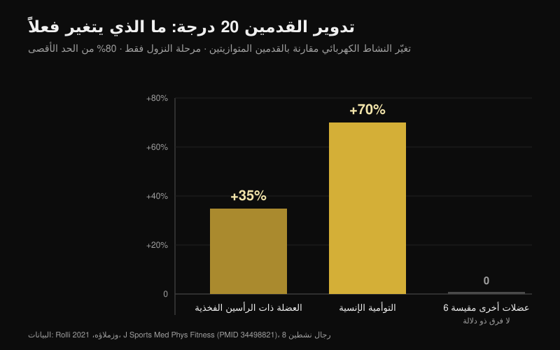
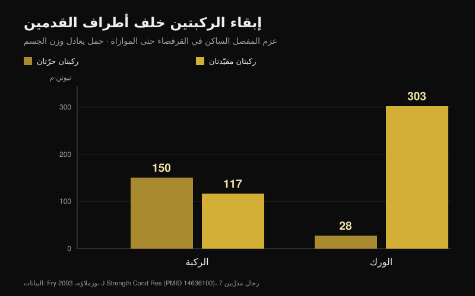

# الركبتان إلى الخارج في القرفصاء: قاعدة أم إشارة؟

بقلم [Giammaria Loi](/autore/giammaria-loi) · حُدِّث في 25 أكتوبر 2026

"ادفع ركبتيك إلى الخارج" هي على الأرجح أكثر جملة تُقال تحت البار المحمّل. تعمل جيدًا مع بعض الأشخاص لدرجة أنها تحوّلت إلى قاعدة للجميع، ومن لا يطبّقها يُقال له إن أداءه خاطئ. قرأت ثماني أوراق مفهرسة قاست الزوايا والنشاط العضلي وعزوم المفاصل في القرفصاء. الإشارة مفيدة، لكن معظم ما بُني حولها لا يصمد.

## باختصار

- **تدوير القدمين يغيّر القليل جدًا.** عند 20 درجة من الدوران الخارجي مقارنةً بالقدمين المتوازيتين، وبحمل 80% من الحد الأقصى، تتغيّر عضلتان فقط: ذات الرأسين الفخذية **+35%** والتوأمية الإنسية **+70%**، وفي مرحلة النزول وحدها. كل ما عدا ذلك يبقى كما هو (Rolli وزملاؤه، 2021).
- **زيادة الدوران الخارجي لا تعني تشغيلًا أكبر للألوية.** مراجعة لثماني عشرة دراسة تخطيط كهربائي للعضلات تخلص إلى أن التنويعات الشائعة — عرض الوقفة، دوران الورك، القرفصاء الأمامية — لا تغيّر تفعيل العضلات بصورة ذات دلالة (Clark وزملاؤه، 2012).
- **الركبة التي تنهار إلى الداخل لا تُصحَّح بالكلام.** من تظهر لديهم هذه الحالة تكون نسب التفعيل المشترك بين الألوية والمقرِّبات أدنى (**p = 0.007** للألوية الكبرى) ومدى ثني الكاحل الظهري أقل: الإشارة لا تمسّ أيًّا من السببين (Mauntel وزملاؤه، 2013).
- **خطر الرباط الصليبي الشهير مأخوذ من حركة أخرى.** الدراسة المستقبلية الأكثر اقتباسًا قاست الهبوط بعد القفز لدى 205 رياضيات، لا القرفصاء بالبار (Hewett وزملاؤه، 2005).
- **"الركبة يجب ألا تتجاوز أصابع القدم" هو الخطأ المعاكس.** تقييدها يخفض عزم الركبة من 150 إلى 117 نيوتن·متر، لكنه يرفع عزم الورك من 28 إلى **303** نيوتن·متر: أكثر من عشرة أضعاف (Fry وزملاؤه، 2003).

## من أين جاءت الإشارة ولماذا تعمل رغم ذلك

أثناء النزول لا يقوم الورك بالثني وحده: بل يجمع الثني والإبعاد والدوران. داخل هذا المزيج قد تتحرك الركبة إلى الخارج في النزول وتعود قليلًا إلى الداخل عند الخروج من أدنى نقطة. ولا أحد من الاتجاهين صحيح أو خاطئ بذاته: كلاهما نتيجة شكل الورك لديك وطريقة دفعك.

وُلدت عبارة "الركبتان إلى الخارج" كتصحيح لمن يفقد وضعيته: تنهار الركبة إلى الداخل، تتسطّح القدم، ويتبدّد الدفع. هنا تنفع الإشارة، ولهذا انتشرت. المشكلة في الخطوة التالية: تحويلها إلى قاعدة تسري أيضًا على من لم تكن لديه هذه المشكلة أصلًا.

## تدوير القدمين يغيّر عضلتين، لا القرفصاء كلها

الدراسة الأكثر مباشرة في هذا الموضوع فعلت شيئًا بسيطًا: ثمانية رجال نشطين أدّوا القرفصاء الخلفية بحمل 80% من الحد الأقصى بثلاث زوايا للقدم — متوازية، و+10 درجات، و+20 درجة من الدوران الخارجي — مع تسجيل ثماني عضلات في الساق المسيطرة (Rolli وزملاؤه، 2021).

عند 20 درجة مقارنةً بالوضع المتوازي يتغيّر شيئان: تعمل العضلة ذات الرأسين الفخذية بنسبة **35% أكثر** (p = 0.027)، والتوأمية الإنسية بنسبة **70% أكثر** (p = 0.040). ويظهر الفرقان في مرحلة النزول فقط. أما في بقية العضلات المقيسة وبقية الظروف فلم يظهر أي فرق ذي دلالة.

هذه نتيجة أصغر مما تَعِد به الإشارة، وهي تتوافق مع المراجعة المرجعية في الموضوع: عبر ثماني عشرة دراسة قاست النشاط الكهربائي في القرفصاء بالبار الحر، لا تؤثر التنويعات الشائعة في التقنية تأثيرًا ذا دلالة على تفعيل العضلات (Clark وزملاؤه، 2012). ما يغيّره فعلًا هو الحمل على البار.

ثمة استثناء، لكنه يخصّ توزيع العمل بين المفاصل لا بين العضلات: مع البار المنخفض والوقفة العريضة تكون مساهمة الورك في العزم الكلي أعلى، ومع البار المرتفع والوقفة الضيقة ترتفع مساهمة الركبة، مع نشاط أكبر للعضلة المتسعة الوحشية وأقل للألوية الكبرى (Larsen وزملاؤه، 2021). ولنقل العمل إلى الورك تُستخدم وضعية البار وعرض الوقفة، لا بضع درجات إضافية من دوران الركبة.

## إذا انهارت الركبة إلى الداخل فالإشارة لا تمسّ السبب

هذا هو الجزء الأنفع لمن يتدرّب. قارنت دراسة بين 40 بالغًا نشطًا: 20 تظهر لديهم بوضوح انهيار الركبة إلى الداخل في القرفصاء على ساق واحدة، و20 لا تظهر لديهم (Mauntel وزملاؤه، 2013).

لدى مجموعة الانهيار سمتان قابلتان للقياس. الأولى: نسب تفعيل مشترك أدنى بين الألوية والمقرِّبات — الألوية الوسطى إلى المقرِّبات p = 0.028، والألوية الكبرى إلى المقرِّبات p = 0.007. والثانية: مدى أقل من الثني الظهري السلبي للكاحل، سواء والركبة ممدودة (p = 0.047) أو مثنية (p = 0.034).

بعبارة أخرى: تنزلق الركبة إلى الداخل لأن الكاحل لا يسمح للساق بالتقدّم، ولأن توازن القوى حول الورك مختلّ. جملة تُصرخ تحت البار لا تغيّر حركية الكاحل ولا تقوّي الألوية. قد تُخفي المشكلة في مجموعة واحدة، لكنها لا تحلّها.

## ما مدى الخطورة فعلًا

عبارة "ادفع ركبتيك وإلا تمزّق رباطك الصليبي" تأتي من بحث حقيقي، لكن عن حركة أخرى. تابعت الدراسة المستقبلية الأكثر اقتباسًا 205 رياضيات في كرة القدم والسلة والطائرة وقاست الهبوط بعد القفز. التسع اللواتي تمزّق لديهن الرباط الصليبي الأمامي لاحقًا هبطن بزاوية إبعاد للركبة **أكبر بـ 8 درجات**، وعزم إبعاد أعلى بـ **2.5 ضعف**، وقوة رد فعل أرضية أعلى بنسبة 20%، مع زمن ارتكاز أقصر بنسبة 16% (Hewett وزملاؤه، 2005).

الأرقام متينة، وقد تنبّأ النموذج بالإصابة بحساسية 78% ونوعية 73%. لكنها تصف هبوطًا: اصطدام في أجزاء من الثانية، على ساق واحدة، من دون تحكم إرادي. أما قرفصاء بـ 90% من الحد الأقصى مع ميل بضع درجات إلى الداخل عند الخروج من أدنى نقطة فهي حركة بطيئة وثنائية الجانب وواعية. وحتى اليوم لا توجد دراسة مستقبلية تربط هذا الميل بزيادة خطر الإصابة لدى رافعي الأثقال. والخلط بين الحالتين هو أشهر قفزة منطقية في هذا الموضوع.

## الخطأ التوأم: "الركبة يجب ألا تتجاوز أصابع القدم"

هذه القاعدة المعاكسة، وتنبع من الفكرة ذاتها: أن الركبة يجب أن تُحمى من حيث المبدأ. أدّى سبعة رجال مدرَّبين قرفصاء حتى الموازاة بحمل يعادل وزن أجسامهم في حالتين: ركبتان حرّتان في تجاوز أطراف القدمين، أو حاجز خشبي يمنعهما (Fry وزملاؤه، 2003).

مع الركبتين الحرّتين بلغ عزم الركبة 150.1 نيوتن·متر وعزم الورك 28.2. ومع التقييد انخفض عزم الركبة إلى 117.3 — أي نحو 22% أقل — لكن الورك ارتفع إلى **302.7** نيوتن·متر، أي أكثر من عشرة أضعاف القيمة الأصلية. الحمل لا يختفي، بل ينتقل إلى الورك وأسفل الظهر. ويخلص المؤلفون إلى أن توزيعًا معقولًا للقوى يتطلب على الأرجح أن تتجاوز الركبتان أطراف القدمين قليلًا.

## وركك يقرّر أكثر من الإشارة

القطعة الأخيرة تشريحية. يختلف شكل رأس عظم الفخذ وعنقه من شخص لآخر، ومعه تختلف الزاوية التي يصطدم عندها العظم بحافة الحُق. في نموذج العناصر المحدودة، ارتفع الإجهاد المتوسط على الحُق أثناء القرفصاء من 9.64 ميغاباسكال في ورك مرجعي إلى 11.36 مع تشوّه cam متوسط وإلى 28.43 مع تشوّه cam كبير؛ وبلغ ثني الورك لدى المصابين بالاصطدام الفخذي الحُقّي 106.3 درجة مقابل 112.6، والدوران الداخلي 8.9 مقابل 14.8 (Bagwell وPowers، 2017).

هنا تستعيد الإشارة قيمتها، لكن لسبب مختلف عما يُقال عادة: يلاحظ المؤلفان أن أداء القرفصاء والورك في وضع محايد أو في دوران خارجي قد يحدّ من الاصطدام العظمي عند زوايا الثني الكبيرة. لا لتفعيل عضلة أكثر، بل لإتاحة مساحة للمفصل. ولذلك فإن شخصين بعظمَي فخذ مختلفين ستبدو قرفصاؤهما مختلفة بالضرورة، وهذا هو السبب الرئيسي لعدم وجود زاوية صالحة للجميع (Schoenfeld، 2010).

## ما يقوله البحث فعلًا

| الادعاء | الحكم | المعطى |
| --- | --- | --- |
| "الركبتان إلى الخارج" إشارة لا قاعدة للجميع | **مؤكَّد** | لا دراسة تحدّد زاوية مثلى؛ والمراجعات لا تجد فروقًا مهمة بين تنويعات دوران الورك (Clark وزملاؤه، 2012) |
| دوران خارجي أكبر = ألوية أكثر | **مُفنَّد** | عند 20 درجة تتغيّر فقط ذات الرأسين الفخذية (+35%) والتوأمية الإنسية (+70%)، وفي النزول وحده (Rolli وزملاؤه، 2021) |
| الدوران الخارجي المفروض يزيد عمل المقرِّبات في العمق | **غير محقَّق** | ادعاء شائع بلا مرجع؛ لم نجده على PubMed في عمليات البحث يوم 25 أكتوبر 2026 |
| انهيار الركبة إلى الداخل خطر دائمًا | **يحتاج تدقيقًا** | البيانات المستقبلية تصف الهبوط بعد القفز لدى رياضيات، لا القرفصاء بالبار (Hewett وزملاؤه، 2005) |
| يكفي دفع الركبتين إلى الخارج لتصحيح الروحاء | **يحتاج تدقيقًا** | يرتبط الانهيار بثني ظهري أقل للكاحل وبتفعيل مشترك أدنى بين الألوية والمقرِّبات (Mauntel وزملاؤه، 2013) |
| يجب ألا تتجاوز الركبتان أطراف القدمين | **مُفنَّد** | تقييدهما ينقل العزم إلى الورك: 28 ← 303 نيوتن·متر (Fry وزملاؤه، 2003) |
| التشريح الفردي يغيّر القرفصاء المثالية | **مؤكَّد** | تشوّه cam والاصطدام يغيّران الإجهاد والمدى المتاح (Bagwell وPowers، 2017) |

## كيف تطبّق ذلك

1. **استخدم الإشارة فقط إذا كانت لديك المشكلة التي تعالجها.** إن لم تنهَر ركبتك إلى الداخل فإضافة دوران خارجي لا تمنحك شيئًا قابلًا للقياس: أنت تغيّر تقنية ناجحة.
2. **اكتشف زاوية قدمك بالتجربة لا بالتقليد.** مجموعة خفيفة عند 0 درجة، وأخرى عند +10، وثالثة عند +20: احتفظ بالزاوية التي تنزل فيها أعمق من دون أن تنفصل القدم عن الأرض.
3. **إذا انهارت الركبة فافحص الكاحل قبل الكلام.** في وضع الطعن، والقدم على بعد 10 سم من الحائط: إن لم تلمس الركبة الحائط مع بقاء الكعب على الأرض فالمشكلة هناك.
4. **أضف عملًا لمبعِّدات الورك وباسطاته.** هذه هي الطريقة الوحيدة لتغيير نسبة التفعيل المشترك التي تفصل من تنهار ركبته عمّن لا تنهار. ساعة من الإشارات لا تعوّض ثمانية أسابيع من [العمل الموجَّه للألوية](/ar/blog/tamarin-almuakkadat-hip-thrust-am-alqurfusa).
5. **دع الركبتين تتقدّمان.** إيقافهما خلف أطراف القدمين لا يحمي الركبة: بل يحمّل الورك وأسفل الظهر أكثر من عشرة أضعاف.
6. **احكم على التقنية بقابلية التكرار لا بالشكل.** إذا تشابهت ثلاث مجموعات من خمس تكرارات في المسار والعمق فوضعيتك سليمة حتى لو لم تشبه ما في الفيديو.

**مع Nurvan.** النقطة الثانية اختبار، والاختبار لا ينفع إلا إذا بقيت أرقامه محفوظة. في Nurvan يمكنك حفظ القرفصاء بزوايا قدم أو عروض وقفة مختلفة كتنويعات منفصلة للتمرين نفسه: كل مجموعة تسجّل الحمل والتكرارات وRIR (التكرارات المتبقية في الاحتياط)، ويُظهر لك السجل خلال أسابيع قليلة أي إعداد يتقدّم فعلًا على جسدك. أما مجموعات الإحماء المقترحة تلقائيًا فتمنحك التكرارات الخفيفة لتجربة زاوية جديدة من دون إحراق مجموعة عمل. [جرّب Nurvan](https://nurvan.app)

## أسئلة شائعة

**كم يجب أن أدوّر قدميّ في القرفصاء؟**
لا توجد قيمة تصلح للجميع. تستخدم الدراسات 0 و10 و20 درجة من الدوران الخارجي، والفروق في التفعيل صغيرة ومحصورة في مرحلة النزول. عمليًا: اختر الزاوية التي تبلغ فيها العمق الذي تحتاجه مع ثبات القدم كاملة على الأرض وبالمسار نفسه مجموعةً بعد مجموعة.

**هل انهيار الركبتين إلى الداخل يضرّ الركبة؟**
لا توجد دراسات مستقبلية تثبت ذلك لدى رافعي الأثقال. بيانات خطر الرباط الصليبي مأخوذة من الهبوط بعد القفز لدى رياضيات. ويبقى الانهيار الواسع والمفاجئ تحت حمل شبه أقصى إشارة لا ينبغي تجاهلها، لكنه مسألة ثبات وتقنية قبل أن يكون تشخيصًا. وإذا ظهر ألم فاستشر طبيبًا أو أخصائي علاج طبيعي.

**هل دفع الركبتين إلى الخارج يفعّل الألوية أكثر؟**
ليس بصورة قابلة للقياس. لا تجد مراجعة دراسات التخطيط الكهربائي فروقًا ذات دلالة بين تنويعات دوران الورك وعرض الوقفة. ولنقل العمل إلى الورك فإن وضعية البار وعرض الوقفة أكثر فاعلية بكثير.

**هل يمكنني أن أدع الركبتين تتجاوزان أطراف القدمين؟**
نعم، وهو على الأرجح الخيار الأفضل. تقييدهما يخفض عزم الركبة بنحو 22% لكنه يضاعف عزم الورك أكثر من عشر مرات، ويفرض كذلك ميلًا أكبر للجذع.

## اقرأ أيضًا

- [تمارين الألوية: hip thrust أم القرفصاء؟](/ar/blog/tamarin-almuakkadat-hip-thrust-am-alqurfusa) — أيهما يبني الألوية فعلًا، بالأرقام
- [تمديد الساقين أم دفع الأرجل: ما الذي ينمو حقًا](/ar/blog/tamdid-alsaqayn-am-dafe-alarjul-alfakhidh-almustaqim) — ما الذي يتغيّر بين تمرينين يبدوان متبادلين
- [قبضة ضغط الصدر: واسعة أم متوسطة أم ضيقة؟](/ar/blog/qabdat-dafe-alsadr-wasia-dayiqa) — النوع نفسه من القواعد التقنية، مفكَّكًا على المقعد

## المصادر

1. Clark DR, Lambert MI, Hunter AM, 2012. Muscle activation in the loaded free barbell squat: a brief review. *J Strength Cond Res*. PMID [22373894](https://pubmed.ncbi.nlm.nih.gov/22373894/) · [DOI](https://doi.org/10.1519/JSC.0b013e31822d533d)
2. Rolli F, Vitale JA, Pugliese L, Boccia G, La Torre A, Pollitt L, 2021. The impact of foot angle on lower limb muscles activity during the back squat and counter movement jump. *J Sports Med Phys Fitness*. PMID [34498821](https://pubmed.ncbi.nlm.nih.gov/34498821/) · [DOI](https://doi.org/10.23736/S0022-4707.21.12588-5)
3. Larsen S, Kristiansen E, Helms E, van den Tillaar R, 2021. Effects of Stance Width and Barbell Placement on Kinematics, Kinetics, and Myoelectric Activity in Back Squats. *Front Sports Act Living*. PMID [34541522](https://pubmed.ncbi.nlm.nih.gov/34541522/) · [DOI](https://doi.org/10.3389/fspor.2021.719013)
4. Mauntel TC, Begalle RL, Cram TR, Frank BS, Hirth CJ, Blackburn T, Padua DA, 2013. The effects of lower extremity muscle activation and passive range of motion on single leg squat performance. *J Strength Cond Res*. PMID [23096063](https://pubmed.ncbi.nlm.nih.gov/23096063/) · [DOI](https://doi.org/10.1519/JSC.0b013e318276b886)
5. Hewett TE, Myer GD, Ford KR, Heidt RS, Colosimo AJ, McLean SG, van den Bogert AJ, Paterno MV, Succop P, 2005. Biomechanical measures of neuromuscular control and valgus loading of the knee predict anterior cruciate ligament injury risk in female athletes: a prospective study. *Am J Sports Med*. PMID [15722287](https://pubmed.ncbi.nlm.nih.gov/15722287/) · [DOI](https://doi.org/10.1177/0363546504269591)
6. Fry AC, Smith JC, Schilling BK, 2003. Effect of knee position on hip and knee torques during the barbell squat. *J Strength Cond Res*. PMID [14636100](https://pubmed.ncbi.nlm.nih.gov/14636100/) · [DOI](https://doi.org/10.1519/1533-4287(2003)017%3C0629:EOKPOH%3E2.0.CO;2)
7. Bagwell JJ, Powers CM, 2017. The Influence of Squat Kinematics and Cam Morphology on Acetabular Stress. *Arthroscopy*. PMID [28969815](https://pubmed.ncbi.nlm.nih.gov/28969815/) · [DOI](https://doi.org/10.1016/j.arthro.2017.03.018)
8. Schoenfeld BJ, 2010. Squatting kinematics and kinetics and their application to exercise performance. *J Strength Cond Res*. PMID [20182386](https://pubmed.ncbi.nlm.nih.gov/20182386/) · [DOI](https://doi.org/10.1519/JSC.0b013e3181bac2d7)

نقطة الانطلاق: منشور لـ Alfred Jong ([@alfred.reformance](https://www.instagram.com/p/Ddbl4IKmyqw/)) عن إشارة "knees out". نصّ هذا المقال وبنيته وعمليات التحقق فيه أصلية.

---

**Giammaria Loi** مؤسس Nurvan. يتدرّب بالأثقال منذ 2012، ويعمل مدربًا شخصيًا ومدربًا معتمدًا من FIPE منذ 2013، وينافس في رفع الأثقال القوة على المستوى الوطني منذ 2018.

> ملاحظة: محتوى معلوماتي لا يغني عن رأي الطبيب أو المختص. عند الشعور بألم في الركبة أو الورك أو الظهر، استشر طبيبًا أو أخصائي علاج طبيعي قبل تغيير تدريبك.
