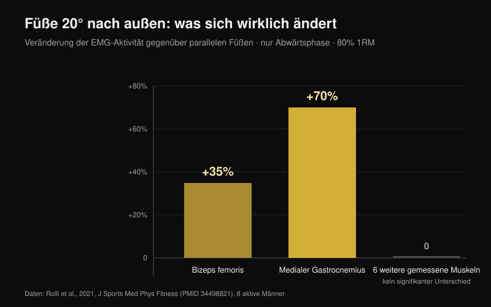
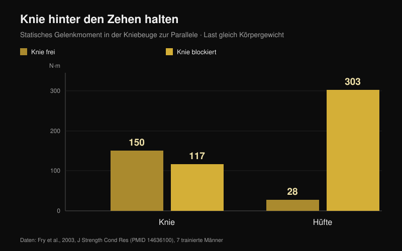

# Knie nach außen in der Kniebeuge: Regel oder Cue?

Von [Giammaria Loi](/autore/giammaria-loi) · aktualisiert am 25. Oktober 2026

„Knie nach außen" ist wahrscheinlich der meistgesagte Satz unter einer beladenen Langhantel. Bei manchen funktioniert er so gut, dass daraus eine Regel für alle wurde — und wer sie nicht befolgt, bekommt zu hören, seine Kniebeuge sei falsch. Ich habe acht indexierte Arbeiten gelesen, die Gelenkwinkel, Muskelaktivität und Gelenkmomente in der Kniebeuge gemessen haben. Der Cue ist nützlich. Fast alles, was man um ihn herum gebaut hat, hält nicht stand.

## Kurz gefasst

- **Die Füße nach außen zu drehen ändert kaum etwas.** Bei 20° Außenrotation gegenüber parallelen Füßen, bei 80 % des Maximums, bewegen sich nur zwei Muskeln: Bizeps femoris **+35 %** und medialer Gastrocnemius **+70 %**, und das ausschließlich in der Abwärtsphase. Alles andere bleibt gleich (Rolli et al., 2021).
- **Mehr Außenrotation heißt nicht mehr Gesäß.** Eine Übersichtsarbeit über 18 EMG-Studien kommt zu dem Schluss, dass übliche Varianten — Standbreite, Hüftrotation, Frontkniebeuge — die Muskelaktivierung nicht signifikant verändern (Clark et al., 2012).
- **Ein nach innen fallendes Knie korrigiert man nicht mit Worten.** Wer dieses Einknicken zeigt, hat niedrigere Koaktivierungsverhältnisse zwischen Gesäß und Adduktoren (**p = 0,007** für den Gluteus maximus) und weniger Sprunggelenk-Dorsalextension. Der Cue erreicht keine der beiden Ursachen (Mauntel et al., 2013).
- **Das berühmte Kreuzbandrisiko stammt aus einer anderen Bewegung.** Die meistzitierte prospektive Studie hat Sprunglandungen bei 205 Athletinnen gemessen, keine Langhantelkniebeugen (Hewett et al., 2005).
- **„Die Knie dürfen nie über die Zehen" ist der umgekehrte Fehler.** Werden sie blockiert, sinkt das Kniemoment von 150 auf 117 N·m, das Hüftmoment steigt aber von 28 auf **303 N·m** — mehr als das Zehnfache (Fry et al., 2003).

## Woher der Cue kommt und warum er trotzdem wirkt

Beim Absenken beugt die Hüfte nicht nur: Sie kombiniert Flexion, Abduktion und Rotation. In dieser Kombination kann das Knie abwärts nach außen wandern und beim Herauskommen aus der tiefen Position etwas nach innen driften. Keine der beiden Richtungen ist an sich richtig oder falsch: Beide ergeben sich aus der Form deiner Hüfte und aus der Art, wie du drückst.

„Knie nach außen" entstand als Korrektur für Sportler, die die Position verlieren: Das Knie fällt nach innen, der Fuß sackt ab, der Druck verpufft. Dort wirkt der Cue, und deshalb hat er sich weltweit verbreitet. Das Problem ist der nächste Schritt — ihn in eine Regel für Menschen zu verwandeln, die dieses Problem nie hatten.

## Die Fußdrehung verändert zwei Muskeln, nicht die ganze Kniebeuge

Die direkteste Studie zur Frage hat es einfach gehalten: Acht aktive Männer beugten mit 80 % des Maximums in drei Fußwinkeln — parallel, +10° und +20° Außenrotation — während acht Muskeln des dominanten Beins abgeleitet wurden (Rolli et al., 2021).

Bei 20° gegenüber parallel ändern sich zwei Dinge: Der Bizeps femoris arbeitet **35 % mehr** (p = 0,027), der mediale Gastrocnemius **70 % mehr** (p = 0,040). Beide Unterschiede treten nur in der Abwärtsphase auf. In allen anderen gemessenen Muskeln und allen übrigen Bedingungen zeigte sich kein signifikanter Unterschied.

Das ist weniger, als der Cue verspricht, und es passt zur Referenzübersicht: In 18 Studien zur EMG in der freien Langhantelkniebeuge verändern übliche Technikvarianten die Muskelaktivierung nicht signifikant (Clark et al., 2012). Was sie wirklich verändert, ist die Last auf der Stange.

Eine Ausnahme gibt es, sie betrifft aber die Verteilung zwischen Gelenken, nicht zwischen Muskeln: Mit tiefer Hantelposition und breitem Stand trägt die Hüfte mehr zum Gesamtmoment bei, mit hoher Position und engem Stand das Knie, mit mehr Vastus lateralis und weniger Gluteus maximus (Larsen et al., 2021). Wer Arbeit auf die Hüfte verlagern will, tut das über Hantelposition und Standbreite, nicht über ein paar Grad mehr Knieaußenrotation.

## Fällt das Knie nach innen, erreicht der Cue die Ursache nicht

Das ist der praktisch wichtigste Teil. Eine Studie verglich 40 aktive Erwachsene: 20 mit deutlichem Einknicken des Knies nach innen in der einbeinigen Kniebeuge und 20 ohne (Mauntel et al., 2013).

Die Gruppe mit Einknicken hat zwei messbare Merkmale. Erstens niedrigere Koaktivierungsverhältnisse zwischen Gesäß und Hüftadduktoren — Gluteus medius zu Adduktoren p = 0,028, Gluteus maximus zu Adduktoren p = 0,007. Zweitens weniger passive Dorsalextension im Sprunggelenk, sowohl bei gestrecktem (p = 0,047) als auch bei gebeugtem Knie (p = 0,034).

Übersetzt: Das Knie wandert nach innen, weil das Sprunggelenk das Schienbein nicht nach vorn lässt und weil das Kräfteverhältnis um die Hüfte verschoben ist. Ein Zuruf unter der Stange verändert weder Sprunggelenkmobilität noch Gesäßkraft. Er kann das Problem für einen Satz kaschieren, nicht lösen.

## Wie gefährlich ist das wirklich

„Knie raus, sonst reißt dein Kreuzband" stammt aus echter Forschung, aber zu einer anderen Bewegung. Die meistzitierte prospektive Studie begleitete 205 Fußball-, Basketball- und Volleyballspielerinnen und maß eine Sprunglandung. Die neun, die später das vordere Kreuzband rissen, landeten mit einem **um 8° größeren** Knieabduktionswinkel, einem **2,5-fach** höheren Abduktionsmoment und einer um 20 % höheren Bodenreaktionskraft, bei 16 % kürzerer Standzeit (Hewett et al., 2005).

Die Zahlen sind belastbar, das Modell sagte die Verletzung mit 78 % Sensitivität und 73 % Spezifität voraus. Sie beschreiben aber eine Landung: Aufprall in Sekundenbruchteilen, einbeinig, ohne willkürliche Kontrolle. Eine Kniebeuge mit 90 % und ein paar Grad Einwärtsdrift beim Herauskommen ist langsam, beidbeinig und bewusst. Bis heute gibt es keine prospektive Studie, die diese Drift bei Kraftsportlern mit erhöhtem Verletzungsrisiko verknüpft. Beides gleichzusetzen ist der häufigste Denkfehler zu diesem Thema.

## Der Zwillingsfehler: „Knie nie über die Zehen"

Das ist die umgekehrte Regel, und sie entspringt derselben Idee: Das Knie müsse grundsätzlich geschont werden. Sieben trainierte Männer beugten zur Parallelen mit einer Last in Höhe ihres Körpergewichts, in zwei Bedingungen: Knie frei über die Zehen, oder von einer Holzbarriere gestoppt (Fry et al., 2003).

Mit freien Knien betrug das Kniemoment 150,1 N·m, das Hüftmoment 28,2 N·m. Blockiert sank das Knie auf 117,3 N·m — rund 22 % weniger — die Hüfte stieg jedoch auf **302,7 N·m**, mehr als das Zehnfache des Ausgangswerts. Die Last verschwindet nicht, sie zieht in Hüfte und unteren Rücken um. Die Autoren schließen daraus, dass eine sinnvolle Lastverteilung wahrscheinlich verlangt, dass die Knie leicht über die Zehen wandern.

## Deine Hüfte entscheidet mehr als der Cue

Das letzte Stück ist anatomisch. Form von Hüftkopf und Schenkelhals unterscheiden sich von Mensch zu Mensch, und damit der Winkel, in dem der Knochen an den Pfannenrand stößt. In einem Finite-Elemente-Modell stieg die mittlere Belastung der Hüftpfanne während der Kniebeuge von 9,64 MPa in einer Referenzhüfte auf 11,36 MPa bei moderater Cam-Morphologie und auf 28,43 MPa bei ausgeprägter Cam; Personen mit femoroazetabulärem Impingement erreichten 106,3° Hüftbeugung gegenüber 112,6° und 8,9° Innenrotation gegenüber 14,8° (Bagwell und Powers, 2017).

Hier verdient der Cue seinen Platz, aber aus einem anderen Grund als dem erzählten: Die Autoren merken an, dass Beugen mit neutraler oder außenrotierter Hüfte den knöchernen Anschlag bei großen Beugewinkeln begrenzen kann. Nicht um einen Muskel stärker anzusteuern — um dem Gelenk Platz zu lassen. Zwei Menschen mit unterschiedlichen Oberschenkelknochen haben deshalb Kniebeugen, die unterschiedlich aussehen *müssen*, und das ist der Hauptgrund, warum es keinen universellen Winkel gibt (Schoenfeld, 2010).

## Was die Forschung wirklich sagt

| Aussage | Urteil | Die Daten |
| --- | --- | --- |
| „Knie nach außen" ist ein Cue, keine Regel für alle | **Bestätigt** | Keine Studie nennt einen optimalen Winkel; Übersichten finden keine relevanten Unterschiede zwischen Hüftrotationsvarianten (Clark et al., 2012) |
| Mehr Außenrotation = mehr Gesäß | **Widerlegt** | Bei 20° ändern sich nur Bizeps femoris (+35 %) und medialer Gastrocnemius (+70 %), und nur abwärts (Rolli et al., 2021) |
| Vorgegebene Außenrotation erhöht die Adduktorenarbeit in der Tiefe | **Nicht belegt** | Weit verbreitet, aber ohne Quellenangabe; in unseren PubMed-Suchen am 25. Oktober 2026 nicht auffindbar |
| Ein nach innen fallendes Knie ist immer gefährlich | **Einzuordnen** | Die prospektiven Daten beschreiben Sprunglandungen bei Athletinnen, keine Langhantelkniebeugen (Hewett et al., 2005) |
| Knie nach außen drücken behebt den Valgus | **Einzuordnen** | Das Einknicken geht mit weniger Dorsalextension und niedrigerer Gesäß:Adduktoren-Koaktivierung einher (Mauntel et al., 2013) |
| Die Knie dürfen nicht über die Zehen | **Widerlegt** | Blockieren verschiebt das Moment zur Hüfte: 28 → 303 N·m (Fry et al., 2003) |
| Die individuelle Anatomie verändert die ideale Kniebeuge | **Bestätigt** | Cam-Morphologie und Impingement verändern Belastung und verfügbaren Bewegungsumfang (Bagwell und Powers, 2017) |

## So setzt du es um

1. **Nutze den Cue nur, wenn du das Problem hast, das er löst.** Fällt dein Knie nicht nach innen, bringt zusätzliche Außenrotation messbar nichts — du änderst eine Technik, die funktioniert.
2. **Finde deinen Fußwinkel durch Testen, nicht durch Abschauen.** Ein leichter Satz bei 0°, einer bei +10°, einer bei +20°: Behalte den Winkel, in dem du am tiefsten kommst, ohne dass der Fuß abhebt.
3. **Fällt das Knie nach innen, teste zuerst das Sprunggelenk.** Im Ausfallschritt den Fuß 10 cm vor die Wand: Berührt das Knie die Wand nicht, ohne dass die Ferse abhebt, liegt dein Problem dort.
4. **Ergänze Arbeit für Hüftabduktoren und -strecker.** Nur so änderst du das Koaktivierungsverhältnis, das Einknicker von Nicht-Einknickern trennt. Eine Stunde Zurufe ersetzt keine acht Wochen [gezieltes Gesäßtraining](/de/blog/po-uebungen-hip-thrust-oder-kniebeuge).
5. **Lass die Knie nach vorn wandern.** Sie hinter den Zehen zu stoppen schützt das Knie nicht: Es belastet Hüfte und unteren Rücken um ein Vielfaches stärker.
6. **Beurteile Technik nach Wiederholbarkeit, nicht nach Optik.** Haben drei Sätze zu fünf dieselbe Bahn und dieselbe Tiefe, ist deine Position in Ordnung, auch wenn sie nicht aussieht wie im Video.

**Mit Nurvan.** Punkt 2 ist ein Test, und ein Test taugt nur, wenn die Zahlen irgendwo bleiben. In Nurvan kannst du die Kniebeuge mit verschiedenen Fußwinkeln oder Standbreiten als eigene Varianten derselben Übung speichern: Jeder Satz erfasst Last, Wiederholungen und RIR (die Wiederholungen, die du noch im Tank hattest), und der Verlauf zeigt innerhalb weniger Wochen, welche Einstellung an deinem Körper wirklich vorangeht. Die automatisch vorgeschlagenen Aufwärmsätze liefern die leichten Wiederholungen, in denen ein neuer Winkel getestet werden kann, ohne einen Arbeitssatz zu verbrennen. [Nurvan ausprobieren](https://nurvan.app)

## Häufige Fragen

**Wie weit soll ich die Füße in der Kniebeuge nach außen drehen?**
Es gibt keinen Wert, der für alle passt. Studien verwenden 0°, 10° und 20° Außenrotation, und die Aktivierungsunterschiede sind klein und auf die Abwärtsphase beschränkt. Praktisch: Nimm den Winkel, in dem du die nötige Tiefe erreichst, der Fuß vollflächig steht und die Bahn Satz für Satz gleich bleibt.

**Sind nach innen fallende Knie schlecht für das Knie?**
Bei Kraftsportlern gibt es dafür keine prospektiven Belege. Die Kreuzbanddaten stammen aus Sprunglandungen bei Athletinnen. Ein großes, plötzliches Einknicken bei nahezu maximaler Last bleibt ein Signal, das man ernst nehmen sollte, aber es ist zuerst ein Stabilitäts- und Technikthema, keine Diagnose. Bei Schmerzen sprich mit einer Ärztin oder einem Physiotherapeuten.

**Aktiviert das Herausdrücken der Knie das Gesäß stärker?**
Nicht messbar. Die Übersichtsarbeit zu EMG-Studien findet keine signifikanten Unterschiede zwischen Hüftrotations- und Standvarianten. Um Arbeit zur Hüfte zu verlagern, wirken Hantelposition und Standbreite deutlich stärker.

**Darf ich die Knie über die Zehen wandern lassen?**
Ja, und es ist wahrscheinlich vorzuziehen. Sie zu blockieren senkt das Kniemoment um rund 22 %, vervielfacht das Hüftmoment aber um mehr als das Zehnfache und erzwingt zusätzlich mehr Vorlage des Oberkörpers.

## Lies auch

- [Po-Übungen: Hip Thrust oder Kniebeuge?](/de/blog/po-uebungen-hip-thrust-oder-kniebeuge) — was den Gesäßmuskel wirklich aufbaut, mit Zahlen
- [Beinstrecker oder Beinpresse: Was wirklich wächst](/de/blog/beinstrecker-oder-beinpresse-rectus-femoris) — was sich zwischen zwei scheinbar austauschbaren Übungen ändert
- [Griffbreite beim Bankdrücken: weit, mittel oder eng?](/de/blog/bankdruecken-griffbreite-weit-eng) — dieselbe Art technischer Regel, auf der Bank auseinandergenommen

## Quellen

1. Clark DR, Lambert MI, Hunter AM, 2012. Muscle activation in the loaded free barbell squat: a brief review. *J Strength Cond Res*. PMID [22373894](https://pubmed.ncbi.nlm.nih.gov/22373894/) · [DOI](https://doi.org/10.1519/JSC.0b013e31822d533d)
2. Rolli F, Vitale JA, Pugliese L, Boccia G, La Torre A, Pollitt L, 2021. The impact of foot angle on lower limb muscles activity during the back squat and counter movement jump. *J Sports Med Phys Fitness*. PMID [34498821](https://pubmed.ncbi.nlm.nih.gov/34498821/) · [DOI](https://doi.org/10.23736/S0022-4707.21.12588-5)
3. Larsen S, Kristiansen E, Helms E, van den Tillaar R, 2021. Effects of Stance Width and Barbell Placement on Kinematics, Kinetics, and Myoelectric Activity in Back Squats. *Front Sports Act Living*. PMID [34541522](https://pubmed.ncbi.nlm.nih.gov/34541522/) · [DOI](https://doi.org/10.3389/fspor.2021.719013)
4. Mauntel TC, Begalle RL, Cram TR, Frank BS, Hirth CJ, Blackburn T, Padua DA, 2013. The effects of lower extremity muscle activation and passive range of motion on single leg squat performance. *J Strength Cond Res*. PMID [23096063](https://pubmed.ncbi.nlm.nih.gov/23096063/) · [DOI](https://doi.org/10.1519/JSC.0b013e318276b886)
5. Hewett TE, Myer GD, Ford KR, Heidt RS, Colosimo AJ, McLean SG, van den Bogert AJ, Paterno MV, Succop P, 2005. Biomechanical measures of neuromuscular control and valgus loading of the knee predict anterior cruciate ligament injury risk in female athletes: a prospective study. *Am J Sports Med*. PMID [15722287](https://pubmed.ncbi.nlm.nih.gov/15722287/) · [DOI](https://doi.org/10.1177/0363546504269591)
6. Fry AC, Smith JC, Schilling BK, 2003. Effect of knee position on hip and knee torques during the barbell squat. *J Strength Cond Res*. PMID [14636100](https://pubmed.ncbi.nlm.nih.gov/14636100/) · [DOI](https://doi.org/10.1519/1533-4287(2003)017%3C0629:EOKPOH%3E2.0.CO;2)
7. Bagwell JJ, Powers CM, 2017. The Influence of Squat Kinematics and Cam Morphology on Acetabular Stress. *Arthroscopy*. PMID [28969815](https://pubmed.ncbi.nlm.nih.gov/28969815/) · [DOI](https://doi.org/10.1016/j.arthro.2017.03.018)
8. Schoenfeld BJ, 2010. Squatting kinematics and kinetics and their application to exercise performance. *J Strength Cond Res*. PMID [20182386](https://pubmed.ncbi.nlm.nih.gov/20182386/) · [DOI](https://doi.org/10.1519/JSC.0b013e3181bac2d7)

Ausgangspunkt: ein Beitrag von Alfred Jong ([@alfred.reformance](https://www.instagram.com/p/Ddbl4IKmyqw/)) zum Cue „knees out". Text, Struktur und Faktenprüfung dieses Artikels sind eigenständig.

---

**Giammaria Loi** ist der Gründer von Nurvan. Er trainiert seit 2012 mit Gewichten, arbeitet seit 2013 als FIPE-zertifizierter Personal Trainer und Coach und startet seit 2018 im Powerlifting auf nationaler Ebene.

> Hinweis: informativer Inhalt, kein Ersatz für die Einschätzung einer Ärztin, eines Arztes oder einer Fachperson. Bei Knie-, Hüft- oder Rückenschmerzen sprich vor einer Trainingsumstellung mit einer Ärztin oder einem Physiotherapeuten.
