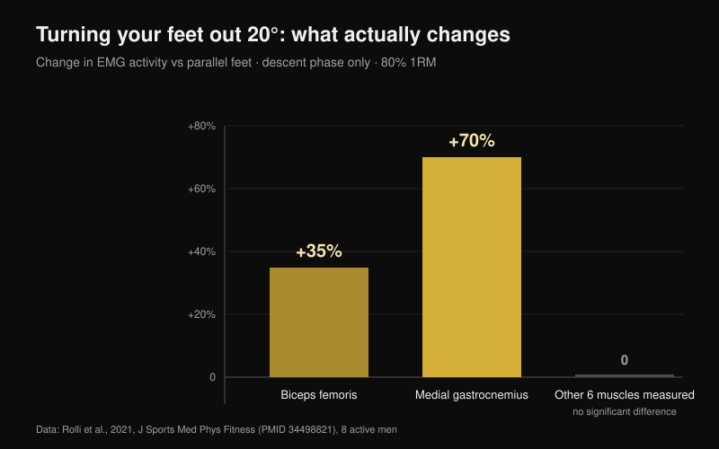
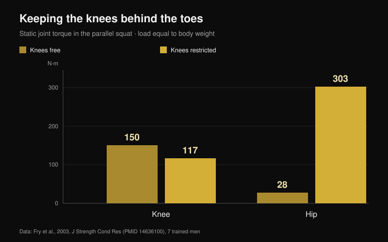

# Knees out in the squat: cue or actual rule?

By [Giammaria Loi](/autore/giammaria-loi) · updated 25 October 2026

"Knees out" is probably the most repeated sentence under a loaded barbell. It works so well on some lifters that it turned into a rule for everyone, and anyone who ignores it gets told their squat is wrong. I read eight indexed papers that measured joint angles, muscle activity and joint torques in the squat. The cue is useful. Almost everything people have built around it is not.

## The short version

- **Turning your feet out barely changes anything.** At 20° of external foot rotation versus parallel feet, at 80% of 1RM, only two muscles move: biceps femoris **+35%** and medial gastrocnemius **+70%**, and only on the way down. Everything else stays the same (Rolli et al., 2021).
- **More external rotation does not mean more glutes.** A review of 18 EMG studies concludes that common variations — stance width, hip rotation, front squat — do not significantly change muscle activation (Clark et al., 2012).
- **Knees caving in is not a fault you fix with words.** Lifters who show medial knee displacement have lower glute-to-adductor coactivation ratios (**p = 0.007** for gluteus maximus) and less ankle dorsiflexion. A cue touches neither cause (Mauntel et al., 2013).
- **The famous ACL risk comes from a different movement.** The most cited prospective study measured jump landings in 205 female athletes, not barbell squats (Hewett et al., 2005).
- **"Never let the knees pass the toes" is the opposite mistake.** Blocking the knees cuts knee torque from 150 to 117 N·m but pushes hip torque from 28 to **303 N·m** — more than tenfold (Fry et al., 2003).

## Where the cue comes from, and why it still works

On the way down the hip does not only flex: it combines flexion, abduction and rotation. Inside that combination the knee can travel outward during the descent and drift slightly inward as you come out of the bottom. Neither direction is right or wrong in itself. Both come out of the shape of your hip and the way you push.

"Knees out" was born as a correction for lifters who lose position: the knee collapses inward, the foot flattens, the drive leaks away. There it works, and that is why it spread. The problem is the next step — turning it into a rule for people who never had that problem.

## Rotating your feet changes two muscles, not the whole squat

The most direct study on the question did something simple: eight physically active men performed back squats at 80% of 1RM with three foot angles — parallel, +10° and +20° of external rotation — while eight muscles of the dominant leg were recorded (Rolli et al., 2021).

At 20° versus parallel, two things change. Biceps femoris works **35% more** (p = 0.027) and medial gastrocnemius **70% more** (p = 0.040). Both differences appear only in the descending phase. In every other muscle measured and every other condition, nothing significant emerged.

That is a smaller result than the cue promises, and it matches the reference review on the topic: across 18 studies that measured EMG in the free barbell squat, common technique variations — stance width, hip rotation, front squat — do not significantly affect muscle activation (Clark et al., 2012). What does change activation is the load on the bar.

There is one exception, but it concerns how work is split between joints rather than between muscles. With a low bar position and a wide stance, the hip contributes more to total joint moment; with a high bar and a narrow stance, the knee contributes more, with greater vastus lateralis and less gluteus maximus activity (Larsen et al., 2021). If you want to shift work to the hip, you do it with bar position and stance width, not by rotating your knees a few degrees further out.

## If your knees cave in, the cue does not touch the cause

This is the part that matters most in the gym. One study compared 40 physically active adults: 20 who clearly show the knee collapsing inward during a single-leg squat and 20 who do not (Mauntel et al., 2013).

The group that caves in has two measurable traits. First, lower coactivation ratios between glutes and hip adductors — gluteus medius to adductors p = 0.028, gluteus maximus to adductors p = 0.007. Second, less passive ankle dorsiflexion, both with the knee extended (p = 0.047) and flexed (p = 0.034).

In plain terms: the knee drifts in because the ankle will not let the shin travel forward and because the balance of force around the hip is skewed. A sentence shouted under the bar changes neither your ankle mobility nor your glute strength. It can mask the problem for one set. It does not fix it.

## How dangerous is a knee that drifts in, really

"Knees out or you'll tear your ACL" comes from real research, but on a different movement. The most cited prospective study followed 205 female soccer, basketball and volleyball athletes and measured a jump-landing task. The nine who went on to rupture the anterior cruciate ligament landed with a knee abduction angle **8° greater**, a knee abduction moment **2.5 times** higher and a ground reaction force 20% larger, with a stance time 16% shorter (Hewett et al., 2005).

The numbers are solid, and the model predicted injury status with 78% sensitivity and 73% specificity. But they describe a landing: impact in fractions of a second, on one leg, with no voluntary control. A squat at 90% with a few degrees of inward travel out of the hole is slow, bilateral and deliberate. To date there is no prospective study linking that drift to injury risk in lifters. Treating the two as the same thing is the most common leap of logic on this topic.

## The twin mistake: "knees must never pass the toes"

This is the opposite rule, and it comes from the same idea that the knee should be protected on principle. Seven trained men performed parallel barbell squats with a load equal to body weight in two conditions: knees free to travel past the toes, or a wooden barrier stopping them (Fry et al., 2003).

With knees free, knee torque was 150.1 N·m and hip torque 28.2 N·m. With the knees blocked, the knee dropped to 117.3 N·m — about 22% less — but the hip rose to **302.7 N·m**, more than ten times its starting value. The load does not disappear; it moves to the hip and lower back. The authors conclude that sensible joint loading probably requires the knees to travel slightly past the toes.

## Your hip decides more than the cue does

The last piece is anatomical. The shape of the femoral head and neck varies between people, and with it the angle at which bone meets the rim of the socket. In a finite element model, average acetabular stress during a squat went from 9.64 MPa in a reference hip to 11.36 MPa with a moderate cam morphology and 28.43 MPa with a large one; participants with femoroacetabular impingement reached 106.3° of hip flexion against 112.6°, and 8.9° of internal rotation against 14.8° (Bagwell and Powers, 2017).

Here the cue earns its place, but for a different reason than the one usually given: the authors note that squatting with the hip in neutral or external rotation may limit bony abutment at high flexion angles. Not to recruit a muscle — to give the joint room. Two people with different femurs will therefore have squats that *should* look different, and that is the main reason no universal knee angle exists (Schoenfeld, 2010).

## What the research actually says

| Claim | Verdict | The data |
| --- | --- | --- |
| "Knees out" is a cue, not a rule for everyone | **Confirmed** | No study identifies an optimal angle; reviews find no meaningful differences between hip rotation variants (Clark et al., 2012) |
| More external rotation = more glutes | **Busted** | At 20° only biceps femoris (+35%) and medial gastrocnemius (+70%) change, and only on the descent (Rolli et al., 2021) |
| Prescribed external rotation raises adductor work in the deep range | **Unverified** | Widely repeated without a citation; we could not locate it on PubMed in searches run on 25 October 2026 |
| A knee that drifts inward is always dangerous | **Needs context** | Prospective data describe jump landings in female athletes, not barbell squats (Hewett et al., 2005) |
| Pushing the knees out fixes knee valgus | **Needs context** | Caving in is associated with less ankle dorsiflexion and lower glute-to-adductor coactivation (Mauntel et al., 2013) |
| Knees must never pass the toes | **Busted** | Blocking them moves the torque to the hip: 28 → 303 N·m (Fry et al., 2003) |
| Individual anatomy changes the ideal squat | **Confirmed** | Cam morphology and impingement change joint stress and available range (Bagwell and Powers, 2017) |

## How to use this

1. **Use the cue only if you have the problem it solves.** If your knee does not collapse inward, adding external rotation gives you nothing measurable — you are changing a technique that already works.
2. **Find your foot angle by testing it, not copying it.** Run one light set at 0°, one at +10° and one at +20°, and keep the angle where you reach depth without the foot peeling off the floor.
3. **If the knee caves, test the ankle before you talk.** Half-kneel with your foot 10 cm from a wall: if the knee cannot touch the wall with the heel down, your problem is there, not in your head.
4. **Add work for hip abductors and extensors.** That is the only way to change the coactivation ratio that separates lifters who cave from lifters who do not. An hour of cueing does not replace eight weeks of [targeted glute work](/en/blog/glute-exercises-hip-thrust-vs-squat).
5. **Let the knees travel.** Stopping them behind the toes does not protect the knee; it loads the hip and lower back more than ten times as hard.
6. **Judge technique by repeatability, not by looks.** If three sets of five share the same bar path and the same depth, your position is fine even when it does not match the video.

**With Nurvan.** Point 2 is a test, and a test only works if the numbers stay somewhere. In Nurvan you can save the squat with different foot angles or stance widths as separate variants of the same exercise: every set records load, reps and RIR (reps in reserve), and the history chart shows within a few weeks which setup is actually progressing on your body. The automatic warm-up sets give you the light reps where a new angle can be tested without burning a working set. [Try Nurvan](https://nurvan.app)

## FAQ

**How far should my feet turn out in the squat?**
There is no value that fits everyone. Studies use 0°, 10° and 20° of external rotation and the activation differences are small and limited to the descent. Practically, pick the angle that lets you reach the depth you need with the whole foot planted and the same bar path set after set.

**Are knees caving in during a squat bad for the knee?**
No prospective study shows that in lifters. The ACL risk data come from jump landings in female athletes. A large, sudden inward collapse under near-maximal load is still a signal worth acting on, but it is a stability and technique issue before it is a diagnosis. If pain appears, speak to a doctor or physiotherapist.

**Does pushing the knees out activate the glutes more?**
Not measurably. The EMG review finds no significant activation differences between hip rotation and stance variants. To shift work toward the hip, bar position and stance width do far more.

**Can I let my knees travel past my toes?**
Yes, and it is probably preferable. Blocking them cuts knee torque by roughly 22% but multiplies hip torque more than tenfold, and it forces more forward trunk lean on top of that.

## Read next

- [Glute exercises: hip thrust or squat?](/en/blog/glute-exercises-hip-thrust-vs-squat) — which one actually builds the glute, with the numbers
- [Leg extension vs leg press: what actually grows](/en/blog/leg-extension-vs-leg-press-rectus-femoris) — what changes between two exercises that look interchangeable
- [Bench press grip width: wide, medium or close?](/en/blog/bench-press-grip-width-wide-close) — the same kind of technical rule, taken apart on the bench

## References

1. Clark DR, Lambert MI, Hunter AM, 2012. Muscle activation in the loaded free barbell squat: a brief review. *J Strength Cond Res*. PMID [22373894](https://pubmed.ncbi.nlm.nih.gov/22373894/) · [DOI](https://doi.org/10.1519/JSC.0b013e31822d533d)
2. Rolli F, Vitale JA, Pugliese L, Boccia G, La Torre A, Pollitt L, 2021. The impact of foot angle on lower limb muscles activity during the back squat and counter movement jump. *J Sports Med Phys Fitness*. PMID [34498821](https://pubmed.ncbi.nlm.nih.gov/34498821/) · [DOI](https://doi.org/10.23736/S0022-4707.21.12588-5)
3. Larsen S, Kristiansen E, Helms E, van den Tillaar R, 2021. Effects of Stance Width and Barbell Placement on Kinematics, Kinetics, and Myoelectric Activity in Back Squats. *Front Sports Act Living*. PMID [34541522](https://pubmed.ncbi.nlm.nih.gov/34541522/) · [DOI](https://doi.org/10.3389/fspor.2021.719013)
4. Mauntel TC, Begalle RL, Cram TR, Frank BS, Hirth CJ, Blackburn T, Padua DA, 2013. The effects of lower extremity muscle activation and passive range of motion on single leg squat performance. *J Strength Cond Res*. PMID [23096063](https://pubmed.ncbi.nlm.nih.gov/23096063/) · [DOI](https://doi.org/10.1519/JSC.0b013e318276b886)
5. Hewett TE, Myer GD, Ford KR, Heidt RS, Colosimo AJ, McLean SG, van den Bogert AJ, Paterno MV, Succop P, 2005. Biomechanical measures of neuromuscular control and valgus loading of the knee predict anterior cruciate ligament injury risk in female athletes: a prospective study. *Am J Sports Med*. PMID [15722287](https://pubmed.ncbi.nlm.nih.gov/15722287/) · [DOI](https://doi.org/10.1177/0363546504269591)
6. Fry AC, Smith JC, Schilling BK, 2003. Effect of knee position on hip and knee torques during the barbell squat. *J Strength Cond Res*. PMID [14636100](https://pubmed.ncbi.nlm.nih.gov/14636100/) · [DOI](https://doi.org/10.1519/1533-4287(2003)017%3C0629:EOKPOH%3E2.0.CO;2)
7. Bagwell JJ, Powers CM, 2017. The Influence of Squat Kinematics and Cam Morphology on Acetabular Stress. *Arthroscopy*. PMID [28969815](https://pubmed.ncbi.nlm.nih.gov/28969815/) · [DOI](https://doi.org/10.1016/j.arthro.2017.03.018)
8. Schoenfeld BJ, 2010. Squatting kinematics and kinetics and their application to exercise performance. *J Strength Cond Res*. PMID [20182386](https://pubmed.ncbi.nlm.nih.gov/20182386/) · [DOI](https://doi.org/10.1519/JSC.0b013e3181bac2d7)

Starting point: a post by Alfred Jong ([@alfred.reformance](https://www.instagram.com/p/Ddbl4IKmyqw/)) on the "knees out" cue. The text, structure and fact-checking in this article are our own.

---

**Giammaria Loi** is the founder of Nurvan. He has been lifting since 2012, has worked as a FIPE-certified personal trainer and coach since 2013, and has competed in powerlifting at national level since 2018.

> Note: this is educational content and does not replace the advice of a doctor or qualified professional. If you have knee, hip or back pain, speak to a doctor or physiotherapist before changing your training.
