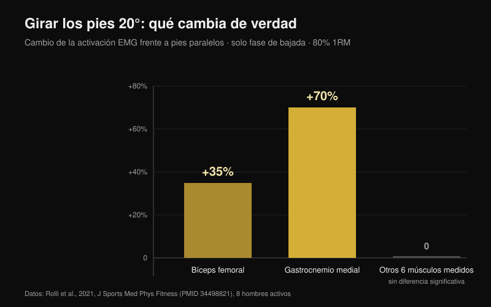
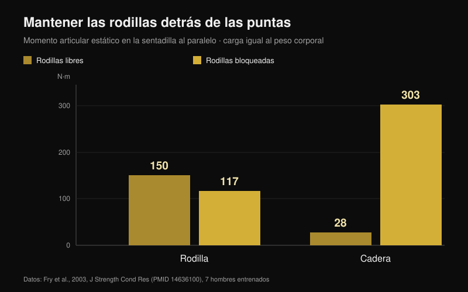

# Rodillas hacia fuera en sentadilla: ¿regla o cue?

Por [Giammaria Loi](/autore/giammaria-loi) · actualizado el 25 de octubre de 2026

"Saca las rodillas" es probablemente la frase más repetida bajo una barra cargada. Funciona tan bien en algunas personas que acabó convertida en regla para todas, y a quien no la cumple se le dice que está haciendo mal la sentadilla. He leído ocho trabajos indexados que midieron ángulos, activación muscular y momentos articulares en la sentadilla. El cue sirve. Casi todo lo que se ha construido a su alrededor, no.

## En resumen

- **Girar los pies cambia muy poco.** Con 20° de rotación externa frente a pies paralelos, al 80% del máximo, solo se mueven dos músculos: bíceps femoral **+35%** y gastrocnemio medial **+70%**, y únicamente en la bajada. El resto queda igual (Rolli et al., 2021).
- **Más rotación externa no significa más glúteo.** Una revisión de 18 estudios de EMG concluye que las variantes habituales —anchura de pies, rotación de cadera, sentadilla frontal— no cambian de forma significativa la activación muscular (Clark et al., 2012).
- **La rodilla que se mete hacia dentro no se corrige hablando.** Quien muestra ese colapso tiene ratios de coactivación glúteo:aductores más bajos (**p = 0,007** para el glúteo mayor) y menos dorsiflexión de tobillo: el cue no toca ninguna de las dos causas (Mauntel et al., 2013).
- **El famoso riesgo de ligamento cruzado viene de otro gesto.** El estudio prospectivo más citado midió aterrizajes de salto en 205 deportistas, no sentadillas con barra (Hewett et al., 2005).
- **"Que la rodilla nunca pase la punta" es el error contrario.** Bloquearlas baja el momento en la rodilla de 150 a 117 N·m, pero sube el de la cadera de 28 a **303 N·m**: más de diez veces (Fry et al., 2003).

## De dónde viene el cue y por qué funciona igualmente

Al bajar, la cadera no solo flexiona: combina flexión, abducción y rotación. Dentro de esa combinación la rodilla puede desplazarse hacia fuera durante la bajada y meterse algo al salir del punto bajo. Ninguna de las dos direcciones es correcta o incorrecta por sí misma: son el resultado de la forma de tu cadera y de cómo empujas.

"Rodillas hacia fuera" nació como corrección para quien pierde la posición: la rodilla colapsa hacia dentro, el pie se aplana y el empuje se escapa. Ahí sirve, y por eso dio la vuelta al mundo. El problema es el paso siguiente: convertirlo en regla también para quien nunca tuvo ese problema.

## Girar los pies cambia dos músculos, no toda la sentadilla

El estudio más directo sobre el tema hizo algo sencillo: ocho hombres activos ejecutaron sentadilla trasera al 80% del máximo con tres ángulos de pie —paralelos, +10° y +20° de rotación externa— midiendo ocho músculos de la pierna dominante (Rolli et al., 2021).

Con 20° frente a paralelos cambian dos cosas: el bíceps femoral trabaja un **35% más** (p = 0,027) y el gastrocnemio medial un **70% más** (p = 0,040). Ambas diferencias aparecen solo en la fase de bajada. En el resto de músculos medidos y en el resto de condiciones no apareció ninguna diferencia significativa.

Es un resultado más pequeño de lo que promete el cue, y encaja con la revisión de referencia: en 18 estudios que midieron EMG en sentadilla con barra libre, las variaciones habituales de técnica no afectan significativamente a la activación muscular (Clark et al., 2012). Lo que sí la cambia es la carga en la barra.

Hay una excepción, pero afecta al reparto entre articulaciones, no entre músculos: con barra baja y pies anchos la cadera aporta más al momento total, mientras que con barra alta y pies estrechos aporta más la rodilla, con más vasto lateral y menos glúteo mayor (Larsen et al., 2021). Si quieres llevar trabajo a la cadera, lo haces con la posición de la barra y la anchura de los pies, no rotando unos grados más las rodillas.

## Si la rodilla se mete, el cue no toca la causa

Esta es la parte más útil para quien entrena. Un estudio comparó a 40 adultos activos: 20 que muestran un claro colapso de la rodilla hacia dentro en sentadilla a una pierna y 20 que no (Mauntel et al., 2013).

El grupo que colapsa tiene dos rasgos medibles. Primero, ratios de coactivación más bajos entre glúteos y aductores: glúteo medio sobre aductores p = 0,028, glúteo mayor sobre aductores p = 0,007. Segundo, menos dorsiflexión pasiva de tobillo, tanto con la rodilla extendida (p = 0,047) como flexionada (p = 0,034).

Traducido: la rodilla se mete porque el tobillo no deja avanzar la tibia y porque el reparto de fuerza alrededor de la cadera está desequilibrado. Una frase gritada bajo la barra no cambia la movilidad del tobillo ni fortalece el glúteo. Puede tapar el problema durante una serie; no lo resuelve.

## Cuánto peligro hay realmente

El "saca las rodillas o te rompes el cruzado" viene de una investigación real, pero sobre otro gesto. El estudio prospectivo más citado siguió a 205 deportistas de fútbol, baloncesto y voleibol midiendo un aterrizaje de salto. Las nueve que después se rompieron el ligamento cruzado anterior aterrizaban con un ángulo de abducción de rodilla **8° mayor**, un momento de abducción **2,5 veces** más alto y una fuerza de reacción del suelo un 20% superior, con un tiempo de apoyo un 16% más corto (Hewett et al., 2005).

Los números son sólidos y el modelo predecía la lesión con un 78% de sensibilidad y un 73% de especificidad. Pero describen un aterrizaje: impacto en fracciones de segundo, sobre una pierna, sin control voluntario. Una sentadilla al 90% con unos grados de entrada al salir del punto bajo es un gesto lento, bilateral y consciente. Hoy no existe ningún estudio prospectivo que relacione ese movimiento con más riesgo de lesión en quien levanta. Tratar los dos casos como si fueran lo mismo es el salto lógico más común en este tema.

## El error gemelo: "la rodilla nunca debe pasar la punta del pie"

Es la regla opuesta y nace de la misma idea: que la rodilla hay que protegerla por principio. Siete hombres entrenados hicieron sentadillas al paralelo con una carga igual a su peso corporal en dos condiciones: rodillas libres para avanzar más allá de las puntas, o bloqueadas por una barrera de madera (Fry et al., 2003).

Con las rodillas libres, el momento en la rodilla fue de 150,1 N·m y en la cadera de 28,2 N·m. Bloqueándolas, la rodilla bajó a 117,3 N·m —un 22% menos— pero la cadera subió a **302,7 N·m**: más de diez veces el valor de partida. La carga no desaparece, se muda a la cadera y la zona lumbar. Los autores concluyen que un reparto razonable de fuerzas probablemente exige que las rodillas pasen ligeramente las puntas.

## Tu cadera decide más que el cue

La última pieza es anatómica. La forma de la cabeza y el cuello del fémur varía entre personas, y con ella el ángulo al que el hueso choca con el borde del acetábulo. En un modelo de elementos finitos, el estrés medio en el acetábulo durante la sentadilla pasó de 9,64 MPa en una cadera de referencia a 11,36 MPa con morfología cam moderada y a 28,43 MPa con una cam amplia; los sujetos con pinzamiento femoroacetabular alcanzaban 106,3° de flexión de cadera frente a 112,6°, y 8,9° de rotación interna frente a 14,8° (Bagwell y Powers, 2017).

Aquí el cue se gana su sitio, pero por un motivo distinto del que se cuenta: los autores observan que hacer sentadilla con la cadera en posición neutra o en rotación externa puede reducir el choque óseo a grados altos de flexión. No para activar más un músculo: para dar espacio a la articulación. Dos personas con fémures distintos tendrán, por tanto, sentadillas que *deben* verse distintas, y esa es la razón principal por la que no existe un ángulo universal (Schoenfeld, 2010).

## Qué dice realmente la investigación

| Afirmación | Veredicto | El dato |
| --- | --- | --- |
| "Rodillas hacia fuera" es un cue, no una regla para todos | **Confirmado** | Ningún estudio identifica un ángulo óptimo; las revisiones no hallan diferencias relevantes entre variantes de rotación de cadera (Clark et al., 2012) |
| Más rotación externa = más glúteo | **Desmentido** | Con 20° solo cambian bíceps femoral (+35%) y gastrocnemio medial (+70%), y solo al bajar (Rolli et al., 2021) |
| La rotación externa impuesta aumenta el trabajo de los aductores en profundidad | **No verificado** | Afirmación repetida sin estudio citado; no la encontramos en PubMed con las búsquedas del 25 de octubre de 2026 |
| La rodilla que se mete siempre es peligrosa | **Matizable** | Los datos prospectivos describen aterrizajes de salto en deportistas, no sentadillas con barra (Hewett et al., 2005) |
| Basta con sacar las rodillas para corregir el valgo | **Matizable** | El colapso se asocia a menos dorsiflexión de tobillo y menor coactivación glúteo:aductores (Mauntel et al., 2013) |
| Las rodillas no deben pasar las puntas | **Desmentido** | Bloquearlas traslada el momento a la cadera: 28 → 303 N·m (Fry et al., 2003) |
| La anatomía individual cambia la sentadilla ideal | **Confirmado** | La morfología cam y el pinzamiento cambian el estrés y los grados disponibles (Bagwell y Powers, 2017) |

## Cómo aplicarlo

1. **Usa el cue solo si tienes el problema que resuelve.** Si tu rodilla no colapsa hacia dentro, añadir rotación externa no te aporta nada medible: estás cambiando una técnica que funciona.
2. **Encuentra tu ángulo de pie probándolo, no copiándolo.** Haz una serie ligera a 0°, otra a +10° y otra a +20°, y quédate con el ángulo en el que bajas más sin que el pie se despegue del suelo.
3. **Si la rodilla se mete, prueba el tobillo antes de hablar.** Ponte en zancada con el pie a 10 cm de la pared: si la rodilla no toca la pared sin levantar el talón, tu problema está ahí.
4. **Añade trabajo para abductores y extensores de cadera.** Es la única forma de cambiar el ratio de coactivación que separa a quien colapsa de quien no. Una hora de cues no sustituye ocho semanas de [trabajo específico de glúteo](/es/blog/ejercicios-de-gluteos-hip-thrust-o-sentadilla).
5. **Deja avanzar las rodillas.** Pararlas detrás de las puntas no protege la rodilla: carga la cadera y la zona lumbar diez veces más.
6. **Juzga la técnica por su repetibilidad, no por su estética.** Si tres series de cinco comparten trayectoria y profundidad, tu posición es válida aunque no se parezca a la del vídeo.

**Con Nurvan.** El punto 2 es un test, y un test solo sirve si los números se quedan en algún sitio. En Nurvan puedes guardar la sentadilla con distintos ángulos de pie o anchuras como variantes separadas del mismo ejercicio: cada serie registra carga, repeticiones y RIR (las repeticiones que te habrían sobrado), y el histórico te muestra en pocas semanas qué configuración progresa de verdad en tu cuerpo. Las series de calentamiento propuestas automáticamente te dan las repeticiones ligeras para probar un ángulo nuevo sin quemar una serie efectiva. [Prueba Nurvan](https://nurvan.app)

## Preguntas frecuentes

**¿Cuánto debo girar los pies en la sentadilla?**
No hay un valor válido para todos. En los estudios se usan 0°, 10° y 20° de rotación externa y las diferencias de activación son pequeñas y limitadas a la bajada. En la práctica, elige el ángulo con el que alcanzas la profundidad que necesitas con el pie bien apoyado y la misma trayectoria serie tras serie.

**¿Es malo que las rodillas se metan hacia dentro?**
No hay estudios prospectivos que lo demuestren en quien levanta. Los datos de riesgo de cruzado vienen de aterrizajes de salto en deportistas. Un colapso amplio y repentino con carga casi máxima sigue siendo una señal que no conviene ignorar, pero es un problema de estabilidad y técnica antes que un diagnóstico. Si aparece dolor, consulta con un médico o fisioterapeuta.

**¿Sacar las rodillas activa más el glúteo?**
No de forma medible. La revisión de los trabajos de EMG no encuentra diferencias significativas entre variantes de rotación de cadera y de anchura. Para llevar trabajo a la cadera funcionan mucho mejor la posición de la barra y la anchura de los pies.

**¿Puedo dejar que las rodillas pasen las puntas?**
Sí, y probablemente es preferible. Bloquearlas reduce el momento en la rodilla alrededor de un 22% pero multiplica por más de diez el de la cadera, y además obliga a inclinar más el tronco.

## Lee también

- [Ejercicios de glúteos: ¿hip thrust o sentadilla?](/es/blog/ejercicios-de-gluteos-hip-thrust-o-sentadilla) — cuál construye realmente el glúteo, con los números
- [Extensión de piernas o prensa: qué crece de verdad](/es/blog/extension-de-piernas-o-prensa-recto-femoral) — qué cambia entre dos ejercicios que parecen intercambiables
- [Agarre en press de banca: ¿ancho, medio o cerrado?](/es/blog/agarre-press-banca-ancho-cerrado) — el mismo tipo de regla técnica, desmontada en el banco

## Fuentes

1. Clark DR, Lambert MI, Hunter AM, 2012. Muscle activation in the loaded free barbell squat: a brief review. *J Strength Cond Res*. PMID [22373894](https://pubmed.ncbi.nlm.nih.gov/22373894/) · [DOI](https://doi.org/10.1519/JSC.0b013e31822d533d)
2. Rolli F, Vitale JA, Pugliese L, Boccia G, La Torre A, Pollitt L, 2021. The impact of foot angle on lower limb muscles activity during the back squat and counter movement jump. *J Sports Med Phys Fitness*. PMID [34498821](https://pubmed.ncbi.nlm.nih.gov/34498821/) · [DOI](https://doi.org/10.23736/S0022-4707.21.12588-5)
3. Larsen S, Kristiansen E, Helms E, van den Tillaar R, 2021. Effects of Stance Width and Barbell Placement on Kinematics, Kinetics, and Myoelectric Activity in Back Squats. *Front Sports Act Living*. PMID [34541522](https://pubmed.ncbi.nlm.nih.gov/34541522/) · [DOI](https://doi.org/10.3389/fspor.2021.719013)
4. Mauntel TC, Begalle RL, Cram TR, Frank BS, Hirth CJ, Blackburn T, Padua DA, 2013. The effects of lower extremity muscle activation and passive range of motion on single leg squat performance. *J Strength Cond Res*. PMID [23096063](https://pubmed.ncbi.nlm.nih.gov/23096063/) · [DOI](https://doi.org/10.1519/JSC.0b013e318276b886)
5. Hewett TE, Myer GD, Ford KR, Heidt RS, Colosimo AJ, McLean SG, van den Bogert AJ, Paterno MV, Succop P, 2005. Biomechanical measures of neuromuscular control and valgus loading of the knee predict anterior cruciate ligament injury risk in female athletes: a prospective study. *Am J Sports Med*. PMID [15722287](https://pubmed.ncbi.nlm.nih.gov/15722287/) · [DOI](https://doi.org/10.1177/0363546504269591)
6. Fry AC, Smith JC, Schilling BK, 2003. Effect of knee position on hip and knee torques during the barbell squat. *J Strength Cond Res*. PMID [14636100](https://pubmed.ncbi.nlm.nih.gov/14636100/) · [DOI](https://doi.org/10.1519/1533-4287(2003)017%3C0629:EOKPOH%3E2.0.CO;2)
7. Bagwell JJ, Powers CM, 2017. The Influence of Squat Kinematics and Cam Morphology on Acetabular Stress. *Arthroscopy*. PMID [28969815](https://pubmed.ncbi.nlm.nih.gov/28969815/) · [DOI](https://doi.org/10.1016/j.arthro.2017.03.018)
8. Schoenfeld BJ, 2010. Squatting kinematics and kinetics and their application to exercise performance. *J Strength Cond Res*. PMID [20182386](https://pubmed.ncbi.nlm.nih.gov/20182386/) · [DOI](https://doi.org/10.1519/JSC.0b013e3181bac2d7)

Punto de partida: una publicación de Alfred Jong ([@alfred.reformance](https://www.instagram.com/p/Ddbl4IKmyqw/)) sobre el cue "knees out". El texto, la estructura y las verificaciones de este artículo son propios.

---

**Giammaria Loi** es el fundador de Nurvan. Entrena con pesas desde 2012, trabaja como entrenador personal y coach certificado FIPE desde 2013 y compite en powerlifting a nivel nacional desde 2018.

> Nota: contenido informativo, no sustituye la opinión de un médico o profesional. Si tienes dolor de rodilla, cadera o espalda, consulta con un médico o fisioterapeuta antes de cambiar tu entrenamiento.
