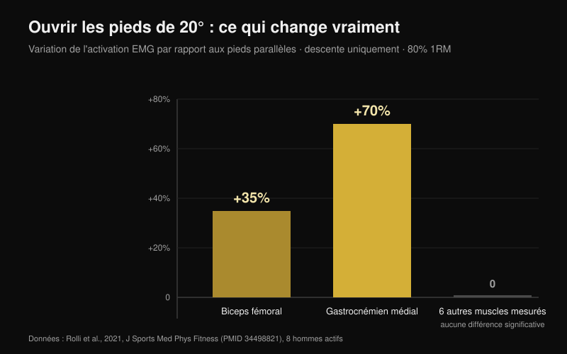
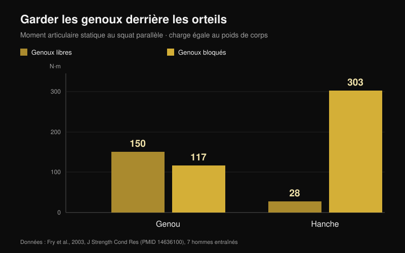

# Genoux vers l'extérieur au squat : règle ou cue ?

Par [Giammaria Loi](/autore/giammaria-loi) · mis à jour le 25 octobre 2026

« Pousse les genoux vers l'extérieur » est sans doute la phrase la plus répétée sous une barre chargée. Elle fonctionne si bien sur certains pratiquants qu'elle est devenue une règle pour tout le monde, et celui qui ne l'applique pas s'entend dire qu'il squatte mal. J'ai lu huit travaux indexés qui ont mesuré les angles, l'activation musculaire et les moments articulaires au squat. Le cue est utile. Presque tout ce qu'on a construit autour ne tient pas.

## En bref

- **Ouvrir les pieds change très peu de choses.** À 20° de rotation externe par rapport aux pieds parallèles, à 80 % du maximum, seuls deux muscles bougent : biceps fémoral **+35 %** et gastrocnémien médial **+70 %**, et uniquement à la descente. Le reste ne change pas (Rolli et al., 2021).
- **Plus de rotation externe ne veut pas dire plus de fessiers.** Une revue de 18 études EMG conclut que les variantes courantes — écartement des pieds, rotation de hanche, squat avant — ne modifient pas significativement l'activation musculaire (Clark et al., 2012).
- **Un genou qui rentre ne se corrige pas avec des mots.** Les pratiquants concernés présentent des ratios de coactivation fessiers:adducteurs plus faibles (**p = 0,007** pour le grand fessier) et moins de dorsiflexion de cheville : le cue ne touche aucune des deux causes (Mauntel et al., 2013).
- **Le fameux risque de croisé vient d'un autre geste.** L'étude prospective la plus citée a mesuré des réceptions de saut chez 205 athlètes féminines, pas des squats à la barre (Hewett et al., 2005).
- **« Les genoux ne doivent jamais dépasser les orteils » est l'erreur inverse.** Les bloquer fait passer le moment au genou de 150 à 117 N·m, mais celui à la hanche de 28 à **303 N·m** : plus de dix fois (Fry et al., 2003).

## D'où vient le cue, et pourquoi il marche quand même

À la descente, la hanche ne fait pas que fléchir : elle combine flexion, abduction et rotation. Dans cette combinaison, le genou peut partir vers l'extérieur pendant la descente et rentrer légèrement à la sortie du bas. Aucune des deux directions n'est bonne ou mauvaise en soi : elles découlent de la forme de votre hanche et de votre façon de pousser.

« Genoux vers l'extérieur » est né comme correction pour celui qui perd sa position : le genou s'effondre vers l'intérieur, le pied s'affaisse, la poussée se disperse. Là, le cue sert, et c'est pour ça qu'il a fait le tour du monde. Le problème, c'est l'étape suivante : en faire une règle valable aussi pour ceux qui n'ont jamais eu ce problème.

## Ouvrir les pieds change deux muscles, pas tout le squat

L'étude la plus directe sur la question a fait simple : huit hommes actifs ont exécuté des squats arrière à 80 % du maximum avec trois angles de pied — parallèles, +10° et +20° de rotation externe — avec huit muscles de la jambe dominante enregistrés (Rolli et al., 2021).

À 20° par rapport aux pieds parallèles, deux choses changent : le biceps fémoral travaille **35 % de plus** (p = 0,027) et le gastrocnémien médial **70 % de plus** (p = 0,040). Les deux différences n'apparaissent qu'en phase de descente. Pour tous les autres muscles mesurés et toutes les autres conditions, rien de significatif.

C'est un résultat plus petit que ce que promet le cue, et il colle à la revue de référence : sur 18 études ayant mesuré l'EMG au squat barre libre, les variations courantes de technique n'affectent pas significativement l'activation musculaire (Clark et al., 2012). Ce qui la change vraiment, c'est la charge sur la barre.

Une exception existe, mais elle concerne la répartition entre articulations, pas entre muscles : avec une barre basse et un appui large, la hanche contribue davantage au moment total, tandis qu'avec une barre haute et un appui étroit c'est le genou, avec plus de vaste latéral et moins de grand fessier (Larsen et al., 2021). Pour déplacer le travail vers la hanche, on joue sur la position de barre et l'écartement, pas sur quelques degrés de rotation du genou.

## Si le genou rentre, le cue ne touche pas la cause

C'est la partie la plus utile en salle. Une étude a comparé 40 adultes actifs : 20 qui montrent un net effondrement du genou vers l'intérieur au squat unipodal et 20 qui n'en montrent pas (Mauntel et al., 2013).

Le groupe concerné présente deux caractéristiques mesurables. D'abord, des ratios de coactivation plus faibles entre fessiers et adducteurs — moyen fessier sur adducteurs p = 0,028, grand fessier sur adducteurs p = 0,007. Ensuite, moins de dorsiflexion passive de cheville, genou tendu (p = 0,047) comme genou fléchi (p = 0,034).

Traduction : le genou rentre parce que la cheville ne laisse pas le tibia avancer et parce que l'équilibre de force autour de la hanche est faussé. Une phrase criée sous la barre ne change ni la mobilité de cheville ni la force du fessier. Elle peut masquer le problème le temps d'une série ; elle ne le règle pas.

## Quel danger réel ?

Le « genoux dehors ou tu casses ton croisé » vient d'une vraie recherche, mais sur un autre geste. L'étude prospective la plus citée a suivi 205 athlètes de football, basket et volley en mesurant une réception de saut. Les neuf qui ont ensuite rompu le ligament croisé antérieur atterrissaient avec un angle d'abduction du genou **supérieur de 8°**, un moment d'abduction **2,5 fois** plus élevé et une force de réaction au sol supérieure de 20 %, avec un temps d'appui plus court de 16 % (Hewett et al., 2005).

Les chiffres sont solides, et le modèle prédisait la blessure avec 78 % de sensibilité et 73 % de spécificité. Mais ils décrivent une réception : impact en fractions de seconde, sur une jambe, sans contrôle volontaire. Un squat à 90 % avec quelques degrés de rentrée à la sortie du bas est un geste lent, bilatéral et conscient. À ce jour, aucune étude prospective ne relie cette rentrée à un risque accru de blessure chez les pratiquants de force. Confondre les deux cas est le saut logique le plus fréquent sur ce sujet.

## L'erreur jumelle : « les genoux ne doivent jamais dépasser les orteils »

C'est la règle inverse, et elle naît de la même idée : protéger le genou par principe. Sept hommes entraînés ont réalisé des squats au parallèle avec une charge égale à leur poids de corps dans deux conditions : genoux libres de dépasser les orteils, ou bloqués par une barrière en bois (Fry et al., 2003).

Genoux libres, le moment au genou était de 150,1 N·m et à la hanche de 28,2 N·m. Genoux bloqués, le genou tombe à 117,3 N·m — environ 22 % de moins — mais la hanche monte à **302,7 N·m**, plus de dix fois la valeur de départ. La charge ne disparaît pas : elle déménage vers la hanche et le bas du dos. Les auteurs concluent qu'une répartition sensée des forces exige probablement que les genoux dépassent légèrement les orteils.

## Votre hanche décide plus que le cue

Dernière pièce : l'anatomie. La forme de la tête et du col fémoral varie d'une personne à l'autre, et avec elle l'angle auquel l'os vient buter sur le bord du cotyle. Dans un modèle par éléments finis, la contrainte moyenne sur le cotyle pendant un squat passe de 9,64 MPa dans une hanche de référence à 11,36 MPa avec une morphologie cam modérée et à 28,43 MPa avec une cam importante ; les sujets avec conflit fémoro-acétabulaire atteignaient 106,3° de flexion de hanche contre 112,6°, et 8,9° de rotation interne contre 14,8° (Bagwell et Powers, 2017).

Ici le cue retrouve sa place, mais pour une autre raison que celle qu'on raconte : les auteurs notent que squatter hanche en position neutre ou en rotation externe peut limiter le conflit osseux aux grands angles de flexion. Pas pour activer un muscle : pour laisser de la place à l'articulation. Deux personnes aux fémurs différents auront donc des squats qui *doivent* avoir l'air différents, et c'est la raison principale pour laquelle aucun angle universel n'existe (Schoenfeld, 2010).

## Ce que dit vraiment la recherche

| Affirmation | Verdict | La donnée |
| --- | --- | --- |
| « Genoux vers l'extérieur » est un cue, pas une règle pour tous | **Confirmé** | Aucune étude n'identifie d'angle optimal ; les revues ne trouvent pas de différences notables entre variantes de rotation de hanche (Clark et al., 2012) |
| Plus de rotation externe = plus de fessiers | **Démenti** | À 20°, seuls le biceps fémoral (+35 %) et le gastrocnémien médial (+70 %) changent, et seulement à la descente (Rolli et al., 2021) |
| La rotation externe imposée augmente le travail des adducteurs en profondeur | **Non vérifié** | Affirmation répandue sans étude citée ; introuvable sur PubMed avec nos recherches du 25 octobre 2026 |
| Un genou qui rentre est toujours dangereux | **À nuancer** | Les données prospectives décrivent des réceptions de saut chez des athlètes, pas des squats à la barre (Hewett et al., 2005) |
| Il suffit de pousser les genoux dehors pour corriger le valgus | **À nuancer** | L'effondrement est associé à moins de dorsiflexion de cheville et à une coactivation fessiers:adducteurs plus faible (Mauntel et al., 2013) |
| Les genoux ne doivent pas dépasser les orteils | **Démenti** | Les bloquer déplace le moment vers la hanche : 28 → 303 N·m (Fry et al., 2003) |
| L'anatomie individuelle change le squat idéal | **Confirmé** | Morphologie cam et conflit modifient la contrainte et les degrés disponibles (Bagwell et Powers, 2017) |

## Comment l'appliquer

1. **N'utilisez le cue que si vous avez le problème qu'il résout.** Si votre genou ne s'effondre pas vers l'intérieur, ajouter de la rotation externe ne vous apporte rien de mesurable : vous modifiez une technique qui fonctionne.
2. **Trouvez votre angle de pied en le testant, pas en le copiant.** Une série légère à 0°, une à +10°, une à +20° : gardez l'angle où vous descendez le plus bas sans décoller le pied.
3. **Si le genou rentre, testez la cheville avant de parler.** En fente, pied à 10 cm du mur : si le genou ne touche pas le mur talon au sol, le problème est là.
4. **Ajoutez du travail pour les abducteurs et extenseurs de hanche.** C'est le seul moyen de changer le ratio de coactivation qui sépare ceux qui s'effondrent des autres. Une heure de cues ne remplace pas huit semaines de [travail ciblé des fessiers](/fr/blog/exercices-fessiers-hip-thrust-ou-squat).
5. **Laissez les genoux avancer.** Les arrêter derrière les orteils ne protège pas le genou : cela charge la hanche et le bas du dos dix fois plus.
6. **Jugez la technique sur sa répétabilité, pas sur son esthétique.** Si trois séries de cinq ont la même trajectoire et la même profondeur, votre position est bonne même si elle ne ressemble pas à celle de la vidéo.

**Avec Nurvan.** Le point 2 est un test, et un test ne vaut que si les chiffres restent quelque part. Dans Nurvan, vous pouvez enregistrer le squat avec différents angles de pied ou écartements comme des variantes distinctes du même exercice : chaque série note la charge, les répétitions et le RIR (les répétitions qu'il vous restait en réserve), et l'historique montre en quelques semaines quel réglage progresse vraiment sur votre corps. Les séries d'échauffement proposées automatiquement offrent les répétitions légères pour tester un nouvel angle sans griller une série efficace. [Essayer Nurvan](https://nurvan.app)

## Questions fréquentes

**De combien faut-il ouvrir les pieds au squat ?**
Il n'existe pas de valeur valable pour tous. Les études utilisent 0°, 10° et 20° de rotation externe et les différences d'activation sont faibles et limitées à la descente. En pratique, choisissez l'angle qui vous permet d'atteindre la profondeur voulue avec le pied bien à plat et la même trajectoire série après série.

**Un genou qui rentre au squat abîme-t-il le genou ?**
Aucune étude prospective ne le démontre chez les pratiquants de force. Les données sur le croisé portent sur des réceptions de saut chez des athlètes féminines. Un effondrement large et brutal sous charge quasi maximale reste un signal à ne pas ignorer, mais c'est un problème de stabilité et de technique avant d'être un diagnostic. En cas de douleur, consultez un médecin ou un kinésithérapeute.

**Pousser les genoux dehors active-t-il plus les fessiers ?**
Pas de façon mesurable. La revue des travaux EMG ne trouve pas de différences significatives entre variantes de rotation de hanche et d'écartement. Pour déplacer le travail vers la hanche, la position de barre et l'écartement sont bien plus efficaces.

**Puis-je laisser les genoux dépasser les orteils ?**
Oui, et c'est probablement préférable. Les bloquer réduit le moment au genou d'environ 22 % mais multiplie celui de la hanche par plus de dix, tout en forçant une inclinaison plus marquée du buste.

## À lire aussi

- [Exercices fessiers : hip thrust ou squat ?](/fr/blog/exercices-fessiers-hip-thrust-ou-squat) — lequel construit vraiment le fessier, chiffres à l'appui
- [Leg extension ou presse à cuisses : ce qui grossit vraiment](/fr/blog/leg-extension-ou-presse-a-cuisses-droit-femoral) — ce qui change entre deux exercices qui semblent interchangeables
- [Prise au développé couché : large, moyenne ou serrée ?](/fr/blog/prise-developpe-couche-large-serree) — le même type de règle technique, démonté au banc

## Sources

1. Clark DR, Lambert MI, Hunter AM, 2012. Muscle activation in the loaded free barbell squat: a brief review. *J Strength Cond Res*. PMID [22373894](https://pubmed.ncbi.nlm.nih.gov/22373894/) · [DOI](https://doi.org/10.1519/JSC.0b013e31822d533d)
2. Rolli F, Vitale JA, Pugliese L, Boccia G, La Torre A, Pollitt L, 2021. The impact of foot angle on lower limb muscles activity during the back squat and counter movement jump. *J Sports Med Phys Fitness*. PMID [34498821](https://pubmed.ncbi.nlm.nih.gov/34498821/) · [DOI](https://doi.org/10.23736/S0022-4707.21.12588-5)
3. Larsen S, Kristiansen E, Helms E, van den Tillaar R, 2021. Effects of Stance Width and Barbell Placement on Kinematics, Kinetics, and Myoelectric Activity in Back Squats. *Front Sports Act Living*. PMID [34541522](https://pubmed.ncbi.nlm.nih.gov/34541522/) · [DOI](https://doi.org/10.3389/fspor.2021.719013)
4. Mauntel TC, Begalle RL, Cram TR, Frank BS, Hirth CJ, Blackburn T, Padua DA, 2013. The effects of lower extremity muscle activation and passive range of motion on single leg squat performance. *J Strength Cond Res*. PMID [23096063](https://pubmed.ncbi.nlm.nih.gov/23096063/) · [DOI](https://doi.org/10.1519/JSC.0b013e318276b886)
5. Hewett TE, Myer GD, Ford KR, Heidt RS, Colosimo AJ, McLean SG, van den Bogert AJ, Paterno MV, Succop P, 2005. Biomechanical measures of neuromuscular control and valgus loading of the knee predict anterior cruciate ligament injury risk in female athletes: a prospective study. *Am J Sports Med*. PMID [15722287](https://pubmed.ncbi.nlm.nih.gov/15722287/) · [DOI](https://doi.org/10.1177/0363546504269591)
6. Fry AC, Smith JC, Schilling BK, 2003. Effect of knee position on hip and knee torques during the barbell squat. *J Strength Cond Res*. PMID [14636100](https://pubmed.ncbi.nlm.nih.gov/14636100/) · [DOI](https://doi.org/10.1519/1533-4287(2003)017%3C0629:EOKPOH%3E2.0.CO;2)
7. Bagwell JJ, Powers CM, 2017. The Influence of Squat Kinematics and Cam Morphology on Acetabular Stress. *Arthroscopy*. PMID [28969815](https://pubmed.ncbi.nlm.nih.gov/28969815/) · [DOI](https://doi.org/10.1016/j.arthro.2017.03.018)
8. Schoenfeld BJ, 2010. Squatting kinematics and kinetics and their application to exercise performance. *J Strength Cond Res*. PMID [20182386](https://pubmed.ncbi.nlm.nih.gov/20182386/) · [DOI](https://doi.org/10.1519/JSC.0b013e3181bac2d7)

Point de départ : une publication d'Alfred Jong ([@alfred.reformance](https://www.instagram.com/p/Ddbl4IKmyqw/)) sur le cue « knees out ». Le texte, la structure et les vérifications de cet article nous sont propres.

---

**Giammaria Loi** est le fondateur de Nurvan. Il soulève de la fonte depuis 2012, travaille comme coach et préparateur certifié FIPE depuis 2013 et compète en powerlifting au niveau national depuis 2018.

> Note : contenu informatif, qui ne remplace pas l'avis d'un médecin ou d'un professionnel. En cas de douleur au genou, à la hanche ou au dos, consultez un médecin ou un kinésithérapeute avant de modifier votre entraînement.
