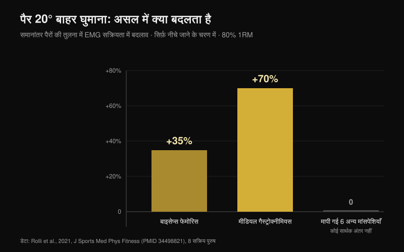
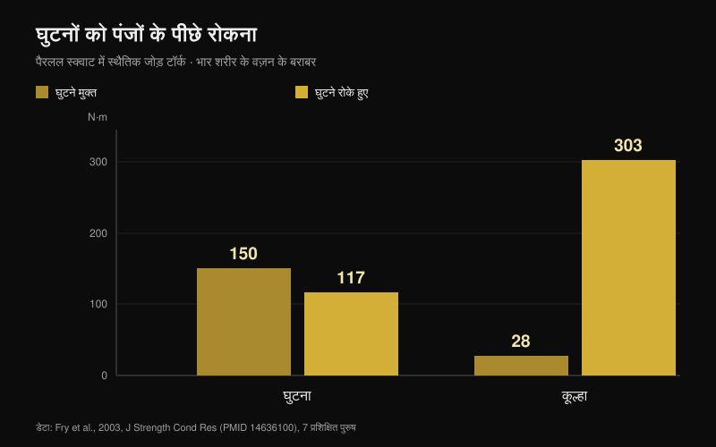

# स्क्वाट में घुटने बाहर: नियम है या सिर्फ़ क्यू?

लेखक: [Giammaria Loi](/autore/giammaria-loi) · 25 अक्टूबर 2026 को अपडेट किया गया

"घुटने बाहर निकालो" शायद लदे हुए बार के नीचे सबसे ज़्यादा बोला जाने वाला वाक्य है। कुछ लोगों पर यह इतना अच्छा काम करता है कि सबके लिए नियम बन गया, और जो इसे नहीं मानता उसे कहा जाता है कि उसका स्क्वाट ग़लत है। मैंने आठ इंडेक्स्ड पेपर पढ़े जिनमें स्क्वाट के दौरान जोड़ों के कोण, मांसपेशियों की सक्रियता और जोड़ों के टॉर्क मापे गए। क्यू उपयोगी है। उसके इर्द-गिर्द जो कुछ खड़ा किया गया है, वह लगभग पूरा टिकता नहीं।

## संक्षेप में

- **पैर बाहर घुमाने से बहुत कम बदलता है।** समानांतर पैरों की तुलना में 20° बाहरी घुमाव पर, 80% 1RM के साथ, सिर्फ़ दो मांसपेशियाँ बदलती हैं: बाइसेप्स फेमोरिस **+35%** और मीडियल गैस्ट्रोक्नीमियस **+70%**, और वह भी सिर्फ़ नीचे जाने के चरण में। बाकी सब वैसा ही रहता है (Rolli et al., 2021)।
- **ज़्यादा बाहरी घुमाव का मतलब ज़्यादा ग्लूट्स नहीं।** 18 EMG अध्ययनों की समीक्षा कहती है कि आम वैरिएशन — स्टांस की चौड़ाई, हिप रोटेशन, फ्रंट स्क्वाट — मांसपेशी सक्रियता को सार्थक रूप से नहीं बदलते (Clark et al., 2012)।
- **अंदर गिरते घुटने शब्दों से ठीक नहीं होते।** जिनमें यह दिखता है उनमें ग्लूट्स और एडक्टर्स का को-एक्टिवेशन अनुपात कम होता है (ग्लूटियस मैक्सिमस के लिए **p = 0.007**) और टखने का डॉर्सिफ्लेक्शन भी कम: क्यू इन दोनों में से किसी कारण को नहीं छूता (Mauntel et al., 2013)।
- **ACL का मशहूर ख़तरा एक दूसरी हरकत से आया है।** सबसे ज़्यादा उद्धृत प्रॉस्पेक्टिव स्टडी ने 205 महिला एथलीटों की जंप लैंडिंग मापी थी, बारबेल स्क्वाट नहीं (Hewett et al., 2005)।
- **"घुटने कभी पंजों से आगे न जाएँ" उल्टी ग़लती है।** उन्हें रोकने पर घुटने का टॉर्क 150 से 117 N·m पर आता है, लेकिन कूल्हे का 28 से **303 N·m** तक चढ़ जाता है: दस गुना से ज़्यादा (Fry et al., 2003)।

## यह क्यू आया कहाँ से, और फिर भी काम क्यों करता है

नीचे जाते समय कूल्हा सिर्फ़ मुड़ता नहीं: वह फ्लेक्शन, अपडक्शन और रोटेशन को जोड़ता है। इस मेल में घुटना उतरते समय बाहर की ओर जा सकता है और सबसे नीचे से उठते समय थोड़ा अंदर आ सकता है। दोनों में से कोई दिशा अपने आप में सही या ग़लत नहीं है: दोनों आपके कूल्हे की बनावट और आपके ज़ोर लगाने के तरीके का नतीजा हैं।

"घुटने बाहर" उन लोगों के लिए सुधार के तौर पर आया था जो पोज़िशन खो देते हैं: घुटना अंदर गिरता है, पैर चपटा हो जाता है, ज़ोर बिखर जाता है। वहाँ यह काम करता है, और इसीलिए यह पूरी दुनिया में फैला। समस्या अगले क़दम पर है — इसे उन लोगों के लिए भी नियम बना देना जिन्हें यह दिक़्क़त कभी थी ही नहीं।

## पैर घुमाने से दो मांसपेशियाँ बदलती हैं, पूरा स्क्वाट नहीं

इस सवाल पर सबसे सीधी स्टडी ने एक आसान काम किया: आठ सक्रिय पुरुषों ने 80% 1RM पर बैक स्क्वाट किया, पैरों के तीन कोणों के साथ — समानांतर, +10° और +20° बाहरी घुमाव — और प्रमुख टाँग की आठ मांसपेशियाँ रिकॉर्ड की गईं (Rolli et al., 2021)।

समानांतर की तुलना में 20° पर दो चीज़ें बदलती हैं: बाइसेप्स फेमोरिस **35% ज़्यादा** काम करता है (p = 0.027) और मीडियल गैस्ट्रोक्नीमियस **70% ज़्यादा** (p = 0.040)। दोनों अंतर सिर्फ़ नीचे जाने के चरण में दिखते हैं। बाकी सभी मापी गई मांसपेशियों और बाकी सभी स्थितियों में कोई सार्थक अंतर नहीं मिला।

यह नतीजा उससे कहीं छोटा है जितना क्यू का वादा है, और यह इस विषय की संदर्भ समीक्षा से मेल खाता है: फ्री बारबेल स्क्वाट में EMG मापने वाले 18 अध्ययनों में तकनीक के आम बदलाव मांसपेशी सक्रियता को सार्थक रूप से प्रभावित नहीं करते (Clark et al., 2012)। उसे असल में बदलती है बार पर रखी गई वज़न की मात्रा।

एक अपवाद है, पर वह जोड़ों के बीच काम के बँटवारे से जुड़ा है, मांसपेशियों के बीच से नहीं: लो-बार और चौड़े स्टांस में कुल मोमेंट में कूल्हे का योगदान ज़्यादा होता है, जबकि हाई-बार और सँकरे स्टांस में घुटने का योगदान बढ़ता है, वैस्टस लैटरलिस ज़्यादा और ग्लूटियस मैक्सिमस कम (Larsen et al., 2021)। काम को कूल्हे पर ले जाना हो तो बार की पोज़िशन और स्टांस की चौड़ाई से होता है, घुटनों को कुछ डिग्री और बाहर घुमाने से नहीं।

## अगर घुटना अंदर आता है, तो क्यू कारण को छूता ही नहीं

ट्रेनिंग करने वालों के लिए यही सबसे काम का हिस्सा है। एक स्टडी ने 40 सक्रिय वयस्कों की तुलना की: 20 जिनमें सिंगल-लेग स्क्वाट में घुटना साफ़ तौर पर अंदर गिरता है और 20 जिनमें नहीं (Mauntel et al., 2013)।

गिरने वाले समूह में दो मापी जा सकने वाली ख़ूबियाँ हैं। पहली: ग्लूट्स और हिप एडक्टर्स के बीच कम को-एक्टिवेशन अनुपात — ग्लूटियस मीडियस बनाम एडक्टर्स p = 0.028, ग्लूटियस मैक्सिमस बनाम एडक्टर्स p = 0.007। दूसरी: टखने का कम पैसिव डॉर्सिफ्लेक्शन, घुटना सीधा होने पर भी (p = 0.047) और मुड़ा होने पर भी (p = 0.034)।

सीधे शब्दों में: घुटना अंदर इसलिए आता है क्योंकि टखना पिंडली को आगे बढ़ने नहीं देता और क्योंकि कूल्हे के चारों ओर ताक़त का संतुलन बिगड़ा हुआ है। बार के नीचे चिल्लाया गया एक वाक्य न टखने की गतिशीलता बदलता है, न ग्लूट को मज़बूत करता है। वह एक सेट तक समस्या को ढँक सकता है; हल नहीं करता।

## असल में ख़तरा कितना है

"घुटने बाहर करो वरना ACL फट जाएगा" असली शोध से आया है, पर एक दूसरी हरकत पर। सबसे ज़्यादा उद्धृत प्रॉस्पेक्टिव स्टडी ने फ़ुटबॉल, बास्केटबॉल और वॉलीबॉल की 205 महिला एथलीटों को फ़ॉलो किया और जंप लैंडिंग मापी। जिन नौ का बाद में ACL फटा, वे उतरते समय घुटने के **8° ज़्यादा** एब्डक्शन कोण, **2.5 गुना** ज़्यादा एब्डक्शन मोमेंट और 20% ज़्यादा ग्राउंड रिएक्शन फ़ोर्स के साथ उतरती थीं, और उनका स्टांस टाइम 16% छोटा था (Hewett et al., 2005)।

आंकड़े मज़बूत हैं, और मॉडल ने चोट का अनुमान 78% संवेदनशीलता और 73% विशिष्टता के साथ लगाया। लेकिन वे एक लैंडिंग का वर्णन करते हैं: सेकंड के अंशों में टक्कर, एक टाँग पर, बिना सचेत नियंत्रण के। जबकि 90% पर किया गया स्क्वाट, जिसमें सबसे नीचे से उठते समय कुछ डिग्री अंदर आता है, धीमी, दोनों टाँगों वाली और सचेत हरकत है। आज तक कोई प्रॉस्पेक्टिव स्टडी इस हलचल को वेट उठाने वालों में चोट के जोखिम से नहीं जोड़ती। दोनों को एक मान लेना इस विषय की सबसे आम तार्किक छलाँग है।

## जुड़वाँ ग़लती: "घुटने पंजों से आगे न जाएँ"

यह उल्टा नियम है, और उसी सोच से निकला है कि घुटने की सिद्धांततः रक्षा होनी चाहिए। सात प्रशिक्षित पुरुषों ने अपने शरीर के वज़न के बराबर भार के साथ पैरलल स्क्वाट किया, दो स्थितियों में: घुटने पंजों से आगे जाने के लिए मुक्त, या लकड़ी की रुकावट से रोके हुए (Fry et al., 2003)।

घुटने मुक्त होने पर घुटने का टॉर्क 150.1 N·m और कूल्हे का 28.2 N·m था। रोकने पर घुटना 117.3 N·m पर आया — क़रीब 22% कम — पर कूल्हा **302.7 N·m** तक चढ़ गया, शुरुआती मान से दस गुना से भी ज़्यादा। भार ग़ायब नहीं होता, वह कूल्हे और निचली पीठ पर चला जाता है। लेखक नतीजा निकालते हैं कि बलों का समझदार बँटवारा शायद यह माँगता है कि घुटने पंजों से थोड़ा आगे जाएँ।

## आपका कूल्हा क्यू से ज़्यादा तय करता है

आख़िरी हिस्सा शारीरिक रचना का है। फ़ीमर के सिर और गर्दन की बनावट हर व्यक्ति में अलग होती है, और उसके साथ वह कोण भी जिस पर हड्डी एसिटैबुलम के किनारे से टकराती है। एक फ़ाइनाइट एलिमेंट मॉडल में स्क्वाट के दौरान एसिटैबुलम पर औसत तनाव एक संदर्भ कूल्हे में 9.64 MPa से बढ़कर मध्यम cam बनावट में 11.36 MPa और बड़े cam में 28.43 MPa हो गया; फ़ीमोरोएसिटैबुलर इम्पिंजमेंट वालों में हिप फ्लेक्शन 112.6° के मुक़ाबले 106.3° और इंटरनल रोटेशन 14.8° के मुक़ाबले 8.9° था (Bagwell और Powers, 2017)।

यहाँ क्यू अपनी जगह बनाता है, पर उस वजह से नहीं जो आमतौर पर बताई जाती है: लेखक लिखते हैं कि कूल्हे को न्यूट्रल या बाहरी घुमाव में रखकर स्क्वाट करने से ज़्यादा फ्लेक्शन कोणों पर हड्डी की टक्कर घट सकती है। किसी मांसपेशी को ज़्यादा सक्रिय करने के लिए नहीं — जोड़ को जगह देने के लिए। अलग-अलग फ़ीमर वाले दो लोगों का स्क्वाट इसलिए अलग *दिखना ही चाहिए*, और यही मुख्य वजह है कि कोई सार्वभौमिक कोण नहीं है (Schoenfeld, 2010)।

## शोध असल में क्या कहता है

| दावा | नतीजा | आंकड़ा |
| --- | --- | --- |
| "घुटने बाहर" एक क्यू है, सबके लिए नियम नहीं | **पुष्ट** | कोई स्टडी सर्वोत्तम कोण नहीं बताती; समीक्षाओं में हिप रोटेशन वैरिएंट्स के बीच कोई बड़ा अंतर नहीं मिलता (Clark et al., 2012) |
| ज़्यादा बाहरी घुमाव = ज़्यादा ग्लूट्स | **ग़लत** | 20° पर सिर्फ़ बाइसेप्स फेमोरिस (+35%) और मीडियल गैस्ट्रोक्नीमियस (+70%) बदलते हैं, वह भी नीचे जाते समय (Rolli et al., 2021) |
| तय किया गया बाहरी घुमाव गहराई में एडक्टर्स का काम बढ़ाता है | **अप्रमाणित** | बहुप्रचलित दावा, पर कोई स्रोत नहीं; 25 अक्टूबर 2026 की PubMed खोज में नहीं मिला |
| अंदर आता घुटना हमेशा ख़तरनाक है | **संदर्भ ज़रूरी** | प्रॉस्पेक्टिव आंकड़े महिला एथलीटों की जंप लैंडिंग के हैं, बारबेल स्क्वाट के नहीं (Hewett et al., 2005) |
| घुटने बाहर धकेलने से valgus ठीक हो जाता है | **संदर्भ ज़रूरी** | अंदर गिरना कम डॉर्सिफ्लेक्शन और कम ग्लूट:एडक्टर को-एक्टिवेशन से जुड़ा है (Mauntel et al., 2013) |
| घुटने पंजों से आगे नहीं जाने चाहिए | **ग़लत** | रोकने पर टॉर्क कूल्हे पर चला जाता है: 28 → 303 N·m (Fry et al., 2003) |
| व्यक्तिगत शारीरिक रचना आदर्श स्क्वाट बदल देती है | **पुष्ट** | cam बनावट और इम्पिंजमेंट तनाव और उपलब्ध रेंज बदलते हैं (Bagwell और Powers, 2017) |

## इसे कैसे लागू करें

1. **क्यू तभी इस्तेमाल करें जब वह समस्या आपके पास हो जिसे वह हल करता है।** अगर आपका घुटना अंदर नहीं गिरता, तो अतिरिक्त बाहरी घुमाव आपको कुछ मापने लायक़ नहीं देता: आप एक चलती हुई तकनीक को बदल रहे हैं।
2. **अपना पैर का कोण आज़माकर खोजें, नक़ल करके नहीं।** 0° पर एक हल्का सेट, +10° पर एक, +20° पर एक: वह कोण रखें जिसमें आप पैर उठाए बिना सबसे नीचे तक जाते हैं।
3. **घुटना अंदर आता है तो बोलने से पहले टखना जाँचें।** लंज में पैर दीवार से 10 सेमी दूर रखें: अगर एड़ी उठाए बिना घुटना दीवार को नहीं छूता, तो समस्या वहीं है।
4. **हिप एब्डक्टर्स और एक्सटेंसर्स के लिए काम जोड़ें।** वह को-एक्टिवेशन अनुपात बदलने का यही अकेला तरीक़ा है जो गिरने वालों को बाकी से अलग करता है। एक घंटे के क्यू आठ हफ़्ते के [लक्षित ग्लूट काम](/hi/blog/glutes-exercise-hip-thrust-ya-squat) की जगह नहीं लेते।
5. **घुटनों को आगे जाने दें।** उन्हें पंजों के पीछे रोकना घुटने की रक्षा नहीं करता: यह कूल्हे और निचली पीठ पर दस गुना से ज़्यादा भार डालता है।
6. **तकनीक को दोहराव की स्थिरता से आँकें, दिखावट से नहीं।** अगर पाँच-पाँच के तीन सेट का रास्ता और गहराई एक जैसी है, तो आपकी पोज़िशन ठीक है, भले ही वह वीडियो जैसी न दिखे।

**Nurvan के साथ।** बिंदु 2 एक टेस्ट है, और टेस्ट तभी काम का है जब आंकड़े कहीं बचे रहें। Nurvan में आप अलग-अलग पैर के कोण या स्टांस चौड़ाई वाले स्क्वाट को एक ही एक्सरसाइज़ के अलग वैरिएंट के तौर पर सेव कर सकते हैं: हर सेट भार, रेप्स और RIR (कितने रेप्स अभी बाक़ी थे) दर्ज करता है, और हिस्ट्री कुछ हफ़्तों में दिखा देती है कि आपके शरीर पर कौन-सा सेटअप सचमुच आगे बढ़ रहा है। अपने आप सुझाए गए वॉर्म-अप सेट वे हल्के रेप्स देते हैं जिनमें नया कोण आज़माया जा सके, बिना किसी वर्किंग सेट को बर्बाद किए। [Nurvan आज़माएँ](https://nurvan.app)

## अक्सर पूछे जाने वाले सवाल

**स्क्वाट में पैर कितने बाहर घुमाने चाहिए?**
सबके लिए एक जैसा आंकड़ा नहीं है। अध्ययनों में 0°, 10° और 20° बाहरी घुमाव इस्तेमाल होते हैं और सक्रियता के अंतर छोटे हैं तथा सिर्फ़ नीचे जाने के चरण तक सीमित हैं। व्यवहार में वह कोण चुनें जिसमें पूरा पैर ज़मीन पर टिका रहे, हर सेट में रास्ता एक जैसा रहे और आपको ज़रूरी गहराई मिल जाए।

**स्क्वाट में घुटने अंदर आना घुटने के लिए बुरा है?**
वेट उठाने वालों में इसे साबित करने वाली कोई प्रॉस्पेक्टिव स्टडी नहीं है। ACL जोखिम के आंकड़े महिला एथलीटों की जंप लैंडिंग से आते हैं। लगभग अधिकतम भार पर अचानक और बड़ा अंदर गिरना फिर भी ऐसा संकेत है जिसे अनदेखा नहीं करना चाहिए, पर यह निदान से पहले स्थिरता और तकनीक का मसला है। दर्द हो तो डॉक्टर या फ़िज़ियोथेरेपिस्ट से बात करें।

**घुटने बाहर धकेलने से ग्लूट्स ज़्यादा सक्रिय होते हैं?**
मापने लायक़ नहीं। EMG अध्ययनों की समीक्षा में हिप रोटेशन और स्टांस वैरिएंट्स के बीच कोई सार्थक अंतर नहीं मिलता। काम को कूल्हे पर ले जाने में बार की पोज़िशन और स्टांस की चौड़ाई कहीं ज़्यादा असरदार हैं।

**क्या घुटने पंजों से आगे जा सकते हैं?**
हाँ, और शायद यही बेहतर है। उन्हें रोकने से घुटने का टॉर्क क़रीब 22% घटता है पर कूल्हे का दस गुना से ज़्यादा बढ़ जाता है, और ऊपर से धड़ को ज़्यादा झुकाना पड़ता है।

## यह भी पढ़ें

- [ग्लूट्स की एक्सरसाइज़: हिप थ्रस्ट या स्क्वाट?](/hi/blog/glutes-exercise-hip-thrust-ya-squat) — आंकड़ों के साथ, असल में ग्लूट कौन बनाता है
- [लेग एक्सटेंशन या लेग प्रेस: सचमुच क्या बढ़ता है](/hi/blog/leg-extension-vs-leg-press-rectus-femoris-hindi) — दो दिखने में एक जैसी एक्सरसाइज़ में फ़र्क़ क्या है
- [बेंच प्रेस ग्रिप: चौड़ी, मीडियम या क्लोज़?](/hi/blog/bench-press-grip-width-hindi) — वैसा ही तकनीकी नियम, बेंच पर खोलकर देखा गया

## स्रोत

1. Clark DR, Lambert MI, Hunter AM, 2012. Muscle activation in the loaded free barbell squat: a brief review. *J Strength Cond Res*. PMID [22373894](https://pubmed.ncbi.nlm.nih.gov/22373894/) · [DOI](https://doi.org/10.1519/JSC.0b013e31822d533d)
2. Rolli F, Vitale JA, Pugliese L, Boccia G, La Torre A, Pollitt L, 2021. The impact of foot angle on lower limb muscles activity during the back squat and counter movement jump. *J Sports Med Phys Fitness*. PMID [34498821](https://pubmed.ncbi.nlm.nih.gov/34498821/) · [DOI](https://doi.org/10.23736/S0022-4707.21.12588-5)
3. Larsen S, Kristiansen E, Helms E, van den Tillaar R, 2021. Effects of Stance Width and Barbell Placement on Kinematics, Kinetics, and Myoelectric Activity in Back Squats. *Front Sports Act Living*. PMID [34541522](https://pubmed.ncbi.nlm.nih.gov/34541522/) · [DOI](https://doi.org/10.3389/fspor.2021.719013)
4. Mauntel TC, Begalle RL, Cram TR, Frank BS, Hirth CJ, Blackburn T, Padua DA, 2013. The effects of lower extremity muscle activation and passive range of motion on single leg squat performance. *J Strength Cond Res*. PMID [23096063](https://pubmed.ncbi.nlm.nih.gov/23096063/) · [DOI](https://doi.org/10.1519/JSC.0b013e318276b886)
5. Hewett TE, Myer GD, Ford KR, Heidt RS, Colosimo AJ, McLean SG, van den Bogert AJ, Paterno MV, Succop P, 2005. Biomechanical measures of neuromuscular control and valgus loading of the knee predict anterior cruciate ligament injury risk in female athletes: a prospective study. *Am J Sports Med*. PMID [15722287](https://pubmed.ncbi.nlm.nih.gov/15722287/) · [DOI](https://doi.org/10.1177/0363546504269591)
6. Fry AC, Smith JC, Schilling BK, 2003. Effect of knee position on hip and knee torques during the barbell squat. *J Strength Cond Res*. PMID [14636100](https://pubmed.ncbi.nlm.nih.gov/14636100/) · [DOI](https://doi.org/10.1519/1533-4287(2003)017%3C0629:EOKPOH%3E2.0.CO;2)
7. Bagwell JJ, Powers CM, 2017. The Influence of Squat Kinematics and Cam Morphology on Acetabular Stress. *Arthroscopy*. PMID [28969815](https://pubmed.ncbi.nlm.nih.gov/28969815/) · [DOI](https://doi.org/10.1016/j.arthro.2017.03.018)
8. Schoenfeld BJ, 2010. Squatting kinematics and kinetics and their application to exercise performance. *J Strength Cond Res*. PMID [20182386](https://pubmed.ncbi.nlm.nih.gov/20182386/) · [DOI](https://doi.org/10.1519/JSC.0b013e3181bac2d7)

प्रेरणा: Alfred Jong ([@alfred.reformance](https://www.instagram.com/p/Ddbl4IKmyqw/)) की "knees out" क्यू पर पोस्ट। इस लेख का पाठ, ढाँचा और तथ्य-जाँच हमारी अपनी है।

---

**Giammaria Loi** Nurvan के संस्थापक हैं। वे 2012 से वेट ट्रेनिंग करते हैं, 2013 से FIPE प्रमाणित पर्सनल ट्रेनर और कोच के रूप में काम करते हैं और 2018 से राष्ट्रीय स्तर पर पावरलिफ्टिंग में प्रतिस्पर्धा करते हैं।

> नोट: यह जानकारीपरक सामग्री है, डॉक्टर या पेशेवर की राय का विकल्प नहीं। घुटने, कूल्हे या पीठ में दर्द हो तो ट्रेनिंग बदलने से पहले डॉक्टर या फ़िज़ियोथेरेपिस्ट से सलाह लें।
