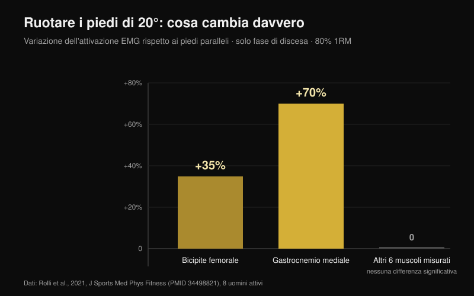
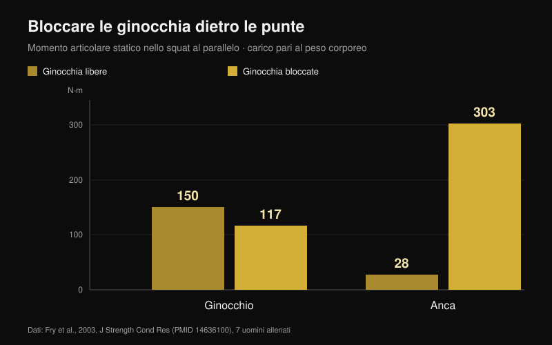

# Ginocchia in fuori nello squat: regola o cue?

Di [Giammaria Loi](/autore/giammaria-loi) · aggiornato il 25 ottobre 2026

"Spingi le ginocchia in fuori" è probabilmente la frase più detta in sala pesi sotto un bilanciere. Funziona così bene su alcune persone che è diventata una regola per tutte, e chi non la rispetta si sente dire che sta sbagliando. Ho letto otto lavori indicizzati che hanno misurato angoli, attivazione muscolare e momenti articolari nello squat. Il risultato è che il cue è utile, ma quasi tutto quello che gli viene attribuito intorno non regge.

## In breve

- **Ruotare i piedi in fuori cambia pochissimo.** A 20° di extrarotazione rispetto ai piedi paralleli, con l'80% del massimale, si muovono solo due muscoli: bicipite femorale **+35%** e gastrocnemio mediale **+70%**, e soltanto nella fase di discesa. Tutto il resto resta uguale (Rolli et al., 2021).
- **Più extrarotazione non vuol dire più glutei.** Una revisione di 18 studi EMG conclude che le varianti comuni — larghezza della stance, rotazione d'anca, front squat — non cambiano in modo significativo l'attivazione muscolare (Clark et al., 2012).
- **Il ginocchio che rientra non è un difetto da correggere a parole.** Chi mostra il cedimento verso l'interno ha rapporti di coattivazione gluteo:adduttori più bassi (**p = 0,007** per il grande gluteo) e meno dorsiflessione di caviglia: il cue da solo non tocca nessuna delle due cause (Mauntel et al., 2013).
- **Il famoso rischio per il legamento crociato viene da un altro gesto.** Lo studio prospettico più citato ha misurato atterraggi da salto in 205 atlete, non squat con bilanciere (Hewett et al., 2005).
- **"Mai oltre le punte" è l'errore opposto.** Bloccare le ginocchia dietro le punte abbassa il momento al ginocchio da 150 a 117 N·m, ma fa salire quello all'anca da 28 a **303 N·m**: dieci volte tanto (Fry et al., 2003).

## Da dove nasce il cue, e perché funziona lo stesso

Mentre scendi, l'anca non fa solo flessione: combina flessione, abduzione e rotazione. In questa combinazione il ginocchio può spostarsi verso l'esterno durante la discesa e rientrare un po' quando risali dal punto basso. Nessuna delle due direzioni è di per sé corretta o sbagliata: sono il risultato della forma della tua anca e della strategia con cui spingi.

Il cue "ginocchia in fuori" nasce come correzione per chi perde la posizione: il ginocchio collassa verso l'interno, il piede si appiattisce e la spinta si disperde. In quel caso serve, ed è il motivo per cui ha fatto il giro del mondo. Il problema è il passo successivo, quello che lo trasforma in una regola valida anche per chi non ha quel problema.

## Ruotare i piedi cambia due muscoli, non tutto lo squat

Lo studio più diretto sul punto ha fatto una cosa semplice: ha preso otto uomini attivi e gli ha fatto eseguire il back squat all'80% del massimale con tre angoli del piede — paralleli, +10° e +20° di extrarotazione — misurando otto muscoli della gamba dominante (Rolli et al., 2021).

A 20° di extrarotazione, rispetto ai piedi paralleli, cambiano due cose: il bicipite femorale lavora il **35% in più** (p = 0,027) e il gastrocnemio mediale il **70% in più** (p = 0,040). Entrambe le differenze compaiono solo nella fase di discesa. In tutti gli altri muscoli misurati e in tutte le altre condizioni non emerge alcuna differenza significativa.

È un risultato più piccolo di quello che il cue promette. E combacia con la revisione di riferimento sull'argomento: su 18 studi che hanno misurato l'EMG nello squat con bilanciere libero, le variazioni comuni della tecnica — larghezza della stance, rotazione d'anca, front squat — non cambiano in modo significativo l'attivazione muscolare (Clark et al., 2012). Quello che la cambia davvero è il carico sul bilanciere.

Un'eccezione esiste, ma riguarda la distribuzione del lavoro fra articolazioni, non fra muscoli: con bilanciere basso e stance larga il contributo dell'anca al momento totale è più alto, mentre con bilanciere alto e stance stretta sale il contributo del ginocchio, con più vasto laterale e meno grande gluteo (Larsen et al., 2021). Se vuoi spostare lavoro sull'anca, lo fai con la posizione del bilanciere e la larghezza della stance, non ruotando un po' di più le ginocchia.

## Se le ginocchia rientrano, il cue non tocca la causa

Qui sta la parte più utile per chi si allena. Uno studio ha confrontato 40 adulti attivi: 20 che mostrano un chiaro cedimento del ginocchio verso l'interno nello squat su una gamba e 20 che non lo mostrano (Mauntel et al., 2013).

Chi cede verso l'interno ha due caratteristiche misurabili. La prima: rapporti di coattivazione più bassi fra glutei e adduttori — gluteo medio su adduttori p = 0,028, grande gluteo su adduttori p = 0,007. La seconda: meno dorsiflessione passiva di caviglia, sia a ginocchio esteso (p = 0,047) sia a ginocchio flesso (p = 0,034).

Tradotto: il ginocchio rientra perché la caviglia non lascia avanzare la tibia e perché il rapporto di forza intorno all'anca è sbilanciato. Una frase urlata sotto il bilanciere non cambia la mobilità della caviglia e non rinforza il gluteo. Può mascherare il problema per una serie; non lo risolve.

## Quanto è pericoloso davvero il ginocchio che rientra

Il "ginocchia in fuori o ti rompi il crociato" arriva da una ricerca reale, ma su un altro gesto. Lo studio prospettico più citato ha seguito 205 atlete di calcio, basket e pallavolo misurandone l'atterraggio da un salto. Le nove che hanno poi rotto il legamento crociato anteriore avevano un angolo di abduzione del ginocchio **8° maggiore**, un momento di abduzione **2,5 volte** più alto e una forza di reazione al suolo del 20% superiore, con un tempo di appoggio più corto del 16% (Hewett et al., 2005).

Sono numeri solidi, e il modello prediceva l'infortunio con il 78% di sensibilità e il 73% di specificità. Ma si riferiscono a un atterraggio: impatto in frazioni di secondo, su una gamba, senza controllo volontario. Uno squat al 90% con un rientro di pochi gradi in uscita dal punto basso è un gesto lento, bilaterale e consapevole. Non esiste, a oggi, uno studio prospettico che leghi quel rientro a un maggior rischio di infortunio nei sollevatori. Trattare i due casi come la stessa cosa è il salto logico più comune su questo tema.

## L'errore gemello: "le ginocchia non devono superare le punte"

È la regola opposta, e nasce dalla stessa idea che il ginocchio vada protetto per principio. Sette uomini allenati hanno eseguito squat al parallelo con un carico pari al peso corporeo in due condizioni: ginocchia libere di avanzare oltre le punte, oppure bloccate da una barriera di legno (Fry et al., 2003).

Con le ginocchia libere il momento al ginocchio è 150,1 N·m e quello all'anca 28,2 N·m. Bloccandole, il ginocchio scende a 117,3 N·m — meno del 22% — ma l'anca passa a **302,7 N·m**: oltre dieci volte il valore di partenza. Il carico non sparisce, trasloca su anca e zona lombare. Gli autori concludono che una distribuzione sensata delle forze richiede probabilmente che le ginocchia superino leggermente le punte.

## La tua anca decide più del cue

L'ultimo pezzo è anatomico. La forma della testa e del collo del femore cambia da persona a persona, e con essa l'angolo a cui l'osso va in conflitto con il bordo dell'acetabolo. In un modello a elementi finiti, lo stress medio sull'acetabolo durante lo squat passa da 9,64 MPa in un'anca di riferimento a 11,36 MPa con una morfologia cam moderata e a 28,43 MPa con una cam ampia; nei soggetti con conflitto femoro-acetabolare la flessione d'anca raggiunta era 106,3° contro 112,6° e la rotazione interna 8,9° contro 14,8° (Bagwell e Powers, 2017).

Qui il cue torna utile, ma per una ragione diversa da quella che si racconta: gli autori osservano che squattare con l'anca in posizione neutra o in extrarotazione può ridurre il conflitto osseo ad alti gradi di flessione. Non per attivare di più un muscolo: per lasciare spazio all'articolazione. Due persone con femori diversi avranno quindi uno squat che *deve* avere un aspetto diverso, e questa è la ragione principale per cui non esiste un angolo giusto universale (Schoenfeld, 2010).

## Cosa dice davvero la ricerca

| Affermazione | Verdetto | Il dato |
| --- | --- | --- |
| "Ginocchia in fuori" è un cue, non una regola per tutti | **Confermato** | Nessuno studio individua un angolo ottimale; le revisioni non trovano differenze rilevanti fra varianti di rotazione d'anca (Clark et al., 2012) |
| Più extrarotazione = più glutei | **Smentito** | A 20° cambiano solo bicipite femorale (+35%) e gastrocnemio mediale (+70%), e solo in discesa (Rolli et al., 2021) |
| L'extrarotazione imposta aumenta il lavoro degli adduttori in profondità | **Non verificato** | Affermazione diffusa ma senza studio citato; non l'abbiamo trovata su PubMed con le ricerche fatte il 25 ottobre 2026 |
| Il ginocchio che rientra è sempre pericoloso | **Da precisare** | I dati prospettici riguardano l'atterraggio da salto in atlete, non lo squat con bilanciere (Hewett et al., 2005) |
| Basta spingere le ginocchia in fuori per correggere il valgo | **Da precisare** | Il cedimento si associa a meno dorsiflessione di caviglia e a coattivazione gluteo:adduttori più bassa (Mauntel et al., 2013) |
| Le ginocchia non devono superare le punte | **Smentito** | Bloccarle sposta il momento dall'anca: 28 → 303 N·m (Fry et al., 2003) |
| L'anatomia individuale cambia lo squat ideale | **Confermato** | Morfologia cam e conflitto femoro-acetabolare cambiano stress e gradi disponibili (Bagwell e Powers, 2017) |

## Come applicarlo

1. **Usa il cue solo se hai il problema che risolve.** Se il tuo ginocchio non collassa verso l'interno, aggiungere extrarotazione non ti dà niente di misurabile: stai cambiando una tecnica che funziona.
2. **Trova il tuo angolo del piede provandolo, non copiandolo.** Parti dai piedi leggermente ruotati, prova una serie leggera a 0°, una a +10°, una a +20° e tieni l'angolo in cui scendi più profondo senza perdere il contatto del piede a terra.
3. **Se il ginocchio rientra, testa la caviglia prima di parlare.** Mettiti in affondo con il piede a 10 cm dal muro: se il ginocchio non tocca il muro senza staccare il tallone, il tuo problema è lì, non nella testa.
4. **Aggiungi lavoro per abduttori ed estensori d'anca.** È l'unico modo per cambiare il rapporto di coattivazione che distingue chi cede da chi non cede. Un'ora di cue non sostituisce otto settimane di [lavoro mirato sui glutei](/blog/esercizi-glutei-hip-thrust-squat).
5. **Lascia che le ginocchia avanzino.** Fermarle dietro le punte non protegge il ginocchio: carica l'anca e la bassa schiena di dieci volte tanto.
6. **Giudica la tecnica dalla ripetibilità, non dall'estetica.** Se tre serie di cinque hanno la stessa traiettoria e la stessa profondità, la tua posizione va bene anche se non assomiglia a quella del video.

**Con Nurvan.** Il punto 2 è un test, e un test ha senso solo se i numeri restano. In Nurvan puoi salvare lo squat con angoli di piede o larghezze di stance diversi come varianti separate dello stesso esercizio: ogni serie registra carico, ripetizioni e RIR (le ripetizioni che avresti ancora in serbatoio), e lo storico ti mostra in poche settimane quale assetto sta progredendo davvero sul tuo corpo. Le serie di riscaldamento proposte automaticamente ti danno le ripetizioni leggere in cui provare un angolo nuovo senza bruciare le serie allenanti. [Prova Nurvan](https://nurvan.app)

## Domande frequenti

**Quanto devo ruotare i piedi nello squat?**
Non esiste un valore valido per tutti. Negli studi si usano 0°, 10° e 20° di extrarotazione e le differenze di attivazione sono piccole e limitate alla discesa. La scelta pratica è l'angolo in cui raggiungi la profondità che ti serve con il piede ben appoggiato e la stessa traiettoria serie dopo serie.

**Le ginocchia che rientrano nello squat fanno male al ginocchio?**
Non ci sono studi prospettici che lo dimostrino nei sollevatori. I dati sul rischio di rottura del crociato riguardano l'atterraggio da salto in atlete. Un rientro ampio e improvviso sotto carico massimale resta un segnale da non ignorare, ma è un problema di stabilità e di tecnica prima che di diagnosi. Se compare dolore, parlane con un medico o un fisioterapista.

**Spingere le ginocchia in fuori attiva di più i glutei?**
Non in modo misurabile. La revisione dei lavori EMG non trova differenze significative di attivazione fra variazioni di rotazione d'anca e di stance. Per spostare lavoro sull'anca sono più efficaci la posizione del bilanciere e la larghezza della stance.

**Posso far avanzare le ginocchia oltre le punte?**
Sì, ed è probabilmente preferibile. Bloccarle riduce il momento al ginocchio di circa il 22% ma moltiplica per oltre dieci quello all'anca, costringendo anche a inclinare di più il busto.

## Leggi anche

- [Esercizi per i glutei: hip thrust o squat?](/blog/esercizi-glutei-hip-thrust-squat) — quale dei due costruisce davvero il gluteo, numeri alla mano
- [Leg extension o leg press: cosa cresce davvero](/blog/leg-extension-o-leg-press-retto-femorale) — cosa cambia fra due esercizi che sembrano intercambiabili
- [Presa in panca piana: larga, media o stretta?](/blog/presa-panca-piana-larga-stretta) — lo stesso tipo di schema tecnico, smontato sul distensore

## Fonti

1. Clark DR, Lambert MI, Hunter AM, 2012. Muscle activation in the loaded free barbell squat: a brief review. *J Strength Cond Res*. PMID [22373894](https://pubmed.ncbi.nlm.nih.gov/22373894/) · [DOI](https://doi.org/10.1519/JSC.0b013e31822d533d)
2. Rolli F, Vitale JA, Pugliese L, Boccia G, La Torre A, Pollitt L, 2021. The impact of foot angle on lower limb muscles activity during the back squat and counter movement jump. *J Sports Med Phys Fitness*. PMID [34498821](https://pubmed.ncbi.nlm.nih.gov/34498821/) · [DOI](https://doi.org/10.23736/S0022-4707.21.12588-5)
3. Larsen S, Kristiansen E, Helms E, van den Tillaar R, 2021. Effects of Stance Width and Barbell Placement on Kinematics, Kinetics, and Myoelectric Activity in Back Squats. *Front Sports Act Living*. PMID [34541522](https://pubmed.ncbi.nlm.nih.gov/34541522/) · [DOI](https://doi.org/10.3389/fspor.2021.719013)
4. Mauntel TC, Begalle RL, Cram TR, Frank BS, Hirth CJ, Blackburn T, Padua DA, 2013. The effects of lower extremity muscle activation and passive range of motion on single leg squat performance. *J Strength Cond Res*. PMID [23096063](https://pubmed.ncbi.nlm.nih.gov/23096063/) · [DOI](https://doi.org/10.1519/JSC.0b013e318276b886)
5. Hewett TE, Myer GD, Ford KR, Heidt RS, Colosimo AJ, McLean SG, van den Bogert AJ, Paterno MV, Succop P, 2005. Biomechanical measures of neuromuscular control and valgus loading of the knee predict anterior cruciate ligament injury risk in female athletes: a prospective study. *Am J Sports Med*. PMID [15722287](https://pubmed.ncbi.nlm.nih.gov/15722287/) · [DOI](https://doi.org/10.1177/0363546504269591)
6. Fry AC, Smith JC, Schilling BK, 2003. Effect of knee position on hip and knee torques during the barbell squat. *J Strength Cond Res*. PMID [14636100](https://pubmed.ncbi.nlm.nih.gov/14636100/) · [DOI](https://doi.org/10.1519/1533-4287(2003)017%3C0629:EOKPOH%3E2.0.CO;2)
7. Bagwell JJ, Powers CM, 2017. The Influence of Squat Kinematics and Cam Morphology on Acetabular Stress. *Arthroscopy*. PMID [28969815](https://pubmed.ncbi.nlm.nih.gov/28969815/) · [DOI](https://doi.org/10.1016/j.arthro.2017.03.018)
8. Schoenfeld BJ, 2010. Squatting kinematics and kinetics and their application to exercise performance. *J Strength Cond Res*. PMID [20182386](https://pubmed.ncbi.nlm.nih.gov/20182386/) · [DOI](https://doi.org/10.1519/JSC.0b013e3181bac2d7)

Spunto: post di Alfred Jong ([@alfred.reformance](https://www.instagram.com/p/Ddbl4IKmyqw/)) sul cue "knees out". Testo, struttura e verifiche di questo articolo sono originali.

---

**Giammaria Loi** è il fondatore di Nurvan. Si allena con i pesi dal 2012, lavora come personal trainer e coach certificato FIPE dal 2013 e gareggia nel powerlifting a livello nazionale dal 2018.

> Nota: contenuto informativo, non sostituisce il parere di un medico o professionista. In caso di dolore al ginocchio, all'anca o alla schiena, rivolgiti a un medico o a un fisioterapista prima di modificare l'allenamento.
