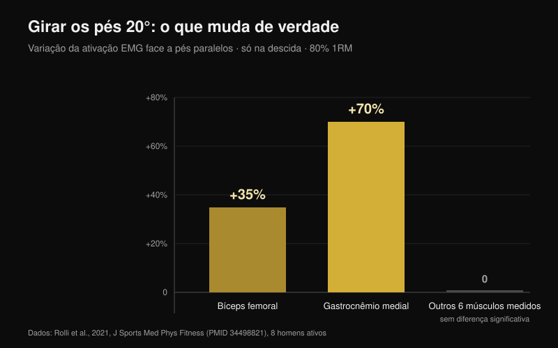
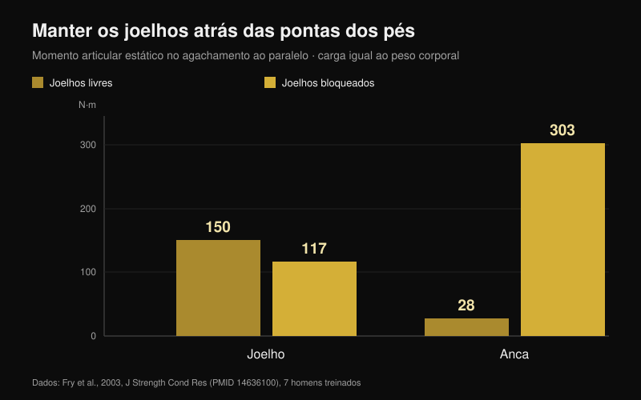

# Joelhos para fora no agachamento: regra ou cue?

Por [Giammaria Loi](/autore/giammaria-loi) · atualizado a 25 de outubro de 2026

"Joelhos para fora" é provavelmente a frase mais repetida debaixo de uma barra carregada. Funciona tão bem em algumas pessoas que acabou por virar regra para todas, e quem não a cumpre ouve dizer que está a agachar mal. Li oito trabalhos indexados que mediram ângulos, ativação muscular e momentos articulares no agachamento. O cue é útil. Quase tudo o que se construiu à volta dele não se sustenta.

## Em resumo

- **Girar os pés muda muito pouco.** Com 20° de rotação externa face a pés paralelos, a 80% do máximo, só se mexem dois músculos: bíceps femoral **+35%** e gastrocnêmio medial **+70%**, e apenas na descida. O resto fica igual (Rolli et al., 2021).
- **Mais rotação externa não significa mais glúteo.** Uma revisão de 18 estudos de EMG conclui que as variantes comuns — largura dos pés, rotação da anca, agachamento frontal — não alteram significativamente a ativação muscular (Clark et al., 2012).
- **O joelho que entra para dentro não se corrige a falar.** Quem apresenta esse colapso tem rácios de coativação glúteo:adutores mais baixos (**p = 0,007** para o glúteo máximo) e menos dorsiflexão de tornozelo: o cue não toca em nenhuma das causas (Mauntel et al., 2013).
- **O famoso risco de ligamento cruzado vem de outro gesto.** O estudo prospetivo mais citado mediu aterragens de salto em 205 atletas, não agachamentos com barra (Hewett et al., 2005).
- **"O joelho nunca deve passar a ponta do pé" é o erro oposto.** Bloqueá-los baixa o momento no joelho de 150 para 117 N·m, mas sobe o da anca de 28 para **303 N·m**: mais de dez vezes (Fry et al., 2003).

## De onde vem o cue e porque funciona na mesma

Ao descer, a anca não faz apenas flexão: combina flexão, abdução e rotação. Dentro dessa combinação o joelho pode deslocar-se para fora durante a descida e entrar ligeiramente na saída do ponto mais baixo. Nenhuma das direções é certa ou errada por si: resultam da forma da tua anca e da maneira como empurras.

"Joelhos para fora" nasceu como correção para quem perde a posição: o joelho colapsa para dentro, o pé achata, o impulso dispersa-se. Aí serve, e foi por isso que deu a volta ao mundo. O problema é o passo seguinte — transformá-lo numa regra válida também para quem nunca teve esse problema.

## Girar os pés muda dois músculos, não o agachamento todo

O estudo mais direto sobre o tema fez algo simples: oito homens ativos executaram agachamento com barra a 80% do máximo com três ângulos de pé — paralelos, +10° e +20° de rotação externa — medindo oito músculos da perna dominante (Rolli et al., 2021).

Aos 20° face a paralelos mudam duas coisas: o bíceps femoral trabalha **35% mais** (p = 0,027) e o gastrocnêmio medial **70% mais** (p = 0,040). Ambas as diferenças aparecem só na fase de descida. Em todos os outros músculos medidos e nas restantes condições não surgiu nenhuma diferença significativa.

É um resultado mais pequeno do que o cue promete, e encaixa na revisão de referência: em 18 estudos que mediram EMG no agachamento com barra livre, as variações comuns de técnica não afetam significativamente a ativação muscular (Clark et al., 2012). O que a altera de verdade é a carga na barra.

Existe uma exceção, mas diz respeito à divisão entre articulações, não entre músculos: com barra baixa e pés largos a anca contribui mais para o momento total, enquanto com barra alta e pés estreitos contribui mais o joelho, com mais vasto lateral e menos glúteo máximo (Larsen et al., 2021). Para levar trabalho à anca, usa-se a posição da barra e a largura dos pés, não alguns graus a mais de rotação do joelho.

## Se o joelho entra, o cue não toca na causa

Esta é a parte mais útil para quem treina. Um estudo comparou 40 adultos ativos: 20 que mostram um claro colapso do joelho para dentro no agachamento unilateral e 20 que não (Mauntel et al., 2013).

O grupo que colapsa tem duas características mensuráveis. Primeiro, rácios de coativação mais baixos entre glúteos e adutores — glúteo médio sobre adutores p = 0,028, glúteo máximo sobre adutores p = 0,007. Segundo, menos dorsiflexão passiva de tornozelo, tanto com o joelho estendido (p = 0,047) como fletido (p = 0,034).

Traduzindo: o joelho entra porque o tornozelo não deixa a tíbia avançar e porque o equilíbrio de força à volta da anca está desalinhado. Uma frase gritada debaixo da barra não muda a mobilidade do tornozelo nem reforça o glúteo. Pode tapar o problema durante uma série; não o resolve.

## Qual é o perigo real

O "joelhos para fora ou rompes o cruzado" vem de investigação real, mas sobre outro gesto. O estudo prospetivo mais citado acompanhou 205 atletas de futebol, basquetebol e voleibol medindo uma aterragem de salto. As nove que vieram a romper o ligamento cruzado anterior aterravam com um ângulo de abdução do joelho **8° maior**, um momento de abdução **2,5 vezes** mais alto e uma força de reação ao solo 20% superior, com um tempo de apoio 16% mais curto (Hewett et al., 2005).

Os números são sólidos e o modelo previa a lesão com 78% de sensibilidade e 73% de especificidade. Mas descrevem uma aterragem: impacto em frações de segundo, sobre uma perna, sem controlo voluntário. Um agachamento a 90% com alguns graus de entrada à saída do ponto baixo é um gesto lento, bilateral e consciente. Até hoje não existe nenhum estudo prospetivo que ligue essa entrada a maior risco de lesão em praticantes de força. Tratar os dois casos como a mesma coisa é o salto lógico mais comum neste tema.

## O erro gémeo: "os joelhos nunca devem passar as pontas dos pés"

É a regra oposta e nasce da mesma ideia: proteger o joelho por princípio. Sete homens treinados fizeram agachamentos ao paralelo com carga igual ao peso corporal em duas condições: joelhos livres para passar as pontas, ou travados por uma barreira de madeira (Fry et al., 2003).

Com joelhos livres, o momento no joelho foi 150,1 N·m e na anca 28,2 N·m. Travando-os, o joelho desceu para 117,3 N·m — cerca de 22% menos — mas a anca subiu para **302,7 N·m**, mais de dez vezes o valor inicial. A carga não desaparece: muda-se para a anca e a zona lombar. Os autores concluem que uma distribuição razoável das forças exige provavelmente que os joelhos passem ligeiramente as pontas.

## A tua anca decide mais do que o cue

A última peça é anatómica. A forma da cabeça e do colo do fémur varia de pessoa para pessoa, e com ela o ângulo em que o osso embate no bordo do acetábulo. Num modelo de elementos finitos, o stress médio no acetábulo durante o agachamento passou de 9,64 MPa numa anca de referência para 11,36 MPa com morfologia cam moderada e 28,43 MPa com cam ampla; os participantes com conflito femoroacetabular atingiam 106,3° de flexão da anca contra 112,6°, e 8,9° de rotação interna contra 14,8° (Bagwell e Powers, 2017).

Aqui o cue ganha o seu lugar, mas por uma razão diferente da que se conta: os autores observam que agachar com a anca em posição neutra ou em rotação externa pode limitar o embate ósseo em ângulos altos de flexão. Não para ativar mais um músculo: para dar espaço à articulação. Duas pessoas com fémures diferentes terão, por isso, agachamentos que *têm* de parecer diferentes, e essa é a razão principal pela qual não existe um ângulo universal (Schoenfeld, 2010).

## O que a investigação diz mesmo

| Afirmação | Veredicto | O dado |
| --- | --- | --- |
| "Joelhos para fora" é um cue, não uma regra para todos | **Confirmado** | Nenhum estudo identifica um ângulo ótimo; as revisões não encontram diferenças relevantes entre variantes de rotação da anca (Clark et al., 2012) |
| Mais rotação externa = mais glúteo | **Desmentido** | Aos 20° só mudam bíceps femoral (+35%) e gastrocnêmio medial (+70%), e só na descida (Rolli et al., 2021) |
| A rotação externa imposta aumenta o trabalho dos adutores em profundidade | **Não verificado** | Afirmação repetida sem estudo citado; não a encontrámos na PubMed com as pesquisas de 25 de outubro de 2026 |
| O joelho que entra é sempre perigoso | **A precisar** | Os dados prospetivos descrevem aterragens de salto em atletas, não agachamentos com barra (Hewett et al., 2005) |
| Basta empurrar os joelhos para fora para corrigir o valgo | **A precisar** | O colapso associa-se a menos dorsiflexão de tornozelo e a coativação glúteo:adutores mais baixa (Mauntel et al., 2013) |
| Os joelhos não devem passar as pontas dos pés | **Desmentido** | Travá-los desloca o momento para a anca: 28 → 303 N·m (Fry et al., 2003) |
| A anatomia individual muda o agachamento ideal | **Confirmado** | Morfologia cam e conflito alteram o stress e os graus disponíveis (Bagwell e Powers, 2017) |

## Como aplicar

1. **Usa o cue só se tiveres o problema que ele resolve.** Se o teu joelho não colapsa para dentro, acrescentar rotação externa não te dá nada mensurável: estás a mexer numa técnica que funciona.
2. **Encontra o teu ângulo de pé testando, não copiando.** Uma série leve a 0°, outra a +10°, outra a +20°: fica com o ângulo em que desces mais sem o pé descolar do chão.
3. **Se o joelho entra, testa o tornozelo antes de falar.** Em afundo, pé a 10 cm da parede: se o joelho não toca na parede sem levantar o calcanhar, o problema está aí.
4. **Acrescenta trabalho para abdutores e extensores da anca.** É a única forma de mudar o rácio de coativação que separa quem colapsa de quem não colapsa. Uma hora de cues não substitui oito semanas de [trabalho específico de glúteo](/pt/blog/exercicios-para-gluteos-hip-thrust-ou-agachamento).
5. **Deixa os joelhos avançar.** Travá-los atrás das pontas não protege o joelho: carrega a anca e a zona lombar dez vezes mais.
6. **Julga a técnica pela repetibilidade, não pela estética.** Se três séries de cinco têm a mesma trajetória e a mesma profundidade, a tua posição está bem mesmo que não se pareça com a do vídeo.

**Com a Nurvan.** O ponto 2 é um teste, e um teste só serve se os números ficarem em algum lado. Na Nurvan podes guardar o agachamento com diferentes ângulos de pé ou larguras como variantes separadas do mesmo exercício: cada série regista carga, repetições e RIR (as repetições que ainda tinhas em reserva), e o histórico mostra em poucas semanas qual configuração está mesmo a progredir no teu corpo. As séries de aquecimento propostas automaticamente dão-te as repetições leves para testar um ângulo novo sem queimar uma série de trabalho. [Experimenta a Nurvan](https://nurvan.app)

## Perguntas frequentes

**Quanto devo girar os pés no agachamento?**
Não há um valor válido para todos. Nos estudos usam-se 0°, 10° e 20° de rotação externa e as diferenças de ativação são pequenas e limitadas à descida. Na prática, escolhe o ângulo em que atinges a profundidade de que precisas com o pé bem assente e a mesma trajetória série após série.

**Os joelhos a entrar no agachamento fazem mal ao joelho?**
Não há estudos prospetivos que o demonstrem em praticantes de força. Os dados sobre o cruzado vêm de aterragens de salto em atletas. Um colapso amplo e súbito com carga quase máxima continua a ser um sinal a não ignorar, mas é um problema de estabilidade e técnica antes de ser um diagnóstico. Se surgir dor, fala com um médico ou fisioterapeuta.

**Empurrar os joelhos para fora ativa mais o glúteo?**
Não de forma mensurável. A revisão dos trabalhos de EMG não encontra diferenças significativas entre variantes de rotação da anca e de largura. Para levar trabalho à anca, a posição da barra e a largura dos pés funcionam muito melhor.

**Posso deixar os joelhos passarem as pontas dos pés?**
Sim, e é provavelmente preferível. Travá-los reduz o momento no joelho cerca de 22% mas multiplica o da anca por mais de dez, obrigando ainda a inclinar mais o tronco.

## Lê também

- [Exercícios para glúteos: hip thrust ou agachamento?](/pt/blog/exercicios-para-gluteos-hip-thrust-ou-agachamento) — qual constrói mesmo o glúteo, com os números
- [Cadeira extensora ou leg press: o que cresce mesmo](/pt/blog/cadeira-extensora-ou-leg-press-reto-femoral) — o que muda entre dois exercícios que parecem intercambiáveis
- [Pegada no supino: larga, média ou fechada?](/pt/blog/pegada-supino-larga-fechada) — o mesmo tipo de regra técnica, desmontada no banco

## Fontes

1. Clark DR, Lambert MI, Hunter AM, 2012. Muscle activation in the loaded free barbell squat: a brief review. *J Strength Cond Res*. PMID [22373894](https://pubmed.ncbi.nlm.nih.gov/22373894/) · [DOI](https://doi.org/10.1519/JSC.0b013e31822d533d)
2. Rolli F, Vitale JA, Pugliese L, Boccia G, La Torre A, Pollitt L, 2021. The impact of foot angle on lower limb muscles activity during the back squat and counter movement jump. *J Sports Med Phys Fitness*. PMID [34498821](https://pubmed.ncbi.nlm.nih.gov/34498821/) · [DOI](https://doi.org/10.23736/S0022-4707.21.12588-5)
3. Larsen S, Kristiansen E, Helms E, van den Tillaar R, 2021. Effects of Stance Width and Barbell Placement on Kinematics, Kinetics, and Myoelectric Activity in Back Squats. *Front Sports Act Living*. PMID [34541522](https://pubmed.ncbi.nlm.nih.gov/34541522/) · [DOI](https://doi.org/10.3389/fspor.2021.719013)
4. Mauntel TC, Begalle RL, Cram TR, Frank BS, Hirth CJ, Blackburn T, Padua DA, 2013. The effects of lower extremity muscle activation and passive range of motion on single leg squat performance. *J Strength Cond Res*. PMID [23096063](https://pubmed.ncbi.nlm.nih.gov/23096063/) · [DOI](https://doi.org/10.1519/JSC.0b013e318276b886)
5. Hewett TE, Myer GD, Ford KR, Heidt RS, Colosimo AJ, McLean SG, van den Bogert AJ, Paterno MV, Succop P, 2005. Biomechanical measures of neuromuscular control and valgus loading of the knee predict anterior cruciate ligament injury risk in female athletes: a prospective study. *Am J Sports Med*. PMID [15722287](https://pubmed.ncbi.nlm.nih.gov/15722287/) · [DOI](https://doi.org/10.1177/0363546504269591)
6. Fry AC, Smith JC, Schilling BK, 2003. Effect of knee position on hip and knee torques during the barbell squat. *J Strength Cond Res*. PMID [14636100](https://pubmed.ncbi.nlm.nih.gov/14636100/) · [DOI](https://doi.org/10.1519/1533-4287(2003)017%3C0629:EOKPOH%3E2.0.CO;2)
7. Bagwell JJ, Powers CM, 2017. The Influence of Squat Kinematics and Cam Morphology on Acetabular Stress. *Arthroscopy*. PMID [28969815](https://pubmed.ncbi.nlm.nih.gov/28969815/) · [DOI](https://doi.org/10.1016/j.arthro.2017.03.018)
8. Schoenfeld BJ, 2010. Squatting kinematics and kinetics and their application to exercise performance. *J Strength Cond Res*. PMID [20182386](https://pubmed.ncbi.nlm.nih.gov/20182386/) · [DOI](https://doi.org/10.1519/JSC.0b013e3181bac2d7)

Ponto de partida: uma publicação de Alfred Jong ([@alfred.reformance](https://www.instagram.com/p/Ddbl4IKmyqw/)) sobre o cue "knees out". O texto, a estrutura e as verificações deste artigo são originais.

---

**Giammaria Loi** é o fundador da Nurvan. Treina com pesos desde 2012, trabalha como personal trainer e coach certificado FIPE desde 2013 e compete em powerlifting a nível nacional desde 2018.

> Nota: conteúdo informativo, não substitui a opinião de um médico ou profissional. Em caso de dor no joelho, na anca ou nas costas, fala com um médico ou fisioterapeuta antes de alterar o treino.
