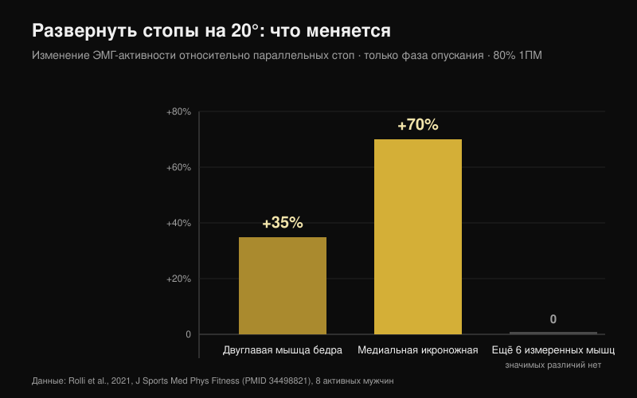
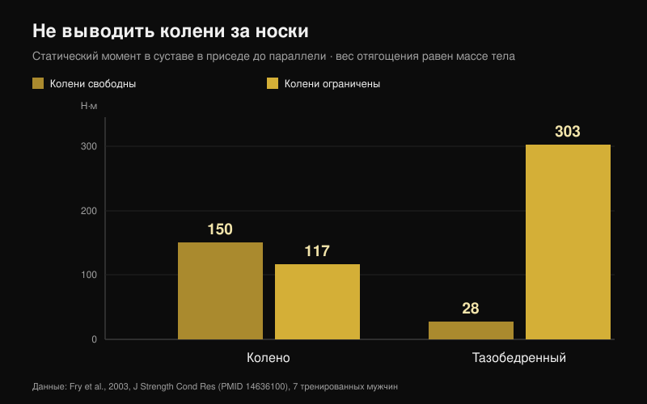

# Колени наружу в приседе: правило или подсказка?

Автор: [Giammaria Loi](/autore/giammaria-loi) · обновлено 25 октября 2026

«Колени наружу» — пожалуй, самая частая фраза под загруженной штангой. У части людей она работает настолько хорошо, что превратилась в правило для всех, а тому, кто его не соблюдает, говорят, что он приседает неправильно. Я прочитал восемь индексированных работ, в которых измеряли углы, активность мышц и моменты в суставах во время приседа. Подсказка полезна. Почти всё, что вокруг неё построили, не выдерживает проверки.

## Коротко

- **Разворот стоп меняет очень мало.** При 20° наружной ротации по сравнению с параллельными стопами, на 80% от максимума, меняются только две мышцы: двуглавая мышца бедра **+35%** и медиальная икроножная **+70%**, и только в фазе опускания. Остальное остаётся прежним (Rolli et al., 2021).
- **Больше наружной ротации — не значит больше ягодичных.** Обзор 18 ЭМГ-исследований заключает, что привычные варианты — ширина стойки, ротация бедра, фронтальный присед — значимо не меняют активацию мышц (Clark et al., 2012).
- **Колено, заваливающееся внутрь, не исправляют словами.** У тех, у кого оно заваливается, ниже коэффициенты коактивации ягодичных и приводящих (**p = 0,007** для большой ягодичной) и меньше тыльное сгибание голеностопа: подсказка не затрагивает ни одну из причин (Mauntel et al., 2013).
- **Знаменитый риск для крестообразной связки взят из другого движения.** Самое цитируемое проспективное исследование измеряло приземления после прыжка у 205 спортсменок, а не приседы со штангой (Hewett et al., 2005).
- **«Колени никогда не должны выходить за носки» — обратная ошибка.** Если их удерживать, момент в колене падает со 150 до 117 Н·м, но момент в тазобедренном суставе растёт с 28 до **303 Н·м** — более чем в десять раз (Fry et al., 2003).

## Откуда взялась подсказка и почему она всё равно работает

При опускании тазобедренный сустав не просто сгибается: он сочетает сгибание, отведение и ротацию. Внутри этого сочетания колено может уходить наружу на спуске и слегка заходить внутрь при выходе из нижней точки. Ни одно из направлений само по себе не является правильным или неправильным: это результат формы вашего сустава и того, как вы давите.

«Колени наружу» появилось как коррекция для тех, кто теряет позицию: колено заваливается внутрь, стопа заваливается, усилие рассеивается. В этом случае подсказка работает, и поэтому она разошлась по всему миру. Проблема в следующем шаге — когда её превращают в правило и для тех, у кого такой проблемы никогда не было.

## Разворот стоп меняет две мышцы, а не весь присед

Самое прямое исследование по теме сделало простую вещь: восемь физически активных мужчин выполняли присед со штангой на спине на 80% от максимума в трёх положениях стоп — параллельно, +10° и +20° наружной ротации — с регистрацией восьми мышц доминирующей ноги (Rolli et al., 2021).

При 20° по сравнению с параллельными стопами меняются две вещи: двуглавая мышца бедра работает на **35% больше** (p = 0,027), медиальная икроножная — на **70% больше** (p = 0,040). Оба различия появляются только в фазе опускания. Во всех остальных измеренных мышцах и условиях значимых различий не обнаружено.

Это меньше, чем обещает подсказка, и это согласуется с базовым обзором: в 18 исследованиях ЭМГ в приседе со свободной штангой привычные вариации техники значимо не влияют на активацию мышц (Clark et al., 2012). Реально её меняет вес на штанге.

Исключение есть, но оно касается распределения между суставами, а не между мышцами: при низком положении штанги и широкой стойке вклад тазобедренного сустава в общий момент выше, а при высоком положении и узкой стойке выше вклад колена, с большей активностью латеральной широкой мышцы и меньшей — большой ягодичной (Larsen et al., 2021). Чтобы сместить работу на таз, меняют положение штанги и ширину стойки, а не несколько градусов разворота колена.

## Если колено заваливается, подсказка не трогает причину

Это самая полезная часть для тренирующихся. В одном исследовании сравнили 40 физически активных взрослых: 20 с явным заваливанием колена внутрь в приседе на одной ноге и 20 без него (Mauntel et al., 2013).

У группы с заваливанием две измеримые особенности. Первая: более низкие коэффициенты коактивации между ягодичными и приводящими — средняя ягодичная к приводящим p = 0,028, большая ягодичная к приводящим p = 0,007. Вторая: меньше пассивного тыльного сгибания голеностопа, как при разогнутом колене (p = 0,047), так и при согнутом (p = 0,034).

Если перевести: колено уходит внутрь, потому что голеностоп не даёт голени двигаться вперёд и потому что баланс сил вокруг таза смещён. Фраза, выкрикнутая под штангой, не меняет подвижность голеностопа и не укрепляет ягодичную. Она может замаскировать проблему на один подход, но не решает её.

## Насколько это действительно опасно

«Колени наружу, иначе порвёшь крестообразную» идёт из реального исследования, но о другом движении. Самая цитируемая проспективная работа наблюдала 205 спортсменок из футбола, баскетбола и волейбола и измеряла приземление после прыжка. У девяти, которые затем порвали переднюю крестообразную связку, угол отведения колена был **на 8° больше**, момент отведения — **в 2,5 раза** выше, сила реакции опоры — на 20% больше, а время опоры — на 16% короче (Hewett et al., 2005).

Цифры надёжные, модель предсказывала травму с чувствительностью 78% и специфичностью 73%. Но описывают они приземление: удар за доли секунды, на одной ноге, без произвольного контроля. Присед на 90% с несколькими градусами смещения внутрь при выходе из нижней точки — движение медленное, двустороннее и осознанное. На сегодня нет ни одного проспективного исследования, связывающего это смещение с риском травмы у силовых атлетов. Приравнивать два случая — самая частая логическая подмена в этой теме.

## Парная ошибка: «колени не должны выходить за носки»

Это противоположное правило, и растёт оно из той же идеи: колено нужно беречь из принципа. Семеро тренированных мужчин выполняли приседы до параллели с весом, равным массе тела, в двух условиях: колени свободно выходят за носки или их останавливает деревянный барьер (Fry et al., 2003).

При свободных коленях момент в колене составил 150,1 Н·м, в тазобедренном суставе — 28,2 Н·м. При ограничении колено опустилось до 117,3 Н·м — примерно на 22% меньше — но таз поднялся до **302,7 Н·м**, более чем в десять раз от исходного значения. Нагрузка не исчезает, она переезжает на таз и поясницу. Авторы заключают, что разумное распределение сил, вероятно, требует, чтобы колени слегка выходили за носки.

## Ваш тазобедренный сустав решает больше, чем подсказка

Последняя часть — анатомическая. Форма головки и шейки бедренной кости различается у разных людей, а вместе с ней и угол, при котором кость упирается в край вертлужной впадины. В модели конечных элементов средняя нагрузка на вертлужную впадину во время приседа выросла с 9,64 МПа в референсном суставе до 11,36 МПа при умеренной cam-морфологии и до 28,43 МПа при выраженной; у участников с бедренно-вертлужным конфликтом сгибание в тазобедренном суставе достигало 106,3° против 112,6°, а внутренняя ротация — 8,9° против 14,8° (Bagwell и Powers, 2017).

Здесь подсказка оправдана, но по другой причине, чем обычно рассказывают: авторы отмечают, что присед с тазобедренным суставом в нейтральном положении или в наружной ротации может уменьшить костный упор при больших углах сгибания. Не чтобы активнее включить мышцу — чтобы дать суставу место. У двух людей с разными бёдрами присед *должен* выглядеть по-разному, и это главная причина, почему универсального угла не существует (Schoenfeld, 2010).

## Что на самом деле говорит наука

| Утверждение | Вердикт | Данные |
| --- | --- | --- |
| «Колени наружу» — подсказка, а не правило для всех | **Подтверждено** | Ни одно исследование не называет оптимальный угол; обзоры не находят заметных различий между вариантами ротации бедра (Clark et al., 2012) |
| Больше наружной ротации = больше ягодичных | **Опровергнуто** | При 20° меняются только двуглавая мышца бедра (+35%) и медиальная икроножная (+70%), и только на спуске (Rolli et al., 2021) |
| Заданная наружная ротация увеличивает работу приводящих в глубине | **Не проверено** | Распространённое утверждение без ссылки; не найдено в PubMed при поиске 25 октября 2026 |
| Заваливающееся внутрь колено всегда опасно | **Требует уточнения** | Проспективные данные описывают приземления у спортсменок, а не приседы со штангой (Hewett et al., 2005) |
| Достаточно развести колени, чтобы убрать вальгус | **Требует уточнения** | Заваливание связано с меньшим тыльным сгибанием голеностопа и более низкой коактивацией ягодичных и приводящих (Mauntel et al., 2013) |
| Колени не должны выходить за носки | **Опровергнуто** | Ограничение переносит момент на таз: 28 → 303 Н·м (Fry et al., 2003) |
| Индивидуальная анатомия меняет идеальный присед | **Подтверждено** | Cam-морфология и конфликт меняют нагрузку и доступную амплитуду (Bagwell и Powers, 2017) |

## Как это применить

1. **Используйте подсказку, только если у вас есть проблема, которую она решает.** Если колено не заваливается внутрь, добавочная наружная ротация не даёт ничего измеримого: вы меняете технику, которая работает.
2. **Найдите свой угол стоп испытанием, а не копированием.** Один лёгкий подход при 0°, один при +10°, один при +20°: оставьте угол, в котором опускаетесь глубже всего, не отрывая стопу от пола.
3. **Если колено заваливается, сначала проверьте голеностоп.** Встаньте в выпад, стопа в 10 см от стены: если колено не достаёт до стены, не отрывая пятку, проблема там.
4. **Добавьте работу на отводящие и разгибатели бедра.** Это единственный способ изменить коэффициент коактивации, который отличает тех, у кого колено заваливается, от тех, у кого нет. Час подсказок не заменит восьми недель [целевой работы на ягодичные](/ru/blog/uprazhneniya-dlya-yagodits-hip-thrust-ili-prised).
5. **Дайте коленям выйти вперёд.** Остановка за носками не защищает колено: она в десять с лишним раз сильнее нагружает таз и поясницу.
6. **Оценивайте технику по повторяемости, а не по эстетике.** Если три подхода по пять имеют одинаковую траекторию и одинаковую глубину, ваша позиция в порядке, даже если она не похожа на видео.

**С Nurvan.** Пункт 2 — это тест, а тест имеет смысл, только если цифры где-то сохраняются. В Nurvan присед с разными углами стоп или ширинами стойки можно сохранить как отдельные варианты одного упражнения: каждый подход фиксирует вес, повторения и RIR (повторения, оставшиеся в запасе), а история за несколько недель показывает, какая настройка действительно прогрессирует именно у вас. Автоматически предложенные разминочные подходы дают лёгкие повторения, в которых новый угол можно проверить, не сжигая рабочий подход. [Попробовать Nurvan](https://nurvan.app)

## Частые вопросы

**Насколько разворачивать стопы в приседе?**
Единого значения для всех нет. В исследованиях используют 0°, 10° и 20° наружной ротации, и различия в активации малы и ограничены фазой опускания. Практически: выбирайте угол, при котором достигаете нужной глубины с полностью прижатой стопой и одинаковой траекторией от подхода к подходу.

**Вредно ли, если колени в приседе заваливаются внутрь?**
Проспективных данных об этом у силовых атлетов нет. Цифры о риске для крестообразной связки получены при приземлениях у спортсменок. Сильное и резкое заваливание под околомаксимальным весом всё равно остаётся сигналом, который не стоит игнорировать, но это прежде всего вопрос стабильности и техники, а не диагноз. При появлении боли обратитесь к врачу или физиотерапевту.

**Разведение коленей сильнее включает ягодичные?**
Измеримо — нет. Обзор ЭМГ-работ не находит значимых различий между вариантами ротации бедра и ширины стойки. Чтобы сместить работу на таз, гораздо эффективнее положение штанги и ширина стойки.

**Можно ли выводить колени за носки?**
Да, и, вероятно, это предпочтительнее. Ограничение снижает момент в колене примерно на 22%, но увеличивает момент в тазобедренном суставе более чем в десять раз и дополнительно заставляет сильнее наклонять корпус.

## Читайте также

- [Упражнения для ягодиц: ягодичный мост или присед?](/ru/blog/uprazhneniya-dlya-yagodits-hip-thrust-ili-prised) — что действительно строит ягодичные, с цифрами
- [Разгибания ног или жим ногами: что реально растёт](/ru/blog/razgibaniya-nog-ili-zhim-nogami-pryamaya-myshtsa-bedra) — что меняется между двумя якобы взаимозаменяемыми упражнениями
- [Хват в жиме лёжа: широкий, средний или узкий?](/ru/blog/khvat-zhim-lezha-shirokiy-uzkiy) — то же самое техническое правило, разобранное на скамье

## Источники

1. Clark DR, Lambert MI, Hunter AM, 2012. Muscle activation in the loaded free barbell squat: a brief review. *J Strength Cond Res*. PMID [22373894](https://pubmed.ncbi.nlm.nih.gov/22373894/) · [DOI](https://doi.org/10.1519/JSC.0b013e31822d533d)
2. Rolli F, Vitale JA, Pugliese L, Boccia G, La Torre A, Pollitt L, 2021. The impact of foot angle on lower limb muscles activity during the back squat and counter movement jump. *J Sports Med Phys Fitness*. PMID [34498821](https://pubmed.ncbi.nlm.nih.gov/34498821/) · [DOI](https://doi.org/10.23736/S0022-4707.21.12588-5)
3. Larsen S, Kristiansen E, Helms E, van den Tillaar R, 2021. Effects of Stance Width and Barbell Placement on Kinematics, Kinetics, and Myoelectric Activity in Back Squats. *Front Sports Act Living*. PMID [34541522](https://pubmed.ncbi.nlm.nih.gov/34541522/) · [DOI](https://doi.org/10.3389/fspor.2021.719013)
4. Mauntel TC, Begalle RL, Cram TR, Frank BS, Hirth CJ, Blackburn T, Padua DA, 2013. The effects of lower extremity muscle activation and passive range of motion on single leg squat performance. *J Strength Cond Res*. PMID [23096063](https://pubmed.ncbi.nlm.nih.gov/23096063/) · [DOI](https://doi.org/10.1519/JSC.0b013e318276b886)
5. Hewett TE, Myer GD, Ford KR, Heidt RS, Colosimo AJ, McLean SG, van den Bogert AJ, Paterno MV, Succop P, 2005. Biomechanical measures of neuromuscular control and valgus loading of the knee predict anterior cruciate ligament injury risk in female athletes: a prospective study. *Am J Sports Med*. PMID [15722287](https://pubmed.ncbi.nlm.nih.gov/15722287/) · [DOI](https://doi.org/10.1177/0363546504269591)
6. Fry AC, Smith JC, Schilling BK, 2003. Effect of knee position on hip and knee torques during the barbell squat. *J Strength Cond Res*. PMID [14636100](https://pubmed.ncbi.nlm.nih.gov/14636100/) · [DOI](https://doi.org/10.1519/1533-4287(2003)017%3C0629:EOKPOH%3E2.0.CO;2)
7. Bagwell JJ, Powers CM, 2017. The Influence of Squat Kinematics and Cam Morphology on Acetabular Stress. *Arthroscopy*. PMID [28969815](https://pubmed.ncbi.nlm.nih.gov/28969815/) · [DOI](https://doi.org/10.1016/j.arthro.2017.03.018)
8. Schoenfeld BJ, 2010. Squatting kinematics and kinetics and their application to exercise performance. *J Strength Cond Res*. PMID [20182386](https://pubmed.ncbi.nlm.nih.gov/20182386/) · [DOI](https://doi.org/10.1519/JSC.0b013e3181bac2d7)

Отправная точка: публикация Alfred Jong ([@alfred.reformance](https://www.instagram.com/p/Ddbl4IKmyqw/)) о подсказке «knees out». Текст, структура и проверки в этой статье — наши собственные.

---

**Giammaria Loi** — основатель Nurvan. Тренируется с отягощениями с 2012 года, с 2013 года работает персональным тренером и коучем с сертификацией FIPE, с 2018 года выступает в пауэрлифтинге на национальном уровне.

> Примечание: информационный материал, не заменяет консультацию врача или специалиста. При боли в колене, тазобедренном суставе или спине обратитесь к врачу или физиотерапевту, прежде чем менять тренировки.
