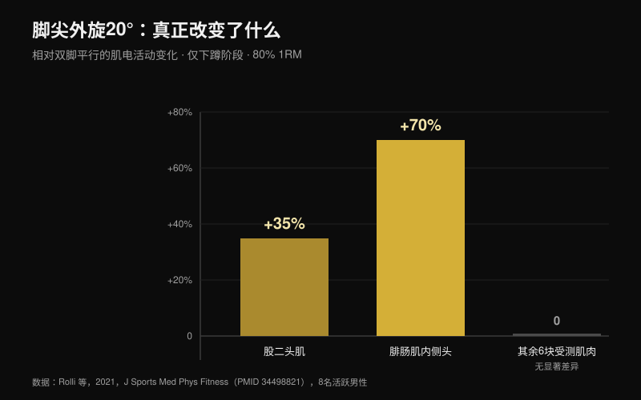
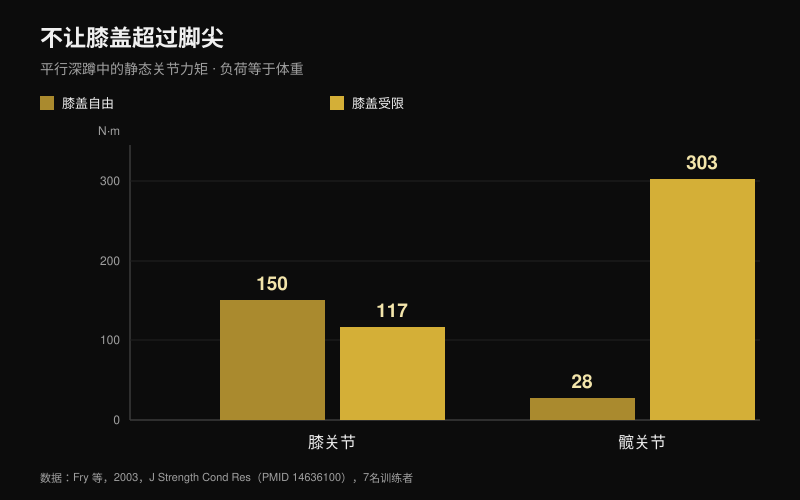

# 深蹲「膝盖外展」：是规则还是口令？

作者：[Giammaria Loi](/autore/giammaria-loi) · 更新于 2026年10月25日

「膝盖往外顶」大概是杠铃下方被喊得最多的一句话。它在一部分人身上效果太好，于是变成了对所有人的规则，不照做的人会被说姿势不对。我读了八篇被收录的研究，它们测量了深蹲中的关节角度、肌肉激活和关节力矩。这个口令有用，但围绕它堆起来的说法几乎都站不住脚。

## 要点速读

- **脚尖外旋改变的东西非常少。** 相对双脚平行，在80% 1RM下外旋20°时只有两块肌肉变化：股二头肌 **+35%**、腓肠肌内侧头 **+70%**，而且只出现在下蹲阶段，其余完全不变（Rolli 等，2021）。
- **外旋更多不等于臀部参与更多。** 一篇涵盖18项肌电研究的综述指出，常见变式——站距宽窄、髋关节旋转、前蹲——都不会显著改变肌肉激活（Clark 等，2012）。
- **膝盖内扣不是靠一句口令能纠正的。** 出现内扣的人，臀肌与内收肌的共激活比更低（臀大肌 **p = 0.007**），踝背屈也更少：口令碰不到这两个原因中的任何一个（Mauntel 等，2013）。
- **那条著名的十字韧带风险来自另一个动作。** 被引用最多的前瞻性研究测的是205名女运动员的落地动作，不是杠铃深蹲（Hewett 等，2005）。
- **「膝盖绝不能超过脚尖」是相反方向的错误。** 挡住膝盖后，膝关节力矩从150降到117 N·m，髋关节力矩却从28升到 **303 N·m**，超过十倍（Fry 等，2003）。

## 这个口令从哪来，为什么依然有效

下蹲时髋关节不只是屈曲：它同时包含屈曲、外展和旋转。在这个组合里，膝盖可能在下降中往外走，也可能在离开最低点时略微内移。两个方向本身都没有对错，它们取决于你髋关节的形状和你发力的方式。

「膝盖外展」最初是给丢失位置的人用的纠正：膝盖向内塌陷、足弓塌下去、推力散掉。在这种情况下它确实有用，这也是它传遍全世界的原因。问题出在下一步——把它变成一条连没有这个问题的人也要遵守的规则。

## 脚尖外旋改变两块肌肉，而不是整个深蹲

关于这一点最直接的研究做法很简单：八名身体活跃的男性以80% 1RM完成背蹲，脚尖分别为平行、外旋+10°和+20°，同时记录优势腿八块肌肉（Rolli 等，2021）。

外旋20°相对平行站位，只有两件事发生变化：股二头肌多工作 **35%**（p = 0.027），腓肠肌内侧头多工作 **70%**（p = 0.040）。两个差异都只出现在下蹲阶段。其余被测肌肉和其余条件下都没有显著差异。

这个结果比口令承诺的要小得多，并且与该主题的参考综述一致：在18项测量自由杠铃深蹲肌电的研究中，常见的技术变式并不会显著影响肌肉激活（Clark 等，2012）。真正改变激活的是杠铃上的重量。

确实有一个例外，但它关系到关节之间的分工，而不是肌肉之间：低杠加宽站距时，髋关节对总力矩的贡献更高；高杠加窄站距时，膝关节贡献更高，股外侧肌更多而臀大肌更少（Larsen 等，2021）。想把负荷转到髋部，靠的是杠位和站距，而不是把膝盖再往外转几度。

## 如果膝盖内扣，口令没碰到原因

这是对训练者最有用的一段。一项研究比较了40名身体活跃的成年人：20人在单腿蹲中明显出现膝盖内扣，20人没有（Mauntel 等，2013）。

内扣组有两个可测量的特征。第一，臀肌与髋内收肌之间的共激活比更低——臀中肌比内收肌 p = 0.028，臀大肌比内收肌 p = 0.007。第二，被动踝背屈更少，无论膝关节伸直（p = 0.047）还是屈曲（p = 0.034）。

翻译过来就是：膝盖内扣，是因为踝关节不让胫骨前移，也因为髋周围的力量比例失衡。杠铃下的一声喊叫既不能改变踝关节活动度，也不能让臀肌变强。它也许能在一组之内掩盖问题，但不能解决问题。

## 内扣到底有多危险

「膝盖外展，不然十字韧带要断」出自真实研究，但针对的是另一个动作。被引用最多的前瞻性研究追踪了205名足球、篮球和排球女运动员，测量落地动作。后来发生前交叉韧带断裂的九人，落地时膝外展角度 **大8°**，膝外展力矩高 **2.5倍**，地面反作用力高20%，支撑时间短16%（Hewett 等，2005）。

数据是可靠的，模型预测损伤的敏感度78%、特异度73%。但它描述的是落地：零点几秒内的冲击、单腿、没有主动控制。而90%强度下、离开最低点时内移几度的深蹲，是缓慢、双侧而且有意识的动作。到目前为止，没有任何前瞻性研究把这种内移与力量训练者的损伤风险联系起来。把两者当成同一件事，是这个话题上最常见的逻辑跳跃。

## 孪生错误：「膝盖不能超过脚尖」

这是相反的规则，出自同一个念头：膝盖天生需要被保护。七名训练者以等于自身体重的负荷做平行深蹲，分两种条件：膝盖可自由超过脚尖，或被一块木挡板拦住（Fry 等，2003）。

膝盖自由时，膝关节力矩150.1 N·m，髋关节力矩28.2 N·m。挡住之后，膝关节降到117.3 N·m——少约22%——髋关节却升到 **302.7 N·m**，是起始值的十倍以上。负荷并没有消失，它搬到了髋部和下背部。作者的结论是：合理的受力分布很可能需要膝盖略微超过脚尖。

## 你的髋关节比口令更有决定权

最后一块拼图属于解剖。股骨头和股骨颈的形状因人而异，骨头撞上髋臼边缘的角度也随之不同。在一个有限元模型中，深蹲时髋臼的平均应力从参照髋的9.64 MPa，升到中度cam形态的11.36 MPa，再到大cam形态的28.43 MPa；有股骨髋臼撞击的受试者髋屈曲只到106.3°，对照为112.6°，内旋8.9°对14.8°（Bagwell 与 Powers，2017）。

在这里口令终于站得住，但理由和通常说的不同：作者指出，以髋关节中立或外旋的姿势深蹲，可能减少高屈曲角度下的骨性抵触。不是为了多激活某块肌肉，而是为了给关节留出空间。股骨形态不同的两个人，深蹲 *本来就* 应该长得不一样，这也是不存在通用角度的主要原因（Schoenfeld，2010）。

## 研究到底怎么说

| 说法 | 结论 | 数据 |
| --- | --- | --- |
| 「膝盖外展」是口令，不是人人适用的规则 | **证实** | 没有研究指出最佳角度；综述未发现髋旋转变式之间有实质差异（Clark 等，2012） |
| 外旋越多＝臀部参与越多 | **被推翻** | 20°时只有股二头肌（+35%）和腓肠肌内侧头（+70%）变化，且仅在下蹲阶段（Rolli 等，2021） |
| 规定的外旋会增加深位的内收肌工作量 | **未核实** | 流传很广但没有引用来源；2026年10月25日的 PubMed 检索未能找到 |
| 膝盖内扣总是危险 | **需要补充条件** | 前瞻性数据描述的是女运动员的落地，不是杠铃深蹲（Hewett 等，2005） |
| 把膝盖推出去就能纠正膝外翻 | **需要补充条件** | 内扣与踝背屈减少、臀肌:内收肌共激活偏低相关（Mauntel 等，2013） |
| 膝盖不能超过脚尖 | **被推翻** | 挡住它会把力矩搬到髋部：28 → 303 N·m（Fry 等，2003） |
| 个体解剖会改变理想的深蹲 | **证实** | cam形态与撞击改变应力和可用角度（Bagwell 与 Powers，2017） |

## 怎么用

1. **只有当你有它要解决的问题时才用这个口令。** 如果你的膝盖并不内扣，额外的外旋不会带来任何可测量的好处，你只是在改动一个本来就有效的技术。
2. **你的脚尖角度要测出来，不是抄出来。** 分别用0°、+10°、+20°各做一组轻重量，保留那个能让你蹲得更深、脚掌又不离地的角度。
3. **如果膝盖内扣，先测踝关节再说话。** 单膝跪地，脚尖离墙10厘米：如果脚跟不离地时膝盖碰不到墙，问题就在那里。
4. **给髋外展肌和伸髋肌加训练量。** 这是改变共激活比的唯一办法，而共激活比正是内扣与不内扣的分界线。一小时的口令替代不了八周[针对臀部的训练](/zh/blog/tunbu-xunlian-tuigua-haishi-shenzun)。
5. **让膝盖往前走。** 把膝盖拦在脚尖之后并不能保护膝盖，它让髋部和下背部承受十倍以上的负荷。
6. **用可重复性评判技术，而不是用外观。** 如果三组五次的轨迹和深度一致，你的姿势就是可以的，哪怕它和视频里的不一样。

**用 Nurvan。** 第2条是一个测试，而测试只有在数字被留存下来时才成立。在 Nurvan 里，你可以把不同脚尖角度或站距的深蹲保存为同一动作的不同变式：每一组都记录重量、次数和 RIR（还能再做几次），历史曲线会在几周内告诉你，哪一种设置在你身上真正在进步。自动给出的热身组提供了轻重量次数，让你测试新角度而不浪费正式组。[试试 Nurvan](https://nurvan.app)

## 常见问题

**深蹲时脚尖该外旋多少度？**
没有适用于所有人的数值。研究中使用0°、10°和20°的外旋，激活差异很小且只限于下蹲阶段。实际做法是：选择能让你在脚掌完全踩实、每组轨迹一致的前提下，达到所需深度的那个角度。

**深蹲时膝盖内扣会伤膝盖吗？**
在力量训练者身上没有前瞻性研究能证明这一点。十字韧带的风险数据来自女运动员的落地动作。接近最大重量时突然出现大幅内扣，仍然是不该忽视的信号，但它首先是稳定性和技术问题，而不是诊断。如果出现疼痛，请咨询医生或物理治疗师。

**把膝盖推出去能更多练到臀吗？**
在可测量的范围内不能。肌电研究综述未发现髋旋转和站距变式之间有显著差异。想把负荷转向髋部，杠位和站距的作用大得多。

**膝盖可以超过脚尖吗？**
可以，而且多半更好。挡住膝盖大约能让膝关节力矩下降22%，却让髋关节力矩增加十倍以上，还会迫使躯干前倾更多。

## 延伸阅读

- [臀部训练：臀推还是深蹲？](/zh/blog/tunbu-xunlian-tuigua-haishi-shenzun) —— 到底哪一个真正练臀，用数字说话
- [腿屈伸还是腿举：真正长肌肉的是哪个](/zh/blog/tuibu-shenzhan-vs-dengtui-gusizhiji) —— 两个看似可以互换的动作差在哪里
- [卧推握距：宽、中还是窄？](/zh/blog/wotui-woju-kuanzhai) —— 同一类技术规则，在卧推上被逐条拆开

## 参考文献

1. Clark DR, Lambert MI, Hunter AM, 2012. Muscle activation in the loaded free barbell squat: a brief review. *J Strength Cond Res*. PMID [22373894](https://pubmed.ncbi.nlm.nih.gov/22373894/) · [DOI](https://doi.org/10.1519/JSC.0b013e31822d533d)
2. Rolli F, Vitale JA, Pugliese L, Boccia G, La Torre A, Pollitt L, 2021. The impact of foot angle on lower limb muscles activity during the back squat and counter movement jump. *J Sports Med Phys Fitness*. PMID [34498821](https://pubmed.ncbi.nlm.nih.gov/34498821/) · [DOI](https://doi.org/10.23736/S0022-4707.21.12588-5)
3. Larsen S, Kristiansen E, Helms E, van den Tillaar R, 2021. Effects of Stance Width and Barbell Placement on Kinematics, Kinetics, and Myoelectric Activity in Back Squats. *Front Sports Act Living*. PMID [34541522](https://pubmed.ncbi.nlm.nih.gov/34541522/) · [DOI](https://doi.org/10.3389/fspor.2021.719013)
4. Mauntel TC, Begalle RL, Cram TR, Frank BS, Hirth CJ, Blackburn T, Padua DA, 2013. The effects of lower extremity muscle activation and passive range of motion on single leg squat performance. *J Strength Cond Res*. PMID [23096063](https://pubmed.ncbi.nlm.nih.gov/23096063/) · [DOI](https://doi.org/10.1519/JSC.0b013e318276b886)
5. Hewett TE, Myer GD, Ford KR, Heidt RS, Colosimo AJ, McLean SG, van den Bogert AJ, Paterno MV, Succop P, 2005. Biomechanical measures of neuromuscular control and valgus loading of the knee predict anterior cruciate ligament injury risk in female athletes: a prospective study. *Am J Sports Med*. PMID [15722287](https://pubmed.ncbi.nlm.nih.gov/15722287/) · [DOI](https://doi.org/10.1177/0363546504269591)
6. Fry AC, Smith JC, Schilling BK, 2003. Effect of knee position on hip and knee torques during the barbell squat. *J Strength Cond Res*. PMID [14636100](https://pubmed.ncbi.nlm.nih.gov/14636100/) · [DOI](https://doi.org/10.1519/1533-4287(2003)017%3C0629:EOKPOH%3E2.0.CO;2)
7. Bagwell JJ, Powers CM, 2017. The Influence of Squat Kinematics and Cam Morphology on Acetabular Stress. *Arthroscopy*. PMID [28969815](https://pubmed.ncbi.nlm.nih.gov/28969815/) · [DOI](https://doi.org/10.1016/j.arthro.2017.03.018)
8. Schoenfeld BJ, 2010. Squatting kinematics and kinetics and their application to exercise performance. *J Strength Cond Res*. PMID [20182386](https://pubmed.ncbi.nlm.nih.gov/20182386/) · [DOI](https://doi.org/10.1519/JSC.0b013e3181bac2d7)

灵感来源：Alfred Jong（[@alfred.reformance](https://www.instagram.com/p/Ddbl4IKmyqw/)）关于「knees out」口令的贴文。本文的文字、结构与核查均为原创。

---

**Giammaria Loi** 是 Nurvan 的创始人。他从2012年开始力量训练，自2013年起担任 FIPE 认证私人教练与教练，自2018年起在国家级别参加力量举比赛。

> 注：本文为信息性内容，不能替代医生或专业人士的意见。如有膝关节、髋关节或背部疼痛，请在调整训练前咨询医生或物理治疗师。
