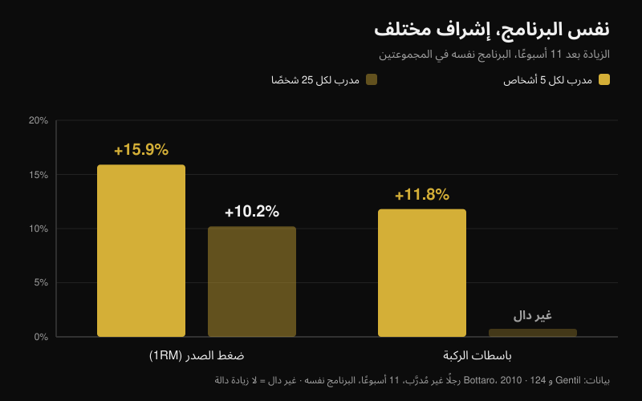
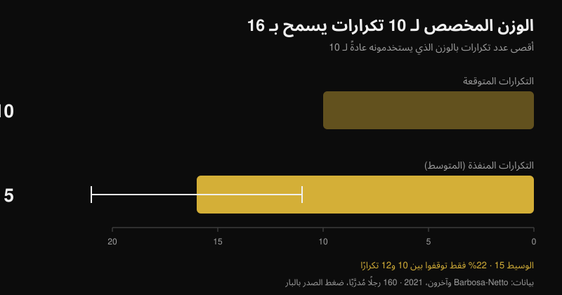

# هل ينجح التدريب عن بُعد؟ ما تقوله الدراسات

بقلم [Giammaria Loi](/autore/giammaria-loi) · حُدِّث في 26 أكتوبر 2026

«أنت تدفع لشخص لا يراك تتمرّن أبدًا.» هذا أول اعتراض على التدريب عن بُعد، وله أساس حقيقي: هناك دراسات تتبع فيها مجموعتان البرنامج نفسه تمامًا، وتنتهي المجموعة التي يقف المدرب بجانبها أقوى. قرأت سبع أوراق مفهرسة عن الإشراف وشدة التمرين والتدريب الموجَّه عن بُعد. الفارق موجود فعلًا، لكنه لا ينشأ من حيث يظن معظم الناس — وفهم ذلك يغيّر تمامًا ما ينبغي أن تطلبه من مدرب أونلاين.

## باختصار

- **البرنامج نفسه، نتائج مختلفة.** اثنا عشر أسبوعًا ببرنامج مُدوَّر متطابق: المجموعة التي تدرّبت ومعها مدرب شخصي رفعت الأوزان أسرع وأنهت بأرقام قصوى أعلى في القرفصاء وضغط الصدر من المجموعة بلا إشراف (Mazzetti et al., 2000).
- **درجة قرب الإشراف مهمة.** بمدرب لكل 5 أشخاص ارتفع ضغط الصدر بنسبة **15.9%** مقابل **10.2%** بمدرب لكل 25؛ ولم تتحسن قوة باسطات الركبة (**+11.8%**) إلا في مجموعة الإشراف القريب (Gentil و Bottaro, 2010).
- **السبب ليس التحفيز بل الشدة.** في الدراسة نفسها كان الحضور وحجم العمل متطابقين بين المجموعتين. ما اختلف هو نسبة من وصلوا فعلًا إلى الشدة القصوى.
- **وحدك تدفع أقل مما تظن.** 160 رجلًا مُدرَّبًا وضعوا على البار الوزن الذي يستخدمونه عادةً «لعشرة تكرارات»: أدّوا **16 ± 5** تكرارًا (الوسيط 15)، ولم يتوقف بين 10 و12 سوى 22% (Barbosa-Netto et al., 2021).
- **عن بُعد يصمد، لكن ليس في كل شيء.** ستة عشر أسبوعًا من البرنامج نفسه عبر الفيديو لم تكن أدنى من الحضور المباشر في الوزن وكتلة الدهون والقدرة الهوائية وقوة باسطات الركبة؛ أما في قبضة اليد وبسط الجذع وثني الركبة فلم تصمد المقارنة (Langeard et al., 2022).

## المدرب لا يمنحك برنامجًا أفضل، بل يجعلك تنفّذ برنامجك فعلًا

الدراسة التي أسست هذا المسار نُشرت عام 2000 وتصميمها شبه خام. عشرون رجلًا متوسطي التدريب قُسِّموا إلى مجموعتين: واحدة تتدرّب تحت إشراف مباشر من مدرب شخصي، والأخرى وحدها. البرنامج كان متطابقًا: اثنا عشر أسبوعًا من التدوير الخطي بمرحلة تحضيرية (10-12 تكرارًا أقصى)، وتضخيم (8-10)، وقوة (5-8)، وذروة (3-6)، بأوزان حرة وأجهزة (Mazzetti et al., 2000).

النتيجة المثيرة ليست «المجموعة المُشرَف عليها كانت أفضل»، بل *أين* كانت أفضل. صار متوسط الحمل لكل مجموعة أعلى بدلالة إحصائية لدى المُشرَف عليهم ابتداءً من الأسبوع السابع في القرفصاء، ومن الأسبوع الثالث في ضغط الصدر. كما كانت سرعة ارتفاع الحمل أسبوعًا بعد أسبوع أكبر. وعند الأسبوع الثاني عشر كانت الأرقام القصوى في القرفصاء وضغط الصدر أعلى بدلالة إحصائية مع الإشراف. تحسّنت المجموعتان، لكن واحدة نفّذت فعلًا البرنامج الذي نفّذته الأخرى إلى النصف.

بعبارة أخرى: قيمة المدرب في تلك الدراسة لم تكن في التخطيط — فقد كان واحدًا للجميع — بل في وجود من ينظر إلى البار ويقول: «أضف خمسة كيلوغرامات».

## ما يتغير هو الشدة، لا الحضور الجسدي

الدراسة التالية تشرح الآلية، وهي الأهم بين السبع لمن يقيّم خدمة تدريب أونلاين. مئة وأربعة وعشرون شابًا غير مُدرَّب اتبعوا البرنامج نفسه لإحدى عشرة أسبوعًا، مقسّمين إلى مجموعتين تختلفان في شيء واحد: نسبة المدربين إلى المتدربين في الصالة، واحد لكل 5 أو واحد لكل 25 (Gentil و Bottaro, 2010).

مع النسبة العالية ارتفع الرقم الأقصى في ضغط الصدر **15.9%** مقابل **10.2%** مع النسبة المنخفضة، ولم تتحسن قوة باسطات الركبة بدلالة إحصائية (**+11.8%**) إلا في مجموعة الإشراف القريب. وكانت الفروق بين المجموعتين دالة إحصائيًا في المقياسين.

ثم يأتي الرقم الذي يهدم التفسير الشائع. **لا** فرق بين المجموعتين في الحضور ولا في حجم العمل في ضغط الصدر ودفع الأرجل. الشيء الوحيد المختلف كان نسبة من تدرّبوا بشدة قصوى، وهي أعلى في مجموعة الإشراف القريب. لم ينجح المدرب لأنه حافظ على انتظام الناس — فقد كانوا منتظمين أصلًا — بل لأنه أوصلهم إلى حدودهم في كل مجموعة.

ورقة ثالثة تدفع المنطق نفسه خطوة أبعد: نساء مسنّات تدرّبن ستة عشر أسبوعًا بنسبة 1:2 أظهرن أحجام تأثير أكبر في الأرقام القصوى مقارنةً بنسبة 1:5، ولم تنخفض كتلة الدهون إلا في المجموعة الأقرب إشرافًا (Vieira et al., 2020). العينة صغيرة ولم تُعلَن فروق بين المجموعتين، فهي مؤشر لا دليل، لكنها تشير إلى الاتجاه نفسه.

## النقطة العمياء: كم تدفع فعلًا

إذا كانت الآلية هي الشدة، فالسؤال التالي: كم يخطئ من يتدرّب وحده؟ هناك دراسة قاست ذلك بأقسى طريقة ممكنة.

سُئل 160 رجلًا مُدرَّبًا سؤالًا واحدًا: «ما الوزن الذي تستخدمه عادةً لعشرة تكرارات في ضغط الصدر بالبار؟» وبعد إحماء قصير طُلب منهم أداء أكبر عدد ممكن من التكرارات به. كان المتوسط **16 ± 5 تكرارًا**، والوسيط 15: فارق هائل ومتين إحصائيًا عن العشرة المُعلَنة (p < 0.001). المدى الأكثر شيوعًا كان 13-15 تكرارًا (31% من العينة)، ولم يتوقف بين 10 و12 سوى 22% (Barbosa-Netto et al., 2021).

يكتب الباحثون ذلك بلا مواربة: تلك البرامج التدريبية لم تكن متوافقة مع جهد أقصى. ولا يتعلق الأمر بمبتدئين، بل برجال مُدرَّبين مقتنعين بأنهم يستخدمون وزن العشرة الخاص بهم. ولهذا أيضًا يكون عدد التكرارات أقل أهمية من القرب من الفشل العضلي، وهي نقطة فصّلتها في [كم تكرارًا يلزم فعلًا لبناء العضلات](/ar/blog/kam-takrar-lilkutla-aladalia).

المدرب في الصالة يصحّح هذا الخطأ لحظيًا. والسؤال الحقيقي عن التدريب عن بُعد هو: هل توجد طريقة أخرى لتصحيحه؟

## إذن هل ينجح التوجيه عن بُعد؟ يعتمد على ما يجب أن يضبطه

أنظف مقارنة مباشرة تأتي من دراسة عدم دونية على كبار سن أصحاء. ثلاث مجموعات: بلا تدريب، وتدريب منزلي بتوجيه حضوري، وتدريب منزلي بتوجيه عبر الفيديو. البرنامج متطابق للمجموعتين النشطتين، مركّب، ستة عشر أسبوعًا، ساعة مرتين أسبوعيًا (Langeard et al., 2022).

جاء التوجيه بالفيديو **غير أدنى** من الحضور المباشر في وزن الجسم وكتلة الدهون والقدرة الهوائية القصوى ومعدل النبض الأقصى والاستهلاك الأقصى للأكسجين وقوة بسط الركبة وقدرة الأطراف السفلية. و**لم** يثبت عدم دونيته في الكتلة العضلية وقوة القبضة وبسط الجذع وثني الركبة. والباحثون صريحون: في مقاييس القوة الثابتة هذه يبقى الحضور المباشر متفوقًا.

وتُظهر تجربة عشوائية ثانية أن العمل عن بُعد ممكن حتى مع من يعاني ألمًا: 130 عاملًا في رعاية المسنين أضافوا لاثني عشر أسبوعًا تمارين قوة بتوجيه مباشر عبر الفيديو، فخفّضت المجموعة التجريبية متوسط شدة ألم أسفل الظهر مقارنةً بالضابطة (p = 0.034)، مع تحسّن في ألم المعصم واليد وفي أداء عضلات الطرف العلوي. وفي تحليل الالتزام بالبروتوكول حقّق من أنجزوا 50% من الجلسات على الأقل فوائد إضافية في المزاج وجودة الحياة واستهلاك الأدوية (Espin et al., 2024).

توضيح أمين، لأنه يغيّر طريقة قراءة هذه الأرقام: المشاركون في الدراستين كانوا كبار سن أصحاء وعاملين، لا رياضيي قوة. هم يثبتون أن التوجيه عن بُعد يُحدث تكيّفات حقيقية، لكنهم لا يخبروننا كم يقترب رافع أثقال متقدم من مدربه الحضوري. هذه المقارنة غير موجودة في الأدبيات حتى اليوم.

## ما الذي يجب أن يقيسه المدرب عن بُعد ليساوي مدرب الصالة

من هنا تُكتب الخلاصة العملية وحدها تقريبًا. للمدرب الحضوري ميزة واحدة مُثبتة: يرى كم بقي لك حتى الفشل ويجعلك تزيد الوزن. والمدرب أونلاين في المستوى نفسه إن امتلك طريقة موثوقة لمعرفة الشيء ذاته.

الأداة موجودة ومدروسة. مراجعة شملت 31 دراسة عن مقاييس RIR — أي التكرارات التي كانت ستبقى لديك في نهاية المجموعة — تخلص إلى أنها قابلة للاستخدام ومفيدة لتحديد الشدة ولتعديل الحمل، مع تحفظ واحد: التقدير أدق حين يُجرى قرب الفشل، لا على بُعد عشرة تكرارات من النهاية (Bastos et al., 2024).

بالترجمة: المدرب الذي يصله «تمّ، كل شيء جيد» أعمى تمامًا مثل مدرب 1:25 في دراسة Gentil. أما المدرب الذي يصله الوزن والتكرارات و RIR لكل مجموعة، إضافة إلى فيديو المجموعة الأخيرة في التمارين الأساسية، فلديه المعطيان اللازمان ليفعل الشيء الوحيد المهم: أن يقول لك متى تزيد.

## ما تقوله الأبحاث فعلًا

| الادعاء | الحكم | المعطى |
| --- | --- | --- |
| المدرب الذي يراقبك يجعلك تتقدم أكثر | **مؤكَّد** | البرنامج نفسه 12 أسبوعًا: أحمال أعلى لكل مجموعة وأرقام قصوى أكبر مع الإشراف المباشر (Mazzetti et al., 2000) |
| فائدته أساسًا تحفيزك ودفعك للحضور | **مُفنَّد** | بين 1:5 و1:25 تساوى الحضور وحجم العمل؛ ما اختلف هو نسبة من تدرّبوا بشدة قصوى (Gentil و Bottaro, 2010) |
| «أنا أعرف وحدي متى أدفع» | **مُفنَّد** | الوزن المستخدم «لعشرة» سمح بـ 16 ± 5؛ ولم يتوقف بين 10 و12 سوى 22% (Barbosa-Netto et al., 2021) |
| التدريب أونلاين يعطي نتائج الحضور نفسها | **يحتاج تدقيقًا** | غير أدنى في الوزن وكتلة الدهون والاستهلاك الأقصى للأكسجين وقوة بسط الركبة وقدرة الساقين؛ لا في القبضة والجذع وثني الركبة (Langeard et al., 2022) |
| لا يمكن متابعة من يعاني ألمًا عن بُعد | **مُفنَّد** | 12 أسبوعًا من تمارين بتوجيه بالفيديو خفّضت ألم أسفل الظهر لدى 130 عاملًا في الرعاية (Espin et al., 2024) |
| بلا رؤية المجموعة يستحيل ضبط الشدة | **يحتاج تدقيقًا** | مقاييس RIR تصلح لتحديد الحمل وتعديله، لكن التقدير دقيق قرب الفشل فقط (Bastos et al., 2024) |
| كلما ضاقت نسبة المدرب إلى المتدرب كان أفضل | **غير مُتحقَّق** | مقارنة 1:2 مقابل 1:5 لدى نساء مسنّات تُظهر تأثيرًا أكبر لكن على عينة صغيرة (Vieira et al., 2020) |

## كيف تطبّق ذلك

1. **قيّم المدرب أونلاين بما يقيسه لا بعدد رسائله.** السؤال قبل الدفع واحد: كيف ستعرف كم أبعد عن الفشل في كل مجموعة؟
2. **سجّل الوزن والتكرارات و RIR في كل مجموعة عمل.** بدون الأرقام الثلاثة معًا لا يستطيع أحد عن بُعد أن يقرر إن كان عليك زيادة الوزن الأسبوع المقبل.
3. **عايِر مقياس RIR لديك مرة واحدة باختبار.** في تمرين آمن (جهاز، أو بار مع مصدّات أمان) خذ الوزن الذي تستخدمه «لعشرة» واذهب إلى الفشل. إن خرجت 15 تكرارًا فعشرتك كانت في الحقيقة RIR 5 وكل مقياسك منزاح.
4. **أرسل فيديو المجموعة الأخيرة لا الإحماء.** هي الوحيدة التي تُظهر الأداء تحت التعب والهامش المتبقي فعلًا.
5. **اطلب قاعدة تدرّج مكتوبة.** مثلًا: إن أنهيت المجموعة بـ RIR 2 أو أكثر، فزد الوزن في التمرين التالي. قاعدة كهذه تعمل حتى في الأسابيع التي يتأخر فيها رد المدرب.
6. **غطِّ النقاط العمياء بالأرقام.** أضعف ما صمد عن بُعد كان قوة القبضة وثبات الجذع: إن كانا يهمانك فبرمِجهما كتمارين بوزن وزمن يُسجَّلان، لا كعمل إضافي «بالإحساس».

**مع Nurvan.** التدريب عن بُعد ينكسر دائمًا في النقطة نفسها: المدرب لا يرى أرقام مجموعاتك. في Nurvan يعمل المدرب والرياضي على البرنامج نفسه، وتسجّل كل مجموعة الوزن والتكرارات و RIR، فيُظهر السجل للمدرب إن كنت تتقدم أم واقفًا منذ ثلاثة أسابيع على الوزن ذاته. وتُقترح مجموعات الإحماء تلقائيًا، كما يمكن استيراد برنامج مكتوب في PDF أو Excel أو حتى في صورة دون إعادة كتابته يدويًا. [جرّب Nurvan](https://nurvan.app)

## أسئلة شائعة

**هل ينجح التدريب أونلاين فعلًا؟**
نعم: في الدراسات المتاحة يُحدث تكيّفات حقيقية في القوة وتركيب الجسم والقدرة الهوائية وتخفيف ألم أسفل الظهر. والمقارنة المباشرة مع الحضور تصمد في كثير من المؤشرات لا في كلها، وكل البيانات تأتي من بالغين أصحاء أو عاملين، لا من رياضيي قوة متقدمين.

**الأفضل مدرب أونلاين أم مدرب في النادي؟**
يعتمد على ما ينقصك. إن كانت المشكلة في أداء الحركات المركّبة أو في الخوف من الدفع، فللحضور الجسدي ميزة لا تعوّضها أي محادثة. وإن كان الأداء سليمًا والمشكلة في تدرّج الأحمال، فالمدرب أونلاين الذي يتلقى الوزن والتكرارات و RIR يعمل على الآلية ذاتها التي صنعت الفارق في الدراسات.

**كيف يعرف المدرب عن بُعد أنني تدرّبت بما يكفي؟**
من البيانات التي ترسلها. مقاييس RIR هي الأداة المدروسة لذلك، بحدّ معروف: التقدير موثوق قرب الفشل وأقل بكثير على بُعد ست أو سبع تكرارات من النهاية. لذلك يساوي فيديو واحد للمجموعة الأخيرة عشر رسائل.

**هل يصلح التدريب أونلاين للمبتدئ؟**
أكبر آثار الإشراف ظهرت تحديدًا لدى غير المدرَّبين، فالمبتدئ الذي يُتابَع بسوء عن بُعد يخسر كثيرًا. إن كنت تبدأ من الصفر فاطلب مكالمات فيديو مباشرة في الأسابيع الأولى وعددًا محدودًا من التمارين يسهل ضبطها بالفيديو.

## اقرأ أيضًا

- [كم تكرار لبناء العضلات؟ خرافة الـ 8-12](/ar/blog/kam-takrar-lilkutla-aladalia) — لماذا القرب من الفشل أهم من عدد التكرارات
- [تقسيم التمرين: مبتدئ أم متقدم؟](/ar/blog/taqsim-altadrib-mubtadi-mutaqaddim) — كم من البنية تحتاج فعلًا حسب مستواك

## المصادر

1. Mazzetti SA, Kraemer WJ, Volek JS, Duncan ND, Ratamess NA, Gómez AL, Newton RU, Häkkinen K, Fleck SJ, 2000. The influence of direct supervision of resistance training on strength performance. *Med Sci Sports Exerc*. PMID [10862549](https://pubmed.ncbi.nlm.nih.gov/10862549/) · [DOI](https://doi.org/10.1097/00005768-200006000-00023)
2. Gentil P, Bottaro M, 2010. Influence of supervision ratio on muscle adaptations to resistance training in nontrained subjects. *J Strength Cond Res*. PMID [19661830](https://pubmed.ncbi.nlm.nih.gov/19661830/) · [DOI](https://doi.org/10.1519/JSC.0b013e3181ad3373)
3. Barbosa-Netto S, d'Acelino-e-Porto OS, Almeida MB, 2021. Self-Selected Resistance Exercise Load: Implications for Research and Prescription. *J Strength Cond Res*. PMID [29112055](https://pubmed.ncbi.nlm.nih.gov/29112055/) · [DOI](https://doi.org/10.1519/JSC.0000000000002287)
4. Langeard A, Bigot L, Maffiuletti NA, Moussay S, Sesboüé B, Quarck G, Gauthier A, 2022. Non-inferiority of a home-based videoconference physical training program in comparison with the same program administered face-to-face in healthy older adults: the MOTION randomised controlled trial. *Age Ageing*. PMID [35290431](https://pubmed.ncbi.nlm.nih.gov/35290431/) · [DOI](https://doi.org/10.1093/ageing/afac059)
5. Espin A, Irazusta J, Aiestaran M, Latorre Erezuma U, García-García J, Arrinda I, Acedo K, Rodriguez-Larrad A, 2024. Videoconference-Supervised Group Exercise Reduces Low Back Pain in Eldercare Workers: Results from the ReViEEW Randomised Controlled Trial. *J Occup Rehabil*. PMID [38632115](https://pubmed.ncbi.nlm.nih.gov/38632115/) · [DOI](https://doi.org/10.1007/s10926-024-10182-2)
6. Bastos V, Machado S, Teixeira DS, 2024. Feasibility and Usefulness of Repetitions-In-Reserve Scales for Selecting Exercise Intensity: A Scoping Review. *Percept Mot Skills*. PMID [38563729](https://pubmed.ncbi.nlm.nih.gov/38563729/) · [DOI](https://doi.org/10.1177/00315125241241785)
7. Vieira DCL, Nascimento DC, Tajra V, Teixeira TG, Farias DL, Tibana RA, Silva AO, Rosa TS, De Moraes MR, Voltarelli FA, Navalta JW, Prestes J, 2020. High Supervised Resistance Training in Elderly Women: The Role of Supervision Ratio. *Int J Exerc Sci*. PMID [32509119](https://pubmed.ncbi.nlm.nih.gov/32509119/) · [DOI](https://doi.org/10.70252/WNVF6463)

إشارة الاتجاه: ACSM، *Worldwide Fitness Trends 2026* (نُشرت في 22 أكتوبر 2025)، مع تطبيقات التمرين في المركز الرابع والتقنيات القائمة على البيانات في الثامن. نص هذا المقال وبنيته وتحققاته أصلية.

---

**Giammaria Loi** مؤسس Nurvan. يتدرّب بالأثقال منذ 2012، ويعمل مدربًا شخصيًا ومعتمدًا من FIPE منذ 2013، وينافس في رفع القوة على المستوى الوطني منذ 2018.

> ملاحظة: محتوى معلوماتي لا يغني عن رأي الطبيب أو المختص. إن كان لديك ألم أو حالة صحية قائمة، فاستشر طبيبًا قبل بدء برنامج تدريبي أو تغييره، حضوريًا كان أم عن بُعد.
